# 5. 前沿技术

本章将重点介绍一些前沿技术背后的理论，并帮助您准备好使用深度学习（将在第 6 章和第 7 章中介绍）处理单变量和多变量时间序列数据的问题。在本章中，我们将首先通过回顾感知机、激活函数、反向传播、梯度下降的类型、循环神经网络、长短期记忆网络、门控循环单元、卷积神经网络和自编码器来介绍神经网络。

## 神经网络简介

1958 年，康奈尔大学的弗兰克·罗森布拉特在美国海军的支持下开发了一个称为*感知机*的系统。这可能是最早的神经网络原型。他的系统能够从 20x20 像素的图片中识别简单的几何形状。事实上，罗森布拉特并非试图构建一个图像识别系统，而是想通过计算机模拟大脑来研究大脑的工作方式。因此，他的成果吸引了许多科学家的兴趣。正如《纽约时报》在 1958 年 7 月报道的那样：“今天，海军展示了一个电子系统的原型，预计该系统将能够行走、说话、观看、自我复制，并具备自我意识。”

人脑拥有数十亿个神经元。*神经元*是人脑中相互连接的细胞，负责处理和转化人类的思想，其中包含电信号和化学信号。*树突*是从其他神经元接收信息的分支。

在图 5-1 中，左侧展示了生物大脑结构，其中包含不同的神经元（顶点），它们通过轴突（边）与不同的树突（分支）相连。图的右侧展示了人工构建的神经网络结构，包括输入 X[1]、X[2]、… X[n]，其中包含一个激活函数并生成最终输出。

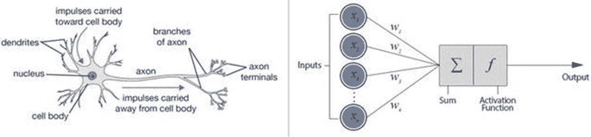

图 5-1

生物神经元与人工神经网络对比（来源：Mwandau, Brian & Nyanchama, Matunda, 2018；《探究击键动力学作为双因素生物识别安全》）

## 感知机

*感知机*是一种单层神经网络架构，包含一个神经元。它是一种数学架构，其中每个神经元接收输入，分别对其进行加权，求和，然后将总和通过一个非线性函数（激活函数）以产生输出。图 5-2 展示了一个感知机。

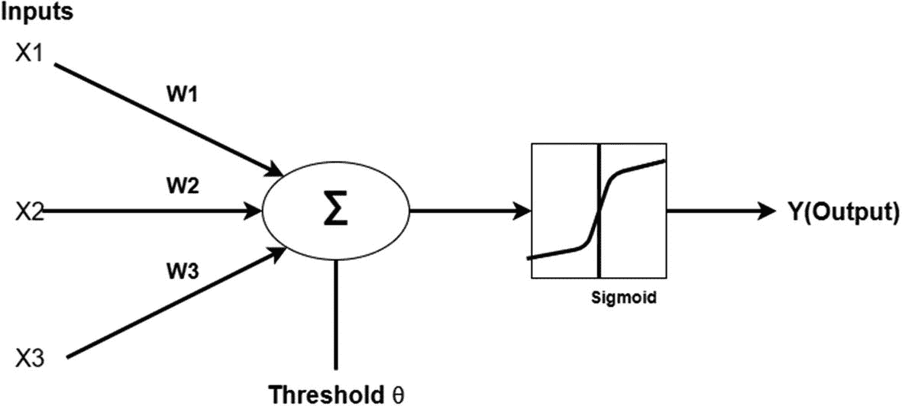

图 5-2

感知机的数学表示

以下是感知机模型：

**输入**：X[1], X[2], X[3]

**权重**：w[1], w[2], w[3]

**偏置**：b

**输出**：Y

步骤如下：

**步骤 1**：将所有输入 X[1], X[2], X[3] 与所有权重 w[1], w[2], w[3] 相乘。

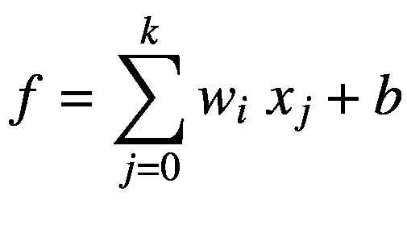

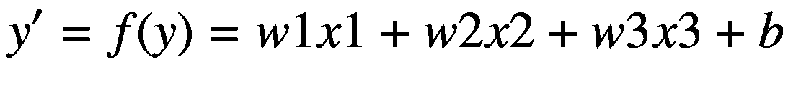

**步骤 2**：应用激活函数 sigmoid。

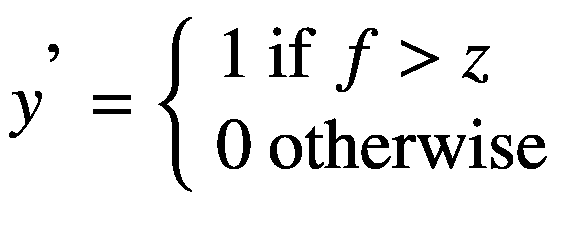

## 激活函数

激活函数也称为*径向基函数*。它是一个数学函数或公式，用于给出模型的输出。其结果范围通常在 0 到 1 之间或 -1 到 1 之间。

以下是使用激活函数的原因：

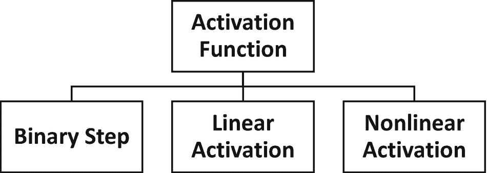

图 5-3

激活函数的类型

*   如果不使用激活函数，每一层的输出都是上一层输入的线性函数。无论神经网络有多少层，输出都是输入的线性组合。

*   如果使用激活函数，它会为神经元引入非线性因素，使得神经网络可以任意逼近任何非线性函数，从而可以应用于许多非线性模型。图 5-3 展示了激活函数的类型。

### 二进制阶跃函数

二进制阶跃函数（图 5-4）是一种基于阈值的激活函数。如果输出值高于或低于某个阈值，神经元将被激活，并向下一层发送完全相同的信号。

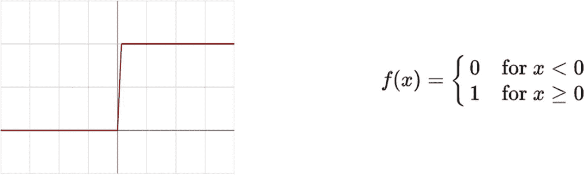

图 5-4

二进制阶跃函数

### 线性激活函数

线性激活函数（图 5-5）是一种简单的数学公式，其中输入值乘以某个分配的权重并产生输出。它比二进制阶跃函数更可取，因为它支持多个输出。

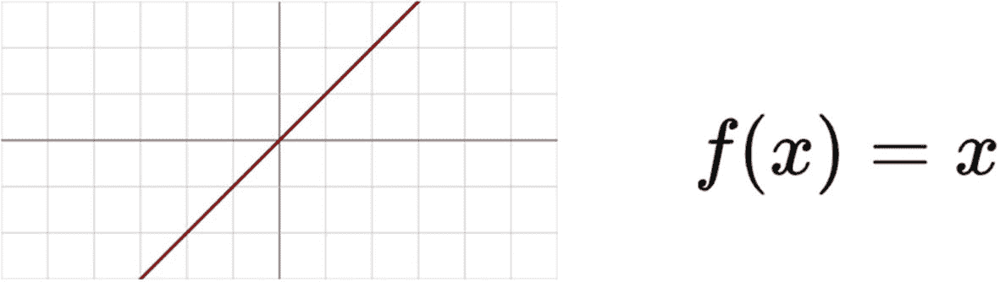

图 5-5

线性激活函数

以下是线性激活函数的缺点：

*   **反向传播难以使用**：线性激活函数的导数是常数。因此，很难对常数值进行反向传播。

*   **神经网络的所有层合并为一层**：当您借助线性激活函数设计神经网络时，最后一层将与第一层的线性激活函数相同。因此，这个线性激活函数将神经网络变成了一层。

因此，带有线性激活函数的神经网络会产生一个标准的线性回归模型，该模型不具备维持数据复杂性的强大能力。

### 非线性激活函数

传统神经网络使用非线性激活函数，因为它们能够处理所需的复杂输入与输出映射。对于训练处理复杂数据类型（如原始数据、图像、音频和视频，这些数据通常是非线性且维度较高的）的模型而言，非线性激活函数是必不可少的。

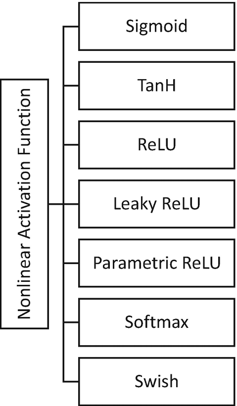

图 5-6

非线性激活函数的类型

*   非线性激活函数支持反向传播，它包含一个与输入值相关的导数函数。
*   非线性激活函数允许多个层堆叠，有助于构建神经网络。该网络包含众多隐藏层，负责处理数据的复杂性并预测准确的结果。图 5-6 展示了非线性激活函数的类型。

#### Sigmoid

Sigmoid 激活函数（图 5-7）的输出值范围被限定在 [0, 1] 之间。换句话说，它可以归一化每一层的输出值。它具有平滑的梯度。当输入值过高或过低时，它无法处理梯度消失问题。其计算成本较高。

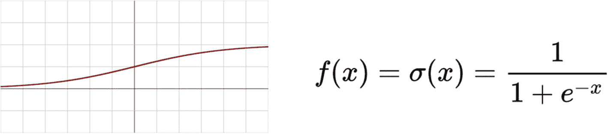

图 5-7

Sigmoid 激活函数

#### TanH

TanH 激活函数（图 5-8）的输出值范围被限定在 [-1, 1] 之间。这是一个零中心模型，能够处理强负值、中性值和强正值。除了值域范围不同，它与 Sigmoid 函数类似。

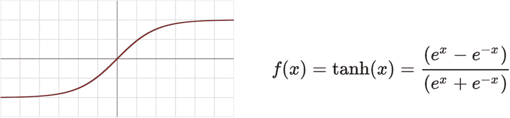

图 5-8

TanH 激活函数

#### 线性整流单元

线性整流单元（ReLU），如图 5-9 所示，是神经网络中一种基础且广泛使用的激活函数。ReLU 的梯度实际上是非饱和的，这极大地加速了与 Sigmoid/TanH 函数相关的随机梯度下降的收敛速度（根据 Krizhevsky 等人的论文）。它能够高效处理计算，其表达式类似于线性激活函数，但支持反向传播。当输入值为零或负数时，它无法执行反向传播并停止学习；这被称为*死亡 ReLU 问题*。

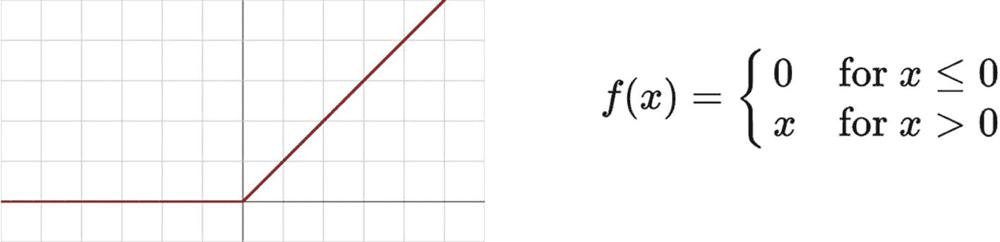

图 5-9

ReLU

#### 带泄露的线性整流单元

带泄露的线性整流单元（Leaky ReLU）（图 5-10）具有两大优点。首先，它解决了死亡 ReLU 问题，因为它没有零斜率部分。它能够加速训练。其函数具有一个小的负斜率（大约 0.01）。但其结果在处理负值时并不一致。

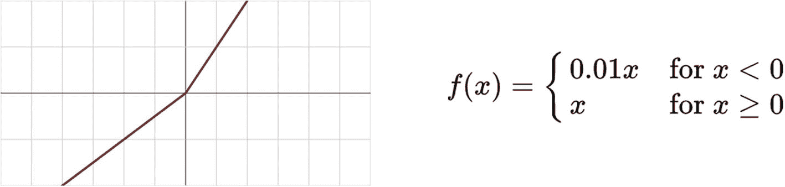

图 5-10

Leaky ReLU

#### 参数化线性整流单元

参数化线性整流单元（Parametric ReLU）（图 5-11）是一种带泄露的 ReLU 激活函数，但它没有像 0.01 这样的预定义斜率；它为神经网络创建参数，以便在输入值为负时自行确定斜率。它允许学习一个负斜率值。可以执行反向传播来确定最合适的 α 值。对于不同类型的问题，其实现方式可能有所不同。

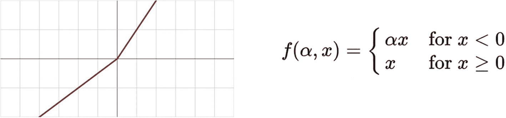

图 5-11

Parametric ReLU

#### Softmax

Softmax 激活函数将对数值（logits）转换为概率，这些概率的总和为 1，其输出向量表示一系列可能结果的概率分布（图 5-12）。它可以处理多类别问题。Softmax 层主要用于输出层。

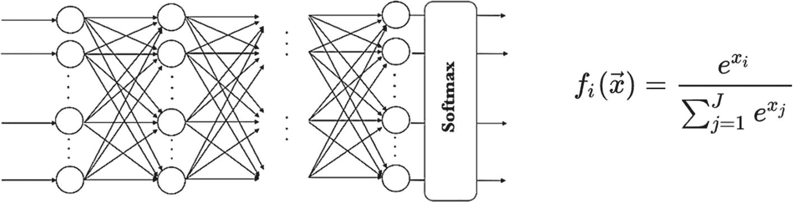

图 5-12

Softmax 激活函数

#### Swish

谷歌大脑团队于 2017 年提出了 Swish 激活函数（图 5-13），其性能优于 ReLU。Swish 是 x 乘以 Sigmoid 激活函数。在处理复杂数据的更深层模型上，Swish 表现更佳。

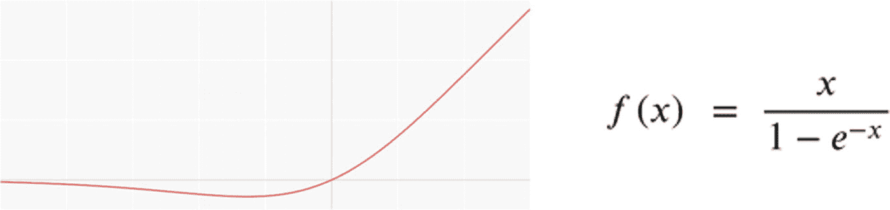

图 5-13

Swish 激活函数

## 前向传播

*前向传播*（图 5-14）是将 X 输入值作为初始信息，然后传播到神经网络每一层的隐藏单元，以产生最终输出（y）的过程。

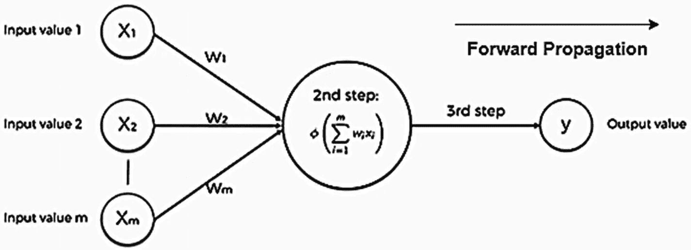

图 5-14

前向传播的表示

**步骤 1**：向神经网络中的每个神经元提供输入 (X)，并计算两个函数；第一个是线性乘法。

**步骤 2**：应用激活函数。

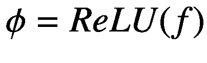

我们可以使用不同的激活函数。然后它将向前传播通过每一层，我们将得到预测输出。但神经网络并非仅通过单次前向传播就能学习信息。因此，我们每次学习时都会计算信息差距，这被称为*代价函数*（误差计算）。我们可以尝试通过在神经网络中应用反向传播来减少该误差。

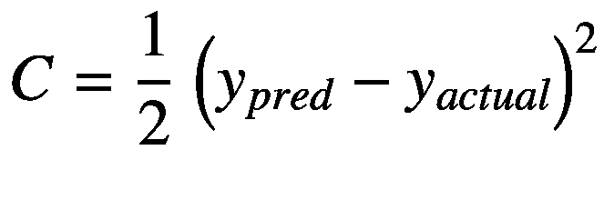

在下一节中，我们将探讨反向传播。

## 反向传播

反向传播，或称*反向传播算法*，是将误差从隐藏层传播回输入层以调整权重的过程（图 5-15）。

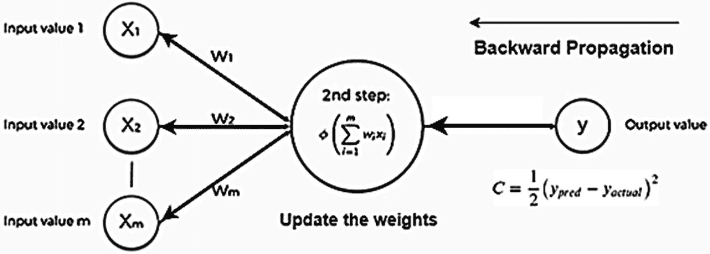

图 5-15

反向传播示意图

你可以通过两种不同的方式来调整权重。

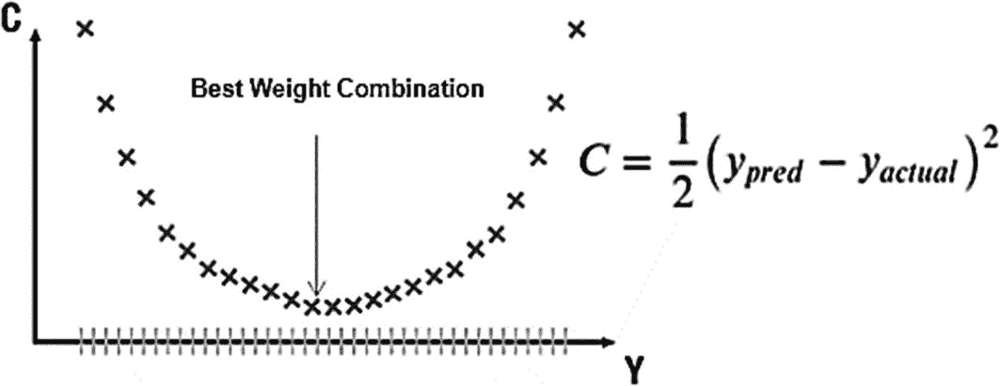

图 5-16

暴力方法

*   **暴力方法**：在这种方法中，神经网络尝试设计所有权重的可能组合，并仅指出那些最适合应用的组合。这种方法最大的问题是当输入增加时会出现维度灾难。它会消耗更多的计算时间，并且结果可能效率低下。它仅用于像感知机这样的单层网络。图 5-16 展示了暴力方法。

*   **梯度下降**：梯度下降是一种用于识别每次值更新时变化率的方法。在这种方法中，我们可以应用迭代优化方法的一阶导数来获得最小代价函数。这是找出最优权重的最佳方法。
    *   如果梯度具有负斜率，则代表全局最小值的左侧。
    *   如果梯度具有正斜率，则代表全局最小值的右侧。
    *   如果梯度为零，则代表一个全局最小值点。

以下是误差分析的数学表示。

这是代价函数：

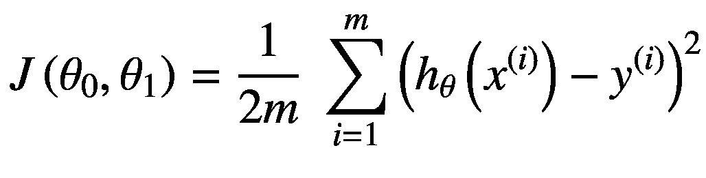

以下是更新规则：

以下是导数：

图 5-17 展示了不同类型的梯度下降方法。

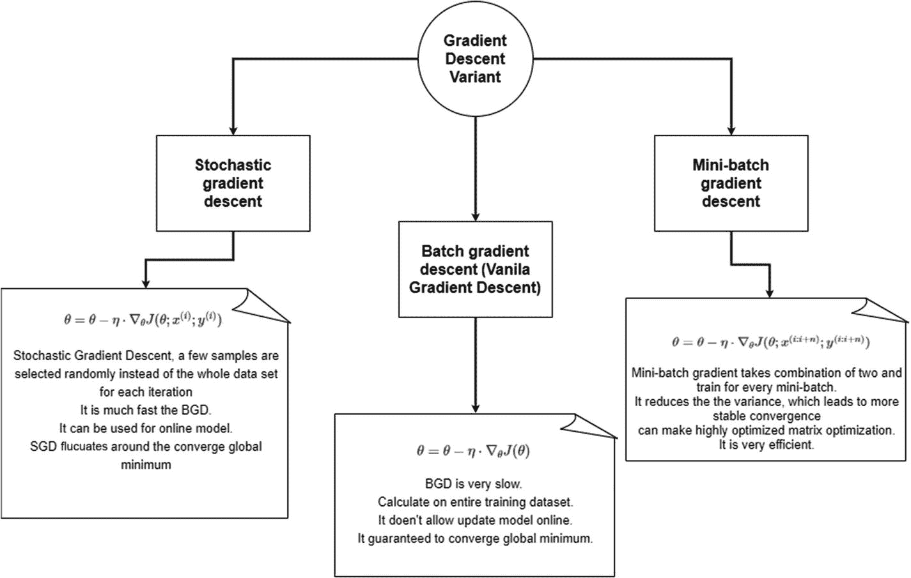

图 5-17

梯度下降的分类

在下一节中，我们将介绍不同类型的梯度下降优化算法。

### 梯度下降优化算法

梯度下降是一种[一阶](https://en.wikipedia.org/wiki/Category:First_order_methods)[优化](https://en.wikipedia.org/wiki/Mathematical_optimization)[算法](https://en.wikipedia.org/wiki/Algorithm)，它被迭代地用于寻找可微函数的[局部最小值](https://en.wikipedia.org/wiki/Local_minimum)。该方法用于最小化凸函数。在其基本形式中，梯度下降为无约束问题找到一个近似解。

梯度下降优化器主要通过三种方式工作。

*   更新学习率（*α*）
*   更新梯度分量*，* ∂L/∂w
*   *同时使用*前两种方式

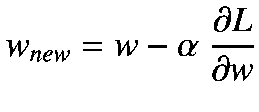

### 学习率与梯度下降优化器

学习率（α*）* 与梯度下降优化器函数（∂L/∂w）相乘。

1.  优化器与一个正因子（学习率 α）相乘，因此梯度会变小*，*这代表了 RMSprop。
2.  优化器通常采用梯度的移动平均值，称为*动量*，而不是像普通梯度下降那样只取一个值。

图 5-18 展示了不同的优化器。

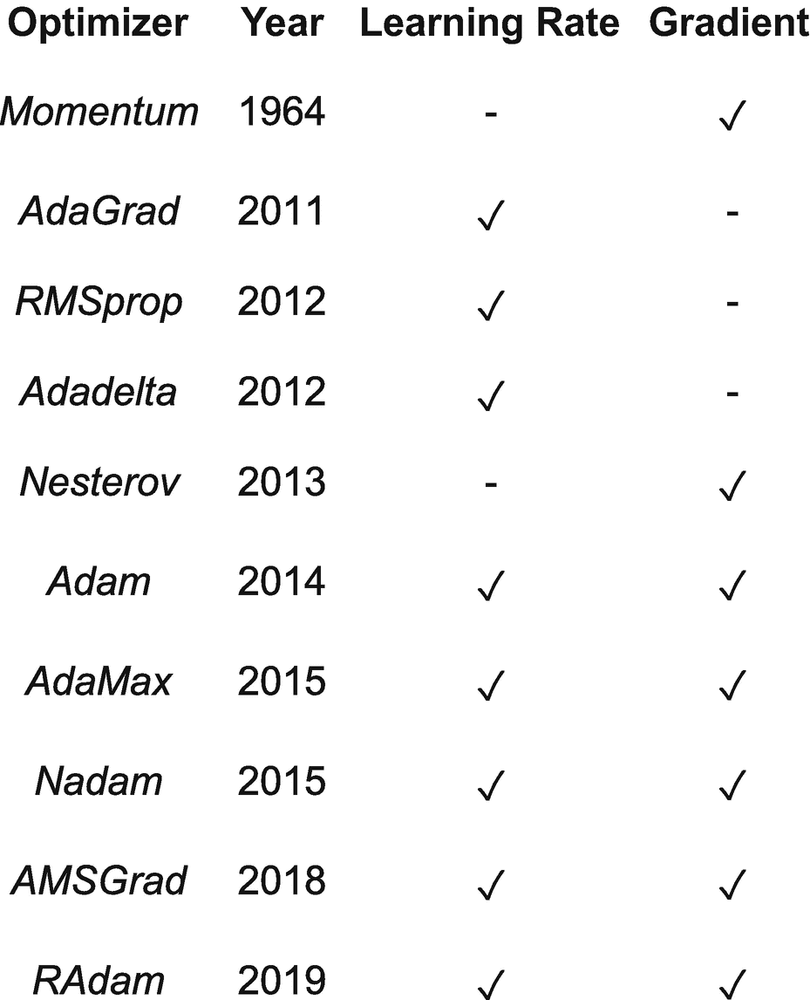

图 5-18

优化方法的演进时间线

图 5-19 和图 5-20 展示了梯度下降的类型。

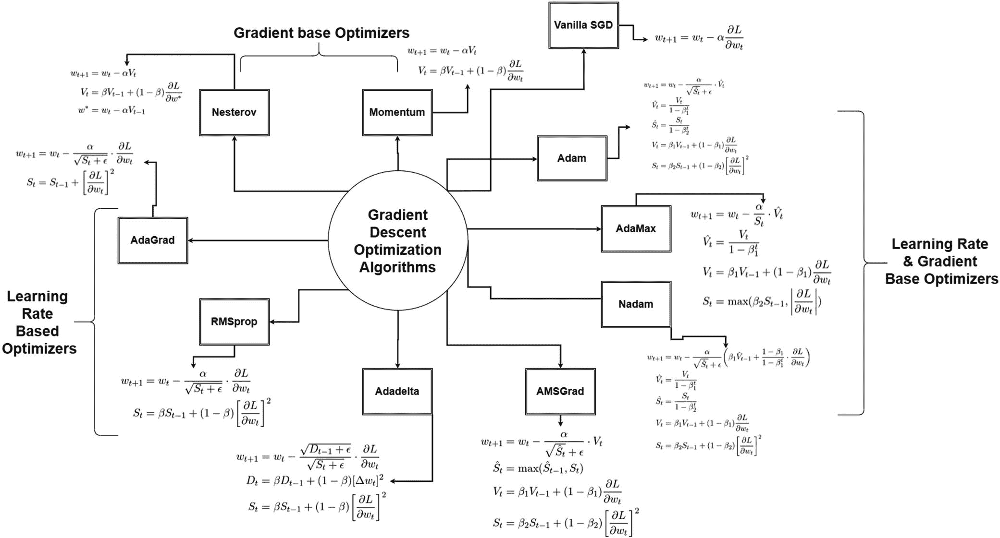

图 5-20

带公式的优化方法简要图表

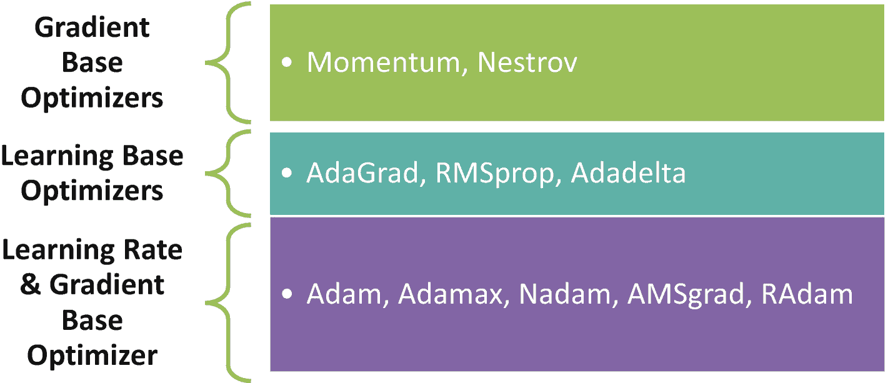

图 5-19

优化方法的类型

在下一节中，我们将介绍用于序列到序列学习的循环神经网络。

## 循环神经网络

*循环神经网络*（RNN）是一种序列类的神经网络，其中前一状态的输出作为当前状态的输入。在神经网络中，所有的输入和输出也是相互独立的，但当需要按顺序预测事物时，RNN 表现良好。

RNN 处理的是具有序列性质的数据。因此，当数据中的顺序很重要时，应该使用 RNN。此类数据的例子包括自然语言数据、语音数据、时间序列数据、视频数据、音乐数据和股票市场数据。这些都是包含序列的现实世界数据的例子。图 5-21 展示了 RNN 与普通 NN 的区别。

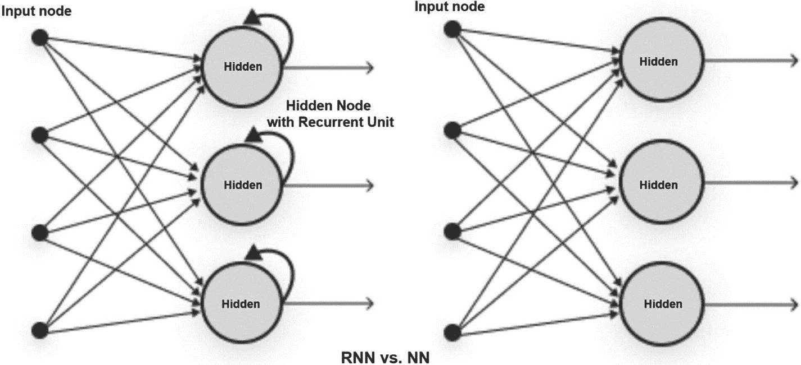

图 5-21

常规 RNN 与 NN 对比

神经网络不包含这种循环单元，而 RNN 包含，这有助于处理数据中发现的序列模式。

RNN 有以下模型，全部在图 5-22 至 5-24 中展示。

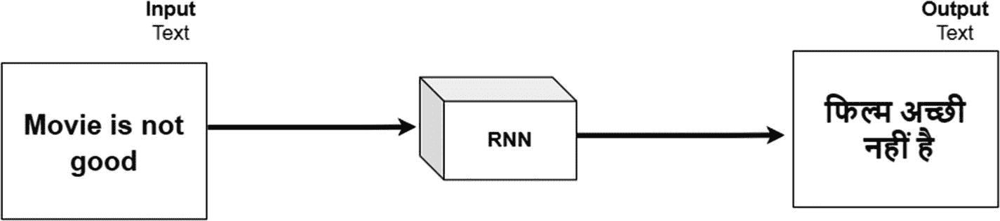

图 5-24

多对多关系

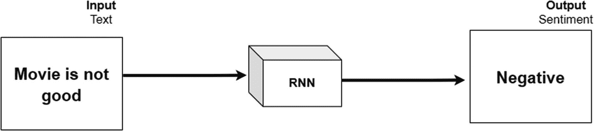

图 5-23

多对一关系

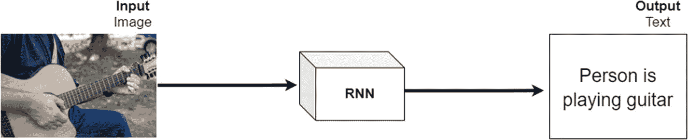

图 5-22

一对多关系

*   一对多
*   多对一
*   多对多

我们输入一张图像（一个），得到文本序列结果（多个）。

我们输入文本（多个），得到情感（一个）作为输出。

我们输入文本（多个），得到翻译结果（多个）作为输出。

### 前馈循环神经网络

前馈循环神经网络的结构与标准神经网络类似。一个根本区别在于输入序列。在循环神经网络中，输入序列就是进入的数据。在图 5-25 中，X[t-1]、X[t]、X[t+1]、X[t+2] 即为输入序列。输入通过隐藏层，并接收隐藏层中前一个时间步的值和权重（*W*）。

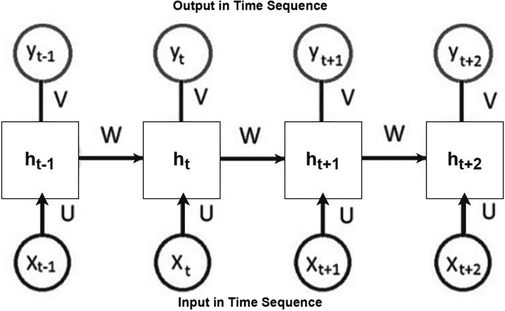

图 5-25

前馈循环神经网络示意图

现在，让我们从数学角度审视前馈循环神经网络。

在时间步 (t)，其方程如下：

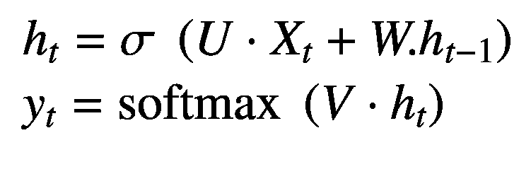

其中：

σ = TanH 激活函数

U = 隐藏层的权重（向量）

V = 输出层的权重（向量）

W = 不同时间步的相同权重向量

X = 带序列的输入向量

Y = 带序列的输出向量

以下是代价函数：

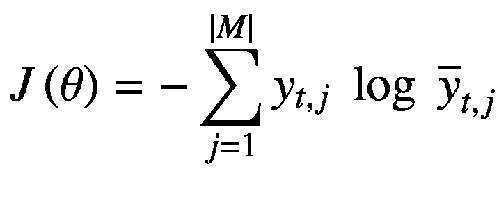

以下是交叉熵：

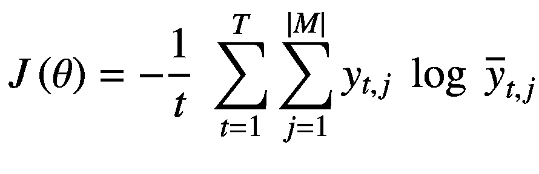

在图 5-25 中，我们可以看到输入层、隐藏层和输出层的数量。

以下是计算输出的步骤序列：

1.  使用权重 U 和输入 X 计算 h[t-1]。
2.  根据 h[t-1] 和输出权重 V 计算 y[t-1]。
3.  使用前一层参数 U、X、W 以及 h[t-1] 计算 h[t] 值。
4.  根据 V 和 h[t] 计算 y[t]，并持续此过程直至最后一步。

注意

我们在循环神经网络中使用 sigmoid、tanH 和 softmax 激活函数。

下一节，我们将探讨循环神经网络中的反向传播方法。

## 循环神经网络中的时间反向传播

如图 5-26 所示，时间反向传播算法（BPTT）是一种梯度下降算法，用于借助推导出的链式法则更新权重并最小化误差。它主要应用于序列数据，与循环神经网络、长短期记忆网络、门控循环单元等算法有所不同。这里有两个问题。

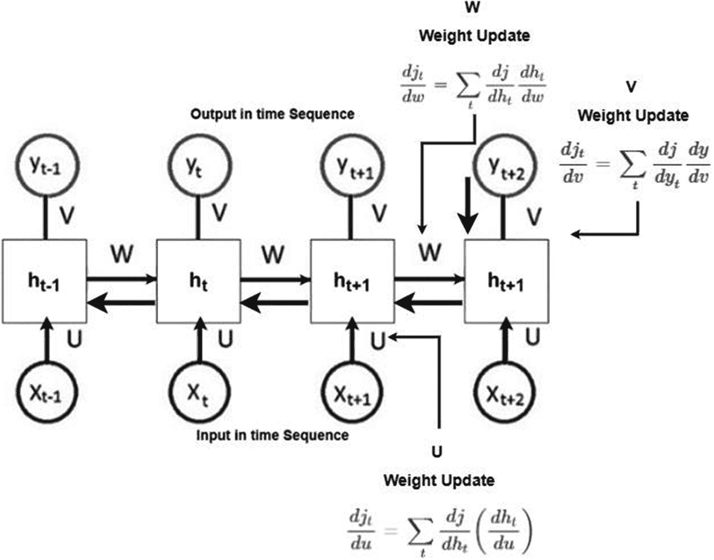

图 5-26

循环神经网络中时间反向传播示意图

*   关于隐藏单元和输出单元，总误差减少了多少？
*   输出相对于权重（U、V、W）如何变化？

反向传播与我们应用于神经网络的操作类似。唯一的区别在于，当前时间步是基于前一个时间步计算的。因此，我们必须遍历所有路径并使用链式法则，如下所示：

所有权重在所有时间步中保持不变。

如果

|W| < 1（梯度消失问题）

|W| > 1（梯度爆炸问题）

循环神经网络最大的问题是梯度消失问题（VGP）或梯度爆炸问题。在反向传播过程中，由于我们持续更新权重，所有权重在所有时间步中保持不变，因此梯度会随着更新变得过弱或过强，从而导致梯度消失或梯度爆炸问题。

以下是梯度消失问题的解决方案：

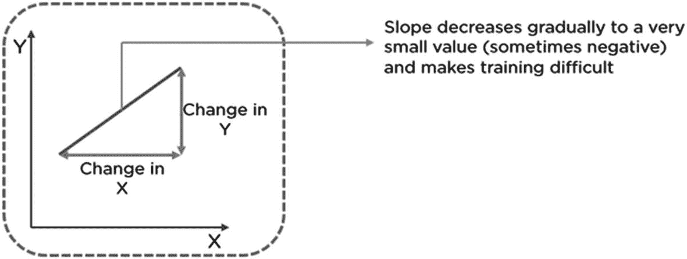

图 5-27

梯度消失与梯度爆炸示意图

*   参数是权重和偏置。
*   超参数是学习率、周期数、批次大小等。
*   如果值呈指数级收缩，则导致梯度消失。
*   如果值呈指数级增大，则导致梯度爆炸。

    图 5-27 展示了梯度消失和梯度爆炸。

    因此，深度学习模型需要时间来训练并从数据中学习，在某些情况下，它可能无法充分训练。这会导致神经网络收敛性差甚至不收敛。

    由于梯度消失问题，梯度变得非常小，并经常下降到极小值（有时为负值）。这使得模型性能变弱，准确率降低。模型可能无法按预期进行预测或分类。

    下一节，我们将学习长短期记忆网络。

*   **使用长短期记忆网络**：用于处理梯度消失问题
*   **使用更快的硬件**：从中央处理器切换到图形处理器（英伟达）
*   **使用其他激活函数**：例如 ReLU，它受此问题影响较小
*   **使用残差网络**：以避免该问题

    **注意** 梯度消失问题发生在训练循环神经网络时。这主要发生在网络参数和超参数未正确定制的情况下。

## 长短期记忆网络

长短期记忆网络（LSTM）最早由 Sepp Hochreiter 和 Jürgen Schmidhuber 于 1997 年提出。通过使用**恒定误差轮盘（CEC）**单元，LSTM 解决了梯度爆炸和梯度消失问题。LSTM 模块的初步版本包含了细胞、输入门和输出门。它以其设计而闻名，是一种特定类型的循环神经网络，应用了许多标准版本无法实现的真实场景。RNN 最大的问题在于它仅能保存前一时刻的状态信息，这导致了梯度消失问题。而 LSTM 解决了这一问题。

LSTM 的构建是为了避免长期依赖问题。长时间记住信息基本上是它的默认行为。所有 RNN 都具有重复的神经网络链式模块。这个重复模块是一个简单的结构，例如 RNN 中的 `tanH` 层。LSTM 也具有相同的链式结构，但并非单一的神经网络层（图 5-28）。

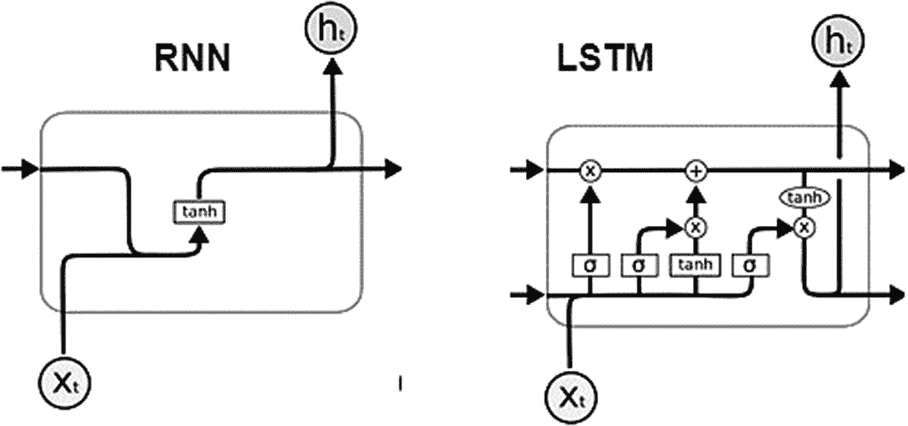

图 5-28

RNN 与 LSTM 对比

与 RNN 相比，LSTM 有一个额外的特性，称为*记忆*。

*   **遗忘门 f**（一个使用 sigmoid 激活函数的神经网络）
*   **候选层 C**（一个使用 tanH 激活函数的神经网络）
*   **输入门 I**（一个使用 sigmoid 激活函数的神经网络）
*   **输出门 O**（一个使用 sigmoid 激活函数的神经网络）
*   **隐藏状态 h**
*   **记忆细胞 C**

图 5-29 展示了它有四个不同的门：遗忘门、候选门、输入门和输出门。所有门都是使用 sigmoid 激活函数的单层神经网络，除了候选门使用的是 tanH 激活函数。

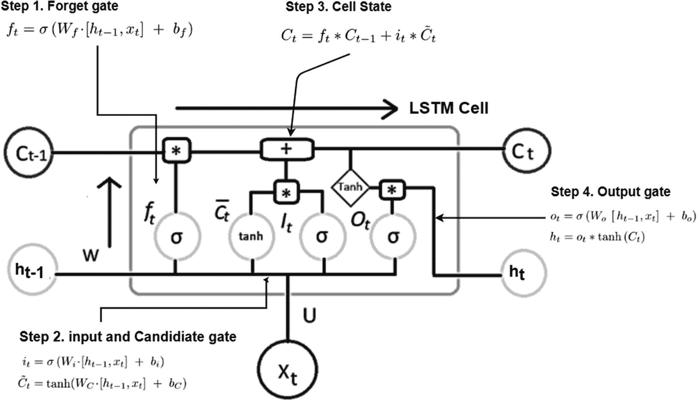

图 5-29

带有公式的 LSTM 细胞架构

图 5-29 展示了在 T 时间步的 LSTM。

*   输入细胞包含 x（输入向量）、h[t-1]（前一隐藏状态）和 C（前一记忆状态）。
*   输出细胞包含 h（当前隐藏细胞）和 C（当前记忆细胞）。
*   W 和 U 是权重向量。

### LSTM 的逐步解释

以下是 LSTM 的逐步解释。

**步骤 1**：假设我们必须根据所有未来的时间戳预测即将到来的序列。在此类问题中，细胞状态可以存储当前输入的所有信息，以便做出正确的预测。当我们获得新的输入数据时，我们将其与序列时间序列数据中的先前模式联系起来。

以下是遗忘门方程：

![$$ {f}_t=\sigma\;\left({W}_f\cdot \left[{h}_{t-1},{x}_t\right]+{b}_f\right) $$](images/492113_1_En_5_Chapter/492113_1_En_5_Chapter_TeX_Equo.png)

**步骤 2**：下一步是决定哪些信息对我们重要，以便我们能够存储它。这被分为两部分。第一个输入门层，包含 sigmoid 层，决定更新哪些值。接着，一个 `tanH` 层为新的候选值生成一个向量；这个向量被称为 。这可以进一步添加到状态中。我们可以将这两个门关联起来，以创建一个更新后的状态。

以下是输入门和候选门方程：

![$$ {\displaystyle \begin{array}{l}{i}_t=\sigma\;\left({W}_i\cdot \left[{h}_{t-1},{x}_t\right]+{b}_i\right)\\ {}{\overset{\sim }{C}}_t=\tanh \kern0.24em \left({W}_C\cdot \left[{h}_{t-1},{x}_t\right]+{b}_C\right)\end{array}} $$](images/492113_1_En_5_Chapter/492113_1_En_5_Chapter_TeX_Equp.png)

**步骤 3**：是时候将旧的细胞状态 C[t-1] 更新为新的细胞状态 C[t] 了。我们将旧状态乘以 *ft*，遗忘掉不必要的部分。然后我们将输入门 (i[t]) 乘以候选门 (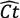)，这成为新的候选值，并根据我们决定更新每个状态值的程度进行缩放。

以下是细胞状态方程：

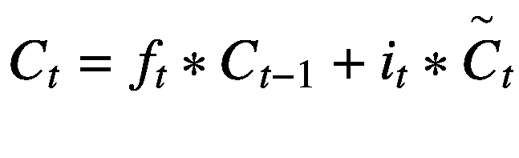

**步骤 4**：我们必须对输出状态做出决定。这基于细胞状态，但可以是过滤后的版本。第一个 sigmoid 层决定我们将输出细胞状态的哪一部分；然后我们将细胞状态输入 `tanH`，并将其乘以 sigmoid 门的输出。这样，我们只能输出我们决定输出的部分。

以下是输出状态和隐藏状态的方程：

![$$ {\displaystyle \begin{array}{l}{o}_t=\sigma\;\left({W}_o\;\left[{h}_{t-1},{x}_t\right]+{b}_o\right)\\ {}{h}_t={o}_t\ast \tanh\;\left({C}_t\right)\end{array}} $$](images/492113_1_En_5_Chapter/492113_1_En_5_Chapter_TeX_Equr.png)

LSTM 有两种变体，窥视孔连接和窥视孔卷积，我们现在来看一下。

### 窥视孔 LSTM

LSTM 细胞接收来自输入和输出细胞的连接，但与旨在控制的恒定误差轮盘没有直接链接。我们可以直接观察输出，在输出门关闭之前，输出接近于零。所有记忆块都存在同样的问题。当输出门锁定时，没有任何门可以访问 CEC 控制。此问题的一个简单补救措施是从 CEC 到同一记忆块的门添加窥视孔连接。窥视孔连接允许所有门在输出门关闭时也能检查当前的细胞状态。

图 5-30 展示了一个带有窥视孔连接的 LSTM 单元（即窥视孔 LSTM）。窥视孔连接允许门访问 CEC，其激活值即为细胞状态。h[t-1] 未被使用。c[t-1] 在大多数地方被使用。

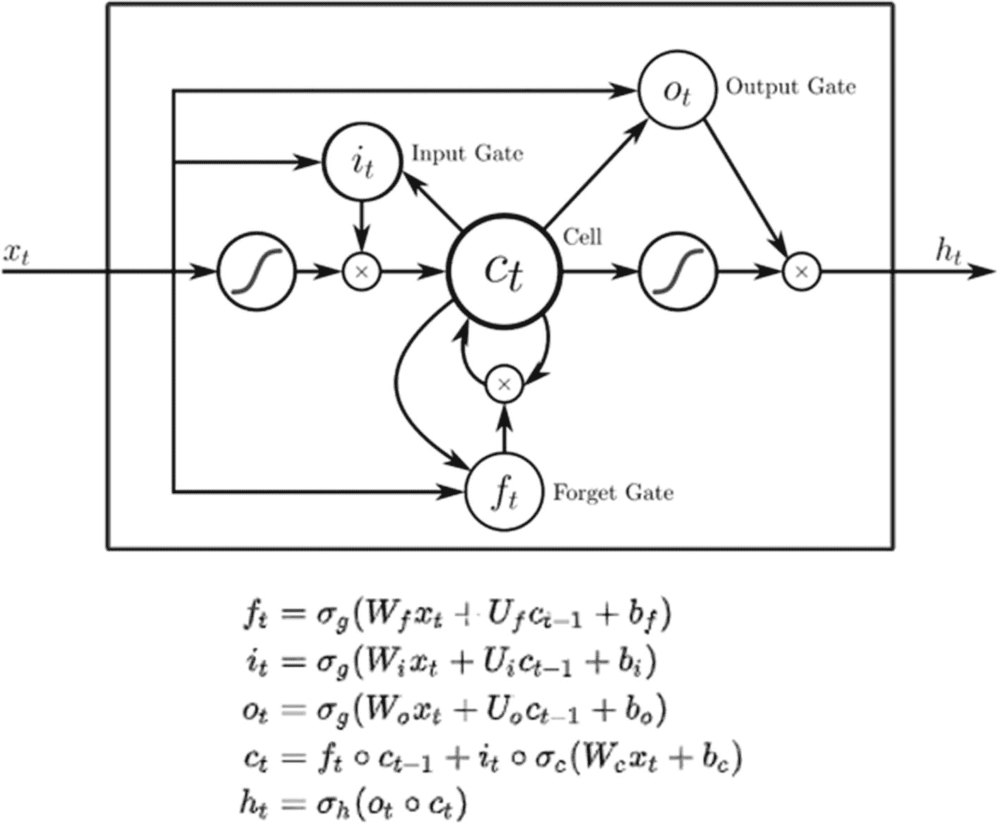

图 5-30

窥视孔 LSTM 的表示

### 窥视孔卷积 LSTM

LSTM 已被证明能够处理时间相关性。但对于空间数据，它包含过多的冗余。卷积 LSTM（ConvLSTM）解决了这个问题，因此我们现在可以解决时空序列预测问题。图 5-31 展示了将 2D 图像转换为 3D 张量的过程。

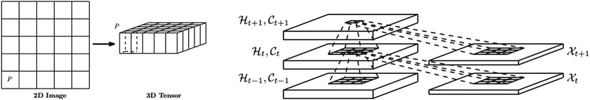

图 5-31

将 2D 图像转换为 3D 张量

图 5-32 从数学上展示了 ConvLSTM 的内部结构。

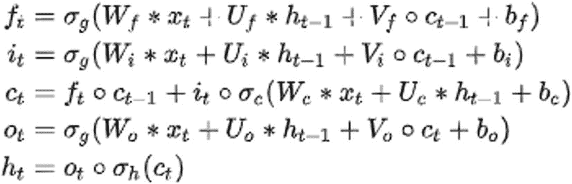

图 5-32

ConvLSTM 的内部结构（来源：Xingjian, S. H. I., 等. “Convolutional LSTM network: A machine learning approach for precipitation nowcasting,” 2015, Advances in neural information processing systems）

在下一节中，我们将介绍门控循环单元及其变体。

## 门控循环单元

*门控循环单元*（GRU）是一种使用门控机制的特殊循环神经网络（图 5-33）。它由 Kyunghyun Cho 于 2014 年提出。GRU 与带有遗忘门的 LSTM 结构相同，但参数更少；它不包含输出门。GRU 在音频声学分类和语音分类等任务上表现良好。GRU 在小型数据集上甚至表现更优。GRU 不擅长训练 LSTM 可学习的简单语言，因为 LSTM 能执行无界计数，而 GRU 不能。

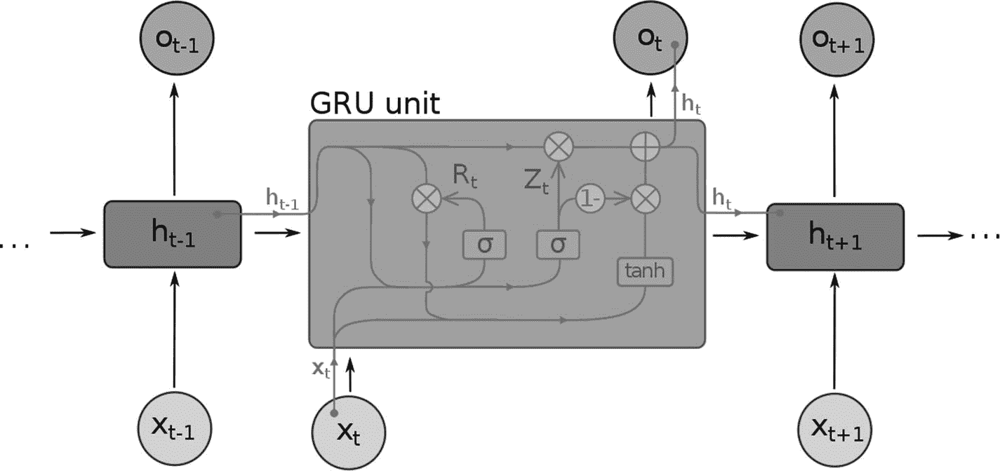

图 5-33

GRU 的表示

已有多种变体被提出，它们对先前隐藏状态和偏置进行了不同的组合，其简化版本被称为*最小门控单元*。

GRU 有两种变体。一种是全门控单元，如图 5-33 所示。

最初，当 t = 0 时，输出向量为 h[0] = 0。

*   x[t] 是输入数据，h[t] 是输出数据，z[t] 是更新门，r[t] 是重置门。

*   W、U 和 b 是参数矩阵和向量，使用了两种激活函数：sigmoid（**σ**[**g**]）和 tanH（**Φ**[**h**]）。

图 5-34 展示了三种变体。

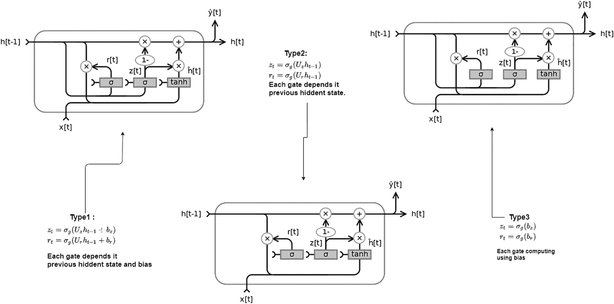

图 5-34

GRU 变体的表示

第二种是*最小门控单元*，它与全门控单元相同，只是将重置门合并为一个遗忘门（图 5-35）。这意味着输出向量将会改变。

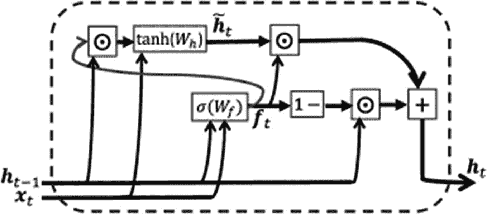

图 5-35

最小门控单元

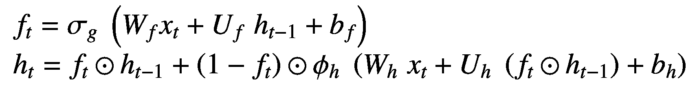

*   x[t] 是输入数据，h[t] 是输出数据，f[t] 是遗忘门。

*   W、U 和 b 是参数矩阵和向量。

在下一节中，我们将介绍卷积神经网络。

## 卷积神经网络

卷积神经网络（CNN）由 LeCun 和 Bengio 于 1995 年首次发表。卷积神经网络结构基于神经生物学观察：即使物体的方向和位置发生变化，我们视觉皮层中的神经元也能毫无问题地识别它们。与多层感知器不同，你可以学习物体的独特特征，而不管它们的位置或方向如何。

CNN 包含一个提取特征的卷积层和一个压缩信息的池化层。卷积层和池化层在输入层和输出层之间重复。迭代次数通过实验确定以获得最佳结果。CNN 使用非像素滤波器来解决多层感知器的问题。卷积滤波器由矩阵组成。滤波器在卷积层中从左上角到右下角扫描图像，读取图像的特征以生成特征图。在图 5-36 中，核矩阵被称为*滤波器*。

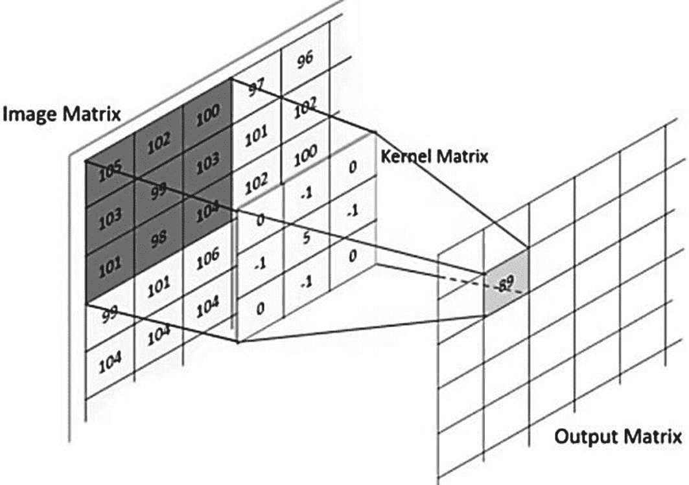

图 5-36

卷积操作

在图 5-36 中，左侧图像是图像矩阵，由三原色组成；它以三维深度表示，滤波器由一个小棕色框表示。滤波器由权重矩阵提供。当滤波器从左向右移动时，特征图会在输入图像的不同位置搜索相同的特征。如果滤波器经过的部分与特征匹配，它将输出一个高值，以增加图像分类的可能性。例如，如果你扫描一张汽车图像，然后扫描车轮的形状，那么该物体很可能是汽车，并且会输出一个高值。

将滤波器垂直和水平读取的特征图列出来，以创建一张图，如中间图像所示。如果使用多个滤波器，则会创建多个特征图。CNN 的池化层压缩特征图，减少参数数量（图 5-37）。将 4×4 的特征图分割成 2×2 的单元组来表示每个组。有取最大值的最大池化和取平均值的平均池化。

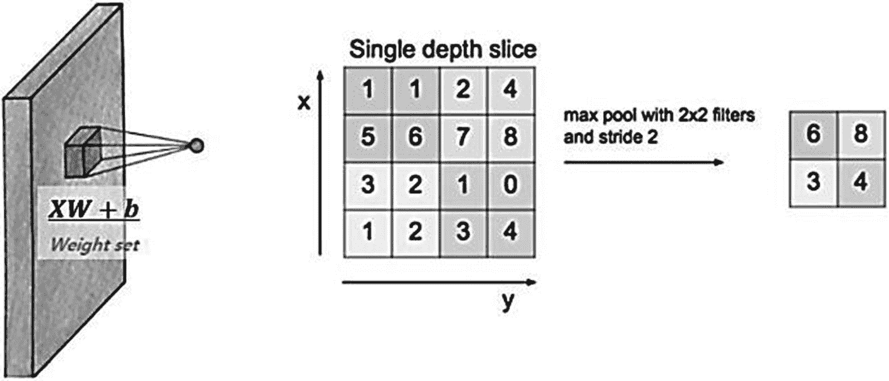

图 5-37

池化的表示

通过基于图像重新应用滤波器来创建另一张图像，重复此过程。如果你重复创建多个滤波器和图像的过程，并且其特征被压缩，那么图像各方面的结果将下降为一个数字。这个值是一个随机估计值。CNN 模型的准确性取决于滤波器的复杂程度。

### 广义 CNN 公式

以下是由 LeCun 设计的 LeNet 5 CNN 算法系列的原始数学表示。

1.  **卷积公式**：

    ![$$ {\displaystyle \begin{array}{l}\mathrm{Input}:\left(n\;x\;n\;x\;{n}_c\right)\\ {}\mathrm{Filter}:\left(f\;x\;f\;x\;{n}_c\right)\\ {}\mathrm{Output}:\left(\left[\frac{n+2p-f}{s}+1\right]\;x\;\left[\frac{n+2p-f}{s}+1\right]\kern0.24em {xn}_c^{\hbox{'}}\right)\;\end{array}} $$](images/492113_1_En_5_Chapter/492113_1_En_5_Chapter_TeX_Equu.png)

    这包括滤波器大小 (f)、步长 (s)、填充 (p) 和输入大小 (n)，其中 n[c]’ 是滤波器的数量。

2.  **池化层**：

    池化有两种类型。
    1.  **最大池化**：将从所有单元中取最大值。

    2.  **平均池化**：将从所有单元中取平均值。

3.  **批量归一化**：用于通过微调和缩放激活来归一化输入层。它使模型训练速度加快。

4.  **随机失活**：这是一种在训练过程中随机忽略某些神经元的方法。它们被随机“丢弃”。它用于防止模型过拟合。

表 5-1 说明了不同的层及其数学公式。

表 5-1

CNN 不同层的公式

| - |

在下一节中，我们将介绍一维 CNN。

### 一维卷积神经网络

卷积神经网络非常擅长识别数据中的简单模式，然后利用这些模式在更高层中形成更复杂的模式。当你希望从整个数据集的较短（固定长度）片段中获取有价值的特征，并且该片段中特征的位置无关紧要时，一维卷积神经网络非常有用。

这对于分析传感器数据的时间序列（例如陀螺仪数据或加速度计数据）非常理想。它也适用于分析固定时间长度内的任何类型的信号数据（例如音频信号）。另一个应用是自然语言处理（尽管长短期记忆网络在此更有前景，因为单词的邻近性并不总是可训练模式的良好指标）。

在下一节中，我们将介绍自编码器，这是一种流行的无监督深度学习方法。

## 自编码器

*自编码器*是一种无监督的深度学习神经网络模型。它能够学习输入数据的隐藏特征，这被称为*编码*。同时，它能够利用学习到的新生成特征重建原始输入数据，这被称为*解码*。

直观地说，自编码器可用于特征降维，例如主成分分析，但其性能优于主成分分析，因为神经网络模型可以提取更有效的新特征。除了特征降维，自编码器学习到的新特征可以输入到监督学习模型中，因此自编码器可以充当特征提取器。作为一种无监督深度学习模型，自编码器也可用于生成与训练样本不同的新数据。通过这种方式，自编码器（变分自编码器）成为了生成模型。

图 5-38 展示了自编码器的基本结构。它包括两个过程：编码和解码。

图 5-38

自编码器的表示

编码器输入 x 经过编码得到新特征 y，并且输入 x 可以重建形成新的唯一特征 y。编码过程如下：

可以看出，在神经网络结构中，编码是一个线性组合后跟一个非线性激活函数。如果没有非线性结构，那么自编码器与普通的主成分分析就没有区别。利用新特征 ***y***，可以进入 ***x*** 的重建，即解码过程：

我们希望重建公式尽可能一致，并且可以使用损失函数最小化负对数似然来训练模型，如下所示：

对于高斯分布数据，最好使用均方误差；对于伯努利分布，可以使用交叉熵，这可以从似然函数推导出来。通常情况下，我们会给自编码器添加一些限制，即 *W*^’ = *W*^(*T*)，这是常用的方法。这被称为*捆绑权重*。

## 总结

在本章中，你学习了激活函数、反向传播、梯度下降的类型、循环神经网络、长短期记忆网络、门控循环单元、卷积神经网络和自编码器。在下一章中，你将学习如何使用前沿技术解决单变量时间序列问题。

