# 6. 单变量时间序列的前沿技术

在上一章中，你学习了使用传统技术处理时间序列数据。在本章中，你将学习如何使用前沿技术解决单变量时间序列问题。*单变量时间序列*是由在等间隔时间段内顺序记录的单个（标量）观测值组成的时间序列。在本章中，你将学习单步时间序列预测和水平式时间序列预测。

## 时间序列预测的单步数据准备

单步时间序列预测是一种技术，模型每次只暴露于一个数据窗口（例如天、周、月、季度或年），并尝试预测下一个连续步骤，如图 6-1 所示。

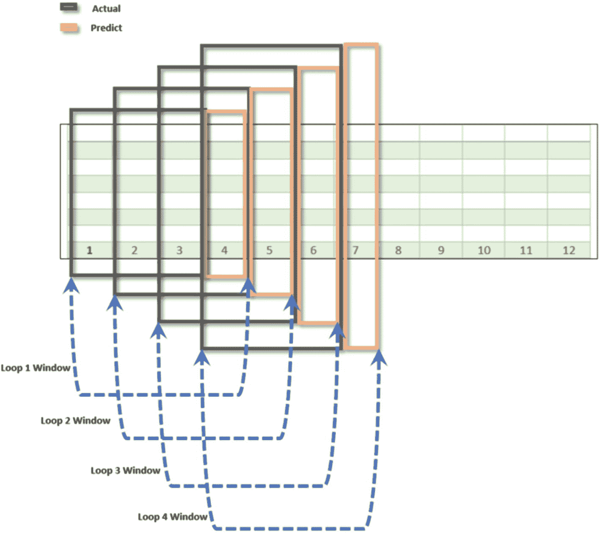

图 6-1

单步时间序列预测的表示

**示例 1**：数据为月度级别。模型看到第一个窗口，从第 1 个月到第 48 个月（即四年数据），并预测第 49 个月。然后，在下一次迭代中，模型查看第 2 个月到第 49 个月的数据进行训练，并尝试预测第 50 个月。

**示例 2**：数据为日度级别。模型看到第一个窗口，从第 1 天到第 90 天（即三个月数据），并预测第 91 天的值。然后，在下一次迭代中（第 2 天到第 91 天）进行训练，它尝试预测第 92 天。

## 时间序列预测的水平式数据准备

水平式时间序列预测是一种技术，模型每次只暴露于一个数据窗口（例如天、周、月、季度或年），并尝试根据选择预测接下来的 *n* 个连续步骤，如图 6-2 所示。

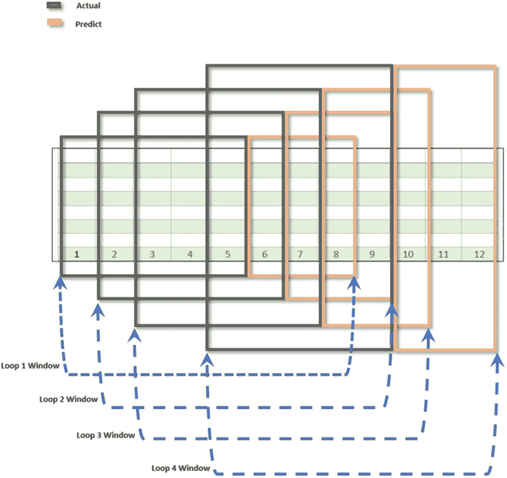

图 6-2

水平式时间序列预测的表示

**示例 1:** 数据为月度级别。模型看到第一个窗口，从第 1 个月到第 48 个月（即四年数据），并预测第 49 个月到第 59 个月的值。然后，在下一次迭代中（第 2 个月到第 49 个月）进行训练，它尝试预测第 50 个月到第 60 个月。

**示例 2:** 数据为日度级别。模型看到第一个窗口，从第 1 天到第 90 天（即三个月数据），并尝试预测第 91 天到第 101 天的值。然后，在下一次迭代中（第 2 天到第 91 天）进行训练，它尝试预测第 92 天到第 102 天。


## LSTM 单变量单步预测实战

在上一节中，你了解了用于预测的单步和水平式时间序列数据准备方法。本节将使用单步数据准备和 LSTM 来解决单变量时间序列问题。

导入所需的库并加载 CSV 数据，该数据包含明尼苏达州交通部（Mn DoT）301 号 ATR 站点的 I-94 西行方向每小时交通流量，该站点大致位于明尼苏达州明尼阿波利斯市和圣保罗市之间。数据中包含了影响交通流量的每小时天气特征和节假日信息。

*   **Tensorflow** 是一个开源人工智能库，它使用数据流图来构建模型。它允许开发者创建具有多个层的大规模神经网络。以下代码实现已经过测试，在 Tensorflow 和 Tensorflow GPU 2.0 及以上版本上运行效果最佳。

让我们使用这些数据来预测接下来十小时的交通流量。

```
import pandas as pd
import numpy as np
import tensorflow as tf
from sklearn import preprocessing
import matplotlib.pyplot as plt
tf.random.set_seed(123)
np.random.seed(123)
```

让我们通过查看五点摘要来快速浏览一下数据。

```
df = pd.read_csv(r'\Data\Metro_Interstate_Traffic_Volume.csv')
df.head()
```


```
df.describe()
```


让我们删除重复项，因为同一小时可能存在不同的天气状况。

```
df.drop_duplicates(subset=['date_time'], keep=False,inplace=True)
```

对于训练/测试分割，我们保留最后十小时的数据（即十条记录），以便在基于历史数据训练后，用这些数据来验证模型。

```
validate = df['traffic_volume'].tail(10)
df.drop(df['traffic_volume'].tail(10).index,inplace=True)
uni_data = df['traffic_volume']
uni_data.index = df['date_time']
uni_data.head()
```


让我们对数据进行缩放，因为众所周知，当特征处于同一尺度时，神经网络收敛更快且精度更高。

```
uni_data = uni_data.values
scaler_x = preprocessing.MinMaxScaler()
x_rescaled = scaler_x.fit_transform(uni_data.reshape(-1, 1))
```

定义一个函数来准备适用于时间序列的单变量数据。

```
def custom_ts_univariate_data_prep(dataset, start, end, window, horizon):
X = []
y = []
start = start + window
if end is None:
end = len(dataset) - horizon
for i in range(start, end):
indicesx = range(i-window, i)
X.append(np.reshape(dataset[indicesx], (window, 1)))
indicesy = range(i,i+horizon)
y.append(dataset[indicesy])
return np.array(X), np.array(y)
```

由于我们进行的是单步预测，让模型查看/训练过去 48 小时的数据，并尝试预测第 49 小时的数据。因此，使用 `horizon` = 1。

```
univar_hist_window = 48
horizon = 1
TRAIN_SPLIT = 30000
x_train_uni, y_train_uni = custom_ts_univariate_data_prep(x_rescaled, 0, TRAIN_SPLIT,univar_hist_window, horizon)
x_val_uni, y_val_uni = custom_ts_univariate_data_prep(x_rescaled, TRAIN_SPLIT, None,univar_hist_window,horizon)
print ('Single window of past history')
print (x_train_uni[0])
print ('\n Target horizon')
print (y_train_uni[0])
Single window of past history
[[0.76167582]
[0.62032967]
[0.65480769]
[0.69038462]
[0.67554945]
[0.71167582]
[0.76703297]
[0.82623626]
[0.79546703]
[0.65521978]
[0.48612637]
[0.38241758]
[0.32431319]
[0.21002747]
[0.13228022]
[0.06950549]
[0.04409341]
[0.0375    ]
[0.05041209]
[0.11181319]
[0.37335165]
[0.77925824]
[0.89436813]
[0.75151099]
[0.70013736]
[0.67129121]
[0.7331044 ]
[0.78186813]
[0.84299451]
[0.63502747]
[0.49326923]
[0.39807692]
[0.36222527]
[0.24409341]
[0.13942308]
[0.08214286]
[0.05068681]
[0.04285714]
[0.05041209]
[0.1146978 ]
[0.37445055]
[0.78145604]
[0.96016484]
[0.82211538]
[0.72925824]
[0.63228022]
[0.67087912]
[0.7010989 ]]
Target horizon
[[0.71126374]]
```

使用 `tf.data` 函数准备训练和验证时间序列数据，这是一种向模型提供数据的更快、更高效的方式。

```
BATCH_SIZE = 256
BUFFER_SIZE = 150
train_univariate = tf.data.Dataset.from_tensor_slices((x_train_uni, y_train_uni))
train_univariate = train_univariate.cache().shuffle(BUFFER_SIZE).batch(BATCH_SIZE).repeat()
val_univariate = tf.data.Dataset.from_tensor_slices((x_val_uni, y_val_uni))
val_univariate = val_univariate.batch(BATCH_SIZE).repeat()
```

最佳权重保存在 `model_path` 中。

```
model_path = r'\Chapter 6\LSTM_Univarient_2.h5'
```

定义 LSTM 模型，如下所示：

```
lstm_model = tf.keras.models.Sequential([
tf.keras.layers.LSTM(100, input_shape=x_train_uni.shape[-2:],return_sequences=True),
tf.keras.layers.Dropout(0.2),
tf.keras.layers.LSTM(units=50,return_sequences=False),
tf.keras.layers.Dropout(0.2),
tf.keras.layers.Dense(units=1),
])
lstm_model.compile(optimizer='adam', loss='mse')
配置模型并开始训练，同时使用早停和检查点。
当监控的损失开始超过耐心值时，早停会停止训练。
检查点在模型达到最小损失时保存模型权重。
EVALUATION_INTERVAL = 100
EPOCHS = 150
history = lstm_model.fit(train_univariate, epochs=EPOCHS,steps_per_epoch=EVALUATION_INTERVAL,validation_data=val_univariate, validation_steps=50,verbose =1,callbacks =[tf.keras.callbacks.EarlyStopping(monitor='val_loss', min_delta=0, patience=10, verbose=1, mode='min'),
tf.keras.callbacks.ModelCheckpoint(model_path,monitor='val_loss', save_best_only=True, mode='min', verbose=0)])
```

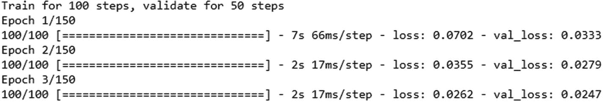

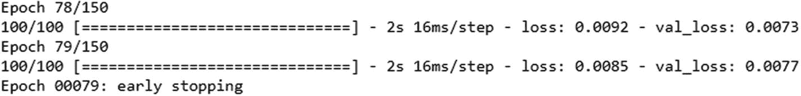

前面的示例显示，模型在第 79 个 epoch 停止了，而不是运行完 150 个 epoch。将最佳权重加载到模型中。

```
Trained_model = tf.keras.models.load_model(model_path)
```

查看模型摘要。

```
Trained_model.summary()
```


绘制 `loss` 和 `val_loss` 随 epoch 变化的曲线图。

```
plt.plot(history.history['loss'])
plt.plot(history.history['val_loss'])
plt.title('Model loss')
plt.ylabel('loss')
plt.xlabel('epoch')
plt.legend(['train loss', 'validation loss'], loc='upper left')
plt.rcParams["figure.figsize"] = [16,9]
plt.show()
```

在机器学习和深度学习中，存在三种情况。

*   **欠拟合**，当验证损失小于训练损失时

*   **过拟合**，当验证损失高于训练损失时

*   **良好拟合**，当验证损失等于训练损失时


图 6-3 展示了一张折线图，帮助我们理解一个好的模型是如何进行泛化的。

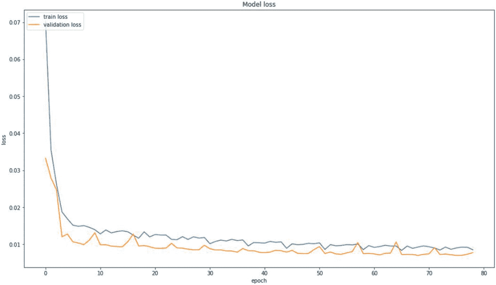

图 6-3

训练损失和验证损失随训练轮次增加的变化情况

我们需要预测接下来的十个步骤，但我们的模型每次只能预测一个时间步，因此我们取训练数据中最后 48 小时的数据，每次递增一个预测值，并预测接下来的数值。

```
uni = df['traffic_volume']
validatehori = uni.tail(48)
validatehist = validatehori.values
result = []
# 在此处定义预测长度
window_len = 10
val_rescaled = scaler_x.fit_transform(validatehist.reshape(-1, 1))
for i in range(1, window_len+1):
val_rescaled = val_rescaled.reshape((1, val_rescaled.shape[0], 1))
Predicted_results = Trained_model.predict(val_rescaled)
print(f'predicted : {Predicted_results}')
result.append(Predicted_results[0])
val_rescaled = np.append(val_rescaled[:,1:],[[Predicted_results]])
print(val_rescaled)
```

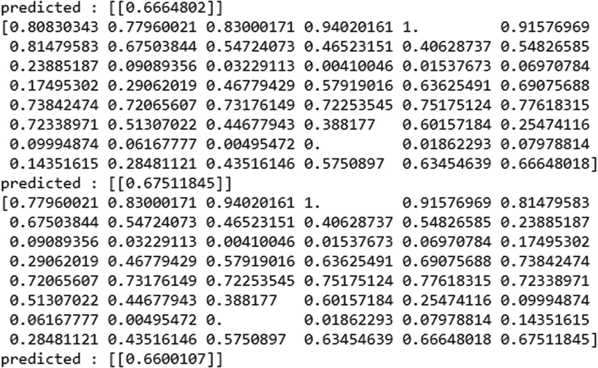

将预测值重新缩放回原始尺度。

```
result_inv_trans = scaler_x.inverse_transform(result)
result_inv_trans
```

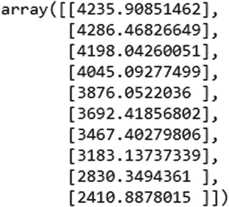

定义时间序列评估函数。

```
from sklearn import metrics
def timeseries_evaluation_metrics_func(y_true, y_pred):
def mean_absolute_percentage_error(y_true, y_pred):
y_true, y_pred = np.array(y_true), np.array(y_pred)
return np.mean(np.abs((y_true - y_pred) / y_true)) * 100
print('Evaluation metric results:-')
print(f'MSE is : {metrics.mean_squared_error(y_true, y_pred)}')
print(f'MAE is : {metrics.mean_absolute_error(y_true, y_pred)}')
print(f'RMSE is : {np.sqrt(metrics.mean_squared_error(y_true, y_pred))}')
print(f'MAPE is : {mean_absolute_percentage_error(y_true, y_pred)}')
print(f'R2 is : {metrics.r2_score(y_true, y_pred)}',end='\n\n')
timeseries_evaluation_metrics_func(validate,result_inv_trans)
```

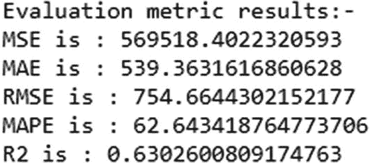

绘制实际值与预测值的对比图。

```
plt.plot( list(validate))
plt.plot( list(result_inv_trans))
plt.title("Actual vs Predicted")
plt.ylabel("Traffic volume")
plt.legend(('Actual','predicted'))
plt.show()
```

在完美预测的情况下，预测值应等于实际值，因此你看到的折线图展示了预测值与实际值的偏差程度（即预测误差）。

图 6-4 中的折线图描绘了实际值和预测值随时间的变化情况。

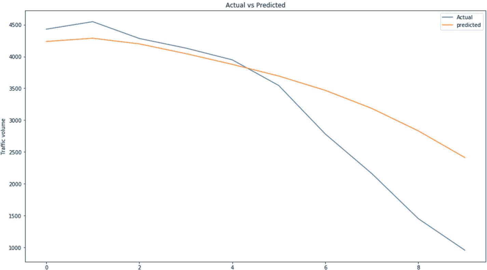

图 6-4

实际值与预测值的对比图

## LSTM 单变量水平预测风格实战

在本节中，我们将使用水平预测风格的数据准备方法和 LSTM 来解决单变量时间序列问题。

导入所需的库并加载 CSV 文件。

```
import pandas as pd
import numpy as np
import tensorflow as tf
from sklearn import preprocessing
import matplotlib.pyplot as plt
tf.random.set_seed(123)
np.random.seed(123)
```

让我们使用这些数据来预测接下来十小时的交通流量。

```
df = pd.read_csv(r'\Data\Metro_Interstate_Traffic_Volume.csv')
df.head()
```


让我们通过检查五点摘要来快速浏览数据。

```
df.describe()
```


让我们删除重复项，因为同一小时可能对应不同的天气状况。

```
df.drop_duplicates(subset=['date_time'], keep=False,inplace=True)
```

现在进行训练/测试分割。我们保留十小时的数据（即十条记录），用于在基于历史数据训练后验证模型。

```
validate = df['traffic_volume'].tail(10)
df.drop(df['traffic_volume'].tail(10).index,inplace=True)
uni_data = df['traffic_volume']
uni_data.index = df['date_time']
uni_data.head()
```

让我们对数据进行重新缩放，因为已知神经网络在特征处于同一尺度时，收敛速度更快且精度更高。


让我们对数据进行重新缩放，因为已知神经网络在特征处于同一尺度时，收敛速度更快且精度更高。

```
uni_data = uni_data.values
scaler_x = preprocessing.MinMaxScaler()
x_rescaled = scaler_x.fit_transform(uni_data.reshape(-1, 1))
```

定义一个函数来准备适用于时间序列的单变量数据。

由于我们进行的是水平预测风格的预测，让模型查看/训练过去 48 小时的数据，并尝试预测接下来十小时的结果；因此，使用 `horizon = 10`。

```
def custom_ts_univariate_data_prep(dataset, start, end, window, horizon):
X = []
y = []
start = start + window
if end is None:
end = len(dataset) - horizon
for i in range(start, end):
indicesx = range(i-window, i)
X.append(np.reshape(dataset[indicesx], (window, 1)))
indicesy = range(i, i+horizon)
y.append(dataset[indicesy])
return np.array(X), np.array(y)
univar_hist_window = 48
horizon = 10
TRAIN_SPLIT = 30000
x_train_uni, y_train_uni = custom_ts_univariate_data_prep(x_rescaled, 0, TRAIN_SPLIT,univar_hist_window, horizon)
x_val_uni, y_val_uni = custom_ts_univariate_data_prep(x_rescaled, TRAIN_SPLIT, None,univar_hist_window,horizon)
print ('Single window of past history')
print (x_train_uni[0])
print ('\n Target horizon')
print (y_train_uni[0])
Single window of past history
[[0.76167582]
[0.62032967]
[0.65480769]
[0.69038462]
[0.67554945]
[0.71167582]
[0.76703297]
[0.82623626]
[0.79546703]
[0.65521978]
[0.48612637]
[0.38241758]
[0.32431319]
[0.21002747]
[0.13228022]
[0.06950549]
[0.04409341]
[0.0375    ]
[0.05041209]
[0.11181319]
[0.37335165]
[0.77925824]
[0.89436813]
[0.75151099]
[0.70013736]
[0.67129121]
[0.7331044 ]
[0.78186813]
[0.84299451]
[0.63502747]
[0.49326923]
[0.39807692]
[0.36222527]
[0.24409341]
[0.13942308]
[0.08214286]
[0.05068681]
[0.04285714]
[0.05041209]
[0.1146978 ]
[0.37445055]
[0.78145604]
[0.96016484]
[0.82211538]
[0.72925824]
[0.63228022]
[0.67087912]
[0.7010989 ]]
Target horizon
[[0.71126374]
[0.75563187]
[0.78475275]
[0.86428571]
[0.83200549]
[0.67403846]
[0.48118132]
[0.41717033]
[0.38763736]
[0.27362637]]
```

使用 `tf.data` 函数准备训练和验证时间序列数据，这是一种向模型提供数据的更快、更高效的方式。


```
BATCH_SIZE = 256
BUFFER_SIZE = 150
train_univariate = tf.data.Dataset.from_tensor_slices((x_train_uni, y_train_uni))
train_univariate = train_univariate.cache().shuffle(BUFFER_SIZE).batch(BATCH_SIZE).repeat()
val_univariate = tf.data.Dataset.from_tensor_slices((x_val_uni, y_val_uni))
val_univariate = val_univariate.batch(BATCH_SIZE).repeat()
```

最佳权重保存在 `model_path` 中。

```
model_path = r'\Chapter 6\LSTM_Univarient_1.h5'
```

定义 LSTM 模型。

```
lstm_model = tf.keras.models.Sequential([
tf.keras.layers.LSTM(100, input_shape=x_train_uni.shape[-2:],return_sequences=True),
tf.keras.layers.Dropout(0.2),
tf.keras.layers.LSTM(units=50,return_sequences=False),
tf.keras.layers.Dropout(0.2),
tf.keras.layers.Dense(units=horizon),
])
lstm_model.compile(optimizer='adam', loss='mse')
```

配置模型，并开始训练，同时使用早停和检查点机制。

早停会在监测的损失开始超过容忍度（patience）时停止训练。

检查点会在模型达到最小损失时保存模型权重。

```
EVALUATION_INTERVAL = 100
EPOCHS = 150
history = lstm_model.fit(train_univariate, epochs=EPOCHS,steps_per_epoch=EVALUATION_INTERVAL,validation_data=val_univariate, validation_steps=50,verbose =1,callbacks =[tf.keras.callbacks.
EarlyStopping(monitor='val_loss', min_delta=0, patience=10, verbose=1, mode='min'),tf.keras.callbacks.ModelCheckpoint(model_path,monitor='val_loss', save_best_only=True, mode='min', verbose=0)])
```

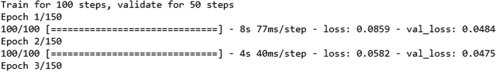

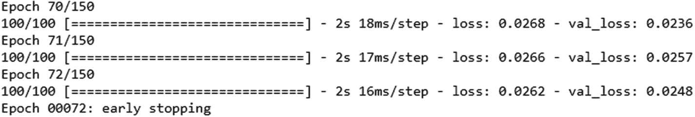

前面的示例显示，模型在第 72 个 epoch 停止了，而不是运行完 150 个 epoch。将最佳权重加载到模型中。

```
Trained_model = tf.keras.models.load_model(model_path)
Trained_model.summary()
```

查看模型摘要。

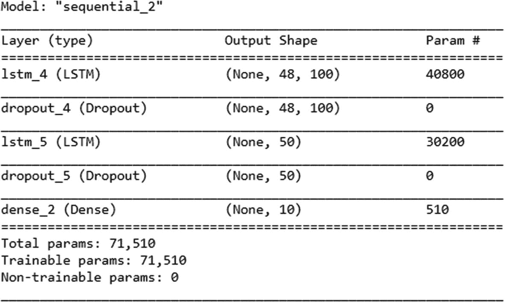

绘制 `loss` 和 `val_loss` 随 epoch 变化的曲线。

```
plt.plot(history.history['loss'])
plt.plot(history.history['val_loss'])
plt.title('Model loss')
plt.ylabel('loss')
plt.xlabel('epoch')
plt.legend(['train loss', 'validation loss'], loc='upper left')
plt.rcParams["figure.figsize"] = [16,9]
plt.show()
```

图 6-5 展示了一个折线图，有助于我们理解一个优秀的模型是如何进行泛化的。

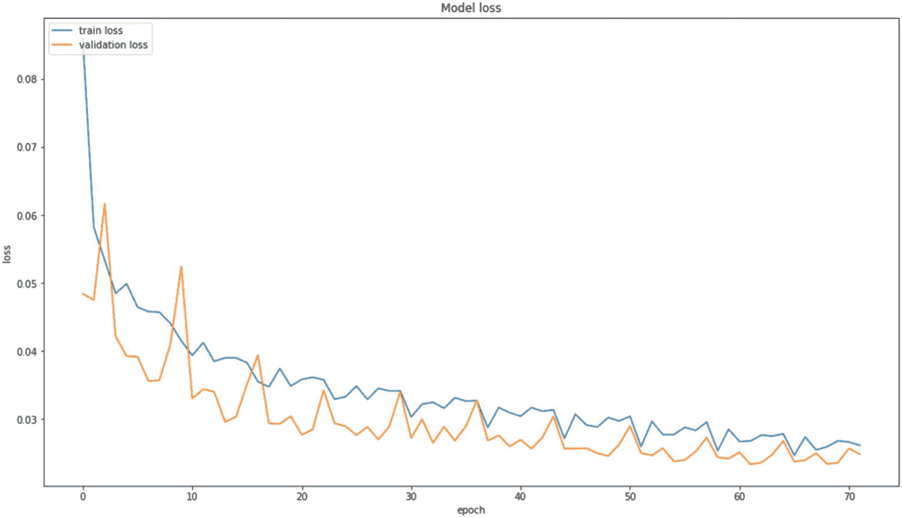

图 6-5

训练损失和验证损失随 epoch 数量增加的变化情况

我们需要预测接下来的十个时间步，因此，从训练模型中取出最后 48 小时的数据，并预测接下来十小时的值。

```
uni = df['traffic_volume']
validatehori = uni.tail(48)
validatehist = validatehori.values
scaler_val = preprocessing.MinMaxScaler()
val_rescaled = scaler_x.fit_transform(validatehist.reshape(-1, 1))
val_rescaled = val_rescaled.reshape((1, val_rescaled.shape[0], 1))
Predicted_results = Trained_model.predict(val_rescaled)
Predicted_results
```

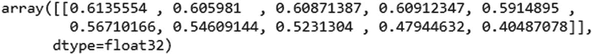

将预测值重新缩放回原始尺度，如下所示：

```
Predicted_inver_res = scaler_x.inverse_transform(Predicted_results)
Predicted_inver_res
```

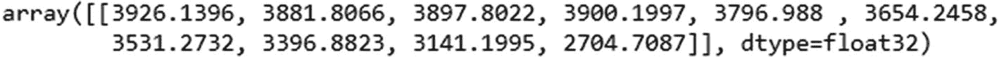

定义时间序列评估函数，如下所示：

```
from sklearn import metrics
def timeseries_evaluation_metrics_func(y_true, y_pred):
def mean_absolute_percentage_error(y_true, y_pred):
y_true, y_pred = np.array(y_true), np.array(y_pred)
return np.mean(np.abs((y_true - y_pred) / y_true)) * 100
print('Evaluation metric results:-')
print(f'MSE is : {metrics.mean_squared_error(y_true, y_pred)}')
print(f'MAE is : {metrics.mean_absolute_error(y_true, y_pred)}')
print(f'RMSE is : {np.sqrt(metrics.mean_squared_error(y_true, y_pred))}')
print(f'MAPE is : {mean_absolute_percentage_error(y_true, y_pred)}')
print(f'R2 is : {metrics.r2_score(y_true, y_pred)}',end='\n\n')
timeseries_evaluation_metrics_func(validate,Predicted_inver_res[0])
```

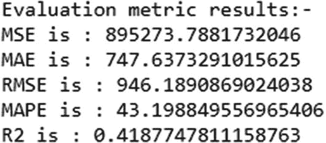

```
plt.plot( list(validate))
plt.plot( list(Predicted_inver_res[0]))
plt.title("Actual vs Predicted")
plt.ylabel("Traffic volume")
plt.legend(('Actual','predicted'))
plt.show()
```

图 6-6 展示了一个折线图，描绘了实际值和预测值随时间的变化情况。

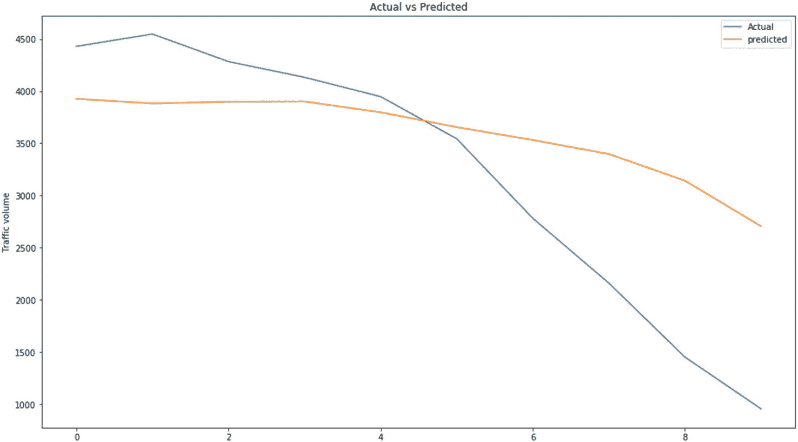

图 6-6

*实际值与预测值的对比*


## 双向 LSTM 单变量单步预测实战

本节将使用单步数据准备和双向 LSTM 来解决单变量时间序列问题。

导入所需库并加载 CSV 文件。

```
import pandas as pd
import numpy as np
import tensorflow as tf
from sklearn import preprocessing
import matplotlib.pyplot as plt
tf.random.set_seed(123)
np.random.seed(123)
```

让我们加载数据，并通过检查五点摘要来初步了解数据。

```
df = pd.read_csv(r'\Data\Metro_Interstate_Traffic_Volume.csv')
df.head()
```

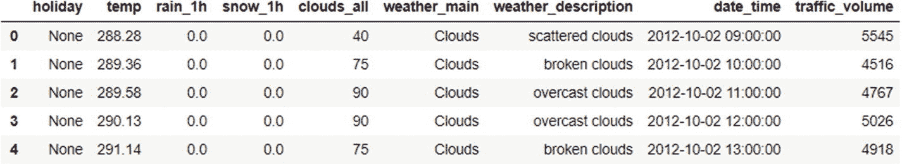

```
df.describe()
```

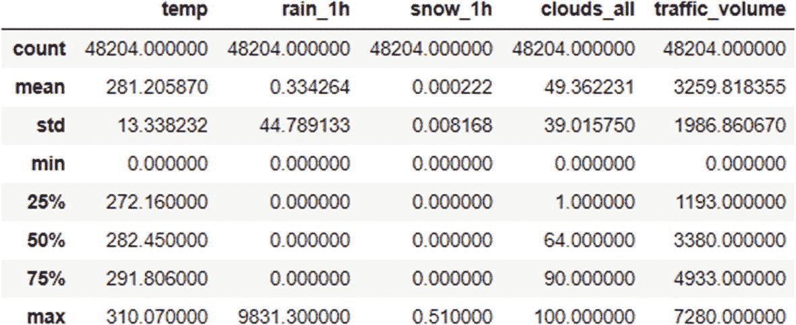

由于同一小时存在不同的天气状况，让我们删除重复项。

```
df.drop_duplicates(subset=['date_time'], keep=False,inplace=True)
```

划分训练集/测试集。我们保留最后十小时的数据（即十条记录），用于在历史数据训练后验证模型。

```
validate = df['traffic_volume'].tail(10)
df.drop(df['traffic_volume'].tail(10).index,inplace=True)
uni_data = df['traffic_volume']
uni_data.index = df['date_time']
uni_data.head()
```


让我们对数据进行缩放，因为已知神经网络在特征处于同一尺度时，收敛速度更快且精度更高。

```
uni_data = uni_data.values
scaler_x = preprocessing.MinMaxScaler()
x_rescaled = scaler_x.fit_transform(uni_data.reshape(-1, 1))
```

定义一个函数，用于准备适用于时间序列问题的单变量数据。

```
def custom_ts_univariate_data_prep(dataset, start, end, window, horizon):
    X = []
    y = []
    start = start + window
    if end is None:
        end = len(dataset) - horizon
    for i in range(start, end):
        indicesx = range(i-window, i)
        X.append(np.reshape(dataset[indicesx], (window, 1)))
        indicesy = range(i,i+horizon)
        y.append(dataset[indicesy])
    return np.array(X), np.array(y)
```

由于我们进行的是单步预测，让模型基于过去 48 小时的数据进行训练，并尝试预测第 49 小时的数据；因此，设置 `horizon` = 1。

```
univar_hist_window = 48
horizon = 1
TRAIN_SPLIT = 30000
x_train_uni, y_train_uni = custom_ts_univariate_data_prep(x_rescaled, 0, TRAIN_SPLIT, univar_hist_window, horizon)
x_val_uni, y_val_uni = custom_ts_univariate_data_prep(x_rescaled, TRAIN_SPLIT, None, univar_hist_window, horizon)
```

使用 `tf.data` 函数准备训练和验证时间序列数据，这是一种向模型提供数据更快、更高效的方式。

```
BATCH_SIZE = 256
BUFFER_SIZE = 150
train_univariate = tf.data.Dataset.from_tensor_slices((x_train_uni, y_train_uni))
train_univariate = train_univariate.cache().shuffle(BUFFER_SIZE).batch(BATCH_SIZE).repeat()
val_univariate = tf.data.Dataset.from_tensor_slices((x_val_uni, y_val_uni))
val_univariate = val_univariate.batch(BATCH_SIZE).repeat()
```

定义双向 LSTM 模型。

```
Bi_lstm_model = tf.keras.models.Sequential([
    tf.keras.layers.Bidirectional(tf.keras.layers.LSTM(100, return_sequences=True), input_shape=x_train_uni.shape[-2:]),
    tf.keras.layers.Bidirectional(tf.keras.layers.LSTM(50)),
    tf.keras.layers.Dense(20, activation='softmax'),
    tf.keras.layers.Dropout(0.2),
    tf.keras.layers.Dense(units=1),
])
Bi_lstm_model.compile(optimizer='adam', loss='mse')
```

最佳权重保存在 `model_path`。

```
model_path = r'\Chapter 6\Bi_directional_LSTM_Univarient_2.h5'
```

配置模型，并开始使用早停和检查点进行训练。

早停：当监控的损失在超过耐心值后开始增加时，停止训练。

检查点：在模型达到最小损失时保存模型权重。

```
EVALUATION_INTERVAL = 100
EPOCHS = 150
history = Bi_lstm_model.fit(train_univariate, epochs=EPOCHS, steps_per_epoch=EVALUATION_INTERVAL, validation_data=val_univariate, validation_steps=50, verbose=1,
callbacks =[tf.keras.callbacks.EarlyStopping(monitor='val_loss', min_delta=0, patience=10, verbose=1, mode='min'), tf.keras.callbacks.ModelCheckpoint(model_path, monitor='val_loss', save_best_only=True, mode='min', verbose=0)])
```

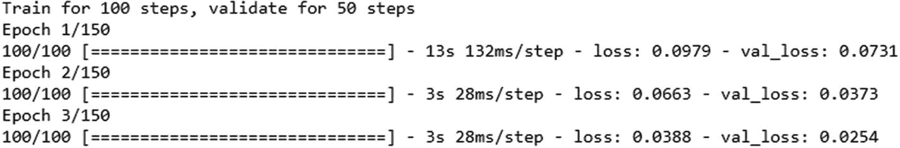

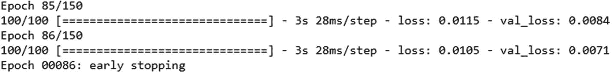

前面的示例显示模型在 86 个 epoch 内停止，而不是运行 150 个 epoch。将最佳权重加载到模型中。

```
Trained_model = tf.keras.models.load_model(model_path)
```

查看模型摘要。

```
Trained_model.summary()
```

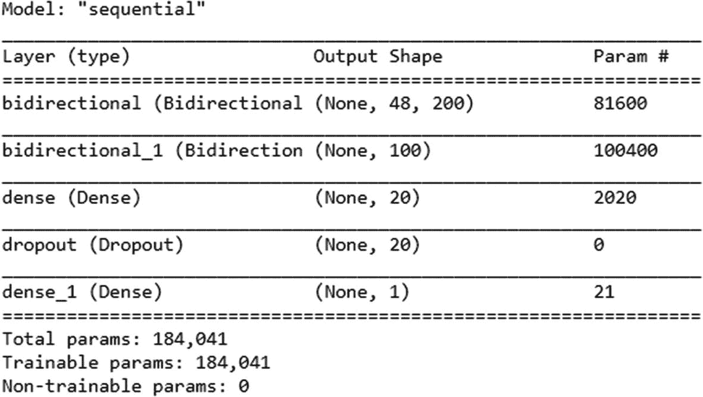

查看模型摘要。

```
plt.plot(history.history['loss'])
plt.plot(history.history['val_loss'])
plt.title('Model loss')
plt.ylabel('loss')
plt.xlabel('epoch')
plt.legend(['train loss', 'validation loss'], loc='upper left')
plt.rcParams["figure.figsize"] = [16,9]
plt.show()
```

图 6-7 展示了一个折线图，有助于我们理解一个好的模型是如何进行泛化的。

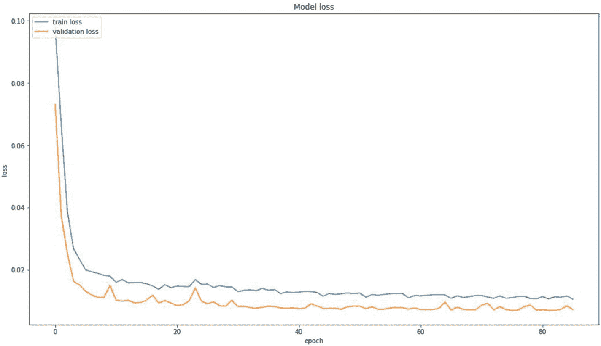

图 6-7

训练损失和验证损失随 epoch 数量增加的变化情况

我们需要预测接下来的十步，但我们的模型每次只预测一个时间步，因此让我们从训练数据中取最后 48 小时的数据，每次递增一个预测值，并预测后续的值。

```
uni = df['traffic_volume']
validatehori = uni.tail(48)
validatehist = validatehori.values
result = []
# 在此处定义预测长度
window_len = 10
val_rescaled = scaler_x.fit_transform(validatehist.reshape(-1, 1))
for i in range(1, window_len+1):
    val_rescaled = val_rescaled.reshape((1, val_rescaled.shape[0], 1))
    Predicted_results = Trained_model.predict(val_rescaled)
    print(f'predicted : {Predicted_results}')
    result.append(Predicted_results[0])
    val_rescaled = np.append(val_rescaled[:,1:],[[Predicted_results]])
    print(val_rescaled)
```

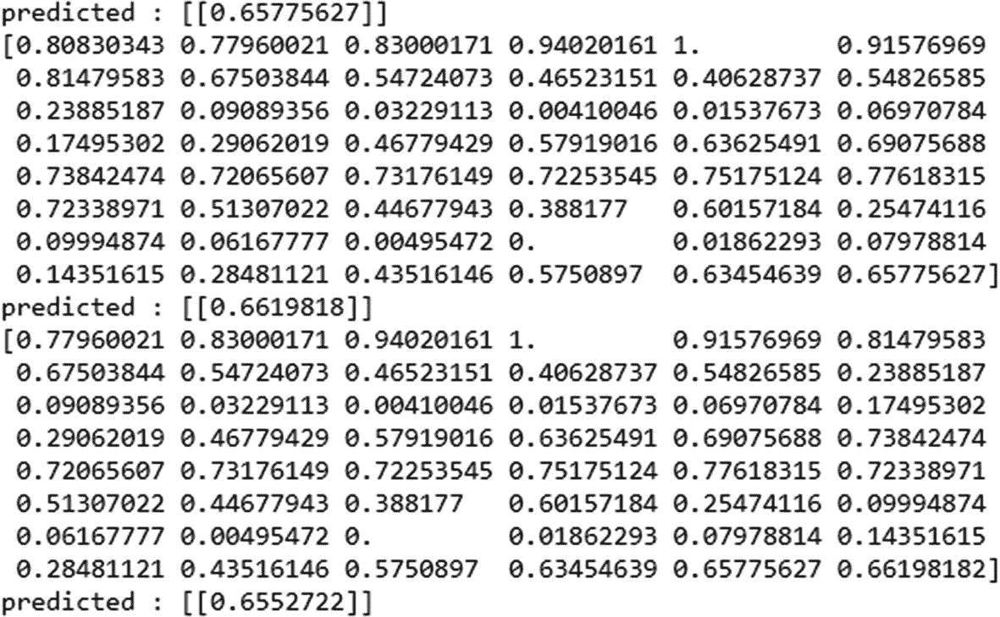

将预测值重新缩放回原始尺度。

```
result_inv_trans = scaler_x.inverse_transform(result)
```

定义时间序列评估函数。

```
from sklearn import metrics
def timeseries_evaluation_metrics_func(y_true, y_pred):
    def mean_absolute_percentage_error(y_true, y_pred):
        y_true, y_pred = np.array(y_true), np.array(y_pred)
        return np.mean(np.abs((y_true - y_pred) / y_true)) * 100
    print('Evaluation metric results:-')
    print(f'MSE is : {metrics.mean_squared_error(y_true, y_pred)}')
    print(f'MAE is : {metrics.mean_absolute_error(y_true, y_pred)}')
    print(f'RMSE is : {np.sqrt(metrics.mean_squared_error(y_true, y_pred))}')
    print(f'MAPE is : {mean_absolute_percentage_error(y_true, y_pred)}')
    print(f'R2 is : {metrics.r2_score(y_true, y_pred)}',end='\n\n')
timeseries_evaluation_metrics_func(validate,result_inv_trans)
```

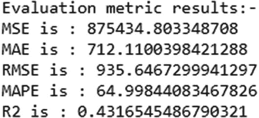

绘制实际值与预测值的对比图。

```
plt.plot( list(validate))
plt.plot( list(result_inv_trans))
plt.title("Actual vs Predicted")
plt.ylabel("Traffic volume")
plt.legend(('Actual','predicted'))
plt.show()
```

图 6-8 展示了一个折线图，描绘了实际值和预测值随时间的变化情况。

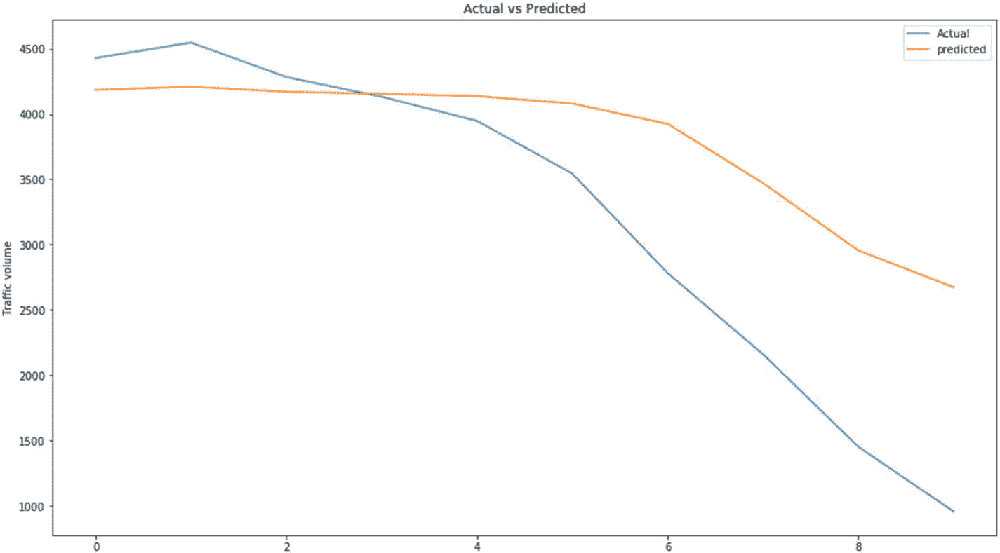

图 6-8


实际值与预测值的对比

## 双向 LSTM 单变量水平预测实战

本节将使用水平预测数据准备方法和双向 LSTM 来解决单变量时间序列问题。

导入所需库并加载 CSV 文件。

```
import pandas as pd
import numpy as np
import tensorflow as tf
from sklearn import preprocessing
import matplotlib.pyplot as plt
tf.random.set_seed(123)
np.random.seed(123)
```

通过查看五数汇总来快速预览数据。

```
df = pd.read_csv(r'\Data\Metro_Interstate_Traffic_Volume.csv')
df.head()
```


```
df.describe()
```


删除重复项，因为同一小时存在不同的天气状况。

```
df.drop_duplicates(subset=['date_time'], keep=False,inplace=True)
```

划分训练集/测试集。我们保留最后十小时的数据（即十条记录），用于在历史数据训练完成后验证模型效果。

```
validate = df['traffic_volume'].tail(10)
df.drop(df['traffic_volume'].tail(10).index,inplace=True)
uni_data = df['traffic_volume']
uni_data.index = df['date_time']
uni_data.head()
```


对数据进行缩放，因为神经网络在特征处于同一量级时收敛更快且精度更高。

```
uni_data = uni_data.values
scaler_x = preprocessing.MinMaxScaler()
x_rescaled = scaler_x.fit_transform(uni_data.reshape(-1, 1))
```

定义适用于时间序列的单变量数据准备函数。

由于我们采用水平预测方式，让模型基于过去 48 小时的数据进行训练，并尝试预测未来十小时的结果。因此设置`horizon = 10`。

```
def custom_ts_univariate_data_prep(dataset, start, end, window, horizon):
X = []
y = []
start = start + window
if end is None:
end = len(dataset) - horizon
for i in range(start, end):
indicesx = range(i-window, i)
X.append(np.reshape(dataset[indicesx], (window, 1)))
indicesy = range(i,i+horizon)
y.append(dataset[indicesy])
return np.array(X), np.array(y)
univar_hist_window = 48
horizon = 10
TRAIN_SPLIT = 30000
x_train_uni, y_train_uni = custom_ts_univariate_data_prep(x_rescaled, 0, TRAIN_SPLIT,univar_hist_window, horizon)
x_val_uni, y_val_uni = custom_ts_univariate_data_prep(x_rescaled, TRAIN_SPLIT, None,univar_hist_window,horizon)
```

使用`tf.data`函数准备训练和验证时间序列数据，这是一种更快速高效的数据输入方式。

```
BATCH_SIZE = 256
BUFFER_SIZE = 150
train_univariate = tf.data.Dataset.from_tensor_slices((x_train_uni, y_train_uni))
train_univariate = train_univariate.cache().shuffle(BUFFER_SIZE).batch(BATCH_SIZE).repeat()
val_univariate = tf.data.Dataset.from_tensor_slices((x_val_uni, y_val_uni))
val_univariate = val_univariate.batch(BATCH_SIZE).repeat()
```

以下是双向 LSTM 模型：

```
Bi_lstm_model = tf.keras.models.Sequential([
tf.keras.layers.Bidirectional(tf.keras.layers.LSTM(100, return_sequences=True),
input_shape=x_train_uni.shape[-2:]),
tf.keras.layers.Bidirectional(tf.keras.layers.LSTM(50)),
tf.keras.layers.Dense(20, activation='softmax'),
tf.keras.layers.Dropout(0.2),
tf.keras.layers.Dense(units=horizon),
])
Bi_lstm_model.compile(optimizer='adam', loss='mse')
```

最佳权重保存在`model_path`路径下。

```
model_path = r'\Chapter 6\Bidirectional_LSTM_Univarient_1.h5'
```

配置模型并开始训练，同时启用早停和检查点机制。

早停会在监测的损失值超过容忍范围时停止训练。

检查点会在模型达到最小损失时保存权重。


```
EVALUATION_INTERVAL = 100
EPOCHS = 100
history = Bi_lstm_model.fit(train_univariate, epochs=EPOCHS,steps_per_epoch=EVALUATION_INTERVAL,validation_data=val_univariate, validation_steps=50,verbose =1,
callbacks =[tf.keras.callbacks.EarlyStopping(monitor='val_loss', min_delta=0, patience=10, verbose=1, mode='min'),tf.keras.callbacks.ModelCheckpoint(model_path,monitor='val_loss', save_best_only=True, mode='min', verbose=0)])
```

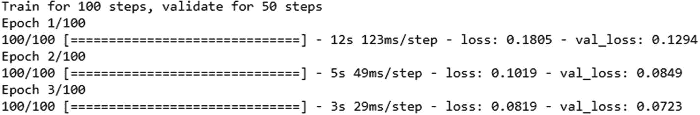

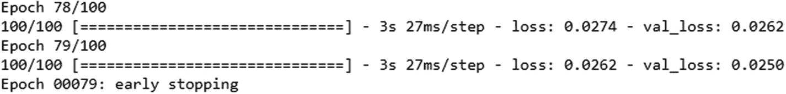

上一个示例显示，模型在 79 个 epoch 内停止，而不是运行 150 个 epoch。将最佳权重加载到模型中。

```
Trained_model = tf.keras.models.load_model(model_path)
```

查看模型摘要。

```
Trained_model.summary()
```

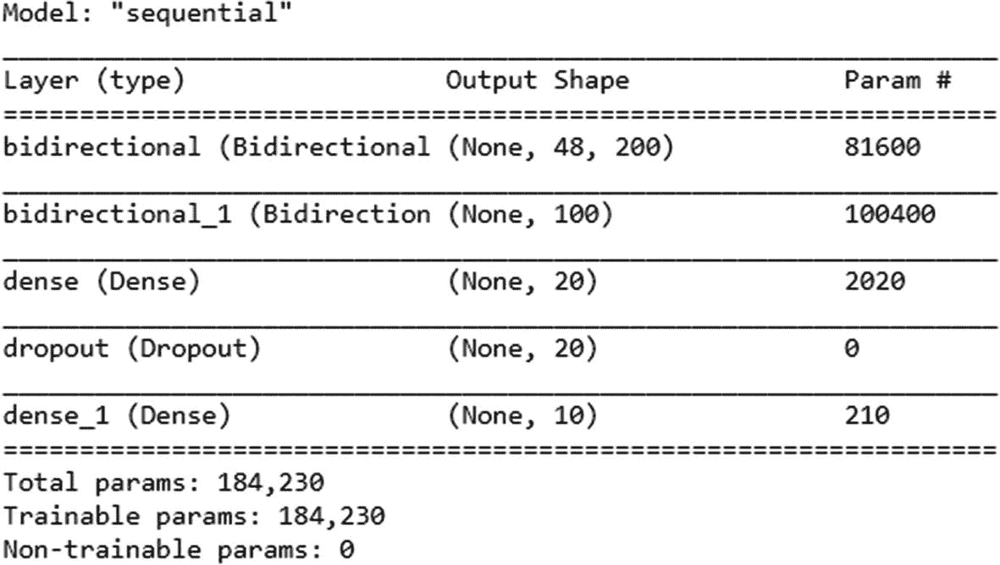

绘制`loss`和`val_loss`随 epoch 变化的曲线。

```
plt.plot(history.history['loss'])
plt.plot(history.history['val_loss'])
plt.title('Model loss')
plt.ylabel('loss')
plt.xlabel('epoch')
plt.legend(['train loss', 'validation loss'], loc='upper left')
plt.rcParams["figure.figsize"] = [16,9]
plt.show()
```

图 6-9 描绘了一条折线图，有助于我们理解一个优秀的模型是如何实现泛化的。

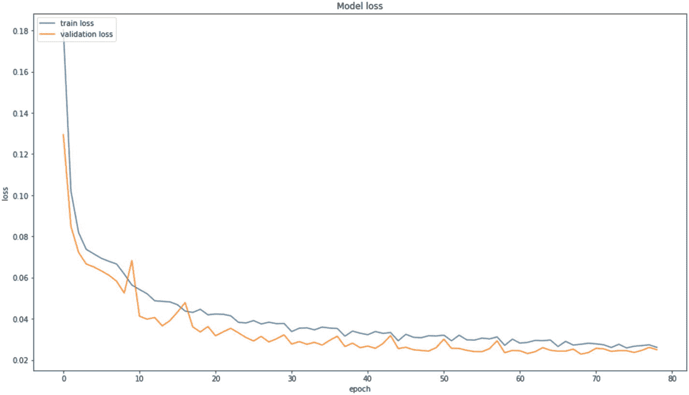

图 6-9

训练损失和验证损失随 epoch 数量增加的变化情况

我们需要预测接下来的十个时间步，因此从训练模型中取出最后 48 小时的数据，并预测接下来十小时的值。

```
uni = df['traffic_volume']
validatehori = uni.tail(48)
validatehist = validatehori.values
scaler_val = preprocessing.StandardScaler()
val_rescaled = scaler_x.fit_transform(validatehist.reshape(-1, 1))
val_rescaled = val_rescaled.reshape((1, val_rescaled.shape[0], 1))
Predicted_results = Trained_model.predict(val_rescaled)
Predicted_results
```

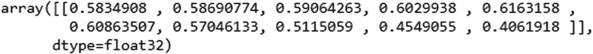

将预测值重新缩放回原始尺度。

```
Predicted_inver_res = scaler_x.inverse_transform(Predicted_results)
Predicted_inver_res
```

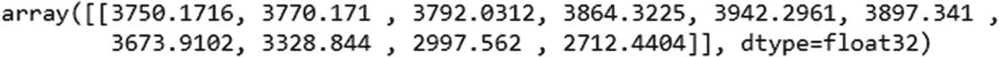

定义时间序列评估函数。

```
from sklearn import metrics
def timeseries_evaluation_metrics_func(y_true, y_pred):
def mean_absolute_percentage_error(y_true, y_pred):
y_true, y_pred = np.array(y_true), np.array(y_pred)
return np.mean(np.abs((y_true - y_pred) / y_true)) * 100
print('Evaluation metric results:-')
print(f'MSE is : {metrics.mean_squared_error(y_true, y_pred)}')
print(f'MAE is : {metrics.mean_absolute_error(y_true, y_pred)}')
print(f'RMSE is : {np.sqrt(metrics.mean_squared_error(y_true, y_pred))}')
print(f'MAPE is : {mean_absolute_percentage_error(y_true, y_pred)}')
print(f'R2 is : {metrics.r2_score(y_true, y_pred)}',end='\n\n')
timeseries_evaluation_metrics_func(validate,Predicted_inver_res[0])
```

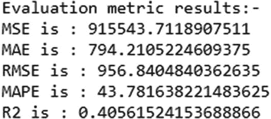

绘制实际值与预测值的对比图。

```
plt.plot( list(validate))
plt.plot( list(Predicted_inver_res[0]))
plt.title("Actual vs Predicted")
plt.ylabel("Traffic volume")
plt.legend(('Actual','predicted'))
plt.show()
```

图 6-10 展示了一条折线图，描绘了实际值和预测值随时间的变化情况。

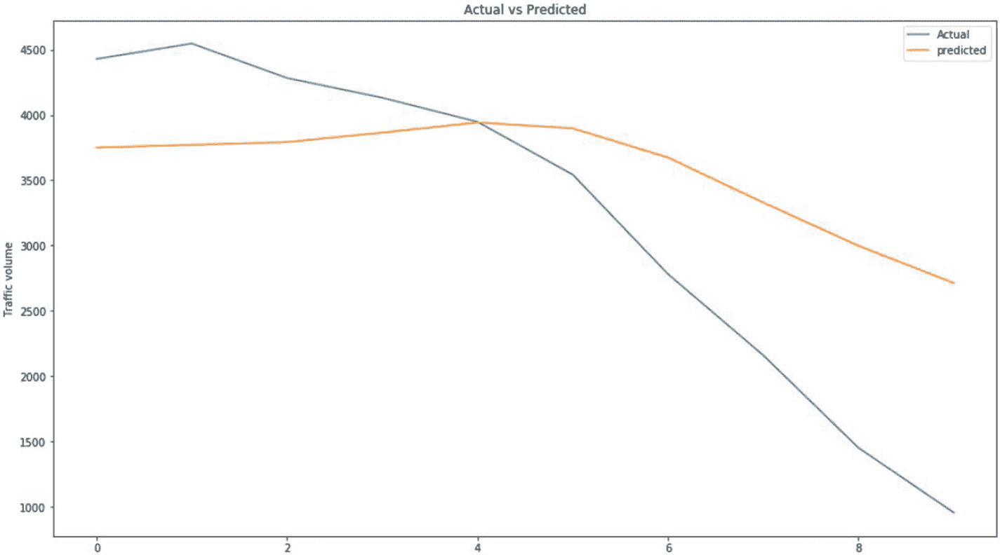

图 6-10

实际值与预测值的对比情况

## GRU 单变量单步风格实战

在本节中，我们将使用单步数据准备和 GRU 来解决单变量时间序列问题。

导入所需的库并加载 CSV 文件。

```
import pandas as pd
import numpy as np
import tensorflow as tf
from sklearn import preprocessing
import matplotlib.pyplot as plt
tf.random.set_seed(123)
np.random.seed(123)
```

让我们加载数据，并通过检查五点摘要来快速浏览数据。

```
df = pd.read_csv(r'\Data\Metro_Interstate_Traffic_Volume.csv')
df.head()
```


```
df.describe()
```


让我们删除重复项，因为同一小时可能包含不同的天气状况。

```
df.drop_duplicates(subset=['date_time'], keep=False,inplace=True)
```

训练/测试分割。我们保留十小时的数据（即十条记录），用于在基于历史数据训练后验证模型。

```
validate = df['traffic_volume'].tail(10)
df.drop(df['traffic_volume'].tail(10).index,inplace=True)
uni_data = df['traffic_volume']
uni_data.index = df['date_time']
uni_data.head()
```


让我们对数据进行重新缩放，因为已知神经网络在特征处于同一尺度时，能以更高的精度更快地收敛。

```
uni_data = uni_data.values
scaler_x = preprocessing.MinMaxScaler()
x_rescaled = scaler_x.fit_transform(uni_data.reshape(-1, 1))
```

定义一个函数，用于准备适合时间序列的单变量数据。

```
def custom_ts_univariate_data_prep(dataset, start, end, window, horizon):
X = []
y = []
start = start + window
if end is None:
end = len(dataset) - horizon
for i in range(start, end):
indicesx = range(i-window, i)
X.append(np.reshape(dataset[indicesx], (window, 1)))
indicesy = range(i,i+horizon)
y.append(dataset[indicesy])
return np.array(X), np.array(y)
```

由于我们进行的是单步预测，让模型查看/训练过去 48 小时的数据，并尝试预测第 49 小时的值；因此，使用`horizon = 1`。

```
univar_hist_window = 48
horizon = 1
TRAIN_SPLIT = 30000
x_train_uni, y_train_uni = custom_ts_univariate_data_prep(x_rescaled, 0, TRAIN_SPLIT,univar_hist_window, horizon)
x_val_uni, y_val_uni = custom_ts_univariate_data_prep(x_rescaled, TRAIN_SPLIT, None,univar_hist_window,horizon)
```

使用`tf.data`函数准备训练和验证时间序列数据，这是一种向模型提供数据的更快、更高效的方式。

```
BATCH_SIZE = 256
BUFFER_SIZE = 150
train_univariate = tf.data.Dataset.from_tensor_slices((x_train_uni, y_train_uni))
train_univariate = train_univariate.cache().shuffle(BUFFER_SIZE).batch(BATCH_SIZE).repeat()
val_univariate = tf.data.Dataset.from_tensor_slices((x_val_uni, y_val_uni))
val_univariate = val_univariate.batch(BATCH_SIZE).repeat()
```

定义 GRU 模型。

```
GRU_model = tf.keras.models.Sequential([
tf.keras.layers.GRU(100, input_shape=x_train_uni.shape[-2:],return_sequences=True),
tf.keras.layers.Dropout(0.2),
tf.keras.layers.GRU(units=50,return_sequences=False),
tf.keras.layers.Dropout(0.2),
tf.keras.layers.Dense(units=1),
])
GRU_model.compile(optimizer='adam', loss='mse')
```

最佳权重存储在`model_path`中。

```
model_path = r'\Chapter 6\GRU_Univarient_2.h5'
```

配置模型并开始训练，同时使用早停和检查点机制。

早停会在监控的损失开始超过耐心值时停止训练。

检查点会在模型达到最小损失时保存模型权重。


```
EVALUATION_INTERVAL = 100
EPOCHS = 150
history = GRU_model.fit(train_univariate, epochs=EPOCHS,steps_per_epoch=EVALUATION_INTERVAL,validation_data=val_univariate, validation_steps=50,verbose =1, callbacks =[tf.keras.callbacks.
EarlyStopping(monitor='val_loss', min_delta=0, patience=10, verbose=1, mode='min'),tf.keras.callbacks.ModelCheckpointDmodel_path,monitor='val_loss', save_best_only=True, mode='min', verbose=0)])
```

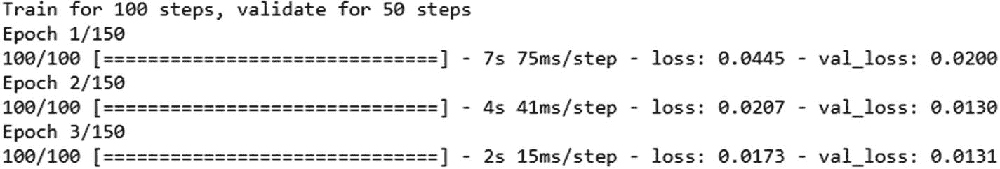


上一个示例显示，模型在第 86 个 epoch 停止，而不是运行完 150 个 epoch。将最佳权重加载到模型中。

```
Trained_model = tf.keras.models.load_model(model_path)
```

查看模型摘要。

```
Trained_model.summary()
```

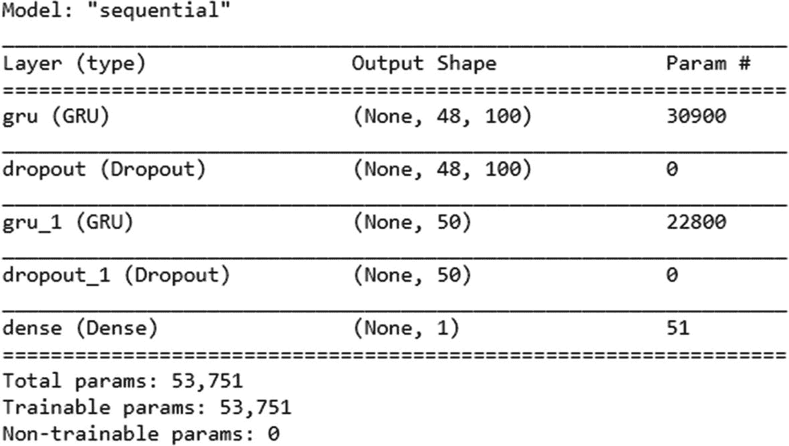

绘制`loss`和`val_loss`随 epoch 变化的曲线。

```
plt.plot(history.history['loss'])
plt.plot(history.history['val_loss'])
plt.title('Model loss')
plt.ylabel('loss')
plt.xlabel('epoch')
plt.legend(['train loss', 'validation loss'], loc='upper left')
plt.rcParams["figure.figsize"] = [16,9]
plt.show()
```

图 6-11 展示了一个折线图，帮助我们理解一个好的模型是如何进行泛化的。

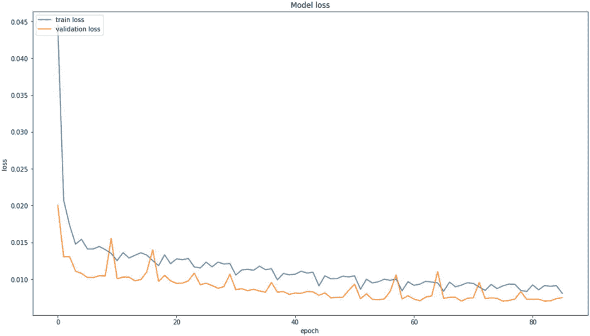

图 6-11

训练损失和验证损失随 epoch 数量增加的变化情况

我们需要预测接下来的十个时间步，但我们的模型每次只预测一个时间步，因此我们取训练数据中最后 48 小时的数据，每次递增一个预测值，并预测后续的值。

```
uni = df['traffic_volume']
validatehori = uni.tail(48)
validatehist = validatehori.values
result = []
# 在此处定义预测长度
window_len = 10
val_rescaled = scaler_x.fit_transform(validatehist.reshape(-1, 1))
for i in range(1, window_len+1):
val_rescaled = val_rescaled.reshape((1, val_rescaled.shape[0], 1))
Predicted_results = Trained_model.predict(val_rescaled)
print(f'预测值 : {Predicted_results}')
result.append(Predicted_results[0])
val_rescaled = np.append(val_rescaled[:,1:],[[Predicted_results]])
print(val_rescaled)
```

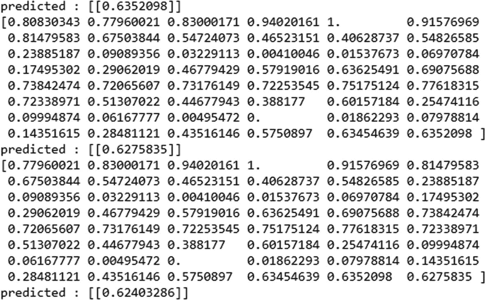

将预测值重新缩放回原始尺度。

```
result_inv_trans = scaler_x.inverse_transform(result)
```

定义时间序列评估函数。

```
from sklearn import metrics
def timeseries_evaluation_metrics_func(y_true, y_pred):
def mean_absolute_percentage_error(y_true, y_pred):
y_true, y_pred = np.array(y_true), np.array(y_pred)
return np.mean(np.abs((y_true - y_pred) / y_true)) * 100
print('评估指标结果：-')
print(f'MSE 为 : {metrics.mean_squared_error(y_true, y_pred)}')
print(f'MAE 为 : {metrics.mean_absolute_error(y_true, y_pred)}')
print(f'RMSE 为 : {np.sqrt(metrics.mean_squared_error(y_true, y_pred))}')
print(f'MAPE 为 : {mean_absolute_percentage_error(y_true, y_pred)}')
print(f'R2 为 : {metrics.r2_score(y_true, y_pred)}',end='\n\n')
timeseries_evaluation_metrics_func(validate,result_inv_trans)
```

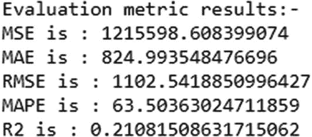

绘制实际值与预测值的对比图。

```
plt.plot( list(validate))
plt.plot( list(result_inv_trans))
plt.title("实际值 vs 预测值")
plt.ylabel("交通流量")
plt.legend(('实际值','预测值'))
plt.show()
```

图 6-12 展示了一个折线图，描绘了实际值和预测值随时间的变化情况。

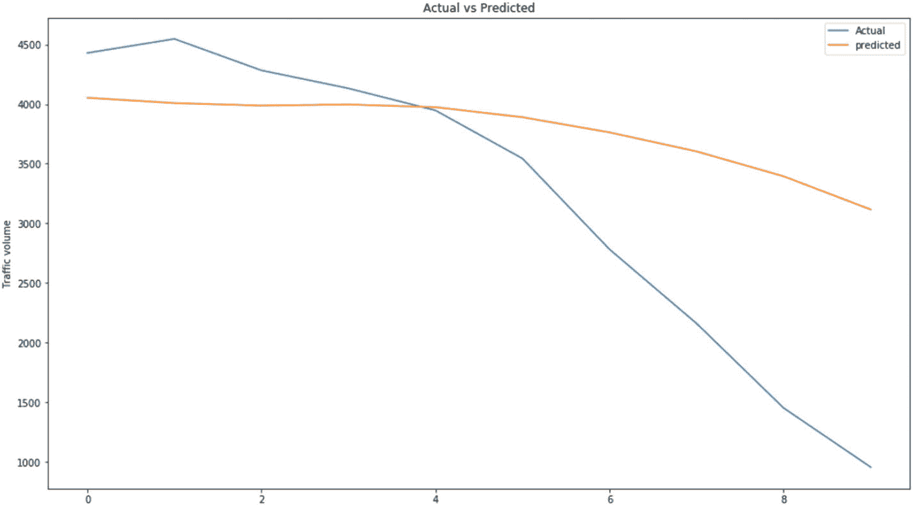

图 6-12

实际值与预测值的对比图

## GRU 单变量水平风格实战

在本节中，我们将使用水平风格的数据准备方法和 GRU 来解决单变量时间序列问题。

导入所需的库并加载 CSV 文件。

```
import pandas as pd
import numpy as np
import tensorflow as tf
from sklearn import preprocessing
import matplotlib.pyplot as plt
tf.random.set_seed(123)
np.random.seed(123)
```

让我们加载数据，并通过查看五点摘要来快速浏览数据。

```
df = pd.read_csv(r'\Data\Metro_Interstate_Traffic_Volume.csv')
df.head()
```


```
df.describe()
```


让我们删除重复项，因为同一小时可能包含不同的天气状况。

```
df.drop_duplicates(subset=['date_time'], keep=False,inplace=True)
```

训练/测试分割。我们保留十小时的数据（即十条记录），用于在基于历史数据训练后验证模型。

```
validate = df['traffic_volume'].tail(10)
df.drop(df['traffic_volume'].tail(10).index,inplace=True)
uni_data = df['traffic_volume']
uni_data.index = df['date_time']
uni_data.head()
```


定义一个函数，用于准备适用于时间序列的单变量数据。

由于我们进行的是水平风格预测，让模型基于过去 48 小时的数据进行训练，并尝试预测接下来十小时的结果；因此，使用`horizon = 10`。

```
uni_data = uni_data.values
scaler_x = preprocessing.MinMaxScaler()
x_rescaled = scaler_x.fit_transform(uni_data.reshape(-1, 1))
def custom_ts_univariate_data_prep(dataset, start, end, window, horizon):
X = []
y = []
start = start + window
if end is None:
end = len(dataset) - horizon
for i in range(start, end):
indicesx = range(i-window, i)
X.append(np.reshape(dataset[indicesx], (window, 1)))
indicesy = range(i,i+horizon)
y.append(dataset[indicesy])
return np.array(X), np.array(y)
univar_hist_window = 48
horizon = 10
TRAIN_SPLIT = 30000
x_train_uni, y_train_uni = custom_ts_univariate_data_prep(x_rescaled, 0, TRAIN_SPLIT,univar_hist_window, horizon)
x_val_uni, y_val_uni = custom_ts_univariate_data_prep(x_rescaled, TRAIN_SPLIT, None,univar_hist_window,horizon)
```

使用`tf.data`函数准备训练和验证时间序列数据，这是一种更快、更高效地向模型提供数据的方式。

```
BATCH_SIZE = 256
BUFFER_SIZE = 150
train_univariate = tf.data.Dataset.from_tensor_slices((x_train_uni, y_train_uni))
train_univariate = train_univariate.cache().shuffle(BUFFER_SIZE).batch(BATCH_SIZE).repeat()
val_univariate = tf.data.Dataset.from_tensor_slices((x_val_uni, y_val_uni))
val_univariate = val_univariate.batch(BATCH_SIZE).repeat()
```

定义 GRU 模型。

```
GRU_model = tf.keras.models.Sequential([
tf.keras.layers.GRU(100, input_shape=x_train_uni.shape[-2:],return_sequences=True),
tf.keras.layers.Dropout(0.2),
tf.keras.layers.GRU(units=50,return_sequences=False),
tf.keras.layers.Dropout(0.2),
tf.keras.layers.Dense(units=horizon),
])
GRU_model.compile(optimizer='adam', loss='mse')
```

最佳权重存储在`model_path`中。

```
model_path = r'\Chapter 6\GRU_Univarient_1.h5'
```

配置模型并开始训练，同时使用早停和检查点机制。

早停会在监控的损失开始超过容忍度时停止训练。

检查点机制会在模型达到最小损失时保存模型权重。


```
EVALUATION_INTERVAL = 100
EPOCHS = 150
history = GRU_model.fit(train_univariate, epochs=EPOCHS,steps_per_epoch=EVALUATION_INTERVAL,validation_data=val_univariate, validation_steps=50,verbose =1,callbacks =[tf.keras.callbacks.
EarlyStopping(monitor='val_loss', min_delta=0, patience=10, verbose=1, mode='min'),tf.keras.callbacks.ModelCheckpoint(model_path,monitor='val_loss', save_best_only=True, mode='min', verbose=0)])
```

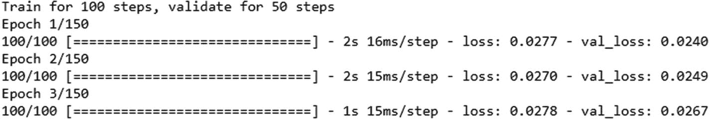


上一个示例显示，模型在 17 个周期内就停止了，而不是运行满 150 个周期。

将最佳权重加载到模型中。

```
Trained_model = tf.keras.models.load_model(model_path)
```

查看模型摘要。

```
Trained_model.summary()
```

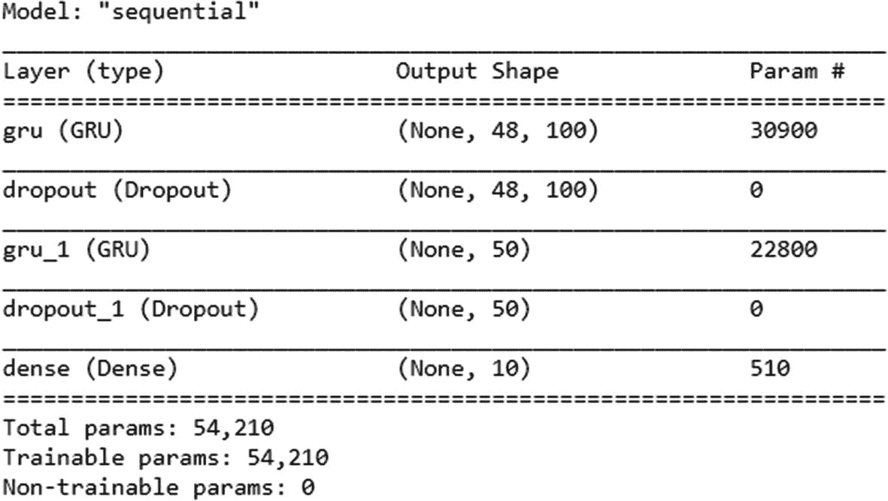

绘制`loss`和`val_loss`随周期变化的曲线。

```
plt.plot(history.history['loss'])
plt.plot(history.history['val_loss'])
plt.title('Model loss')
plt.ylabel('loss')
plt.xlabel('epoch')
plt.legend(['train loss', 'validation loss'], loc='upper left')
plt.rcParams["figure.figsize"] = [16,9]
plt.show()
```

图 6-13 展示的折线图有助于我们理解一个优秀的模型是如何实现良好泛化的。

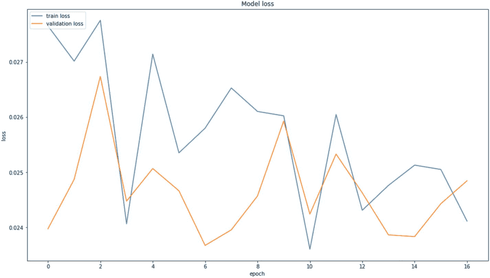

图 6-13

训练损失和验证损失随周期数增加的变化情况

我们需要预测接下来的十个时间步，因此从训练模型中取出最后 48 小时的数据，并预测接下来十小时的值。

```
uni = df['traffic_volume']
validatehori = uni.tail(48)
validatehist = validatehori.values
scaler_val = preprocessing.MinMaxScaler()
val_rescaled = scaler_x.fit_transform(validatehist.reshape(-1, 1))
val_rescaled = val_rescaled.reshape((1, val_rescaled.shape[0], 1))
```

将预测值重新缩放回原始尺度。

```
Predicted_results = Trained_model.predict(val_rescaled)
Predicted_results
```

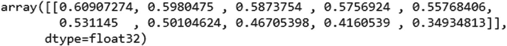

```
Predicted_inver_res = scaler_x.inverse_transform(Predicted_results)
Predicted_inver_res
```

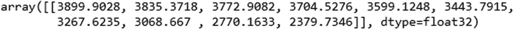

定义时间序列评估函数。

```
from sklearn import metrics
def timeseries_evaluation_metrics_func(y_true, y_pred):
def mean_absolute_percentage_error(y_true, y_pred):
y_true, y_pred = np.array(y_true), np.array(y_pred)
return np.mean(np.abs((y_true - y_pred) / y_true)) * 100
print('Evaluation metric results:-')
print(f'MSE is : {metrics.mean_squared_error(y_true, y_pred)}')
print(f'MAE is : {metrics.mean_absolute_error(y_true, y_pred)}')
print(f'RMSE is : {np.sqrt(metrics.mean_squared_error(y_true, y_pred))}')
print(f'MAPE is : {mean_absolute_percentage_error(y_true, y_pred)}')
print(f'R2 is : {metrics.r2_score(y_true, y_pred)}',end='\n\n')
timeseries_evaluation_metrics_func(validate,Predicted_inver_res[0])
```

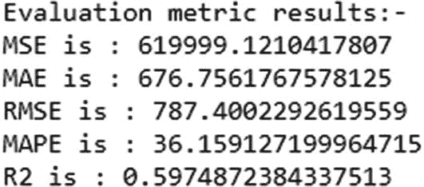

绘制实际值与预测值的对比图。

```
plt.plot( list(validate))
plt.plot( list(Predicted_inver_res[0]))
plt.title("Actual vs Predicted")
plt.ylabel("Traffic volume")
plt.legend(('Actual','predicted'))
plt.show()
```

图 6-14 展示的折线图描绘了实际值与预测值随时间的变化情况。

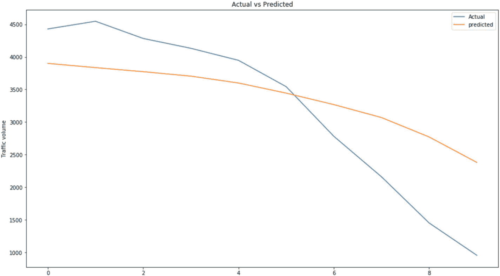

图 6-14

实际值与预测值的对比图


## 实战：自编码器 LSTM 单变量单步预测风格

在本节中，我们将使用单步数据准备和自编码器 LSTM 来解决单变量时间序列问题。

导入所需库并加载 CSV 文件。

```
import pandas as pd
import numpy as np
import tensorflow as tf
from sklearn import preprocessing
import matplotlib.pyplot as plt
tf.random.set_seed(123)
np.random.seed(123)
```

让我们通过查看五数汇总来快速预览数据。

```
df = pd.read_csv(r'\Data\Metro_Interstate_Traffic_Volume.csv')
df.head()
```


```
df.describe()
```


让我们删除重复项，因为同一小时可能包含不同的天气状况。

```
df.drop_duplicates(subset=['date_time'], keep=False,inplace=True)
```

划分训练集/测试集。我们保留最后十小时的数据（即十条记录），用于在基于历史数据训练后验证模型。

```
validate = df['traffic_volume'].tail(10)
df.drop(df['traffic_volume'].tail(10).index,inplace=True)
uni_data = df['traffic_volume']
uni_data.index = df['date_time']
uni_data.head()
```


让我们对数据进行缩放，因为已知神经网络在特征处于同一尺度时，收敛速度更快且精度更高。

```
uni_data = uni_data.values
scaler_x = preprocessing.MinMaxScaler()
x_rescaled = scaler_x.fit_transform(uni_data.reshape(-1, 1))
```

定义一个函数，用于准备适用于时间序列的单变量数据。

```
def custom_ts_univariate_data_prep(dataset, start, end, window, horizon):
X = []
y = []
start = start + window
if end is None:
end = len(dataset) - horizon
for i in range(start, end):
indicesx = range(i-window, i)
X.append(np.reshape(dataset[indicesx], (window, 1)))
indicesy = range(i,i+horizon)
y.append(dataset[indicesy])
return np.array(X), np.array(y)
```

由于我们进行的是单步预测，让模型基于过去 48 小时的数据进行训练/观察，并尝试预测第 49 小时的数据；因此，使用 `horizon = 1`。

```
univar_hist_window = 48
horizon = 1
TRAIN_SPLIT = 30000
x_train_uni, y_train_uni = custom_ts_univariate_data_prep(x_rescaled, 0, TRAIN_SPLIT,univar_hist_window, horizon)
x_val_uni, y_val_uni = custom_ts_univariate_data_prep(x_rescaled, TRAIN_SPLIT, None,univar_hist_window,horizon)
```

使用 `tf.data` 函数准备训练和验证时间序列数据，这是一种向模型提供数据的更快、更高效的方式。

```
BATCH_SIZE = 256
BUFFER_SIZE = 150
train_univariate = tf.data.Dataset.from_tensor_slices((x_train_uni, y_train_uni))
train_univariate = train_univariate.cache().shuffle(BUFFER_SIZE).batch(BATCH_SIZE).repeat()
val_univariate = tf.data.Dataset.from_tensor_slices((x_val_uni, y_val_uni))
val_univariate = val_univariate.batch(BATCH_SIZE).repeat()
```

定义编码器-解码器模型。

```
ED_lstm_model = tf.keras.models.Sequential([
tf.keras.layers.LSTM(100, input_shape=x_train_uni.shape[-2:], return_sequences=True),
tf.keras.layers.LSTM(units=50,return_sequences=True),
tf.keras.layers.LSTM(units=15),
tf.keras.layers.RepeatVector(y_train_uni.shape[1]),
tf.keras.layers.LSTM(units=100,return_sequences=True),
tf.keras.layers.LSTM(units=50,return_sequences=True),
tf.keras.layers.TimeDistributed(tf.keras.layers.Dense(units=1))
])
ED_lstm_model.compile(optimizer='adam', loss='mse')
```

最佳权重保存在 `model_path` 中。

```
model_path = r'\Chapter 6\LSTM_encoder_decoder_Univarient_2.h5'
```

配置模型并开始训练，同时使用早停和检查点机制。

早停会在监测的损失开始超过容忍度时停止训练。

检查点会在模型权重达到最小损失时保存它们。


```
EVALUATION_INTERVAL = 100
EPOCHS = 150
history = ED_lstm_model.fit(train_univariate, epochs=EPOCHS,steps_per_epoch=EVALUATION_INTERVAL,validation_data=val_univariate, validation_steps=50,verbose =1,
callbacks =[tf.keras.callbacks.EarlyStopping(monitor='val_loss', min_delta=0, patience=10, verbose=1, mode='min'),tf.keras.callbacks.ModelCheckpoint(model_path,monitor='val_loss', save_best_only=True, mode='min', verbose=0)])
```


前面的示例显示，模型在 64 个 epoch 内就停止了，而不是运行 150 个 epoch。将最佳权重加载到模型中。

```
Trained_model = tf.keras.models.load_model(model_path)
```

查看模型摘要。

```
Trained_model.summary()
```

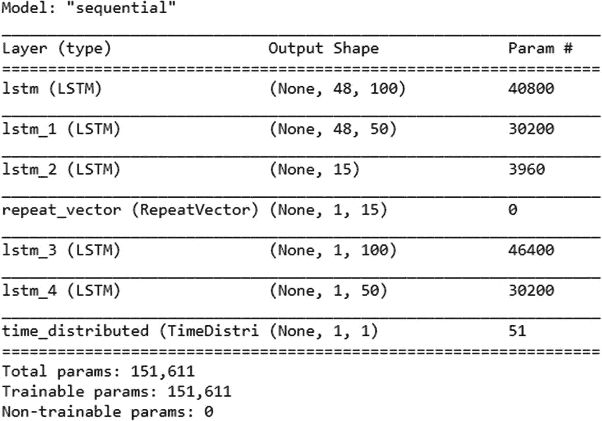

绘制 `loss` 和 `val_loss` 随 epoch 变化的曲线。

```
plt.plot(history.history['loss'])
plt.plot(history.history['val_loss'])
plt.title('Model loss')
plt.ylabel('loss')
plt.xlabel('epoch')
plt.legend(['train loss', 'validation loss'], loc='upper left')
plt.rcParams["figure.figsize"] = [16,9]
plt.show()
```

图 6-15 展示了一个折线图，帮助我们理解一个好的模型是如何进行泛化的。

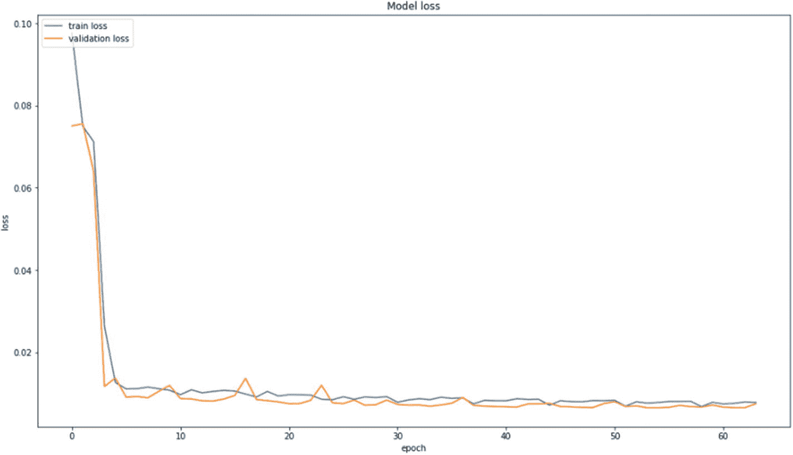

图 6-15

训练损失和验证损失随 epoch 数量增加的变化情况

我们需要预测接下来的十步，但我们的模型每次只预测一个时间步，因此我们取训练数据中最后 48 小时的数据，每次递增一个预测值，并预测后续的值。

```
uni = df['traffic_volume']
validatehori = uni.tail(48)
validatehist = validatehori.values
result = []
# Define Forecast length here
window_len = 10
val_rescaled = scaler_x.fit_transform(validatehist.reshape(-1, 1))
for i in range(1, window_len+1):
val_rescaled = val_rescaled.reshape((1, val_rescaled.shape[0], 1))
Predicted_results = Trained_model.predict(val_rescaled)
print(f'predicted : {Predicted_results}')
result.append(Predicted_results[0])
val_rescaled = np.append(val_rescaled[:,1:],[[Predicted_results]])
print(val_rescaled)
```

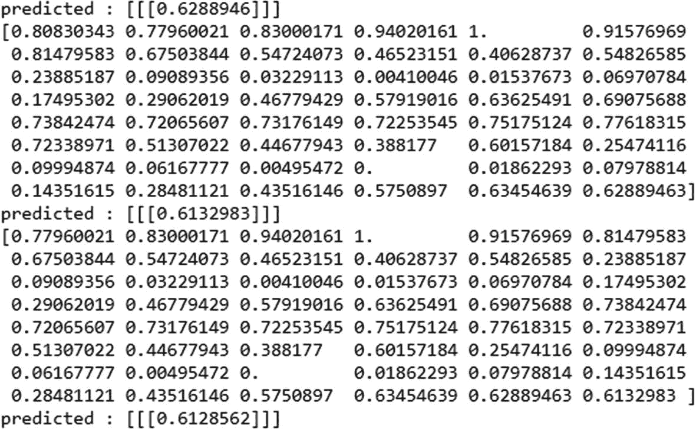

将预测值重新缩放回原始尺度。

```
result_inv_trans = scaler_x.inverse_transform(np.array(result).reshape(-1,1))
```

定义时间序列评估函数。

```
from sklearn import metrics
def timeseries_evaluation_metrics_func(y_true, y_pred):
def mean_absolute_percentage_error(y_true, y_pred):
y_true, y_pred = np.array(y_true), np.array(y_pred)
return np.mean(np.abs((y_true - y_pred) / y_true)) * 100
print('Evaluation metric results:-')
print(f'MSE is : {metrics.mean_squared_error(y_true, y_pred)}')
print(f'MAE is : {metrics.mean_absolute_error(y_true, y_pred)}')
print(f'RMSE is : {np.sqrt(metrics.mean_squared_error(y_true, y_pred))}')
print(f'MAPE is : {mean_absolute_percentage_error(y_true, y_pred)}')
print(f'R2 is : {metrics.r2_score(y_true, y_pred)}',end='\n\n')
timeseries_evaluation_metrics_func(validate,result_inv_trans)
```


绘制实际值与预测值的对比图。

```
plt.plot( list(validate))
plt.plot( list(result_inv_trans))
plt.title("Actual vs Predicted")
plt.ylabel("Traffic volume")
plt.legend(('Actual','predicted'))
plt.show()
```

图 6-16 展示了折线图，描绘了实际值和预测值随时间的变化情况。


图 6-16

实际值与预测值的对比情况


## 实战：自编码器 LSTM 单变量水平线风格

在本节中，我们将使用水平线风格的数据准备和自编码器 LSTM 来解决单变量时间序列问题。

导入所需的库并加载 CSV 文件。

```
import pandas as pd
import numpy as np
import tensorflow as tf
from sklearn import preprocessing
import matplotlib.pyplot as plt
tf.random.set_seed(123)
np.random.seed(123)
```

让我们通过检查五点摘要来快速浏览数据。

```
df = pd.read_csv(r'\Data\Metro_Interstate_Traffic_Volume.csv')
df.head()
```


```
df.describe()
```


让我们删除重复项，因为同一小时可能包含不同的天气状况。

```
df.drop_duplicates(subset=['date_time'], keep=False,inplace=True)
validate = df['traffic_volume'].tail(10)
df.drop(df['traffic_volume'].tail(10).index,inplace=True)
uni_data = df['traffic_volume']
uni_data.index = df['date_time']
uni_data.head()
```


让我们重新缩放数据，因为已知当特征处于同一尺度时，神经网络会以更高的精度更快地收敛。

```
uni_data = uni_data.values
scaler_x = preprocessing.MinMaxScaler()
x_rescaled = scaler_x.fit_transform(uni_data.reshape(-1, 1))
```

定义一个函数来准备适用于时间序列的单变量数据。

由于我们正在进行水平线风格的预测，让模型查看/训练过去 48 小时的数据，并尝试预测接下来十小时的结果。因此，使用 `horizon = 10`。

```
def custom_ts_univariate_data_prep(dataset, start, end, window, horizon):
X = []
y = []
start = start + window
if end is None:
end = len(dataset) - horizon
for i in range(start, end):
indicesx = range(i-window, i)
X.append(np.reshape(dataset[indicesx], (window, 1)))
indicesy = range(i,i+horizon)
y.append(dataset[indicesy])
return np.array(X), np.array(y)
univar_hist_window = 48
horizon = 10
TRAIN_SPLIT = 30000
x_train_uni, y_train_uni = custom_ts_univariate_data_prep(x_rescaled, 0, TRAIN_SPLIT,univar_hist_window, horizon)
x_val_uni, y_val_uni = custom_ts_univariate_data_prep(x_rescaled, TRAIN_SPLIT, None,univar_hist_window,horizon)
```

使用 `tf.data` 函数准备训练和验证时间序列数据，这是一种向模型提供数据的更快、更高效的方式。

```
BATCH_SIZE = 256
BUFFER_SIZE = 150
train_univariate = tf.data.Dataset.from_tensor_slices((x_train_uni, y_train_uni))
train_univariate = train_univariate.cache().shuffle(BUFFER_SIZE).batch(BATCH_SIZE).repeat()
val_univariate = tf.data.Dataset.from_tensor_slices((x_val_uni, y_val_uni))
val_univariate = val_univariate.batch(BATCH_SIZE).repeat()
```

定义自编码器模型。

```
ED_lstm_model = tf.keras.models.Sequential([
tf.keras.layers.LSTM(100, input_shape=x_train_uni.shape[-2:], return_sequences=True),
tf.keras.layers.LSTM(units=50,return_sequences=True),
tf.keras.layers.LSTM(units=15),
tf.keras.layers.RepeatVector(y_train_uni.shape[1]),
tf.keras.layers.LSTM(units=100,return_sequences=True),
tf.keras.layers.LSTM(units=50,return_sequences=True),
tf.keras.layers.TimeDistributed(tf.keras.layers.Dense(units=1))
])
ED_lstm_model.compile(optimizer='adam', loss='mse')
```

最佳权重保存在 `model_path`。

```
model_path = r'\Chapter 6\LSTM_encoder_decoder_Univarient_1.h5'
```

配置模型并开始训练，同时使用早停和检查点。

早停在监控的损失超过耐心值时停止训练。

检查点在模型权重达到最小损失时保存它们。

```
EVALUATION_INTERVAL = 100
EPOCHS = 150
history = ED_lstm_model.fit(train_univariate, epochs=EPOCHS,steps_per_epoch=EVALUATION_INTERVAL,validation_data=val_univariate, validation_steps=50,verbose =1,
callbacks =[tf.keras.callbacks.EarlyStopping(monitor='val_loss', min_delta=0, patience=10, verbose=1, mode='min'),tf.keras.callbacks.ModelCheckpoint(model_path,monitor='val_loss', save_best_only=True, mode='min', verbose=0)])
```


前面的示例显示，模型在 72 个 epoch 内停止，而不是运行 150 个 epoch。

将最佳权重加载到模型中。

```
Trained_model = tf.keras.models.load_model(model_path)
```

检查模型摘要。

```
Trained_model.summary()
```


绘制 `loss` 和 `val_loss` 与 epoch 的关系图。

```
plt.plot(history.history['loss'])
plt.plot(history.history['val_loss'])
plt.title('Model loss')
plt.ylabel('loss')
plt.xlabel('epoch')
plt.legend(['train loss', 'validation loss'], loc='upper left')
plt.rcParams["figure.figsize"] = [16,9]
plt.show()
```

图 6-17 描绘了一个折线图，帮助我们理解一个好的模型是如何进行泛化的。


图 6-17

训练损失和验证损失随 epoch 数量增加的变化表示

我们需要预测接下来的十步，所以让我们从训练模型中获取最后 48 小时的数据，并预测接下来十小时的值。

```
uni = df['traffic_volume']
validatehori = uni.tail(48)
validatehist = validatehori.values
scaler_val = preprocessing.MinMaxScaler()
val_rescaled = scaler_x.fit_transform(validatehist.reshape(-1, 1))
val_rescaled = val_rescaled.reshape((1, val_rescaled.shape[0], 1))
Predicted_results = Trained_model.predict(val_rescaled)
Predicted_results
```


将预测值重新缩放回原始尺度。

```
Predicted_inver_res = scaler_x.inverse_transform(Predicted_results[0])
Predicted_inver_res
```


定义时间序列评估函数。

```
from sklearn import metrics
def timeseries_evaluation_metrics_func(y_true, y_pred):
def mean_absolute_percentage_error(y_true, y_pred):
y_true, y_pred = np.array(y_true), np.array(y_pred)
return np.mean(np.abs((y_true - y_pred) / y_true)) * 100
print('Evaluation metric results:-')
print(f'MSE is : {metrics.mean_squared_error(y_true, y_pred)}')
print(f'MAE is : {metrics.mean_absolute_error(y_true, y_pred)}')
print(f'RMSE is : {np.sqrt(metrics.mean_squared_error(y_true, y_pred))}')
print(f'MAPE is : {mean_absolute_percentage_error(y_true, y_pred)}')
print(f'R2 is : {metrics.r2_score(y_true, y_pred)}',end='\n\n')
timeseries_evaluation_metrics_func(validate,Predicted_inver_res)
```


绘制实际值与预测值的对比图。

```
plt.plot( list(validate))
plt.plot( list(Predicted_inver_res))
plt.title("Actual vs Predicted")
plt.ylabel("Traffic volume")
plt.legend(('Actual','predicted'))
plt.show()
```

图 6-18 显示了一个折线图，描绘了实际值和预测值随时间的变化。


图 6-18

实际值与预测值的对比表示


## CNN 单变量单步预测实战

在本节中，我们将使用单步数据准备方法和 CNN 来解决单变量时间序列问题。

导入所需库并加载 CSV 文件。

```
import pandas as pd
import numpy as np
import tensorflow as tf
from sklearn import preprocessing
import matplotlib.pyplot as plt
from tensorflow.keras.models import Sequential
from tensorflow.keras.layers import Dense
from tensorflow.keras.layers import Flatten
from tensorflow.keras.layers import Conv1D
from tensorflow.keras.layers import MaxPool1D
from tensorflow.keras.layers import Dropout
tf.random.set_seed(123)
np.random.seed(123)
```

让我们通过查看五数汇总来快速预览数据。

```
df = pd.read_csv(r'\Data\Metro_Interstate_Traffic_Volume.csv')
df.head()
```


```
df.describe()
```


让我们删除重复项，因为同一小时可能包含不同的天气状况。

```
df.drop_duplicates(subset=['date_time'], keep=False,inplace=True)
```

划分训练集/测试集。我们保留最后十小时的数据（即十条记录），用于在基于历史数据训练后进行验证。

```
validate = df['traffic_volume'].tail(10)
df.drop(df['traffic_volume'].tail(10).index,inplace=True)
uni_data = df['traffic_volume']
uni_data.index = df['date_time']
uni_data.head()
```


让我们对数据进行缩放，因为已知神经网络在特征处于同一尺度时，收敛速度更快且精度更高。

```
uni_data = uni_data.values
scaler_x = preprocessing.MinMaxScaler()
x_rescaled = scaler_x.fit_transform(uni_data.reshape(-1, 1))
```

定义一个函数，用于准备适用于时间序列的单变量数据。

```
def custom_ts_univariate_data_prep(dataset, start, end, window, horizon):
X = []
y = []
start = start + window
if end is None:
end = len(dataset) - horizon
for i in range(start, end):
indicesx = range(i-window, i)
X.append(np.reshape(dataset[indicesx], (window, 1)))
indicesy = range(i,i+horizon)
y.append(dataset[indicesy])
return np.array(X), np.array(y)
```

由于我们进行的是单步预测，让模型基于过去 48 小时的数据进行训练，并尝试预测第 49 小时的数据。因此，使用 `horizon = 1`。

```
univar_hist_window = 48
horizon = 1
TRAIN_SPLIT = 30000
x_train_uni, y_train_uni = custom_ts_univariate_data_prep(x_rescaled, 0, TRAIN_SPLIT,univar_hist_window, horizon)
x_val_uni, y_val_uni = custom_ts_univariate_data_prep(x_rescaled, TRAIN_SPLIT, None,univar_hist_window,horizon)
```

使用 `tf.data` 函数准备训练和验证时间序列数据，这是一种向模型提供数据的更快、更高效的方式。

```
BATCH_SIZE = 256
BUFFER_SIZE = 150
train_univariate = tf.data.Dataset.from_tensor_slices((x_train_uni, y_train_uni))
train_univariate = train_univariate.cache().shuffle(BUFFER_SIZE).batch(BATCH_SIZE).repeat()
val_univariate = tf.data.Dataset.from_tensor_slices((x_val_uni, y_val_uni))
val_univariate = val_univariate.batch(BATCH_SIZE).repeat()
```

定义 CNN 模型。

```
model = Sequential()
model.add(Conv1D(filters=64, kernel_size=3, activation='relu', input_shape=(x_train_uni.shape[1], x_train_uni.shape[2])))
model.add(MaxPool1D(pool_size=2))
model.add(Dropout(0.2))
model.add(Flatten())
model.add(Dense(30, activation='relu'))
model.add(Dropout(0.2))
model.add(Dense(1))
model.compile(optimizer='adam', loss='mse')
```

最佳权重保存在 `model_path` 中。

```
model_path = r'\Chapter 6\CNN_Univarient_2.h5'
```

配置模型，并开始使用早停和检查点进行训练。

当监测的损失开始超过容忍度时，早停会停止训练。


检查点机制会在模型损失达到最小值时保存模型权重。

```
EVALUATION_INTERVAL = 100
EPOCHS = 150
history = model.fit(train_univariate, epochs=EPOCHS,steps_per_epoch=EVALUATION_INTERVAL,validation_data=val_univariate, validation_steps=50,verbose =1,callbacks =[tf.keras.callbacks.
EarlyStopping(monitor='val_loss', min_delta=0, patience=10, verbose=1, mode='min'),tf.keras.callbacks.ModelCheckpoint(model_path,monitor='val_loss', save_best_only=True, mode='min', verbose=0)])
```


上一个示例显示，模型在 45 个 epoch 内就停止了，而不是运行 150 个 epoch。将最佳权重加载到模型中。

```
Trained_model = tf.keras.models.load_model(model_path)
```

查看模型摘要。

```
Trained_model.summary()
```


绘制`loss`和`val_loss`随 epoch 变化的曲线。

```
plt.plot(history.history['loss'])
plt.plot(history.history['val_loss'])
plt.title('Model loss')
plt.ylabel('loss')
plt.xlabel('epoch')
plt.legend(['train loss', 'validation loss'], loc='upper left')
plt.rcParams["figure.figsize"] = [16,9]
plt.show()
```

图 6-19 展示了一个折线图，帮助我们理解一个好的模型是如何进行泛化的。


图 6-19

训练损失和验证损失随 epoch 数量增加的变化情况

我们需要预测接下来的十个时间步，但我们的模型每次只预测一个时间步，因此我们取训练数据中最后 48 小时的数据，每次递增一个预测值，并预测后续的值。

```
uni = df['traffic_volume']
validatehori = uni.tail(48)
validatehist = validatehori.values
result = []
# Define Forecast length here
window_len = 10
val_rescaled = scaler_x.fit_transform(validatehist.reshape(-1, 1))
for i in range(1, window_len+1):
val_rescaled = val_rescaled.reshape((1, val_rescaled.shape[0], 1))
Predicted_results = Trained_model.predict(val_rescaled)
print(f'predicted : {Predicted_results}')
result.append(Predicted_results[0])
val_rescaled = np.append(val_rescaled[:,1:],[[Predicted_results]])
print(val_rescaled)
```


将预测值重新缩放回原始尺度。

```
result_inv_trans = scaler_x.inverse_transform(result)
```

定义时间序列评估函数。

```
from sklearn import metrics
def timeseries_evaluation_metrics_func(y_true, y_pred):
def mean_absolute_percentage_error(y_true, y_pred):
y_true, y_pred = np.array(y_true), np.array(y_pred)
return np.mean(np.abs((y_true - y_pred) / y_true)) * 100
print('Evaluation metric results:-')
print(f'MSE is : {metrics.mean_squared_error(y_true, y_pred)}')
print(f'MAE is : {metrics.mean_absolute_error(y_true, y_pred)}')
print(f'RMSE is : {np.sqrt(metrics.mean_squared_error(y_true, y_pred))}')
print(f'MAPE is : {mean_absolute_percentage_error(y_true, y_pred)}')
print(f'R2 is : {metrics.r2_score(y_true, y_pred)}',end='\n\n')
timeseries_evaluation_metrics_func(validate,result_inv_trans)
```


绘制实际值与预测值的对比图。

```
plt.plot( list(validate))
plt.plot( list(result_inv_trans))
plt.title("Actual vs Predicted")
plt.ylabel("Traffic volume")
plt.legend(('Actual','predicted'))
plt.show()
```

图 6-20 展示了一个折线图，描绘了实际值和预测值随时间的变化情况。


图 6-20

实际值与预测值的对比表示


## CNN 单变量水平预测实战

本节我们将使用水平预测数据准备方法和 CNN 来解决单变量时间序列问题。

导入所需库并加载 CSV 文件。

```
import pandas as pd
import numpy as np
import tensorflow as tf
from sklearn import preprocessing
import matplotlib.pyplot as plt
from tensorflow.keras.models import Sequential
from tensorflow.keras.layers import Dense
from tensorflow.keras.layers import Flatten
from tensorflow.keras.layers import Conv1D
from tensorflow.keras.layers import MaxPool1D
from tensorflow.keras.layers import Dropout
tf.random.set_seed(123)
np.random.seed(123)
```

让我们加载数据，并通过查看五点摘要来快速预览数据。

```
df = pd.read_csv(r'\Data\Metro_Interstate_Traffic_Volume.csv')
df.head()
```


```
df.describe()
```


由于同一小时包含不同的天气状况，让我们删除重复项。

```
df.drop_duplicates(subset=['date_time'], keep=False,inplace=True)
```

划分训练/测试集。我们保留最后十小时的数据（即十条记录），用于在历史数据训练后验证模型。

```
validate = df['traffic_volume'].tail(10)
df.drop(df['traffic_volume'].tail(10).index,inplace=True)
```

对数据进行缩放，因为已知神经网络在特征处于同一量级时收敛更快且精度更高。

```
uni_data = df['traffic_volume']
uni_data.index = df['date_time']
uni_data.head()
```


```
uni_data = uni_data.values
scaler_x = preprocessing.MinMaxScaler()
x_rescaled = scaler_x.fit_transform(uni_data.reshape(-1, 1))
```

定义一个函数，用于准备适合时间序列的单变量数据。

由于我们进行的是水平预测，让模型查看/训练过去 48 小时的数据，并尝试预测接下来十小时的结果。因此，使用 `horizon = 10`。

```
def custom_ts_univariate_data_prep(dataset, start, end, window, horizon):
X = []
y = []
start = start + window
if end is None:
end = len(dataset) - horizon
for i in range(start, end):
indicesx = range(i-window, i)
X.append(np.reshape(dataset[indicesx], (window, 1)))
indicesy = range(i,i+horizon)
y.append(dataset[indicesy])
return np.array(X), np.array(y)
univar_hist_window = 48
horizon = 10
TRAIN_SPLIT = 30000
x_train_uni, y_train_uni = custom_ts_univariate_data_prep(x_rescaled, 0, TRAIN_SPLIT,univar_hist_window, horizon)
x_val_uni, y_val_uni = custom_ts_univariate_data_prep(x_rescaled, TRAIN_SPLIT, None,univar_hist_window,horizon)
```

使用 `tf.data` 函数准备训练和验证时间序列数据，这是一种向模型提供数据更快、更高效的方式。

```
BATCH_SIZE = 256
BUFFER_SIZE = 150
train_univariate = tf.data.Dataset.from_tensor_slices((x_train_uni, y_train_uni))
train_univariate = train_univariate.cache().shuffle(BUFFER_SIZE).batch(BATCH_SIZE).repeat()
val_univariate = tf.data.Dataset.from_tensor_slices((x_val_uni, y_val_uni))
val_univariate = val_univariate.batch(BATCH_SIZE).repeat()
```

定义 CNN 模型。

```
model = Sequential()
model.add(Conv1D(filters=64, kernel_size=3, activation='relu', input_shape=(x_train_uni.shape[1], x_train_uni.shape[2])))
model.add(MaxPool1D(pool_size=2))
model.add(Dropout(0.2))
model.add(Flatten())
model.add(Dense(30, activation='relu'))
model.add(Dropout(0.2))
model.add(Dense(horizon))
model.compile(optimizer='adam', loss='mse')
```

最佳权重保存在 `model_path` 中。

```
model_path = r'\Chapter 6\CNN_Univarient_1.h5'
```

配置模型，并启用早停和检查点功能开始训练。


当监测到的损失值开始持续超过容忍度（patience）时，早停法（Early stopping）会停止训练。

检查点（Checkpointing）会在模型权重达到最小损失时保存它们。

```
EVALUATION_INTERVAL = 100
EPOCHS = 150
history = model.fit(train_univariate, epochs=EPOCHS,steps_per_epoch=EVALUATION_INTERVAL,validation_data=val_univariate, validation_steps=50,verbose =1,callbacks =[tf.keras.callbacks.
EarlyStopping(monitor='val_loss', min_delta=0, patience=10, verbose=1, mode='min'),tf.keras.callbacks.ModelCheckpoint(model_path,monitor='val_loss', save_best_only=True, mode='min', verbose=0)])
```


前面的示例显示，模型在 66 个 epoch 内就停止了，而不是运行完 150 个 epoch。

将最佳权重加载到模型中。

```
Trained_model = tf.keras.models.load_model(model_path)
```

查看模型摘要。

```
Trained_model.summary()
```


绘制`loss`和`val_loss`随 epoch 变化的曲线。

```
plt.plot(history.history['loss'])
plt.plot(history.history['val_loss'])
plt.title('Model loss')
plt.ylabel('loss')
plt.xlabel('epoch')
plt.legend(['train loss', 'validation loss'], loc='upper left')
plt.rcParams["figure.figsize"] = [16,9]
plt.show()
```

图 6-21 描绘了一个折线图，帮助我们理解一个好的模型是如何进行泛化的。


图 6-21

训练损失和验证损失随 epoch 数量增加的变化情况

我们需要预测接下来的十个时间步，因此从训练模型中取出最后 48 小时的数据，并预测接下来十小时的值。

```
uni = df['traffic_volume']
validatehori = uni.tail(48)
validatehist = validatehori.values
scaler_val = preprocessing.MinMaxScaler()
val_rescaled = scaler_x.fit_transform(validatehist.reshape(-1, 1))
val_rescaled = val_rescaled.reshape((1, val_rescaled.shape[0], 1))
Predicted_results = Trained_model.predict(val_rescaled)
Predicted_results
```


将预测值重新缩放回原始尺度。

```
Predicted_inver_res = scaler_x.inverse_transform(Predicted_results)
```

定义时间序列评估函数。

```
from sklearn import metrics
def timeseries_evaluation_metrics_func(y_true, y_pred):
def mean_absolute_percentage_error(y_true, y_pred):
y_true, y_pred = np.array(y_true), np.array(y_pred)
return np.mean(np.abs((y_true - y_pred) / y_true)) * 100
print('Evaluation metric results:-')
print(f'MSE is : {metrics.mean_squared_error(y_true, y_pred)}')
print(f'MAE is : {metrics.mean_absolute_error(y_true, y_pred)}')
print(f'RMSE is : {np.sqrt(metrics.mean_squared_error(y_true, y_pred))}')
print(f'MAPE is : {mean_absolute_percentage_error(y_true, y_pred)}')
print(f'R2 is : {metrics.r2_score(y_true, y_pred)}',end='\n\n')
timeseries_evaluation_metrics_func(validate,Predicted_inver_res[0])
```


绘制实际值与预测值的对比图。

```
plt.plot( list(validate))
plt.plot( list(Predicted_inver_res[0]))
plt.title("Actual vs Predicted")
plt.ylabel("Traffic volume")
plt.legend(('Actual','predicted'))
plt.show()
```

图 6-22 展示了一个折线图，描绘了实际值和预测值随时间的变化情况。


图 6-22

实际值与预测值的对比图

## 总结

在本章中，你学习了如何为时间序列准备单步和水平式数据，并使用 LSTM、双向 LSTM、GRU、自编码器和 CNN 解决单变量时间序列问题。在下一章中，你将学习如何使用前沿技术解决多变量时间序列问题。

