# 7. 多变量时间序列的前沿技术

在上一章中，你学习了如何执行单变量时间序列预测。在本章中，你将了解单步和水平式时间序列预测的数据准备，并解决一些多变量时间序列问题。多变量时间序列是一种多个变量都依赖于时间的方法，我们利用这些变量来尝试估计一个目标变量。


## LSTM 多变量水平预测风格实战

本节将使用水平预测风格的数据准备方法和 LSTM 来解决多变量时间序列问题。

导入所需的库并加载 CSV 数据。

```
import pandas as pd
import numpy as np
import tensorflow as tf
from sklearn import preprocessing
import matplotlib.pyplot as plt
tf.random.set_seed(123)
np.random.seed(123)
```

让我们加载数据，并通过查看五数汇总来快速浏览数据。

```
df = pd.read_csv(r'\Data\Metro_Interstate_Traffic_Volume.csv')
df.head()
```

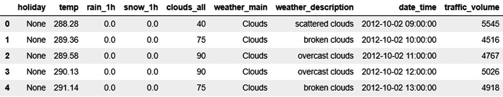

```
df.describe()
```

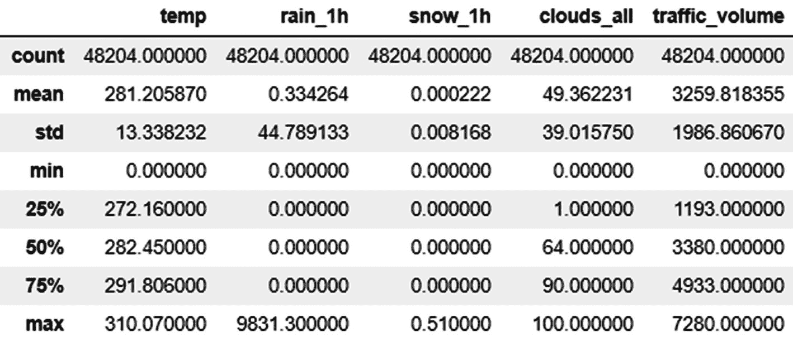

让我们删除重复项，因为同一小时可能存在不同的天气状况。

```
df.drop_duplicates(subset=['date_time'], keep=False,inplace=True)
```

对类别特征应用标签编码。

```
holiday_le = preprocessing.LabelEncoder()
df['holiday_le'] = holiday_le.fit_transform(df['holiday'])
weather_main_le = preprocessing.LabelEncoder()
df['weather_main_le'] = weather_main_le.fit_transform(df['weather_main'])
weather_description_le = preprocessing.LabelEncoder()
df['weather_description_le'] = weather_description_le.fit_transform(df['weather_description'])
```

XGBoost 是一个优化的分布式梯度提升库，旨在实现高效、灵活和可移植。让我们用它来检查特征重要性。图 7-1 展示了条形图表示。

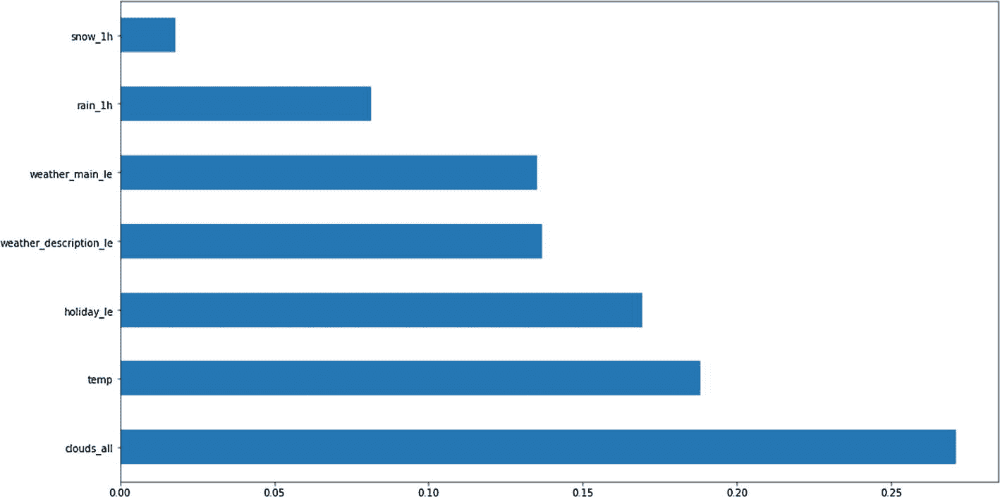

图 7-1

使用条形图表示特征重要性

```
from numpy import loadtxt
from xgboost import XGBRegressor
from matplotlib import pyplot
model = XGBRegressor()
model.fit(df[['temp', 'rain_1h', 'snow_1h', 'clouds_all', 'holiday_le','weather_main_le', 'weather_description_le']],
df[['traffic_volume']])
(pd.Series(model.feature_importances_, index=df[['temp', 'rain_1h', 'snow_1h', 'clouds_all', 'holiday_le',
'weather_main_le', 'weather_description_le']].columns)
.nlargest(7)
.plot(kind='barh'))
```

让我们将所有特征纳入模型训练。定义一个函数来准备多变量数据，使其适用于时间序列。

```
def custom_ts_multi_data_prep(dataset, target, start, end, window, horizon):
X = []
y = []
start = start + window
if end is None:
end = len(dataset) - horizon
for i in range(start, end):
indices = range(i-window, i)
X.append(dataset[indices])
indicey = range(i+1, i+1+horizon)
y.append(target[indicey])
return np.array(X), np.array(y)
```

进行训练/测试分割，让我们保留十小时的数据（即十条记录），以便在基于历史数据训练后验证结果。

```
validate = df[['rain_1h','temp', 'snow_1h', 'clouds_all', 'holiday_le','weather_main_le', 'weather_description_le',
'traffic_volume']].tail(10)
df.drop(df.tail(10).index,inplace=True)
```

让我们对数据进行缩放，因为已知神经网络在特征处于相同尺度时，收敛速度更快且精度更高。

```
x_scaler = preprocessing.MinMaxScaler()
y_scaler = preprocessing.MinMaxScaler()
dataX = x_scaler.fit_transform(df[['rain_1h','temp', 'snow_1h', 'clouds_all', 'holiday_le','weather_main_le', 'weather_description_le','traffic_volume']])
dataY = y_scaler.fit_transform(df[['traffic_volume']])
```

由于我们正在进行水平预测，让模型基于过去 48 小时的数据进行训练，并尝试预测接下来十小时的结果。因此，使用 `horizon = 10`。

```
hist_window = 48
horizon = 10
TRAIN_SPLIT = 30000
x_train_multi, y_train_multi = custom_ts_multi_data_prep(
dataX, dataY, 0, TRAIN_SPLIT, hist_window, horizon)
x_val_multi, y_val_multi= custom_ts_multi_data_prep(
dataX, dataY, TRAIN_SPLIT, None, hist_window, horizon)
print ('Single window of past history')
print(x_train_multi[0])
print ('\n Target horizon')
print (y_train_multi[0])
Single window of past history
[[0\.         0.92972555 0\.         0.4        0.63636364 0.1
0.64864865 0.76167582]
[0\.         0.93320863 0\.         0.75       0.63636364 0.1
0.05405405 0.62032967]
[0\.         0.93391815 0\.         0.9        0.63636364 0.1
0.51351351 0.65480769]
[0\.         0.93569194 0\.         0.9        0.63636364 0.1
0.51351351 0.69038462]
[0\.         0.93894927 0\.         0.75       0.63636364 0.1
0.05405405 0.67554945]
[0\.         0.94081981 0\.         0.01       0.63636364 0.
0.72972973 0.71167582]
[0\.         0.94549618 0\.         0.01       0.63636364 0.
[0\.         0.90847228 0\.         0.01       0.63636364 0.
0.72972973 0.1146978 ]
[0\.         0.907279   0\.         0.01       0.63636364 0.
0.72972973 0.37445055]
...
[0\.         0.90540846 0\.         0.01       0.63636364 0.
0.72972973 0.78145604]
[0\.         0.90486019 0\.         0.01       0.63636364 0.
0.72972973 0.96016484]
[0\.         0.90902054 0\.         0.01       0.63636364 0.
0.72972973 0.82211538]
[0\.         0.91908279 0\.         0.01       0.63636364 0.
0.72972973 0.72925824]
[0\.         0.93262812 0\.         0.01       0.63636364 0.
0.72972973 0.63228022]
[0\.         0.94027155 0\.         0.01       0.63636364 0.
0.72972973 0.67087912]
[0\.         0.95130132 0\.         0.01       0.63636364 0.
0.72972973 0.7010989 ]]
Target horizon
[[0.75563187]
[0.78475275]
[0.86428571]
[0.83200549]
[0.67403846]
[0.48118132]
[0.41717033]
[0.38763736]
[0.27362637]
[0.16016484]]
```

使用 `tf.data` 函数准备训练和验证时间序列数据，这是一种向模型提供数据的更快、更高效的方式。

```
BATCH_SIZE = 256
BUFFER_SIZE = 150
train_data_multi = tf.data.Dataset.from_tensor_slices((x_train_multi, y_train_multi))
train_data_multi = train_data_multi.cache().shuffle(BUFFER_SIZE).batch(BATCH_SIZE).repeat()
val_data_multi = tf.data.Dataset.from_tensor_slices((x_val_multi, y_val_multi))
val_data_multi = val_data_multi.batch(BATCH_SIZE).repeat()
```

定义 LSTM 模型。

```
lstm_multi = tf.keras.models.Sequential()
lstm_multi.add(tf.keras.layers.LSTM(150,input_shape=x_train_multi.shape[-2:],return_sequences=True))
lstm_multi.add(tf.keras.layers.Dropout(0.2)),
lstm_multi.add(tf.keras.layers.LSTM(units=100,return_sequences=False)),
lstm_multi.add(tf.keras.layers.Dropout(0.2)),
lstm_multi.add(tf.keras.layers.Dense(units=horizon)),
lstm_multi.compile(optimizer='adam', loss='mse')
```

最佳权重保存在 `model_path`。

```
model_path = r'\Chapter 7\LSTM_Multivariate.h5'
```

配置模型并开始训练，同时使用早停和检查点。

早停在监控的损失开始超过期望限制时停止训练。

检查点在模型权重达到最小损失时保存它们。

```
EVALUATION_INTERVAL = 150
EPOCHS = 100
history = lstm_multi.fit(train_data_multi, epochs=EPOCHS,steps_per_epoch=EVALUATION_INTERVAL,validation_data=val_data_multi, validation_steps=50,verbose =1,callbacks =[tf.keras.callbacks.
EarlyStopping(monitor='val_loss', min_delta=0, patience=10, verbose=1, mode='min'),tf.keras.callbacks.ModelCheckpoint(model_path,monitor='val_loss', save_best_only=True, mode='min', verbose=0)])
```

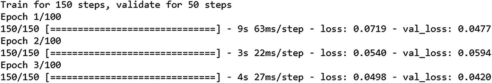

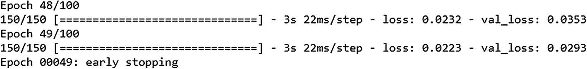

前面的示例显示，模型在 49 个 epoch 内停止，而不是运行 150 个 epoch。

将最佳权重加载到模型中。


```
Trained_model = tf.keras.models.load_model(model_path)
```

绘制`loss`和`val_loss`随 epoch 的变化曲线。

```
plt.plot(history.history['loss'])
plt.plot(history.history['val_loss'])
plt.title('Model loss')
plt.ylabel('loss')
plt.xlabel('epoch')
plt.legend(['train loss', 'validation loss'], loc='upper left')
plt.rcParams["figure.figsize"] = [16,9]
plt.show()
```

图 7-2 展示了一条折线图，帮助我们理解一个优秀的模型是如何实现良好泛化的。

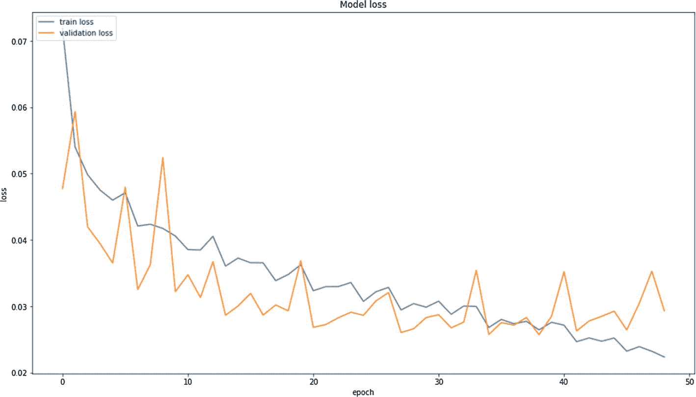

图 7-2

训练损失和验证损失随 epoch 数量增加的变化情况

查看模型摘要。

```
Trained_model.summary()
```

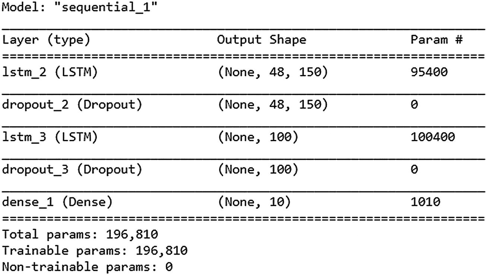

我们需要预测接下来的十个时间步，因此从训练模型中取出最后 48 小时的数据，并预测接下来十小时的值。

```
data_val = x_scaler.fit_transform(df[['rain_1h','temp', 'snow_1h', 'clouds_all', 'holiday_le', 'weather_main_le',
'weather_description_le','traffic_volume']].tail(48))
val_rescaled = data_val.reshape(1, data_val.shape[0], data_val.shape[1])
Predicted_results = Trained_model.predict(val_rescaled)
Predicted_results
```

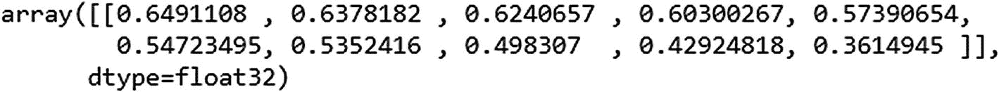

将预测值重新缩放回原始尺度。

```
Predicted_results_Inv_trans = y_scaler.inverse_transform(Predicted_results)
Predicted_results_Inv_trans
```

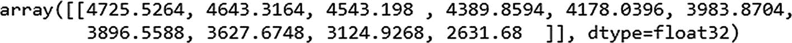

定义时间序列评估函数。

```
from sklearn import metrics
def timeseries_evaluation_metrics_func(y_true, y_pred):
def mean_absolute_percentage_error(y_true, y_pred):
y_true, y_pred = np.array(y_true), np.array(y_pred)
return np.mean(np.abs((y_true - y_pred) / y_true)) * 100
print('Evaluation metric results:-')
print(f'MSE is : {metrics.mean_squared_error(y_true, y_pred)}')
print(f'MAE is : {metrics.mean_absolute_error(y_true, y_pred)}')
print(f'RMSE is : {np.sqrt(metrics.mean_squared_error(y_true, y_pred))}')
print(f'MAPE is : {mean_absolute_percentage_error(y_true, y_pred)}')
print(f'R2 is : {metrics.r2_score(y_true, y_pred)}',end='\n\n')
timeseries_evaluation_metrics_func(validate['traffic_volume'],Predicted_results_Inv_trans[0])
```

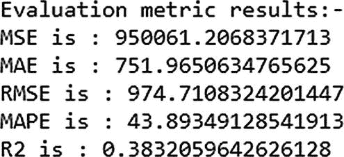

绘制实际值与预测值的对比图。

```
plt.plot( list(validate['traffic_volume']))
plt.plot( list(Predicted_results_Inv_trans[0]))
plt.title("Actual vs Predicted")
plt.ylabel("Traffic volume")
plt.legend(('Actual','predicted'))
plt.show()
```

图 7-3 展示了一条折线图，描绘了实际值与预测值随时间的变化情况。

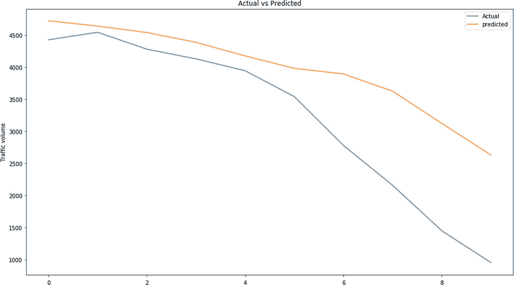

图 7-3

实际值与预测值的对比展示

## 双向 LSTM 多变量水平风格实战

在本节中，我们将使用水平风格的数据准备方法和双向 LSTM 来解决多变量时间序列问题。

导入所需的库并加载 CSV 数据。

```
import pandas as pd
import numpy as np
import tensorflow as tf
from sklearn import preprocessing
import matplotlib.pyplot as plt
tf.random.set_seed(123)
np.random.seed(123)
```

让我们加载数据，并通过查看五点摘要来快速浏览数据。

```
df = pd.read_csv(r'\Data\Metro_Interstate_Traffic_Volume.csv')
df.head()
```

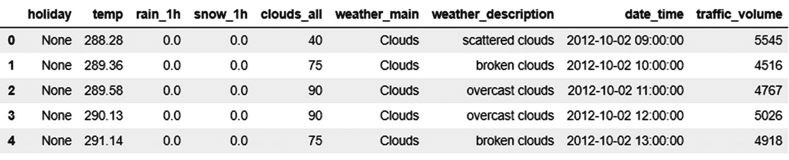

```
df.describe()
```

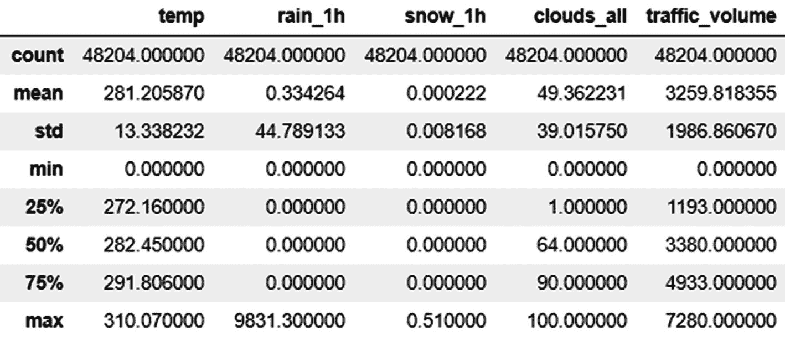

让我们删除重复项，因为同一小时可能存在不同的天气状况。

```
df.drop_duplicates(subset=['date_time'], keep=False,inplace=True)
```

对分类特征应用标签编码，并将其转换为数值型。

```
holiday_le = preprocessing.LabelEncoder()
df['holiday_le'] = holiday_le.fit_transform(df['holiday'])
weather_main_le = preprocessing.LabelEncoder()
df['weather_main_le'] = weather_main_le.fit_transform(df['weather_main'])
weather_description_le = preprocessing.LabelEncoder()
df['weather_description_le'] = weather_description_le.fit_transform(df['weather_description'])
```

训练/测试分割，我们保留十小时的数据（即十条记录），用于在基于历史数据训练后验证结果。

```
validate = df[['rain_1h','temp', 'snow_1h', 'clouds_all', 'holiday_le','weather_main_le', 'weather_description_le',
'traffic_volume']].tail(10)
df.drop(df.tail(10).index,inplace=True)
```

定义一个函数，用于准备适用于时间序列的多变量数据。

```
def custom_ts_multi_data_prep(dataset, target, start, end, window, horizon):
X = []
y = []
start = start + window
if end is None:
end = len(dataset) - horizon
for i in range(start, end):
indices = range(i-window, i)
X.append(dataset[indices])
indicey = range(i+1, i+1+horizon)
y.append(target[indicey])
return np.array(X), np.array(y)
validate = df[['rain_1h','temp', 'snow_1h', 'clouds_all', 'holiday_le','weather_main_le', 'weather_description_le',
'traffic_volume']].tail(10)
df.drop(df.tail(10).index,inplace=True)
```

让我们对数据进行缩放，因为已知神经网络在特征处于相同尺度时，收敛速度更快且精度更高。

```
x_scaler = preprocessing.MinMaxScaler()
y_scaler = preprocessing.MinMaxScaler()
dataX = x_scaler.fit_transform(df[['rain_1h','temp', 'snow_1h', 'clouds_all', 'holiday_le','weather_main_le', 'weather_
description_le','traffic_volume']])
dataY = y_scaler.fit_transform(df[['traffic_volume']])
```

由于我们进行的是水平风格预测，让模型基于过去 48 小时的数据进行训练/观察，并尝试预测接下来十小时的结果。因此，使用`horizon = 10`。

```
hist_window = 48
horizon = 10
TRAIN_SPLIT = 30000
x_train_multi, y_train_multi = custom_ts_multi_data_prep(
dataX, dataY, 0, TRAIN_SPLIT, hist_window, horizon)
x_val_multi, y_val_multi = custom_ts_multi_data_prep(
dataX, dataY, TRAIN_SPLIT, None, hist_window, horizon)
```

使用`tf.data`函数准备训练和验证时间序列数据，这是一种向模型提供数据的更快、更高效的方式。

```
BATCH_SIZE = 256
BUFFER_SIZE = 150
train_data_multi = tf.data.Dataset.from_tensor_slices((x_train_multi, y_train_multi))
train_data_multi = train_data_multi.cache().shuffle(BUFFER_SIZE).batch(BATCH_SIZE).repeat()
val_data_multi = tf.data.Dataset.from_tensor_slices((x_val_multi, y_val_multi))
val_data_multi = val_data_multi.batch(BATCH_SIZE).repeat()
```

定义双向 LSTM 模型。


```
Bi_lstm_model = tf.keras.models.Sequential([
tf.keras.layers.Bidirectional(tf.keras.layers.LSTM(150, return_sequences=True), input_shape=x_train_multi.shape[-2:]),
tf.keras.layers.Bidirectional(tf.keras.layers.LSTM(50)),
tf.keras.layers.Dense(20, activation='tanh'),
tf.keras.layers.Dropout(0.2),
tf.keras.layers.Dense(units=horizon),
])
Bi_lstm_model.compile(optimizer='adam', loss='mse')
```

最佳权重保存在 `model_path`。

```
model_path = r'\Chapter 7\Bidirectional_LSTM_Multivariate.h5'
```

配置模型，并启用早停和检查点机制开始训练。

早停机制会在监测的损失值开始上升超过期望阈值时停止训练。

检查点机制会在模型权重达到最小损失时保存权重。

```
EVALUATION_INTERVAL = 100
EPOCHS = 150
history = Bi_lstm_model.fit(train_data_multi, epochs=EPOCHS, steps_per_epoch=EVALUATION_INTERVAL, validation_data=val_data_multi, validation_steps=50, verbose=1,callbacks=[tf.keras.
callbacks.EarlyStopping(monitor='val_loss', min_delta=0, patience=10, verbose=1, mode='min'), tf.keras.callbacks.ModelCheckpoint(model_path, monitor='val_loss', save_best_only=True, mode='min', verbose=0)])
```

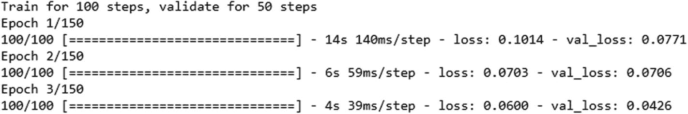

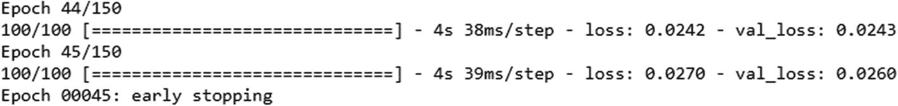

前面的示例显示，模型在 45 个周期内就停止了，而不是运行完 150 个周期。

将最佳权重加载到模型中。

```
Trained_model = tf.keras.models.load_model(model_path)
```

查看模型摘要。

```
Trained_model.summary()
```

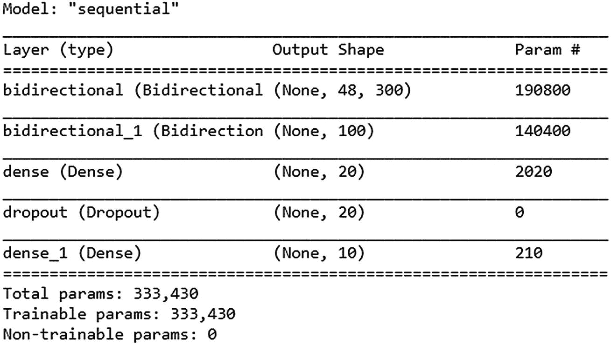

绘制 `loss` 和 `val_loss` 随周期的变化图。

```
plt.plot(history.history['loss'])
plt.plot(history.history['val_loss'])
plt.title('Model loss')
plt.ylabel('loss')
plt.xlabel('epoch')
plt.legend(['train loss', 'validation loss'], loc='upper left')
plt.rcParams["figure.figsize"] = [16,9]
plt.show()
```

图 7-4 展示了一个折线图，帮助我们理解一个好的模型是如何进行泛化的。

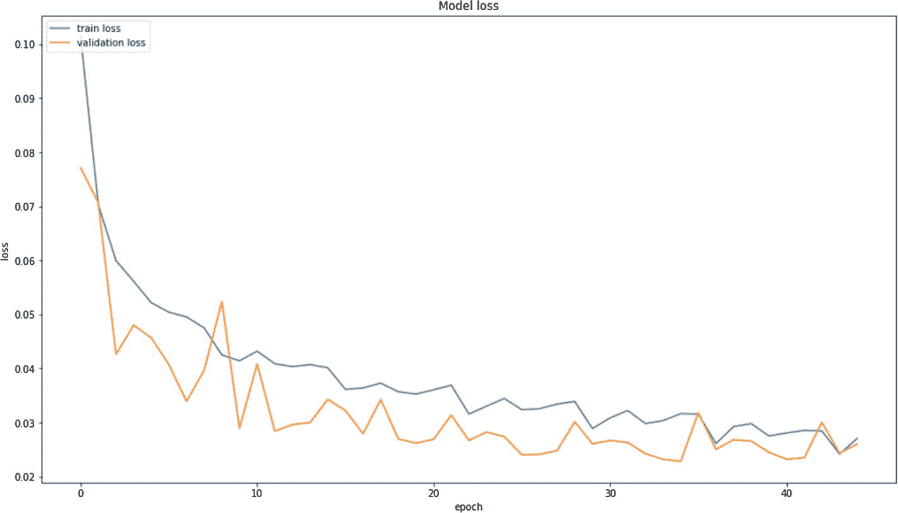

图 7-4

训练损失和验证损失随周期数增加的变化情况

我们需要预测接下来的十个时间步，因此，从训练模型中取出最后 48 小时的数据，并预测接下来十小时的值。

```
data_val = x_scaler.fit_transform(df[['rain_1h','temp', 'snow_1h', 'clouds_all', 'holiday_le',
'weather_main_le', 'weather_description_le','traffic_volume']].tail(48))
val_rescaled = data_val.reshape(1, data_val.shape[0], data_val.shape[1])
Predicted_results = Trained_model.predict(val_rescaled)
Predicted_results
```

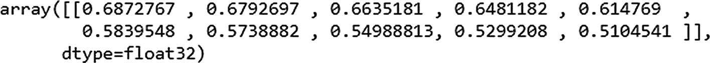

将预测值重新缩放回原始尺度。

```
Predicted_results_Inv_trans = y_scaler.inverse_transform(Predicted_results)
Predicted_results_Inv_trans
```

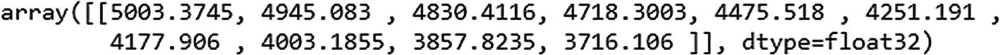

定义时间序列评估函数。

```
from sklearn import metrics
def timeseries_evaluation_metrics_func(y_true, y_pred):
def mean_absolute_percentage_error(y_true, y_pred):
y_true, y_pred = np.array(y_true), np.array(y_pred)
return np.mean(np.abs((y_true - y_pred) / y_true)) * 100
print('Evaluation metric results:-')
print(f'MSE is : {metrics.mean_squared_error(y_true, y_pred)}')
print(f'MAE is : {metrics.mean_absolute_error(y_true, y_pred)}')
print(f'RMSE is : {np.sqrt(metrics.mean_squared_error(y_true, y_pred))}')
print(f'MAPE is : {mean_absolute_percentage_error(y_true, y_pred)}')
print(f'R2 is : {metrics.r2_score(y_true, y_pred)}',end='\n\n')
timeseries_evaluation_metrics_func(validate['traffic_volume'],Predicted_results_Inv_trans[0])
```

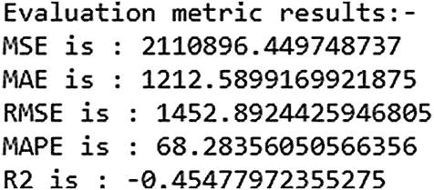

绘制实际值与预测值的对比图。

```
plt.plot( list(validate['traffic_volume']))
plt.plot( list(Predicted_results_Inv_trans[0]))
plt.title("Actual vs Predicted")
plt.ylabel("Traffic volume")
plt.legend(('Actual','predicted'))
plt.show()
```

图 7-5 展示了一个折线图，描绘了实际值和预测值随时间的变化情况。

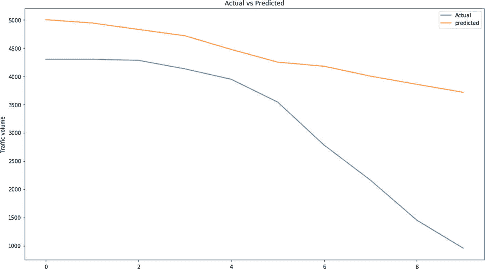

图 7-5

实际值与预测值的对比图


## 自编码器 LSTM 多变量水平风格实战

在本节中，我们将使用水平风格的数据准备方法和自编码器 LSTM 来解决多变量时间序列问题。

导入所需的库并加载 CSV 数据。

```
import pandas as pd
import numpy as np
import tensorflow as tf
from sklearn import preprocessing
import matplotlib.pyplot as plt
tf.random.set_seed(123)
np.random.seed(123)
```

让我们加载数据，并通过查看五点摘要来初步了解数据。

```
df = pd.read_csv(r'Data\Metro_Interstate_Traffic_Volume.csv')
df.head()
```

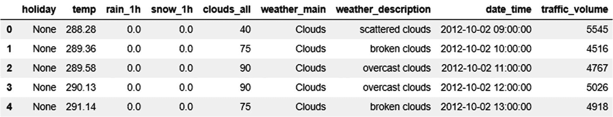

```
df.describe()
```

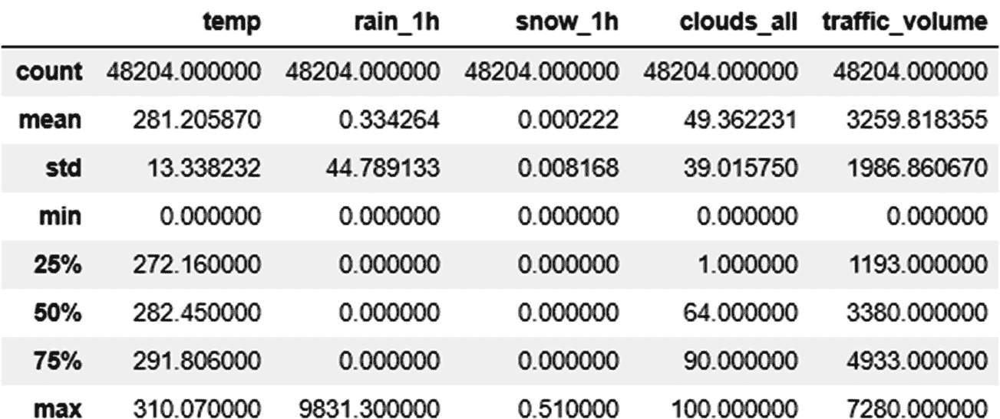

由于同一小时可能存在不同的天气状况，让我们删除重复项。

```
df.drop_duplicates(subset=['date_time'], keep=False,inplace=True)
```

对分类特征应用标签编码，并将其转换为数值。

```
holiday_le = preprocessing.LabelEncoder()
df['holiday_le'] = holiday_le.fit_transform(df['holiday'])
weather_main_le = preprocessing.LabelEncoder()
df['weather_main_le'] = weather_main_le.fit_transform(df['weather_main'])
weather_description_le = preprocessing.LabelEncoder()
df['weather_description_le'] = weather_description_le.fit_transform(df['weather_description'])
```

定义一个函数，用于准备适合时间序列的多变量数据。

```
def custom_ts_multi_data_prep(dataset, target, start, end, window, horizon):
X = []
y = []
start = start + window
if end is None:
end = len(dataset) - horizon
for i in range(start, end):
indices = range(i-window, i)
X.append(dataset[indices])
indicey = range(i+1, i+1+horizon)
y.append(target[indicey])
return np.array(X), np.array(y)
```

划分训练集/测试集，并预留十小时的数据（即十条记录），用于在基于历史数据训练后验证结果。

```
validate = df[['rain_1h','temp', 'snow_1h', 'clouds_all', 'holiday_le','weather_main_le', 'weather_description_le',
'traffic_volume']].tail(10)
df.drop(df.tail(10).index,inplace=True)
```

让我们对数据进行缩放，因为已知神经网络在特征处于相同尺度时，能以更高的精度更快地收敛。

```
x_scaler = preprocessing.MinMaxScaler()
y_scaler = preprocessing.MinMaxScaler()
dataX = x_scaler.fit_transform(df[['rain_1h','temp', 'snow_1h', 'clouds_all', 'holiday_le','weather_main_le', 'weather_
description_le','traffic_volume']])
dataY = y_scaler.fit_transform(df[['traffic_volume']])
```

由于我们采用水平风格预测，让模型基于过去 48 小时的数据进行训练，并尝试预测接下来十小时的结果。因此，使用 `horizon = 10`。

```
hist_window = 48
horizon = 10
TRAIN_SPLIT = 30000
x_train_multi, y_train_multi = custom_ts_multi_data_prep(
dataX, dataY, 0, TRAIN_SPLIT, hist_window, horizon)
x_val_multi, y_val_multi= custom_ts_multi_data_prep(
dataX, dataY, TRAIN_SPLIT, None, hist_window, horizon)
```

使用 `tf.data` 函数准备训练和验证时间序列数据，这是一种向模型提供数据的更快、更高效的方式。

```
BATCH_SIZE = 256
BUFFER_SIZE = 150
train_data_multi = tf.data.Dataset.from_tensor_slices((x_train_multi, y_train_multi))
train_data_multi = train_data_multi.cache().shuffle(BUFFER_SIZE).batch(BATCH_SIZE).repeat()
val_data_multi = tf.data.Dataset.from_tensor_slices((x_val_multi, y_val_multi))
val_data_multi = val_data_multi.batch(BATCH_SIZE).repeat()
```

定义自编码器 LSTM 模型。

```
ED_lstm_model = tf.keras.models.Sequential([
tf.keras.layers.LSTM(40, input_shape=x_train_multi.shape[-2:], return_sequences=True),
tf.keras.layers.LSTM(units=20,return_sequences=True),
tf.keras.layers.LSTM(units=15),
tf.keras.layers.RepeatVector(y_train_multi.shape[1]),
tf.keras.layers.LSTM(units=40,return_sequences=True),
tf.keras.layers.LSTM(units=25,return_sequences=True),
tf.keras.layers.TimeDistributed(tf.keras.layers.Dense(units=1))
])
ED_lstm_model.compile(optimizer='adam', loss='mse')
```

最佳权重保存在 `model_path` 中。

```
model_path = r'\Chapter 7\Encoder_Decoder_LSTM_Multivariate.h5'
```

配置模型，并开始使用早停和检查点进行训练。

早停会在监测的损失开始超过期望限制时停止训练。

检查点会在模型权重达到最小损失时保存它们。

```
EVALUATION_INTERVAL = 100
EPOCHS = 150
history = ED_lstm_model.fit(train_data_multi, epochs=EPOCHS,steps_per_epoch=EVALUATION_INTERVAL,validation_data=val_data_multi, validation_steps=50,verbose =1,
callbacks =[tf.keras.callbacks.EarlyStopping(monitor='val_loss', min_delta=0, patience=10, verbose=1, mode='min'),tf.keras.callbacks.ModelCheckpoint(model_path,monitor='val_loss', save_best_only=True, mode='min', verbose=0)])
```

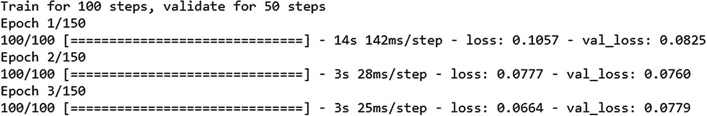

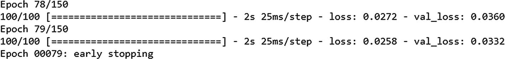

前面的示例显示，模型在 79 个 epoch 内停止，而不是运行 150 个 epoch。

将最佳权重加载到模型中。

```
Trained_model = tf.keras.models.load_model(model_path)
```

查看模型摘要。

```
Trained_model.summary()
```

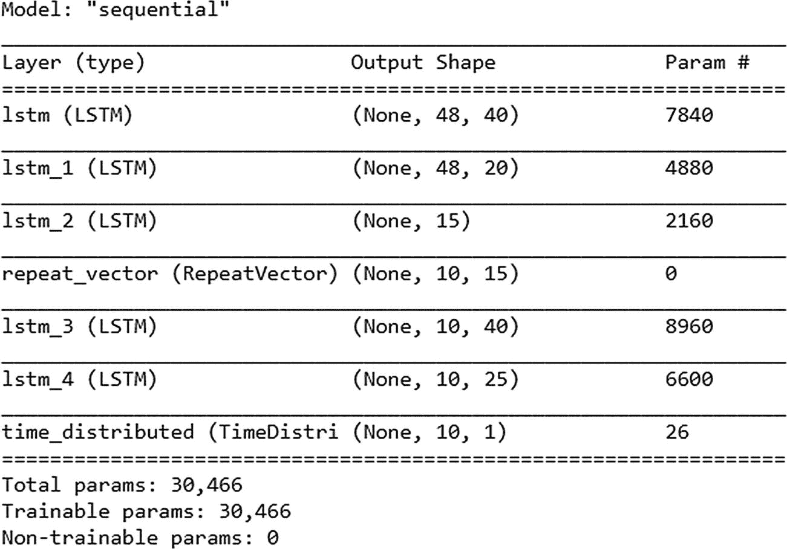

绘制 `loss` 和 `val_loss` 随 epoch 变化的曲线。

```
plt.plot(history.history['loss'])
plt.plot(history.history['val_loss'])
plt.title('Model loss')
plt.ylabel('loss')
plt.xlabel('epoch')
plt.legend(['train loss', 'validation loss'], loc='upper left')
plt.rcParams["figure.figsize"] = [16,9]
plt.show()
```

图 7-6 展示了一个折线图，有助于我们理解一个优秀的模型是如何进行泛化的。

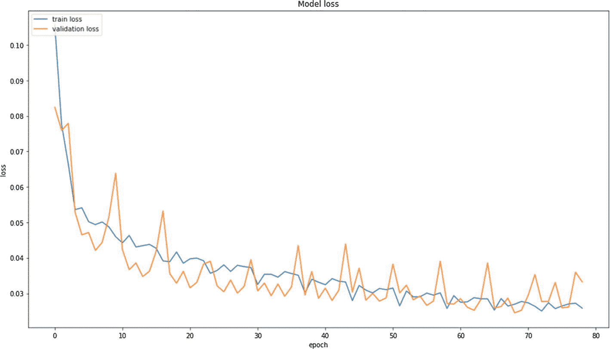

图 7-6

训练损失和验证损失随 epoch 数量增加的变化表示

我们需要预测接下来的十步，因此从训练模型中取出最后 48 小时的数据，并预测接下来十小时的值。

```
data_val = x_scaler.fit_transform(df[['rain_1h','temp', 'snow_1h', 'clouds_all', 'holiday_le','weather_main_le',
'weather_description_le','traffic_volume']].tail(48))
val_rescaled = data_val.reshape(1, data_val.shape[0], data_val.shape[1])
Predicted_results = Trained_model.predict(val_rescaled)
Predicted_results
```

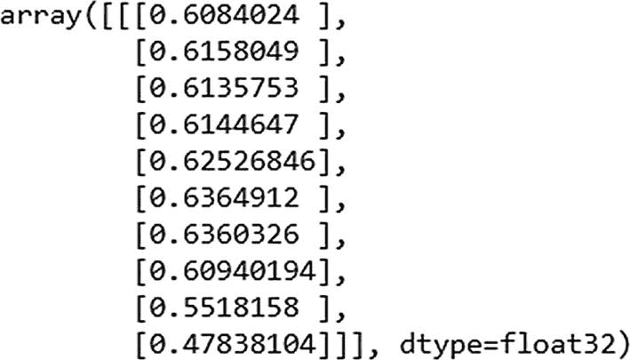

将预测值重新缩放回原始尺度。

```
Predicted_results_Inv_trans = y_scaler.inverse_transform(Predicted_results.reshape(-1,1))
Predicted_results_Inv_trans
```

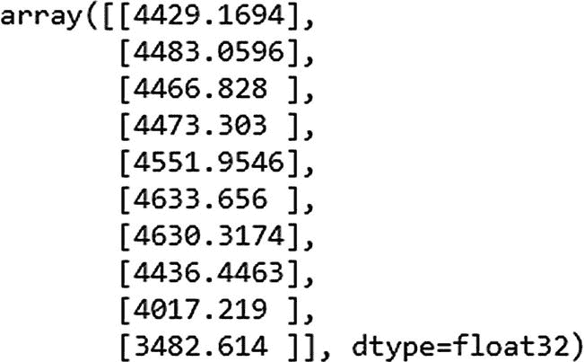

定义时间序列评估函数。


```
from sklearn import metrics
def timeseries_evaluation_metrics_func(y_true, y_pred):
def mean_absolute_percentage_error(y_true, y_pred):
y_true, y_pred = np.array(y_true), np.array(y_pred)
return np.mean(np.abs((y_true - y_pred) / y_true)) * 100
print('Evaluation metric results:-')
print(f'MSE is : {metrics.mean_squared_error(y_true, y_pred)}')
print(f'MAE is : {metrics.mean_absolute_error(y_true, y_pred)}')
print(f'RMSE is : {np.sqrt(metrics.mean_squared_error(y_true, y_pred))}')
print(f'MAPE is : {mean_absolute_percentage_error(y_true, y_pred)}')
print(f'R2 is : {metrics.r2_score(y_true, y_pred)}',end='\n\n')
timeseries_evaluation_metrics_func(validate['traffic_volume'],Predicted_results_Inv_trans)
```

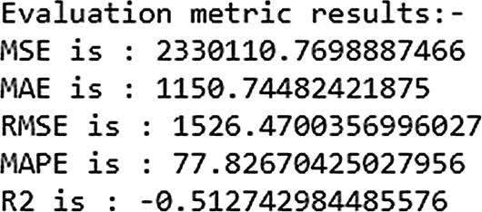

绘制实际值与预测值的对比图。

```
plt.plot( list(validate['traffic_volume']))
plt.plot( list(Predicted_results_Inv_trans))
plt.title("Actual vs Predicted")
plt.ylabel("Traffic volume")
plt.legend(('Actual','predicted'))
plt.show()
```

图 7-7 展示了一条折线图，描绘了实际值与预测值随时间的变化趋势。

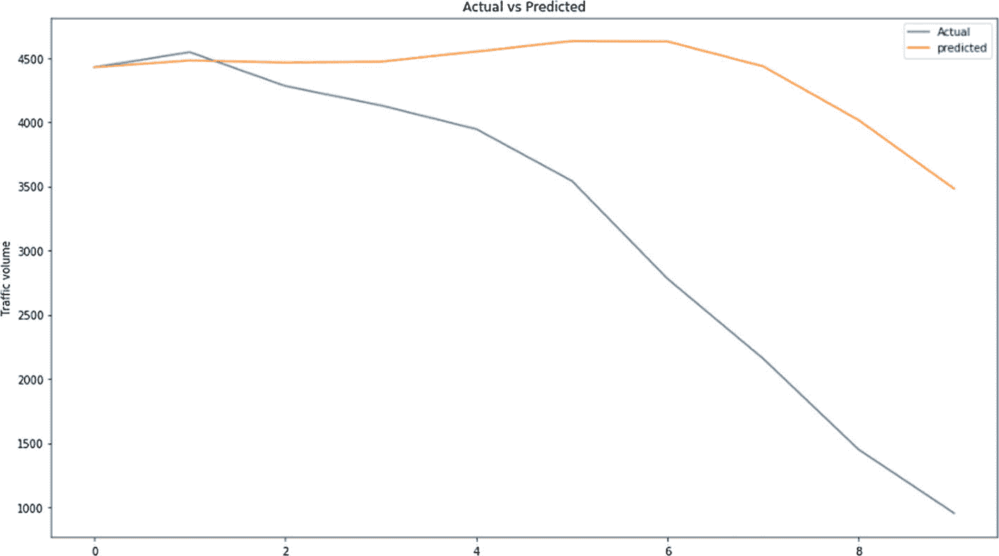

图 7-7

实际值与预测值的对比展示

## GRU 多变量水平预测风格实战

在本节中，我们将使用水平预测风格的数据准备方法和 GRU 来解决多变量时间序列问题。

导入所需库并加载 CSV 数据。

```
import pandas as pd
import numpy as np
import tensorflow as tf
from sklearn import preprocessing
import matplotlib.pyplot as plt
tf.random.set_seed(123)
np.random.seed(123)
```

让我们加载数据，并通过查看五点摘要来快速浏览数据。

```
df = pd.read_csv(r'\Data\Metro_Interstate_Traffic_Volume.csv')
df.head()
```

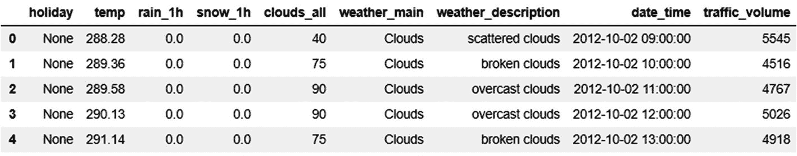

```
df.describe()
```

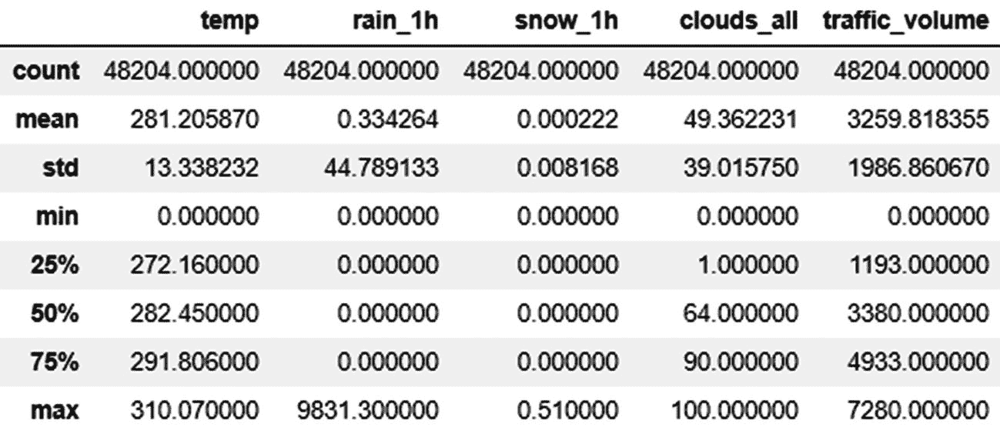

让我们删除重复项，因为同一小时可能存在不同的天气状况。

```
df.drop_duplicates(subset=['date_time'], keep=False,inplace=True)
```

对分类特征应用标签编码，并将其转换为数值。

```
holiday_le = preprocessing.LabelEncoder()
df['holiday_le'] = holiday_le.fit_transform(df['holiday'])
weather_main_le = preprocessing.LabelEncoder()
df['weather_main_le'] = weather_main_le.fit_transform(df['weather_main'])
weather_description_le = preprocessing.LabelEncoder()
df['weather_description_le'] = weather_description_le.fit_transform(df['weather_description'])
```

定义一个函数，用于准备适合时间序列的多变量数据。

```
def custom_ts_multi_data_prep(dataset, target, start, end, window, horizon):
X = []
y = []
start = start + window
if end is None:
end = len(dataset) - horizon
for i in range(start, end):
indices = range(i-window, i)
X.append(dataset[indices])
indicey = range(i+1, i+1+horizon)
y.append(target[indicey])
return np.array(X), np.array(y)
```

进行训练/测试分割，并保留最后十小时的数据（即十条记录），以便在基于历史数据训练后用于验证结果。

```
validate = df[['rain_1h','temp', 'snow_1h', 'clouds_all', 'holiday_le','weather_main_le', 'weather_description_le',
'traffic_volume']].tail(10)
df.drop(df.tail(10).index,inplace=True)
```

让我们对数据进行缩放，因为已知神经网络在特征处于相同尺度时，能以更高的精度更快收敛。

```
x_scaler = preprocessing.MinMaxScaler()
y_scaler = preprocessing.MinMaxScaler()
dataX = x_scaler.fit_transform(df[['rain_1h','temp', 'snow_1h', 'clouds_all', 'holiday_le','weather_main_le', 'weather_
description_le','traffic_volume']])
dataY = y_scaler.fit_transform(df[['traffic_volume']])
```

由于我们进行的是水平预测风格，让模型基于过去 48 小时的数据进行训练/观察，并尝试预测接下来十小时的结果。因此，使用 `horizon = 10`。

```
hist_window = 48
horizon = 10
TRAIN_SPLIT = 30000
x_train_multi, y_train_multi = custom_ts_multi_data_prep(
dataX, dataY, 0, TRAIN_SPLIT, hist_window, horizon)
x_val_multi, y_val_multi= custom_ts_multi_data_prep(
dataX, dataY, TRAIN_SPLIT, None, hist_window, horizon)
```

使用 `tf.data` 函数准备训练和验证时间序列数据，这是一种向模型提供数据的更快、更高效的方式。

```
BATCH_SIZE = 256
BUFFER_SIZE = 150
train_data_multi = tf.data.Dataset.from_tensor_slices((x_train_multi, y_train_multi))
train_data_multi = train_data_multi.cache().shuffle(BUFFER_SIZE).batch(BATCH_SIZE).repeat()
val_data_multi = tf.data.Dataset.from_tensor_slices((x_val_multi, y_val_multi))
val_data_multi = val_data_multi.batch(BATCH_SIZE).repeat()
```

定义 GRU 模型。

```
GRU_model = tf.keras.models.Sequential([
tf.keras.layers.GRU(100, input_shape=x_train_multi.shape[-2:],return_sequences=True),
tf.keras.layers.Dropout(0.2),
tf.keras.layers.GRU(units=50,return_sequences=False),
tf.keras.layers.Dropout(0.2),
tf.keras.layers.Dense(units=horizon),
])
GRU_model.compile(optimizer='adam', loss='mse')
```

最佳权重保存在 `model_path` 中。


```
model_path = r'\Chapter 7\GRU_Multivariate.h5'
```

配置模型，并开始使用早停法和检查点机制进行训练。

早停法会在监测的损失值开始超过预期上限时停止训练。

检查点机制则会在模型权重达到最小损失时保存这些权重。

```
EVALUATION_INTERVAL = 100
EPOCHS = 150
history = GRU_model.fit(train_data_multi, epochs=EPOCHS,steps_per_epoch=EVALUATION_INTERVAL,validation_data=val_data_multi, validation_steps=50,verbose =1,callbacks =[tf.keras.callbacks.
EarlyStopping(monitor='val_loss', min_delta=0, patience=10, verbose=1, mode='min'),tf.keras.callbacks.ModelCheckpoint(model_path,monitor='val_loss', save_best_only=True, mode='min', verbose=0)])
```

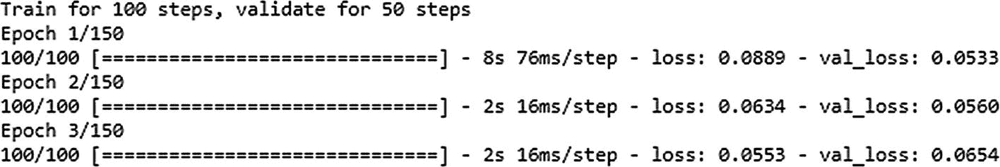

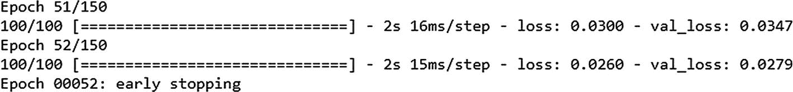

前面的示例显示，模型在 52 个 epoch 内就停止了，而不是运行满 150 个 epoch。

将最佳权重加载到模型中。

```
Trained_model = tf.keras.models.load_model(model_path)
```

查看模型摘要。

```
Trained_model.summary()
```

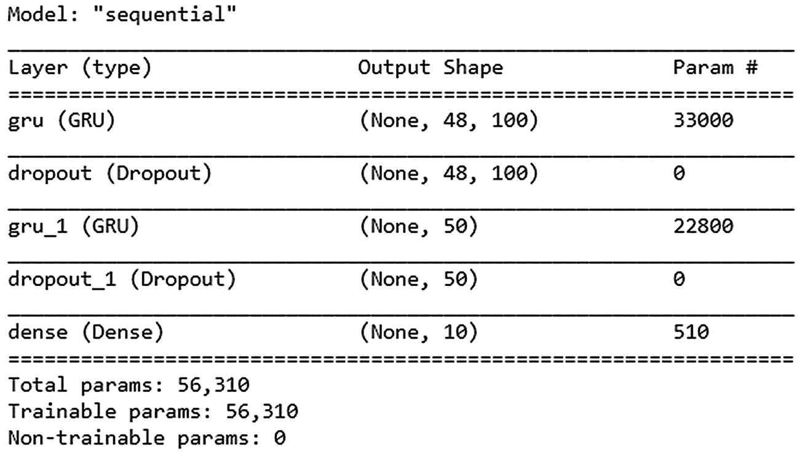

绘制 `loss` 和 `val_loss` 随 epoch 变化的曲线。

```
plt.plot(history.history['loss'])
plt.plot(history.history['val_loss'])
plt.title('Model loss')
plt.ylabel('loss')
plt.xlabel('epoch')
plt.legend(['train loss', 'validation loss'], loc='upper left')
plt.rcParams["figure.figsize"] = [16,9]
plt.show()
```

图 7-8 展示了一张折线图，帮助我们理解一个优秀的模型是如何实现良好泛化能力的。

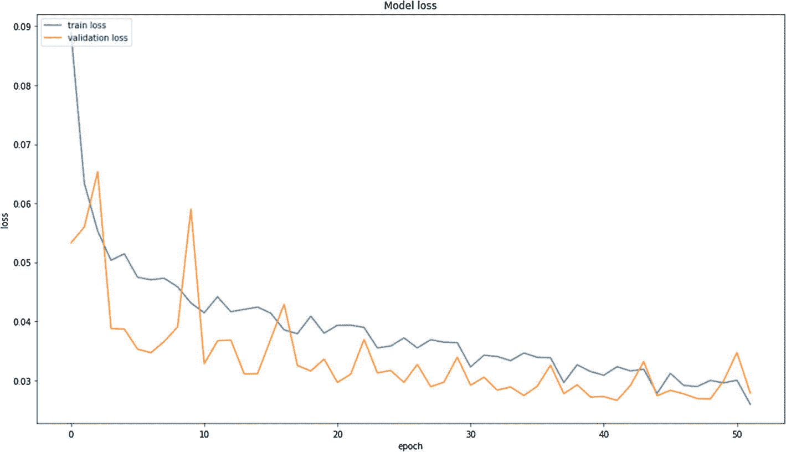

图 7-8

训练损失和验证损失随 epoch 数量增加的变化情况

我们需要预测接下来的十个时间步，因此从训练模型中取出最后 48 小时的数据，并预测接下来十小时的值。

```
data_val = x_scaler.fit_transform(df[['rain_1h','temp', 'snow_1h', 'clouds_all', 'holiday_le',
'weather_main_le', 'weather_description_le','traffic_volume']].tail(48))
val_rescaled = data_val.reshape(1, data_val.shape[0], data_val.shape[1])
Predicted_results = Trained_model.predict(val_rescaled)
Predicted_results
```

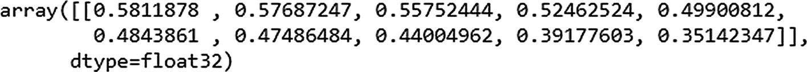

将预测值重新缩放回原始尺度。

```
Predicted_results_Inv_trans = y_scaler.inverse_transform(Predicted_results)
Predicted_results_Inv_trans
```

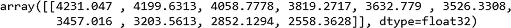

定义时间序列评估函数。

```
from sklearn import metrics
def timeseries_evaluation_metrics_func(y_true, y_pred):
def mean_absolute_percentage_error(y_true, y_pred):
y_true, y_pred = np.array(y_true), np.array(y_pred)
return np.mean(np.abs((y_true - y_pred) / y_true)) * 100
print('Evaluation metric results:-')
print(f'MSE is : {metrics.mean_squared_error(y_true, y_pred)}')
print(f'MAE is : {metrics.mean_absolute_error(y_true, y_pred)}')
print(f'RMSE is : {np.sqrt(metrics.mean_squared_error(y_true, y_pred))}')
print(f'MAPE is : {mean_absolute_percentage_error(y_true, y_pred)}')
print(f'R2 is : {metrics.r2_score(y_true, y_pred)}',end='\n\n')
timeseries_evaluation_metrics_func(validate['traffic_volume'],Predicted_results_Inv_trans[0])
```

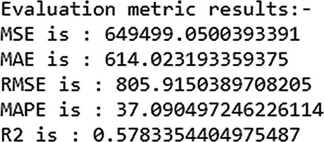

绘制实际值与预测值的对比图。

```
plt.plot( list(validate['traffic_volume']))
plt.plot( list(Predicted_results_Inv_trans[0]))
plt.title("Actual vs Predicted")
plt.ylabel("Traffic volume")
plt.legend(('Actual','predicted'))
plt.show()
```

图 7-9 展示了一张折线图，描绘了实际值与预测值随时间的变化情况。

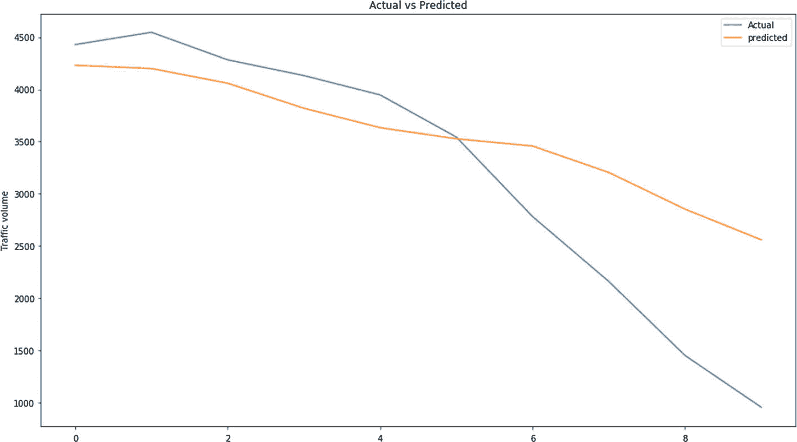

图 7-9

实际值与预测值的对比展示


## CNN 多变量时间序列预测实战

本节将使用时间序列预测风格的数据准备方法和 CNN 来解决多变量时间序列问题。

导入所需库并加载 CSV 数据。

```
import tensorflow as tf
import matplotlib.pyplot as plt
import numpy as np
import pandas as pd
from sklearn import preprocessing
from tensorflow.keras.models import Sequential
from tensorflow.keras.layers import Dense
from tensorflow.keras.layers import Flatten,TimeDistributed,RepeatVector
from tensorflow.keras.layers import Conv1D
from tensorflow.keras.layers import MaxPool1D
from tensorflow.keras.layers import Dropout
tf.random.set_seed(123)
np.random.seed(123)
```

让我们加载数据，并通过查看五数汇总来快速浏览数据。

```
df = pd.read_csv(r'\Data\Metro_Interstate_Traffic_Volume.csv')
df.head()
```

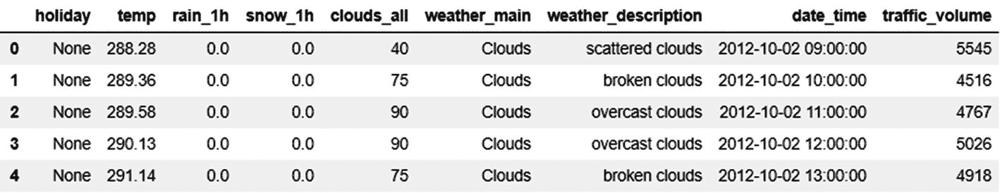

```
df.describe()
```

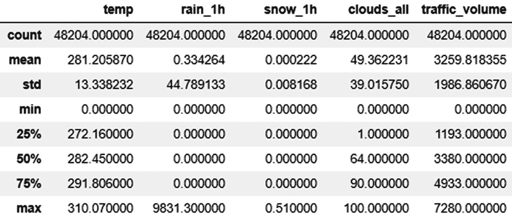

让我们删除重复项，因为同一小时可能对应不同的天气状况。

```
df.drop_duplicates(subset=['date_time'], keep=False,inplace=True)
```

对分类特征应用标签编码，并将其转换为数值。

```
holiday_le = preprocessing.LabelEncoder()
df['holiday_le'] = holiday_le.fit_transform(df['holiday'])
weather_main_le = preprocessing.LabelEncoder()
df['weather_main_le'] = weather_main_le.fit_transform(df['weather_main'])
weather_description_le = preprocessing.LabelEncoder()
df['weather_description_le'] = weather_description_le.fit_transform(df['weather_description'])
```

定义一个函数来准备适用于时间序列的多变量数据。

```
def custom_ts_multi_data_prep(dataset, target, start, end, window, horizon):
X = []
y = []
start = start + window
if end is None:
end = len(dataset) - horizon
for i in range(start, end):
indices = range(i-window, i)
X.append(dataset[indices])
indicey = range(i+1, i+1+horizon)
y.append(target[indicey])
return np.array(X), np.array(y)
```

划分训练集和测试集，并预留十小时的数据（即十条记录），用于在历史数据训练后验证结果。

```
validate = df[['rain_1h','temp', 'snow_1h', 'clouds_all', 'holiday_le','weather_main_le', 'weather_description_le',
'traffic_volume']].tail(10)
df.drop(df.tail(10).index,inplace=True)
```

让我们对数据进行缩放，因为已知神经网络在特征处于相同尺度时，能以更高的精度更快收敛。

```
x_scaler = preprocessing.MinMaxScaler()
y_scaler = preprocessing.MinMaxScaler()
dataX = x_scaler.fit_transform(df[['rain_1h','temp', 'snow_1h', 'clouds_all', 'holiday_le',
'weather_main_le', 'weather_description_le','traffic_volume']])
dataY = y_scaler.fit_transform(df[['traffic_volume']])
```

由于我们进行的是时间序列预测，让模型基于过去 48 小时的数据进行训练，并尝试预测接下来十小时的结果。因此，使用 `horizon = 10`。

```
hist_window = 48
horizon = 10
TRAIN_SPLIT = 30000
x_train_multi, y_train_multi = custom_ts_multi_data_prep(
dataX, dataY, 0, TRAIN_SPLIT, hist_window, horizon)
x_val_multi, y_val_multi= custom_ts_multi_data_prep(
dataX, dataY, TRAIN_SPLIT, None, hist_window, horizon)
```

使用 `tf.data` 函数准备训练和验证时间序列数据，这是一种向模型提供数据的更快、更高效的方式。

```
BATCH_SIZE = 256
BUFFER_SIZE = 150
train_data_multi = tf.data.Dataset.from_tensor_slices((x_train_multi, y_train_multi))
train_data_multi = train_data_multi.cache().shuffle(BUFFER_SIZE).batch(BATCH_SIZE).repeat()
val_data_multi = tf.data.Dataset.from_tensor_slices((x_val_multi, y_val_multi))
val_data_multi = val_data_multi.batch(BATCH_SIZE).repeat()
```

定义 CNN 模型。

```
model = Sequential()
model.add(Conv1D(filters=64, kernel_size=3, activation='relu', input_shape=(x_train_multi.shape[1], x_train_multi.shape[2])))
model.add(MaxPool1D(pool_size=2))
model.add(Dropout(0.2))
model.add(Flatten())
model.add(Dense(30, activation='relu'))
model.add(Dropout(0.2))
model.add(Dense(horizon))
model.compile(optimizer='adam', loss='mse')
```

最佳权重保存在 `model_path` 中。

```
model_path = r'\Chapter 7\CNN_Multivariate.h5'
```

配置模型，并开始使用早停和检查点进行训练。

早停会在监测的损失开始超过期望限制时停止训练。

检查点会在模型权重达到最小损失时保存它们。

```
EVALUATION_INTERVAL = 100
EPOCHS = 150
history = model.fit(train_data_multi, epochs=EPOCHS, steps_per_epoch=EVALUATION_INTERVAL, validation_data=val_data_multi, validation_steps=50, verbose=1,callbacks=[tf.keras.callbacks.EarlyStopping(monitor='val_loss', min_delta=0, patience=10, verbose=1, mode='min'), tf.keras.callbacks.ModelCheckpoint(model_path, monitor='val_loss', save_best_only=True, mode='min', verbose=0)])
```

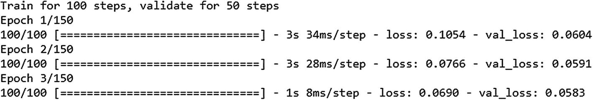


前面的示例显示，模型在 59 个 epoch 内停止，而不是运行 150 个 epoch。

将最佳权重加载到模型中。

```
Trained_model = tf.keras.models.load_model(model_path)
```

查看模型摘要。

```
Trained_model.summary()
```

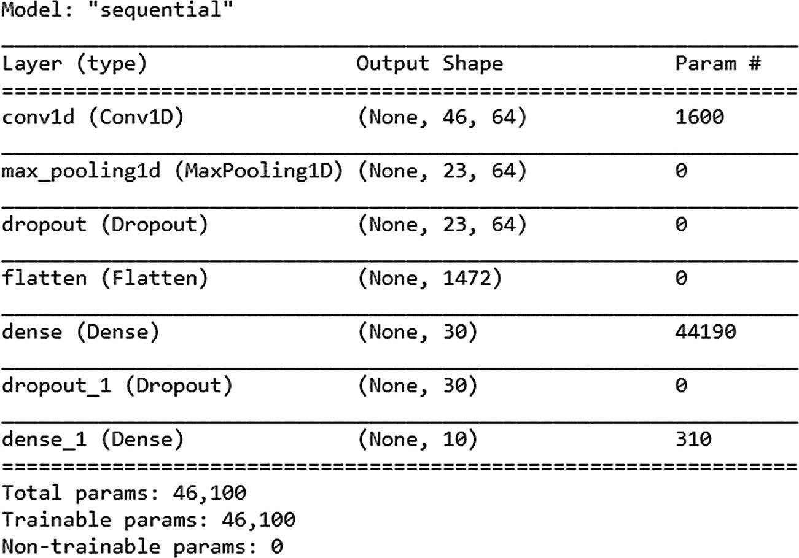

绘制 `loss` 和 `val_loss` 随 epoch 变化的曲线。

```
plt.plot(history.history['loss'])
plt.plot(history.history['val_loss'])
plt.title('Model loss')
plt.ylabel('loss')
plt.xlabel('epoch')
plt.legend(['train loss', 'validation loss'], loc='upper left')
plt.rcParams["figure.figsize"] = [16,9]
plt.show()
```

图 7-10 展示了一个折线图，有助于我们理解一个好的模型是如何进行泛化的。

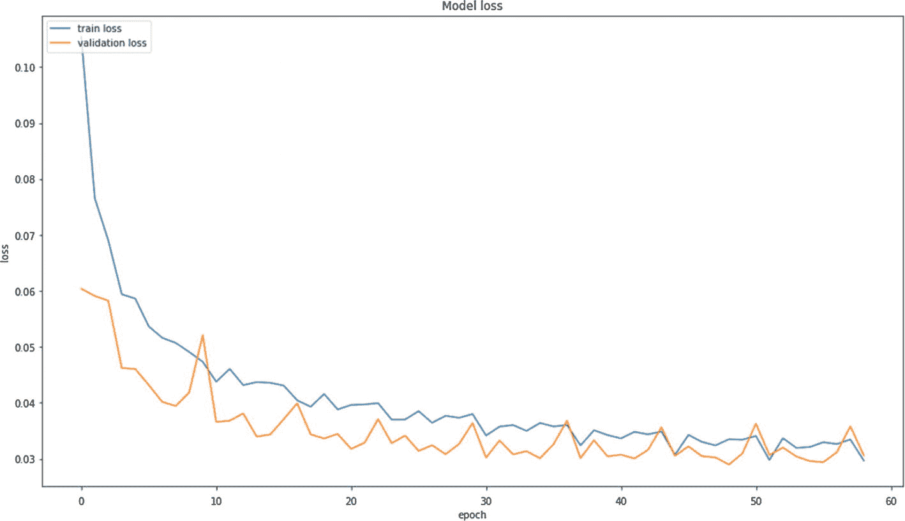

图 7-10

训练损失和验证损失随 epoch 数量增加的变化情况

我们需要预测接下来的十步，因此从训练模型中取出最后 48 小时的数据，并预测接下来十小时的值。

```
data_val = x_scaler.fit_transform(df[['rain_1h','temp', 'snow_1h', 'clouds_all', 'holiday_le',
'weather_main_le', 'weather_description_le','traffic_volume']].tail(48))
val_rescaled = data_val.reshape(1, data_val.shape[0], data_val.shape[1])
Predicted_results = Trained_model.predict(val_rescaled)
Predicted_results
```

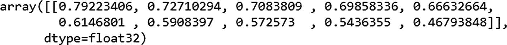

将预测值重新缩放回原始尺度。

```
Predicted_results_Inv_trans = y_scaler.inverse_transform(Predicted_results)
```

定义时间序列评估函数。

```
from sklearn import metrics
def timeseries_evaluation_metrics_func(y_true, y_pred):
def mean_absolute_percentage_error(y_true, y_pred):
y_true, y_pred = np.array(y_true), np.array(y_pred)
return np.mean(np.abs((y_true - y_pred) / y_true)) * 100
print('Evaluation metric results:-')
print(f'MSE is : {metrics.mean_squared_error(y_true, y_pred)}')
print(f'MAE is : {metrics.mean_absolute_error(y_true, y_pred)}')
print(f'RMSE is : {np.sqrt(metrics.mean_squared_error(y_true, y_pred))}')
print(f'MAPE is : {mean_absolute_percentage_error(y_true, y_pred)}')
print(f'R2 is : {metrics.r2_score(y_true, y_pred)}',end='\n\n')
timeseries_evaluation_metrics_func(validate['traffic_volume'],Predicted_results_Inv_trans[0])
```


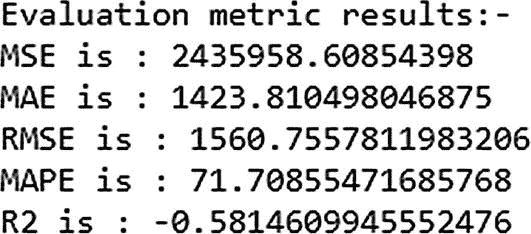

绘制实际值与预测值的对比图。

```
plt.plot( list(validate['traffic_volume']))
plt.plot( list(Predicted_results_Inv_trans[0]))
plt.title("Actual vs Predicted")
plt.ylabel("Traffic volume")
plt.legend(('Actual','predicted'))
plt.show()
```

图 7-11 展示了一个折线图，描绘了实际值与预测值随时间的变化趋势。

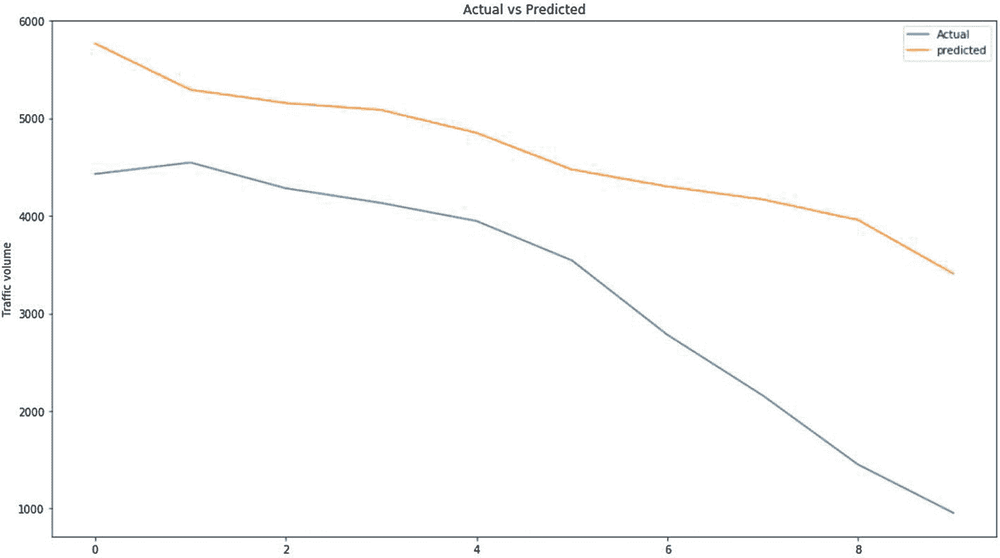

图 7-11

实际值与预测值的对比展示

我们使用不同的数据准备方式和模型架构对相同的数据进行了评估，并观察到了神经网络的强大能力。为了提高精度，可以尝试使用 Hyperopt、Optune 或 Keras Tuner 进行超参数调优，这能显著提升精度。

## 总结

在本章中，你学习了如何对时间序列进行单步和水平式数据准备，以及如何使用 LSTM、双向 LSTM、GRU、自编码器和 CNN 解决多变量时间序列问题。在下一章中，你将学习如何使用 Prophet 解决单变量和多变量问题。

