# 8. Prophet

Prophet 是 Facebook 开发的一个开源框架，用于时间序列的建模和预测。它专注于一个加法模型，该模型将非线性趋势与每日、每周和每年的季节性以及额外的节假日效应相结合。Prophet 在处理缺失数据、趋势变化方面表现出色，并且通常能很好地处理异常值。它还允许你向模型添加外生变量。

## Prophet 模型

Prophet 使用一个可分解的时间序列模型。

**y(*****t*****) = g(*****t*****) + s(*****t*****) + h(*****t*****) + ϵ**[**t**]

其中

**g(t)** = 趋势（线性/逻辑斯蒂）

**s(t)** = 周期性变化/季节性

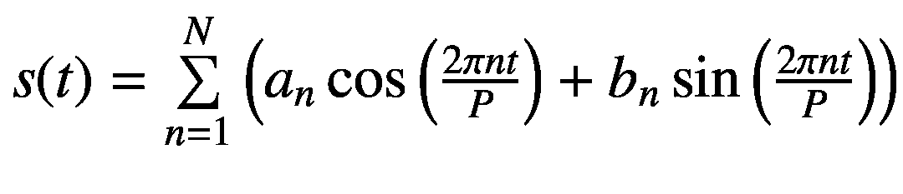

这里，*P* 是我们预期时间序列具有的稳定周期（例如，当时间变量以天为单位时，对于年度数据 P = 365.25，对于周数据 P = 7）。

拟合季节性需要计算 2*N* 个参数 β = [a1, b1,…., a*N*, b*N*]^T，方法是为历史数据和未来数据中的每一个 *t* 值构建一个季节性向量矩阵。

**h(t)** = 节假日效应

对于每个节假日 *i*，令 D *i* 为该节假日的过去和未来日期集合，如下所示：

Z(*t*) = [1(*t* ϵ D[1]),…,1(*t* ϵ D[L])]

并取以下形式：

h(*t*) = Z(*t*)κ

与季节性类似，我们使用先验 κ∼Normal(0,ν²)。

**ϵt** = 模型未捕获的变化

Prophet 的核心过程使用 Stan（一种概率编程语言）实现。Stan 执行 MAP 优化以找到参数，并利用[哈密顿蒙特卡洛](https://en.wikipedia.org/wiki/Hybrid_Monte_Carlo)算法帮助估计参数的不确定性。

在下一节中，你将学习如何使用 Prophet 并解决时间序列问题。

## 实现 Prophet

在上一节中，你了解了 Prophet 背后的高级数学原理；现在让我们在一个时间序列数据集上实现它。

注意

Prophet 模型的输入必须始终是一个包含 `ds` 和 `y` 列的 DataFrame，其中 `ds` 是日期字段（YYYY-MM-DD 或 YYYY-MM-DD HH:MM:SS），并带有对应的 `y` 变量。

导入所需的库并加载 CSV 数据，该数据包含共享单车数据。数据时间范围从 2011 年 1 月到 2012 年 12 月。

由于数据是小时级别的，因此每天包含 24 个观测值。使用此数据集，让我们尝试预测接下来 48 小时（即两天）的计数（目标变量）。

```
import warnings
import matplotlib.pyplot as plt
import numpy as np
import pandas as pd
from sklearn import metrics
from fbprophet import Prophet
```

让我们快速浏览一下数据。

```
df = pd.read_csv('Data\Bike_Sharing_Demand.csv',parse_dates = True)
df.head()
```


定义时间序列评估函数。

```
def timeseries_evaluation_metrics_func(y_true, y_pred):
def mean_absolute_percentage_error(y_true, y_pred):
y_true, y_pred = np.array(y_true), np.array(y_pred)
return np.mean(np.abs((y_true - y_pred) / y_true)) * 100
#print('Evaluation metric results:-')
print(f'MSE is : {metrics.mean_squared_error(y_true, y_pred)}')
print(f'MAE is : {metrics.mean_absolute_error(y_true, y_pred)}')
print(f'RMSE is : {np.sqrt(metrics.mean_squared_error(y_true, y_pred))}')
print(f'MAPE is : {mean_absolute_percentage_error(y_true, y_pred)}')
print(f'R2 is : {metrics.r2_score(y_true, y_pred)}',end='\n\n')
```

将数据转换为 Prophet 接受的格式。

```
df = df.rename(columns={'datetime': 'ds', 'count': 'y'})
```

进行训练/测试分割，我们保留最后两天的数据（即 48 条记录），用于在基于历史数据训练后验证结果。

```
validate = df[['ds','y']].tail(48)
df.drop(df[['ds','y']].tail(48).index,inplace=True)
train = df[['ds','y']]
```

让我们初始化 `Prophet` 类，然后使用默认参数进行拟合，这将内部为大多数参数找到最佳参数。

```
m = Prophet(yearly_seasonality=False)
m.fit(train)
```

Prophet 需要一个未来的 DataFrame 来进行预测，因此让我们创建一个频率为 `H`、长度为 48 小时的未来 DataFrame。

其他可用的频率选项包括 `day`、`week`、`month`、`quarter`、`year`、`1`（1 秒）、`60`（1 分钟）、`3600`（1 小时）和 `H`（小时）。

```
p = 48
future =m.make_future_dataframe(periods=p,freq='H',include_history=False)
forecast = m.predict(future)
timeseries_evaluation_metrics_func(validate.y,forecast.yhat)
```

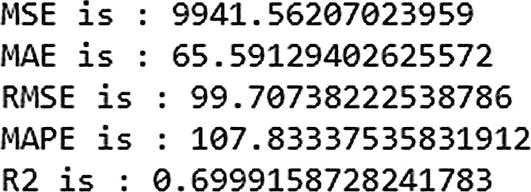

图 8-1 展示了预测图。

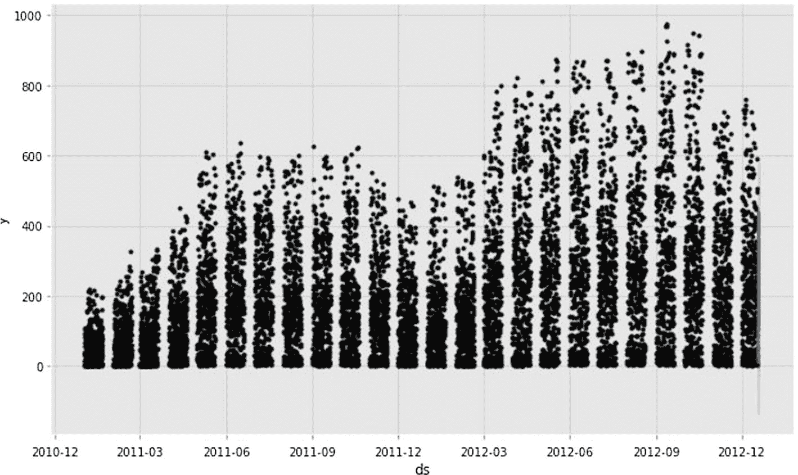

图 8-1

预测结果展示

```
fig1 = m.plot(forecast)
```

让我们绘制预测的各个组件（图 8-2）。

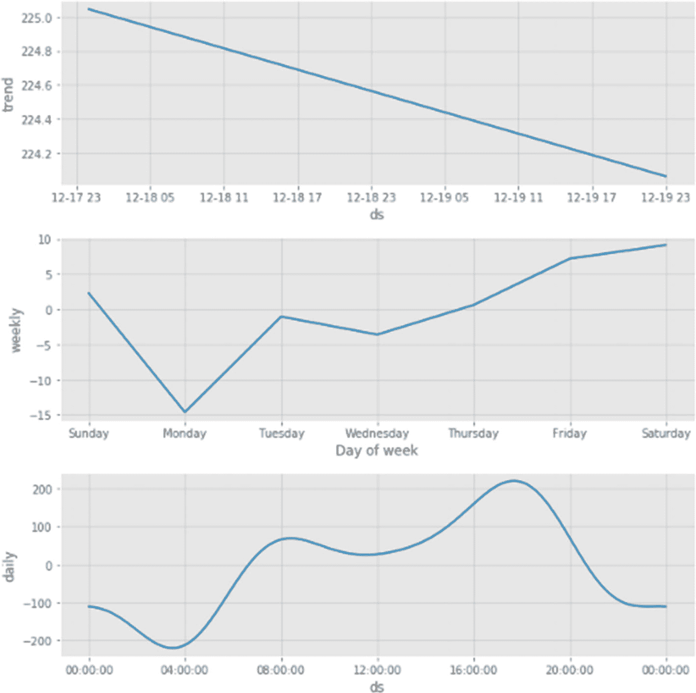

图 8-2

预测组件展示

```
fig2 = m.plot_components(forecast)
```

`add_changepoints_to_plot` 函数会添加红色线条；垂直虚线是 Prophet 识别出的趋势变化点（图 8-3）。

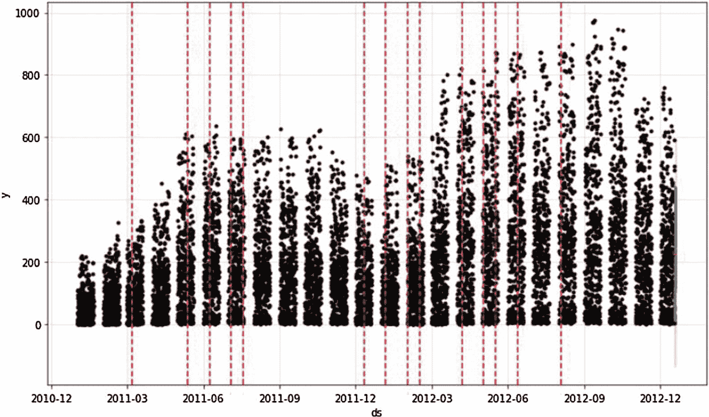

图 8-3

趋势变化点展示

```
from fbprophet.plot import add_changepoints_to_plot
fig = m.plot(forecast)
a = add_changepoints_to_plot(fig.gca(), m, forecast)
```


### 添加对数变换

在上一节中，你学习了如何使用 Prophet 对时间序列问题进行建模。在本节中，我们将对数据应用对数变换，并检查精度是否有所提升。

经过*对数变换*的数据遵循正态分布或近似正态分布。导入所需的库并加载 CSV 数据。

```
import warnings
import matplotlib.pyplot as plt
import numpy as np
import pandas as pd
from sklearn import metrics
from fbprophet import Prophet
```

让我们快速浏览一下数据。

```
df = pd.read_csv('Data\Bike_Sharing_Demand.csv',parse_dates = True)
df.head()
```


定义时间序列评估函数。

```
def timeseries_evaluation_metrics_func(y_true, y_pred):
def mean_absolute_percentage_error(y_true, y_pred):
y_true, y_pred = np.array(y_true), np.array(y_pred)
return np.mean(np.abs((y_true - y_pred) / y_true)) * 100
#print('Evaluation metric results:-')
print(f'MSE is : {metrics.mean_squared_error(y_true, y_pred)}')
print(f'MAE is : {metrics.mean_absolute_error(y_true, y_pred)}')
print(f'RMSE is : {np.sqrt(metrics.mean_squared_error(y_true, y_pred))}')
print(f'MAPE is : {mean_absolute_percentage_error(y_true, y_pred)}')
print(f'R2 is : {metrics.r2_score(y_true, y_pred)}',end='\n\n')
```

将数据转换为 Prophet 接受的格式。

```
df = df.rename(columns={'datetime': 'ds', 'count': 'y'})
```

划分训练集/测试集。我们保留最后两天的数据（即 48 条记录），用于在基于历史数据训练后验证结果。

```
validate = df[['ds','y']].tail(48)
df.drop(df[['ds','y']].tail(48).index,inplace=True)
train = df[['ds','y']]
```

我们应用对数变换以使数据呈正态分布。

```
train['y']= np.log(train['y'])
```

让我们初始化 `Prophet` 类，然后进行拟合。

```
m = Prophet(yearly_seasonality=False)
m.fit(train)
```

Prophet 需要一个未来的 DataFrame 来进行预测，因此我们创建一个频率为 `H`、覆盖未来 48 小时的 DataFrame。

```
p = 48
future = make_future_dataframe(periods=p,freq='H',include_history=False)
forecast = m.predict(future)
```

正如我们对输入数据应用了对数变换，我们需要对结果应用逆对数变换，将其恢复为原始尺度。

```
forecast['yhat'] = np.exp(forecast['yhat'])
timeseries_evaluation_metrics_func(validate.y,forecast['yhat'])
```

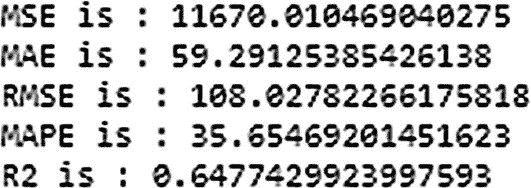

图 8-4 展示了预测图。

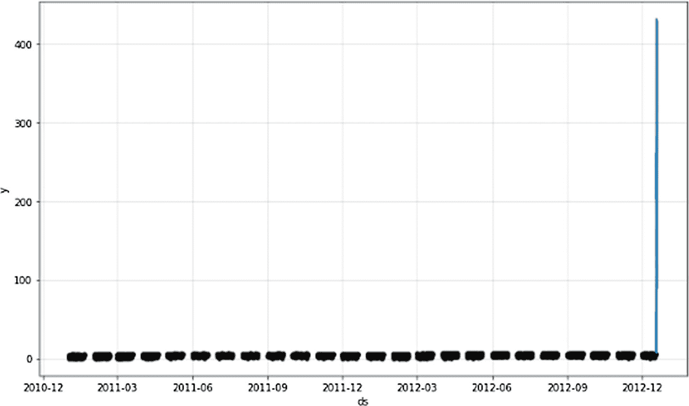

图 8-4

预测结果展示

```
fig1 = m.plot(forecast)
```

让我们绘制预测的各个组件（图 8-5）。

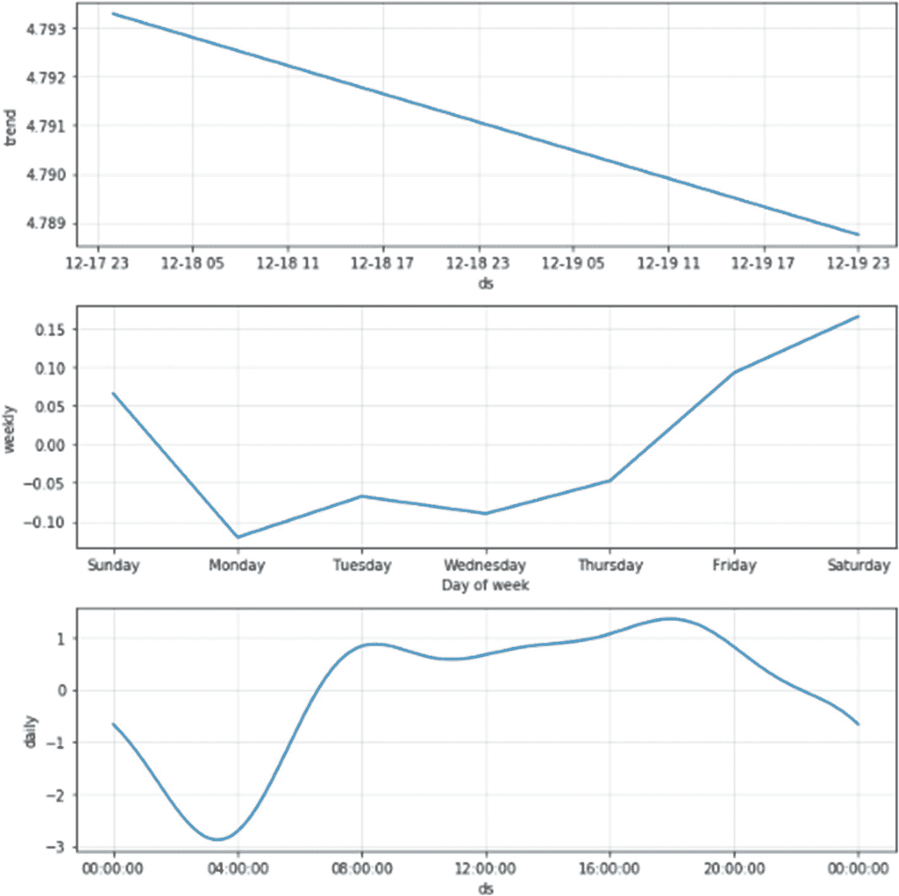

图 8-5

预测组件展示

```
fig2 = m.plot_components(forecast)
```

创建变点图（图 8-6）。

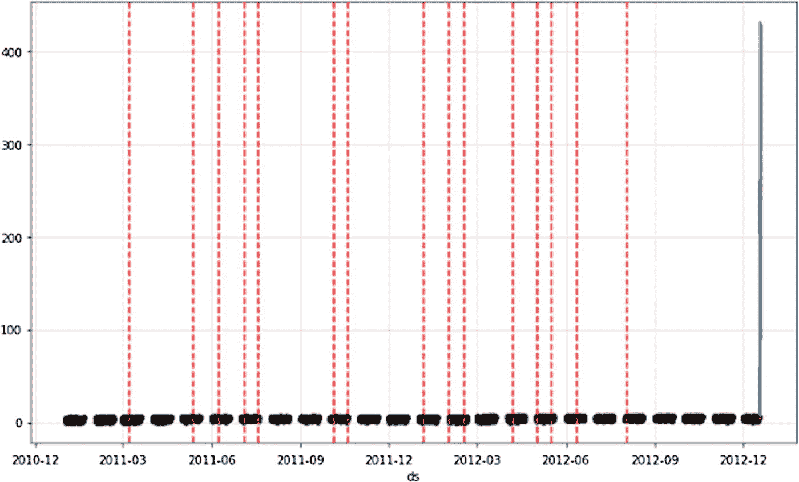

图 8-6

趋势变点展示

```
from fbprophet.plot import add_changepoints_to_plot
fig = m.plot(forecast)
a = add_changepoints_to_plot(fig.gca(), m, forecast)
```

通过应用对数变换，我们并未看到模型精度提升；相反，精度反而下降了。

### 添加内置的国家节假日

在本节中，我们将添加 Prophet 内置的美国国家节假日，并检查精度是否有所提升。

Prophet 包含以下国家的节假日：巴西 (BR)、印度尼西亚 (ID)、印度 (IN)、马来西亚 (MY)、越南 (VN)、泰国 (TH)、菲律宾 (PH)、土耳其 (TU)、巴基斯坦 (PK)、孟加拉国 (BD)、埃及 (EG)、中国 (CN) 和俄罗斯 (RU)。

导入所需的库并加载 CSV 数据。

```
import warnings
import matplotlib.pyplot as plt
import numpy as np
import pandas as pd
from sklearn import metrics
from fbprophet import Prophet
```

让我们快速浏览一下数据。

```
df = pd.read_csv(r'Data\Bike_Sharing_Demand.csv',parse_dates = True)
df.head()
```

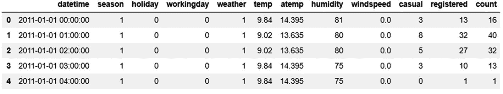

定义时间序列评估函数。

```
def timeseries_evaluation_metrics_func(y_true, y_pred):
def mean_absolute_percentage_error(y_true, y_pred):
y_true, y_pred = np.array(y_true), np.array(y_pred)
return np.mean(np.abs((y_true - y_pred) / y_true)) * 100
#print('Evaluation metric results:-')
print(f'MSE is : {metrics.mean_squared_error(y_true, y_pred)}')
print(f'MAE is : {metrics.mean_absolute_error(y_true, y_pred)}')
print(f'RMSE is : {np.sqrt(metrics.mean_squared_error(y_true, y_pred))}')
print(f'MAPE is : {mean_absolute_percentage_error(y_true, y_pred)}')
print(f'R2 is : {metrics.r2_score(y_true, y_pred)}',end='\n\n')
```

将数据转换为 Prophet 接受的格式。

```
df = df.rename(columns={'datetime': 'ds', 'count': 'y'})
```

划分训练集/测试集，我们保留最后两天的数据（即 48 条记录），用于在基于历史数据训练后验证数据。

```
validate = df[['ds','y']].tail(48)
df.drop(df[['ds','y']].tail(48).index,inplace=True)
train = df[['ds','y']]
```

让我们初始化 `Prophet` 类，使用 `add_country_holidays` 添加国家节假日，然后使用默认参数拟合数据。

```
m = Prophet(yearly_seasonality=False)
m.add_country_holidays(country_name='US')
m.fit(train)
```

Prophet 需要一个未来的 DataFrame 来进行预测，因此我们创建一个频率为 `H`、覆盖未来 48 小时的 DataFrame。

```
p = 48
future = m.make_future_dataframe(periods=p,freq='H',include_history=False)
forecast = m.predict(future)
timeseries_evaluation_metrics_func(validate.y,forecast.yhat)
```

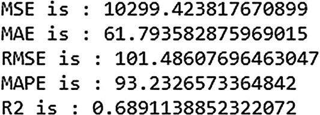

创建变点图（图 8-7）。

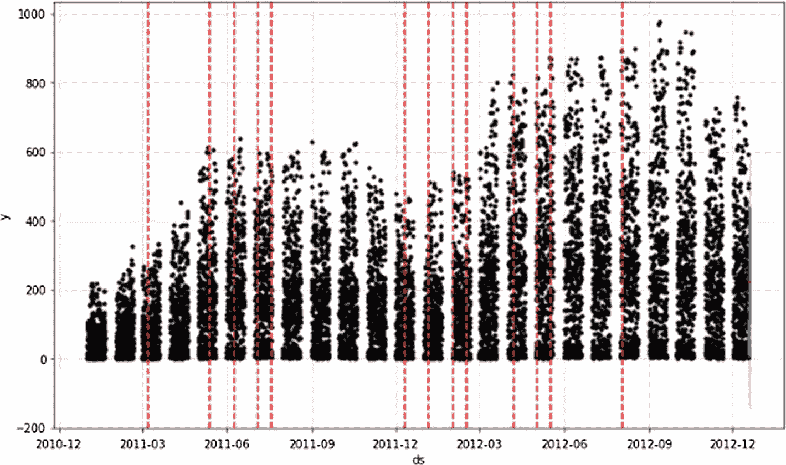

图 8-7

趋势变点展示

```
from fbprophet.plot import add_changepoints_to_plot
fig = m.plot(forecast)
a = add_changepoints_to_plot(fig.gca(), m, forecast)
```


## 使用 add_regressors(函数) 添加外生变量

在本节中，我们将添加可能影响目标变量的外生变量，并检查模型精度是否有所提升。这个问题也可以称为多变量时间序列问题。

```
import warnings
import matplotlib.pyplot as plt
import numpy as np
import pandas as pd
from sklearn import metrics
from fbprophet import Prophet
```

导入所需的库并加载 CSV 数据。

```
df = pd.read_csv('Data\Bike_Sharing_Demand.csv',parse_dates = True)
df.head()
```

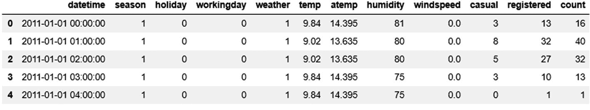

```
df['datetime'] = pd.to_datetime(df['datetime'])
```

定义时间序列评估函数。

```
def timeseries_evaluation_metrics_func(y_true, y_pred):
def mean_absolute_percentage_error(y_true, y_pred):
y_true, y_pred = np.array(y_true), np.array(y_pred)
return np.mean(np.abs((y_true - y_pred) / y_true)) * 100
#print('Evaluation metric results:-')
print(f'MSE is : {metrics.mean_squared_error(y_true, y_pred)}')
print(f'MAE is : {metrics.mean_absolute_error(y_true, y_pred)}')
print(f'RMSE is : {np.sqrt(metrics.mean_squared_error(y_true, y_pred))}')
print(f'MAPE is : {mean_absolute_percentage_error(y_true, y_pred)}')
print(f'R2 is : {metrics.r2_score(y_true, y_pred)}',end='\n\n')
```

将数据转换为 Prophet 可接受的格式。

```
df = df.rename(columns={'datetime': 'ds', 'count': 'y'})
```

划分训练集/测试集，我们保留最后两天的数据（即 48 条记录），用于在基于历史数据训练后验证结果。我们需要对外生变量进行同样的操作，并将其添加到原始 DataFrame 中。然后，我们可以进一步使用它来训练和验证数据。

```
validate = df[['ds','y','season','holiday','weather','temp','humidity','windspeed']].tail(48)
df.drop(df[['ds','y','season','holiday','weather','temp','humidity','windspeed']].tail(48).index,inplace=True)
train = df[['ds','y','season','holiday','weather','temp','humidity','windspeed']]
```

让我们初始化 `Prophet` 类，然后逐个添加外生变量，最后在训练数据上拟合模型。

```
m = Prophet(yearly_seasonality=False)
m.add_regressor('season')
m.add_regressor('holiday')
m.add_regressor('weather')
m.add_regressor('temp')
m.add_regressor('humidity')
m.add_regressor('windspeed')
m.fit(train)
```

Prophet 需要一个未来的 DataFrame 来进行预测，因此让我们创建一个频率为 `H`、长度为 48 的未来 DataFrame，用于预测接下来的 48 小时。

```
p = 48
future = m.make_future_dataframe(periods=p,freq='H',include_history=False)
```

将外生变量添加到预测 DataFrame 中，以便模型在预测时可以使用它们。

```
future['season'] = validate['season'].values
future['holiday'] = validate['holiday'].values
future['weather'] =  validate['weather'].values
future['temp'] = validate['temp'].values
future['humidity'] =  validate['humidity'].values
future['windspeed'] = validate['windspeed'].values
forecast = m.predict(future)
timeseries_evaluation_metrics_func(validate.y,forecast.yhat)
```

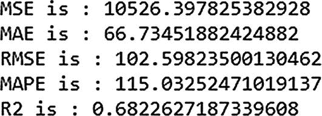

绘制预测图（图 8-8）。

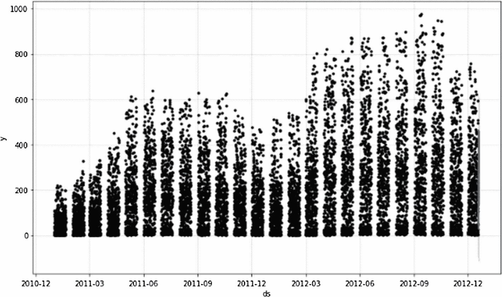

**图 8-8**

预测结果展示

```
fig1 = m.plot(forecast)
```

让我们绘制预测的各个分量（图 8-9）。

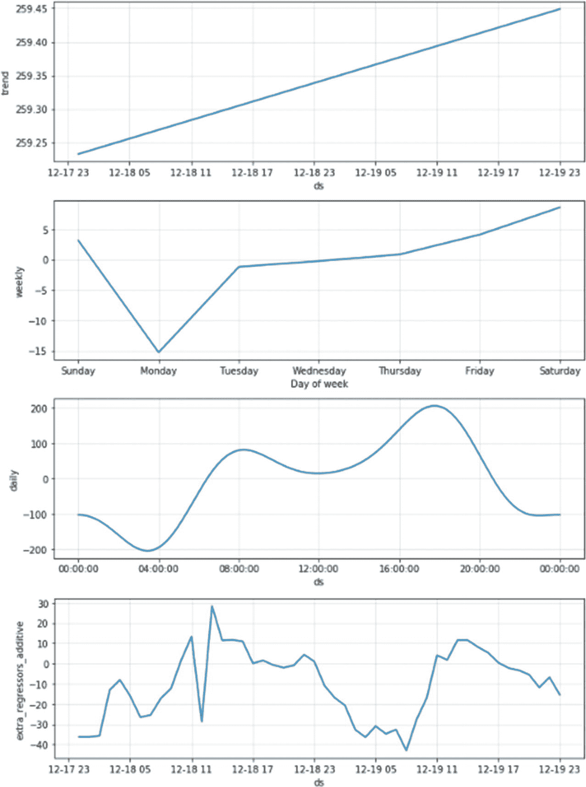

**图 8-9**

预测分量展示

```
fig2 = m.plot_components(forecast)
```

绘制变点（图 8-10）。

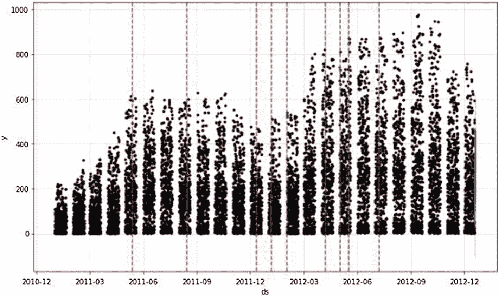

**图 8-10**

趋势变点展示

```
from fbprophet.plot import add_changepoints_to_plot
fig = m.plot(forecast)
a = add_changepoints_to_plot(fig.gca(), m, forecast)
```

## 总结

在本章中，你学习了 Prophet 背后的高级数学原理、如何创建基础模型、如何对时间序列数据应用对数变换、如何添加国家节假日，以及如何使用 `add_regressor` 处理多变量时间序列数据。


索引 A 激活函数 二进制阶跃函数 线性激活函数 非线性 参见非线性激活函数类型 加法模型 加法季节性模型 add_regressor .agg() 函数 聚合，GROUP BY 赤池信息准则 (AIC) 阿尔法 ARMA 模型 升序数据顺序 增强迪基-富勒 (ADF) 检验 自动 ARIMA 自相关函数 (ACF) 自相关图 自编码器 自编码器 LSTM 多变量 水平风格 实际值 *vs.* 预测值 最佳权重 删除重复项 早停与检查点 五数概括 函数定义 导入库 模型摘要 重新缩放预测值 时间序列评估函数 训练与验证损失 训练与验证时间序列数据 训练/测试分割 自编码器 LSTM 单变量 水平风格 实际值 *vs.* 预测值 自编码器模型 最佳权重 早停与检查点 函数定义 导入库 线图 损失与验证损失 模型摘要检查 预测值 重新缩放数据 数据预览 时间序列评估函数 训练与验证损失 训练与验证时间序列数据 自编码器 LSTM 单变量 单步风格 实际值 *vs.* 预测值图 最佳权重 早停与检查点 编码-解码器模型 函数定义 导入库 损失与验证损失 模型摘要检查 预测值 重新缩放数据 数据预览 时间序列评估函数 训练与验证损失 训练与验证时间序列数据 训练/测试 自回归 (AR) 模型 自回归积分滑动平均 (ARIMA) ADF 检验函数 置信区间 数据框 诊断图 探索性数据分析 Facebook 股票数据 积分 (I) 库与加载 CSV 数据 模型训练 非季节性 pmdarima 模块 p, d, q 的表示 时间序列评估函数 自回归模型 B 通过时间的反向传播 (BPTT) 反向传播 暴力方法 梯度下降 学习率 *vs.* 梯度下降优化器 表示 平衡面板数据 贝叶斯信息准则 (BIC) 伯努利分布 双向 LSTM 多变量 水平风格 实际值 *vs.* 预测值 最佳权重 早停与检查点 五数概括 函数定义 导入库 加载 CSV 数据 神经网络 重新缩放预测值 时间序列评估函数 Trained_model**.**summary () 训练与验证损失 训练与验证时间序列数据 训练/测试 双向 LSTM 单变量 水平风格 双向 LSTM 单变量 单步风格 实际值 *vs.* 预测值 函数定义 模型摘要检查 神经网络 预测值重新缩放 所需库与加载 CSV 文件 参见 /train 数据预览 停止与检查点 时间序列评估函数 训练与验证损失 训练与验证时间序列数据 训练/测试分割 二进制阶跃函数 生物神经元 *vs.* 人工神经网络 箱线图 暴力方法 C K 线图 CNN 多变量 水平风格 实际值 *vs.* 预测值图 最佳权重 删除重复项 早停与检查点 五数概括 函数定义 导入库 标签编码 损失与验证损失 模型摘要 重新缩放预测值 时间序列评估函数 训练与验证损失 训练与验证时间序列数据 训练/测试分割 CNN 单变量 水平风格 实际值 *vs.* 预测值 最佳权重 早停与检查点 五数概括 函数定义 导入库 模型摘要 预测值 时间序列评估函数 训练与验证损失 训练与验证时间序列数据 训练/测试 CNN 单变量 单步风格 实际值 *vs.* 预测值 检查点配置 五数概括 函数定义 导入库 线图 模型摘要 预测值 重新缩放数据 参见 /train 时间序列评估函数 训练与验证损失 训练与验证时间序列数据 训练/测试 协整检验 恒定误差传送带 (CEC) 单元 连续时间序列 卷积 LSTM (ConvLSTM) 卷积神经网络 (CNN) 批归一化 卷积层 卷积公式 卷积操作 丢弃 滤波器公式 一维 池化 相关性 代价函数 交叉熵 横截面数据 CSV 文件 周期成分 周期性变化 可及性 衰退 检测 繁荣 D 阻尼 数据过滤 数据平稳性 图 统计量 单位根检验 汇总统计量 数据类型 横截面数据 面板数据/纵向数据 时间序列 数据整理 Pandas 参见 Pandas 解码 分解 树突 降序数据顺序 describe() 函数 描述性统计 去季节性 去趋势 HP 滤波器 Pandas 差分 SciPy 信号 时间序列数据 df.shift() 函数 迪基-富勒 (DF) 检验 diff() 函数 差分平稳 差分 (滞后差分) 离散时间序列 双指数平滑 加法/乘法趋势 自动网格搜索 模型摘要 最佳参数 自定义网格搜索 模型 自定义网格搜索参数 拟合参数 Holt 参数 Holt 指数平滑 预测公式 线图展示结果 加载数据集预览 趋势成分 下钻数据 死亡 ReLU 问题 E 编码 扩展窗口 探索性数据分析 指数加权移动窗口 指数平滑 F 前馈循环神经网络 一阶差分 (趋势差分) 一阶平稳 前向传播 全外连接 G 门控循环单元 (GRU) 高斯分布 数据 梯度下降 梯度下降优化算法 groupby() 函数 GRU 多变量 水平风格 实际值 *vs.* 预测值图 最佳权重 删除重复项 早停与检查点 五数概括 函数定义 导入库 标签编码 线图 模型摘要 重新缩放预测值 时间序列评估函数 训练与验证损失 训练与验证时间序列数据 训练/测试分割 GRU 单变量 水平风格 GRU 单变量 单步风格 实际值 *vs.* 预测值图 最佳权重 早停与检查点 函数定义 导入库 损失与验证损失 模型摘要检查 预测值 重新缩放数据 参见 /train 数据预览 时间序列评估函数 训练与验证损失 训练与验证时间序列数据 训练/测试 H 霍德里克-普雷斯科特 (HP) 滤波器 Holt 方法 Holt-Winter 指数平滑 Holt-Winters 方法 水平风格时间序列预测 HP 滤波器 去趋势 I 内连接 内合并 逆差分函数 J 连接 全外 内 左 右 JSON 格式 K 核密度估计 (KDE) 克维亚特科夫斯基-菲利普斯-施密特-辛 (KPSS) 检验 L 泄漏 ReLU 学习率 *vs.* 梯度下降优化器 左连接 左合并 线性激活函数 将数据加载到 Pandas CSV 文件 Excel 文件 JSON 格式 URL 对数变换数据 长短期记忆 (LSTM) 单元架构 含公式 卷积 梯度爆炸与消失问题 门 长期依赖 窥视孔 *vs.* RNN 逐步解释 T 时间步 LSTM 多变量 水平风格 实际值 *vs.* 预测值 条形图表示 最佳权重 早停与检查点 五数概括检查 导入库 标签编码 线图 神经网络 预测值 单窗口历史数据 时间序列评估函数 Trained_model**.**summary () 训练与验证损失 训练与验证时间序列数据 训练/测试 LSTM 单变量 水平风格 实际值 *vs.* 预测值 检查点 数据与预测 函数定义 损失与验证损失 模型摘要 预测值 所需库与加载 CSV 文件 重新缩放数据 单窗口历史数据 数据预览 目标水平 时间序列评估函数 训练与验证损失 训练与验证时间序列数据 训练模型与预测 LSTM 单变量 单步风格 实际值 *vs.* 预测值 数据与预测 删除重复项 函数定义 损失与验证损失 机器与深度学习 模型摘要 单窗口历史数据 Tensorflow 时间序列评估函数 训练与验证损失 训练与验证时间序列数据 M 平均绝对误差 (MAE) 平均绝对百分比误差 (MAPE) 均方误差 (MSE) 集中趋势度量 变异性度量 最小门控单元 缺失数据处理 向后填充法 FILLNA 向前填充法 插值法 Isnull() 缺失值/数据 移动平均 (MA) 乘法模型 多变量时间序列 多变量预测方法 N 神经网络 神经元 非线性激活函数 泄漏 ReLU 参数化 ReLU ReLU Sigmoid Softmax tanH 训练模型 非平稳时间序列 正态随机游走 NOT IN 操作 NumPy O 一维 CNN 优化方法 优化器 ORDER BY 排序 外合并 过度平滑 P, Q Pandas DataFrames describe() 函数 筛选、应用 group by() 函数 GROUP BY 操作 isin() 函数 连接 (合并) 参见 Join NOT IN 操作 移位操作 unique() 函数 Pandas 差分 pandas.head() 函数 Pandasql GROUP BY 操作 筛选、应用 Python 框架 sqldf 面板数据/纵向数据 参数化 ReLU 偏自相关函数 (PACF) 窥视孔 LSTM 感知机 菲利普斯-佩龙 (PP) 检验 Pmdarima 主成分分析 (PCA) 概率密度函数 (PDF) Prophet 添加内置国家假日 添加外生变量/add_regressors 应用对数变换 实现 add_changepoints_to_plot 函数 预测成分 预测图 未来数据框 导入库 加载 CSV 数据 时间序列评估函数 训练/测试分割 趋势变点 开源框架 时间序列模型 P 值解释 R R 平方 径向基函数 随机游走 修正线性单元 (ReLU) 循环神经网络 (RNN) BPTT 参见通过时间的反向传播 (BPTT) 前馈 *vs.* LSTM 多对多关系 多对一关系 *vs.* 神经网络 一对多关系 回归模型 重采样 按月 按季度 按周 按年 Pandas 中的操作 半月基础 右合并 滚动窗口 均方根误差 (RMSE) S SARIMAX 模型 施密特-菲利普斯检验 SciPy 去趋势 SciPy 库 季节性 ARIMA (SARIMA) ADF 检验函数 解释非季节性与季节性成分 建模 乘法模型 非季节性成分 非平稳与自动 ARIMA 周期数 搜索空间 数据预览 时间序列数据集 时间序列评估函数 趋势元素 单变量时间序列数据 季节性差分 一阶差分 二阶差分 季节性 自相关图 分解 去季节性 时间序列数据 多箱线图 周期性波动 二阶差分 序列相关 移位 Sigmoid 激活函数 简单指数平滑 (SES) 算法超参数 阿尔法 预测估计 水平 高级数学 线图展示结果 平均绝对百分比误差 (MAPE) NumPy 最优参数搜索结果 均方根误差 (RMSE) 数据集行 SimpleExpSmoothing 参数 sklearn 时间序列数据集 简单网格搜索 单步时间序列预测 sklearn Softmax 激活函数 sort_value() 函数 SQL 语法 平稳时间序列 平稳数据技术 差分 一阶差分 (趋势差分) 随机游走 季节性差分 参见季节性差分 二阶差分 (趋势差分) 平稳时间序列数据 统计量 单位根检验 严格或强平稳 子集数据 汇总统计量 Swish 激活 T tanH 激活函数 Tensorflow 绑定权重 时间序列分析 时间序列数据 时间序列分解 时间序列建模技术 趋势 定义 去趋势 参见去趋势 霍德里克-普雷斯科特 (HP) 滤波器 线 平稳 三次指数平滑 加法趋势 算法超参数 供参考 自动网格搜索 模型摘要 最佳参数查找 自定义网格搜索 评估指标 拟合参数 预测方程 网格搜索参数 线图展示结果 数据集行 简单网格搜索 数据预览 U 非平衡面板数据 意外变化 unique() 函数 单变量时间序列 不可预测误差 V 梯度消失问题 (VGP) VARMA 模型 ADF 检验函数 协整 数据平稳性 Pandas 差分 df_results_moni 数据框 网格搜索 逆差分函数 逆预测结果 多变量时间序列数据 参数网格 打印数据框值 结果图 数据预览 时间序列数据集 时间序列评估函数 变量平稳 向量自回归 (VAR) ADF 检验函数 对齐图 双向模型 协整检验 数据平稳性 数据平稳性 Pandas 差分 直方图与 KDE 线图、直方图与 KDE 图 多变量预测方法 Pandas 差分 图、直方图与 KDE 图创建 结果 数据预览 随机过程模型 测试 训练测试分割 时间序列数据集 时间序列评估函数 单变量时间序列 变量平稳 向量移动平均 (VMA) W 弱 (二阶) 平稳 窗口函数 扩展窗口 指数加权移动窗口 滚动窗口 Winter 方法 X, Y, Z XGBoost
