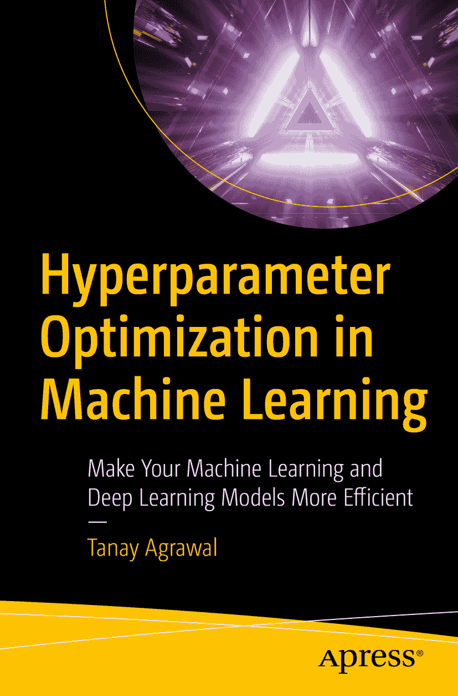

ISBN 978-1-4842-6578-9e-ISBN 978-1-4842-6579-6 [`doi.org/10.1007/978-1-4842-6579-6`](https://doi.org/10.1007/978-1-4842-6579-6) © Tanay Agrawal 2021 Apress Standard 本出版物中使用的通用描述性名称、注册商标名称、商标、服务标志等，即使没有明确声明，也不意味着这些名称不受相关保护性法律和法规的约束，因此可自由使用。出版商、作者和编辑假定本书在出版之日所提供的信息和建议是真实准确的。出版商、作者或编辑均不对本书所含材料或可能存在的任何错误或遗漏提供明示或暗示的担保。出版商对已出版地图中的管辖权主张和机构归属保持中立。本书通过 `Springer Science+Business Media New York` 在全球图书贸易中发行，地址：1 New York Plaza, Suite 4600, New York, NY 10004-1562, USA。电话：1-800-SPRINGER，传真：(201) 348-4505，电子邮件：orders-ny@springer-sbm.com，或访问 https://www.springeronline.com。`Apress Media, LLC` 是一家加利福尼亚有限责任公司，其唯一成员（所有者）是 `Springer Science + Business Media Finance Inc (SSBM Finance Inc)`。`SSBM Finance Inc` 是一家特拉华州公司。

*谨以此书献给我的父母和祖父母。*

## 序言 1

我必须承认，在我训练第一个机器学习模型时，手动调整参数是我真正享受的事情。我会更改一个参数，运行训练脚本，然后等待评估分数是否有所提升。这是一种小小的罪恶快感。

但随着我在机器学习领域投入更多时间，我意识到还有其他更有影响力的领域可以投入精力。我意识到我可以（也应该）将参数调整工作外包出去。

我了解了随机搜索，并开始在项目中使用它。在某个时候，我觉得自己可以做得比随机搜索更好，于是开始阅读关于更高级的超参数优化算法和库的资料。

我找到的许多文章都相当肤浅和基础，但我记得读过一篇关于 `Hyperopt`（最流行的超参数优化库之一）的深入、实践性强且易于理解的文章。它是由 Tanay Agrawal 撰写的。那篇文章可能仍然是我读过关于这个主题最有价值的文章之一。我在一篇博客文章中提到了它，我们就是这样认识的。

当 Tanay 告诉我他正在写一本关于超参数优化的书时，我毫不犹豫地提出审阅。说实话，我真的很想比别人先读到它！令我惊讶的是，Tanay 同意了，我也得以在这里那里提了一些意见。

这本书真正深入探讨了超参数优化的理论与实践。我非常喜欢它如何深入解释理论，但又不过于复杂。实践示例围绕当今广泛使用的库和框架展开，这使得这本书与时俱进，最重要的是，非常实用。

我向任何希望超越基础知识、学习超参数优化的“为什么”、“怎么做”和“是什么”的机器学习从业者推荐这本书。

> Jakub Czakon

> 高级数据科学家

> Neptune.ai

## 序言 2

在这本书中，Tanay 带你踏上一段互动之旅——从最字面的意义上说，因为每一行代码都可以在笔记本中运行——深入探索超参数的奥秘。它帮助任何人快速上手，使用他们选择的任何库来调整和改进他们的深度学习项目。

作者以透彻且易于理解的方式，精心涵盖了机器学习模型中超参数的内部工作原理，这将使你能够理解并使用不同的库在此基础上进行构建。这本书还揭开了最黑的黑匣子：自动化机器学习中的超参数优化。

这是一本关于复杂主题的友好指南，同时充满了即使是高级从业者也会喜欢的尖端精华内容。

> Akruti Acharya

> 数据科学家

> Curl HG

# 引言

在构建机器学习模型时，选择正确的超参数是数据科学从业者面临的最大问题之一。本书是一本超参数优化（`HPO`）指南。它从`超参数`最基本的定义开始，一直带你到使用先进的 `HPO` 技术构建你自己的 AutoML 脚本。本书面向学生和数据科学专业人士。

本书共五章。第 1 章帮助你理解超参数如何影响模型构建的整体过程。它阐述了 `HPO` 的重要性。第 2 章介绍了基本且易于实现的 `HPO` 方法。第 3 章带你了解应对时间和内存限制的各种技术。第 4 章和第 5 章讨论了贝叶斯优化、相关库和 AutoML。

本书旨在让读者以直观且实用的方式理解 `HPO` 概念，并为每个部分提供代码实现。希望你喜欢。

## 致谢

我要感谢 Kailash Ahirwar（MateLabs 首席技术官）作为我的优秀导师。非常感谢 MateLabs 和 Curl HG 团队的持续支持。我感谢 Akruti Acharya 和 Jakub Czakon 在撰写本书时提供的富有洞察力的意见。我还要感谢 Paankhi Agrawal、Sahil Sharma、H.-Y. Amanieu 博士、Anubhav Kesari、Abhishek Kumar、Amog Chandrashekar 等人。没有家人的爱与鼓励，这本书是不可能完成的。

## 关于作者 关于技术审校