# 1. 超参数简介

人工智能（AI）突然无处不在，从商业分析、医疗保健、汽车工业到你在日常生活中可能享受的各种平台，如社交媒体、游戏和广泛的娱乐产业，都在发生变革。计划在视频流应用上看部电影，但决定不了看哪部？在 AI 的帮助下，你最终可能会观看基于你过去电影选择推荐的一部。

机器学习是 AI 的一个子集，涉及算法从以往经验中学习。在某些情况下，机器学习已经达到了人类水平的准确性。例如，最先进的深度神经网络（DNN）在某些任务（如图像分类、目标检测等）上表现与人类一样好，尽管这与模拟人类智能不同（但这是一步）。

在机器学习算法中，调整超参数是构建高效模型的重要方面之一。在本章中，你将了解*超参数*一词的含义，并学习超参数如何影响构建机器学习模型的整体过程。


## 机器学习简介

*机器学习*是研究无需明确定义执行代码，而是利用数据进行学习的算法。机器学习使算法能够在无需人工干预的情况下自主学习。

计算机科学家、时任卡内基梅隆大学教授的汤姆·M·米切尔对机器学习定义如下：“如果计算机程序在任务*T*中的性能（由性能度量*P*衡量）随着经验*E*而提升，则称该程序从经验*E*中学习。”

机器学习算法根据所需解决问题的类型可分为多个子类。在此我将介绍三种主要类型：

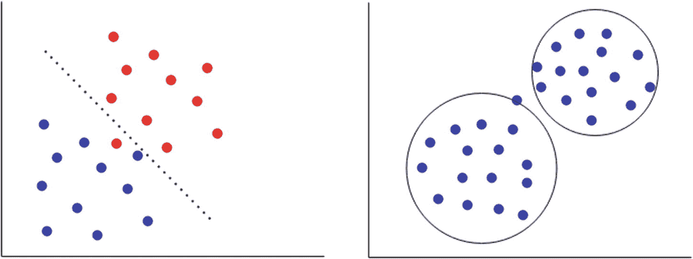

图 1-1-1

监督式机器学习（左）与无监督式机器学习（右）示例

*   *监督式机器学习算法*：提供带标签的数据，我们基于这些数据构建模型，以根据变量预测此类标签。例如，假设你想购买一艘宇宙飞船。多个因素会帮助你决定购买哪艘飞船：成本、飞船尺寸、建造质量、是否配备超光速引擎、武器系统等等。现在我们拥有数百艘飞船的数据，包含这些特征信息及其价格，因此我们构建一个模型来预测价格。这属于回归问题。*回归问题*具有连续的目标值，如果目标值是离散的，我们则称之为*分类问题*。第三类问题涉及时间戳，即*时间序列预测*，其中下一个数据点在一定程度上依赖于先前信息，因此算法需要记住先前数据点的信息。图 1-1-1 左侧的图像是一个分类问题的示例。我们需要带标签的数据才能学习如何在它们之间画出分隔线。

*   *无监督式机器学习算法*：这类问题没有目标值。假设你需要根据特征将假设的宇宙飞船进行聚类分组，你会使用*聚类算法*来完成。无监督式机器学习用于检测数据集中的模式。你不知道哪个簇对应什么，但你知道同一簇中的所有飞船彼此相似；图 1-1-1 右侧的图像展示了一个示例。

*   *强化机器学习算法*：强化机器学习算法从环境中学习；如果表现良好，它会获得奖励，目标是最大化奖励。例如，考虑 Chrome 浏览器中的“奔跑恐龙”游戏（访问 `chrome://dino/` 并按空格键）。恐龙不断向障碍物奔跑。为了提高分数，你必须在精确的时间按下空格键，让恐龙跳过障碍物。这里的分数就是奖励，跳跃则是需要在正确时机决定的变量。在类似问题中，我们使用强化机器学习算法。*Q-learning 算法*是强化机器学习算法的一个例子。强化机器学习最出色的应用之一是通过试错学习行走的机器人。

机器学习远不止于此。在深入探讨超参数及其优化方法之前，你需要熟悉机器学习的基础知识。如果你是机器学习新手，或者想重温基本概念，请参考附录 I 和附录 II。附录 I 涵盖了机器学习的实际应用及其一些基本方面。附录 II 简要介绍了全连接神经网络以及用于实现的 PyTorch 和 Keras 框架。


## 理解超参数

在处理机器学习算法时，存在两种变量，如图 1-2-1 所示：

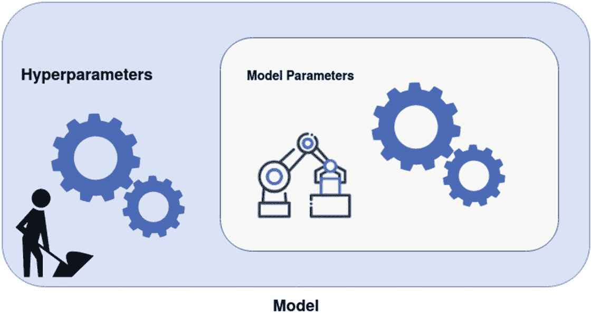

图 1-2-1

内部的方框代表模型参数，机器学习算法在此处运行。外部的方框代表超参数，我们必须在算法开始训练之前设置好它们。

*   ***参数***：这些是算法根据所提供的数据集进行调整的参数（你对此调整过程没有发言权）。
*   ***超参数***：这些是你在开始训练之前手动设置的更高级别的参数，其设置依据包括数据特征以及算法的学习能力等属性。

我将以一个机器学习算法为例，向你展示参数与超参数之间的区别。我们以一个非常基础的算法——线性回归为例。

线性回归中的假设函数如下：

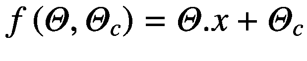

（公式 1.2.1）

这里，*x* 和 Θ 是向量，*x* 是特征向量，Θ 是分配给每个特征的权重，而 Θ[c] 是一个常数偏置。

我们以经典的房价预测问题为例。房价取决于某些因素，包括房屋面积、卧室数量、卫生间数量、所在地区的犯罪率、与公共交通（公交站、机场、火车站）的距离、学区、与最近医院的距离等等。所有这些都可以视为特征；也就是公式 1.2.1 中假设函数里的 *x* 向量。例如，随着卧室数量增加和房屋面积增大，房价会上升；这些特征将具有正的权重（Θ）。而距离学校和医院越远、社区犯罪率越高，房价则会下降；这些特征将具有负的 Θ。在公式 1.2.1 中，f(Θ, Θ[c]) 给出了房价。

我们可以使用优化算法，根据先前的观测数据为每个特征找到最佳的 Θ 值。因此，Θ 向量由优化算法（例如梯度下降）控制和调整。这些权重就是***参数***。

接下来，我们讨论一下优化函数——梯度下降，这将有助于你理解超参数。

我们首先为参数分配一些随机数（即*权重*）。对于一个观测样本，如果我们有向量 *x*（每个特征都有数值）和向量 Θ（每个权重都有随机数值），通过使用公式 1.2.1，我们得到 f(Θ, Θ[c]) 的值。这将是我们预测的值，由于权重是随机的，这个预测值将是一个随机值（p[1]′）。同时，我们拥有房价的真实值（p[1]）。

我们可以计算差值 C[1]（对于第一个观测样本），即 |p[1]-p[1]′|。这是一个我们需要减小的损失。类似地，如果我们计算所有观测样本的损失（C）之和的平均值：

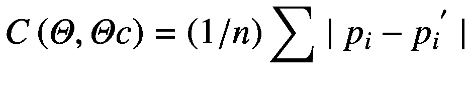

（公式 1.2.2）

公式 1.2.2 被称为损失函数，优化函数的目标是减小 C 的值，这样我们就能给出更准确的预测。损失函数依赖于权重和偏置，如图 1-2-2 所示。

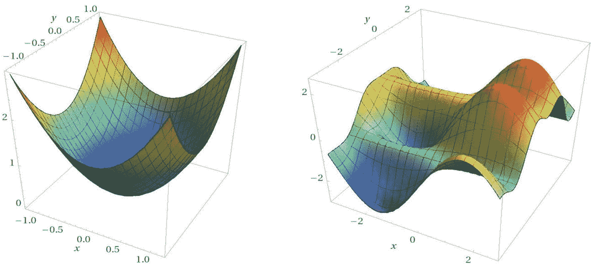

图 1-2-2

三维空间中的损失曲线，x 轴和 y 轴为权重，z 轴为损失

图 1-2-2 中的三维曲线可能是损失函数的几种表现形式。请记住，我们是从随机值开始初始化权重和偏置的；现在我们需要改变这些值，使得损失趋向其最小值。根据微积分，C 的变化如下：

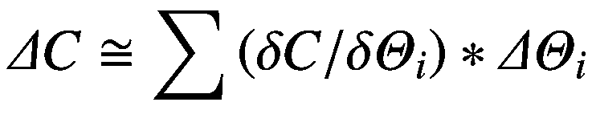

（公式 1.2.3）

*i* = {0, *n*}，其中 Θ[0] 为 Θ[c]

我们将 [(δC/δΘ[0]), (δC/δΘ[1])...] 表示为向量，将 [ΔΘ[0], ΔΘ[1]...] 表示为向量 ΔΘ；因此：

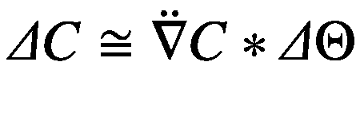

（公式 1.2.4）

但假设如下：

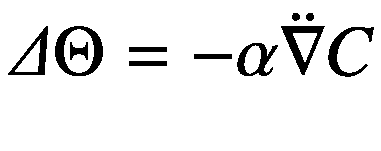

（公式 1.2.5）

将其代入公式 1.2.4，我们得到如下结果：

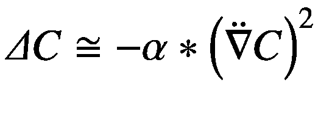

这里，由于 α 是一个正数，损失的变化将始终为负，而我们希望损失始终为负。因此公式 1.2.5 成立。

所以，根据公式 1.2.5，我们得到：

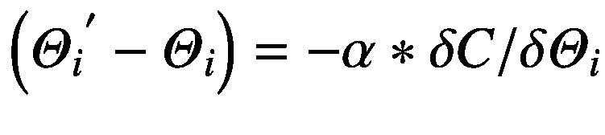

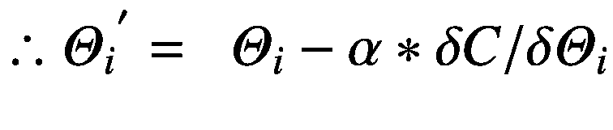

（公式 1.2.6）

其中 Θ[i]′ 是权重 Θ[i] 更新后的新值。在公式 1.2.6 中，权重 Θ[i]′ 的更新值依赖于权重的先前值（Θ[i]）、梯度（δC/δΘ[i]）以及一个正数 α；这里的 α 是梯度下降的超参数之一。它控制着算法的性能。对于每个观测样本，我们运行这个更新方程，在改变权重值的同时减小损失，最终使损失函数达到最小值。


## 超参数优化的必要性

在上一节中，我们在公式 1.2.6 中使用了一个正数 𝛼 来控制算法。这个 𝛼 在梯度下降算法中被称为*学习率*。它控制着损失函数达到最小值时的速率。图 1-3-1、1-3-2 和 1-3-3 展示了如下所述的情况。

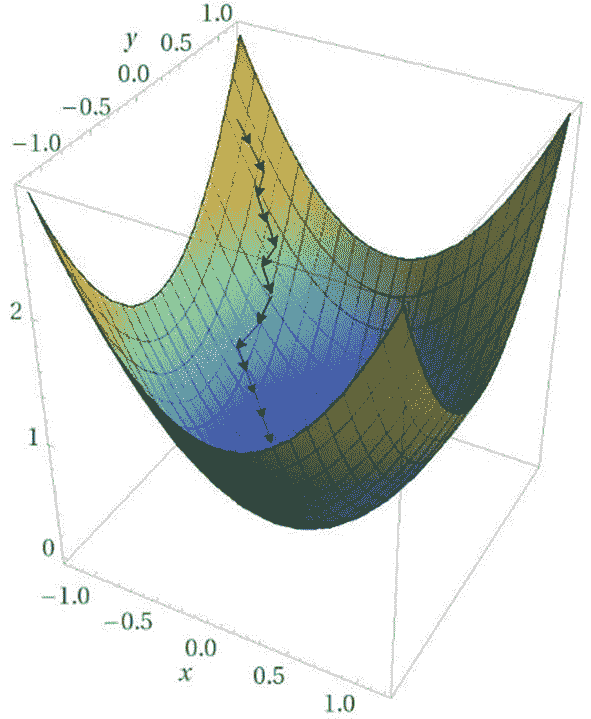

图 1-3-3

𝛼 的最优值

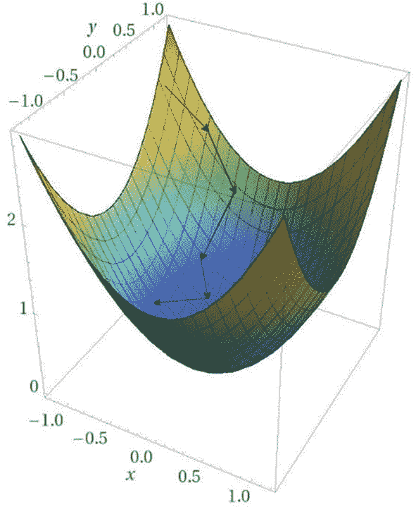

图 1-3-2

𝛼 的较大值

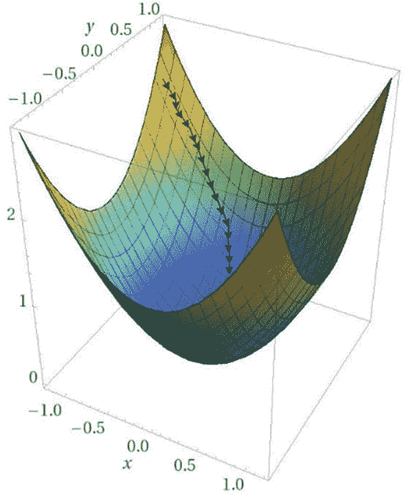

图 1-3-1

𝛼 的较小值

在图 1-3-1 中，𝛼 的值很小；它最终会收敛，但 ΔΘ（即权重的变化）会非常小，以至于需要大量的迭代步数，从而增加了时间。较大的学习率（𝛼）值会导致损失剧烈变化，从而产生过冲并导致发散，如图 1-3-2 所示。然而，如果我们找到 𝛼 的最优值，就能在更短的时间内收敛且不会过冲，如图 1-3-3 所示。这就是为什么我们需要将 𝛼 调整到其最高效的值，这个优化过程被称为*超参数调优*。

在更高级的梯度下降算法变体中，我们从较大的步长（即较大的学习率值）开始以节省时间，当接近收敛点时，再减小该值以避免过冲。但此时，减小 𝛼 的因子又成了另一个超参数。所以，现在你明白了调优这些超参数的重要性。

要调优这些超参数，你必须对算法以及这些超参数如何影响性能有很好的理解。即使你打算使用超参数调优算法（将在后续章节介绍），设定一个好的起点和终点也非常重要。这将为你节省大量时间，并提升算法的性能。

## 算法及其超参数

在本节中，我将讨论一些基本的机器学习算法，以帮助你理解它们的超参数是如何工作的。我将使用 scikit-learn 的约定来讨论这些超参数，但由于它们是通用的，你也可以将它们用于其他实现，甚至是自行实现的算法。我不会深入数学细节，但会提供足够的信息，让你直观地了解它们如何影响算法。在第 2 章中，我们将看到一组糟糕的超参数如何导致模型性能不佳，而一组好的超参数如何创建出优秀的机器学习模型。

### K-近邻算法

K-近邻（KNN）算法既可用作监督学习算法，也可用作无监督学习算法，并可应用于分类、回归、聚类和异常值检测问题。KNN 假设相似的点在空间上更接近，如图 1-4-1 所示。

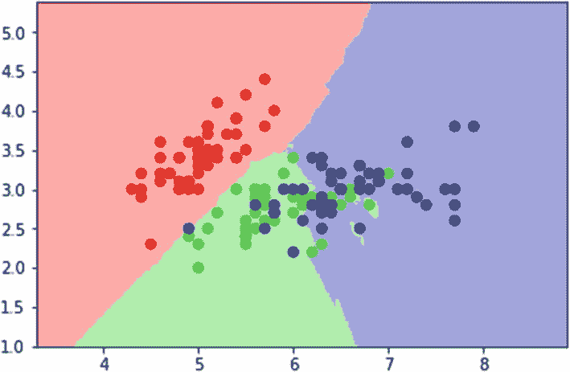

图 1-4-1

一个二维分类数据集在使用 KNN 时显示的决策边界

K-近邻算法会找到与待预测点最接近的 K 个（最近邻点的数量）已标记样本。这个 K 值可以由用户定义。而最近邻的距离可以通过不同的度量来计算，例如欧几里得距离、曼哈顿距离等。为了找到这些最近邻点，会使用诸如 kd-tree 和 ball tree 之类的索引算法。下面我们来讨论这些超参数。

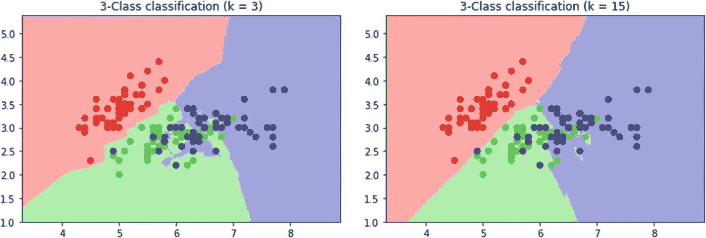

图 1-4-2

上方图像 k=3，下方图像 k=15

*   *K 值（最近邻数量）*：我们设定 K 的值，它是一个正整数，决定了在预测新数据点时，需要考虑的训练数据集中已标记样本的数量。图 1-4-2 展示了增加 K 值如何使边界变得更平滑。而当 k=3 时，边界则更为严格。

*   *权重*：我们可以给予最近邻点相同的优先级，也可以根据它们与查询点的距离来决定其权重；距离越远，权重越小。

*   *索引算法*：索引算法用于映射最近邻点。由于暴力搜索需要计算数据集中所有数据点对之间的距离，因此我们使用基于树的索引算法，如 kd-tree 和 ball tree。kd-tree 在笛卡尔坐标轴上划分数据，而 ball tree 在嵌套的超球面上划分数据。当维度较高时，ball tree 比 kd-tree 更高效。

*   *距离度量*：需要使用一种度量来计算点之间的距离。它可以是欧几里得距离、曼哈顿距离，或者更高阶的闵可夫斯基距离。


### 支持向量机

*支持向量机（SVM）* 是一种强大的算法，它能找到一个将不同类别分开的超平面。图 1-4-3 展示了一个示例，其中有两个类别，分别用红色和蓝色表示。分隔它们的黑色直线就是我们的超平面（由于我们在二维空间中可视化，因此这里是一条直线）。SVM 会找到这样一个超平面，使得间隔（两条虚线之间的距离）最大化。

位于虚线附近的数据点被称为*支持向量*。它们对超平面的形成起着至关重要的作用。我们使用拉格朗日乘数法的优化方法来寻找这个超平面。

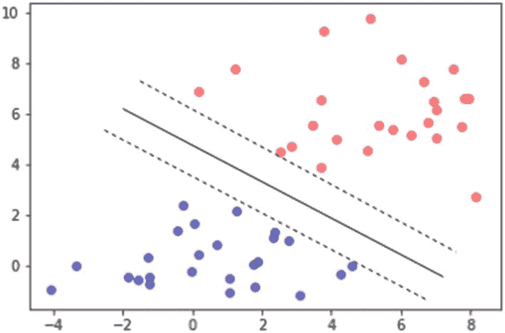

图 1-4-3

被超平面分隔的类别

但这是一个线性可分的问题。在现实生活中，数据集往往不是线性可分的。那么，让我们再举一个例子，看看 SVM 在图 1-4-4 所示的示例中会如何工作。

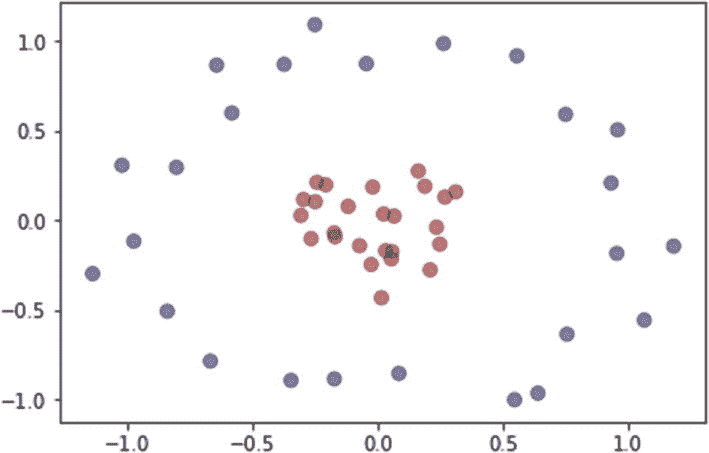

图 1-4-4

包含蓝色和红色两个类别的数据集

图 1-4-4 中的数据不是线性可分的。因此，我们将其投影到更高维度（本例中是三维），如图 1-4-5 所示，现在我们可以应用 SVM 并找到分隔它的平面。

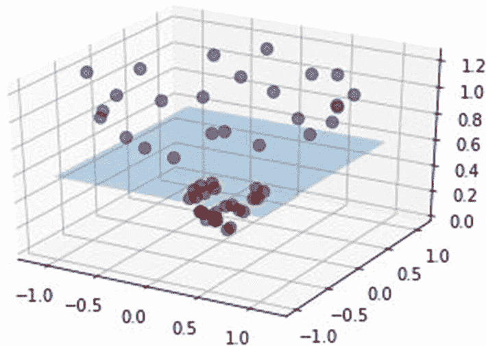

图 1-4-5

数据被投影到更高维度并被一个平面分隔

我们需要找到正确的映射函数来将数据投影到更高维度。这就是不同核函数发挥作用的地方。正确的映射函数可以通过使用正确的核函数来实现，这是 SVM 中最关键的超参数之一。

现在让我们讨论不同的超参数：

*   核函数：如前所述，核函数有助于实现正确的映射函数，这对于 SVM 高效运行至关重要。找到合适的核函数降低了寻找映射函数的复杂性；映射函数和核函数之间存在直接的数学关系。图 1-4-4 是一个可以使用径向基函数（RBF）核解决的示例问题。一些广泛使用的核函数包括多项式核、高斯核、Sigmoid 核，当然还有 RBF 核，其中大部分都在 scikit-learn 的 SVM 实现中定义（sklearn 也允许你定义自己的核函数）。

*   C：C 是一个正则化参数。它在训练精度和间隔宽度之间进行权衡。C 值减小会导致间隔变大和训练精度降低，反之亦然。

*   Gamma：Gamma (𝛾) 定义了训练点的影响范围。𝛾 值越高，意味着训练点的影响范围越小；非常高的值将导致仅影响训练点本身。较低的值影响范围更大；训练点（即支持向量）将对更多的训练集产生影响，因此极低的值将无法有效捕捉数据集的复杂性，最终得到的超平面将等同于一个根据密度区域分隔两个类别的线性超平面。

    这就在超参数 C 和 Gamma 之间建立了一种有趣的关系。通常，我们在 10^(-3) 到 10³ 的对数网格上搜索 Gamma 和 C 的值。

*   度：此超参数仅用于多项式核；更高的度意味着更灵活的决策边界。度为 1 将产生一个线性核。

### 决策树

*决策树* 类似于一组 if-else 语句，是一种简单而优雅的算法，具有非常直观的可视化效果。与神经网络不同，它很容易理解内部发生的事情。此外，它几乎不需要或完全不需要数据预处理。

顾名思义，它是一棵树，因此从一个根节点开始，根节点是其中一个特征。根据数据点在该特征上的值，我们选择树的下一个节点。这个过程一直持续到我们到达叶节点，从而得到预测值。

创建这棵树有点复杂；需要使用各种不同的算法来选择哪个特征放在顶层，哪个放在第二层，等等。一些用于计算特征重要性的算法包括基尼指数、信息增益和卡方检验。选择哪种算法可以被视为决策树算法中重要的超参数之一。

让我们以经典的鸢尾花数据集为例。这里的目标是根据四个特征（花萼长度、花萼宽度、花瓣长度和花瓣宽度）对三种鸢尾花（Setosa、Versicolor 和 Virginica）进行分类。

正如我之前所说，决策树的可视化非常简单；sklearn 提供了一个函数 `tree.plot_tree()`，你只需输入训练好的分类器，它就会绘制出树（图 1-4-6）。

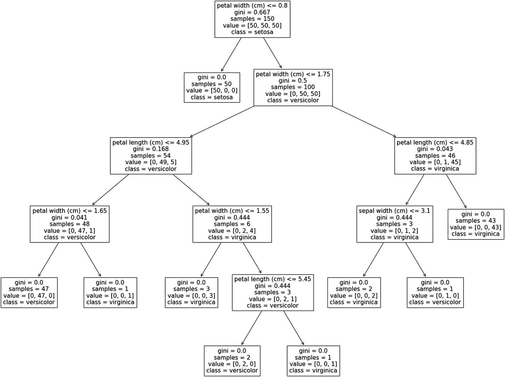

图 1-4-6

在鸢尾花数据集上训练的决策树分类器

如图 1-4-6 所示，所有节点都有基尼指数，特征在树中的位置即基于此。随着我们沿着树向下移动，基尼指数的值会减小。在节点的顶部指定了一个条件；如果条件为真，数据点进入右子节点；如果为假，则进入左子节点。样本数（samples）的值告诉我们，在父节点的真和假条件下分别有多少样本。

我们使用决策树时面临的一个问题是，当树变得复杂时，模型有很大几率会过拟合训练数据。一些超参数可以帮助降低这种复杂性。为了解决这个问题，我们可以对树进行剪枝，使用诸如树的最大深度和叶节点的最小样本数等超参数来帮助剪枝。

以下是超参数：

*   算法：如前所述，该算法决定了特征的优先级，从而决定了它们在树结构中的顺序。

*   树的深度：这定义了树的层数深度。它肯定会影响树的结构复杂度和时间复杂度。我们可以移除不重要的节点并减少深度。

*   最小样本分裂数：这是一个整数值，定义了分割内部节点所需的最小样本数。在图 1-4-6 中，如果我们选择 101，那么树将在第二层之后停止生长。

*   最小叶节点样本数：这定义了叶节点上的最小样本数。这个超参数可以通过减少树的深度来帮助减少过拟合。


### 神经网络

一个基本的*神经网络*由节点和节点层构成，这些节点本质上就是前一层输出与权重相乘的结果（详见附录二）。我们将此处的权重和偏置称为*参数*（因为它们由基于数据集的建模算法决定），而将节点数、层数等称为*超参数*（因为我们需要人为干预来决定它们）。

定义神经网络的架构是当今深度学习从业者面临的最具挑战性的任务之一。架构无法通过暴力搜索发现，因为神经网络的时间复杂度非常高，尝试所有超参数组合是不可能的。因此，创建神经网络架构更像是一门艺术，依赖于逻辑和更先进的超参数调优算法。

神经网络中可能存在大量不同的超参数，这里我们讨论其中几种：

*   **层数**：增加层数会提升神经网络的深度，同时也增强了学习更复杂特征的能力。

*   **节点数**：节点数因层而异，但第一个隐藏层和最后一个隐藏层的节点数必须分别等于输入特征的数量和要预测的类别数量。对于隐藏层，按惯例我们使用 2 的幂次方作为节点数，即 2、4、8、16、32、64、128、256、512、1024 等。这是因为硬件在以 2 的幂次方存储数字时效率更高，尽管没有证据表明这是选择这类超参数的最优方式。

*   **批量大小**：如果我们从数据集中抽取一个子样本，它应该能代表整个数据集的属性。这个批次可用于计算梯度并更新权重。我们遍历所有子样本，直到覆盖整个数据集。这样做的目的是节省内存空间。但你需要为子集大小选择最优值，因为批量大小过小会导致在接近最小值时波动更大，而过大则可能引发内存错误。

*   **激活函数**：激活函数用于在每个节点上引入非线性。在决定激活函数时，我们需要确保几点：它们将被用于成千上万个节点，并且反向传播会使用它们的导数，因此函数及其导数的计算复杂度都应较低。一些广泛使用的激活函数包括 ReLU、Sigmoid 和 Leaky ReLU。

*   **损失函数**：损失函数的选择基于输出类型，例如是二分类、多分类、回归等。还有其他因素。例如，在最后一层使用 sigmoid 激活函数并结合二次损失函数可能会导致学习速度减慢。因此，需要留意这类问题。此外，损失函数本身也有可以调优的内部超参数。

*   **优化器**：在“理解超参数”部分，我们讨论了一种优化方法——梯度下降。还有其他更先进的优化方法，如 Adagrad、Adam 优化器等，这些优化器也包含各种影响整体优化效果的超参数。

神经网络中还有更多超参数，例如批量归一化、Dropout 等。随着技术的进步，这些变量每隔一段时间就会增加。

本节旨在让你了解什么是超参数以及它们如何工作。随着我们继续深入，我们将在寻找最优值的过程中讨论更多这类算法及其超参数。

## 可能超参数值的分布

超参数的值可能因其功能而异。对于像网格搜索（在第 2 章讨论）这样的算法，我们会遍历超参数的某些排列组合。但大多数超参数优化算法是随机选取变量的。这些随机值可能属于某种特定类型的分布。例如，我们在“神经网络”部分看到，我们选择层中节点数的值为 2 的幂次方。因此，我们将集合{2, 4, 8, 16, 32, 64, 128, 256, 512...}视为一种分布。

提示

Seeing Theory ([`https://seeing-theory.brown.edu/`](https://seeing-theory.brown.edu/)) 是一个很棒的网站，提供了概率和统计的交互式可视化。请查看该网站的第 3 章，了解概率分布的可视化。

随机变量可能取值的可能性由概率分布定义。假设我们必须为超参数选择一个随机值；其底层分布可以是以下任何一种：

*   离散概率分布

*   连续概率分布

对于离散变量和连续变量，存在不同类型的概率分布。但在深入探讨这些类型之前，我们先看看什么是离散变量和连续变量。

### 离散变量

一组值中，每个值与下一个值之间存在某个正有限距离，这称为*离散分布*。离散变量可以是有限值，也可以是无限值，具体取决于范围。图 1-5-1 展示了有限离散分布和无限离散分布。

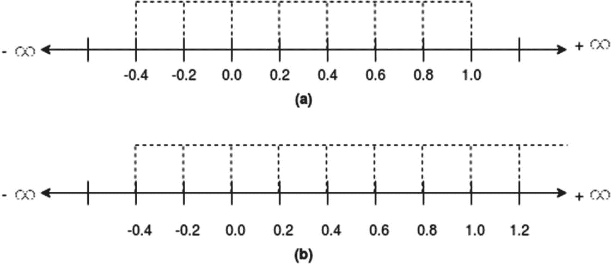

图 1-5-1

两种分布，(a) 有限离散 和 (b) 无限离散

有限离散值位于两个有限实数之间，如图 1-5-1(a)所示，其值位于区间[−0.4, 1.0]内，步长为 0.2。然而，无限离散值可以延伸到无穷大，每个值与下一个值和前一个值之间仍然保持一个正有限距离。在图 1-5-1(b)中，值位于区间−0.4, +∞)内，步长仍为 0.2。

请注意，步长不一定必须相同。它可以是指数级的、递增的等等。图[1-5-2 中的示例展示了一个均匀分布。

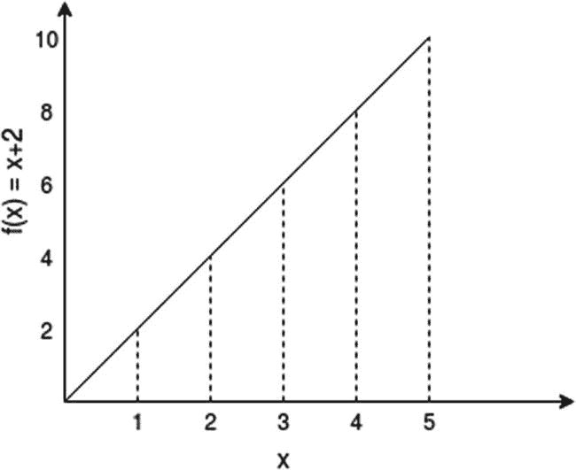

图 1-5-2

一个有限分布的例子，*f*(*x*) = *x* + 2，其中 *x* ∈ [0, 5]，每个 *x* 值之间的差为 1

回顾“支持向量机”部分，超参数 *kernel* 的可能值可以是 *rbf*、*sigmoid*、*linear*、*polynomial* 等。*‘kernel’* 会有一个有限的值集。这可以被视为一个*有限离散值*的例子。我们可以将这些超参数表示如下：

*   *rbf* ↔︎ 1

*   *sigmoid* ↔︎ 2

*   *linear* ↔︎ 3

*   等等

在同一个算法中，我们有另一个超参数 *‘degree’*，其值可以是任何可能的整数。这是一个*无限离散值*的例子。然而，这并不意味着我们要从 −∞ 搜索到 +∞。结果会在极端值处饱和，而且在无限空间中搜索实际上也是不可能的。因此，我们将使用一个巨大的范围（“巨大”是相对的；在某些情况下 10 可能很大，而在其他情况下 10¹⁰⁰可能很大）来包含该分布。


好的，作为一名高级文档工程师和翻译员，我将严格遵循您提供的注意事项和示例格式，将给定的英文文本翻译成中文。


### 连续变量

*连续分布* 是一组位于两个实数之间的无限可能值，如图 1-5-3 所示。

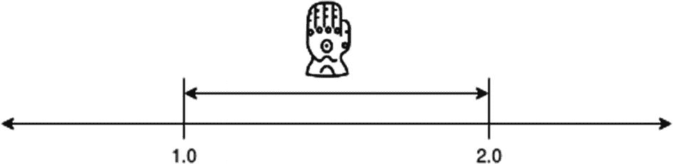

图 1-5-3

1.0 和 2.0 之间存在无限多个数字

再次以“支持向量机”部分为例，SVM 中有像 ‘C’ 和 ‘gamma’ 这样的超参数，它们的值位于一个连续分布上；也就是说，在一个范围内我们可以有无限多个可能的值。

### 概率分布

有无限多种可能的连续和离散概率分布函数可以对随机值进行采样，因此我们将通过讨论实践中常用的几种分布来缩小范围。概率总是在一个范围内计算的，例如图 1-5-4 所示的高斯分布示例。

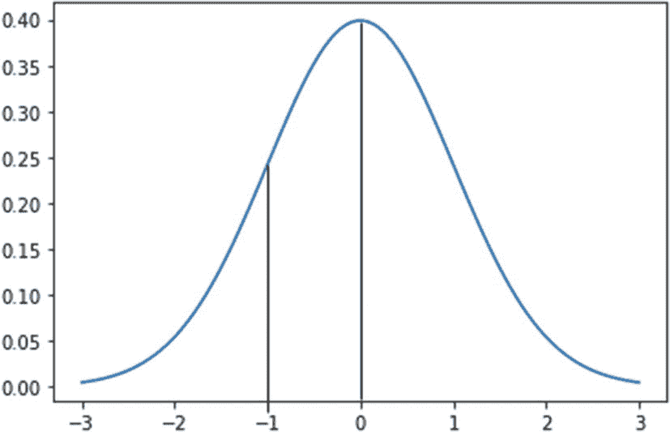

图 1-5-4

均值为 0、标准差为 1 的高斯分布

在图 1-5-4 中，如果我们想为变量 *x* 采样一个值，*x* 可以取无限多个值。*p*(*x*) 为特定值的概率将为 0。因此，我们讨论的是*概率密度函数*，即一个范围内的概率。例如 *p*(*x* < 0) = 0.5。因为它占整个分布面积的一半。类似地，-1 到 0 范围内的概率密度可以通过计算面积来获得，而面积可以通过沿连续曲线进行积分来计算。

这解释了为什么我们需要获取一个范围的概率密度而不是一个点的概率。接下来，我们将使用一个名为 *scipy*.*stats* 的模块来为变量 *x* 采样值，以便讨论一些常用的分布。

#### 均匀分布

在*均匀分布*中，如果宽度相同，则不同范围内的概率密度保持不变。图 1-5-5 显示了一个示例。

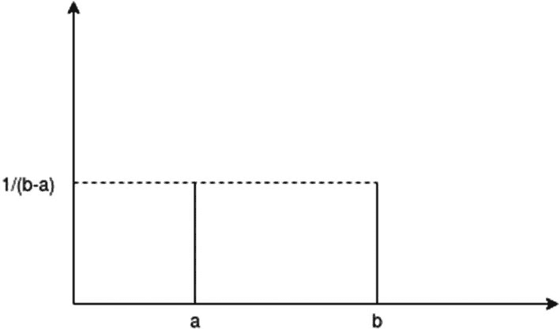

图 1-5-5

a 和 b 之间的均匀分布

曲线下的面积为 1。因此，我们可以将高度计算为 1/(*b* − *a*)，其中 *b* 是上限，*a* 是下限。让我们使用 *scipy*.*stats* 从均匀分布中采样值：

```
from scipy.stats import uniform
import seaborn as sns
n = 10000
start = 10
width = 10
data = uniform.rvs(size=n, loc = start, scale=width)
ax = sns.distplot(data,
bins=100,
hist_kws={'alpha':0.8})
ax.set(xlabel='Uniform Distribution ', ylabel="Frequency")
```

图 1-5-6 显示了均匀分布的直方图，其中 a=10 且 b=20。我在这两个数字之间采样了 10,000 个随机值。

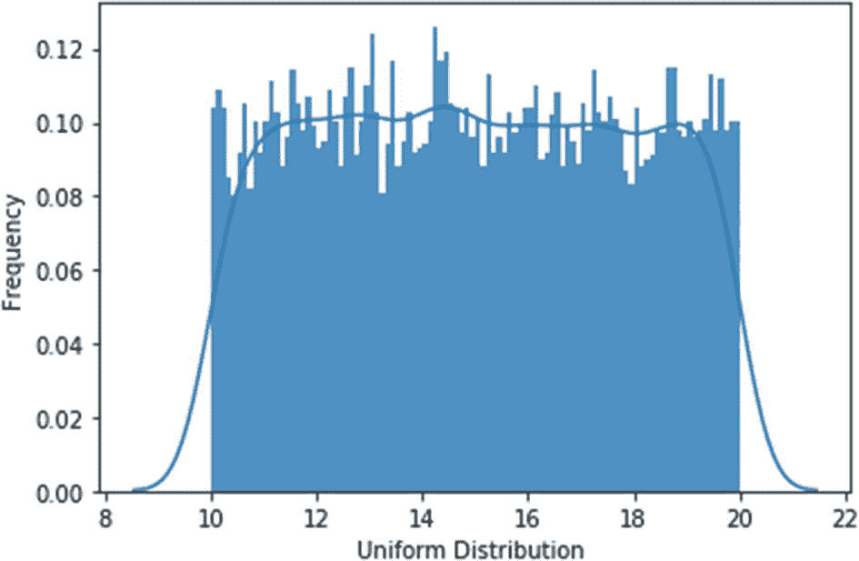

图 1-5-6

均匀分布的直方图

#### 高斯分布

*高斯分布*（或*正态分布*）是自然界中最常见的分布之一。大多数机器学习算法都假设数据集服从高斯分布；也就是说，异常值数量较少，大部分数据集中在簇中。极端值的频率较低，而均值附近的频率较高。

对于均值为 0、标准差为 1 的分布，您可以在图 1-5-4 中看到一个高斯分布。请注意，在 *x* 轴上，如果您标记出 *μ* − *σ* 和 *μ* + *σ*，如图 1-5-7 所示，您会发现它覆盖了大约 68% 的面积。类似地，*μ* − 2*σ* 和 *μ* + 2*σ* 覆盖了大约 95% 的面积，而 *μ* − 3*σ* 和 *μ* + 3*σ* 覆盖了 99.7% 的面积。

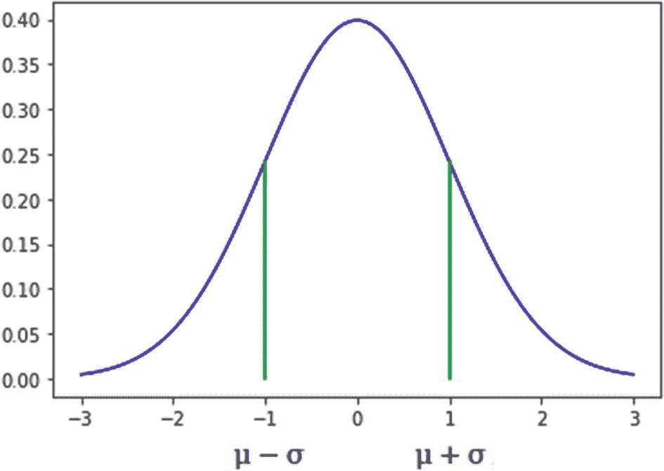

图 1-5-7

均值为 0、标准差为 1 的高斯分布

以下是从高斯数据中采样随机值的代码：

```
from scipy.stats import norm
import seaborn as sns
mean = 0
std_dev = 1
data = norm.rvs(size=10000,loc=0,scale=1)
ax = sns.distplot(data,
bins=100,
hist_kws={'alpha':0.8})
ax.set(xlabel='Gaussian Distribution ', ylabel="Frequency")
```

图 1-5-8 显示了根据从高斯分布采样的随机值绘制的直方图。

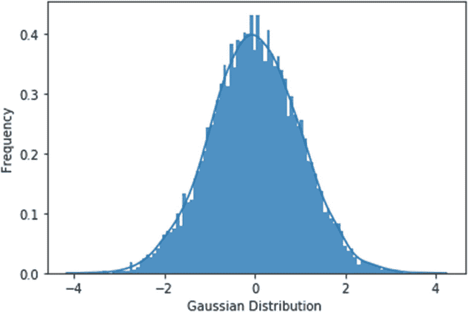

图 1-5-8

高斯分布的直方图

#### 指数分布

另一个重要的分布是*指数分布*。顾名思义，值呈指数增长。有一个参数比率 (*λ*) 控制着分布的斜率。

```
from scipy.stats import expon
import seaborn as sns
loc = 10
lambda_inverse = 1
data = expon.rvs(size=10000,loc=loc,scale=lambda_inverse)
ax = sns.distplot(data,
bins=100,
hist_kws={'alpha':0.8})
ax.set(xlabel='Exponential Distribution', ylabel="Frequency")
```

图 1-5-9 显示了当从对数正态分布中选择随机值时的直方图，该分布可以使用上述代码绘制。

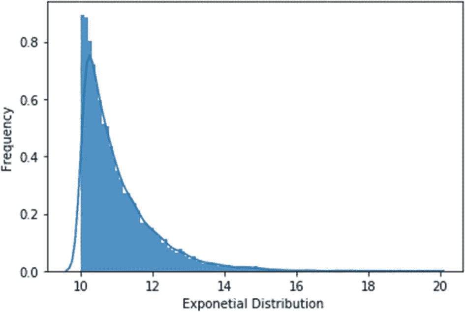

图 1-5-9

指数分布的直方图

在后续章节中，随着我们使用更多的分布，我们将会遇到更多。我们将看到哪些超参数适合哪些分布以及原因。现在您已经了解了超参数，在第 2 章中，我们将探讨一些基本的超参数调优方法。

