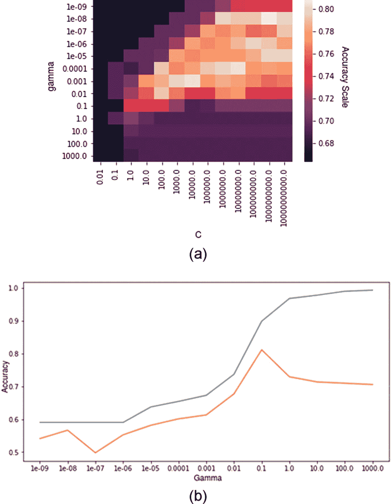
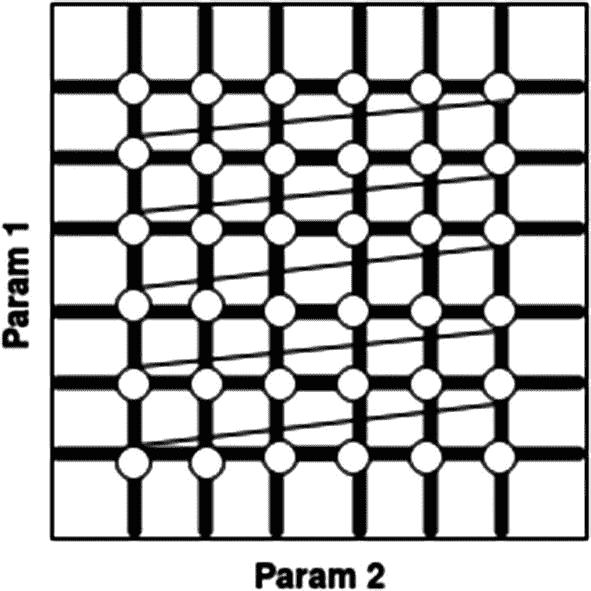
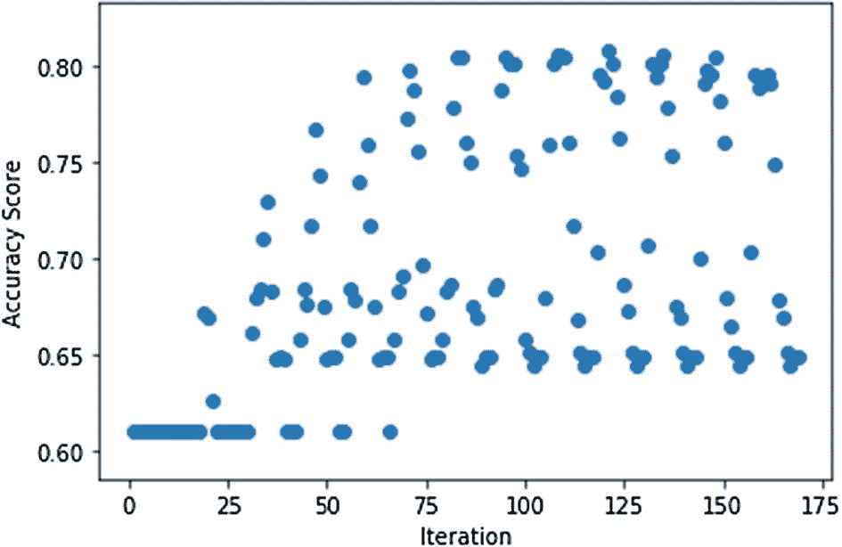
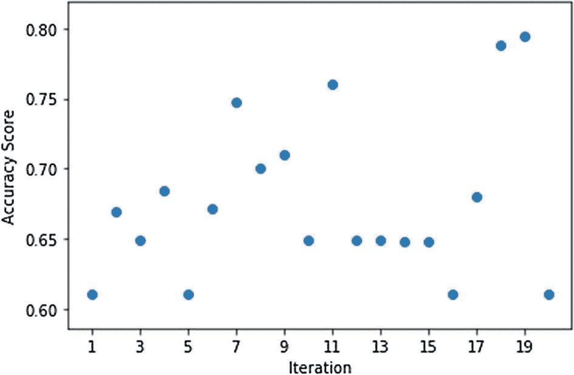
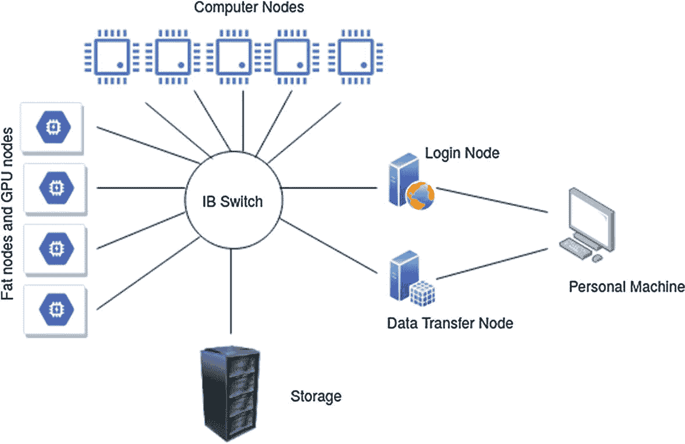

# 2. 使用 Scikit-Learn 进行超参数优化

在上一章中，您了解了什么是超参数以及它们如何影响算法的性能。既然您知道了调整超参数的重要性，本章将向您介绍一些简单但功能强大的算法使用方法，这些算法已在 scikit-learn 库中实现，用于超参数优化。Scikit-learn 是机器学习实践中使用最广泛的开源库之一。它易于使用，并且在预测分析中非常有效。

## 更改超参数

您从第 1 章了解了支持向量机 (SVM) 的工作原理。现在您将看到，在泰坦尼克号数据集（数据集在附录 [I](https://doi.org/10.1007/978-1-4842-6579-6) 中解释）上，当核函数固定为 RBF 时，更改两个超参数——`C`（正则化因子）和 `gamma`（核系数）——如何影响结果。

图 2-1(a) 显示了 `gamma` 和 `C` 之间的比较；热图中较浅的颜色代表更高的准确率。我们看到，当 `C` 值较高 (10¹¹) 且 `gamma` 值较低 (10^-8) 时，我们获得更高的测试准确率；而当 `C` 值较低 (10⁴) 且 `gamma` 值相对较高 (10^-3) 时，我们获得相当的准确率。图 2-1(b) 中的图表显示，随着 `gamma` 值的增加，在保持 `C` 恒定为 1 的情况下，训练准确率（蓝线）和测试准确率（橙线）之间的差异在某个点之后持续增大，导致模型过拟合，这证明我们需要通过降低 `C` 来正则化模型。



图 2-1
(a) `gamma` 和 `C` 不同取值的热图。(b) 随着 `gamma` 增加而变化的准确率

## 网格搜索

寻找最优超参数集最暴力的方法或许是在每一种可能的参数组合上训练数据集。这种方法被称为*网格搜索*，是找到最佳超参数集最确定的方式，但它也有其缺点。图 2-1-1 展示了一个遍历参数 1 和参数 2 所有可能组合的网格。



图 2-1-1
一个遍历两个超参数所有可能组合的网格搜索

假设你有十个算法，每个算法有五个超参数，每个超参数有四个可能的值，并且有一个庞大的数据集，在一组超参数上训练一个算法需要 1 分钟。这种情况下，大约需要一周时间才能找到最佳超参数。但对于超参数数量较少且训练时间较短的情况，我们可以采用网格搜索。现在，我们将用 Python 构建这个简单的算法，并在图 2-1-1 所示的示例上进行测试。

超参数的值可以分布在连续分布或离散分布上。如果值是离散的，那么在一个范围内可能值的数量是有限的。然而，在连续分布中，存在无限个可能的值，正如我们在第 1 章中所见。接下来，我们将调整 `C` 和 `gamma`，这两个参数在某个范围内都是连续分布。但为了构建网格，我们将在对数尺度上创建均匀分布。网格搜索不接受随机变量；要构建网格，它需要具体的值。

让我们创建一个超参数 `C` 和 `gamma` 的网格：

```python
c = 0.001
gamma = 1e-10
param_grid = {
"C": [c*(10**i) for i in range(1,14)],
"gamma": [gamma*(10**i) for i in range(1,14)]
}
```

### 注意

我使用了预处理后的数据集（`X_train`, `y_train`, `X_test`, `y_test`），即泰坦尼克号数据集。请参考附录 I 查看所有预处理方法。

我们首先创建一个函数，将这个网格分解为所有可能的超参数集列表，即 `make_sets()`：

```python
from itertools import product

def make_sets(grid):
    sets = list()
    all_hps_vals = [lst for lst in param_grid.values()]
    hp_keys = [hp for hp in param_grid.keys()]
    val_sets = product(*all_hps_vals)

    for val in val_sets:
        hp_set = dict()
        for idx, hp_key in enumerate(hp_keys):
            hp_set[hp_key] = val[idx]
        sets.append(hp_set)

    return sets

>>> make_sets(param_grid)
[{'C':0.01, 'gamma':1e-09},
 {'C':0.01, 'gamma':1e-08},
 {'C':0.01, 'gamma':1e-07},
 ...
 ...
 {'C':10000000000.0, 'gamma':1000.0}
]
```

现在，我们将创建另一个函数 `grid_search()`，用于将所有参数集拟合到机器学习算法上：

```python
def grid_search(clf, grid, X_train, y_train, X_test, y_test):
    all_sets = make_sets(grid)
    logs = list()
    best_hp_set = {
        "best_test_score": 0.0
    }

    for hp_set in all_sets:
        log = dict()
        model = clf(**hp_set)
        model.fit(X_train, y_train)
        train_score = model.score(X_train, y_train)
        test_score = model.score(X_test, y_test)
        log["hp"] = hp_set
        log["train_score"] = train_score
        log["test_score"] = test_score
        if best_hp_set["best_test_score"] < test_score:
            best_hp_set = {
                "best_test_score": test_score,
                "hp": hp_set
            }
        logs.append(log)

    return logs, best_hp_set
```

现在，我们可以使用泰坦尼克号数据集来测试我们的网格搜索函数：

```python
>>> from sklearn.model_selection import train_test_split
>>> from sklearn.svm import SVC

# 训练测试分割数据集。
# X 和 y 分别是预处理后的特征和标签。
>>> X_train, y_train, X_test, y_test = train_test_split(X, y)
>>> logs, best = grid_search(SVC, param_grid, X_train, y_train, X_test, y_test)
```

我们刚刚定义的 `grid_search()` 函数接收以下输入：分类器、参数网格和数据集。通过 `make_sets()` 函数，`grid_search()` 创建所有超参数组合，并在所有组合上训练模型。然后，我们将训练分数和测试分数保存在一个字典中，并搜索最佳结果。

请注意，为了代码的简洁性，我在训练时没有进行*交叉验证*。为了真正评估每一组超参数，我们必须使用一个验证集，并将测试集留待以后使用，这样我们才能在一个独立的集上评估模型。然而，我们并没有将训练集分割成训练集和验证集（因为在像泰坦尼克号这样的数据集中，我们只有大约 700 个数据点），而是进行交叉验证，从而保留宝贵的训练数据不变。交叉验证还可以防止在验证集上过拟合。

现在，我们将看到如何使用 scikit-learn 提供的 `GridSearchCV()` 函数，以 K 折交叉验证的方式分割训练集：

```python
>>> from sklearn.model_selection import GridSearchCV
>>> clf = GridSearchCV(SVC(), param_grid, cv=3)
>>> # X_train 和 y_train 是来自泰坦尼克号数据集的数据点。
>>> # 使用泰坦尼克号数据集是为了展示这个示例。
>>> clf.fit(X_train, y_train)
>>> clf.best_estimator_
SVC(C=100000.0, break_ties=False, cache_size=200, class_weight=None, coef0=0.0,
    decision_function_shape='ovr', degree=3, gamma=0.0001, kernel="rbf",
    max_iter=-1, probability=False, random_state=None, shrinking=True,
    tol=0.001, verbose=False)
```

在图 2-1-2 中，我们可以看到准确率分数随迭代次数（针对 169 种组合）而变化。



图 2-1-2
迭代次数与准确率分数的关系图

图 2-1-2 没有显示出明显的模式，因为这是一种穷举搜索方法；我们正在尝试所有可能的组合。你可以定义 `GridSearchCV()` 函数，并传入算法、参数网格以及交叉验证的折数。所有其他方法，如 `fit()`、`score()` 等，都是相同的。你可以使用 `best_estimator_` 方法来获取超参数的最佳值。我调整了 'gamma' 和 'C'，与我们的手动实现相同，并保持其余超参数不变。

## 网格搜索

## 随机搜索

网格搜索最终能找到接近最优的超参数组合，但其时间和资源消耗较高。另一种方法——随机搜索——消耗的时间和资源更少。它随机选取超参数，组成一个集合，并基于该集合训练模型。这种方法可能找不到最佳组合，但找到接近最佳组合的概率更高，同时能节省大量时间。

与网格搜索不同，随机搜索不会在无希望的候选参数上花费大量时间，而是跳转到随机超参数上。即使它不借鉴过去的结果，通常也能给出令人满意的结果。在随机搜索中，我们定义试验次数，即要尝试的超参数集合的数量。

让我们通过探索图 2-2-1 所示的示例，来看看随机搜索如何优于网格搜索。


图 2-2-1

比较网格搜索（左）与随机搜索（右）

在图 2-2-1 的两张图中，'x' 轴和 'y' 轴代表两个超参数，背景颜色越浅代表准确率越高。在左侧所示的网格搜索中，如果我们从左上角开始沿网格搜索，需要花费相当长的时间才能到达高准确率区域。在右侧所示的随机搜索中，由于我们是随机搜索超参数，因此比网格搜索更有可能更早地达到高准确率。一旦定义的试验次数用完，我们将选择可用的最佳超参数集合，希望它至少接近最佳组合。

使用随机搜索而非网格搜索的两个主要优点如下：

*   试验次数是预先定义的，且与总组合数无关。

*   由于试验次数已定义，即使增加非贡献参数的数量，算法的时间效率也不会受到影响。

在随机搜索中，由于我们从搜索范围内随机选择超参数，我们可以使用 Python 的 `random` 库：对于离散超参数，使用 `random.randint(a, b)`（返回整数 `a` 和 `b` 之间的随机整数）；对于连续超参数，使用 `random.random()`（返回 0 到 1 之间的随机浮点数，1 不包含在内），或者使用 numpy 或 scipy.stats 中能生成不同类型分布（如均匀分布、对数正态分布、指数分布等）的函数。

或者，如下所示，我们可以为具有连续分布的超参数创建一个更大的网格——比如非常大，因为它不会增加试验次数（我们将要定义的）——从而使算法能够从更大的样本中选择超参数。

```
import random
import numpy as np
def loguniform(low=0, high=1, size=100, base=10):
# 函数创建一个对数均匀分布，包含随机值。
return np.power(base, np.random.uniform(low, high, size))
param_grid = {
"gamma": loguniform(low=-10, high=4, base=10),
"C": loguniform(low=-3, high=11, base=10)
}
def get_random_hp_set(grid):
# 函数从网格中为每个参数随机选择一个值
hp_set = dict()
for key, param in grid.items():
hp_set[key] = np.random.choice(param)
return hp_set
def random_search(clf, grid, n_iterations, X_train, y_train, X_test, y_test):
# 定义随机搜索函数
logs = list()
best_hp_set = {
"best_test_score": 0.0
}
for iteration in range(n_iterations):
log = dict()
# 从为随机搜索定义的函数中选择超参数集合
hp_set = get_random_hp_set(grid)
# print(hp_set)
model = clf(**hp_set)
model.fit(X_train, y_train)
train_score = model.score(X_train, y_train)
test_score = model.score(X_test, y_test)
log["hp"] = hp_set
log["train_score"] = train_score
log["test_score"] = test_score
if best_hp_set["best_test_score"] < test_score:
best_hp_set["best_test_score"] = test_score
best_hp_set["best_hp_set"] = hp_set
logs.append(log)
return logs, best_hp_set
```

现在，让我们使用这个函数：

```
>>> from sklearn.svm import SVC
>>> from sklearn.model_selection import train_test_split
>>> X_train, y_train, X_test, y_test = train_test_split(X, y)
>>> logs, best = random_search(SVC, param_grid, 20, X_train, y_train, X_test, y_test)
```

因此，我们可以在更少的迭代次数内，通过随机搜索至少获得接近最佳的超参数集合。

同样，scikit-learn 为我们提供了一个交叉验证函数 `RandomizedSearchCV()`。让我们看看它是如何工作的：

```
>>> from sklearn.model_selection import RandomizedSearchCV
>>> # 就像我们的函数一样，RandomizedSearchCV 也有参数 'n_iter'
>>> clf = RandomizedSearchCV(SVC(), param_grid, n_iter=20, cv=3)
>>> clf.fit(X_train, y_train)
>>> clf.best_estimator_
SVC(C=1000000000.0, break_ties=False, cache_size=200, class_weight=None,
coef0=0.0, decision_function_shape="ovr", degree=3, gamma=1e-05,
kernel='rbf', max_iter=-1, probability=False, random_state=None,
shrinking=True, tol=0.001, verbose=False)
```

如图 2-2-2 所示，随机搜索仅用 20 次迭代就达到了可比的准确率。



图 2-2-2

随机搜索的迭代次数与准确率关系图

`GridSearchCV` 和 `RandomizedSearchCV` 都有另一个有用的参数 `scoring`；如果设置为默认值，则使用机器学习算法的评分方法，通常是 `'accuracy'`。然而，我们可以将其设置为任何我们认为适合工作的评分方法，例如 `'roc_auc'`、`'f1'`、`'precision'`、`'recall'` 等。

## 并行超参数优化

网格搜索和随机搜索都是暴力方法；它们不依赖先前的结果来选择下一组超参数。我们可以利用这一点，并行处理这些试验。scikit-learn 对这些算法的实现提供了一个参数 `n_job`，可以将其设置为 `-1`，以指定使用本地机器的所有核心。

在本节中，我们将了解如何在高性能计算（HPC）集群上分布诸如网格搜索之类的算法。HPC 集群只是一组高端计算机（称为节点），这些计算机经过配置，可以通过快速互连实现持续通信，提供类似于超级计算机的计算能力。HPC 集群由以下组件组成，如图 2-3-1 所示：



图 2-3-1

HPC 集群

*   登录节点：我们可以从这里通过安全协议（如安全外壳协议 (SSH)）使用自己的机器远程访问集群。它用于上传和执行代码。

# HPC 集群概述与使用

HPC 集群由以下关键组件构成：

*   *数据传输节点*：同样，使用诸如 `scp` 和 `rsync` 等命令的安全协议（如 `SSH`）将大量数据从我们的机器传输到 HPC 集群。传输通过加密隧道进行保护。

*   *计算节点*：有不同类型的计算节点，包括硬件规格与我们个人机器相似的常规节点、具有海量数据存储（以 `TB` 计）的“胖”计算节点，以及由 `GPU` 和 `CPU` 组成的高端节点。这些节点共同协助计算。

*   *无限带宽 (IB) 交换机*：该交换机可实现节点间的快速通信，具有高吞吐量和极低延迟。

*   *存储*：此处可以存储大文件，并可通过数据传输节点进行传输。

然而，使用高性能计算集群并不像设置 `n_job = -1` 那么简单，而且最大限度地利用集群的潜力甚至更加困难。我们将使用 `Slurm` 工作负载管理器（一个用于计算机集群队列的开源作业调度器）和 `ipyparallel`（用于多线程并行计算）。

你可以使用以下代码用于 `HPC` 和 `Amazon EC2` 集群，并根据各自的要求进行少量修改。

现在，我们将再次在 `MNIST` 数据集上优化 `SVM` 的超参数 `C` 和 `gamma`（有关 `MNIST` 的更多信息，请参阅附录 [II](https://doi.org/10.1007/978-1-4842-6579-6)）。

以下代码的灵感来源于 `Leclanché` 公司生产工程数据科学家 `Hugues-Yanis Amanieu` 博士的工作^(¹)。

## 登录与环境设置

首先，我们将使用 `SSH` 登录到登录节点：

```
$ ssh username@ip
```

现在我们已经登录到 HPC 集群，我们将创建一个虚拟环境：

```
$ virtualenv hpc_tuning
$ source hpc_tuning/bin/activate
```

并在你的虚拟环境 `tuning` 中安装所有依赖项：`slurm`、`slurm-client`、`ipyparallel`、`joblib`、`ipython`，当然还有 `scikit-learn`。我们也可以通过 `Anaconda` 下载并安装它们（在 `conda` 虚拟环境中）。

## 编写 Slurm 调度脚本

接下来，我们将编写一个 shell 脚本 (`launch.sh`)，在其中使用 `Slurm` 来调度作业：

```
#这将激活虚拟环境
source hpc_tuning/bin/activate
#为 ipython 创建一个新的作业配置文件名称，slurm 将使用它
profile=job_${JOB_NAME}
#为 ipython 创建一个配置文件
ipython profile create ${profile}
#启动 ip 控制器
ipcontroller --ip="*" --profile=${profile} &
sleep 10
#srun 在所有核心上运行 ipengine
srun ipengine --profile=${profile} --location=$(hostname) &
sleep 25
#执行 python 文件，我们将在其中定义网格搜索以在集群上分布
python $1 -p ${profile}
```

让我们详细探讨这段代码。

*   首先，我们激活一个虚拟环境，其中所有内容都是从零开始安装的，这样我们就不会遇到任何依赖性问题。

*   之后，我们分配一个变量 `profile`，在其中定义一个字符串，该字符串将作为我们作业的名称/标识。

*   创建 ID 后，我们使用 `ipython` 命令创建一个配置文件，该命令会初始化一个包含配置信息的文件夹。

*   现在我们有了一个控制器和引擎。控制器调度和排队作业，引擎计算数据并存储结果。我们使用 `ipython` 进行控制器和引擎之间的通信。

*   `ipcontroller` 命令启动控制器，`ipengine` 命令启动引擎。在启动 `ipcontroller` 时，我们需要控制器监听所有引擎，参数 `--ip="*"` 允许控制器在所有接口上监听。

*   为了让引擎与控制器连接，我们使用带有参数 `--location=="ip"` 的 `ipengine`，在其中提供控制器的 `IP` 地址。`ipcontroller` 会创建一个名为 `ipcontroller-engine.json` 的文件，该文件需要复制到所有引擎；但是，在我们的案例中，我们假设引擎和控制器共享相同的文件系统，在这种情况下，引擎会自动找到 `json` 文件的位置。

请注意，在前面的代码中，我们使用 `srun` 来运行 `ipengine`；`srun` 是一个 `Slurm` 命令，它在所有可用的核心上运行 `ipengine`。最后，我们运行包含 `scikit-learn` 代码的 `Python` 脚本，并传递一个参数配置文件名称。

## 编写 Python 脚本

让我们编写 Python 脚本 (`python_script.py`)：

```
import argparse
import os
import sys
import time
import pandas as pd
from sklearn.externals.joblib import parallel_backend
from sklearn.externals.joblib import register_parallel_backend
from sklearn.externals.joblib import cpu_count
from sklearn.datasets import load_digits
from sklearn.model_selection import GridSearchCV
from sklearn.model_selection import train_test_split
from sklearn.svm import SVC
from ipyparallel import Client
from ipyparallel.joblib import IPythonParallelBackend
# 将文件目录路径附加到系统路径，以便自定义函数的导入能够工作
FILE_DIR = os.path.dirname(os.path.abspath(__file__))
sys.path.append(FILE_DIR)
# argparser 从我们的 shell 脚本中获取配置文件名称作为参数
parser = argparse.ArgumentParser()
parser.add_argument("-p", "--profile", default="job_hp_test",
help="要使用的 IPython 配置文件名称")
args = parser.parse_args()
profile = args.profile
# 计算可用核心总数
print(cpu_count())
# 创建一个 Client 实例，提供在 shell 脚本中创建的配置文件名称
c = Client(profile=profile)
# 确保所有引擎 (c) 都在工作目录中运行
c[:].map(os.chdir, [FILE_DIR]*len(c))
# 打印引擎 ID 列表
print(c.ids)
# 限制所有引擎
bview = c.load_balanced_view()
register_parallel_backend('threading',
lambda : IPythonParallelBackend(view=bview))
# 加载数据
digits = load_digits()
# 将数据拆分为训练集和测试集
X_train, X_test, y_train, y_test = train_test_split(digits.data,
digits.target,
test_size=0.3)
# 准备超参数网格
param_grid = {
"C": [c*(10**i) for i in range(1,14)],
"gamma": [gamma*(10**i) for i in range(1,14)]
}
# 使用默认超参数定义分类器
svc = SVC()
# 定义 GridSearchCV
search = GridSearchCV(svc,
param_grid,
return_train_score=True,
n_jobs=len(c))
# 启动计时器
since = time.time()
# 使用并行后端启动并行处理
with parallel_backend('threading'):
search.fit(X_train, y_train)
# 结束计时器
time_taken = time.time() - since
# 将结果转换并保存到 .csv 文件
print(f"正在将结果保存到 {FILE_DIR}")
results = search.cv_results_
results = pd.DataFrame(results)
results.to_csv(os.path.join(FILE_DIR,'scores.csv'))
print(f"结果已保存！")
# 显示所用时间
print(f"调优时间: {time_taken}")
```

让我们逐步分析上述 `Python` 脚本中发生的情况：

## 虚拟环境与集群配置

*   导入之前在我们的虚拟环境中安装的所有库。

*   由于我们需要使用创建 ipython 配置文件的配置文件名称，因此我们使用 `argparser` 并从 shell 脚本中获取该名称作为参数。

*   初始化客户端，为其提供集群的配置文件名称，以准备所有引擎。`c.ids` 用于获取所有引擎 ID 的列表。

*   限制所有引擎之间的负载均衡。

*   在并行运行算法之前，我们将后端名称定义为一个字符串（`'threading'`），为此我们使用函数 `register_parallel_backend`；稍后我们将在运行模型训练时使用 `'threading'`。

*   加载数据集，将其拆分为训练集和测试集，并定义 `C` 和 `gamma` 的网格。

*   初始化 `SVC()` 并定义 `GridSearchCV()`，其中 `n_jobs` 设置为 `-1`（使用所有可用核心）或 `len(total_engines)`（使用指定数量的核心）。

*   我们之前使用 `register_parallel_backend` 和 `'threading'` 定义了用于并行计算作业的后端名称。现在我们使用该名称运行 `parallel_backend` 和网格搜索，以寻找 SVM 的 `'C'` 和 `'gamma'` 参数。

*   保存结果。

*   执行命令 `sbatch launch.sh python_script.py`；`sbatch` 是一个 Slurm 命令，用于将编写的脚本提交给 Slurm。

*   使用 `scp` 命令传输结果文件。

## 总结与展望

这就是我们如何在充分利用计算机集群潜力的同时，优化大量超参数的方法。你也可以使用随机搜索来代替网格搜索。使用 HPC 将大幅减少你的时间消耗。

我们回顾了一些详尽且暴力的超参数优化方法，这些方法如果应用于神经网络架构搜索等问题，将耗费极长的时间，并且不可行。在后续章节中，我们将看到更多能够处理这些复杂任务的算法和库。然而，在超参数较少、搜索范围较窄的问题中，或者当数据科学家可以通过查看数据集来决定近似值或缩小搜索空间时，这些算法可能会很有效，并且将它们与 HPC 集群等机器结合使用，甚至可以提高其效率。

脚注 1