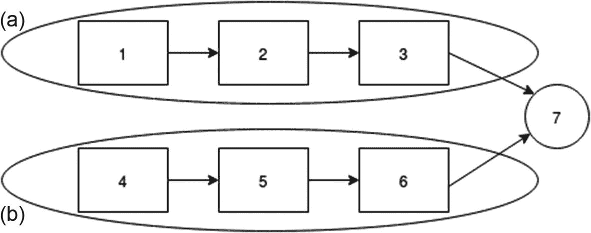
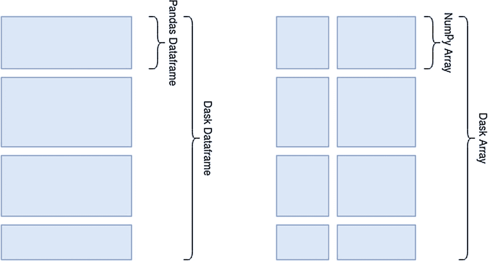
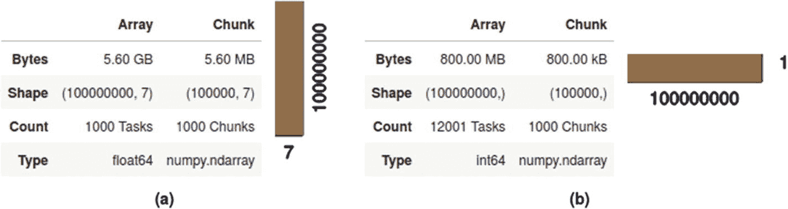
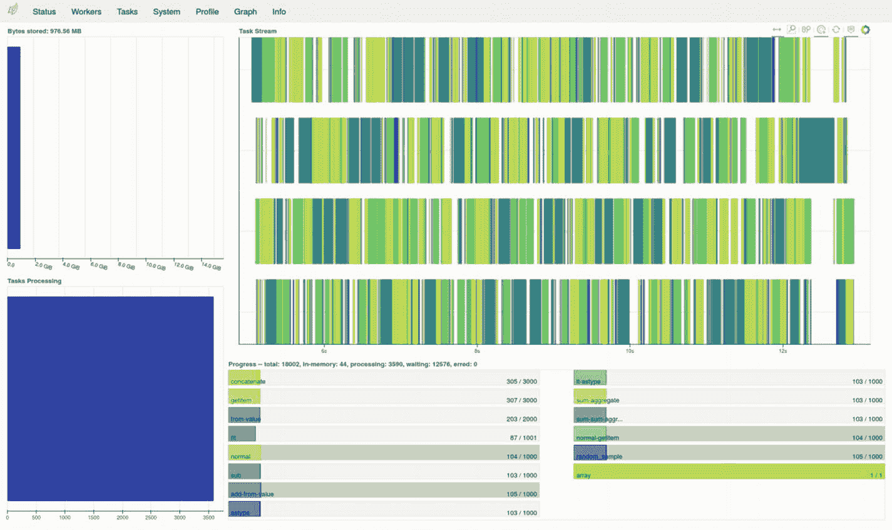
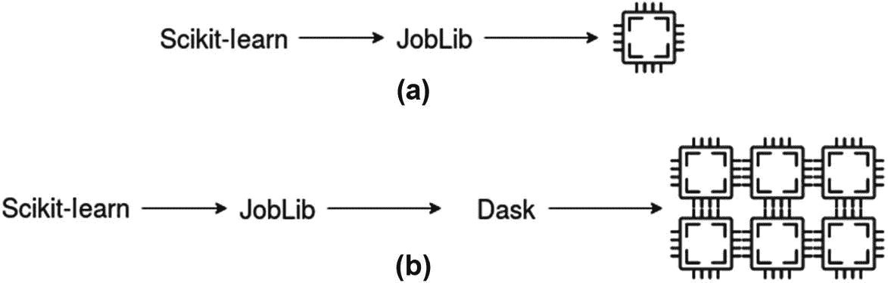
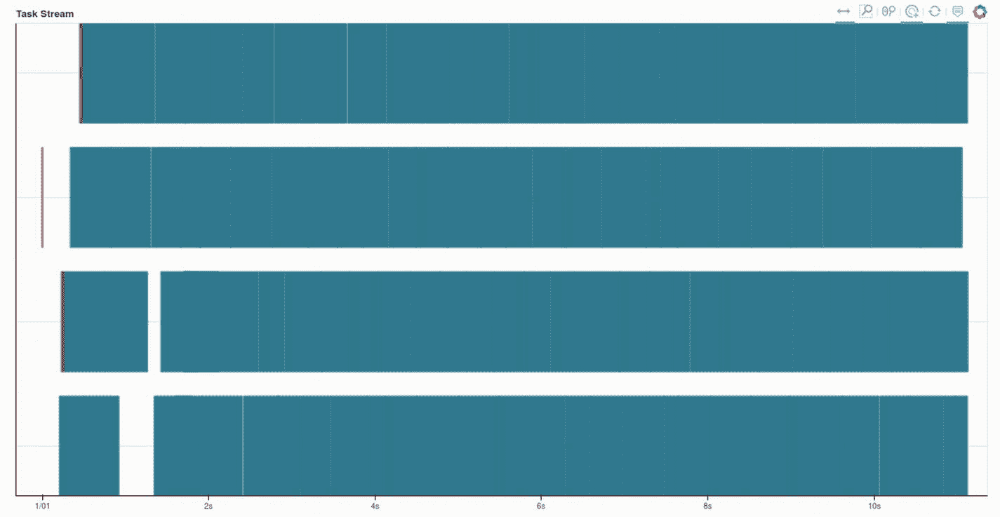
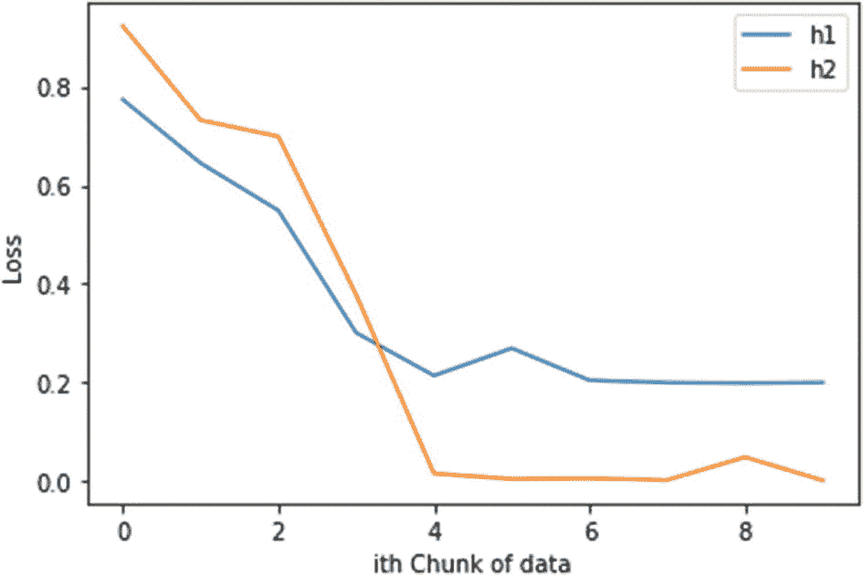
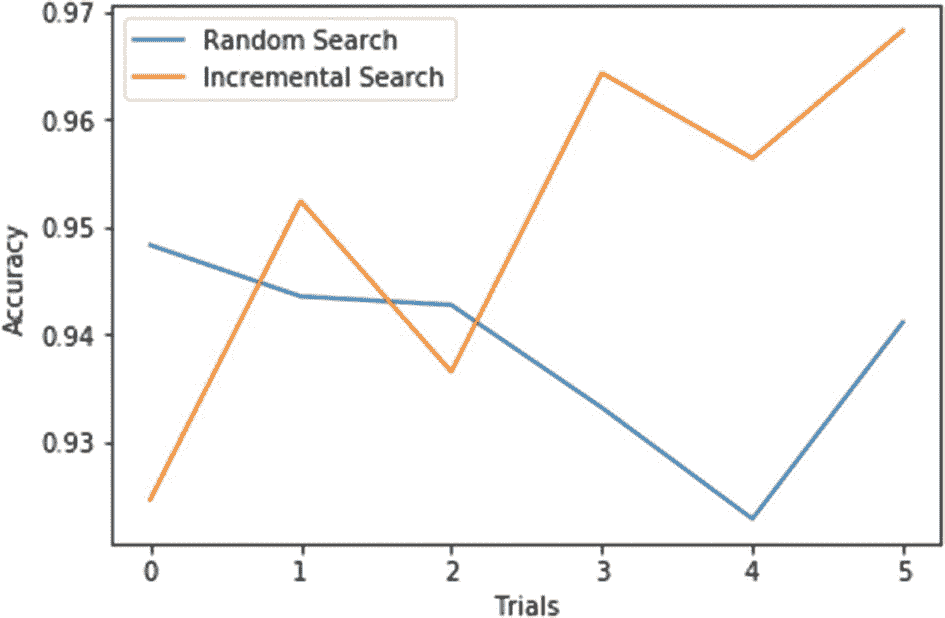

# 3. 解决时间和内存限制

在调整超参数时，我们面临两个主要问题：

*   **内存限制**：有时我们必须处理数百 GB 的数据。我们无法在 RAM 中存储如此大量的数据。在训练神经网络时，我们会分批发送数据。一种可能的解决方案是使用更大的内存，但这并不总是可行的。

*   **时间/计算限制**：假设我们的数据可以放入内存，但我们正在训练一个深度神经网络（DNN），或者超参数优化的搜索空间巨大。这可能会消耗大量时间。

解决这两个问题的一个方法是使用更好的硬件。例如，在深度神经网络的情况下，可以使用图形处理单元（GPU）、张量处理单元（TPU）等来加速训练。尽管更好的硬件可以在一定程度上解决问题，但并非总是能在如此高端的机器上工作。在第 2 章中，我们将网格搜索分布到 HPC 集群上，这解决了时间限制问题，但 HPC 集群是一种昂贵的资源。还有一些更简单的方法，即使用不同类型的集群。在本章中，我们将讨论比 HPC 更简单的替代方案，这些方案可以同时处理内存和时间限制。我们将主要关注训练的分发，以有效利用可用资源。

我们将从 Dask 开始，它非常适合分发机器学习过程，并且与 scikit-learn 配合得最好。然后，我们将看到使用 PyTorch Distributed 和 Horovod 等包来分发神经网络的简单方法。

## Dask

Dask ([`https://dask.org/`](https://dask.org/)) 是 Python 中用于并行计算的库。它使用*动态任务调度*，类似于我们在第 2 章中使用 ipyparallel 在 HPC 集群上所做的工作，这解决了计算限制的问题。然而，在分发方面，Dask 比 ipyparallel 灵活得多。使用动态任务调度，我们可以将训练分发到不同的机器上（而不仅仅是同一台机器上的多个核心）。

但是，假设我们遇到内存限制，因为我们的数据太大，无法一次性加载到内存中。Dask 通过提供*并行集合*（如 Dask Dataframe、Dask array 等）来解决这个问题，这些集合将数据集分发给可以用于分布式环境或解决超内存问题的块。使用 Dask 执行的进程通常包含以下方面：

*   *集合 → 任务图 → 多线程/多处理或分发*

首先，将 Dask 集合传递给任务图，该任务图是所有操作（如预处理、超参数优化、评估等）的完整流水线。在这里，任务可以并行化或以串行方式排列。最后，调度程序可以使用动态任务调度来执行任务图。如果使用单台机器，则可以使用多线程/多处理在核心上并行化；在集群上，任务图可以分发到节点上。在图 3-1-1 所示的任务图示例中，操作 (a) 和 (b) 是独立的，因此两者可以并行执行。(a) 中的任务 1、2 和 3 将串行执行。如果 (a) 在 (b) 之前完成，任务 7 将等待 (b) 完成。



图 3-1-1

任务图示例


### Dask 分布式

*dask*.*distributed* 是一个小型库，它扩展了 *dask* 以实现动态任务调度。在使用 dask 时，我们主要使用 `dask.distributed` 中的 *Client*()：

```
>>> from dask.distributed import Client
>>> client = Client()
```

*Client*() 帮助你连接到分布式集群。一个 Dask 集群会被传递给 *Client*()，具体取决于集群类型。Dask 支持多种不同的集群类型，例如：

*   *SSH*：如果你有一个非托管集群，你需要使用 SSH 协议连接到每台机器。在这种情况下，请使用以下代码：

    ```
    >>> from dask.distributed import Client, SSHCluster
    >>> cluster = SSHCluster(
    ["localhost", "localhost", "localhost"],
    connect_options={"known_hosts": None},
    worker_options={"nthreads": 2},
    scheduler_options={"port": 0,
    "dashboard_address": ":8797"},
    )
    >>> client = Client(cluster)
    ```

这里我们为所有工作节点定义了 IP 地址，`connect_options` 可以包含 SSH 连接的密码等信息。

*   *Kubernetes*：使用 Kubernetes 集群是使用 Dask 部署分布式应用程序的一种快速简便的方法：

    ```
    >>> from dask_kubernetes import KubeCluster
    >>> cluster = KubeCluster.from_yaml('worker-template.yaml')
    >>> cluster.scale(40) #添加 40 个工作节点
    >>> from dask.distributed import Client
    >>> client = Client(cluster)
    ```

你可以根据需要定义工作节点，甚至可以使用 *cluster*.*adapt*() 代替 *cluster*.*scale*() 来根据工作负载进行伸缩。

除了这些集群类型，Dask 还支持在 HPC、YARN（一个 Apache Hadoop 集群）以及由 Amazon、Google 等提供的基于云的集群上进行分布式计算。

通过向 *Client*() 传递 `'processes=False'`，将创建一个本地集群，并且试验将在多个核心上并行执行：

```
>>> from dask.distributed import Client
>>> client = Client(processes=False)
>>> print(client)
Client
Scheduler: tcp://127.0.0.1:35053
Dashboard: http://127.0.0.1:8787/status
Cluster
Workers: 1
Cores: 4
Memory: 16.73 GB
```

这显示了客户端和集群的详细信息。在这个例子中，我使用单台机器同时作为调度器和工作节点。在实际集群中，你可以利用更多的核心、工作节点以及更大的内存。

Dask 提供的一个出色功能是在仪表盘上可视化分布式计算（注意客户端信息下的仪表盘地址）。在这里，一旦搜索执行，你可以实时查看核心的利用率。稍后我们将看一些示例。

### 并行集合

如图 3-1-2 所示，Dask 数据框的块由多个小的 Pandas 数据框组成。类似地，Dask 数组由更小的 NumPy 数组组成。你可以决定块的大小，使其能够放入内存。



图 3-1-2

Dask 数据框（左）和 Dask 数组（右）

此外，对 Dask 数据框的操作模仿了 Pandas 数据框的 API，数组也是如此。例如：

```
#pandas
import pandas as pd
df = pd.read_csv("./dataset/train.csv")
print(df.Age.mean())
#dask
import dask.dataframe as dd
df = dd.read_csv("./dataset/train.csv")
print(df.Age.mean().compute())
```

唯一的区别是你需要使用 `.compute()` 来执行 Dask 中的操作。不过，并非所有 NumPy 和 Pandas 的接口都受支持。

由于 Dask 的并行集合可以帮助解决内存限制问题，让我们对一个原本无法放入内存的大型数据集进行建模，更不用说训练了。

首先初始化客户端：

```
>>> from dask.distributed import Client
>>> client = Client(processes=False)
```

现在创建 Dask 集合：

```
>>> from dask_ml import datasets
>>> from dask_ml.model_selection import train_test_split
>>> import dask.array as da
>>> X, y = datasets.make_classification(n_samples=100000000,
n_features=7,
random_state=0,
chunks=100000)
>>> classes = da.unique(y_train).compute()
>>> X_train, X_test, y_train, y_test = train_test_split(X, y)
```

现在我们有了一个巨大的数据集，它有 1 亿行，每行有 7 个特征和 2 个类别。图 3-1-3 显示了一个 5.6 GB 的数据被分成 1000 个块，每个块有 100,000 行，大小为 5.6 MB。



图 3-1-3

(a) 是变量 X 的表示，(b) 是变量 y 的表示

创建块的意义在于不必将整个数据集加载到内存中；只有 scikit-learn 中带有 `partial_fit` 的算法支持这一点。我将使用 SGD 分类器对数据集进行建模：

```
>>> from sklearn.linear_model import SGDClassifier
>>> clf = SGDClassifier(loss='log', penalty="l2", tol=0.01)
```

执行 `clf.fit(X_train, y_train)` 将对数据集进行一次迭代。为了进一步对分类器进行多次迭代训练，我们可以使用一个简单的 `for` 循环。我们需要将 scikit-learn 的 SGD 分类器包装到 Dask 的 `Incremental` 函数中，该函数管理数据，以便模型能够分块进行训练。

```
>>> from dask_ml.wrappers import Incremental
>>> clf = Incremental(clf, scoring="accuracy")
>>> clf.fit(X_train, y_train, classes=classes)
```

一旦你执行此操作，请查看 Dask 仪表盘，你可以在其中可视化正在进行的各种进程，如图 3-1-4 所示。



图 3-1-4

Dask 仪表盘的“任务流”窗格显示了代表四个核心的四个条。


### 动态任务调度

scikit-learn 中实现的大多数算法都能够使用 `joblib`，它提供了基于线程/进程的单机多核分发能力。通过使用 Dask，我们可以将这些算法分发到集群上，就像我们在第 2 章的 HPC 集群示例中使用 ipyparallel 所做的那样。

Dask 更加灵活，为所有不同类型的分布式系统提供了并行支持，如图 3-1-5 所示。



图 3-1-5

(a) scikit-learn 借助 JobLib 可以将训练任务分发到单机多核上。 (b) 使用 Dask，同样的过程可以分发到单机多核甚至机器集群上。

让我们以优化支持向量机的超参数为例，比较使用 scikit-learn 进行串行优化和使用 Dask 进行分布式调优的时间：

```
from sklearn.datasets import load_digits
from sklearn.model_selection import GridSearchCV, train_test_split
from sklearn.svm import SVC
X, y = load_digits().data, load_digits().target
X_train, X_test, y_train, y_test = train_test_split(X, y, test_size = 0.3, shuffle=True)
c = 0.001
gamma = 1e-10
param_grid = {
"C": [c*(10**i) for i in range(1,14)],
"gamma": [gamma*(10**i) for i in range(1,14)]
}
clf = SVC(kernel='rbf')
search = GridSearchCV(clf, param_grid, cv=3)
```

在上面的代码中，我们加载了 `digits` 数据集，并将使用 `GridSearchCV()` 优化 `C` 和 `gamma`。首先，让我们使用一个没有 Joblib 的纯 ScikitLearn 示例。

```
>>> import time
>>> since = time.time()
>>> model = search.fit(X_train, y_train)
>>> print(time.time()-since)
```

在超参数网格上总共会进行 169 次试验，耗时 75.01 秒。请注意，我们是在串行运行网格搜索。

现在，让我们使用 Dask 将试验并行化到多个核心上：

```
>>> import joblib
>>> import time
>>> from dask.distributed import Client
>>> client = Client(processes=False)
>>> since = time.time()
>>> with joblib.parallel_backend('dask', scatter=[X_train, y_train]):
model = search.fit(X_train, y_train)
>>> print(time.time()-since)
```

现在 JobLib 将使用 Dask 的客户端，在本例中是一个本地集群，用于将 169 种可能的组合分发到多个核心上。完成相同任务所需的时间为 34.73 秒。这仅使用四个核心就有了巨大的改进，因此在真正的机器集群上还有很大的改进空间。查看 Dask 仪表盘以可视化核心使用情况，如图 3-1-6 所示。



图 3-1-6

任务流窗格显示四个水平条，代表四个核心

注意

以上所有实验均在本地机器上执行，调度器和集群是同一个。在“动态任务调度”部分给出的示例中，我们可以单独使用 scikit-learn 将任务分发到单机多核上，而无需使用 Dask。

### 使用 Dask 进行超参数优化

正如我们在前几个示例中看到的，我们可以使用 Dask 进行超参数优化，以解决时间和内存限制。让我们回顾一下 scikit-learn 中的超参数优化算法及其分发方式：

*   我们可以使用简单直接的 scikit-learn 的随机搜索和网格搜索，并传递参数 `'n_jobs'=-1` 以使用单机上的所有核心。这解决了计算/时间限制。
*   我们可以使用 scikit-learn 并将其代码包裹在 `with parallel_backend('dask'):` 中，就像我们在“动态任务调度”部分的示例中所做的那样，无论是随机搜索、网格搜索还是任何其他使用 `*joblib*` 实现的算法。我们可以使用单机上的所有核心，或者将它们分发到集群上，这取决于 `dask.distributed` 的 `client()` 是如何定义的。如果使用集群，这可以进一步减少时间。

现在让我们看看 Dask 还为我们提供了哪些用于超参数优化的功能。

#### Dask 随机搜索和网格搜索

我们不能使用 scikit-learn 提供的随机搜索或网格搜索来训练大型数据集，因为它们不支持 `partial_fit`。然而，Dask 为这两种算法提供了即插即用的替代方案：`dask_ml.model_selection.GridSearchCV` 和 `dask_ml.model_selection.RandomizedSearchCV`。Dask 和 Scikit-Learn 中各自算法的接口是相似的，但 Dask 的版本实现了 `partial_fit`，这样我们就可以将 scikit-learn 的机器学习算法包装在 `Incremental` 中，并将其传递给这些超参数优化算法。

这种设置不仅可以分块训练模型，还可以将其分发到集群上，从而同时解决时间和内存问题。步骤基本上是一个直接的脚本，与我们之前所做的相同：

1.  定义一个客户端。
2.  定义搜索空间。
3.  创建一个大型数据集来测试我们的分布式模型。
4.  训练测试分割。
5.  定义使用部分拟合的机器学习算法，例如 SGD 分类器。
6.  将机器学习算法包装在 `Incremental` 中，以便在将其分发到核心/集群时可以分块管理和训练数据。
7.  在此基础上使用从 Dask 导入的网格搜索，因为它实现了 `partial_fit`。
8.  在 `joblib.parallel_backend` 下训练模型，以便可以进一步分发。

然而，在遵循这些步骤时，我遇到了一个有趣的问题。当我执行代码时，我检查了 Dask 仪表盘。内存开始被填满。问题出在准确率评分上。在我使用了 `dask_ml` 中的准确率指标后，问题得到了解决。

让我们看一个示例：

```
from dask_ml import datasets
from dask_ml.wrappers import Incremental
from dask_ml.model_selection import train_test_split, GridSearchCV
from dask_ml.metrics import accuracy_score
from sklearn.metrics import make_scorer
from sklearn.linear_model import SGDClassifier
import joblib
import dask.array as da
from dask.distributed import Client
client = Client(processes=False)
print(client.dashboard_link)
param_grid = {
"penalty": ['l1', 'l2'],
"tol": [1e-2, 1e-3, 1e-4]
}
X, y = datasets.make_classification(n_samples=100000000,
n_features=7,
random_state=0,
chunks=100000)
# 提供来自 'dask_ml' 的准确率指标
scorer = make_scorer(accuracy_score)
X_train, X_test, y_train, y_test = train_test_split(X, y)
clf = SGDClassifier(loss='log')
clf_wrap = Incremental(clf, scoring=scorer)
searh_clf = GridSearchCV(clf_wrap, param_grid, cv=3)
with joblib.parallel_backend('dask'):
model = searh_clf.fit(X_train, y_train)
```

注意

经过一番摸索，我发现默认情况下使用的是 `SGDClassifier.score` 进行评分计算，它会将 `dask arrays` 的块转换为 `ndarray`，从而导致内存使用过高。当我使用 `dask_ml` 中的评分器时，问题就解决了。

因此，你需要注意确保数据的块不会被转换为 `numpy array`；否则会导致内存被填满。这里使用 Dask 数据框和 Dask 数组的目的就是为了不填满内存。


#### 增量搜索

这是另一种非常优秀的超参数搜索方法。我们知道，Dask 可以将数据分块，而使用 `partial_fit` 的算法可以一次性训练小批量数据。增量搜索算法正是利用了这一点。它在较小的数据集块上，针对多组不同的超参数训练多个模型。然后，它只继续训练表现最佳的那组超参数。然而，这种方法有一个缺点：如果某个超参数在后期才开始表现更好怎么办？例如，在图 3-1-7 中，我们有两个超参数 h1 和 h2，并且我们训练模型直到第九个数据块。最初 h1 表现更好，但后来 h2 开始表现更好。但是，如果我们在第二个数据块时就停止训练，我们就不会知道这一点，并且会丢弃 h2。



图 3-1-7

随着更多数据块被用于训练，损失值逐渐降低

使用增量搜索非常简单，如下所示。其接口与 GridSearchCV 或 RandomSearchCV 类似。

```
from dask_ml.model_selection import IncrementalSearchCV
from sklearn.linear_model import SGDClassifier
param_grid = {
"penalty": ['l1', 'l2'],
"tol": [1e-1, 1e-2, 1e-3, 1e-4, 1e-5, 1e-6]
}
clf = IncrementalSearchCV(SGDClassifier(), param_grid)
#fit the data to train
```

图 3-1-8 展示了一个比较随机搜索和增量搜索的试验次数与准确率关系图。



图 3-1-8

随机搜索与增量搜索的比较。使用了 sklearn 中的 Digits 数据集，在 SGD 分类器上进行训练。结果基于前五次试验进行比较

#### 连续减半搜索

连续减半搜索与增量搜索有些相似。一个时间预算 (B) 被均匀分配给所有超参数组合。我们开始在有限的数据量上训练模型，并使用所有超参数组合。一旦所有模型训练完毕，表现最差的一半组合将被丢弃。在下一次迭代中，剩余的一半模型将在比之前更多的数据上进行训练、评估，然后再丢弃前一半中的一半。

这个过程一直持续到只剩下一组最佳组合，从而将更多资源分配给表现更好的超参数。使用 Dask 实现的连续减半搜索如下：

```
from dask_ml.model_selection import SuccessiveHalvingSearchCV
from sklearn.linear_model import SGDClassifier
clf = SuccessiveHalvingSearchCV(SGDClassifier(), param_grid, n_initial_iter=2)
#call fit to train data
```

这里，我们必须向搜索函数传递 `n_initial_iter`，它定义了最初调用 `partial_fit` 的次数。

不过，与增量搜索类似，同样的问题也可能存在：如果我们过早停止，可能会选错超参数组合。

#### Hyperband 搜索

Hyperband^(²) 是一种基于赌博机算法的方法，用于解决超参数优化问题。这种基于赌博机算法的方法完美地解决了我们这里的问题：我们资源有限，但需要高效地将它们分配给所有的试验。我们再次将更多时间花在表现更好的模型上，而不是将资源和时间浪费在糟糕的超参数配置上。

Hyperband 是连续减半搜索的扩展版本。在连续减半搜索中，我们为超参数组合 (n) 设定一个固定预算 (B)，并且将 'B/n' 的资源均匀分配给 'n' 中的所有组合。但是，如何选择 'n' 仍然是一个问题。有两种可能性：

*   我们应该考虑较小的 'n' 值，这样每个配置获得的资源更多，训练时间更长。但这样覆盖的搜索空间会更小。当准确率分数更多地依赖于训练数据而非超参数时，这种情况可能更有利。

*   我们应该考虑较大的 'n' 值，这样可以用较少的训练量覆盖更多的搜索空间。如果超参数的变化会导致准确率/损失分数发生巨大变化，那么较大的 'n' 值会更好，这与图 3-1-7 中的情况不同，在图 3-1-7 中，我们在后期需要更长时间的训练才能使损失分数趋于饱和。

Hyperband 通过保持 B 值恒定并改变 'n' 的值来解决“n 与 B/n”的权衡问题。因此，较大的 'n' 值会导致更激进的早停策略，因为每个超参数组合的预算减少了。在 Hyperband 中，每次进行连续减半迭代时，我们都会改变 'n' 的值。这里有一个嵌套循环；内层循环执行连续搜索，外层循环则遍历不同的 'n' 值。这提供了大量的并行化可能性，Dask 实现的 Hyperband 就利用了这一点：

```
from dask_ml.model_selection import HyperbandSearchCV
from sklearn.linear_model import SGDClassifier
clf = HyperbandSearchCV(SGDClassifier(), param_grid)
#call fit to train data
```

传递给 Hyperband 的两个重要参数是 `max_iter`，它定义了调用 `partial_fit` 的次数，以及 `partial_fit` 的块大小。这两个参数通常根据经验法则确定，其中 `max_iter` 等于超参数组合的数量 (n_param)，而块大小等于 n_param / n_examples，其中 n_examples 是模型训练所用的样本数量；例如，如果 X_train 分五次迭代训练，则 n_examples = 5 * len(X_train)。

注意

当使用这些优化算法（增量搜索、连续减半搜索、增量搜索）时，你只能使用那些实现了 `partial_fit` 的建模算法，因为其核心思想是提前停止训练，而这在其他算法中是无法做到的。虽然你可以使用 RandomSearchCV 和 GridSearchCV 将试验分布到集群上，但当数据是分块训练（数据量大于内存的情况）时，你不能使用它们；在这种情况下，你仍然需要 `partial_fit`。这些方法在处理神经网络时非常有用，因为神经网络是基于批次进行训练的。

Dask 会序列化多个对象以便进行分发。scikit-learn 和 PyTorch 与这些算法的配合效果更好，因为它们都基于 pickle 协议，而 TensorFlow 和 Keras 则不同。但是，在使用 Keras 和 TensorFlow 时，你可以应用其他算法，如 GridSearchCV、RandomSearchCV 等。我们将在下一节讨论这个问题。

## 分布式深度学习模型

深度学习模型的训练成本相当高。将神经网络训练分布到集群上，并在此基础上应用超参数优化，可以帮助我们节省大量时间。深度学习框架提供了用于分布式的模块；例如，TensorFlow Distributed（可扩展到 TensorFlow 和 Keras）、PyTorch Distributed（可扩展到 PyTorch）、Horovod 等。使用 TensorFlow Distributed 进行分布式训练非常麻烦。你必须创建参数服务器并修改大量代码。在本节中，我们将讨论使用 PyTorch Distributed 和 Horovod 来分布式训练深度神经网络，以训练 MNIST 数据集为例。如果你需要快速回顾 PyTorch API 的使用，请参考附录 II。


### PyTorch 分布式

在单台机器和集群上进行分布式的主要区别在于，在集群中我们需要一个后端通信 API 来在节点之间进行通信。这是 PyTorch 的强大之处之一。PyTorch 支持所有三种主要的后端通信 API：NCCL（NVIDIA 集体通信库，发音为“Nickel”）、Gloo 和 MPI（消息传递接口）。以下示例主要基于一个 GitHub 仓库（[`https://github.com/seba-1511/dist_tuto.pth`](https://github.com/seba-1511/dist_tuto.pth)）：

```
import torch
import torch.nn as nn
import torch.nn.functional as F
import torch.optim as optim
import torch.distributed as dist
from torch.autograd import Variable
from torch.multiprocessing import Process
import os
from math import ceil
from random import Random
from torchvision import datasets, transforms
def init_processes(rank, size, fn, backend="gloo"):
os.environ['MASTER_ADDR'] = '127.0.0.1'
os.environ['MASTER_PORT'] = '29500'
dist.init_process_group(backend, rank=rank, world_size=size)
fn(rank, size)
```

我们首先定义通信后端；这里将使用 'gloo'。接着定义主节点地址和主节点端口，以便所有节点都向一个中心主节点报告。每次执行 `init_processes` 函数时，都会创建一个新的进程组，并执行函数 `fn()`。在我们的例子中，`fn` 将是一个训练神经网络的函数，因此我们稍后会编写一个函数，用于在子样本上训练模型，然后对梯度进行平均。

注意

PyTorch 文档建议，作为经验法则，在使用 CPU 时使用 'gloo'，在 GPU 上训练时使用 'nccl'。

```
class Net(nn.Module):
def __init__(self):
super(Net, self).__init__()
self.conv1 = nn.Conv2d(1, 10, kernel_size=5)
self.conv2 = nn.Conv2d(10, 20, kernel_size=5)
self.conv2_drop = nn.Dropout2d()
self.fc1 = nn.Linear(320, 50)
self.fc2 = nn.Linear(50, 10)
def forward(self, x):
x = F.relu(F.max_pool2d(self.conv1(x), 2))
x = F.relu(F.max_pool2d(self.conv2_drop(self.conv2(x)), 2))
x = x.view(-1, 320)
x = F.relu(self.fc1(x))
x = F.dropout(x, training=self.training)
x = self.fc2(x)
return F.log_softmax(x)
```

我们需要创建一个神经网络来构建模型，因此这里定义了一个简单的卷积网络：

```
class Partition(object):
def __init__(self, data, index):
self.data = data
self.index = index
def __len__(self):
return len(self.index)
def __getitem__(self, index):
data_idx = self.index[index]
return self.data[data_idx]
class DataPartitioner(object):
def __init__(self, data, sizes=[0.7, 0.2, 0.1], seed=1234):
self.data = data
self.partitions = []
rng = Random()
rng.seed(seed)
data_len = len(data)
indexes = [x for x in range(0, data_len)]
rng.shuffle(indexes)
for frac in sizes:
part_len = int(frac * data_len)
self.partitions.append(indexes[0:part_len])
indexes = indexes[part_len:]
def use(self, partition):
return Partition(self.data, self.partitions[partition])
```

我们的模型是并行训练的，因此一旦在一批数据上训练完成，就需要更新所有梯度。所以，当一批数据训练完成后，我们收集所有梯度并取其平均值。数据以相等的比例发送到所有节点，以便每个模型的收敛保持一致。数据划分基于正在运行的进程数量。我们可以使用前面代码中定义的类来获取一定比例的数据。

```
def partition_dataset():
transformations = [transforms.ToTensor(),
transforms.Normalize((0.1307, ), (0.3081, ))
]
dataset = datasets.MNIST('./data',
train=True,
download=True,
transform=transforms.Compose(transformations)
)
size = dist.get_world_size()
bsz = int(8 / float(size))
partition_sizes = [1.0 / size for _ in range(size)]
partition = DataPartitioner(dataset, partition_sizes)
partition = partition.use(dist.get_rank())
train_set = torch.utils.data.DataLoader(
partition, batch_size=bsz, shuffle=True)
return train_set, bsz
```

此函数加载 MNIST 数据集，并使用 `DataPartitioner()` 对数据进行划分。`dist.get_world_size()` 返回当前进程组中的进程数量。因此，如果运行三个进程，我们将有三个分区大小，每个占 0.33 的比例。类似地，对于批次大小，我们将所需的批次大小除以进程数：

```
def average_gradients(model):
size = float(dist.get_world_size())
for param in model.parameters():
dist.all_reduce(param.grad.data, op=dist.reduce_op.SUM)
param.grad.data /= size
```

这里我们对梯度进行平均。`all_reduce` 会更新所有分布式模型中的参数。现在，我们定义将优化模型的函数，并将其传递给 `init_processes()`。

```
def run(rank, size):
torch.manual_seed(1234)
train_set, bsz = partition_dataset()
model = Net()
model = model
optimizer = optim.SGD(model.parameters(), lr=0.01, momentum=0.5)
num_batches = ceil(len(train_set.dataset) / float(bsz))
for epoch in range(10):
epoch_loss = 0.0
for data, target in train_set:
data, target = Variable(data), Variable(target)
optimizer.zero_grad()
output = model(data)
loss = F.nll_loss(output, target)
epoch_loss += loss.item()
loss.backward()
average_gradients(model)
optimizer.step()
print(f'Rank: {dist.get_rank()}, \
Epoch: {epoch}, \
Loss: {epoch_loss / num_batches}')
```

每个 rank 代表正在并行训练的模型。我们调用 `partition_dataset()` 来获取训练集。在迭代过程中，我们使用函数 `average_gradients()` 来平均梯度。现在，最后，我们可以通过将函数 `run()` 传递给 `init_processes()` 来启动分布式训练：

```
size = 3
processes = []
for rank in range(size):
p = Process(target=init_processes, args=(rank, size, run))
p.start()
processes.append(p)
for p in processes:
p.join()
```

这将启动你的分布式训练。通过根据网络和用例进行少量修改，我们可以使用此方法在计算机集群上训练深度学习模型。


### Horovod

Horovod 是一个开源的分布式深度学习训练库，可与 PyTorch 和 TensorFlow/Keras 配合使用。如果你已有非分布式训练的代码，只需添加几行代码即可通过 Horovod 实现分布式训练。（关于如何在不同的集群上进行分布式部署，请参考相关文档。）与 PyTorch Distributed 类似，Horovod 能够使用 Gloo、MPI 以及其他后端通信方式。在本节中，我们将探讨需要进行哪些修改，以及这些修改与上一节中 PyTorch 实现的相似之处。

首先，在 PyTorch 中编写一个简单的单机神经网络训练代码。你可以参考附录 II 的 PyTorch 部分。创建以下函数：

*   `Network()`：一个继承自 `torch.nn.Module` 的类，用于创建神经网络架构
*   `train_epoch()`：一个用于在单机上训练神经网络的函数

同时定义以下全局变量：`batch_size`、`learning_rate`、`momentum` 和 `epochs`。下面的代码展示了如何使用 horovod 进行分布式模型训练：

```
import horovod.torch as hvd
from sparkdl import HorovodRunner
from torch.utils.data.distributed import DistributedSampler
def train_hvd():
hvd.init()
device = torch.device('cuda' if torch.cuda.is_available() else 'cpu')
if device.type == 'cuda':
torch.cuda.set_device(hvd.local_rank())
transformation = [transforms.ToTensor(),
transforms.Normalize((0.1307,), (0.3081,))]
train_dataset = datasets.MNIST(
root=f'data-{hvd.rank()}',
train=True,
download=True,
transform=transforms.Compose(transformation)
)
train_sampler = DistributedSampler(train_dataset,
num_replicas=hvd.size(),
rank=hvd.rank())
train_loader = torch.utils.data.DataLoader(train_dataset,
batch_size=int(batch_size/hvd.size()),
sampler=train_sampler)
model = Network().to(device)
optimizer = optim.SGD(model.parameters(),
lr=learning_rate,
momentum=momentum)
optimizer = hvd.DistributedOptimizer(optimizer,
named_parameters=model.named_parameters())
hvd.broadcast_parameters(model.state_dict(), root_rank=0)
for epoch in range(1, epochs + 1):
train_epoch(train_loader)
```

`train_hvd()` 函数与我们使用 PyTorch Distributed 时的做法非常相似。`hvd.rank()` 用于获取工作节点 ID，因此我们为集群中的每个工作节点（rank）创建一个独立的根文件夹。

与上一节中使用 `partition_dataset()` 在工作节点间创建和划分数据类似，这里我们使用 `DistributedSampler()` 根据工作节点数量创建数据集的分区，并将该对象传递给 `Dataloader()` 以生成数据集。同样，有效的批量大小会根据工作节点数量进行缩放。

定义 `optimizer` 后，我们将其包装在 `hvd.DistributedOptimizer()` 中，这类似于我们之前使用的 `all_reduce()`。梯度会在不同节点上运行的模型之间进行平均。`hvd.broadcast_parameters()` 使用新的梯度更新所有梯度，确保所有 rank 上的模型都以相同的参数启动。

现在，为了在集群间进行分布式训练，我们将使用 `HorovodRunner` 提供的简单接口：

```
hr = HorovodRunner(np=2)
hr.run(train_hvd)
```

这里，`np` 定义了工作节点的数量，`hr.run()` 启动分布式训练。

当你在成百上千维度的空间中优化超参数时，这些分布式方法会非常有用。在优化超参数时，时间效率和资源利用率都是重要的考量因素。

在下一章中，你将看到更先进的基于贝叶斯的优化方法，这些方法实际上会从之前的试验中学习。

脚注 1

