# 4. 贝叶斯优化

在第 2 章和第 3 章中，我们探讨了几种超参数调优方法。网格搜索和随机搜索非常直接，我们还讨论了如何将它们分布式化以节省内存和时间。我们也深入研究了一些更复杂的算法，例如 `HyperBand`。但我们回顾的所有算法都没有从它们的历史记录中学习。假设一个算法可以记录所有之前的观测结果并从中学习。例如，假设它可以观察到我们的模型正在超参数的某些值附近被优化，并且可以利用这个宝贵的信息，继续探索那些接近表现良好的超参数，从而从历史中学习。通过这样做，该算法在达到最佳性能超参数的过程中，就不会在表现不佳的超参数上浪费时间。在本章中，我们将探讨具备这种能力的算法。

让我们从一个例子开始。图 4-1-1 展示了两个超参数之间的关系图。将其与第 2 章中的图 2-2-1 进行比较，后者表示网格搜索（我们在选定的参数网格中进行遍历）和随机搜索（随机命中一组超参数）。

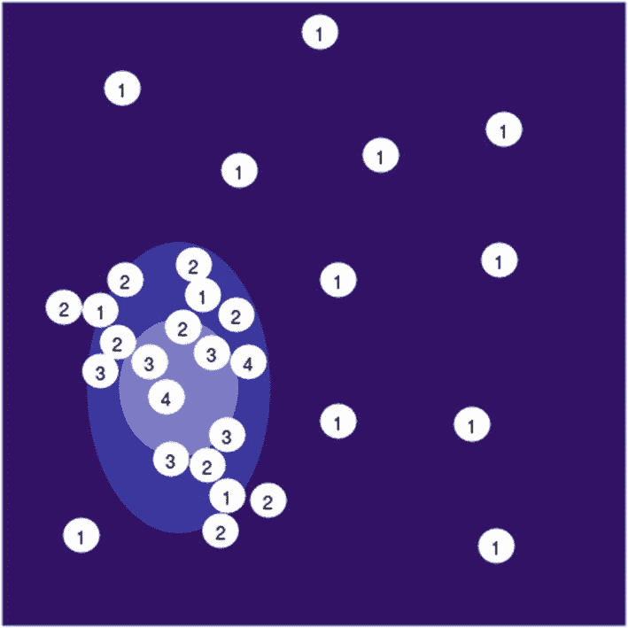
*图 4-1-1*

两个超参数之间的关系图，其中颜色较深的区域表示准确率较低，颜色较浅的区域表示准确率较高

在图 4-1-1 中，标有数字 1 的圆圈是随机选择的超参数。观察到一些位于最深色和最浅色区域之间的中间区域的 1 号点生成了更好的模型。因此，我们不再在其余的 1 号试验点上浪费时间，而是关注表现更好的 1 号试验点周围的区域，并用 2 号点训练模型，依此类推。最终，我们到达了 4 号点，其中一个 4 号点位于中间区域，另一个几乎位于最浅色区域的中心。因此，我们选择位于最浅色区域的 4 号试验点作为我们最佳的超参数集。直观地说，这个过程似乎比你之前学过的穷举方法更好。

## 基于序列模型的全局优化

值得注意的是，在机器学习中，函数训练和评估的成本高昂且速度缓慢。在本节中，我们将探讨基于序列模型的全局优化（`SMBO`）来解决超参数优化问题。`SMBO` 采用贝叶斯优化的方法，该方法用于跟踪先前的评估结果，并基于概率模型选择下一组超参数。

`$$ p(y|x) $$`

我们的目标函数（机器学习算法）记为 `f`，`y` 是通过在超参数集 `x` 上评估 `f` 计算得到的分数。在贝叶斯优化中，本质上包含四个重要方面（在以下步骤列表之后定义）：搜索空间、目标函数、概率回归模型和采集函数。

整个贝叶斯优化过程可总结为以下步骤：

1. 构建一个回归模型。
2. 初始化一些随机的超参数集（在首次试验的情况下，因为我们需要从某处提供初始超参数）。
3. 在采集函数建议的超参数集上评估模型（如果是首次试验，则从步骤 2 中选择超参数），并计算目标函数上的分数。
4. 根据新建议的超参数和分数更新代理模型。
5. 重复步骤 3 和 4，进行指定次数的迭代。

*搜索空间*（`X`），正如你在第 1 章所学到的，是一个定义好的范围，我们为超参数优化算法提供一个可供选择的范围。根据超参数的不同，范围可以是连续的或离散的。例如，在 `SVM` 中选择核函数是一个离散超参数，但 `gamma` 是从连续分布中选择的。搜索空间可能非常复杂。例如，在神经网络中，选择每个隐藏层的节点数取决于隐藏层的数量。

*目标函数*（`f`）是一个函数，它在给定的超参数集上训练机器学习模型，其输出是根据采集函数返回的准确率分数或损失分数。在下面的示例中，我们计算准确率分数，如果返回的值需要最小化，我们将通过最小化其负值来最大化准确率分数。

```
X, y = load_data()  # X 和 y 是一些预处理过的数据
X_train, X_test, y_train, y_test = train_test_split(X, y, test_size = 0.3)
def objective_function(hyperparameters):
    C = hyperparameters["C"]
    gamma = hyperparameters["gamma"]
    model = SVC(C=C, gamma=gamma)
    model.fit(X_train, y_train)
    score = model.score(X_test, y_test)
    # 因为我们想要最大化分数，所以取其负值
    return -score
```

*概率回归模型*（`p(y|x)` 或 `M`），也称为代理函数，是利用先前的评估结果构建的，是对目标函数的概率建模。因此，每次迭代都会通过在目标函数上评估超参数来更新代理模型。与目标函数相比，代理函数的*评估成本更低*，并且代理函数决定下一组将由目标函数评估的超参数，从而降低了优化成本。代理函数可以通过不同的方法构建，例如高斯过程（`GP`）、随机森林或树形结构 Parzen 估计器（`TPE`）。以下是这些代理函数如何形成的简要概述：

* 在高斯过程中，函数 `f` 被假定为高斯分布的一个实现，其预测遵循正态分布。`GP` 直接对 `p(y|x)` 进行建模。
* 在 `TPE` 中，`p(y|x)` 是基于 `p(x|y)` 和 `p(y)` 两者进行建模的。我们将在本章后面更详细地讨论 `TPE`。

*采集函数*（`S`）使用代理模型以及先前超参数集上的预测损失分数来选择下一组超参数。有几种采集函数，例如改进概率、期望改进、最小化器的条件熵和基于赌博机的准则。最常用的是期望改进：

`$$ EI_{y^*}(x) := \int_{-\infty}^{y^*} \max(y^* - y, 0) \cdot p(y|x) \, dy $$`

这里，`EI` 由代理函数和损失分数建模。`y^*` 是某个阈值，而 `y = f(x)` 是在建议的超参数集 `x` 上从目标函数获得的分数。`p(y|x)` 是代理模型。上述积分的正值意味着所建议的超参数很有可能产生更好的结果。在建议集 `x` 上，如果 `y` 负向增加，`EI` 将为正值，从而表明这是一个更好的超参数选择。

以下是 `SMBO` 方法工作原理的通用伪代码模板：

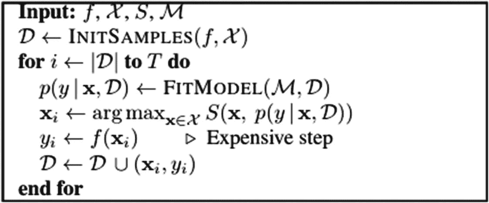

在此伪代码中，`f` 是目标函数，`X` 是超参数的搜索空间，`S` 是采集函数，`M` 是回归模型（代理函数）。

首先，我们用搜索空间中的一些随机样本初始化 `D`；`D` 以 `(x_i, y_i)` 的形式存储评估历史，其中 `x_i` 表示后续的超参数集，`y_i` 表示损失分数。

现在，我们针对指定次数的试验 `T` 运行循环。首先，使用历史记录 `D` 更新代理函数。然后，`S` 建议一组超参数 `x_i`。`x_i` 被发送给 `f`，并计算损失分数。历史记录现在保存在 `D` 中，将再次用于更新代理函数。

经过 `T` 次试验后，我们将得到最佳的超参数集。

你无需自己实现这些方法，因为所有概率回归模型都可以在不同的库中找到实现。例如，`Hyperopt` 实现了 `TPE`，`Spearmint` 和 `MOE` 实现了高斯过程，而 `SMAC` 实现了基于随机森林的代理函数。

接下来，我们将详细讨论树形结构 Parzen 估计器以及期望改进采集函数的工作原理。

## 树结构帕森估计器

树结构帕森估计器（Tree-structured Parzen estimator）是一种流行的贝叶斯优化方法，它使用期望改进采集函数。在 `TPE` 中，`p(y|x)` 是通过 `p(x|y)` 和 `p(y)` 依据贝叶斯定理建模的，这与直接建模 `p(y|x)` 的高斯过程（`GP`）不同。

`$$ p(y|x) = \frac{p(x|y) \cdot p(y)}{p(x)} $$`
*（公式 4.2.1）*

`p(x|y)` 表示为：

`p(x|y) = l(x)` *如果* `y < y^*` *（公式 4.2.2）*

以及

`p(x|y) = g(x)` *如果* `y >= y^*` *（公式 4.2.3）*

这里，`y^*` 是一个分位数，被称为*阈值损失分数*。`l(x)` 和 `g(x)` 是超参数分布。因此，对于某些超参数集 `(x_i)`，如果预测的损失分数 `(y)` 小于 `y^*`，则意味着这些集合位于分布 `l(x)` 中；如果 `y` 大于 `y^*`，则它们位于分布 `g(x)` 中。我们可以通过图 4-2-1 清楚地理解这一点。

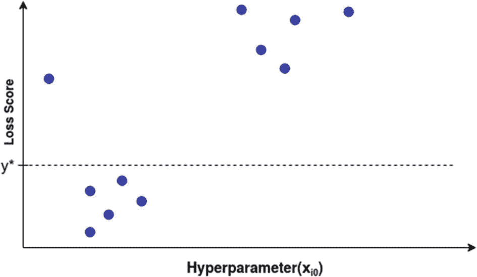

图 4-2-1

在超参数 `x[i0]` 上，低于 `y^*` 的点来自分布 `l(x)`，高于 `y^*` 的点来自分布 `g(x)`

选择 `y*` 的值，使其大于 `f(x)` 的最佳观测值，即 `y < y*`，因此我们必须找到位于 `l(x)` 分布中的超参数集，以便预测的损失分数小于 `y*`。

设

`p(y < y^∗) = γ` （公式 4.2.4）

并且连续边际概率为

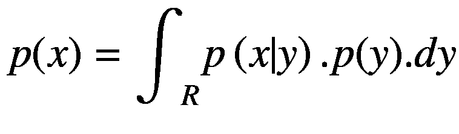

（公式 4.2.5）

现在我们优化 EI：

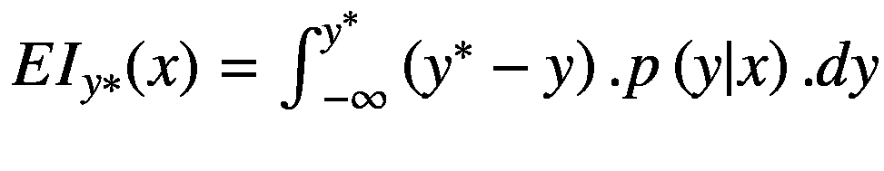 = 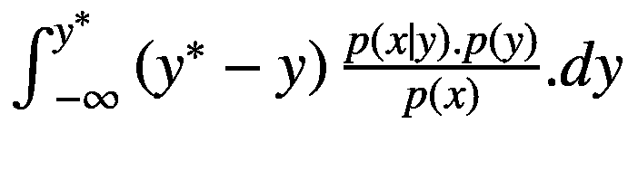 （公式 4.2.6）

利用公式 4.2.2、4.2.3 和 4.2.4，公式 4.2.5 可以写成如下形式：

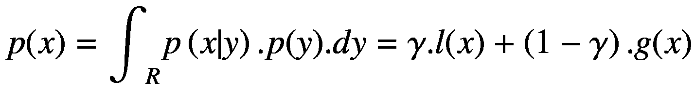

（公式 4.2.7）

现在，公式 4.2.6 中的分母项被简化为公式 4.2.7，它不依赖于 `y`。让我们简化分子：

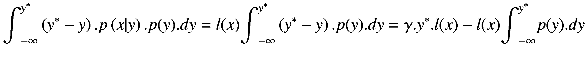

（公式 4.2.8）

将公式 4.2.7 和 4.2.8 结合起来，我们得到期望改进的值：

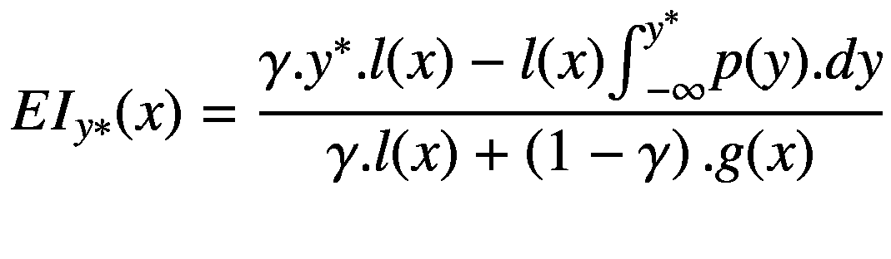

进一步简化，我们得到：

![$$ {EI}_{y\ast }(x)=\frac{\ l(x)\left[\gamma .{y}^{\ast }-{\int}_{-\infty}^{y^{\ast }}p(y). dy\right]}{\gamma .l(x)+\left(1-\gamma \right).g(x)} $$](images/494613_1_En_4_Chapter/494613_1_En_4_Chapter_TeX_Equd.png)

因此：

![$$ {EI}_{y\ast }(x)\propto {\left[\gamma +\frac{g(x)}{l(x)}.\left(1-\gamma \right)\right]}^{-1} $$](images/494613_1_En_4_Chapter/494613_1_En_4_Chapter_TeX_Equ5.png)

（公式 4.2.9）

公式 4.2.9 明确告诉我们，期望改进与比率 `g(x)/l(x)` 成反比。这意味着我们更希望我们的超参数 (`x`) 位于分布 `l(x)` 中，而不是 `g(x)` 中，以增加 EI。

因此，在每次迭代中，从 `l(x)` 中抽取候选值，并返回损失分数最小的那个，从而选择最佳超参数。

现在你已经基本了解了在贝叶斯方法中我们如何对代理函数和采集函数进行建模，接下来我们将介绍一个实现了 TPE 的开源库：Hyperopt。

## Hyperopt

Hyperopt 是一个出色的开源库，用于分布式异步超参数优化，它实现了诸如随机搜索、TPE 和自适应 TPE 等算法。在本节中，我们将重点介绍如何使用 Hyperopt 库来优化超参数。

Hyperopt 可以处理复杂的搜索空间，包括对离散值和连续值的搜索。我们可以使用该库在算法之间进行搜索，并为这些算法找到最佳的超参数集。在处理深度学习问题时，我们面对的是数百维度的空间，为了充分利用深度网络的潜力，我们需要超参数设置达到最优。使用网格搜索或随机搜索并不可行，因为每次训练网络的成本相当高。在这种情况下，使用贝叶斯优化可能是最佳选择。

要使用 Hyperopt，我们需要一个搜索空间和一个目标函数。让我们看一个简单的例子：

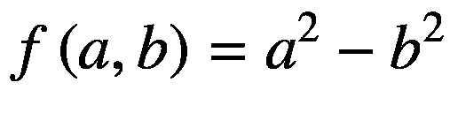

这里，我们最小化 `f(a, b)`，其中 `a ∈ [-2, 3]` 且 `b ∈ [-1, 2]`。

让我们使用 Hyperopt 来优化这个问题：

```python
from hyperopt import tpe, fmin, hp

def objective_func(args):
    a = args['a']
    b = args['b']
    f = a**2 - b**2
    return f

range_a = hp.uniform('a', -2, 3)
range_b = hp.uniform('b', -1, 2)
space = {'a': range_a,
         'b': range_b}

best = fmin(objective_func, space, algo=tpe.suggest, max_evals=100)
```

上述代码使用 TPE 来找到使 `f(a, b)` 最小的 `a` 和 `b` 的最佳值。我们可以看到，函数在 `a = 0` 和 `b = 2` 时取得最小值，最小值为 `f[min] = -4`。让我们看看 Hyperopt 在 1000 次试验中是如何逼近这个问题的。

图 4-3-1 显示，`a` 和 `b` 的值分别趋近于 0 和 2，而 `f` 的值在早期试验中就趋近于 -4。这是一个简单的函数，其最优值是整数。对于更复杂的函数，其值必须从连续分布中选取，TPE 被证明是高效的。

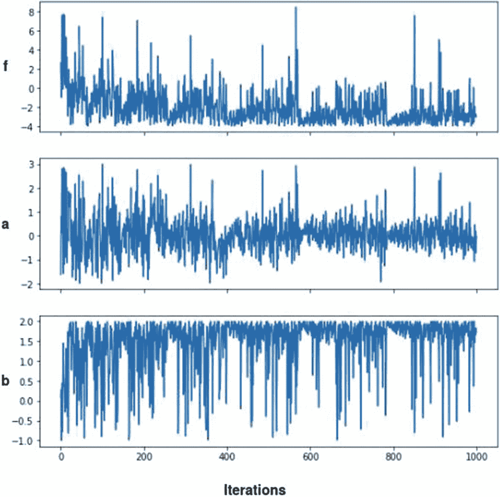

图 4-3-1

使用 TPE 在 1000 次迭代中绘制 `f`、`a` 和 `b` 的值

如前所述，要使用 Hyperopt，我们必须定义一个目标函数和搜索空间。在前面的代码中，我们的目标函数将超参数作为输入，并输出一个我们希望最小化的分数。为了创建搜索空间，对于每个超参数，我们必须使用 Hyperopt 对象形式的分布。我们有多种选择，例如均匀分布、正态分布、对数均匀分布、对数正态分布等，我们将在下一节中更详细地讨论这些。最后，我们将目标函数和搜索空间都传递给 `fmin()` 函数，同时使用 TPE 算法进行优化。我们还需要决定试验次数，就像我们在使用随机搜索时那样。该函数返回一个字典，其中包含了所有迭代中的最佳试验结果。

### 搜索空间

`fmin()` 只向目标函数传递一个参数，因此我们需要将所有超参数范围塞入字典、列表或元组中的某一个。与 scikit-learn 的网格搜索和随机搜索不同，`fmin()` 并不支持任意可迭代的分布；所有超参数都必须是 Hyperopt 的 `hp` 模块中的对象。请参考图 4-3-2 来可视化不同的分布。

以下是一些用于从不同类型的分布中获取特定值的函数，用于我们的超参数搜索：

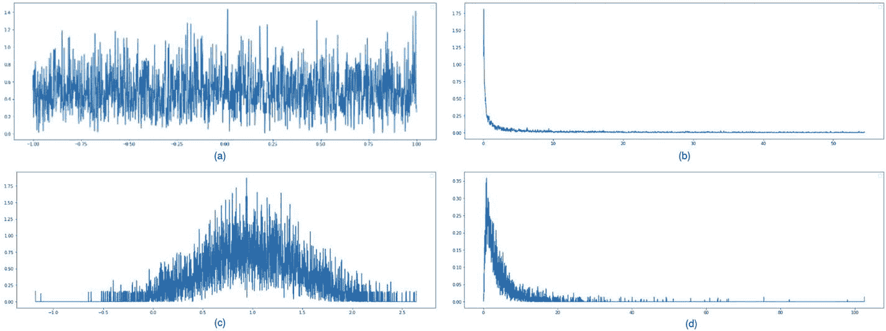

图 4-3-2

这些图形是使用 Hyperopt 分布绘制的。图 (a) 显示了 -1 到 1 之间的均匀分布。图 (b) 显示了 -3 到 4 之间的对数均匀分布。图 (c) 显示了均值为 1、标准差为 0.5 的正态分布。图 (d) 显示了均值和标准差均为 1 的对数正态分布。

*   `hp.choice()`：从给定的列表中选择一个选项
*   `hp.randint()`：从一个整数范围内随机选择一个整数
*   `hp.uniform()`：返回一个在指定范围内的值，该分布在两个给定数字之间是均匀的
*   `hp.loguniform()`：返回一个值，其对数在两个给定数字之间均匀分布
*   `hp.normal()`：根据均值和标准差，从高斯分布中返回一个值
*   `hp.lognormal()`：返回值的对数根据均值和标准差呈正态分布

### 提示
`loguniform(label, a, b)` 可以写成 `exp(uniform(label, a, b))`，其中 `a` 和 `b` 分别是下限和上限。分布范围在 `e^a` 和 `e^b` 之间，但如果你希望它在 `10^a` 和 `10^b` 之间，你可以通过类似这样的操作轻松实现：`loguniform(label, a * loge, b * loge)`。

我们可以使用这些函数来创建非常复杂的搜索空间。让我们看一个创建搜索空间的例子：

```
from hyperopt import tpe, fmin, hp
space = hp.choice('classifier',[
{'model': 'KNeighborsClassifier',
'param': {'n_neighbors':
hp.choice('n_neighbors',range(3,11)),
'algorithm':hp.choice('algorithm', ['ball_tree', 'kd_tree']),
'leaf_size':hp.choice('leaf_size', range(1,50)),
'metric':hp.choice('metric', ["euclidean", "manhattan",
"chebyshev", "minkowski"
])}
},
{'model': 'SVC',
'param':{'C':hp.loguniform('C', -2*m.log(10), 11*m.log(10)),
'kernel':hp.choice('kernel',['rbf', 'poly', 'sigmoid']),
'degree':hp.choice('degree', range(1,15)),
'gamma':hp.loguniform('gamma', -9*m.log(10), 3*m.log(10))}
}
])
```

我们首先使用 `hp.choice()` 为模型选择一个分类器，KNN 或 SVM 中的一个会被选中。一旦我们选择了分类器，就可以创建分布。在前面的例子中，我选择对离散分布使用 `hp.choice()`，对 SVM 中的 `C` 和 `gamma` 使用 `hp.lognormal()`。如前所述，我们可以操作 `hp.loguniform()` 函数来使用 `10^x` 而不是 `e^x`。

### 注意
我们需要为这些 hp 函数提供标签。在前面的代码中，我直接使用了超参数本身的名称来标记分布。

现在我们有了搜索空间，接下来将处理目标函数：

```
from sklearn.datasets import load_digits
from sklearn.model_selection import train_test_split
from sklearn.neighbors import KNeighborsClassifier
from sklearn.svm import SVC
from hyperopt import tpe, fmin, hp
import math as m
digits = load_digits()
X_train, X_test, y_train, y_test = train_test_split(digits.data,
digits.target,
test_size=0.3)
logs = {'args':list(),
'train_score': list(),
'val_score': list()}
def objective_func(args):
clf_func = args["model"]
params = args["param"]
clf = eval(clf_func)(**params)
clf.fit(X_train, y_train)
val_score = clf.score(X_test, y_test)
train_score = clf.score(X_train, y_train)
logs['args'].append(args)
logs['train_score'].append(train_score)
logs['val_score'].append(val_score)
return -val_score
best = fmin(objective_func, space, algo=tpe.suggest, max_evals=100)
```

创建目标函数很简单。我们提取超参数并将它们传递给分类器。然而，在这种情况下，由于我们的分类器也是一个变量，我们也需要提取它。我还创建了一个日志字典来保存历史记录。运行 `fmin()`，算法将开始调优。请参考图 4-3-3，即准确率与试验次数的散点图。

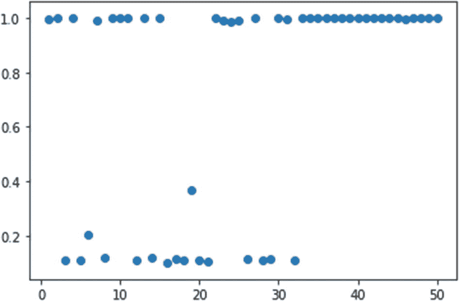

图 4-3-3 显示了在 digits 数据集上优化支持向量分类器的超参数 `C`、`kernel`、`degree` 和 `gamma` 的结果。我们可以看到，在大约 30 次试验后，得分稳定在 0.99。因此，模型对于在哪里寻找最佳超参数更加确定。

使用 Hyperopt 搜索空间定义神经网络架构可能有点棘手，因为某些超参数（如“层数”）的变化会改变超参数的总数，因为这样我们就必须决定每一层的节点数，或者各层是否使用批归一化/丢弃等方法。那么，让我们来看另一个有趣的例子，它展示了如何定义这类棘手的搜索空间：

# 使用 Hyperopt 进行超参数优化

```python
from hyperopt import hp, tpe, fmin
from keras.datasets import mnist
from keras.layers.core import Dense, Dropout, Activation
from keras.models import Sequential
from keras.utils import np_utils
import numpy as np
# 加载并预处理数据
(x_train, y_train), (x_test, y_test) = mnist.load_data()
x_train = x_train.reshape(60000, 784)
x_test = x_test.reshape(10000, 784)
x_train = x_train.astype('float32')
x_test = x_test.astype('float32')
x_train /= 255
x_test /= 255
classes = 10
input_shape = 784
y_train = np_utils.to_categorical(y_train, classes)
y_test = np_utils.to_categorical(y_test, classes)
# 日志
logs = {'model_summary':list(),
'val_acc': list()}
def obj_func(args):
# 初始化 Keras 模型
model = Sequential()
# 定义第一个隐藏层
model.add(Dense(units=args['units']['layer_units_1'],
input_shape=(input_shape, ),
name='layer_units_1'))
# 定义剩余隐藏层的数量
number_of_layers = len(args['units'])
for layer in range(2, number_of_layers):
model.add(Dense(units=args['units'][f'layer_units_{layer}'],
name=f'layer_units_{layer}'))
model.add(Dropout(args['dropout'][f'dropout_p_{layer}'],
name=f'dropout_p_{layer}'))
model.add(Activation(
activation=args['activation'][f'activation_{layer}'],
name=f'activation_{layer}'))
# 添加最后一层
model.add(Dense(classes, name=f'layer_unit_{layer+1}'))
model.add(Activation(activation='softmax',
name=f'activation_{layer+1}'))
model.compile(loss='categorical_crossentropy', metrics=['accuracy'], optimizer="adam")
result = model.fit(x_train, y_train,
batch_size=2,
epochs=1,
verbose=3,
validation_split=0.2)
validation_acc = np.amax(result.history['val_accuracy'])
print(validation_acc)
logs['model_summary'].append(model.summary())
logs['val_acc'].append(validation_acc)
return -validation_acc
def each_layer(number_of_layers):
params = {'units': dict(),
'dropout': dict(),
'activation': dict()}
number_of_nodes = [16,36,64,128,256,512]
for layer in range(number_of_layers):
params['units'][f'layer_units_{layer}'] = hp.choice(
f'layer_{number_of_layers}_{layer}',
number_of_nodes)
params['dropout'][f'dropout_p_{layer}'] = hp.uniform(
f'dropout_{number_of_layers}_{layer}',
0, 0.8)
params['activation'][f'activation_{layer}'] = hp.choice(
f'activation_{number_of_layers}_{layer}',
['relu', 'elu'])
return params
# 选择层数
number_of_layers = [3, 5, 7, 9]
space = hp.choice('layers', [each_layer(n) for n in number_of_layers])
best = fmin(obj_func, space, algo=tpe.suggest, max_evals=10)
```

在这个特定案例中，我首先确定了层数，然后使用了一个函数 `each_layer()`，这样我就可以遍历各层，决定每层的节点数、丢弃率以及激活函数的选择。请注意，我使用了带有 `number_of_layers` 和 `layer` 的标签，因为我希望标签是唯一的，类似于丢弃层和激活函数。现在搜索空间已经创建，我们需要在目标函数中构建神经网络，这相当直接。现在我们可以为复杂的搜索优化超参数了。

### 在 TPE 中并行化试验

我们可以通过并行化试验来进一步利用 TPE。可以一次性从分布 *l*(*x*) 中抽取多个候选值，并并行评估它们。默认情况下，`fmin` 是串行执行的，并使用参数 `trials = Trials()`，该参数使用一个列表。然而，我们可以改用 `MongoTrials()` 来并行评估这些试验。

首先，显然需要安装 MongoDB。之后，只需四个简单步骤即可启动异步优化：

*   使用 `fmin` 时，将 `trials` 参数设为 `MongoTrials()`。

*   启动一个可见的 MongoDB 服务器。

*   执行 Python 文件。

*   运行 `hyperopt-mongo-worker`，这是安装 Hyperopt 时放置在 Python 环境 bin 目录下的一个工作脚本。

让我们对之前的简单示例 `f(a, b) = a² - b²` 使用 `MongoTrials()`：

```python
from hyperopt import tpe, fmin, hp
from hyperopt.mongoexp import MongoTrials
def objective_func(args):
a = args['a']
b = args['b']
f = a**2 - b**2
return f
range_a = hp.uniform('a', -2, 3)
range_b = hp.uniform('b', -1, 2)
space = {'a': range_a,
'b': range_b}
m_trials = MongoTrials("mongo://localhost:27017/foo_db/jobs", exp_key="exp2")
best = fmin(objective_func, space, algo=tpe.suggest, trials=m_trials, max_evals=1000)
```

在上述代码中，我们使用了 `MongoTrials()`。第一步是启动 MongoDB 服务器：

```
$ mongod --dbpath . --port 27017
```

默认端口是 `27017`，但你可以根据需要进行更改。

现在执行之前的 Python 脚本。在 `MongoTrials()` 中，我们需要定义端口和一个 `exp_key`，如果你使用同一个数据库，在不同运行中需要更改这个键。

当你执行脚本时，它会等待 mongo 工作进程启动，你可以使用以下命令启动它们：

```
$ hyperopt-mongo-worker --mongo=localhost:1234/foo_db --poll-interval=0.1
```

如前所述，`hyperopt` - `mongo` - `worker` 是一个存储在 `$PATH` 中的文件（即你正在使用的 Python 环境的 bin 目录）。这里你需要提供 `<host> <port> / <db-name>`，而轮询间隔会在每个定义的间隔内检查任务；如果找到任务，就会开始计算。

一旦你启动了 mongo 工作进程，之前由 EI 建议的超参数集将被传递给目标函数，过程随即开始。

请注意，工作进程是在 `$PATH` 中执行的，并且工作进程需要一个目标函数，因此定义目标函数的 Python 脚本必须导出到 `$PATH` 中。

现在你将获得异步更新，而不是串行更新。或者，你也可以使用 Apache Spark 进行并行化。

Hyperopt 旨在容纳其他代理函数，如高斯过程和随机森林回归，但它们尚未实现。但由于 Hyperopt 是一个开源库，我相信作者们肯定会欢迎这些实现。所以，为了社区的更大利益，请继续为这个出色的库做出贡献吧。

## Hyperopt-Sklearn

Hyperopt-sklearn ^(⁸) 是一个基于 Hyperopt 的库^(⁹)，它利用 Hyperopt 对 `scikit-learn` 算法进行算法选择和超参数调优。

该库可以真正节省时间，因为它为 `scikit-learn` 中提供的算法创建了自己的搜索空间。你可以进行端到端的建模，因为它还为数据预处理提供了算法选择和调优选项（尽管并非所有 `scikit-learn` 算法都已实现）。

`hpsklearn` 的使用方式与 `sklearn` 风格一致，实现了诸如 `fit()`、`.score()` 和 `.predict()` 等方法，就像 `scikit-learn` 的 `Grid/Random Search` 一样。不过，提供搜索空间是可选的。让我们看几个例子来更好地理解它。

```python
from sklearn.datasets import load_boston
from sklearn.model_selection import train_test_split
from hpsklearn import HyperoptEstimator, any_regressor,
any_preprocessing, svr
from hyperopt import tpe, hp
import math as m
X, y = load_boston().data, load_boston().target
X_train, X_test, y_train, y_test = train_test_split(X,y, test_size=0.2)
model = HyperoptEstimator(regressor=any_regressor('test1_reg'),
preprocessing=any_preprocessing('test1_preprocessing'),
algo=tpe.suggest,
verbose=True,
max_evals=100)
model.fit(X_train, y_train, n_folds=3, cv_shuffle=True)
print(model.score(X_test, y_test))
print(mdoel.best_model())
```

就像 `scikit-learn` 中的任何其他分类器/回归器一样，我们可以使用 `HyperoptEstimator`，这意味着即使在你现有的代码中，也只需更改一行代码即可引入这个超参数调优库。在上述代码中，我们赋予了 `hpsklearn` 自由选择任何算法、超参数集以及任何预处理（归一化/标准化等）的能力。然而，我们也可以限制特定算法的调优和预处理选择。例如：

```python
model = HyperoptEstimator(regressor=svr('test_svr'),
preprocessing=[],
algo=tpe.suggest,
verbose=True,
max_evals=100)
```

你可以将前面代码中的模型初始化替换为这一行，以便仅对支持向量回归器进行调优，并且不使用任何预处理。或者，你可以像这样更改一个或多个超参数的搜索空间：

```python
space = {'C':hp.loguniform('C',-2*m.log(10),11*m.log(10)),
'gamma':hp.loguniform('gamma',-9*m.log(10),3*m.log(10))
}
model = HyperoptEstimator(regressor=svr('test_svr', **space['param']),
preprocessing=[],
algo=tpe.suggest,
verbose=True,
max_evals=100)
```

在这里，已定义超参数（`C` 和 `gamma`）的默认搜索空间将被自定义搜索空间覆盖。对于预处理，你也可以进行同样的操作。

由于该库支持 `SVM`、决策树、`KNN` 等算法，你可以使用 `hpsklearn` 获取基线准确率，然后使用自定义搜索空间并尝试不同的模型来进一步调优模型。

## Hyperas

另一个极其有用的开源超参数优化库是 `Hyperas` ^(¹⁰)，它是 Hyperopt 的一个封装，用于优化 `Keras` 神经网络的架构。这个库的编写方式使你无需为神经网络创建复杂的搜索空间；相反，你可以使用简单的 `Keras` 代码，只需添加一些范围即可。下面是一个帮助你理解 Hyperas 概念的示例：

在使用 `Hyperas` 时，我们需要创建两个函数。一个函数用于数据加载。另一个函数类似于目标函数，它包含一个神经网络并返回一个损失分数，唯一的区别在于搜索空间不是一个参数，而是将数据作为参数传递。搜索空间是在我们编写网络中的每个超参数时定义的。而 `Hyperas` 中的 `optim.minimize()` 函数则启动优化过程。

在第一个函数 `data()` 中，我们加载数据集（这里是 `MNIST`）；由于目标函数会进行迭代，我们不希望反复加载数据。从 `data()` 返回的所有内容都将传递给 `create_model()`。

接下来我们定义目标函数，在其中使用 `Keras` 定义神经网络。在初始化 `Sequential()` 之后，我们逐层添加层。在超参数的位置，我们可以使用这种格式给出一个范围：`{{range}}`。`{{range}}` 是 `Hyperas` 中的分布函数，其命名规则与 `Hyperopt` 相同。在 `Hyperas` 中，我们不需要给出标签，因为它会将分配给它们的变量作为标签。然而，如果我们像后续代码那样对某个超参数范围进行迭代，

```python
for i in range(layers):
    model.add(Dense(units={{choice([32, 64, 256, 512, 1024])}}))
```

例如，如果有三层，所有三层都会选择相同的超参数，因为 `Hyperas` 会生成 Python 代码模板并将分布发送给 `Hyperopt`，而由于该参数只编写一次，`Hyperopt` 会将其视为一个超参数。你有两种方法来解决这个问题：要么像我们在“搜索空间”一节的最后一个示例中那样，回头直接使用 `Hyperopt`；要么使用 `if...else` 语句来添加层：

```python
model.add(Dense({{choice([32, 64, 256, 512, 1024])}}))
model.add(Dropout({{uniform(0, 0.8)}}))
model.add(Activation({{choice(['relu', 'elu'])}}))
if {{choice(['one', 'two'])}} == 'two':
    model.add(Dense({{choice([32, 64, 256, 512, 1024])}}))
    model.add(Dropout({{uniform(0, 0.8)}}))
    model.add(Activation({{choice(['relu', 'elu'])}}))
```

只有当选择的层数为二时，才会创建另一层。

`Hyperas` 是 `Hyperopt` 的一个非常简单易用的封装器，你可以用它快速调整模型，但如果你想要更大的灵活性，请使用 `Hyperopt`，即使面对最复杂的搜索空间，它也能发挥奇效。

在本章中，你学习了贝叶斯超参数优化的工作原理，以及如何在你的问题中使用 `Hyperopt`。这些技术可以轻松提高你的时间效率并优化资源利用率。

脚注 1   2   3   4   5   6   7   8