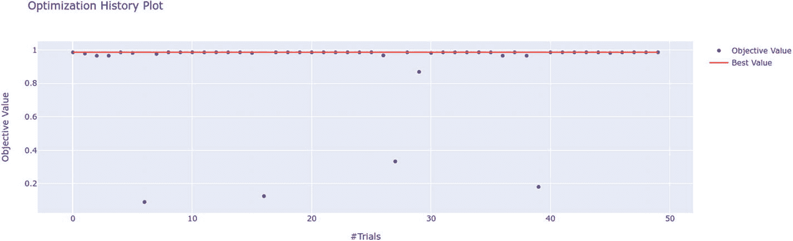
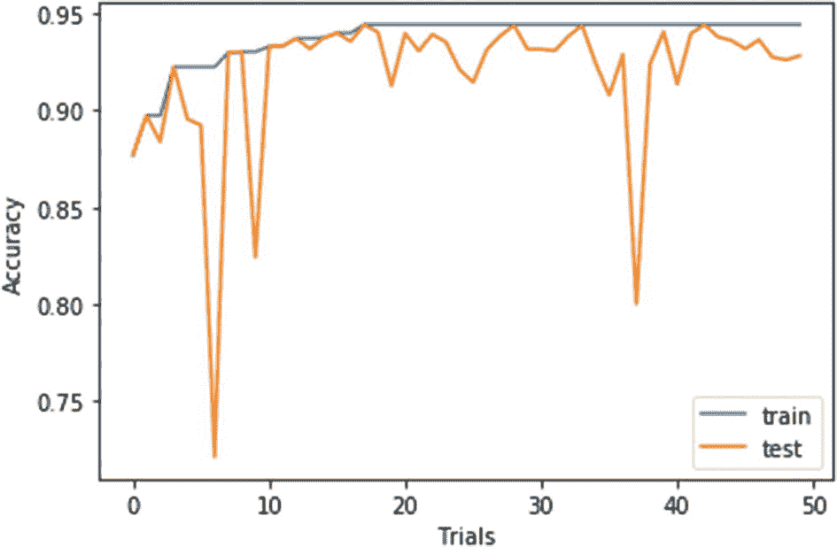
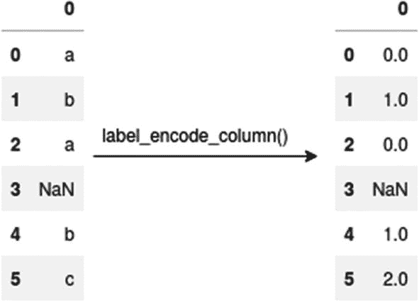
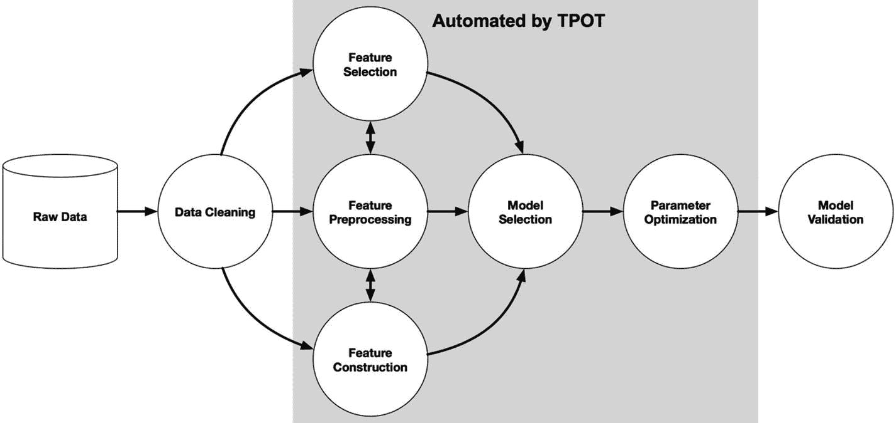

# 5. Optuna 与 AutoML

现在，我们可以使用前几章讨论的技术来创建高效的模型。贝叶斯优化在寻找最优超参数方面大有可为。本章概述了 Optuna 框架，并进一步讨论了超参数优化在自动化机器学习中的作用。我们将使用 Optuna 创建我们自己的小型 AutoML 脚本。然后，我们将探索基于树的流水线优化工具（TPOT），这是一个使用遗传编程来优化机器学习流水线的 AutoML 工具。

## Optuna

与第 4 章讨论的 Hyperopt 类似，Optuna^(¹¹) 是一个使用贝叶斯优化的开源库。Optuna 使用的底层算法与 Hyperopt 相同，但 Optuna 框架更加灵活。Optuna 可以轻松地与 PyTorch、Keras、scikit-learn、Apache MXNet 以及其他库一起使用。其 API 与 Hyperopt 的 API 非常相似，只有一些变化。让我们看一个示例：

```python
from sklearn.datasets import load_digits
from sklearn.model_selection import train_test_split, cross_val_score
from sklearn.neighbors import KNeighborsClassifier
from sklearn.svm import SVC
import optuna
from optuna.samplers import TPESampler
digits = load_digits()
X_train, X_test, y_train, y_test = train_test_split(digits.data,
digits.target,
test_size=0.3)
def objective_func(trial):
classifier_name = trial.suggest_categorical("classifier",
["SVC", "RandomForest"])
if classifier_name == "SVC":
c = trial.suggest_loguniform("svc_c", 1e-2, 1e+11)
gamma = trial.suggest_loguniform("svc_gamma", 1e-9, 1e+3)
kernel = trial.suggest_categorical("svc_kernel",
['rbf','poly','rbf','sigmoid'])
degree = trial.suggest_categorical("svc_degree", range(1,15))
clf = SVC(C=c, gamma=gamma, kernel=kernel, degree=degree)
else:
algorithm = trial.suggest_categorical("algorithm",
['ball_tree', "kd_tree"])
leaf_size = trial.suggest_categorical("leaf_size",
range(1,50))
metric = trial.suggest_categorical("metric",
["euclidean","manhattan",
"chebyshev","minkowski"])
clf = KNeighborsClassifier(algorithm=algorithm,
leaf_size=leaf_size,
metric=metric)
clf.fit(X_train, y_train)
val_acc = clf.score(X_test, y_test)
return val_acc
study = optuna.create_study(direction='maximize', sampler=TPESampler())
study.optimize(objective_func, n_trials=100)
best_trial = study.best_trial.value
print(f"Best trial  accuracy: {best_trial}")
print("parameters for best trail are :")
for key, value in study.best_trial.params.items():
print(f"{key}: {value}")
```

在图 5-1-1 中，我们可以看到曲线在 1 附近趋于饱和。请注意，这里的目标值是验证准确率。


*图 5-1-1 显示前面代码示例前 50 次试验中准确率与试验次数的关系图*

如果这个示例看起来很眼熟，那是因为我们在第 4 章中处理过相同的问题。Optuna 的用户界面与 Hyperopt 非常相似。我们必须定义一个目标函数，该函数应返回一个分数（损失/准确率），该分数将被最小化/最大化。

我们实例化 `create_study()` 函数并对其进行优化，而不是使用 `fmin()` 函数。但 Optuna 提供的最佳特性之一是能够动态定义超参数搜索范围。与 Hyperopt 必须预先定义搜索空间不同，在 Optuna 中，我们在目标函数本身中定义搜索空间（类似于我们在 Hyperas 中所做的）。让我们讨论一下 Optuna 的一些关键方面。

### 搜索空间

在 Hyperopt 和许多其他算法中，我们使用字典来定义搜索空间。如前所述，在 Optuna 中，我们动态定义搜索空间。正如你在第 4 章中所见，使用 Hyperopt 和 Hyperas 在神经网络中创建搜索空间很困难。对于依赖于层数的节点数等超参数，Hyperas 会使用 `if`…`else`。如果使用循环，Hyperas 会为所有层选择相同数量的节点。在 Optuna 中，我们可以在循环中为每个超参数提供唯一的标签。例如：

```python
n_layers = trial.suggest_int('n_layers', 1, 3)
layers = []
in_features = 28 * 28
for i in range(n_layers):
out_features = trial.suggest_int('n_units_{}'.format(i), 4, 128)
layers.append(Linear(in_features, out_features))
layers.append(ReLU())
in_features = out_features
```

Optuna 使处理这个问题变得容易得多。并且 Optuna 提供了与 Hyperopt 相同的分布。以下是一些常用的分布：

*   分类分布：`trial.suggest_categorical()` 用于从列表中选择离散值，这与 Hyperopt 中的 `hp.choice()` 相同。
*   均匀分布：`trial.suggest_uniform()` 用于在均匀尺度上进行随机分布，类似于 `hp.uniform()`。
*   对数均匀分布：`trial.suggest_loguniform(label, low, high)` 用于对数均匀尺度。然而，在 Hyperopt 中，`hp.loguniform(label, low, high)` 返回 `exp(low)` 和 `exp(high)` 之间的分布。在 Optuna 中，返回的是 `low` 和 `high` 之间的对数均匀分布。

我们还可以根据需要使用的其他分布。

### 底层算法

除了树结构 Parzen 估计器和随机搜索之外，Optuna 还提供了连续减半和 HyperBand，这是相对于 Hyperopt 的优势。我们已经在第 3 章中讨论过 HyperBand。以下是使用方法：

```python
import optuna
# define the objective function
study = optuna.create_study(pruner=optuna.pruners.HyperbandPruner())
study.optimize(objective, n_trials=20)
```

### 可视化

Optuna 提供了优雅的可视化功能。图 5-1-1 是由 Optuna 通过 `optuna.visualization.plot_optimization_history(study)` 生成的。你可以传入 `study` 对象，它就会创建一个图表。你可以点击每个散点，观察所使用的不同超参数。此外，还有更多的可视化选项。

回调函数（Callbacks）是 `study.optimize()` 中的一个参数，它会在每次试验后调用回调。利用这一点，你可以在像 `tensorboardX` 这样的仪表盘上实时查看进度。

回调函数的工作方式如下：


## 分布式优化

与 Hyperopt 一样，Optuna 也支持分布式优化，但 Optuna 的实现比 Hyperopt 更容易使用。让我们看看如何配置它：

```python
study = optuna.create_study(study_name='distributed_test',
storage='database_url',
load_if_exists=True)
```

在实例化 `create_study()` 时定义数据库 URL。并将 `load_if_exists=True` 设置为 `True`，这样它就不会创建新的 study，而是查找名为 `distributed_test` 的先前 study。这样一来，每次工作节点启动时，都不会创建新的 study，而是查找现有的 study，从而避免从头开始训练。

有关 Hyperopt 和 Optuna 的全面比较，请参阅 Neptune.ai 高级数据科学家 Jakub Czakon 撰写的以下文章：“Optuna vs Hyperopt：你应该选择哪个超参数优化库？”^(¹²)。

现在，让我们探索一个如何使用 Optuna 优化神经网络超参数的示例。我们将使用 MNIST 数据集和 Keras。首先，导入库并将数据拆分为训练集和测试集。

```python
from keras.datasets import mnist
from keras.layers.core import Dense, Dropout, Activation
from keras.models import Sequential
from keras.utils import np_utils
import numpy as np
import optuna
from optuna.samplers import TPESampler
(x_train, y_train), (x_test, y_test) = mnist.load_data()
x_train = x_train.reshape(60000, 784)
x_test = x_test.reshape(10000, 784)
x_train = x_train.astype('float32')
x_test = x_test.astype('float32')
x_train /= 255
x_test /= 255
classes = 10
input_shape = 784
y_train = np_utils.to_categorical(y_train, classes)
y_test = np_utils.to_categorical(y_test, classes)
x_train, y_train, x_test, y_test, input_shape, classes
```

```python
def log(study, trial):
print(f"Trial No.={trial.number}, HP_Set={trial.params}, \
Score={trial.value}")
print(f"Best Value ={study.best_value}")
def objective_func(trial):
model = Sequential()
hidden_layer_unit_choice = [32, 64, 256, 512, 1024]
hidden_layers = trial.suggest_int('hidden_layers', 1, 6)
model.add(Dense(units=trial.suggest_categorical('layer1', [8, 16]),
input_shape=(input_shape, ),
name='dense1'))
model.add(Activation(activation=trial.suggest_categorical(
f'activation1',
['relu',
'elu'])))
for i in range(1, hidden_layers):
model.add(Dense(units=trial.suggest_categorical(
f'layer{i+1}',
hidden_layer_unit_choice)))
model.add(Dropout(trial.suggest_uniform(
f'dropout{i+1}', 0, 0.8)))
model.add(Activation(
activation=trial.suggest_categorical(
f'activation{i+1}',
['relu',
'elu'])))
model.add(Dense(classes))
model.add(Activation(activation='softmax'))
model.compile(loss='categorical_crossentropy',
metrics=['accuracy'],
optimizer=trial.suggest_categorical('optimizer',
['rmsprop', 'adam', 'sgd']))
result = model.fit(x_train, y_train,
batch_size=4,
epochs=1,
verbose=3,
validation_split=0.2)
validation_acc = np.amax(result.history['val_accuracy'])
print('Validation accuracy:', validation_acc)
return validation_acc
```

定义目标函数。在上述代码中，我们看到超参数是动态地为每一层选择的，只需为标签指定唯一的名称即可。

最后，我们开始优化：

```python
study = optuna.create_study(direction='maximize', sampler=TPESampler())
study.optimize(objective_func, n_trials=50, callbacks=[log])
best_trial = study.best_trial.value
print(f"Best trial  accuracy: {best_trial}")
print("parameters for best trail are :")
for key, value in study.best_trial.params.items():
print(f"{key}: {value}")
```

此示例仅优化了 50 次试验，图 5-1-2 显示了准确率曲线。



图 5-1-2

上述代码示例的准确率与试验次数关系图

在如此庞大的搜索空间中，50 次试验是较少的（为了获得更好的结果，请增加试验次数），但我们可以看到训练分数在上升。请注意，测试分数是独立的，目标函数使用验证准确率来优化超参数。

Optuna 是一个年轻的库，仍有许多工作在进行中，但它很有前景。

## 自动化机器学习

机器学习的高度复杂性要求只有机器学习专家才能构建模型。机器学习模型是任务特定的，每个模型都需要大量的工作。为了向大众提供机器学习，机器学习专家需要一种方法来创建开箱即用的模型。这就是自动化机器学习（AutoML）的用武之地。

当机器学习自行创建完整的流水线并为我们提供一个可部署的模型时，它就实现了自动化。要创建完整的流水线，我们需要使用多种算法，从预处理到创建机器学习模型。所有这些算法都有其需要优化的超参数。在这里，超参数优化发挥着巨大的作用。预处理的步骤和算法在附录 I 中描述。

现在，我们将在后续章节中使用 Optuna 和 TPOT 快速构建我们自己的 AutoML 模块，这些模块将能够处理几乎任何类型的分类数据集。

### 构建你自己的 AutoML 模块


本示例提供了构建一个基础模块的说明，你可以随后对其进行实验并添加更多算法。对于实际应用场景，有许多经过优化的 AutoML 库，我们将在后面讨论。我们将使用泰坦尼克号数据集，该数据集虽然杂乱，但我们的代码将处理所有清洗和预处理工作。

首先，我们导入所有必要的库并加载数据集^(¹³)：

```
import pandas as pd
import numpy as np
import impyute as impy
import optuna
from optuna.samplers import TPESampler
from sklearn.model_selection import train_test_split
from sklearn.preprocessing import LabelEncoder, MinMaxScaler, \
StandardScaler
from sklearn.impute import SimpleImputer
from sklearn.feature_selection import SelectKBest, \
chi2, f_classif, mutual_info_classif
from sklearn.svm import SVC
from sklearn.neighbors import KNeighborsClassifier
data = pd.read_csv("./titanic/train.csv")
y = data['Survived']
X = data.drop('Survived', axis=1)
```

现在，我们来处理不需要优化超参数的部分。我们将定义外部目标函数，因为重复迭代那些无需优化的过程是没有意义的。

```
def label_encode_column(col):
nans = col.isnull()
nan_lst = []
nan_idx_lst = []
label_lst = []
label_idx_lst = []
for idx, nan in enumerate(nans):
if nan:
nan_lst.append(col[idx])
nan_idx_lst.append(idx)
else:
label_lst.append(col[idx])
label_idx_lst.append(idx)
nan_df = pd.DataFrame(nan_lst, index=nan_idx_lst)
label_df = pd.DataFrame(label_lst, index=label_idx_lst)
label_encoder = LabelEncoder()
label_df = label_encoder.fit_transform(label_df.astype(str))
label_df = pd.DataFrame(label_df, index=label_idx_lst)
final_col = pd.concat([label_df, nan_df])
return final_col.sort_index()
for column_name in X.columns:
if str(X[column_name].dtype) == 'object':
X[column_name] = label_encode_column(X[column_name])
if len(X[column_name].unique()) > len(X)/3:
X = X.drop(column_name, axis=1)
```

我们使用了 `label_encode_column()` 函数，但直接使用 `LabelEncoding()` 有什么问题呢？`LabelEncoding()` 也会对 `NaN` 值进行编码，但我们希望稍后对这些值进行插补。因此，该函数会逐列处理，将 `NaN` 值与其他值分离，并在保存其索引位置的同时进行编码。它返回一个排序后的数据框，如图 5-2-1 所示。



图 5-2-1

标签编码器对除 `NaN` 之外的所有值进行编码

因此，在对所有列进行标签编码后，我们会删除那些唯一值数量过多的列。如果你希望将独热编码作为一个选项，也可以将标签编码包含在目标函数中。接下来，我们将定义一些在目标函数中使用的函数：

```
def mice_imputer(data):
data = data.to_numpy()
imputed_data = impy.mice(data)
imputed_data = pd.DataFrame(imputed_data)
return imputed_data
def mean_imputer(data):
imputer = SimpleImputer(strategy='mean')
imputed_data = imputer.fit_transform(data)
imputed_data = pd.DataFrame(imputed_data)
return imputed_data
```

上述代码参数化了两个插补器：均值插补和 MICE 插补。关于如何包含更多选项的说明，请参考附录 I。

```
def feature_selector(X, y, k, algo="f_classif"):
kbest = SelectKBest(eval(algo), k)
X = kbest.fit_transform(X, y)
X = pd.DataFrame(X)
return X
```

我们将选择 'k' 个最佳特征，这本身也是一个超参数。另一个超参数是选择特征选择算法。我们有 `'f_classif'`、`'chi2'` 和 `'mutual_info_classif'`。预处理步骤的最后一步是缩放。我们在归一化和标准化之间进行选择。

```
def scaling(data, scaler="min_max"):
if scaler=='min_max':
scaled_data = MinMaxScaler().fit_transform(data)
else:
scaled_data = StandardScaler().fit_transform(data)
scaled_data = pd.DataFrame(scaled_data)
return scaled_data
```

现在，我们定义目标函数：

## AutoML 与 Optuna 的结合

```python
def objective_func(trial):
    try:
        # 插补
        imputer = trial.suggest_categorical('impyter', ['mice', 'mean'])
        if imputer=='mice':
            imputed_X = mice_imputer(X)
        else:
            imputed_X = mean_imputer(X)
        # 特征选择
        fea_slct = trial.suggest_categorical('fea_slct',
            ['chi2', 'f_classif',
             'mutual_info_classif'])
        no_feature_cols = trial.suggest_int('k', 3, len(X.columns))
        selected_features = feature_selector(imputed_X, y,
            no_feature_cols, fea_slct)
        # 缩放
        scaler = trial.suggest_categorical('scaler',
            ['min_max', 'standard'])
        scaled_X = scaling(selected_features)
    except:
        return 0.0
    # 实例化机器学习算法
    classifier_name = trial.suggest_categorical("classifier",
        ["SVC", "RandomForest"])
    if classifier_name == "SVC":
        c = trial.suggest_loguniform("svc_c", 1e-2, 1e+11)
        gamma = trial.suggest_loguniform("svc_gamma", 1e-9, 1e+3)
        kernel = trial.suggest_categorical("svc_kernel",
            ['rbf','poly','rbf','sigmoid'])
        degree = trial.suggest_categorical("svc_degree", range(1,15))
        clf = SVC(C=c, gamma=gamma, kernel=kernel, degree=degree)
    else :
        algorithm = trial.suggest_categorical("algorithm",
            ['ball_tree', "kd_tree"])
        leaf_size = trial.suggest_categorical("leaf_size", range(1,50))
        metric = trial.suggest_categorical("metic",
            ["euclidean","manhattan",
             "chebyshev","minkowski"])
        clf = KNeighborsClassifier(algorithm=algorithm,
            leaf_size=leaf_size, metric=metric)
    # 拟合模型
    clf.fit(scaled_X, y)
    val_acc = clf.score(scaled_X, y)
    return val_acc

study = optuna.create_study(direction='maximize', sampler=TPESampler())
study.optimize(objective_func, n_trials=100)
best_trial = study.best_trial.value
print(f"最佳试验准确率: {best_trial}")
print("最佳试验的参数为：")
for key, value in study.best_trial.params.items():
    print(f"{key}: {value}")
```

目标函数的第一部分包含所有预处理步骤，我们使用了`try`...`except`。我们使用了之前定义的函数。在某些情况下，当算法和超参数不匹配，或者上一步处理后的数据无法被下一步接受时，你可能会遇到错误。例如，某些特征选择算法不适用于负值，但即使你对数据集很小心，插补器也可能用某个负值来插补 `NaN`。在这种情况下，只需返回零，即可能的最低准确率值。

然后，我们像之前一样定义分类器的选择（你可以添加更多分类器）。AutoML 的理念是创建一个通用代码，为你提供针对数据集的最佳可能流水线。你可以训练任何表格数据集进行分类，从而在无需编写额外代码的情况下，获得针对上述步骤和算法选择的最佳可能流水线。

随着搜索空间复杂度的增加，我们需要对数据集进行更多次试验。试验次数越多，我们获得的结果就越好。为了减少时间，你可以像下面描述的那样，将优化过程分布化。

### TPOT

基于树的流水线优化工具（TPOT）是一个 AutoML 框架，它使用遗传编程来优化机器学习流水线。

正如我们之前讨论的，数据预处理通常包括数据清洗（标签编码、删除不重要的列和缩放），这是我们必须事先处理好的事情。更复杂的任务，如特征选择、特征降维和特征构建，则由 TPOT 处理。它进一步选择具有最佳超参数集的最佳模型。图 5-2-2 展示了由 TPOT 自动化的功能。

遗传算法速度较慢，但擅长为给定的数据集找到最佳路径。我们需要训练很长时间才能达到最佳的超参数集。

理解 TPOT 首先需要理解什么是遗传算法。顾名思义，遗传算法的概念源于达尔文的自然选择理论。遗传算法通过选择最佳算法来不断进化。对于最佳算法，它会对其子代进行一些随机的超参数修改，并评估模型以找到最佳拟合。


图 5-2-2
TPOT 覆盖了大约 80% 的工作

现在，我们将看一个 TPOT 如何工作的示例，使用 TPOT 处理鸢尾花数据集，因为它已经是一个干净的数据集：

```python
from tpot import TPOTClassifier
from sklearn.datasets import load_iris
from sklearn.model_selection import train_test_split
import numpy as np

iris = load_iris()
X_train, X_test, y_train, y_test = train_test_split(
    iris.data.astype(np.float64),
    iris.target.astype(np.float64),
    test_size=0.25
)
```

```python
# 加载数据集并将其分割为训练集和测试集。
tpot = TPOTClassifier(generations=5, population_size=50, verbosity=2)
tpot.fit(X_train, y_train)
```

我们训练 `TPOT` 五个世代；默认是 100 个世代。这个框架的接口与 `scikit-learn` 非常相似。

瞧！我在训练好的模型上对测试集达到了 100% 的准确率。

为了让事情更简单，我们可以将选定的流水线导出到一个 Python 脚本中，然后可以轻松部署。

```python
tpot.export('tpot_iris_pipeline.py')
```

上面的代码行自动生成了以下 `tpot_iris_pipeline.py` 文件：

```python
import numpy as np
import pandas as pd
from sklearn.model_selection import train_test_split
from sklearn.neural_network import MLPClassifier

# NOTE: Make sure that the outcome column is labeled 'target' in the data # file
tpot_data = pd.read_csv('PATH/TO/DATA/FILE', sep="COLUMN_SEPARATOR",
    dtype=np.float64)
features = tpot_data.drop('target', axis=1)

training_features, testing_features, training_target, testing_target = \
    train_test_split(features, tpot_data['target'],
        random_state=None)

# Average CV score on the training set was: 0.9913043478260869
exported_pipeline = MLPClassifier(alpha=0.1, learning_rate_init=0.1)
exported_pipeline.fit(training_features, training_target)
results = exported_pipeline.predict(testing_features)
```

我们优化的时间越长，得到的结果就越好。

还有许多其他的 AutoML 库，例如 `auto-sklearn`、`H2O AutoML` 和 `AutoKeras`。AutoML 不仅有利于数据科学家加速流程，也让没有编程知识的人能够使用机器学习。AutoML 在人工智能的未来无疑占有重要地位。

正如你在本章中所见，超参数优化在 AutoML 中扮演着巨大的角色，使我们能够在最短的时间内生成最佳的机器学习模型。

作为本书的结尾，我祝愿你在使用更高级的方法（如贝叶斯优化和剪枝算法，而不是手动调优或网格搜索）优化超参数时取得成功。优化愉快！

## 索引

### 脚注 1   2   3   4

### A
激活函数
自动化机器学习（`AutoML`）
构建模块
定义
`TPOT`

### B
反向传播
贝叶斯优化
超参数
`SMBO`
树结构帕尔森估计器

### C
连续变量
`create_study()` 函数
交叉验证函数

### D
`Dask`
分布式
网格搜索
超参数优化
随机搜索
`Dask` 并行集合
数据清洗与预处理
特征选择
*F* 检验
互信息
递归
缺失值
链式方程
删除行
均值/中位数
回归/分类
`ML` 算法
模型评估方法
非数值列
标签编码
独热编码
异常值检测
`DBSCAN`
*z-score* 技术
决策树
基于密度的噪声应用空间聚类（`DBSCAN`）
离散变量
距离度量
动态任务调度

### E
指数分布

### F
`fmin()` 函数
*F* 检验
全连接神经网络
隐藏层
`PyTorch`

### G
高斯分布
高斯过程（`GP`）
生成对抗网络（`GAN`）
遗传算法
图形处理器（`GPU`）
`grid_search()` 函数
网格搜索
`GridSearchCV` 函数

### H
高性能计算（`HPC`）
`Horovod`
`Hyperas`
`Hyperopt`
定义
示例
`hyperas`
并行化试验
`TPE`
搜索空间
`Sklearn`
`TPE`
`Hyperopt-sklearn`
超参数优化
`Dask`
仪表盘
减半搜索
超带搜索
增量搜索
超参数
连续变量
决策树
离散变量
`kd-tree`
`KNN`
神经网络
概率分布
参见概率分布函数
`SVM`
超参数调优库

### I, J
增量函数
索引算法
迭代 *vs*. 准确率图
迭代 *vs*. 准确率分数

### K
`K` 近邻（`KNN`）

### L
标签编码
学习率
`Log Softmax` 函数
损失函数

### M
机器学习（`ML`）
内存约束
`MNIST` 数据集
`keras`
`PyTorch`
互信息（`MI`）

### N
神经网络
激活函数
批量大小
离散变量
损失函数
层数
节点数
优化器

### O
独热编码
`Optuna`
算法
定义
分布式优化
示例
搜索空间
可视化

### P, Q
参数
`partition_dataset()`
概率分布函数
指数
高斯
均匀
`PyTorch` 分布式

### R
随机搜索
随机搜索 *vs*. 网格搜索
递归特征选择
强化学习算法

### S
`Scikit-learn` 库
基于序列模型的全局优化（`SMBO`）
`Slurm` 命令
监督机器学习算法
支持向量机（`SVM`）

### T
三维曲线
时间/计算约束
基于树的流水线优化工具（`TPOT`）
树结构帕尔森估计器（`TPE`）

### U, V
均匀分布
无监督机器学习算法

### W, X, Y, Z
权重