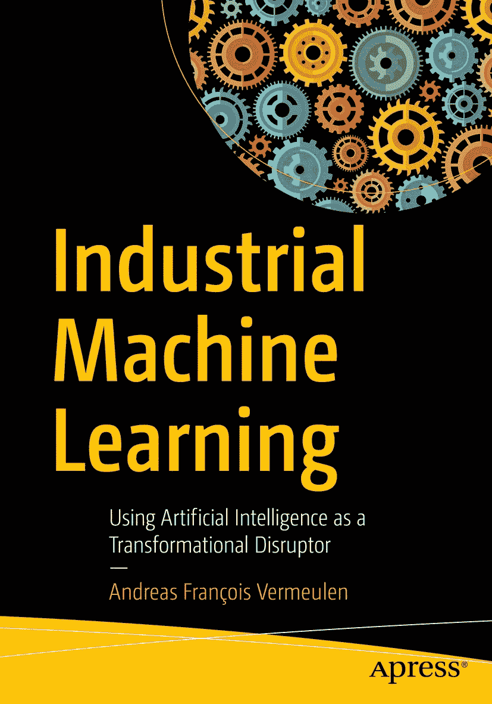

ISBN 978-1-4842-5315-1 e-ISBN 978-1-4842-5316-8 [`doi.org/10.1007/978-1-4842-5316-8`](https://doi.org/10.1007/978-1-4842-5316-8) © Andreas François Vermeulen 2020 本作品受版权保护。出版商保留所有权利，无论是涉及材料的全部或部分，特别是翻译、重印、重用插图、朗诵、广播、以缩微胶片或任何其他物理方式复制，以及传输或信息存储与检索、电子改编、计算机软件，或目前已知或未来开发的类似或不同方法的权利。本书中可能出现商标名称、徽标和图像。我们仅在编辑风格中使用商标名称、徽标和图像，以维护商标所有者的利益，并无意侵犯商标。本书中使用的商品名称、商标、服务标志和类似术语，即使未明确标识，也不应被视为对其是否受专有权利保护的表达。尽管本书中的建议和信息在出版时被认为是真实准确的，但作者、编辑和出版商均不对可能出现的任何错误或遗漏承担法律责任。出版商对本书所含材料不作任何明示或暗示的保证。本书通过 Springer Science+Business Media New York 在全球图书贸易中发行，地址：233 Spring Street, 6th Floor, New York, NY 10013。电话：1-800-SPRINGER，传真：(201) 348-4505，电子邮件：orders-ny@springer-sbm.com，或访问 www.springeronline.com。Apress Media, LLC 是一家加利福尼亚有限责任公司，其唯一成员（所有者）是 Springer Science + Business Media Finance Inc (SSBM Finance Inc)。SSBM Finance Inc 是一家特拉华州公司。

*感谢丹尼斯和劳伦斯的支持与爱。*

“时间是一种幻觉。” ——阿尔伯特·爱因斯坦

致谢

致我所有的导师，感谢你们与我分享的智慧。

致我的众多同事，感谢你们分享既有的智慧！

我们在机器学习上的探讨和概念催生了这些想法。

致 Apress 的各位，你们的技能将一个想法变成了一本书。

做得很好！

> *“一个敢于浪费一小时时间的人，尚未发现生命的价值。”*
> 
> *——* 查尔斯·达尔文

因此，感谢作为读者的您，为我的知识传播投入时间。

### 关于作者与技术审稿人

### 关于作者

### 关于技术审稿人

