# 3. 经典机器学习

机器学习是人工智能（AI）的一种应用，它使业务系统能够无需明确编程即可自动从经验中学习和改进。机器学习专注于开发能够访问数据并利用数据进行学习以改进未来处理流程的程序。

我将在本书的第 4 章至第 10 章中详细讨论特定机器学习算法的细节。

在本书中，我将向你介绍接下来要探讨的机器学习领域。

## 机器学习的准确性测试

我经常使用的技术是从历史数据中提取数据，并将其分为训练集和测试集。这样，你就可以使用真实数据来训练模型，然后预测你应该得到的结果。由于你已经知道测试数据的结果，现在就可以计算出预测值。这使得能够使用过去已知结果的测试数据，将真实数据与模型预测进行对比检查。

### 监督学习

这种机器学习类型通过创建一个基于输入-输出示例对将输入映射到输出的函数来获取洞察。它从带有标签的训练数据中推断出一个函数，这些训练数据由另一来源准备或记录的一组训练示例组成。

请记住，你需要现有的训练数据和测试数据才能进行学习，因此得名“监督”。

我们将在第 4 章和第 5 章中详细讨论这一过程。

### 无监督学习

这种机器学习类型通过推断一个函数来描述未标记数据中的隐藏结构和模式来获取洞察。训练观测数据中不包含分类或归类信息。因此，对学习器没有正确或错误的评估，也无法评估由相关算法输出的学习洞察的准确性。

我们将在第 6 章、第 7 章和第 8 章中详细讨论这一过程。

### 强化学习

在强化学习中，算法针对每个数据点选择一个动作作为响应。学习算法在稍后还会收到一个奖励信号，指示……该决策有多好。基于这个奖励，算法会修改其策略，以获得最高奖励。

我们将在第 9 章中详细讨论这一过程。

### 进化计算

进化计算是一组模仿生物进化的全局优化算法，也是研究这些算法的人工智能和软计算子领域。从技术上讲，你通过试错的方式进化特定种群的某一代，以解决具有元启发式或随机优化特征的问题。生成的代码能够适应数据或处理生态系统的变化。

### 警告

理论上，进化计算所做的适应能够适应任何变化，但根据我的经验，大多数生态系统和实现在其为了适应新需求而探索的变化范围上都有严格的限制。我建议你清晰准确地理解这些限制，以确保你的解决方案能够正确进化。

我们将在第 10 章中详细讨论这一过程。

### 机器学习基本概念

使用机器学习处理数据是一个日新月异的知识体系。新的技术和方法不断被提出，现有流程也在不断演进。能够参与这个领域，真是一个令人振奋的时代。

我现在将讨论几个你需要理解的基本机器学习概念，以便继续阅读本书。因此，请从示例目录中打开 `Chapter 003 Examples 001.ipynb`。

#### 实际正样本（P）

实际正样本（P）是机器学习正在处理的现实世界中可观察状态的“真”状态的数值计数。

示例：在一百人的群体中，有十人明确感染了流感，则 P=10。

#### 实际负样本（N）

实际负样本（N）是机器学习正在处理的现实世界中可观察状态的“假”状态的数值计数。

示例：在一百人的群体中，有九十人明确感染了流感，则 N=90。


#### 真正例 (TP)

真正例 (TP) 是指所有实际为正例且被正确分类为正例的样本数量。数据科学家也将其称为“命中”。

示例：在一百人群体中，有七人被分类或预测为患有流感，且最终被证实确实感染了流感，则 TP=7。

#### 真负例 (TN)

真负例 (TN) 是指所有实际为负例且被正确分类为负例的样本数量。数据科学家也将其称为“正确拒绝”。

示例：在一百人群体中，有八十五人被分类或预测为未患流感，且最终被证实确实没有感染流感，则 TN=85。

#### 假正例 (FP)

假正例 (FP) 是指所有实际为负例但被错误分类为正例的样本数量。数据科学家也将其称为“误报”或“第一类错误”。

示例：在一百人群体中，有五个人被分类或预测为患有流感，但最终被证实并未感染流感，则 FP=5。

#### 假负例 (FN)

假负例 (FN) 是指所有实际为正例但被错误分类为负例的样本数量。数据科学家也将其称为“漏报”或“[第二类错误](https://en.wikipedia.org/wiki/Type_II_error)”。

示例：在一百人群体中，有三个人被分类或预测为未患流感，但最终被证实感染了流感，则 FN=3。

#### 灵敏度或真正例率 (TPR)

现在我将向你展示如何计算机器学习中的一个指标，称为“灵敏度”或“真正例率”。它也被称为“命中率”、“召回率”或“检测概率”。

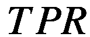

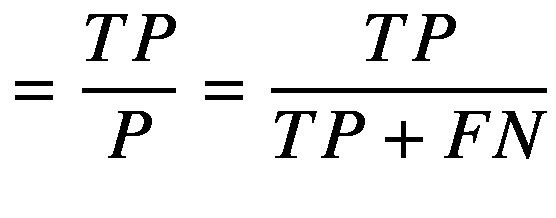

因此，对于我们的示例：

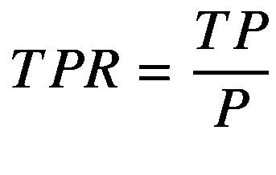


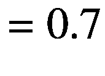

或者按如下方式计算：

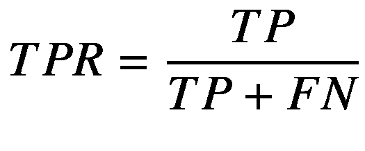

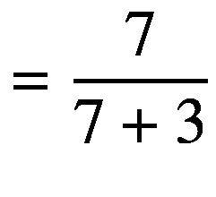

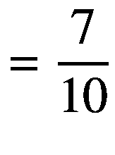


通常，这会被报告为 70% 的灵敏度。

打开示例第 003 章中的 Jupyter Notebook，文件名为：Chapter 003 Examples 001.ipynb。

这个简单的示例向你展示如何使用 sklearn 的 metrics 子库中的 `recall_score` 函数，来计算日常活动中机器学习模型预测结果集的召回率得分。

示例 证明 A - 预测银行哪个柜台将为客户服务？

```
from sklearn.metrics import recall_score
y_true = [0, 1, 2, 3, 0, 1, 2, 3, 0, 1]
y_pred = [0, 1, 2, 3, 0, 1, 2, 3, 0, 2]
print(recall_score(y_true, y_pred, average=None))
```

结果：

```
[1\. 0.66666667 1\. 1.]
```

这表明，对于每种分类类型，机器学习得分如下：

```
柜台 0 : 3 个值，3 个正确 = 1.00 或 100%
柜台 1 : 3 个值，2 个正确 = 0.667 或 66.7%
柜台 2 : 2 个值，2 个正确 = 1.00 或 100%
柜台 3 : 2 个值，2 个正确 = 1.00 或 100%
```

那么，如果我引入一个新的分类，证明 B – 预测诊所哪位医生将为客户服务？

```
from sklearn.metrics import recall_score
y_true = [0, 1, 2, 3, 0, 1, 2, 3, 0, 4]
y_pred = [0, 1, 2, 3, 0, 1, 2, 3, 0, 1]
print(recall_score(y_true, y_pred, average=None))
```

现在答案显示什么？

```
[1\. 1\. 1\. 1\. 0.]
```

类别 4 的分类在召回率方面表现不佳，或者我怀疑该医生不在诊所？

#### 特异度 (SPC) 或真负例率 (TNR)

现在我将向你展示如何计算机器学习中的一个指标，称为“特异度”或“真负例率”。

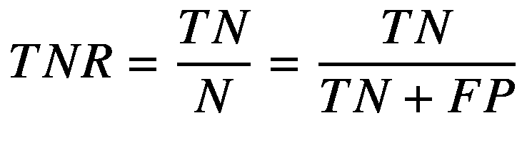

因此，对于我们的示例：

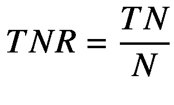


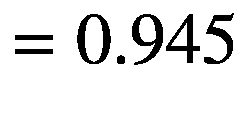

或者按如下方式计算：

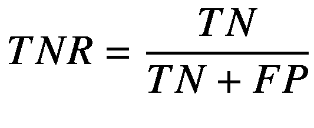

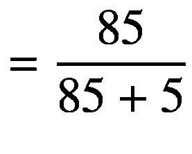

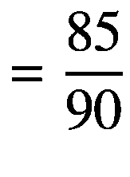


通常，这会被报告为 94.5% 的特异度。

示例：

你是一名医生，正在预测某人是否会得流感。你评估了十个人的数据，并预测其中六人会得流感。到流感季节结束时，你发现只有五人得了流感。

以下是你的预测计算，作为证明 C：

```
from sklearn.metrics import confusion_matrix
y_true = [0, 0, 0, 0, 0, 1, 1, 1, 1, 1]
y_pred = [0, 0, 0, 0, 1, 1, 1, 1, 1, 1]
tn, fp, fn, tp = confusion_matrix(y_true, y_pred).ravel()
sensitivity = tp / (tp+fn)
specificity = tn / (tn+fp)
print('sensitivity :', sensitivity)
print('specificity :', specificity)
```

结果：

```
灵敏度: 1.0 或 100%
特异度: 0.8 或 80%
```

结果显示，你可以 100% 正确预测患有流感的人，即灵敏度为 100%。同时，它也显示你可以 80% 正确预测不会得流感的人，即特异度为 80%。

这意味着你的机器学习 (ML) 误诊了某人患有流感，你可以说这个结果不算太差。这个人很幸运没有得流感。

但是，如果你错误开出的流感疫苗对你的患者造成了长期损害呢？那就不妙了！

### 记住

切勿造成伤害！因此，请确保你理解自己决策的实际影响。

我将在本书后面再次引导你构建机器学习模型时，讨论机器学习的真正实际影响。

#### 精确率或阳性预测值 (PPV)

现在我将向你展示如何计算机器学习中的一个指标，称为“精确率”或“阳性预测值”。

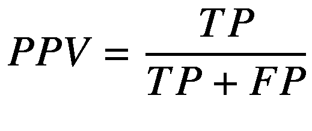

示例：


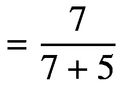

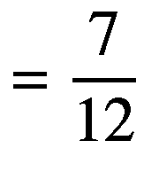

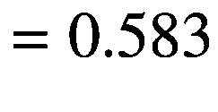

通常，这会被报告为 58.3% 的精确率。

示例：

让我们再次看看我们的流感机器学习案例研究：（参见证明 D）

精确率是正确预测的正例数量与所有预测为正例的总数之比。

```
from sklearn.metrics import precision_score
y_true = [0, 0, 0, 0, 0, 1, 1, 1, 1, 1]
y_pred = [0, 0, 0, 0, 1, 1, 1, 1, 1, 1]
print(precision_score(y_true, y_pred, average=None))
```

结果：

`[1\. 0.83333333]`

该机器学习可以 100% 正确预测“无流感”，但只有 83.3% 正确预测“流感”病例。


#### 阴性预测值（NPV）

现在我将向你展示如何计算机器学习中的一个指标，即“阴性预测值”。

阴性预测值是指预测结果为阴性的记录中，实际应为阴性的概率。

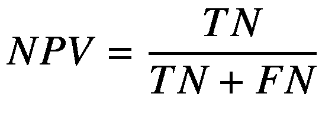

示例：


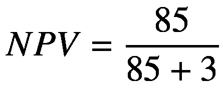

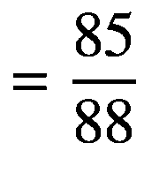

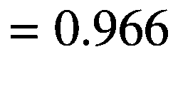

通常，这会被报告为 96.6% 的 NPV。

示例：

以下是针对你的预测的计算：（参见证明 E）

```
from sklearn.metrics import confusion_matrix
y_true = [0, 0, 0, 0, 0, 1, 1, 1, 1, 1]
y_pred = [0, 0, 0, 0, 0, 1, 1, 1, 1, 0]
tn, fp, fn, tp = confusion_matrix(y_true, y_pred).ravel()
npv = tn / (tn+fn)
print('Negative predictive value : %7.3f %%' % (npv*100))
```

结果：

```
Negative predictive value: 0.833 or 83.3%
```

这个阴性预测值表明，预测结果为阴性的样本有 83.3% 的概率确实应为阴性，因此这是一个不错的结果。

#### 漏报率或假阴性率（FNR）

现在我将向你展示如何计算机器学习中的一个指标，即“漏报率”或“假阴性率”。假阴性率（FNR）是指在特定模型下，实际为阳性但预测结果为阴性的样本所占的比例。

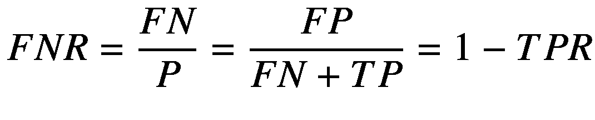

示例：

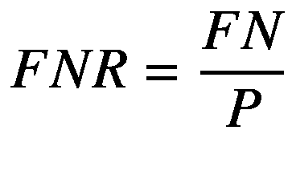

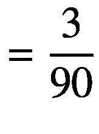

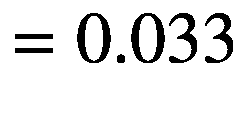

通常，这会被报告为 3.3% 的 FNR。

示例：

以下是针对你的预测的计算：（参见证明 F）

```
from sklearn.metrics import confusion_matrix
y_true = [0, 0, 0, 0, 0, 1, 1, 1, 1, 1]
y_pred = [0, 0, 0, 0, 1, 1, 1, 1, 1, 1]
tn, fp, fn, tp = confusion_matrix(y_true, y_pred).ravel()
fnr = fp / (fn+tp)
print('False negative : %7.3f %%' % (fnr*100))
```

结果：

```
False negative rate : 0.2 or 20%
```

这个 FNR 表明，20% 的预测阳性结果实际上是阴性。

这意味着每 5 个预测为阴性的结果中，就有 1 个是阳性。

实际应用是，如果你进行癌症检测，你将漏掉每 5 个患者中的 1 个。

#### 误报率或假阳性率（FPR）

现在我将向你展示如何计算机器学习中的一个指标，即“误报率”或“假阳性率”（FPR）：

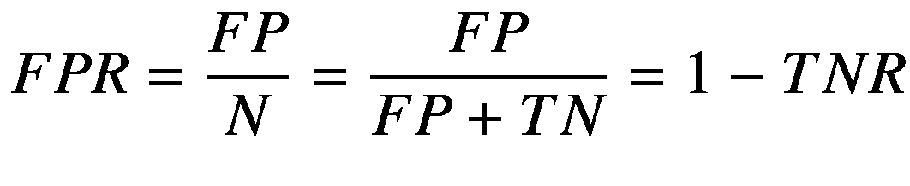

示例：

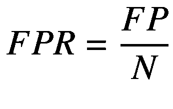

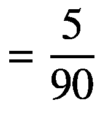

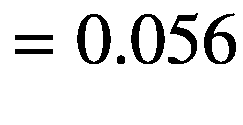

通常，这会被报告为 5.6% 的 FPR。

示例：

以下是针对你的预测的计算：（参见证明 G）

```
from sklearn.metrics import confusion_matrix
y_true = [0, 0, 0, 0, 0, 0, 1, 1, 1, 1]
y_pred = [0, 0, 0, 0, 0, 1, 1, 1, 1, 1]
tn, fp, fn, tp = confusion_matrix(y_true, y_pred).ravel()
fpr = fp / (fp+tn)
print('False positive rate: %7.3f %%' % (fpr*100))
```

结果：

```
False positive rate: 0.16666666666666666
```

这个假阳性率表明，近 17% 的预测阴性结果实际上是阳性。

这意味着每 100 个预测为阳性的结果中，就有 17 个是阴性。

#### 错误发现率（FDR）

现在我将向你展示如何计算机器学习中的一个指标，即“错误发现率”。

错误发现率（FDR）是一种在多重比较时，对零假设检验中第一类错误率进行概念化的技术。控制 FDR 的程序旨在控制“发现”（被拒绝的零假设）中错误（不正确的拒绝）的预期比例。


示例：

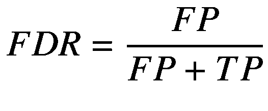

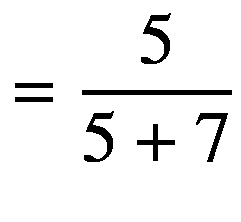

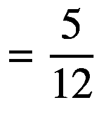

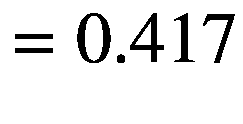

通常，这会被报告为 41.7% 的 FDR。

示例：

以下是针对你的预测的计算：（参见证明 H）

```
from sklearn.metrics import confusion_matrix
y_true = [0, 0, 0, 0, 0, 0, 1, 1, 1, 1]
y_pred = [0, 0, 0, 0, 0, 1, 1, 1, 1, 1]
tn, fp, fn, tp = confusion_matrix(y_true, y_pred).ravel()
fdr = fp / (fp+tp)
print('False discovery rate:', fdr)
```

结果：

```
False discovery rate: 0.2
```

这意味着你有 20% 的概率会发生第一类错误。

#### 错误遗漏率（FOR）

现在我将向你展示如何计算机器学习中的一个指标，即“错误遗漏率”。

错误遗漏率（FOR）是一种在多重假设检验中用于校正多重比较的统计技术，它是阴性预测值的补数。它衡量了被错误拒绝的假阴性样本的比例。

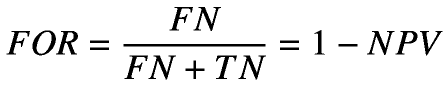

示例：

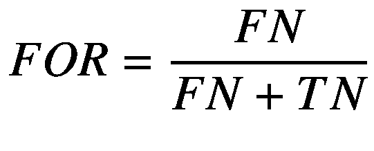

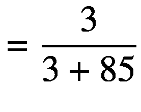

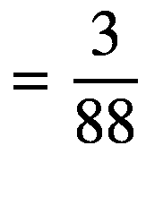

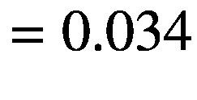

通常，这会被报告为 3.4% 的 FOR。

示例：

以下是针对你的预测的计算：（参见证明 K）

```
from sklearn.metrics import confusion_matrix
y_true = [0, 0, 0, 0, 0, 1, 1, 1, 1, 1]
y_pred = [0, 0, 0, 0, 0, 0, 1, 1, 1, 1]
tn, fp, fn, tp = confusion_matrix(y_true, y_pred).ravel()
fomr = fn / (fn+tn)
print('False omission rate:', fomr)
```

结果：

```
False omission rate: 0.17 or 17%
```

这意味着在 100 个案例中，有 17 个假阴性可能被错误地拒绝。


#### 准确率 (ACC)

现在我将向你展示如何计算机器学习中的一个指标，称为“准确率”（ACC）。

它是统计偏差的一种度量，因为这些偏差会导致结果与“真实”值之间存在差异。

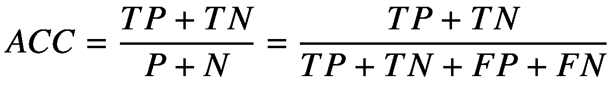

示例：

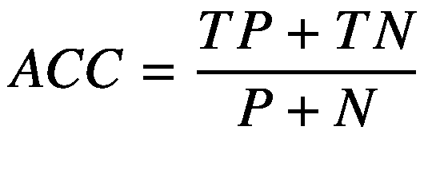

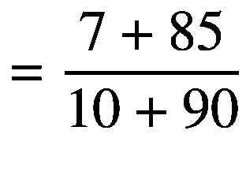

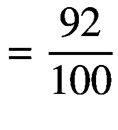

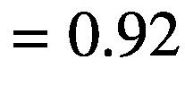

通常，这会被报告为 92% 的准确率。

这是一个重要的计算，因为它显示了偏差。它有一个名为 ISO 5725-1 的标准，其中指出通用术语“准确率”用于指代测量值与真实值的接近程度。

示例：

以下是针对你的预测的计算：（参见证明 L）

```
from sklearn.metrics import confusion_matrix
y_true = [0, 0, 0, 0, 0, 0, 1, 1, 1, 1]
y_pred = [0, 0, 0, 0, 0, 1, 1, 1, 1, 1]
tn, fp, fn, tp = confusion_matrix(y_true, y_pred).ravel()
acc = (tp + tn) / (tp + tn + fp + fn)
print('Accuracy %7.3f %%' % (acc*100))
```

结果：

```
Accuracy: 0.9 or 90%
```

比较两个结果：（参见证明 M）

```
from sklearn.metrics import accuracy_score
y_true = [0, 0, 0, 0, 0, 0, 1, 1, 1, 1]
y_pred = [0, 0, 0, 0, 0, 1, 1, 1, 1, 1]
print('Accuracy:',accuracy_score(y_true, y_pred))
print('Accuracy Count:',accuracy_score(y_true, y_pred, normalize=False))
```

结果是：

```
Accuracy:  90.000 %
Accuracy Count:   9 of  10
```

对于 9 个数据点，结果是 90% 准确。对于这个流感模型来说，这是一个不错的结果。

额外示例：

```
from sklearn.metrics import accuracy_score
y_true = [0, 0, 0, 0, 0, 0, 0, 0, 0, 0, 0, 0, 1, 1, 1, 1, 1, 1, 1, 1]
y_pred = [0, 0, 0, 0, 0, 0, 0, 0, 0, 0, 0, 1, 1, 1, 1, 1, 1, 1, 1, 1]
print('Accuracy:',accuracy_score(y_true, y_pred))
print('Accuracy Count:',accuracy_score(y_true, y_pred, normalize=False))
```

结果：

```
Accuracy:  95.000 %
Accuracy Count:  19 of  20
```

对于 19 个数据点，结果是 95% 准确。对于这个流感模型来说，这是一个不错的结果。

#### F1 分数

现在我将向你展示如何计算机器学习中的一个指标，称为“精确率的调和平均数”或“灵敏度”或“F1 分数”。

F1 分数被定义为精确率和召回率之间的调和平均数。它被用作评估性能的统计度量。这会产生一个 F1 分数（范围从 0 到 9，0 表示最低，9 表示最高），它是基于两个因素（即精确率和召回率）对个体表现的平均值。

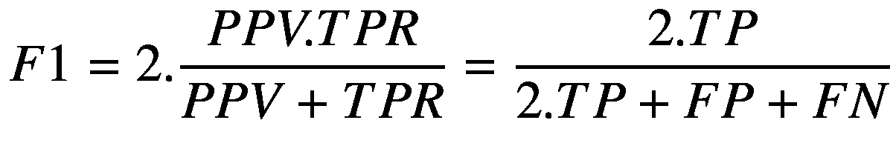

示例：

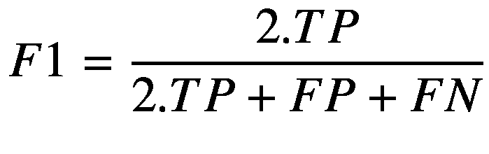

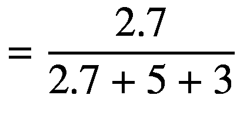

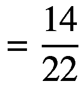

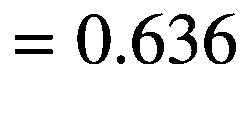

通常，这会被报告为 63.6% 的 F1 分数。

F 度量是精确率和召回率的调和平均数。

示例：（参见证明 N）

```
from sklearn.metrics import f1_score
y_true = [0, 1, 2, 0, 1, 2,0, 1, 2, 0, 1, 2, 0, 1, 2, 0, 1, 2]
y_pred = [0, 2, 1, 0, 0, 1,0, 1, 2, 0, 1, 2, 0, 1, 2, 0, 1, 2]
print('F1 score:', f1_score(y_true, y_pred, average="macro"))
```

结果：

```
F1 score: 0.772 or 77.2%
```

这意味着 F1 分数是 72.2%。

#### 马修斯相关系数 (MCC)

现在我将向你展示如何计算机器学习中的一个指标，称为“马修斯相关系数”（MCC）。

MCC 是观察到的分类与预测分类之间的相关系数。

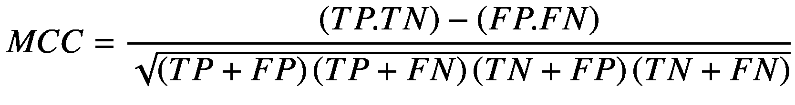

示例：


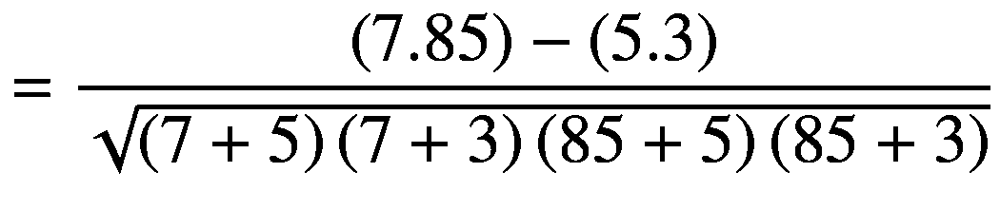


通常，这会被报告为 59.5% 的 MCC。

MCC 被用作衡量二分类质量的指标。

示例：（参见证明 O）

```
from sklearn.metrics import matthews_corrcoef
y_true = [+1, +1, +1, +1, +1, -1, +1, -1]
y_pred = [-1, +1, +1, +1, +1, -1, +1, -1]
print(matthews_corrcoef(y_true, y_pred))
```

结果：

马修斯相关系数 (MCC)：0.745

#### 科恩卡帕系数

科恩卡帕系数是一个分数，用于表达两个标注者在分类问题上的一致性程度。

示例：（参见证明 P）

```
from sklearn.metrics import cohen_kappa_score
y_true = [+1, +1, +1, +1, +1, -1, +1, -1, +1, -1, +1, -1, +1]
y_pred = [-1, +1, +1, +1, +1, -1, +1, -1, +1, -1, +1, -1, +1]
print("Cohen's Kappa:", cohen_kappa_score(y_true, y_pred))
```

结果：

```
Cohen's Kappa: 0.831
```

卡帕分数是一个介于 -1 和 1 之间的数字。

高于 0.8 的分数通常被认为具有良好的一致性；零或更低意味着没有标注一致性（基本上只是随机标注）。

让我们也研究一组更早的数据：（参见证明 Q）

```
from sklearn.metrics import cohen_kappa_score
y_true = [0, 1, 2, 0, 1, 2,0, 1, 2, 0, 1, 2, 0, 1, 2, 0, 1, 2]
y_pred = [0, 2, 1, 0, 0, 1,0, 1, 2, 0, 1, 2, 0, 1, 2, 0, 1, 2]
print("Cohen's Kappa:", cohen_kappa_score(y_true, y_pred))
```

结果：

```
Cohen's Kappa: 0.6666666666666667
```

#### 知情度

现在我将向你展示如何计算机器学习中的一个指标，称为“知情度”或“博彩者知情度”（BM）。

BM 是做出知情决策的概率。

这是一个重要的计算，你需要将其与机器学习模型的结果一起发布。

公式是：


示例：


通常，这会被报告为 64.5% 的知情度。

示例：（参见证明 R）

```
from sklearn.metrics import confusion_matrix
y_true = [0, 0, 0, 0, 0,  0, 0, 0, 0, 0,  1, 1, 1, 1, 1, 1,  1, 1, 1, 1]
y_pred = [0, 0, 0, 0, 0,  0, 0, 0, 0, 0,  1, 1, 1, 1, 1, 1,  1, 1, 1, 0]
tn, fp, fn, tp = confusion_matrix(y_true, y_pred).ravel()
tpr = tp / (tp+fn)
print('True positive rate:', tpr)
tnr = tn / (tn+fp)
print('True negative rate :', tnr)
bm=tpr+tnr-1
print('Bookmaker Informedness:', bm)
```

结果：

```
True positive rate: 0.9
True negative rate : 1.0
Bookmaker Informedness: 0.8999999999999999
```


#### 标记性（Markedness）

现在我将向你展示如何计算机器学习中的一个指标，称为“标记性”（MK）。该过程的标记性是指预测能够导致特定结果的比率。

公式为：


示例：


通常，这会被报告为 54.9% 的标记性。

示例：（参见证明 S）

```
from sklearn.metrics import confusion_matrix
y_true = [0, 0, 0, 0, 0,  0, 0, 0, 0, 0,  1, 1, 1, 1, 1, 1,  1, 1, 1, 1]
y_pred = [0, 0, 0, 0, 0,  0, 0, 0, 0, 0,  1, 1, 1, 1, 1, 1,  1, 1, 1, 0]
tn, fp, fn, tp = confusion_matrix(y_true, y_pred).ravel()
ppv = tp / (tp+fn)
print('Positive predictive value:', ppv)
npv = tn / (tn+fn)
print('Negative predictive value:', npv)
mk=ppv+npv-1
print('Markedness:', mk)
```

结果：

```
Positive predictive value: 0.9
Negative predictive value: 0.9090909090909091
Markedness: 0.8090909090909091
```

你可以关闭示例代码。接下来我将讨论一些你在报告机器学习性能时必须了解的其他通用指标。

#### 阳性似然比（LR+）

现在我将向你展示如何计算机器学习中的一个指标，称为“阳性似然比”（LR+）。

LR+ 表示阳性结果的似然比。

公式为：


示例：


通常，这会被报告为 LR+ 比值为 12.5。

良好的 LR+ 应大于 10。

#### 阴性似然比（LR-）

现在我将向你展示如何计算机器学习中的一个指标，称为“阴性似然比”（LR-）。

LR- 表示阴性结果的似然比。

公式为：


示例：


通常，这会被报告为 LR- 为 0.035。

良好的 LR- 应小于 0.1。

如果 LR+ 或 LR- 接近 1，则模型存在问题或无法正常工作。

你得到的 0.035 这个结果是良好的。

#### 诊断优势比（DOR）

现在我将向你展示如何计算机器学习中的一个指标，称为“诊断优势比”（DOR）。DOR 是衡量测试有效性的指标。

公式为：


示例：


通常，这会被报告为诊断优势比为 357.14 比 1。

你在机器学习基础知识方面取得了不错的进展。

### 警告

ROC 分析是一个复杂的概念，其描述也很复杂。所以，先喝杯好喝的饮料，然后再重新开始。

### 受试者工作特征曲线（ROCC）

受试者工作特征（ROC）曲线，即真阳性率（灵敏度），是作为不同截断点下假阳性率（100-特异度）的函数绘制的。

ROC 曲线通常以 Y 轴表示真阳性率，X 轴表示假阳性率。这意味着图的左上角是“理想”点——假阳性率为零，真阳性率为一。这并不太现实，但确实意味着曲线下面积（AUC）越大通常越好。

ROC 曲线的“陡峭度”也很重要，因为理想情况是在最小化假阳性率的同时最大化真阳性率。

打开示例 Chapter 003 中的 Jupyter Notebook，文件名为：Chapter 003 Examples 002.ipynb

让我们开始 ROC 示例。

实际问题是，我妈妈在同一花坛里种了几株玫瑰，而我的狗 Angus 把玫瑰树上的三个不同标签扯掉了。所以现在我需要将它们重新匹配起来。我做了一些测量。

```
import numpy as np
import matplotlib.pyplot as plt
from itertools import cycle
from sklearn import svm, datasets
from sklearn.metrics import roc_curve, auc
from sklearn.model_selection import train_test_split
from sklearn.preprocessing import label_binarize
from sklearn.multiclass import OneVsRestClassifier
from scipy import interp
imagepath = os.path.join(*[os.path.dirname(os.path.dirname(os.getcwd())),'Results','Chapter 03'])
print(imagepath)
if not os.path.exists(imagepath):
os.makedirs(imagepath)
# Import Rose data to play with
xfile=os.path.abspath("../../Data/x-roses.csv")
yfile=os.path.abspath("../../Data/y-roses.csv")
X = np.loadtxtxfile, delimiter=",")
y = np.loadtxtyfile delimiter=",")
# Binarize the output
y = label_binarize(y, classes=[0, 1, 2])
n_classes = y.shape[1]
# Added noisy features to make the problem harder to solve
random_state = np.random.RandomState(0)
n_samples, n_features = X.shape
X = np.c_[X, random_state.randn(n_samples, 200 * n_features)]
# shuffle and split training and test sets
X_train, X_test, y_train, y_test = train_test_split(X, y, test_size=.5,
random_state=0)
# Learn to predict each class against the other
classifier = OneVsRestClassifier(svm.SVC(gamma='auto'))
y_score = classifier.fit(X_train, y_train).decision_function(X_test)
# Compute ROC curve and ROC area for each class
fpr = dict()
tpr = dict()
roc_auc = dict()
for i in range(n_classes):
fpr[i], tpr[i], _ = roc_curve(y_test[:, i], y_score[:, i])
roc_auc[i] = auc(fpr[i], tpr[i])
# Compute Micro-Average ROC curve and ROC area
fpr["micro"], tpr["micro"], _ = roc_curve(y_test.ravel(), y_score.ravel())
roc_auc["micro"] = auc(fpr["micro"], tpr["micro"])
fig1 = plt.figure(figsize=(10, 10))
lw = 2
plt.plot(fpr[2], tpr[2], color="darkred",
lw=lw, label='ROC curve (area = %0.3f)' % roc_auc[2])
plt.plot([0, 1], [0, 1], color="navy", lw=lw, linestyle="--")
plt.xlim([0.0, 1.0])
plt.ylim([0.0, 1.1])
plt.xlabel('False Positive Rate')
plt.ylabel('True Positive Rate')
plt.title('Receiver Operating Characteristic for Roses')
plt.legend(loc="lower right")
plt.show()
```

结果见图 3-1。


图 3-1

ROC

要检查多类问题的 ROC 曲线图，只需添加以下代码：


```
# 首先汇总所有假阳性率
all_fpr = np.unique(np.concatenate([fpr[i] for i in range(n_classes)]))
# 然后在此点上插值所有 ROC 曲线
mean_tpr = np.zeros_like(all_fpr)
for i in range(n_classes):
mean_tpr += interp(all_fpr, fpr[i], tpr[i])
# 最后计算平均值并计算 AUC
mean_tpr /= n_classes
fpr["macro"] = all_fpr
tpr["macro"] = mean_tpr
roc_auc["macro"] = auc(fpr["macro"], tpr["macro"])
# 绘制每条 ROC 曲线
fig2 = plt.figure(figsize=(12, 9))
plt.plot(fpr["micro"], tpr["micro"],
label='微平均 ROC 曲线 (面积 = {0:0.3f})'
“.format(roc_auc["micro"]),
color='deeppink', linestyle=':', linewidth=4)
plt.plot(fpr["macro"], tpr["macro"],
label='宏平均 ROC 曲线 (面积 = {0:0.3f})'
".format(roc_auc["macro"]),
color='blue', linestyle=':', linewidth=4)
colors = cycle(['aqua', 'darkorange', 'cornflowerblue'])
for i, color in zip(range(n_classes), colors):
plt.plot(fpr[i], tpr[i], color=color, lw=lw,
label='类别 {0} 的 ROC 曲线 (面积 = {1:0.3f})'
".format(i, roc_auc[i]))
plt.plot([0, 1], [0, 1], 'k--', lw=lw)
plt.xlim([0.0, 1.0])
plt.ylim([0.0, 1.05])
plt.xlabel('假阳性率')
plt.ylabel('真阳性率')
plt.title('接收者操作特征扩展到多类')
plt.legend(loc="lower right")
plt.show()
```

结果见图 3-2。


图 3-2

ROC 多类

你可以关闭 Jupyter Notebook。你已经取得了很大进展。现在你可以执行基本的机器学习，并且有了一种方法（ROCC）来直观地验证你的机器学习。接下来，我将向你展示一种更正式的技术来验证模型。

### 交叉验证测试

K-**折交叉验证**是一种用于**交叉验证**的技术：它将训练数据分成 K 个**折**。然后基于 (K - 1) 个**折**的数据构建模型，并在剩余的**折**（**验证**集）上测试模型。这可以改进模型的测试标准。

在本书的后续部分，我们将回到这些基本原理，解释你将用于测试机器学习模型的系统工作原理。

打开示例中名为 Chapter 003 Examples 003.ipynb 的 Jupyter Notebook（位于 Chapter 003 示例中）。

让我们开始交叉验证代码。

```
from sklearn.model_selection import train_test_split
from sklearn import datasets
from sklearn import svm
# 导入玫瑰数据进行操作
X = np.loadtxt("./data/x-roses.csv", delimiter=",")
y = np.loadtxt("./data/y-roses.csv", delimiter=",")
print(X.shape, y.shape)
X_train, X_test, y_train, y_test = train_test_split(
X, y, test_size=0.6, random_state=123)
print(X_train.shape, y_train.shape)
print(X_test.shape, y_test.shape)
clf = svm.SVC(kernel='linear', C=1).fit(X_train, y_train)
scoreResult=clf.score(X_test, y_test)
print(scoreResult)
from sklearn.model_selection import cross_val_score
clf = svm.SVC(kernel='linear', C=1)
scoreTypes = [
'accuracy',
'precision_macro',
'precision_micro',
'precision_weighted',
'r2',
'recall_macro',
'recall_micro',
'recall_weighted']
for scoreType in scoreTypes:
print(scoreType)
print('-------------------------------')
scores = cross_val_score(clf, X, y, cv=3, scoring=scoreType)
for i in range(scores.shape[0]):
print('%0.4f' % scores[i])
print('-------------------------------')
print("得分: %0.4f (+/- %0.4f)" % (scores.mean(), scores.std() * 2))
print('--------------------------------','\n')
```

验证使用几种不同的交叉验证分数检查结果。

结果：

### 注意

这个结果很大……如果你愿意，可以选择一组较小的测试。

在分析结果的过程中，我将逐一讨论这些内容。让我们开始：

```
accuracy

1.0000
0.9216
1.0000

得分: 0.9739 (+/- 0.0739)

precision_macro

1.0000
0.9365
1.0000

得分: 0.9788 (+/- 0.0599)

precision_micro

1.0000
0.9216
1.0000

得分: 0.9739 (+/- 0.0739)

precision_weighted

1.0000
0.9365
1.0000

得分: 0.9788 (+/- 0.0599)

r2

1.0000
0.8824
1.0000

得分: 0.9608 (+/- 0.1109)

recall_macro

1.0000
0.9216
1.0000

得分: 0.9739 (+/- 0.0739)

recall_micro

1.0000
0.9216
1.0000

得分: 0.9739 (+/- 0.0739)

recall_weighted

1.0000
0.9216
1.0000

得分: 0.9739 (+/- 0.0739)

```

这将为你提供良好的准确性指标，因为交叉验证是一种用于估计机器学习模型准确性的统计方法。

泛化的概念是指机器学习工程师将研究结果扩展到更广泛的真实世界数据集，以预测模型在相同模型上的表现。

这种评估表明统计分析的结果如何泛化到独立数据集，或者一般来说……模型对新的未知数据集正确工作的概率是多少？

你现在可以关闭示例 Jupyter Notebook。

到目前为止，你应该已经了解如何使用一系列交叉验证技术来测试模型。

### 提示

始终使用不变的评分类型集进行测试，因为你的测试人员会在模型的生产就绪阶段习惯于签署模型。

## 缺失值插补

我将向你展示，对缺失值进行插补比简单地丢弃包含任何缺失值的样本能获得更好的结果。

### 警告

插补并不总能改善预测，因此请在进行任何插补操作前后通过交叉验证进行检查。

这表明有时删除行或使用标记值更有效，但可能导致不良影响，从而选择错误的模型，而不是真正需要的模型。

打开示例中名为 Chapter 003 Examples 004.ipynb 的 Jupyter Notebook（位于 Chapter 003 示例中）。

让我们从发现示例代码开始：


```
import matplotlib
matplotlib.use('TkAgg')
%matplotlib inline
import numpy as np
import matplotlib.pyplot as plt
from sklearn.datasets import load_diabetes
from sklearn.datasets import load_boston
from sklearn.ensemble import RandomForestRegressor
from sklearn.pipeline import make_pipeline, make_union
from sklearn.impute import SimpleImputer, MissingIndicator
from sklearn.model_selection import cross_val_score
import pandas as pd
import os
rng = np.random.RandomState(0)
sickdf= pd.read_csv(os.path.abspath('../../Data/sickness02.csv'),header=0)
print(sickdf.shape)
homesdf= pd.read_csv( os.path.abspath('../../Data/Homes02.csv'),header=0)
print(homesdf.shape)
def get_results(dataset):
X_full_df = dataset.copy(deep=True)
X_full_df.drop(['T'], axis=1, inplace=True)
y_full_df = dataset[['T']]
X_full=np.array(X_full_df)
y_full=np.array(y_full_df['T'])
n_samples = X_full.shape[0]
n_features = X_full.shape[1]
# Estimate the score on the entire dataset , with no missing values
estimator = RandomForestRegressor(random_state=0, n_estimators=100)
full_scores = cross_val_score(estimator, X_full, y_full,
scoring='neg_mean_squared_error', cv=5)
# Add missing values in 80% of the lines
missing_rate = 0.8
n_missing_samples = int(np.floor(n_samples * missing_rate))
missing_samples = np.hstack((np.zeros(n_samples - n_missing_samples,
dtype=np.bool),
np.ones(n_missing_samples,
dtype=np.bool)))
rng.shuffle(missing_samples)
missing_features = rng.randint(0, n_features, n_missing_samples)
# Estimate the score after replacing missing values by 0
X_missing = X_full.copy()
X_missing[np.where(missing_samples)[0], missing_features] = 0
y_missing = y_full.copy()
estimator = RandomForestRegressor(random_state=0, n_estimators=100)
zero_impute_scores = cross_val_score(estimator, X_missing, y_missing,
scoring='neg_mean_squared_error',
cv=5)
# Estimate the score after imputation (mean strategy) of the missing values
X_missing = X_full.copy()
X_missing[np.where(missing_samples)[0], missing_features] = 0
y_missing = y_full.copy()
estimator = make_pipeline(
make_union(SimpleImputer(missing_values=0, strategy="mean"),
MissingIndicator(missing_values=0)),
RandomForestRegressor(random_state=0, n_estimators=100))
mean_impute_scores = cross_val_score(estimator, X_missing, y_missing,
scoring='neg_mean_squared_error',
cv=5)
return ((full_scores.mean(), full_scores.std()),
(zero_impute_scores.mean(), zero_impute_scores.std()),
(mean_impute_scores.mean(), mean_impute_scores.std()))
results_sick = np.array(get_results(sickdf))
mses_sick = results_sick[:, 0] * -1
stds_sick = results_sick[:, 1]
results_homes = np.array(get_results(homesdf))
mses_homes = results_homes[:, 0] * -1
stds_homes = results_homes[:, 1]
n_bars = len(mses_sick)
xval = np.arange(n_bars)
x_labels = ['完整数据',
'零值填充',
'均值填充']
colors = ['红色', '绿色', '蓝色', '橙色']
# 绘制疾病数据结果
plt.figure(figsize=(12, 6))
ax1 = plt.subplot(121)
for j in xval:
ax1.barh(j, mses_sick[j], xerr=stds_sick[j],
color=colors[j], alpha=0.6, align="center")
ax1.set_title('疾病数据的填充技术')
ax1.set_xlim(left=np.min(mses_sick) * 0.9,
right=np.max(mses_sick) * 1.1)
ax1.set_yticks(xval)
ax1.set_xlabel('均方误差')
ax1.invert_yaxis()
ax1.set_yticklabels(x_labels)
# 绘制房屋数据结果
ax2 = plt.subplot(122)
for j in xval:
ax2.barh(j, mses_homes[j], xerr=stds_homes[j],
color=colors[j], alpha=0.6, align="center")
ax2.set_title('房屋数据的填充技术')
ax2.set_yticks(xval)
ax2.set_xlabel('均方误差')
ax2.invert_yaxis()
ax2.set_yticklabels(["] * n_bars)
plt.show()
imagepath = os.path.join(*[os.path.dirname(os.path.dirname(os.getcwd())),'Results','Chapter 03'])
print(imagepath)
if not os.path.exists(imagepath):
os.makedirs(imagepath)
imagename = os.path.join(*[os.path.dirname(os.path.dirname(os.getcwd())),'Results','Chapter 03','Chapter-003-Examples-004-01.jpg'])
fig.savefig(imagename, bbox_inches="tight")
```

结果如图 3-3 所示。


图 3-3

数据填充

该示例清晰地展示了数据科学结果的改进，因为缺失值的填充改变了数据集。

你可以关闭你的 Jupyter Notebook。

现在你可以处理数据集中的缺失数据，这将有助于你的机器学习工作。

接下来，我将带你了解几个工业知识领域，解释它们如何融入机器学习领域。

## 知识领域

我将带你详细了解如何将机器学习知识应用于你周围世界的具体流程。在本书的学习过程中，将讨论以下领域。

### 机电一体化

机电一体化是一门多学科交叉的科学领域，它融合了机械工程、电子工程、控制工程、电信工程、系统工程和计算机工程。

#### 什么是机械工程？

机械工程是工程学的一个分支，它应用力学和材料科学的原理对机械系统进行分析、设计、制造和维护。它涉及热能和机械动力的生产与利用，用于机器的设计、生产和操作。

在机电一体化的这一部分，你创建物理组件（手臂、腿、轮子、履带等）。我不会详细解释这是如何完成的，但会介绍该领域中一些已知的约束条件，这些条件将影响你的机器学习处理需求。

#### 什么是电子工程？

电子工程是电气工程的一个学科，它利用非线性和有源电气元件（半导体器件、二极管和集成电路）来设计电子电路、设备、超大规模集成电路及其系统。该学科通常也设计无源电气元件，通常基于印刷电路板。

在机电一体化的这一部分，你将创建与机械和电信组件交互的物理组件（嵌入式集成电路）。我不会详细解释这是如何完成的，但会介绍该领域将传递给你的机器学习处理需求的一些特定约束。

#### 什么是电信工程？

电信工程是一门以电气和计算机工程为核心的工程学科，旨在支持和增强电信系统。该工作设计和生产电信设备和设施，如复杂的电子交换系统、光纤布线、IP 网络和无线传输系统。

在机电一体化的这一部分，你将创建与非通信电子组件交互的物理通信组件（嵌入式集成电路）。我不会详细解释这是如何完成的，但会介绍该领域将传递给你的机器学习处理需求的一些特定约束。


#### 什么是控制工程？

控制工程或控制系统工程是一门工程学科，它应用自动控制理论来设计在受控环境中具有所需行为的系统。

你使用传感器和检测器来测量被控过程的输出性能；这些测量结果用于提供纠正性反馈，从而帮助在机电一体化这一部分中实现所需的性能。我不会详细解释这是如何准备的，但会介绍该领域将传递到你的机器学习处理需求中的众多约束条件。

随着物联网（IoT）成为最新的物理设备、车辆、家用电器及其他嵌入电子设备、软件、传感器、执行器和连接功能的物品网络，使这些设备能够连接、收集和交换数据，这一领域正在蓬勃发展。

2017 年，物联网设备数量同比增长 31%，达到 84 亿台，预计到 2020 年将达到 300 亿台。到 2020 年，物联网的全球市场价值预计将达到 7.1 万亿美元。

#### 什么是系统工程？

系统工程是工程学与工程管理的一个跨学科领域，专注于如何在其生命周期内设计和管理复杂系统。

你使用这种设计方法，在机电一体化的这一部分中连接不同的系统。我不会详细解释这是如何完成的，但会介绍该领域将传递到你的机器学习处理需求中的一些特定约束条件。

随着物联网现在需要使用异构控制系统来设计复杂系统，这一领域正在蓬勃发展。

机器学习在开发最具成本效益系统的过程中扮演着重要角色。

#### 什么是计算机工程？

计算机工程这一跨学科领域融合了电子工程和计算机科学，通过使用特定的编程语言对计算机系统和其他技术设备进行编程，从而设计和开发它们，这种编程语言使你能够告诉机器要执行什么。

我将从计算机工程的角度解释，你如何使用机器学习来确定下一步的可能性和所需的结果，以制定你需要传递给控制工程的命令，从而利用机械工程、电子工程、电信工程和系统工程来实现你的最终目标。

在本书的这一点上，我不会更详细地讨论这个主题，但我们将在本书的其余部分多次重新审视它。这是你将用来生成工业化机器学习的机电一体化核心。

### 机器人学

机器人学是工程学的一个分支，涉及机器人的构思、设计、制造和操作。该领域与电子学、计算机科学、人工智能、机电一体化、纳米技术和生物工程学有交叉。

#### 软体机器人学

软体机器人学是机器人学的一个特定子领域，涉及构建没有物理形态的机器人。它们完全是软件，按照机器学习模型或嵌入式指南以自主方式执行任务。

典型的例子是那些在网站上回答问题或根据客户资料与所需营销信息匹配来向客户发布内容的机器人。

#### 硬体机器人学

硬体机器人学是工程学和科学的一个跨学科分支，包括机械工程、电气工程、计算机科学等。机器人学涉及机器人的设计、构造、操作和使用，以及用于其控制、感官反馈和信息处理的计算机系统。这些机器人能够直接操纵其周围环境。

我将通过空中、陆地和水下无人机的模拟来演示你的机器学习需要如何适应在这些环境中工作。

### 第四次工业革命

第四次工业革命是将现实世界与技术世界融合的概念。机器学习目前的应用开始影响我们周围的日常环境，并且在很多方面，我们已经在不知不觉中接受了这些变化，尽管它们一直在帮助我们获得更好的生活质量。

我将演示如何为一个按需生产的小型 3D 打印工厂处理机器学习，以制造一辆简单的六轮车辆。

### 挑战

观察你日常生活中所处的环境，并写下三件你认为是由机器学习产生的事物。


然后写下三件如果能够自动为你完成，会让你的生活变得更好的事情。


在本书的后面，我将回到这六个项目，探讨如何实现将工业化机器学习（IML）应用于这些需求的目标。

## 颠覆者

新闻和讲座圈里充斥着关于使用机器的“颠覆者”的讨论。世界正在转变，而我们并非这个新世界中的主要变革推动者。人类已经热情地或不知不觉地让机器和其他软代理完全掌控了我们的生活。

随着那些在日常生活中协助我们的代理获得更多控制权并更适应个人行为，机器学习的影响将会增加。这些颠覆者为应用机器学习来放大这一过程创造了重大机遇。

我将讨论几个实际演示，说明一个简单的机器学习模型如何被工业化以应对更大的实际工作挑战。以下是我在过去一年中处理的一些项目的小样本。

### 收入增强型购物

机器学习的应用通过根据客户情况定制产品推荐和捆绑销售通常在过去不会出现在同一家商店的产品，为客户提供了丰富的购物体验。

示例：

一家大型零售店聘请了一家营养师公司，协助根据顾客的具体医疗状况和个人需求改变他们的营养食品购买。然后，他们提供一个选项，让您所在地区离您家最近的专业烹饪学校将现成的食物送到您家。

他们还在店内搭建了全尺寸的房间模型，顾客可以通过亲自到访，然后简单地扫描二维码，整个房间的现有物品就会被订购并送货上门。然后，您可以简单地扫描设计师的二维码，让他们以交钥匙的方式完成室内装饰。同样的服务也可通过在线网站、虚拟现实购物体验获得。

他们最新的尝试是使用智能手机上传您当前房间的图像，然后机器学习利用客户层面的画像为您设计一个新房间。我们所熟知的购物体验已被机器学习颠覆到了已成为可接受常态的程度。


### 按客户要求重新购物

现在，您可以外包处理所有客户机票变更和退款的航班选择及定价工作，交由那些运用机器学习与人机协同技术的公司，由它们预先规划并重新预订所需的旅行安排，而无需您亲自介入。

您可以提交购买特定车型的请求，系统会收集所有可用的车辆信息，并将其简单地以购物篮选项的形式展示在在线网站或虚拟现实购物体验中。

这些新型个人买家的出现，正在改变传统商店的零售人口结构。您的客户不再是一个具体的人；您现在是在与一个作为中间代理的机器学习算法打交道，它追求的是最优利润。

商店传统的客户画像方法已不再有效。如今，流程已变为以混乱的零售人口结构作为主要筛选条件。

### 奖励购物

帮助您的忠实旅客找到奖励航班和酒店，同时维护您的收入目标。这一新流程是忠诚度计划概念的体现，即金融机构预先为其客户设定特定的奖励，而这些奖励并不直接属于其传统商业模式的一部分。

一个典型的例子是某家颠覆性银行，它拥有一款移动应用程序，可以追踪客户的行为，然后根据之前的购买记录，学习并提供一个选项列表，列出客户可以购买午餐并获得 2%折扣或返现的地点。这是因为商家接受了这家新银行的支付卡，或者该商家本身就是这家新银行的商业客户，因此您还能获得额外的 3%折扣或返现。

该银行的地理空间机器学习能力，能够引导客户行为转向预先批准的商家。商店传统的客户画像方法总体上已不再有效。这一流程被银行代表其商业客户发放的奖励卡和优惠券所打断。

### 商品销售

通过销售特定客户所需的辅助产品，机器学习画像能够提升每位客户的收入。供应链模型会响应客户需求的变化，并随之调整商店的商品陈列。

新型的机器人货架、自动化存储和检索系统，使机器学习能够预测需求，然后以最少的人工干预方式，按照需求来组织商店布局。软体机器人计算出商店的最优方案，而硬体机器人则在仓库中整理货架，并将其运送到商店楼层。当货架清空后，它会自动返回仓库进行重新上架。

未来的目标是通过按需派遣的自主无人机在商店之间调拨库存，以确保在准时交付模式下实现正确的商品陈列。

传统的商店楼层、商品销售和供应链正在发生变化，现状已不再有效。仅提供与需求匹配的库存，这一购物流程已受到严重干扰。

### 元搜索分流

通过为元搜索引擎提供一个统一的定价和购物内容界面，简化航空公司的网站运营，可以将简单的搜索转变为资金转账交易。

由《第二支付服务指令》（PSD2）推动的开放银行，催生了新型的账户信息服务提供商（AISP）。借助机器学习，这个新的商业代理将为客户整合或汇总来自多家银行的银行数据，创造新的业务主张，提供在一个地方展示所有客户账户信息的仪表板，并使客户能够提交元搜索请求，例如“帮我找一笔贷款，用于购买 1600 Pennsylvania Avenue, NW, Washington, DC 20500”或“今年想存 2000.00 英镑”。

结果将是一个客户页面，其中包含该房产的完整投资组合，以及银行预先批准的抵押贷款选项。这也使得机器学习能够选择正确的银行账户来执行您的银行业务。它甚至可以为您的房产考察预订所需的航班或旅行安排。

通过搜索“想去法国巴黎第七区阿纳托尔·法兰西大街 5 号战神广场的埃菲尔铁塔”来预订假期，机器学习将代表您开始行动，制定完整的行程，然后客户只需在移动应用程序上轻轻一点，即可完成交易预订假期。

这些元搜索分流解决方案将颠覆我们未来处理日常业务的方式，这一切都因为机器学习能够了解我们的需求，然后处理所需的解决方案，而无需最终用户进行复杂的操作。

### 物联网传感器

物联网是一个由物理设备、车辆、家用电器以及众多日常用品组成的全球网络，这些物品都嵌入了电子设备、软件、传感器、执行器和连接功能。这使得这些物体能够连接并交换数据，同时每个物体都通过其嵌入式计算系统具有唯一标识，并且可以在现有的互联网基础设施内进行互操作。

数十亿可穿戴电子产品已经售出，它们以最精细的细节追踪和记录我们周围的世界。您将这一全球物联网设备网络与适当水平的机器学习和机电一体化技术相结合，形成一个能够以前所未有的细节感知世界的新实体。这个机器学习系统有能力开始与人类及其需求进行真正的互动。这将最终颠覆地球上的现有生活，并塑造其未来。

### 自主农业

农业机器学习的应用正在改变我们未来种植作物的方式。物联网传感器的引入，可以监控从育苗到收获的每一步农业活动，以确保实现最优流程。新型工业化规模的集装箱式鱼菜共生系统，使得食品生产规模足以让机器学习预测所需收成，并按需进行种植。

这使得以前无法利用的地方也能进行农业生产。它利用机器人和机器人技术，实现了以前不可能实现的收成。如今，机器人农业设备的引入，使得传统作物的种植只需最少的人工干预，这颠覆了传统的农业概念，转而采用机器学习驱动的解决方案，将农业的产量和多样性提升到了人类历史上从未见过的程度。

### 自主采矿

将机器学习引入采矿业，使得采矿机器人能够在人类无法安全工作的条件下进行作业。采矿过程也更具预测性，因为整个过程由机器学习完全控制，作为端到端的流程进行规划和执行。

以自主方式开采原材料，也为未来从太空或其他星球开采原材料开辟了可能性。

我将在本书后面以这个工业挑战为例进行说明。我们将对环境进行建模，然后模拟一家采矿公司的采矿作业。


### 自主铁路维修

自主铁路维修是一种机器学习解决方案，用于辅助一项高度重复的任务。该任务需要利用可沿轨道行驶的移动系统对轨道进行高科技扫描、检测问题，然后使用工业材料进行 3D 打印以执行小型维修。该系统还能派出维修单元更换轨道，从而形成一个无需人工协助的中央轨道维修设施。

这对铁路组织保持铁路运行来说是一大优势。

### 机器预测性维护

物联网的引入以及监控与数据采集（SCADA）系统的使用，是一种控制系统架构，它将受控系统的完整状态反馈给机器学习环境。机器学习直接控制系统，并能近乎实时地进行修正，以确保系统具有较高的平均故障间隔时间（MTBF）。平均故障间隔时间是指机械或电子系统在正常运行期间，两次固有故障之间预计的间隔时间。

它控制的另一个因素是平均修复时间（MTTR），这是衡量可修复组件可维护性的基本指标。它表示修复故障组件或设备所需的平均时间。通过预测故障，可以预防故障发生，并将维修时间控制在有计划、可安排的范围内。

对工业甚至家用设备的检查很常见，因为大多数设备都有一个通用的启动序列，用于对设备的环境状态和工作状态进行诊断。

### 增强型医疗保健

将机器学习部署到医疗保健系统中，是未来医疗保健领域的一项重大变革。机器学习过程分析医疗保健环境中海量且复杂数据的能力，其准确性和速度是普通医疗工作人员无法企及的。

可穿戴电子健康产品的引入，增强了医疗服务提供者的医疗保健能力，使其能够监控客户，并在出现问题时进行医疗干预。患者可以全天候连接并被监控，从而在问题危及生命之前进行预测。机器学习可以检测到患者的心脏问题，然后像自动脉冲复苏系统这样的系统可以启动，挽救患者的生命。

机器学习可以每秒监控数百万个测量值，并确定谁需要何种医疗响应。这种始终在线的医疗服务将成为未来医疗护理的常态。当前的医疗工作人员将成为处理复杂或未知医疗紧急情况的人机回环中的一环。这些医疗干预措施将直接颠覆当今世界人们的生活方式。

这些仅仅是因成功的工业化机器学习而改变的系统示例，这些机器学习已部署在我们周围的世界中。

如果你环顾四周并进行研究，你很容易就能找到至少三个已经改变的系统，或者你可以通过将机器学习知识（通过完成本书及其实际示例你将获得这些知识）集成到其中而轻松改变的系统。

任何工业化机器学习解决方案要在我们周围的现实世界中运行，都需要一套基本的系统。

我现在将讨论其中一些核心需求。

## 数据湖

数据湖允许你以任意规模，将结构化和非结构化数据存储在一个独特的集中式存储库中。有了数据湖，你可以按原样存储数据，而无需根据你未来可能提出的问题预先对数据进行结构化处理。数据湖还允许你对数据运行不同类型的分析，如 SQL 查询、大数据分析、全文搜索、实时分析和机器学习，以引导更好的洞察并支持更明智的决策。

### 数据湖区域

工业化数据湖包含六个核心区域。

#### 工作区

工作区是机器学习工具存储其在数据湖内工作所需任何数据的地方。这是一个仅限机器访问的区域，不允许最终用户进入。

#### 原始区

原始区是所有数据湖外部数据源的入口点。原始区是多个馈送系统的端点，例如企业资源规划（ERP）、供应链管理（SCM）、人力资源管理系统（HRIS）、会计信息系统（AIS）和物联网（IoT）。总的来说，我们生活的方方面面都在产生大量有用的原始数据，这些数据可以被输送到数据湖的原始区，准备进行分析。

#### 结构化区

结构化区用于将原始数据转换为增强型数据源。该区域将包含格式统一的数据，以帮助下一区域的处理更有效、更高效地进行。

#### 策展区

策展区是整个数据湖中的单一事实来源。我始终将我的数据仓库和数据仓库放置在此区域，以便整合和合并来自结构化区的数据源。我将在本书后面更详细地讨论在此区域内使用星型模型、数据仓库和数据仓库结构。

#### 消费区

消费区是存储用于业务洞察的不同数据集市的地方，这些数据集市已准备好供最终用户可视化其业务洞察。这是大多数业务人员的主要区域。这也是工业化机器学习（IML）解决方案的主要交付区域。

#### 分析区

分析区是数据湖的“沙盒”。该区域用于设计、开发和训练新的、新颖的机器学习解决方案。

我将在本书后面的第 13、14 和 15 章中更详细地讨论这些数据湖区域。

### 数据工程

数据湖允许你导入任何数量的实时数据。数据从多个来源收集，并以原始格式移入数据湖的原始区。此过程允许你扩展到任意大小的数据，同时节省了定义数据结构、模式和转换所需的时间。

### 注意事项

我发现，平均而言，你在创建机器学习模型上每花费一小时，就需要花费三小时来准备模型所需的数据。所以，25%的机器学习工作需要 75%的数据工程工作。

我个人的原则是，每有一位数据科学家，就需要两到三位数据工程师来执行数据工程，即机器学习前的数据准备工作。

### 安全存储与数据编目

数据湖允许你存储关系型数据（运营数据库和业务线应用程序的数据）以及非关系型数据（移动应用、物联网设备和社交媒体数据）。它们还使你能够通过爬取、编目和索引数据来了解湖中有什么数据。最后，必须确保数据安全，以保护你的数据资产。


### 分析

数据湖允许组织中的多种业务角色（如数据科学家、数据开发人员和业务分析师）使用他们选择的分析工具和框架来访问数据。这包括开源框架（如 Apache Hadoop、Presto 和 Apache Spark），以及数据仓库和商业智能供应商提供的商业产品。数据湖的分析区允许你运行分析，而无需将数据迁移到单独的分析系统中。

### 提示

将分析区用作沙盒，可以让你快速迭代大量解决业务问题的思路和概念，从而节省数小时的开发时间。

## 自主机器学习

数据湖将使组织能够生成不同类型的洞察，包括对历史数据的报告，以及执行机器学习——通过构建模型来预测可能的结果，并建议一系列规定性操作以实现最佳结果。自主机器学习的应用正在极大地改变人们对未来就业前景的看法。诸如“……机器人正在抢走我们的工作！”之类的新闻标题，引发了人们对机器学习能力的偏见性抵触。

我假设，既然你在阅读本书，你与我有相同的信念：工业化规模的机器学习将改变我们周围的世界。我认为我们正在进化、学习并适应这些变化，无需恐惧它带来的改变。

这个过程才刚刚开始，在完全准备好迎接 IML（工业化机器学习）的影响之前，我们还将经历多次演变。

做得好……你现在已经掌握了我认为继续前进所需的基础知识。

请享受我将在本书剩余部分与你分享的知识之旅。

## 你应该了解什么？

*   你现在应该知道如何加载本章中的示例，因为我在书中提供了完整的代码。在本书的后续部分，我将只提供代码片段，而完整代码仅出现在示例 Jupyter Notebook 中，我已指示在本书每节内容之前上传这些 Notebook。

*   你应该理解，对机器学习质量评估的基本测试是：当你将模型应用于测试数据集时，其在监督学习上的预测准确度有多高。

*   我还建议你检查已部署的模型，以确定它们是否仍按设计和部署的方式正常工作。

### 警告

确保你的训练和测试数据集没有受到偏差或方差的影响，以免导致数据集无法代表整体总体的真实样本。

## 后续步骤

我建议你花些时间理解我为你提供的基本构建模块。

### 注意

这些只是你在本书后续部分构建高级 IML 时将使用的基本构建模块和概念；关于所涵盖的主题，我们周围有无限的知识可供学习。

### 提示

请研究本章中让你着迷的内容，因为获得的知识越多，你的 IML 就会越好。阅读附录 A，了解获取额外知识的来源指南。

在下一章中，我将演示如何使用监督学习来支持 IML。

