# 4. 监督学习：利用标记数据获取洞察

监督学习是一种机器学习类型，它通过学习创建一个函数，基于示例输入-输出对将输入映射到输出。它从标记的训练数据中推断出一个学习函数，该训练数据由一组训练示例组成，这些示例由其他来源准备或记录。

这种方法仅学习针对正在学习的主题领域中选定的一组特征，已被认定为正确结果或已有先前结果的内容。

## 解决步骤

要解决给定的监督学习问题，你必须执行以下步骤：

1.  **确定训练示例的类型。** 在执行任何新模型的功能之前，数据科学家必须选择使用什么类型的数据作为训练集。例如，在手写分析中，这可以是单个手写字符、整个手写单词或整行手写内容，以验证模型。

2.  **收集训练集。** 训练集的要求是数据必须代表该函数在现实世界中的使用情况。因此，需要收集输入值集合，并同时从人类专家或现实世界的测量中收集相应的输出。

3.  **确定学习函数的输入特征表示。** 学习函数的准确性在很大程度上取决于输入对象的表示方式。通常，输入对象会被转换为一个特征向量，该向量包含描述对象的多个特征。特征数量不应过多（因为维度灾难），但应包含足够的信息以准确预测输出。

4.  **确定学习函数的结构及相应的学习算法。** 例如，工程师可以选择使用支持向量机或决策树。

5.  **完成设计。** 在收集到的训练集上运行学习算法。监督学习算法要求用户确定某些控制参数。这些参数应通过调整来优化在训练集的一个子集（称为验证集）上的性能，或通过交叉验证进行优化。

6.  **评估学习函数的准确性。**

7.  **应迭代步骤 2 到 6，直到准确度可接受为止。**

### 注意

100% 不是一个选项。选择一个可实现的百分比。

在参数调整和学习之后，应在与训练集分离的测试集上测量所得函数的性能。

## 需要考虑的概念

以下概念可以帮助你理解机器学习生态系统。


### 偏差-方差权衡

偏差-方差权衡是一组预测模型的特性：当模型在参数估计中偏差较低时，其参数估计值在不同样本间的方差较高，反之亦然。偏差-方差困境或问题，是指在试图同时最小化这两类误差时产生的冲突，这些误差会阻碍监督学习算法泛化到其训练集之外。

我花费了大量时间调整系统，以平衡这两个影响因素，从而实现高效且有效的工业化机器学习（IML）解决方案。

偏差是由学习算法中的错误假设引起的误差。高偏差可能导致算法遗漏特征与目标输出之间的相关关系；这被称为**欠拟合**。

欠拟合表明模型既无法对训练数据进行建模，也无法泛化到新数据。欠拟合的机器学习模型不是一个合适的模型，因为大多数预测将无法准确检测或预测结果，这些结果源于在训练数据上的不佳表现。

方差是由对训练集波动的敏感性引起的误差。

高方差可能导致算法对训练数据中的随机噪声进行建模，而非预期的输出；这被称为**过拟合**。过拟合表明模型对训练数据的特征过于具体。当模型学习训练数据的细节和噪声，以至于对模型在新数据上的性能产生负面影响时，就会发生这种情况。训练数据中的噪声或随机波动被模型捕捉并作为感知进行学习。问题在于，这些感知不适用于新数据，并且会负面影响模型的泛化能力。

偏差-方差权衡是影响 IML 在实际应用中长期可行性和使用的主要因素。

请注意，在将训练好的模型嵌入物理闪存以驱动集成电路或单片集成电路的世界中，偏差-方差权衡可能会延长或限制特定版本模型部署的预期寿命。

### 警告

偏差-方差权衡是监督学习中的主要问题之一，因为你用于训练的数据集不应包含偏差或方差。

这种权衡的一个实际例子是，在工厂中，机械臂对传送带上的物体进行分类的应用（见图 4-1 和图 4-2）。


图 4-2

机器人视角


图 4-1

真实视角

在用深色圆形和方形糖果训练模型两小时后，问题以两种方式出现。

*   在欠拟合期间，机器人被要求拾取圆形糖果，但它却一直拾取所有糖果。
*   在过拟合期间，机器人只拾取深色圆形糖果。

偏差-方差权衡的做法是，在形状上训练以减少噪声，并在颜色上接受更多噪声。

### 函数复杂度

数据集的复杂度函数是一个有限或无限的样本序列，必须生成这些样本以覆盖每一个不同的特征组合。函数复杂度越高，所需的样本数据就越多。

示例：如果我们的糖果只有深色方形或深色圆形，那么所需的样本将比有十种形状和五种颜色要少。

维度灾难展示了在高维空间（通常有数千个维度）中分析和组织数据时出现的各种现象，因为高维空间意味着更高的复杂度函数和更大的训练样本需求。

### 注意

通常，高维空间容易发生欠拟合。

### 训练数据量

机器学习所需的数据量取决于两个因素：

*   问题的复杂度，通常指最能将输入变量与输出变量关联起来的未知底层函数，其维度空间更为复杂。
*   学习算法的复杂度，通常指用于从特定示例中归纳学习未知底层映射函数的算法。

请注意，更多的训练数据始终是首选，因为在监督学习领域缺乏合适质量的数据是一个主要问题。此外，在普遍可访问的训练集中，也存在许多公认的偏差问题。

### 输入空间的维度

所研究数据的输入空间维度是一个需要调查的重要因素。维度灾难展示了在高维空间中分析和组织数据时出现的复杂现象。随着维度的增加，需要更多的输入数据来展示不同维度的所有组合和排列。

### 输出值中的噪声

输出值中的噪声量会对你的训练产生负面影响。如果由于未知或不可控因素导致的输出噪声影响过于强烈，将导致建模无效或低效，因为模型会过于容易地欠拟合。

示例：白色传送带上的白色糖果会在机械臂的图像检测模型中引入噪声，导致机器人无法检测到图 4-2 中的糖果。

### 数据的异质性

在同一个机器学习过程中，处理数据的异质性会逐渐变得更加复杂。统计学中的异质性意味着数据总体、样本或结果是不同的。它与同质性相反，同质性意味着总体/数据/结果是相同的。

统计学中“苹果与苹果比，橙子与橙子比”的谚语简化了这一点。

异质性的增加会导致模型复杂度的显著提升，并最终降低模型结果的效率。总体的多样性是你面临的最大挑战。多样性越大，就需要更多的特征工程来分离可能样本中的多样性。

示例：圆形糖果的直径可能在 1 到 5 厘米之间：这会使它们具有异质性，而所有糖果直径都是 2 厘米则会使它们具有同质性。拾取所有都是圆形且大小相同的糖果更容易，因为机器学习只需要一个检测糖果的二元结果。

### 注意

在现实世界中，大多数数据集包含的维度通常由高度异质的总体构成。


### 维度灾难

维度是生态系统中追踪或描述特定对象所需的方差特征的结果。我发现对象越复杂，模型追踪其真实特征所需的维度就越多。

当心维度灾难！！

维度灾难指的是在高维空间中分析和组织数据时出现的一种现象，它会导致动态优化问题，因为处理过程不再以可行方式增长。模型处理无法完成，因为维度的数量使其过于复杂且因缺乏共同特征而处理成本过高。这种现象出现在数值分析、采样、组合学、机器学习、数据挖掘和数据库查询中。这些问题的共同点是，当维度增加时，基本维度的体积增长如此之快，以至于可用数据变得稀疏。

这种稀疏性对任何需要统计显著性的方法都构成了挑战。为了获得统计上可靠且合理的结果，支持该结果所需的数据量通常随维度呈指数级增长。

简单来说，即使在最简单的 d 个二元变量的情况下，潜在组合的数量也是 *O*(2^(*d*))，即维度上的指数级增长。

简而言之，每增加一个维度，尝试所有组合所需的工作量就会翻倍。

对于具有 v 个值组合的 d 个变量，它变为 *O*(*v*^(*d*))，这是高维解空间中的一个主要问题。

### 数据冗余

数据冗余会导致无效的因果关系。当相同的数据片段存在于两个不同的维度中时，数据集中就会产生数据冗余。这增加了数据的维度，并导致数据维度之间产生错误的关联。

示例：在同一数据记录中，将糖果的尺寸同时保存为厘米和米，会导致这两个维度之间产生关联。只使用其中一个来防止这些错误的关联。

### 复杂交互和非线性的存在

监督学习中的机器学习在很大程度上依赖于在特征与所需结果之间的关系中发现相关性。交互是驱动成功模型以及为监督学习过程提供适当有效解决方案的主要因素。

#### 多级交互的存在

多级交互的存在对机器学习模型的解释具有重大影响。如果两个感兴趣的变量存在交互，那么每个交互变量与第三个“因变量”之间的关系取决于另一个交互变量的值。在实践中，这给预测改变变量值的后果带来了问题，特别是当与之交互的变量在机器学习空间中难以测量或难以控制时。

解决方案是，仅当没有其他特征和交互可能时才使用多级交互。

#### 非线性

在检查因果关系时，非线性是一个常见问题。这些数据集需要复杂的建模和假设来为非线性事件提供解释。没有解释的非线性可能导致随机的、预测不佳的结果，从而引发混乱。这是因为在一般情况下，非线性在特征之间具有不成比例的因果关系，模型无法将其对齐为模型。

最常见的解决方案是在整个数据集范围内应用一个复杂的加权因子。

### 算法

标准算法是数据处理的主干，也是监督学习生态系统的主要驱动力。以下是可用于赋能 IML 的机器学习方法的主要分组。

以下也是具体的算法及其描述。我将为这些工业化解决方案中的每一个演示一个应用。

### 警告

我将开始使用代码示例来解释机器学习的基本工作原理。请加载这些示例以增强您与本书的互动。我将通过引用我当前正在讨论的代码部分来指导您。

#### 支持向量机

支持向量机（SVM）是一种特定的监督式机器学习算法，可用于分类和回归解决方案。我个人主要将其用于分类解决方案。该算法允许您将每个数据项绘制为 n 维空间（n 是特征数量）中的一个点，每个特征的值就是该坐标的值。您通过找到最能区分两个类别的超平面来执行分类。这本质上是一个 0 和 1 的二元决策。

我将通过一个 Python 示例引导您对 SVM 模型进行基本介绍。

在您的 Jupyter 软件中打开示例 **Jupyter Notebook: Chapter 004 Example 001.ipynb**。

在此示例的 A 部分，您将看到处理 SVM 模型所需的所有库。我将快速讨论这些库，因为它们是本书中许多示例的核心。

sklearn 是 scikit-learn 库（[`https://scikit-learn.org/stable/index.html`](https://scikit-learn.org/stable/index.html)），是 Python 中的机器学习库。

matplotlib（[`https://matplotlib.org/`](https://matplotlib.org/)）是一个 Python 2D 绘图库，可在各种硬拷贝格式和跨平台的交互式环境中生成出版质量的图形。

Numpy（[`http://www.numpy.org`](http://www.numpy.org)）是 Python 中科学计算的基础包。除了科学用途外，其库还可用作通用数据的高效多维容器。


### 提示

这三个库是大多数基于 Python 的机器学习解决方案的支柱。

B 部分是一个用于创建绘图网格的函数。

C 部分是一个用于处理等高线绘图的函数。该函数有助于数据的可视化。

D 部分加载了一个用于实验的样本测试集。你将观察到该数据集包含 2500 个样本，并分布在两个类别中。

使用 pandas 方法：`ClusterDF.describe()` 可以让你对数据的特征有一个总体了解。

|   | **F01** | **F02** | **T** |
| --- | --- | --- | --- |
| count | 2500 | 2500 | 2500 |
| mean | -0.357842 | 48.737365 | 0.502 |
| std | 62.145431 | 46.793813 | 0.500096 |
| min | -138.533496 | -122.941273 | 0 |
| 25% | -50.59668 | 17.424954 | 0 |
| 50% | -14.791261 | 47.037317 | 1 |
| 75% | 48.30878 | 81.998086 | 1 |
| max | 209.938456 | 194.04594 | 1 |

E 部分将帮助你使用四次迭代创建线性 SVC（支持向量分类器）。

你将观察到这个实验失败了，因为迭代次数不足对机器学习的结果产生了影响。

```
ConvergenceWarning: Liblinear failed to converge, increase the number of iterations.
```

F 部分使用更多迭代来训练 SVC 机器学习模型。

```
clf = LinearSVC(random_state=123, max_iter=5, dual=False, verbose=True, class_weight="balanced", multi_class="ovr")
```

你将得到以下结果：

```
LinearSVC(C=1.0, class_weight=None, dual=False, fit_intercept=True,
intercept_scaling=1, loss="squared_hinge", max_iter=5,
multi_class='ovr', penalty="l2", random_state=123, tol=0.0001,
verbose=True)
```

那么，这告诉了你什么？

C=1：误差项的惩罚参数 C 被设置为默认值 1.0。这是该模型的标准设置。

```
Class_weight='balanced' : 类别权重设置为 n_samples / (n_classes * np.bincount(y))
Class   0: count:  1245 weight:  1.0040
Class   1: count:  1255 weight:  0.9960
```

这使得机器学习能够适应训练数据中类别 0 和类别 1 之间的不平衡。

*   dual=False：选择算法使用对偶优化问题还是原始优化问题。当 n_samples > n_features 时，选择 dual=False。

因此，你正在为此模型使用原始优化。

*   fit_intercept=True：这是一个默认设置，表示通过设置为 true，将使用截距来计算模型。fit_intercept=False 将 y 截距设置为 0，而 fit_intercept=True 时，y 截距将由最佳拟合线确定。我通常使用 fit_intercept=True，因为它通常能提供更好的泛化拟合模型。

*   intercept_scaling=1：这是一个默认设置，表示没有向模型引入缩放。如果在时间要求内无法让模型正确训练，我通常会更改模型的缩放比例。我建议你尝试不同的缩放比例，以检查哪种缩放能给出最佳结果。

*   loss=‘squared_hinge’：指定损失函数。你的选项是 ‘hinge’ 或 ‘squared_hinge’。

也就是说，‘hinge’ 是标准的 SVM 损失，而 ‘squared_hinge’ 是 hinge 损失的平方。

max_iter=5：用于训练模型的最大迭代次数。我将迭代次数设置为最小值。在实际模型中，我通常会测试最小值，然后计算 1.5 倍最小值的**安全裕度**；即 7.5，所以对于低于 100 次迭代的情况，我会将其设置为 8。对于大于 100 次迭代的情况，我使用 1.1 的比例，即 100 -> 110 或 1000 -> 1100。

```
multi_class=' ovr ' : 你的选项是：
"ovr" 训练 n_classes 个一对多分类器
"crammer_singer" 优化所有类别的联合目标
```

（注意：crammer_singer 选项在此数据集上不收敛。）

penalty=‘l2’：‘l2’ 惩罚是 SVC 使用的标准。另一个选项是 ‘I1’。

L1 正则化技术被称为 LASSO 回归，而 L2 被称为岭回归。

我选择 ‘l2’ 或 L2 技术，因为它是一种避免模型轻易过拟合的机制。

random_state=123：random_state 是随机数生成器使用的种子，但由于 dual=False，这不会对模型产生影响。

### 警告

始终检查模型中哪些超参数组合会被激活和停用。

tol=0.0001：停止标准的容差，如果值在容差范围内，则提供收敛。

verbose=True：有助于调试。

G 部分通过三个指标对训练进行评分。

```

Coefficient: [[-0.02296428  0.01051741]]

Intercept [-0.37975513]

Score 0.9132

```

这个机器学习得分为 91.32%。

### 提示

高于 90% 的得分通常是可以接受的，除非你需要更准确的预测。

不过，我发现这种水平很少见。

H 部分能够绘制机器学习的结果图，显示预测值与真实值的对比。

你将得到一个图形（图 4-3）。

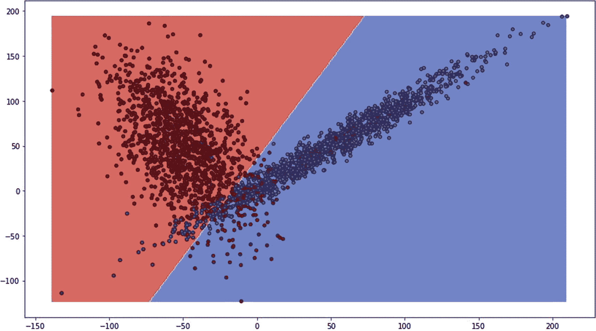

图 4-3

SVC 结果

J 部分准备数据，使用宏类型平均技术进行 F1 分数测试。

你的结果：

```
F1 Score (binary      ):  0.91190
F1 Score (micro       ):  0.91320
F1 Score (macro      ):   0.91318
F1 Score (weighted):      0.91318
```

这意味着机器学习的 F1 分数最低为 91.1%。

K 部分准备马修斯相关系数 (MCC)。

你的结果：

```
Matthews correlation coefficient (MCC): 0.82701
```

L 部分计算混淆矩阵 (CM)。

你的结果：

```
Confusion Matrix (CM)
=======================
TN =   1160 FP =     85
FN =    132 TP =   1123
```

该机器学习模型在检测正确预测水平方面表现良好。

现在你可以关闭 Jupyter Notebook，因为你已经完成了基本机器学习成功指标的计算。

接下来，你可以执行另一个标准的 SVN 解决方案。


#### 线性回归

简单线性回归是一种统计方法，用于总结和研究两个连续（定量）变量之间的关系：

*   一个变量，记为 x，被视为预测变量、解释变量或自变量。
*   另一个变量，记为 y，被视为响应变量、结果变量或因变量。

我将向你展示如何使用相同的机器学习算法对两个特征进行机器学习，以演示数据如何改变算法的行为。

在你的 Jupyter 软件中打开示例 Jupyter Notebook：`Chapter 004 Example 002A.ipynb`。

A 部分包含你所需的库。查看每个库并注意算法：

```
from sklearn import linear_model
```

这一条导入命令加载了执行机器学习所需的线性回归算法。

B 部分加载了一个水污染数据集，该数据集显示了十二种病菌特征（'F01', 'F02', 'F03', 'F04', 'F05', 'F06', 'F07', 'F08', 'F09', 'F10', 'F11', 'F12'）和四个事实（'T01', 'T02', 'T03', 'T'），用于识别该人员是否因水而生病。

你需要使用 C 部分仅提取一个特征（F03）。

你应该得到形状为 (442, 1) 的 `sickdf`。

你还会看到如下数据描述：

```
F
count  4.420000e+02
mean   1.131221e-11
std    4.761905e-02
min   -9.027530e-02
25%   -3.422907e-02
50%   -7.283766e-03
75%    3.124802e-02
max    1.705552e-01
```

现在你已经有了特征（F），需要使用 D 部分获取训练特征集，使用 E 部分获取测试特征集。F 部分将提供训练目标集和测试目标集。

G 部分是算法激活。我建议使用八个并发作业。你可以尝试这些设置以观察对性能的影响，但我不会在书中处理这个问题，因为读者生态系统的多样性使得几乎不可能预测你的结果。

H 部分使用 E 部分的训练集来训练模型。

I 部分使用测试集进行预测。

J 和 K 部分解释了预测的系数和均方误差（MSE）。

F01 特征的结果如下：

```
Coefficients = 1.15740949
Mean squared error (MSE) = 0.2473
Root Mean Square Error (RMSE): 0.4973
```

这是一个相当不错的结果，因为模型在处理测试数据时具有很高的精度。

M 部分计算出的方差得分为 0.0092，平均精确率-召回率得分为 0.6006。

结果是精确率-召回率曲线如图 4-4 所示。

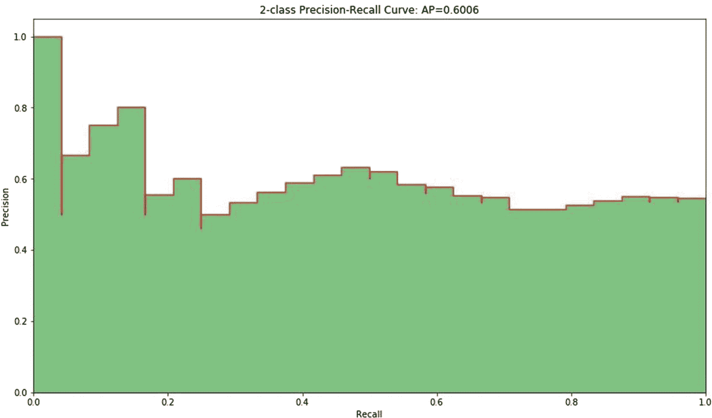

图 4-4

精确率-召回率曲线（F03）

该图显示模型在精确率和召回率方面均高于平均水平。对于给定的数据集和选定的特征，该模型的工作效率为 60.06%。

### 警告

这种结果在现实应用中很典型！

如果你查看数据分布，就能明白为什么这个特定数据集如此容易被学习。

特征 F03 的机器学习结果如图 4-5 所示。

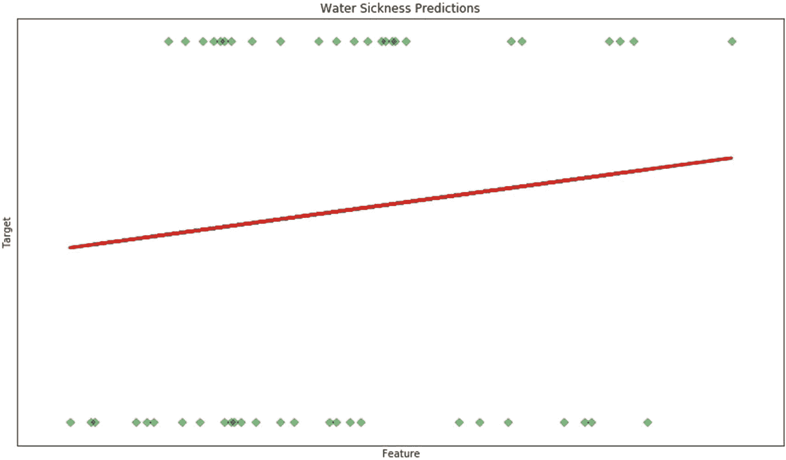

图 4-5

F03 的线性回归结果

如你所见，这个数据集是一个整洁的双极聚类，很容易被线性回归划分。

现在你可以关闭特征 F03 的 Jupyter Notebook。

干得好；你已经完成了分析的第一部分。

你学到了什么？

*   你可以加载数据。
*   你可以选择单个特征。
*   你可以训练机器学习模型。
*   你可以根据未见过的测试数据预测新的结果。
*   你可以创建研究结果的图形输出。

如果你理解了这些步骤，你已经做得很好了。

### 注意

你会发现，大多数模型都是一组基本的数据工程操作，用于格式化数据，以便选定的机器学习进行训练。

随着我们逐步阅读本书，我将根据我在工业界工作和研究中积累的经验提供建议。数据科学和数据工程正在不断发展，每天都有新知识产生。

现在打开示例 Jupyter Notebook：`Chapter 004 Example 002B.ipynb`。

### 注意

C 部分现在用于特征 F12。

F12 的数据不同：

```
F
count  442.000000
mean     0.038358
std      0.028158
min      0.000261
25%      0.015906
50%      0.033673
75%      0.056724
max      0.170555
```

F12 的精确率-召回率曲线结果如图 4-6 所示。

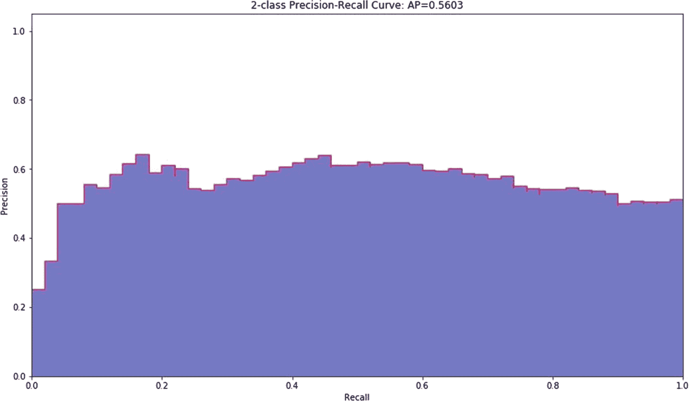

图 4-6

精确率-召回率曲线（F12）

这表明第二个特征在指示目标结果方面表现不佳。

如果你查看分布，会发现机器学习在使用线性回归发现数据边界时遇到了困难。

特征 F12 的机器学习结果如图 4-7 所示。

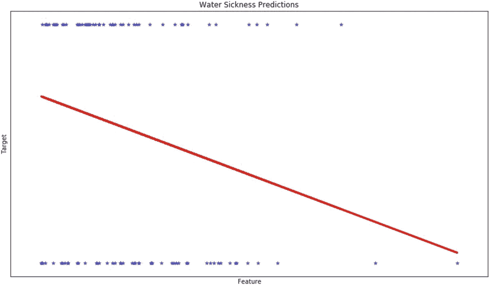

图 4-7

F12 的线性回归结果

### 警告

从数据集中选择机器学习模型和特征会极大地影响你的结果。

现在你可以关闭特征 F12 的 Jupyter Notebook。

### 额外训练

复制该 Notebook，并比较特征 1 到 12 在处理后的结果。

如果你想查看我的 Notebook（`Chapter 004 Example 002B-F01` 到 `Chapter 004 Example 002B-F12`），它们将指导你完成训练的可能解决方案/结果。

这些 Notebook 还会在结果目录中显示每个特征的结果。

干得好；你已经完成了分析的第二部分。

##### 交叉验证

交叉验证有助于你确定模型在应用时，处理将要面对的数据的训练效果如何。


###### 线性回归的交叉验证

在您的 Jupyter 软件中打开示例 Jupyter Notebook：Chapter 004 Example 003.ipynb。

A 部分加载库，并加载之前使用过的“水病”数据。

B 部分激活了 LASSO（最小绝对收缩和选择算子）算法，该算法由罗伯特·蒂布希拉尼于 1996 年设计。该算法通过使用一种称为正则化的过程来改变模型拟合过程，从而提高回归模型的预测准确性和可解释性。

C 部分激活了 GridSearchCV 算法，该算法确保评估所有可能的参数值组合，并保留最佳组合。

D 部分结合了 GridSearchCV 和 LASSO 算法来拟合训练数据模型。

E 部分绘制了此建模过程的结果。

您的结果如图 4-8 所示。

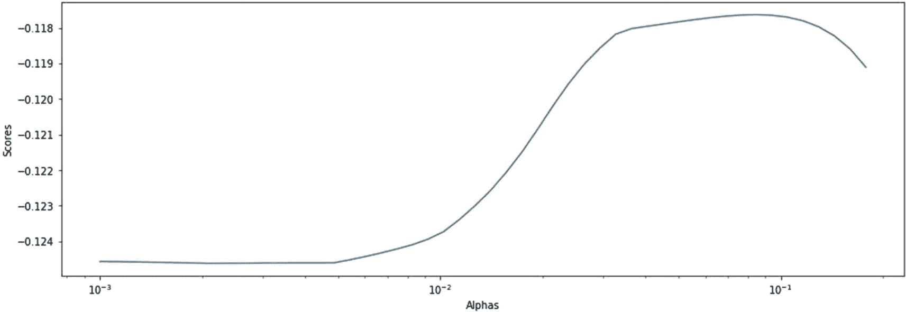

图 4-8

Alpha 值与得分

F 部分将帮助您绘制误差线，显示得分的正负标准差。

您的结果如图 4-9 所示。

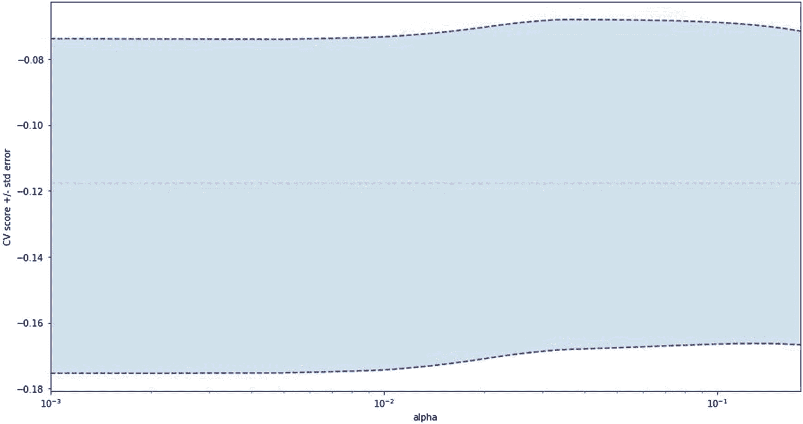

图 4-9

交叉验证得分

***重要问题：***

您如何信任这些 alpha 值的选择？

为了回答这个问题，您需要使用 `LassoCV` 对象，它通过内部交叉验证（即，该过程对其接收到的每个训练数据集执行交叉验证）从数据中自动设置 alpha 参数。

您使用外部交叉验证来查看自动获得的 alpha 值在不同交叉验证折之间有多大差异。

G 部分将计算回答此问题所需的结果。

回答重要问题的结果：***如何信任 alpha 值的选择？***

在不同数据子集上最大化泛化得分的 alpha 参数：

```
[fold   0] alpha:  0.02947, score: -0.28715
[fold   1] alpha:  0.03276, score:  0.05880
[fold   2] alpha:  0.01931, score:  0.11514
[fold   3] alpha:  0.06866, score: -0.00656
[fold   4] alpha:  0.05000, score: -0.22933
[fold   5] alpha:  0.05558, score:  0.05195
[fold   6] alpha:  0.05558, score: -0.28285
[fold   7] alpha:  0.05000, score: -0.09796
[fold   8] alpha:  0.05000, score: -0.89133
[fold   9] alpha:  0.06866, score: -0.10836
[fold  10] alpha:  0.04047, score: -0.08460
[fold  11] alpha:  0.04047, score: -0.64245
[fold  12] alpha:  0.04498, score: -0.18689
[fold  13] alpha:  0.04047, score: -0.34578
[fold  14] alpha:  0.06178, score: -0.04005
[fold  15] alpha:  0.06178, score:  0.03641
[fold  16] alpha:  0.04498, score:  0.24627
[fold  17] alpha:  0.04498, score:  0.15471
[fold  18] alpha:  0.04047, score: -0.20797
[fold  19] alpha:  0.05558, score: -0.29854
[fold  20] alpha:  0.05558, score:  0.15500
[fold  21] alpha:  0.06178, score: -0.03635
[fold  22] alpha:  0.05558, score: -0.12260
[fold  23] alpha:  0.05558, score: -0.04003
[fold  24] alpha:  0.05558, score:  0.12859
```

简单回答：

对于这个例子，我不会信任 alpha，因为该解决方案为不同的数据子集获取了不同的 alpha 值，而且这些 alpha 值的得分差异很大。

现在您可以保存该 notebook。

做得好；您现在可以评估参数，并就如何设置它们以实现成功做出决策。

### 提示

始终测试您的超参数，因为在现实世界的应用中，数据大多数时候都具有多维行为。

##### 稀疏性

稀疏性的概念在许多现实生活数据场景中很常见，因为数据分布稀疏或分散，并且在给定的特征中缺失。由于处理错误导致数据缺失或根本不存在，这在大多数新的 IML 生态系统中是常态。在成熟的 IML 生态系统中，引入工业化的数据工程以及改进数据来源和谱系可以减少这种稀疏性。我将通过观察糖尿病数据集的特征 1 和特征 2 来演示稀疏性的概念。这表明，即使特征 2 在完整模型上具有强系数，但由于稀疏性，与仅使用特征 1 相比，它在预测 y 方面提供的信息并不多。

在您的 Jupyter 软件中打开示例 Jupyter Notebook：Chapter 004 Example 004A.ipynb。

A 部分加载您进行此研究所需的所有库。

*mpl_toolkits.mplot3d* 为您提供交互式 3D 图形。

B 和 C 部分从水病数据中生成示例所需的数据。

我建议您从不同角度查看数据集，以理解数据分布的真实性质。您将通过将数据以及您的机器学习预测绘制在 3D 平面上，然后旋转平面以检查数据的不同角度或视图来实现这一点。

我建议我们以 45 度角视角、X 轴 90 度视角和 Y 轴 90 度视角来查看数据。

数据集的第一个角度和结果如图 4-10 所示。

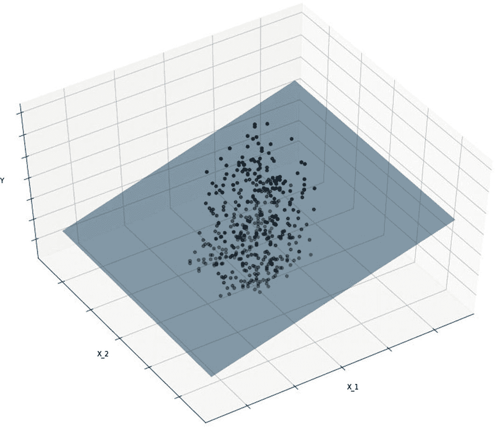

图 4-10

结果的 3D 稀疏性视图

您会同意，这个视图并没有向您展示水病数据数据分布的真实性质。

因此，让我们进入下一个视图，从另一个角度查看这些数据。

数据集的第二个角度和结果如图 4-11 所示。

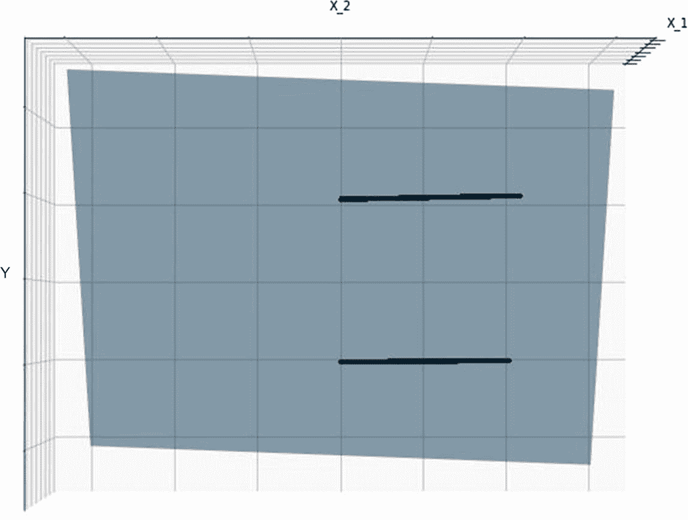

图 4-11

3D 稀疏性 – X 轴俯视图

这个视图清楚地显示数据是沿着两个不同值的双极聚类。

这意味着应该存在一个超平面来分割数据。

使用 3D 视图查看数据是研究数据特征的良好实践。

可视化将向您展示数据的洞察，这是以表格格式查看数据永远无法 100% 实现的。

您还会发现，非数据科学人员更容易理解可视化，因为人类在将知识视为图像时是出色的学习者。

### 提示

如果您发现一个单一的可视化能够解释完整的业务需求和数据洞察，您会发现机器学习会间接获得“它按预期工作”的声誉。

现在让我们来看第三个视图。

数据集的第三个也是最后一个视图如图 4-12 所示。

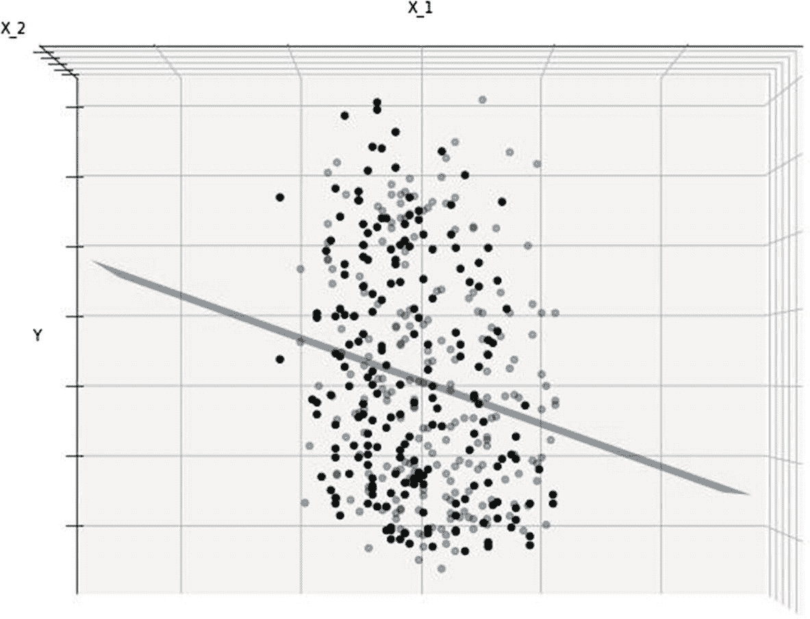

图 4-12

3D 稀疏性 – Y 轴俯视图

现在我们有了完整的洞察。遗憾的是，这个视图清楚地表明数据并非 100% 清晰的雙极聚类。有几个数据点并未沿着超平面分割。


### 警告

问题在于线性超平面并非分割此数据集的最佳模型。

您已完成 Jupyter Notebook，可以将其保存。

现在，您可以在多维空间中查看数据，从 3D 空间的不同角度探究数据的真实面貌，从而发现通常仅沿单一视角观察所无法获得的洞察。

如果您想研究其他几种特征组合，请执行以下操作：

*   打开示例 Jupyter Notebook：Chapter 004 Example 004B.ipynb。

*   打开示例 Jupyter Notebook：Chapter 004 Example 004C.ipynb。

*   打开示例 Jupyter Notebook：Chapter 004 Example 004D.ipynb。

这些示例将演示如何通过选择特征来获得数据集的不同视图。

现在，您可以保存所有示例并进入下一个示例类型。

##### LASSO 路径

下一个笔记本将使用 LARS 算法，针对水样数据集，沿正则化参数创建一条 LASSO 路径。每种颜色代表系数向量的一个不同特征，并作为正则化参数的函数进行显示。

最小角回归（LARS）是一种用于将线性回归模型拟合到高维数据的算法。

此过程适用于在单个视图中可视化高维数据集的数值。

在您的 Jupyter 软件中打开示例 Jupyter Notebook：Chapter 004 Example 005A.ipynb。

运行整个笔记本。

您将得到如图 4-13 所示的结果。

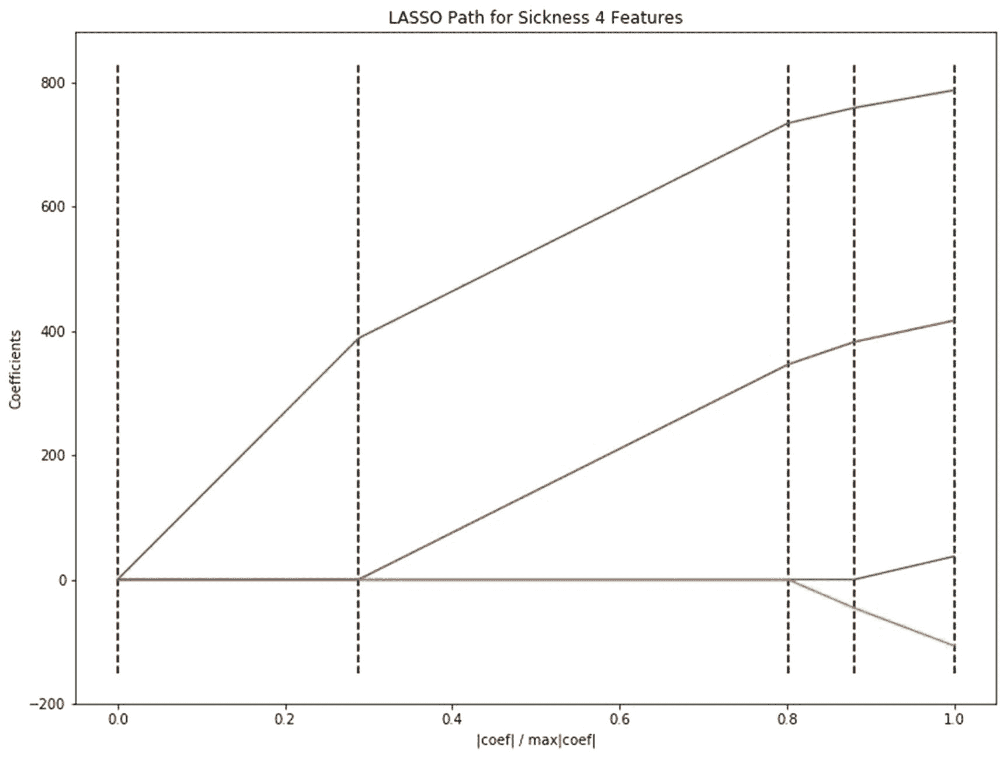

图 4-13

四个特征的 LASSO 路径

此结果仅展示了四个特征，但它清晰地显示了每个特征的路径有多么不同。

### 提示

这些不同的路径证实了我们之前所见：该数据集很复杂，需要一个非线性超平面来创建最佳边界。

现在关闭 Jupyter Notebook。

在您的 Jupyter 软件中打开示例 Jupyter Notebook：Chapter 004 Example 005B.ipynb。

运行整个笔记本。

让我们探究一下，当我们添加更多特征从而增加复杂度时会发生什么。

### 提示

您获得的路径越多样化，可以预期的模型结果就越多样化。

您将得到如图 4-14 所示的结果。

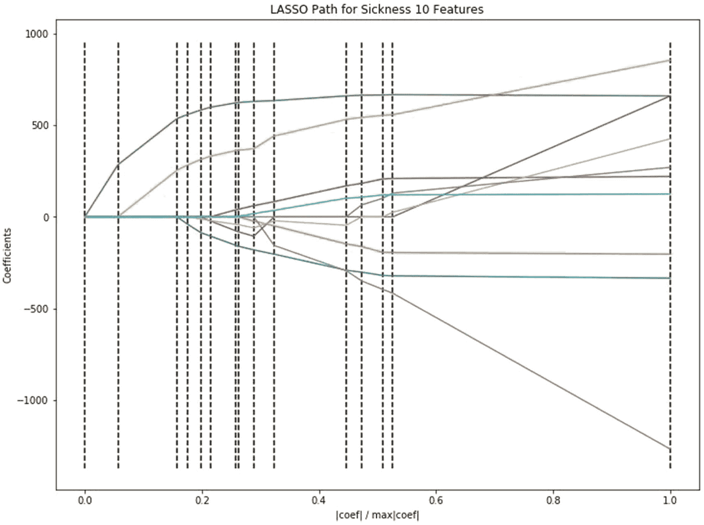

图 4-14

十个特征的 LASSO 路径

此路径分析显示，有几个特征明显是离群值，还有几个特征聚集在一起。

我建议您查看 B 部分的特征选择，并试验哪些特征对能很好地协同工作。

一旦您确定了一个集合，您就能洞察哪些特征可能有效。

您已完成此笔记本，现在可以保存它。

LASSO 路径可视化将引导您研究不同特征的路径。我建议您为每个想要研究的数据集绘制一条 LASSO 路径。

您现在已完成线性回归。做得好，这是很好的进展。您现在应该能够对数据集执行线性回归了。

接下来，我将介绍另一种类型的回归模型。

#### 逻辑回归

当因变量是二分（二元）变量时，逻辑回归是合适的回归分析方法。回归分析通常将逻辑回归用作预测分析。

逻辑回归对数据进行标记，并解释一个二元因变量与一个或多个名义、有序、区间或比率级别的自变量之间的关系。

在您的 Jupyter 软件中打开示例 Jupyter Notebook：Chapter 004 Example 006A.ipynb。

A、B 和 C 部分将使您能够加载数据。

D 部分是新的逻辑回归模型。

```
logreg = linear_model.LogisticRegression(
C=1e6,
solver='lbfgs',
multi_class='ovr',
n_jobs=8,
verbose=True,
max_iter=1968,
dual=False,
class_weight='balanced',
warm_start=False
)
```

此核心模型的超参数含义如下：

*   C=1000000 -> 正则化强度的倒数，值越小表示正则化越强。

因此，这是一个较弱的正则化。

*   solver=‘lbfgs’ -> 可选参数为 ‘newton-cg’, ‘lbfgs’, ‘liblinear’, ‘sag’, ‘saga’，默认值为 ‘liblinear’。

### 提示

针对不同优化问题的算法用法如下：

对于小型数据集，‘liblinear’ 是一个不错的选择，而对于大型数据集，‘sag’ 和 ‘saga’ 速度更快。

对于多类问题，只有 ‘newton-cg’, ‘sag’, ‘saga’ 和 ‘lbfgs’ 能处理多项损失；‘liblinear’ 仅限于一对多方案。

‘newton-cg’, ‘lbfgs’ 和 ‘sag’ 仅处理 L2 惩罚，而 ‘liblinear’ 和 ‘saga’ 处理 L1 惩罚。

multi_class=‘ovr’，即激活二元问题。

可选参数为 ‘ovr’, ‘multinomial’, ‘auto’。

对于 ‘ovr’，模型执行二元问题以拟合每个标签。

对于 ‘multinomial’，最小化的损失是跨整个概率分布拟合的多项损失。

这些超参数是您用来影响模型处理和训练方法的控制手段。

逻辑回归使用了线性回归的概念，但通过逻辑回归执行分类问题，该回归包含 x 的指数函数与比率之间的转换协作。

这使得超平面能够创建简单的平面线性平面无法实现的边界。

### 提示

逻辑回归在特定参数下也可以表现得像线性回归。因此，逻辑回归通常比线性回归更能找到数据集中更好的边界。

您的结果如图 4-15 所示。

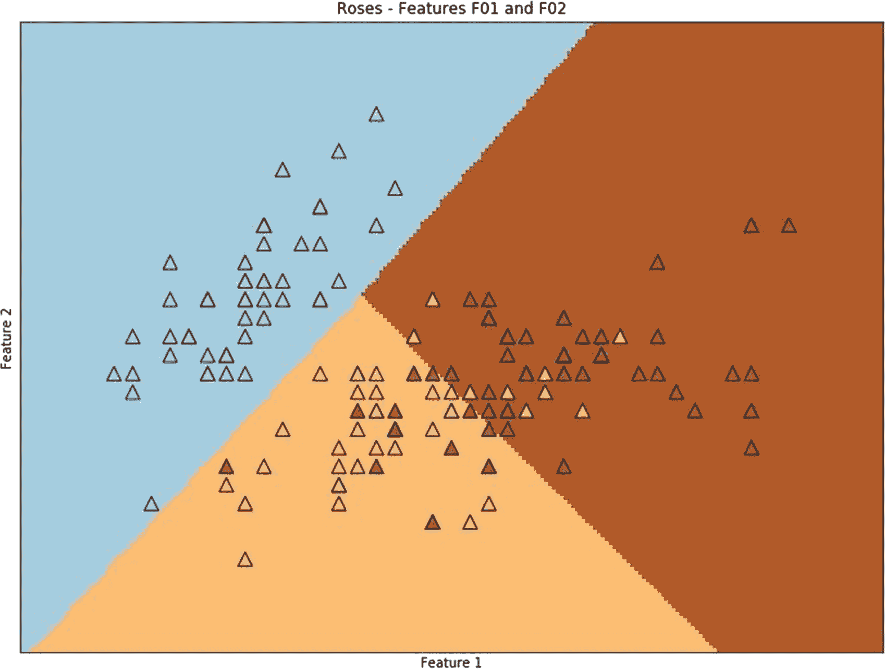

图 4-15

逻辑回归 – F01 和 F02

这两个特征具有清晰的边界，可以识别出三种不同的玫瑰，但黄色和橙色玫瑰之间存在一些问题，因为有几个数据点靠近边界。

您能看出该模型可以轻松地将蓝色玫瑰与其他玫瑰分开吗？然而，它在黄色和红色玫瑰之间的效果较差。这在现实世界的模型应用中很常见。


### 提示

特征并非总是具有清晰的值边界，因为有些值同时属于两个类别。您应尽快找出这些重叠的边界，以防止出现不期望的结果。

您已完成此笔记本的操作。请保存该笔记本。

现在我们将特征更改为特征 2 和特征 3。

在您的 Jupyter 软件中打开示例 Jupyter Notebook：Chapter 004 Example 006B.ipynb。

您的结果如图 4-16 所示。

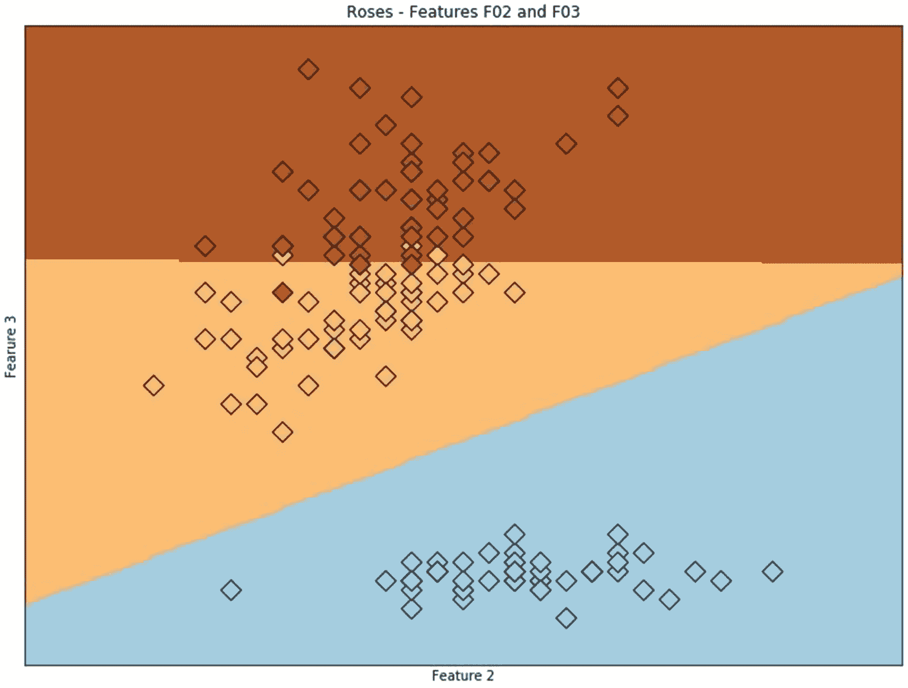

图 4-16

逻辑回归 – F02 和 F03

这两个特征具有清晰的边界，能够区分三种不同的玫瑰，但在黄色和红色玫瑰之间存在一些问题，因为有几个数据点靠近边界。

您已完成此笔记本的操作。

请保存该笔记本，以便日后练习使用。

现在我们将特征更改为特征 1 和特征 3。

在您的 Jupyter 软件中打开示例 Jupyter Notebook：Chapter 004 Example 006C.ipynb。

您的结果如图 4-17 所示。

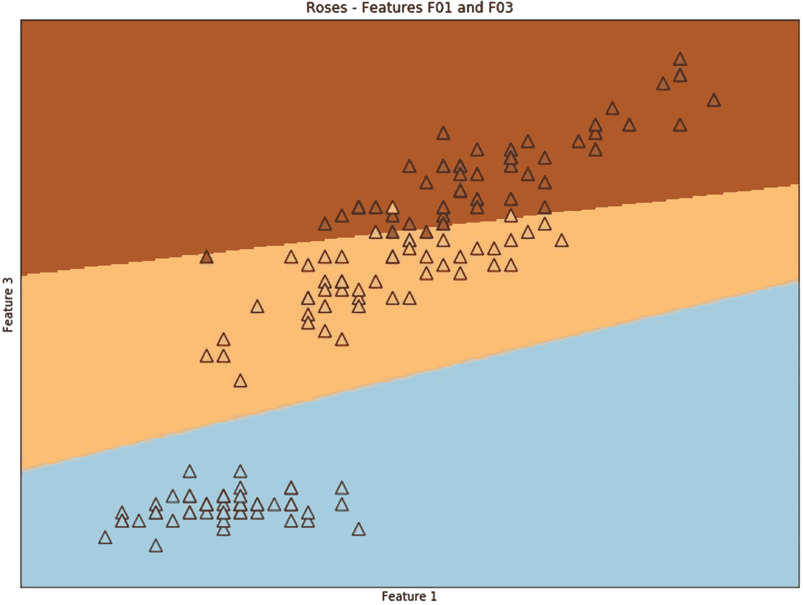

图 4-17

逻辑回归 – F01 和 F03

这两个特征具有清晰的边界，能够区分三种不同的玫瑰，但在黄色和橙色玫瑰之间存在一些问题，因为有几个数据点靠近边界。

您已完成此笔记本的操作。

请保存该笔记本。

这项研究表明，逻辑回归改善了边界，但并非对所有数据点都有效。

### 提示

研究不同的模型将有助于您选择合适的机器学习模型和特征发现过程，从而在 IML 中取得成功。

做得很好；您现在已掌握了使用逻辑回归进行边界发现的方法。

接下来，我将向您介绍模型分类工具集中的一个新部分，您可以使用它来辅助您的机器学习工作。

#### 朴素贝叶斯

朴素贝叶斯分类器基于贝叶斯定理，并假设预测变量之间相互独立。

##### 高斯朴素贝叶斯

GaussianNB 实现了用于分类的高斯朴素贝叶斯算法。它假设特征的可能性服从高斯分布：

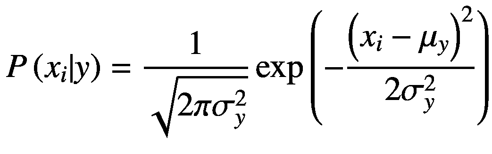

参数 *σ*[*y*] 和 *μ*[*y*] 通过最大似然估计得出。

在您的 Jupyter 软件中打开示例 Jupyter Notebook：Chapter 004 Example 007.ipynb。

A 部分和 B 部分加载了所需的库和您需要的测试数据。

在 C 部分，您研究了一个单一特征（F01），结果如下：

*   在总共 150 个点中，错误标记的点数：41 => 27.333 %

*   这意味着该特征有超过四分之一的风险被错误标记。

*   让我们通过查看其他特征来进一步研究。

D 部分激活了模型：

```
gnb = GaussianNB()
```

您研究了一个单一特征（F02），结果如下：

*   在总共 150 个点中，错误标记的点数：67 => 44.667 %

*   哇，这个特征有将近二分之一的风险被错误标记。

在 E 部分，您研究了一个单一特征（F03），结果如下：

*   在总共 150 个点中，错误标记的点数：7 => 4.667 %

*   看起来好多了；该特征有大约百分之五的风险被错误标记。

在 F 部分，您研究了一个单一特征（F04），结果如下：

*   在总共 150 个点中，错误标记的点数：6 => 4.000 %

*   看起来更好了；该特征有百分之四的风险被错误标记。

*   那么，让我们研究一下，如果使用所有特征，风险是否会改变？

在 G 部分，您研究了所有特征（F01、F02、F03 和 F04），结果如下：

*   在总共 150 个点中，错误标记的点数：6 => 4.000 %

*   看起来相似；这四个特征组合在一起有百分之四的风险被错误标记。

我想指出，特征 F04 正在驱动该模型的核心分类。

您可以保存该笔记本。

您现在已发现，并非所有特征都以相同的方式驱动高斯朴素贝叶斯算法。

您现在也了解了如何使用高斯朴素贝叶斯算法来执行机器学习。

##### 多项式朴素贝叶斯

MultinomialNB 实现了用于多项分布数据的朴素贝叶斯算法，它是文本分类中使用的两种经典朴素贝叶斯变体之一（其中数据通常表示为词向量计数，尽管在实践中 tf-idf 向量也被认为效果良好）。

该分布由每个类别 *y* 的向量 *θ*[*y*] = (*θ*[*y*1], …, *θ*[*yn*]) 参数化，其中 *n* 是特征数量（在文本分类中，即词汇表大小），而 *θ*[*yi*] 是特征 *i* 出现在属于类别 *y* 的样本中的概率 *P*(*x*[*i*]| *y*)。

参数 *θ*[*y*] 通过最大似然估计的平滑版本（即相对频率计数）来估计：

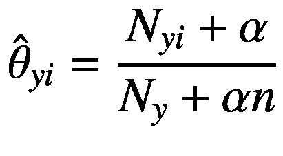

其中 *N*[*yi*] = ∑[*x* ∈ *T*]*x*[*i*] 是特征 *i* 在训练集 *T* 中类别 *y* 的样本中出现的次数，而 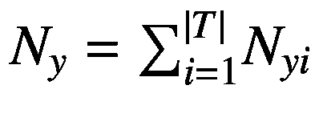 是类别 *y* 所有特征的总计数。

平滑先验 *α* ≥ 0 用于处理学习样本中未出现的特征，并防止在后续计算中出现零概率。设置 *α* = 1 称为拉普拉斯平滑，而 *α* < 1 称为利德斯通平滑。

在您的 Jupyter 软件中打开示例 Jupyter Notebook：Chapter 004 Example 008.ipynb。

执行整个笔记本。

核心部分是 C，模型通过以下代码激活：mnb = MultinomialNB()

您应该得到如下结果：

*   在总共 150 个点中，玫瑰特征 F01、F02、F03 和 F04 错误标记的点数：7 => 4.667 %

这表明，对于这个特定数据集，将模型类型从高斯朴素贝叶斯更改为多项式朴素贝叶斯，使得结果从 4% 恶化到了 4.7%。


### 提示

尝试为每个数据集使用多种机器学习（ML）模型！

了解 ML 模型与数据组合对每个模型的影响。

##### 伯努利朴素贝叶斯

`BernoulliNB` 将朴素贝叶斯训练和分类算法应用于服从多元伯努利分布的数据；也就是说，可能存在多个特征，但每个特征都被假定为二元值（伯努利，布尔）变量。该类要求样本被表征为二元值特征向量；如果提供了任何其他类型的数据，`BernoulliNB` 实例可能会对其输入进行二值化处理（取决于 `binarize` 参数）。

伯努利朴素贝叶斯的决策规则基于：

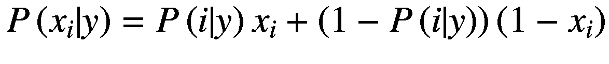

这与多项朴素贝叶斯的规则不同，因为它明确惩罚了作为类别 *y* 指示符的特征 *i* 的未出现情况，而多项变体则会简单地忽略未出现的特征。在文本分类的情况下，可以使用词出现向量（而非词频向量）来训练和使用此分类器。

`BernoulliNB` 在某些数据集上可能表现更好，尤其是那些包含较短文档的数据集。如果时间允许，建议对两种模型都进行评估。

在您的 Jupyter 软件中打开示例 Jupyter Notebook：`Chapter 004 Example 009A.ipynb`。

运行整个 Notebook 并查看结果。您将得到以下结果：

```
Number of mislabeled Rose Feature F01, F02, F03 and F04 points out of a total 600 points : 400 =>  66.667 %
```

在某种程度上，该过程出现了错误。问题出在数据上！！！

请记住，算法需要二元值数据。

### 警告

该算法假设数据是正确的。它不会报告非二元值数据。

让我们用另一个二元值特征集针对相同的结果或目标进行测试。

在您的 Jupyter 软件中打开示例 Jupyter Notebook：`Chapter 004 Example 009B.ipynb`。

运行整个 Notebook 并查看结果。您应该会得到三个相同的结果：

```
GaussianNB: Number of mislabeled Rose Feature F01, F02, F03 and F04 points out of a total 600 points : 53 =>  8.833 %
MultinomialNB: Number of mislabeled Rose Feature F01, F02, F03 and F04 points out of a total 600 points : 35 =>  5.833 %
BernoulliNB: Number of mislabeled Rose Feature F01, F02, F03 and F04 points out of a total 600 points : 200 =>  33.333 %
```

该模型并不出色，但至少在这三种模型之间更具一致性。

这里的教训是，数据类型从双精度变为二元值，模型计算可能并不总能捕捉到这种变化，但这仍然可能引发问题。

### 提示

在特征的数据工程过程中，始终将数据类型评估作为预处理的一部分。

#### 线性判别分析与二次判别分析

##### 线性判别分析

这是一个具有线性决策边界的分类器，通过将类条件密度拟合到数据并使用贝叶斯规则生成。

如果所有类别共享相同的协方差矩阵，则该模型会为每个类别拟合一个高斯密度。

拟合后的模型用于通过将输入投影到最具判别力的方向来降低其维度。

在您的 Jupyter 软件中打开示例 Jupyter Notebook：`Chapter 004 Example 010A.ipynb`。

加载的数据是高度特定（参见 B 部分）的格式。

结果是：

```
[[-1\. -1.]
[-2\. -1.]
[-3\. -2.]
[ 1\. -1.]
[ 2\.  1.]
[ 3\.  2.]]
```

##### 缩放器

加载的数据可以使用一系列数据转换器进行转换。

这些缩放器使机器学习能够处理那些会影响机器学习能力的数据特征。

现在，我将带您了解一系列转换器，向您介绍它们，并解释在数据工程中如何以及何时使用它们。

###### 标准缩放器

在 C/1 部分 - 转换数据 - 标准缩放器中

标准缩放器转换器通过从数据集中移除均值并缩放到单位方差来创建特征。

示例展示了如何使用：

```
transformer = StandardScaler(copy=True, with_mean=True, with_std=True).fit(X_raw)
```

该缩放器转换：

```
原始数据:
[[-1\. -1.]
[-2\. -1.]
[-3\. -2.]
[ 1\.  1.]
[ 2\.  1.]
[ 3\.  2.]]
转换后数据:
[[-0.46291005 -0.70710678]
[-0.9258201  -0.70710678]
[-1.38873015 -1.41421356]
[ 0.46291005  0.70710678]
[ 0.9258201   0.70710678]
[ 1.38873015  1.41421356]]
```

###### 鲁棒缩放器

在 C/2 部分 - 转换数据 - 鲁棒缩放器中：

此缩放器移除中位数并根据数据集的四分位距缩放数据。

示例展示了如何使用：

```
transformer = RobustScaler(copy=True, with_centering=True, with_scaling=True, quantile_range=(25.0, 75.0)).fit(X_raw)
```

该缩放器转换：

```
原始数据:
[[-1\. -1.]
[-2\. -1.]
[-3\. -2.]
[ 1\.  1.]
[ 2\.  1.]
[ 3\.  2.]]
转换后数据:
[[-0.28571429 -0.5       ]
[-0.57142857 -0.5       ]
[-0.85714286 -1\.        ]
[ 0.28571429  0.5       ]
[ 0.57142857  0.5       ]
[ 0.85714286  1\.        ]]
```

### 提示

此缩放器使用的统计量对异常值具有鲁棒性。

###### 二值化

在 C/3 部分 - 转换数据 – 二值化中：

此转换器对数据集执行布尔阈值处理。

示例展示了如何使用：

```
X3a=binarize(X_raw, copy=True,  threshold=1.75)
```

该缩放器转换：

```
原始数据:
[[-1\. -1.]
[-2\. -1.]
[-3\. -2.]
[ 1\.  1.]
[ 2\.  1.]
[ 3\.  2.]]
转换后数据:
[[0\. 0.]
[0\. 0.]
[0\. 0.]
[0\. 0.]
[1\. 0.]
[1\. 1.]]
```

###### 归一化

在 C/4 部分 - 转换数据 – 归一化中：

此操作将输入向量单独缩放到数据集的单位范数。

示例展示了如何使用：

```
X4a=normalize(X_raw, copy=True, norm="l1", axis=1, return_norm=False)
```

该缩放器转换：

```
原始数据:
[[-1\. -1.]
[-2\. -1.]
[-3\. -2.]
[ 1\.  1.]
[ 2\.  1.]
[ 3\.  2.]]
转换后数据:
[[-0.5        -0.5       ]
[-0.66666667 -0.33333333]
[-0.6        -0.4       ]
[ 0.5         0.5       ]
[ 0.66666667  0.33333333]
[ 0.6         0.4       ]]
```

###### 分位数转换器

C/5、C/6、C/7 和 C/8 部分 - 转换数据 - 分位数转换器：

使用分位数信息转换特征。该过程将特征转换为服从均匀分布或正态分布。

示例展示了如何使用：

```
transformer = QuantileTransformer(output_distribution='normal',n_quantiles=4, random_state=0).fit(X_raw)
```

该缩放器转换：

```
原始数据:
[[-1\. -1.]
[-2\. -1.]
[-3\. -2.]
[ 1\.  1.]
[ 2\.  1.]
[ 3\.  2.]]
转换后数据:
[[-0.70710678 -0.70710678]
[-0.89442719 -0.4472136 ]
[-0.83205029 -0.5547002 ]
[ 0.70710678  0.70710678]
[ 0.89442719  0.4472136 ]
[ 0.83205029  0.5547002 ]]
```

现在您已经能够执行转换，您会看到在 D 部分中，示例使您能够选择其中一种转换。

对于主要示例，我建议我们通过选择 `X=X0` 来直接使用数据集。


### 提示

尝试不同的转换器，了解它们如何影响机器学习模型的性能与效果。

现在我们可以回到机器学习的内容。

在 E 部分，你通过 `clf = LinearDiscriminantAnalysis(solver='eigen', shrinkage="auto")` 和 `clf.fit(X, y)` 来运行模型。

线性判别分析是一种具有线性决策边界的分类器，它通过将类条件密度拟合到数据集，并利用贝叶斯规则为每个类别拟合一个高斯密度（假设所有类别共享相同的协方差矩阵）来实现。该拟合模型可以通过将输入投影到最具判别力的方向来降低其维度。

你可以研究不同的求解器：

使用的求解器可以是以下任意值：

*   ‘svd’：奇异值分解（默认）。该求解器不计算数据集的协方差矩阵。此求解器适用于特征数量较多的数据。

*   ‘lsqr’：最小二乘解可以与收缩方法结合来解决问题。

*   ‘eigen’：特征值分解可以与收缩方法结合来解决问题。

F 部分为你准备了机器学习结果的绘图。

你的结果显示在图 4-18 中。

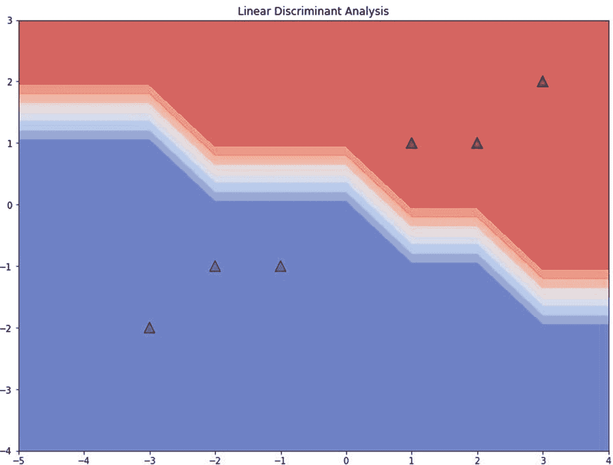

图 4-18

简单线性判别分析

该模型预测了两个类别之间的一条清晰分界线。这对于建模过程来说是一个很好的结果。

你现在可以关闭此示例。

你现在已经成功地对一个简单数据集执行了一系列转换和线性判别分析。

接下来，我们将研究一个更复杂的数据集。

在你的 Jupyter 软件中打开示例 Jupyter Notebook：Chapter 004 Example 010B.ipynb。

运行整个笔记本。

你的结果显示在图 4-19 中。

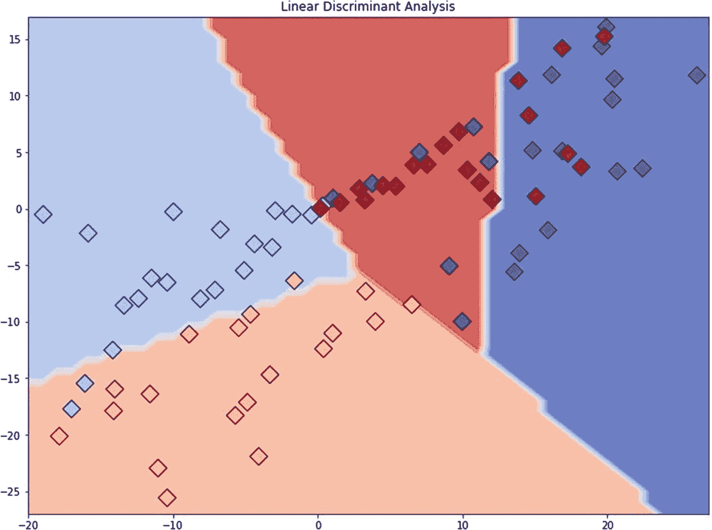

图 4-19

复杂线性判别分析

机器学习获得的分数为：

F1 分数（微平均）：0.7468 或 74.68%，F1 分数（宏平均）：0.7505 或 75.05%。

正如你所观察到的，这意味着每 4 个点中就有 1 个被错误分类。

在 B 部分，我创建了一个名为 Cluster04.csv 的新数据集，我们现在用它来演示，如果你多次使用机器学习来预测所需的结果，模型会如何演变。

你现在可以保存并关闭当前的笔记本。

接下来，在你的 Jupyter 软件中打开示例 Jupyter Notebook：Chapter 004 Example 010C.ipynb。

完全运行该笔记本。

你的结果显示在图 4-20 中。

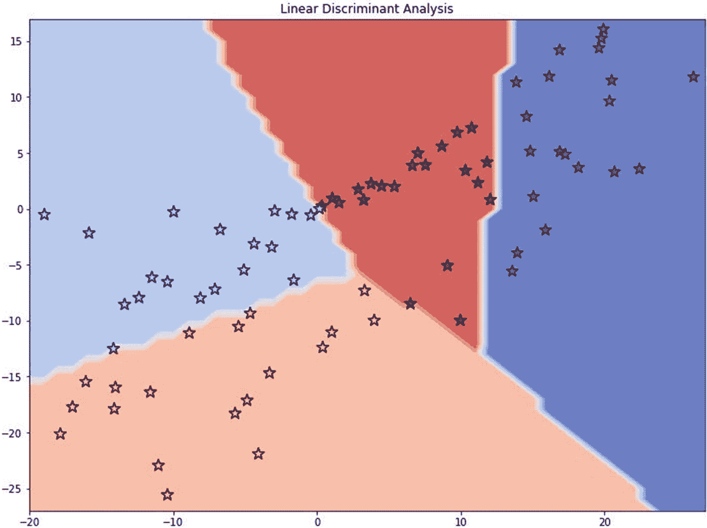

图 4-20

复杂线性判别分析（第一次运行）

你的 F1 分数（微平均）为 0.87341772，F1 分数（宏平均）为 0.87565352。这是一个改进，因为模型现在将预测结果作为训练数据接受。

### 警告

这只是一个模拟。以这种方式进行机器学习并非普遍做法。

但它确实展示了如果业务 100% 遵循预测会产生的真实影响。我曾多次使用这种研究思路来演示，如果客户 100% 采纳建议的预测，可能会实现什么效果。

再次运行该笔记本。

你的结果显示在图 4-21 中。

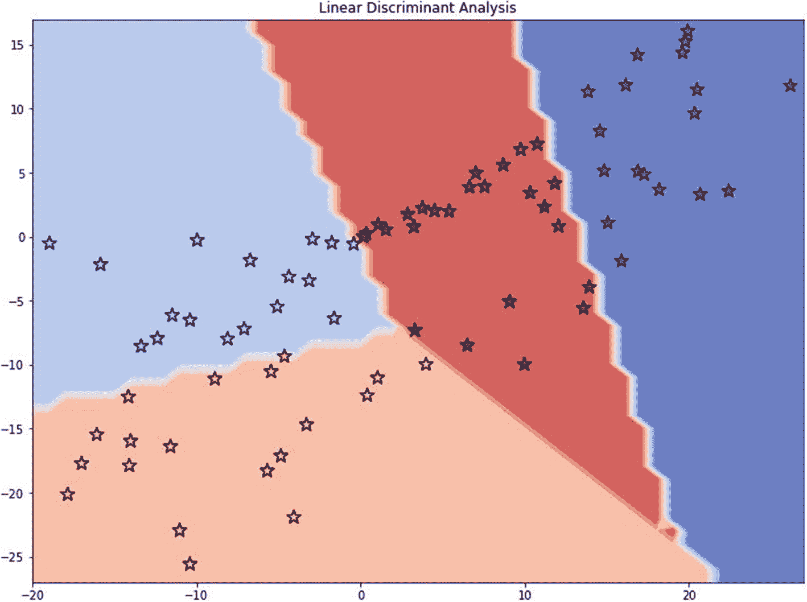

图 4-21

复杂线性判别分析（第二次运行）

复杂线性判别分析（第二次运行）提供以下结果：F1 分数（微平均）为 0.91139241，F1 分数（宏平均）为 0.91392064。更多改进！

复杂线性判别分析（第三次运行）提供 F1 分数（微平均）为 0.93670886，F1 分数（宏平均）为 0.93809072。

复杂线性判别分析（第四次运行）提供 F1 分数（微平均）为 0.95727848，F1 分数（宏平均）为 0.95884775。

复杂线性判别分析（第九次运行）提供，在又运行五次后，F1 分数（微平均）为 0.99040744，F1 分数（宏平均）为 0.98882348。

这是一个具有高度统计显著性的结果；准确率超过 99%，该模型可以正确预测大部分数据集。

你可以关闭此笔记本。

你现在应该理解，数据集、转换和良好的机器学习模型的组合能够带来良好的预测结果。

##### 二次判别分析

在你的 Jupyter 软件中打开示例 Jupyter Notebook：Chapter 004 Example 011.ipynb。

二次判别分析的机器学习过程与线性判别分析相同，但使用二次模型来生成二次决策边界。

你的结果显示在图 4-22 中。

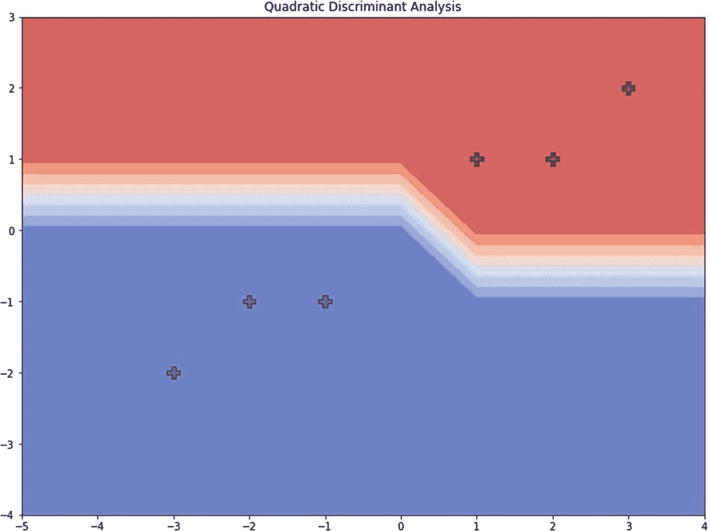

图 4-22

简单二次判别分析

由于数据结构简单，对于该数据集，线性分析和二次分析之间的差异并不明显。

你现在可以关闭笔记本。

让我们用更复杂的数据集来评估同样的分析。

在你的 Jupyter 软件中打开示例 Jupyter Notebook：Chapter 004 Example 011B.ipynb。

运行整个笔记本。

你的结果显示在图 4-23 中。

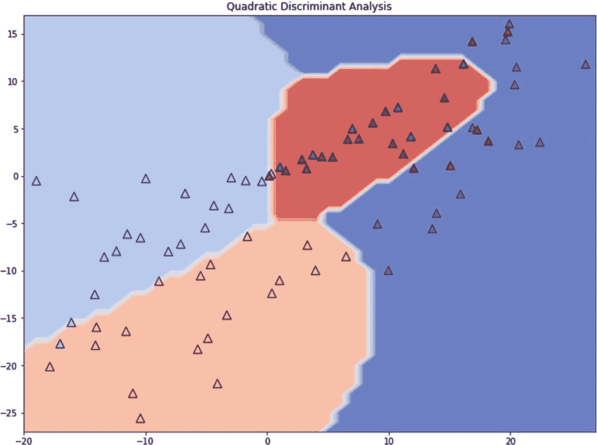

图 4-23

复杂二次判别分析

结果显示，二次求解器能够以比线性求解器更好的方式处理数值的常见重叠区域。

### 提示

在更复杂的数据集上，二次求解器通常比线性求解器表现更好，而在简单数据集上也不会更差。在现实世界的工作中，我个人会更频繁地使用二次求解器。

你现在可以关闭笔记本。

你现在已经完成了线性判别分析和二次判别分析。

此示例展示了这两种方法之间的区别（图 4-24）。

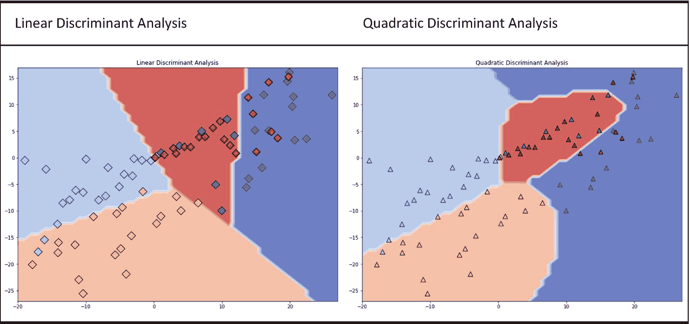

图 4-24

比较线性判别分析和二次判别分析的结果

你能看到二次边界不是一条直线，而是一条二次曲线吗？


##### 带协方差椭圆的线性与二次判别分析

本示例绘制了每个类别的协方差椭圆，以及通过线性判别分析（LDA）和二次判别分析（QDA）学习到的决策边界。椭圆展示了每个类别的双倍标准差。对于 LDA，整个类别集合的标准差是相同的，而 QDA 中每个类别都有其各自的标准差。

在您的 Jupyter 软件中打开示例 Jupyter Notebook：Chapter 004 Example 012.ipynb。

本示例演示了协方差椭圆如何对数据进行聚类，以及线性判别分析和二次判别分析这两种模型在使用相同数据集但不同模型和超参数时，所产生的结果有何差异。

您的结果如图 4-25 所示。

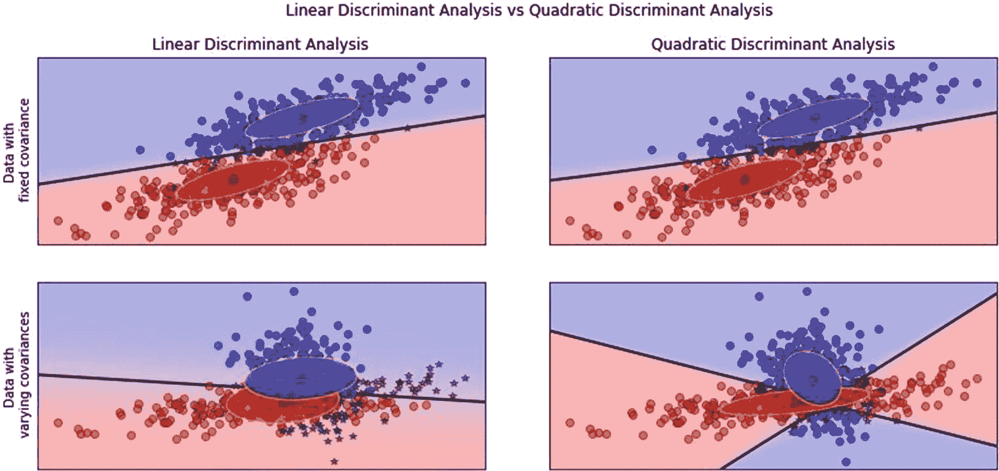

图 4-25

线性判别分析与二次判别分析对比

该对比明确展示了这些线性与二次判别分析的结果，表明二次求解器在此数据集上取得了更好的效果。

您现在可以关闭此 notebook 了。

#### 图形与图像

现在您应该能够轻松地处理带有数字和标签的矩阵了。

接下来，我们将尝试一种新型数据源，即图形或图像。

在您的 Jupyter 软件中打开示例 Jupyter Notebook：Chapter 004 Example 013.ipynb。

我将向您展示如何处理手写图片，以判断书写者所写的数字。

运行该 notebook 以处理机器学习任务。我们将在讨论完所有投影后收集它们。

##### 随机二维投影

通过稀疏随机投影降低维度，同时保证相似的嵌入质量：更节省内存，且投影数据的计算速度更快。

```
rp = random_projection.SparseRandomProjection(n_components=2, random_state=321)
```

（参见结果：表 4-1。）

表 4-1

图形与图像

| 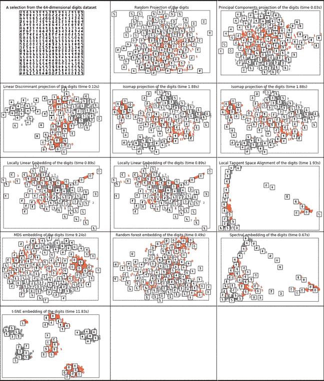 |

##### 计算 SVD 投影

该转换器通过截断奇异值分解（SVD）执行线性降维：

```
X_pca = decomposition.TruncatedSVD(n_components=2).fit_transform(X)
```

（参见结果：表 4-1。）

##### 线性判别分析投影

LDA 使用具有线性决策边界的分类器和贝叶斯规则。

```
X_lda = discriminant_analysis.LinearDiscriminantAnalysis(n_components=2).fit_transform(X2, y)
```

（参见结果：表 4-1。）

我们只是将之前用于图形的同一个机器学习求解器应用到了图像上；这正是这些机器学习求解器的强大之处。

##### 等距映射嵌入

等距映射嵌入通过对数据集进行等距映射，使用非线性降维方法。

```
X_iso = manifold.Isomap(n_neighbors, n_components=2).fit_transform(X)
```

（参见结果：表 4-1。）

##### 局部线性嵌入（LLE）

局部线性嵌入（LLE）寻求数据的低维投影，同时保留局部邻域内的距离。

###### LLE 嵌入

```
clf = manifold.LocallyLinearEmbedding(n_neighbors, n_components=2, method="standard", eigen_solver="auto")
```

（参见结果：表 4-1。）

###### 修正 LLE 嵌入

LLE 的一个公认问题是正则化问题。当邻居数量大于输入维度时，定义每个局部邻域的矩阵会出现秩亏。修正 LLE 成功解决了这个问题。

```
clf = manifold.LocallyLinearEmbedding(n_neighbors, n_components=2, method="modified", eigen_solver="auto")
```

（参见结果：表 4-1。）

###### Hessian LLE 嵌入

Hessian 特征映射是解决 LLE 相同正则化问题的另一种方法。

```
clf = manifold.LocallyLinearEmbedding(n_neighbors, n_components=2, method="hessian", eigen_solver="dense")
```

（参见结果：表 4-1。）

###### 局部切空间对齐（LTSA）嵌入

局部切空间对齐（LTSA）在算法上与 LLE 类似，但 LTSA 并非像 LLE 那样专注于保留邻域距离，而是通过其切空间来刻画每个邻域的局部几何结构，并执行全局优化以对齐这些局部切空间，从而学习嵌入。

```
clf = manifold.LocallyLinearEmbedding(n_neighbors, n_components=2, method="ltsa", eigen_solver="dense")
```

（参见结果：表 4-1。）

###### 多维缩放（MDS）嵌入

多维缩放（MDS）寻求数据的低维表示，其中距离间接映射到呈现给模型的原始高维空间中的距离。

```
clf = manifold.MDS(n_components=2, n_init=1, max_iter=100)
```

（参见结果：表 4-1。）

这是 LLE 风格嵌入模型中的最后一个。

##### 完全随机树嵌入

完全随机树的集成是一种将数据集无监督转换为高维稀疏表示的方法。

```
hasher = ensemble.RandomTreesEmbedding(n_estimators=200, random_state=0, max_depth=5)
pca = decomposition.TruncatedSVD(n_components=2)
```

（参见结果：表 4-1。）

##### 谱嵌入

用于非线性降维的谱嵌入会创建一个由指定函数定义的亲和矩阵，并使用拉普拉斯特征映射将谱分解与相应的图关联起来。最终的转换由每个数据点的特征向量值决定。

```
embedder = manifold.SpectralEmbedding(n_components=2, random_state=0, eigen_solver="arpack")
```

（参见结果：表 4-1。）

##### t-分布随机邻域嵌入（t-SNE）

t-SNE 是一种用于可视化高维数据的实现方法。它将数据点之间的相似性转化为联合概率，并试图最小化低维嵌入与高维数据联合概率之间的 Kullback-Leibler 散度。

```
tsne = manifold.TSNE(n_components=2, init="pca", random_state=0)
```

（参见结果：表 4-1。）


### 提示

如果维度超过五十维，请对稠密数据使用 PCA 或对稀疏数据使用 TruncatedSVD 来降维，因为这将抑制噪声并提高数据样本间成对距离的计算速度。

该笔记本会生成以下输出结果（表 4-1）。

现在，你可以对图像执行机器学习，以将相关图像归类到一起。

#### 决策边界

要理解不同技术在不同问题上的表现差异，本质在于通过比较决策边界图来可视化预测空间。决策边界是通过遍历样本或整个总体，并将每个点的预测结果绘制到图表上生成的。这能精确展示数据分类之间的边界所在。

在 Jupyter 软件中打开示例笔记本：Chapter 004 Example 014.ipynb。

现在，我将带你了解 scikit-learn 中几种分类器在合成数据集上的对比。此示例旨在展示不同分类器决策边界的特性。图中，训练点以实色显示，测试点则为半透明。右下角显示的是分类准确率。

你的结果如图 4-26 所示。

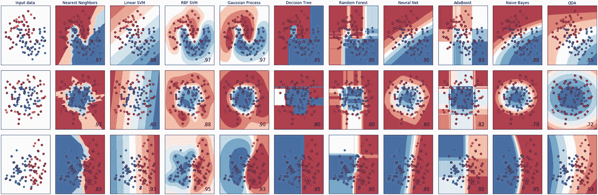

图 4-26

决策边界

你可以清晰地比较不同模型在同一数据集上的不同结果。

### 警告

你是否注意到，不同的算法会对每种类型产生不同的分类结果？

如果你选择了不匹配的算法，这将是一个主要问题。

### 提示

我个人总是尝试在每个训练数据集上至少使用三种不同的算法。

现在你已经了解了决策边界以及算法对这些边界的影响，我建议我们研究其他不同的算法。

从逻辑上讲，现在是一个休息的好时机。我们已经介绍了生成机器学习模型所需的大量工具，这些工具我曾见过用于训练现实世界中的解决方案。

所以，我建议……喝杯咖啡或茶，等你准备好了我们再继续。

#### 决策树

决策树是一种用于分类和回归的非参数监督学习方法。其目标是通过学习从训练数据集的数据特征中推断出的简单决策规则，来创建一个预测目标变量值的模型。

在 Jupyter 软件中打开示例笔记本：Chapter 004 Example 015A.ipynb。

开始下一个示例时，你可能需要安装一组新工具。

如果你没有 graphviz 库，请使用 `conda install -c anaconda graphviz`

如果你没有 graphviz 引擎，请使用：

Windows：使用 [`https://graphviz.gitlab.io/_pages/Download/Download_windows.html`](https://graphviz.gitlab.io/_pages/Download/Download_windows.html)

Ubuntu：`使用 sudo apt-get install graphviz`

```
CentOS：yum install graphviz
```

一旦 graphviz 正常工作，我建议你运行整个笔记本。

机器学习模型在 C 部分生成：

```
clf = tree.DecisionTreeClassifier(
max_features=None,
presort=True,
criterion='gini',
class_weight='balanced',
random_state=321
)
```

重要的选择是 `criterion='gini'`，因为它为基尼不纯度选择方法选择了“gini”；以及 `class_weight='balanced'`，因为“balanced”模式使用 y 的值自动调整权重，使其与输入数据中的类别频率成反比，即 `n_samples / (n_classes ∗ np.bincount(y))`。

该模型得分为：0.9067

它生成了一个包含 93 个节点的树。

你的笔记本生态系统会生成一个决策树，并在 F 部分将其显示为图像（图 4-27）。

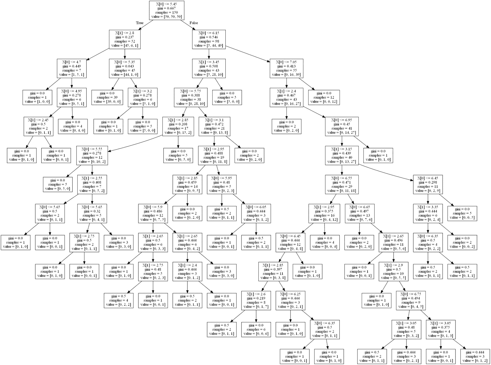

图 4-27

决策树

你的结果如图 4-27 所示。

进展顺利；你已经成功生成了决策树。

我附上了一个示例 Jupyter 笔记本：

*   Chapter 004 Example 015B.ipynb - 使用多个目标。
*   Chapter 004 Example 015C.ipynb - 使用更多类别。
*   Chapter 004 Example 015D.ipynb - 使用更多特征和类别。
*   Chapter 004 Example 015E.ipynb - 将 criterion 改为 `'entropy'`。
*   Chapter 004 Example 015F.ipynb - 改用 ExtraTreeClassifier 引擎。

你现在应该全面了解树如何响应不同的分类超参数。

##### 决策树分类器（玫瑰）

我建议我们现在研究解决方案决策面的可视化，以了解训练好的模型将如何预测它未来处理的数据。

在 Jupyter 软件中打开示例笔记本：Chapter 004 Example 016A.ipynb。

该示例选取了玫瑰四个特征的每一种组合，然后比较它们如何相互作用来预测玫瑰的类型（Blaze、Venus、Honey milk）。

你的结果如图 4-28 所示。

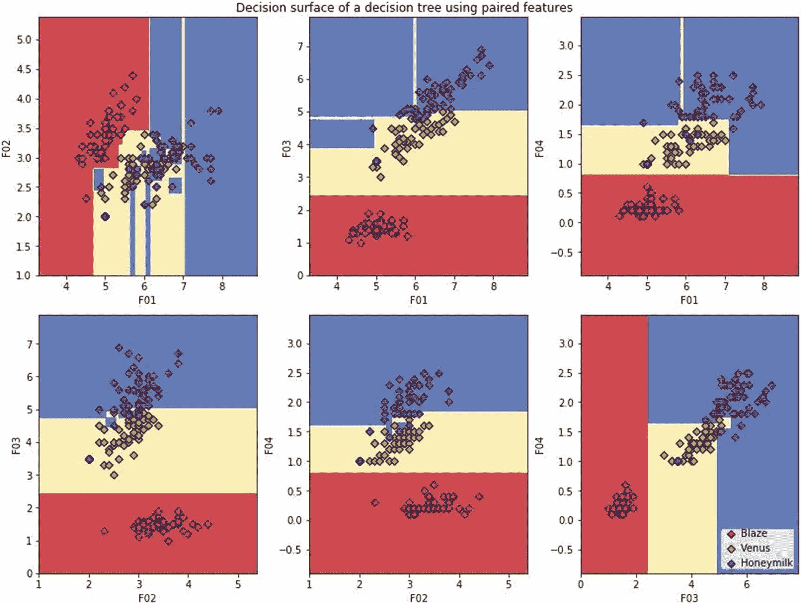

图 4-28

决策树（玫瑰）

你可以清晰地观察到，特征的组合具有明显不同的决策面。

我通常会绘制这些结果，因为它可以向我的客户展示预测值会带来什么结果。

### 提示

找到决策面只占实际工作量的 50%；另外 50% 是向业务方解释结果，说明这些洞察背后的原因。

##### 决策树回归器

决策树通过使用 `DecisionTreeRegressor` 类，同样可以轻松应用于回归问题。

你现在可以研究决策树如何实现回归功能。

在 Jupyter 软件中打开示例笔记本：Chapter 004 Example 017A.ipynb。

运行整个笔记本。

你的结果如图 4-29 所示。

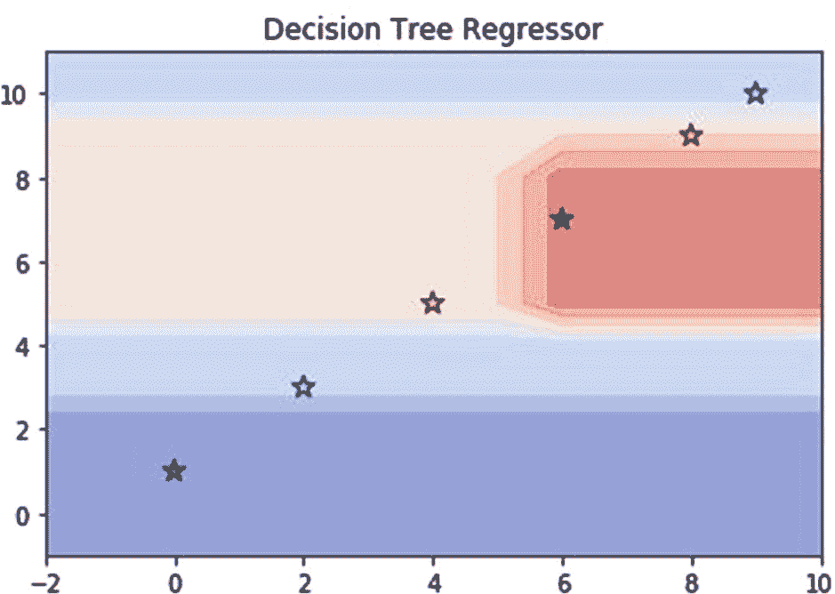

图 4-29

决策树回归器

如果你查看 C 部分，你会看到一个熟悉的模型：

```
clf = tree.DecisionTreeRegressor(max_features=None, presort=True, criterion="mse", random_state=321, splitter="best")
```

重要的超参数是：

```
criterion='mse'
```

均方误差（MSE）等同于将方差减少作为特征选择标准，并通过使用每个终端节点的均值来最小化 L2 损失。

```
splitter='best'
```

每次都选择“最佳”分割，这会以处理周期为代价，获得更准确的树模型。


###### 决策树回归器（max_depth）

树模型上另一个可调的超参数是树的最大深度。

以下示例将帮助你理解最大深度对树模型效果的影响。

在 Jupyter 软件中打开示例 Jupyter Notebook：`Chapter 004 Example 018A.ipynb`。

运行整个 notebook。

核心流程如下：

```
regr_1 = DecisionTreeRegressor(max_depth=2)
regr_2 = DecisionTreeRegressor(max_depth=5)
regr_3 = DecisionTreeRegressor(max_depth=7)
regr_4 = DecisionTreeRegressor(max_depth=None)
```

这将创建四个不同的模型，每个模型的最大深度依次递增。

你的结果如图 4-30 所示。

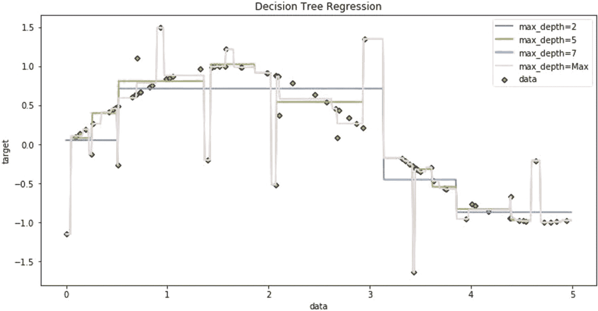

图 4-30

决策树回归器（max_depth）

树的评分随着最大深度的增加而提高。

```
Score max_depth=2  :  0.7630
Score max_depth=5  :  0.9539
Score max_depth=7  :  0.9923
Score max_depth=Max:  1.0000
```

你也可以使用 `ExtraTreeRegressor` 进行同样的测试，示例见：`Chapter 004 Example 018A.ipynb`。

###### 多输出决策树回归

下一个示例将展示如何处理多输出树。

在 Jupyter 软件中打开示例 Jupyter Notebook：`Chapter 004 Example 019.ipynb`。

你的结果如图 4-31 所示。

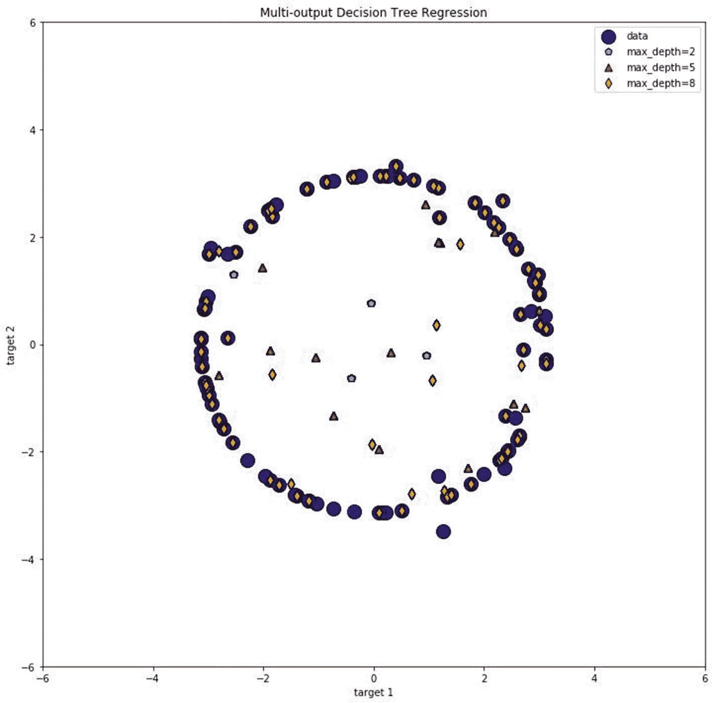

图 4-31

多输出决策树回归

最大深度的变化对评分产生如下结果：

```
Score max_depth=2         :  0.1081 with    7 nodes or   3.5176 % of tree
Score max_depth=5         :  0.5295 with   53 nodes or  26.6332 % of tree
Score max_depth=8         :  0.8797 with  161 nodes or  80.9045 % of tree
Score max_depth=None      :  1.0000 with  199 nodes or 100.0000 % of tree
```

这是机器学习树模型的最后一个示例。

现在你应该能够设计树模型并调整超参数了。此时是关闭之前所有 notebook 并享受一杯饮品的好时机。

#### k-近邻 3 类分类

我们正在实现的分类器是 k-近邻投票算法。

基于邻居的分类是一种基于实例的学习或非泛化学习算法，它通过计算数据集中每个点的最近邻的简单多数投票来执行分类。

在 Jupyter 软件中打开示例 Jupyter Notebook：`Chapter 004 Example 020.ipynb`。

```
for algorithmitem in ['auto', 'ball_tree', 'kd_tree', 'brute']:
for weightitem in ['uniform', 'distance']:
for n_neighborsitem in range(3,7,1):
clf = neighbors.KNeighborsClassifier(n_neighbors=n_neighborsitem, weights=weightitem, algorithm=algorithmitem)
```

两个核心超参数是：

`n_neighbors` = 范围为 3、4、5 和 6，这是一个用于确定最近邻的常量集合。

`weights` = 来自列表 `['uniform', 'distance']` 的权重：

*   `'uniform'`：均匀权重。每个邻域内的所有点权重相等。

*   `'distance'`：按距离的倒数对点进行加权。因此，距离查询点更近的邻居将比距离更远的邻居具有更大的影响。

结果如图 4-32 所示。

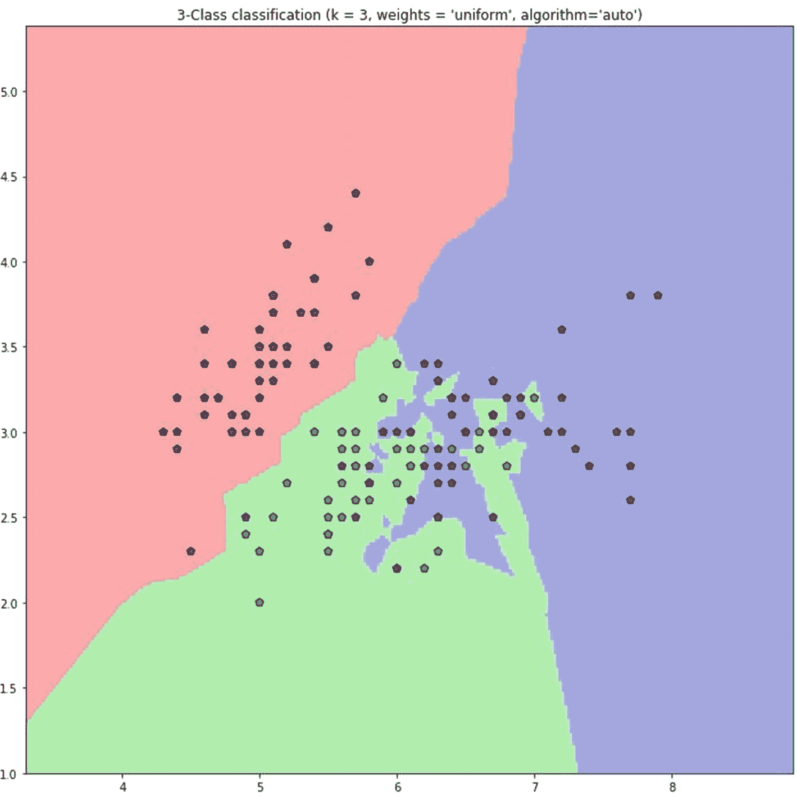

图 4-32

3 类分类（k = 3）– 均匀权重 – 自动算法

图 4-33 展示了 k = 6 如何通过产生决策孤岛来改变最终的决策区域。

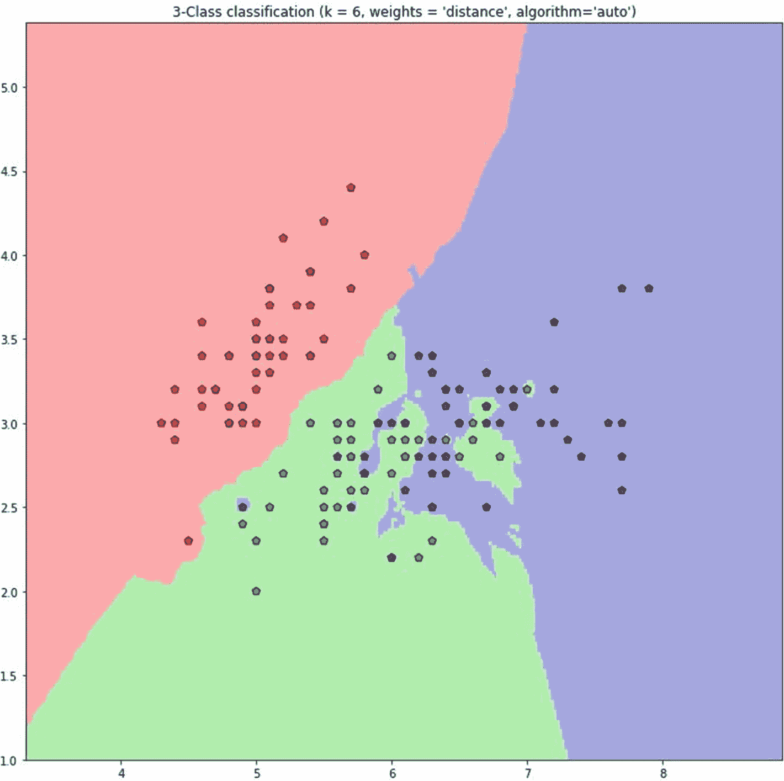

图 4-33

3 类分类（k = 6）– 距离权重 – 自动算法

### 提示

你能观察到在 (5, 2.5) 处尝试分类一个蓝色点导致形成了一个孤岛集群吗？这是过拟合的迹象。

如果你研究结果，可以观察到一系列集群效应，这些效应揭示了数据集如何通过不同的超参数进行聚类。

你应该研究的主要行为是正在形成的分类孤岛，因为在现实世界中，这种行为在地理空间、地理人口统计细分和路线规划中很常见。

### 警告

这些参数可能导致需要大量选项才能找到正确的超参数。

现在你可以关闭这个工作簿了。

#### 最近质心分类器

最近质心分类器为每个类别计算一个质心。

质心是给定类别所有点的平均位置。

质心使用两种方法测量：

*   **欧几里得距离**是两点之间的直线距离。

*   **曼哈顿距离**是两点之间沿直角坐标轴测量的距离。

在 Jupyter 软件中打开示例 Jupyter Notebook：`Chapter 004 Example 021A.ipynb` 和 `Chapter 004 Example 021B.ipynb`。

我们正在检查机器学习如何处理质心测量。

你的结果如表 4-2 所示。

表 4-2

两个类别：欧几里得距离 vs. 曼哈顿距离

| 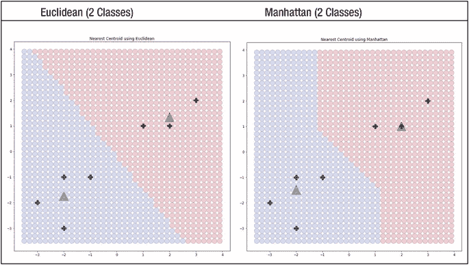 |

你可以清晰地观察到，简单的不同测量技术如何影响质心计算。

这些变化可能对解空间产生重大影响。

### 警告

请注意 `'manhattan'` 设置，因为它会产生意想不到的结果，而现实世界解空间中的大多数人并不能立即理解这些结果。大多数人使用直线距离，而曼哈顿距离则使用直角行进。

我现在将向你展示此过程中的另一个小问题。

让我们研究一下三个类别会产生什么结果（表 4-3）。

表 4-3

三个类别：欧几里得距离 vs. 曼哈顿距离

| 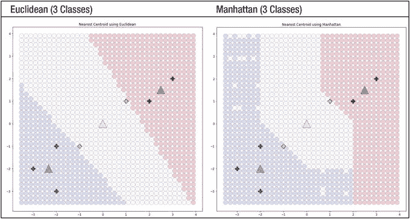 |

哇，看看右侧基于 `'manhattan'` 的图。有几个决策区域显示为不合逻辑的白色区域。原因是该数据集的训练和预测之间存在舍入问题。

另一个更次要的错误是，一个白色点被预测为白色，但它位于蓝色域内。

这是因为该点位于通往两个相邻蓝色区域的对角路径上。在 Jupyter 软件中打开示例 Jupyter Notebook：`Chapter 004 Example 021E.ipynb`，研究一个现实世界的水污染示例（图 4-34）。

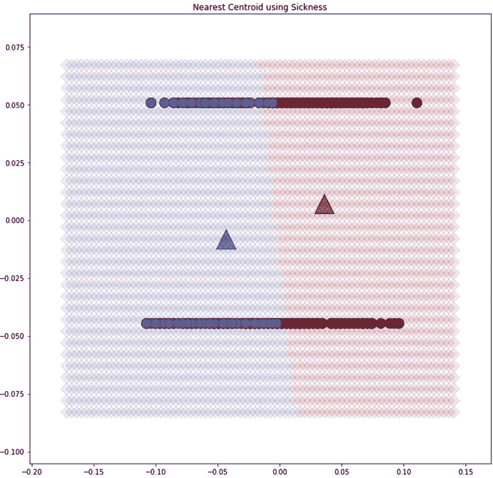

图 4-34

水污染最近质心聚类

在 Jupyter 软件中打开示例 Jupyter Notebook：`Chapter 004 Example 022.ipynb`。

```
The threshold parameter is for shrinking centroids to remove features.
```

你的结果如图 4-35 所示。

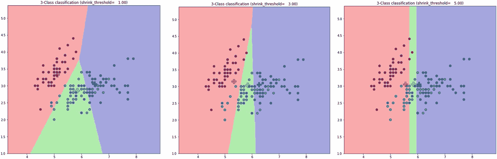

图 4-35

收缩阈值参数


### 警告

请尝试调整你的收缩阈值参数，因为不恰当的参数可能会完全改变最终结果（表 4-4）。

表 4-4

通过收缩阈值丢失的特征

| 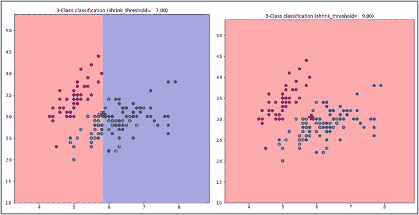 |

你可以关闭此笔记本。

至此，你应该已经能够调整各种机器学习模型上的超参数了。

#### 神经网络

神经网络是一个相互连接的节点群，类似于人脑中庞大的神经元网络。在人工神经网络中，每个节点代表一个人工神经元，箭头则表示从一个人工神经元的输出到另一个神经元输入的连接。

神经网络能够模拟人类的决策过程。目前，网络的能力大多只是决策过程的简化版本。当前，神经网络经过训练，可以对现实世界的决策处理进行一种狭窄的投影。

例如，神经网络可以被训练来识别不同的图片，然后用于识别闭路电视监控画面中相似的图像。

我将使用以下决策过程：假设大楼入口处有两扇门；安全状态的规则是：只要有一扇门打开即可。因此，如果两扇门都关闭，则无法进入；或者如果两扇门都打开，则表明出现错误，需要派遣保安。

在你的 Jupyter 软件中打开示例 Jupyter Notebook：Chapter 004 Example 023A.ipynb。

接下来，你将学习如何构建一个神经网络来解决异或逻辑门问题，如图 4-36 所示。

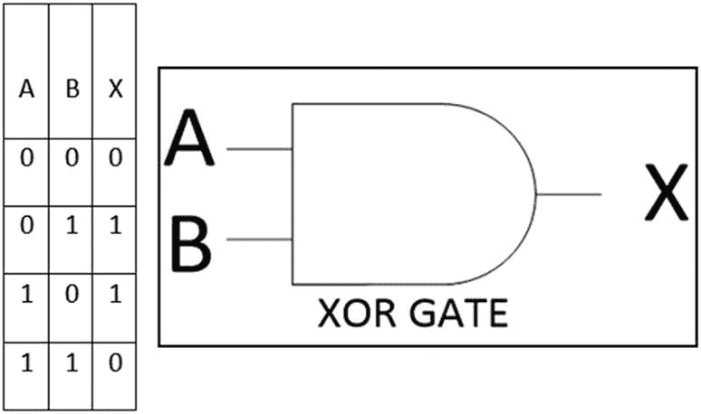

图 4-36

用于解决异或逻辑门的神经网络

运行 Jupyter Notebook 来计算结果。

你的结果：

```

运行异或门网络：[2, 4, 1]

轮次：000000
轮次：010000
轮次：020000
轮次：030000
轮次：040000
轮次：050000
轮次：060000
轮次：070000
轮次：080000
轮次：090000

结果：

[0,0] p=0.000285 y(p)=0 y(t)=0
[0,1] p=0.981030 y(p)=1 y(t)=1
[1,0] p=0.982048 y(p)=1 y(t)=1
[1,1] p=0.000511 y(p)=0 y(t)=0
```

如你所见，网络对预测结果给出了合理的建议。

这个例子是一个简单的二元决策流程，但它可以被工业化，用于处理极其复杂和高维的问题，这些问题可能有成千上万甚至数百万个变量影响过程的最终结果。

神经网络领域是机器学习领域的一部分，在未来几年内将经历多次演变，以帮助数据科学专家对当前看似超出我们能力范围的复杂问题进行建模。

### 预测

到 2025 年，神经网络将作为插件硬件模块应用于大多数移动设备。到 2020 年，边缘计算将使用神经网络作为预测模型。

你可以运行以下 Jupyter Notebook 来测试其他逻辑门：

*   Chapter 004 Example 023B.ipynb - 或门
*   Chapter 004 Example 023C.ipynb - 与门
*   Chapter 004 Example 023D.ipynb - 同或门

逻辑门输出的预测在机器人技术中用于根据已知的预期输出来预测物联网设备的输出。

## 多层感知器

多层感知器（MLP）是一类前馈人工神经网络。一个 MLP 至少由三层节点组成：输入层、隐藏层和输出层。除了输入节点外，每个节点都是一个使用非线性激活函数的神经元。MLP 使用一种称为反向传播的监督学习技术进行训练。

### 正则化参数 ‘alpha’

多层感知器中这种变化的正则化，是在你的合成数据集上对正则化参数 ‘alpha’ 的不同值进行比较。该图显示，不同的 alpha 值会产生不同的决策函数。

*   Alpha 是正则化项（也称为惩罚项）的参数，它通过约束权重的规模来避免过拟合。增加 alpha 可以通过鼓励更小的权重来修正高方差（过拟合的标志），从而导致决策边界图的曲率变小。
*   同样，减小 alpha 可以通过鼓励更大的权重来修正高偏差（欠拟合的标志），可能导致复杂的决策边界。

示例：

在你的 Jupyter 软件中打开示例 Jupyter Notebook：Chapter 004 Example 024.ipynb。

你可以运行完整的 Jupyter Notebook 来观察 alpha 超参数的影响。

你的结果显示在图 4-37 中。

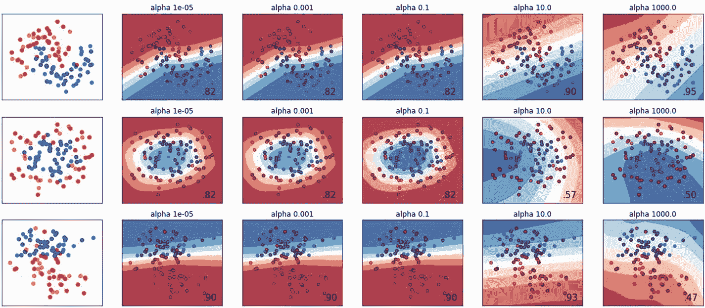

图 4-37

数据影响研究

### 随机学习策略

此时，你将通过可视化不同随机学习策略（包括 SGD 和 Adam）的训练损失曲线，来比较 MLPClassifier 的随机学习策略。由于时间限制，我建议你使用几个小型数据集，对于这些数据集，L-BFGS 可能更合适。但该算法也可以处理更大的数据集，结果相似，唯一的代价是随着数据量增加，处理速度会变慢。

### 警告

结果可能高度依赖于学习率参数的值。

在你的 Jupyter 软件中打开示例 Jupyter Notebook：Chapter 004 Example 025.ipynb。

多层感知器分类器是一种使用 LBFGS 或随机梯度下降来优化对数损失函数的模型。

我构建了一个示例，该示例遍历所有可能的超参数，并创建一个通用图来展示不同的结果。

你的结果显示在图 4-38 中。

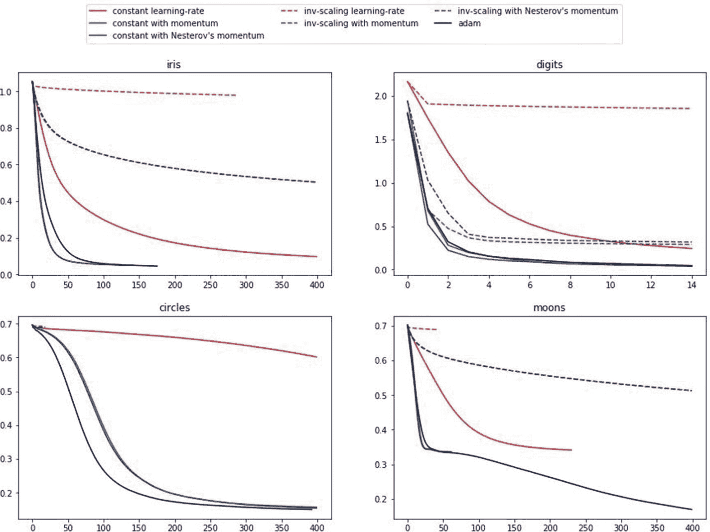

图 4-38

随机学习策略

这个示例向你展示了不同的学习参数针对不同的数据集会产生显著不同的结果。

## 下一步是什么？

你已经成功完成了第 4 章以及监督学习的第一部分。

接下来，我将在第 5 章（监督学习的第二部分）中介绍更多的监督机器学习技术。

首先，我建议你去泡杯咖啡或茶。享受这段时光，重新思考你学到的新知识，并为下一章《工业化机器学习》做好准备。

