# 5. 监督学习：高级算法

这是监督学习过程的第二部分。你现在正在学习监督学习生态系统中更高级的机器学习算法。

## 提升（元算法）

这些算法在工业化机器学习生态系统中被广泛使用，因为它们能解决你在示例及其解决方案中将会遇到的许多常见问题。提升算法使用一组低准确率的分类器来创建一个高准确率的分类器。

其基本概念（图 5-1）是将机器学习链接成一个处理链，以获得改进的结果。

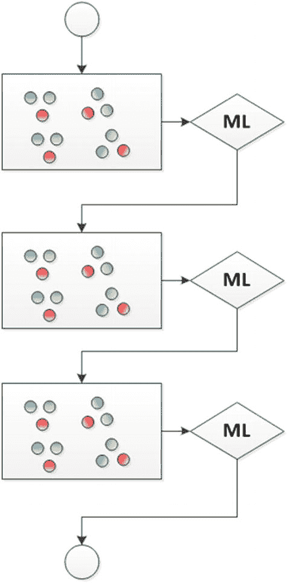

图 5-1 机器学习提升概念

这是一个复杂的介绍。我将快速解释一下弱学习器的概念。

“弱学习器”是一种机器学习算法（用于回归/分类），其准确率仅略高于随机猜测。

### AdaBoost（自适应提升）

AdaBoost 或自适应提升是一种方法，它使数据科学家能够增强数据处理的结果，从而获得更好的效果。

AdaBoost 分类器是一种元估计器，它首先在原始数据集上拟合一个分类器，然后在同一数据集上拟合该分类器的额外副本，但会调整错误分类实例的权重，使得后续的分类器更专注于处理困难的案例。

示例：

在你的 Jupyter 软件中打开示例 Jupyter Notebook：`Chapter 005 Example 001A.ipynb`。

使用 A 部分，激活你所需的核心库。

以下三个导入对于你需要执行的工作很重要。

```
from sklearn.ensemble import AdaBoostClassifier
```

AdaBoost 分类器使用 AdaBoost-SAMME 算法集。

这个特定示例使用的是 SAMME 离散提升算法。

你需要的下一个结构是你想要提升的机器学习算法。

你正在使用支持向量分类（`SVC`）算法。

```
from sklearn.svm import SVC
```

数据工程使用标准缩放器来准备特征。

```
from sklearn.preprocessing import StandardScaler
```

该转换器通过移除均值并缩放到单位方差来标准化特征。

现在你已经有了基本工具，我将向你展示如何构建一个提升解决方案。

B 部分和 C 部分提供你所需的数据。我建议我们使用关于我的玫瑰的数据。

在 D 部分，你使用转换器来执行你所需特征的缩放。

```
transformer = StandardScaler(copy=True, with_mean=True, with_std=False)
```

这会转换数据以支持更好的训练过程。

转换器的结果是：

```
Features: 3
Samples: 420
Scale: None
Mean: [5.82341667 3.07140952 1.22077619]
variance: None
```

在 E 部分，你创建准备好供 AdaBoost 使用的 `SVC`。

```
svc=SVC(max_iter=5000,
gamma='auto',
class_weight='balanced',
probability=True,
kernel='linear',
random_state=0,
verbose=False)
```

这个 `SVC` 将被 AdaBoost 使用。

在 F 部分，你将执行单次提升循环：

```
clf1 = AdaBoostClassifier(algorithm='SAMME',
n_estimators=1,
base_estimator=svc,
learning_rate=1,
random_state=0)
clf1.fit(X_train_scale, y_train)
score1 = clf1.score(X_test_scale,y_test)
```

得分结果是：67.2222%

在 G 部分，你执行 5 次循环，得分是：67.7778% - 有提升！

在 H 部分，你执行 10 次循环，得分是：73.33333% - 有提升！

在 I 部分，你执行 20 次循环，得分是：73.3333% - 没有提升？

提升只会改善到一定程度，之后你只是在浪费时钟周期而没有任何实际收益。

你已成功将 67.2222% 提升到 73.3333%，提升了 9.09%。

你可以关闭已成功完成的 notebook，这是你的第一个提升示例。

在你的 Jupyter 软件中打开示例 Jupyter Notebook：`Chapter 05 Example 001B.ipynb`。

我们将完成另一个示例，但这个示例使用了不同的基础机器学习算法和缩放器。

请参阅 D 部分，了解名为 `RobustScaler` 的缩放器。该缩放器使用对异常值具有鲁棒性的统计量来转换特征，因为它会移除中位数并根据分位数范围缩放数据。

E 部分是你开始使用 `ExtraTreeClassifier` 作为基础机器学习过程的地方。

在 I 部分，你将使用 1000 次循环的提升。

要使 Jupyter Notebook 显示 1000 次循环，你需要执行以下修改：

```
%%javascript
IPython.OutputArea.prototype._should_scroll = function(lines) {
return false;
}
```

正如你在 J 部分所观察到的，你实现了得分从 70.270% 到 97.200% 的提升，提升了 38.324%！这就是提升的力量。

你可以关闭这个 notebook。

接下来，我们将研究一个提升解决方案的值域结果。

打开示例 Jupyter Notebook：`Chapter 05 Example 001C.ipynb`

执行整个 notebook。

通过该解决方案的提升，你实现了从 69.440% 到 82.220% 的提升。

我希望你注意一下在 1 次和 5 次提升之间缺乏改进的情况。

如果我们绘制预测值域，你会观察到值域发生了重大偏移。

你将得到以下四个结果（图 5-2 和图 5-3）。

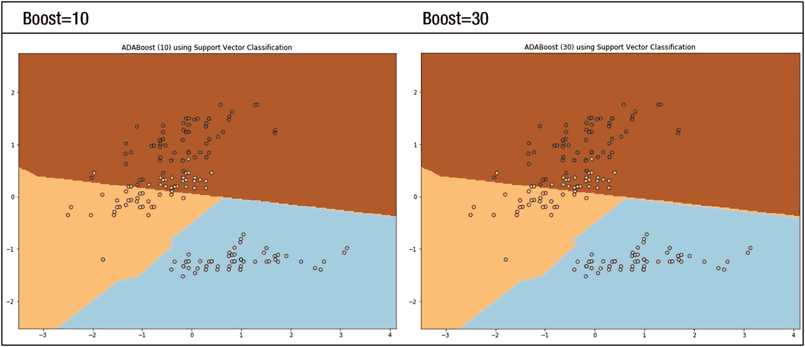

图 5-3 AdaBoost 不改变值域

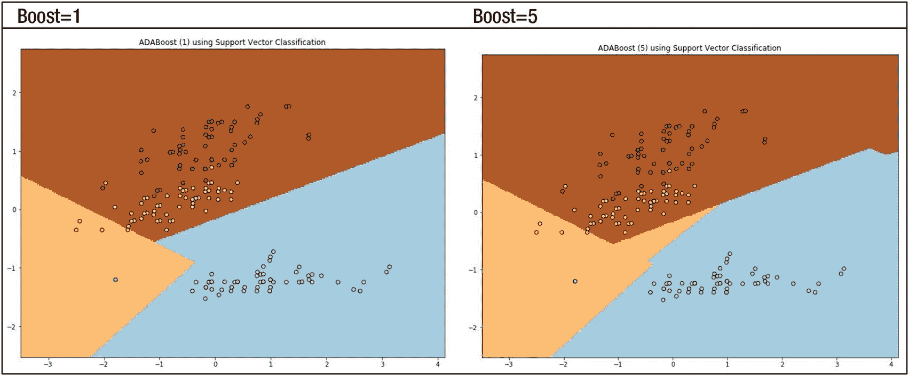

图 5-2 AdaBoost 改变值域

由于在域边界上缺乏测试数据，这种偏移不会在得分中体现出来，因为你没有在这些边界上进行测试。

始终检查你的数据是否覆盖了整个值域！

你可以关闭这个 notebook。做得好；你现在可以执行提升了。

### 梯度树提升

梯度提升是一种用于回归和分类解决方案的机器学习技术，它以弱预测模型（通常是决策树）集成的形式生成预测模型。

示例：

在你的 Jupyter 软件中打开示例 Jupyter Notebook：`Chapter 005 Example 002.ipynb`。

核心引擎是：

```
from sklearn.ensemble import GradientBoostingClassifier
```

H 部分中的以下命令激活了提升：

```
clf = GradientBoostingClassifier(**params)
```

你的结果显示在图 5-4 中。

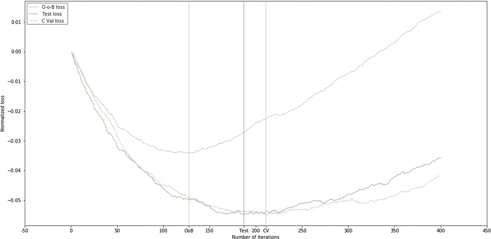

图 5-4 梯度树提升

你可以关闭这个 notebook。

### XGBoost

XGBoost 提供了一个梯度提升框架。它作为一个机器学习库非常成功。

该流程支持分布式处理框架 Apache Hadoop、Apache Spark 和 Apache Flink。这使得该框架具有高度可扩展性，并因此成为最常用的库之一。

Python 库的安装方式如下：

```
conda install -c conda-forge xgboost
或
conda install -c anaconda py-xgboost （我个人选择的是这个）
```

示例：

在你的 Jupyter 软件中打开示例 Jupyter Notebook：`Chapter 005 Example 003.ipynb`。

在 A 部分，你加载 `xgboost` 引擎：

```
from xgboost import XGBClassifier
```

在 C 部分，你通过以下方式使用它：

```
进入`/path.to/xxx`目录，找到`xxx.json`。

在表达式`cvar = avar + bvar`中，加法运算符（`+`）将`avar`与`bvar`相加，得到它们的和`cvar`

在`List.of(arg0, arg1, arg2)`中，`List`接口的工厂方法`of()`接受一系列的元素，返回包含它们的只读列表。

之后我们这样调用`cmd`命令：`cmd arg0 arg1 arg2`。

```
if (condVar > someVal) {console.log("xxx")}
```
```

```
xc = XGBClassifier(max_depth=12,
learning_rate=0.05,
n_estimators=1968,
nthread=8)
```

你的结果：

准确率：82.05128%

你可以使用 E 部分来打开机器学习的输出。

现在你可以关闭这个 notebook。

提升算法的示例到此结束。

现在你应该能够理解如何使用流程提升算法来辅助你的机器学习，以改进模型的训练。

模型训练是 IML 建模部分中最昂贵的环节。

接下来，我们将研究一种新兴算法，即 TensorFlow。

### TensorFlow

TensorFlow 是一个用于跨多种任务进行数据流编程的开源软件库。它是一个符号数学库，也用于神经网络等机器学习应用。

TensorFlow 由 Google Brain 团队于 2015 年 11 月开发。TensorFlow 可以在多个 CPU 和 GPU 上运行。

### 提示

来自 Google 的机器学习速成课程（MLCC）将使你能够为 TensorFlow 打下更好的基础。

如果你想了解更多背景信息，我建议你访问：[`https://www.tensorflow.org/learn`](https://www.tensorflow.org/learn)

### 提示

TensorFlow 社区是一个强大且发展完善的群体。

[`https://www.tensorflow.org/tutorials`](https://www.tensorflow.org/tutorials)

### 提示

由于 TensorFlow 是由 Google Brain 团队开发的，我建议使用：[`https://colab.research.google.com/notebooks/welcome.ipynb`](https://colab.research.google.com/notebooks/welcome.ipynb)

你只需上传示例即可使用它们。

### 注意

本书中我使用的是自己安装的 TensorFlow。

将 TensorFlow 库安装到 Python 中：

```
conda install -c conda-forge tensorflow
```

我将向你展示使用 TensorFlow 进行机器学习的基本构建模块。

TensorFlow 在处理数据并将其转化为有洞察力的信息方面具有强大的能力。

在你的 Jupyter 软件中打开示例 Jupyter Notebook：`Chapter 005 Example 004.ipynb`。

### 注意

你正在直接使用 TensorFlow。

在本章后面，我将向你展示如何使用 Keras 作为接口。

在 A 部分，你将看到通过 `import tensorflow as tf` 加载 TensorFlow 接口。

在 B 部分，你将执行一些基础数学运算来介绍基本概念。

你按如下方式声明常量：`a = tf.constant(5)`。这是为了实现`a=5`。

那么让我们执行这些计算：

```
a=5.000, b=10.000, c=20.000, d=12.000, e=89.000
x=5.000 + 10.000 + 20.000
常量加法：x = 35
y=5.000 x 10.000 x 20.000
常量乘法：y = 1000
z=2.000 ^ 12.000
常量乘方：z = 4096
s=sqrt(89.000)
常量平方根：s = 9
```

我将向你展示如何使用 TensorFlow 执行矩阵运算。

创建一个生成 1x3 矩阵的常量操作。该操作作为节点添加到默认图中。构造函数返回的值代表常量操作的输出。

```
创建一个生成 1x4 矩阵的常量。
matrix1 = tf.constant([[10., 11., 12.,13.]])
创建另一个生成 4x1 矩阵的常量。
matrix2 = tf.constant([[14.],[15.],[16.],[17.]])
```

创建一个以 `matrix1` 和 `matrix2` 为输入的 Matmul 操作。返回值 `product` 代表矩阵乘法的结果。

```
product = tf.matmul(matrix1, matrix2)
```

要运行 matmul 操作，我们调用会话的 `run()` 方法，并传入 `product`。

该操作的输出以 numpy `ndarray` 对象的形式返回在 `result` 中。

```
with tf.Session() as sess:
    result = sess.run(product)
    print(result)
```

你的结果：

[[718.]]

研究 G 部分的计算以测试系统的能力：将 `i=1000` 并看看它的威力！

恭喜你，你已经可以执行基本的 TensorFlow 处理了。

### 预测

TensorFlow 目前是机器学习生态系统中的主要工作主力。我预测这个库及其配套生态系统将在 2025 年成为领先系统。

在开始运行接下来的示例之前，理解以下术语很重要：

**Epoch（周期）**

一个 epoch 是对给定数据样本的一次完整迭代。epoch 的数量是算法将要循环或迭代的次数。epoch 的数量直接影响训练步骤的结果。epoch 太少可能导致你的算法只达到局部最小值，但你使用的 epoch 越多，当达到全局最小值或至少更好的局部最小值时，结果会更好。

**Layers（层）**

机器学习模型是通过组合和堆叠称为层的逻辑链来组装的。将具有精确功能目的的层分离出来，可以得到更简单、更可复用的层。

TensorFlow 提供了一组预配置的、有用的通用层，为你的机器学习支持一个高效且有效的处理环境。

你的模型将由这些层创建的多个有用操作层组成。

**Estimators（估计器）**

估计器是 TensorFlow 最具可扩展性和面向生产环境的模型类型，它使你能够使用预制的估计器，从而将你的处理工作提升到比基础 TensorFlow 支持更高的概念层面。这是 TensorFlow 取得巨大成功的一个特性。

**Checkpoints（检查点）**

检查点是在训练期间创建的模型版本，并保存以备后用。这对于确定新模型相对于旧模型的成功程度非常有用。

现在你可以验证如何在其他数据处理示例中使用 TensorFlow。

打开示例 notebooks：

*   Jupyter Notebook: `Chapter 005 Example 005A.ipynb`

查看 `Chapter-005-Example-005A-01.txt` 中的结果

*   Jupyter Notebook: `Chapter 005 Example 005B.ipynb`

查看：准确率 0.9333

*   Jupyter Notebook: `Chapter 005 Example 005C.ipynb`

查看 `Chapter-005-Example-005C-01.txt` 中的结果

完成这些工作簿后，你就完成了 TensorFlow 的学习。

### 贝叶斯统计

贝叶斯统计是统计学领域中的一种理论，基于概率的贝叶斯解释，其中概率表达了对某个事件的相信程度，这种程度会随着新信息的收集而改变，而不是基于频率或倾向性的固定值。

#### 伯努利试验

伯努利试验是一种只有两种结果的随机实验，通常标记为“成功”或“失败”，其中每次试验成功的概率完全相同。成功的概率由 θ 表示，θ 是介于 0 和 1 之间的一个数。因此 θ∈[0,1]。

在你的 Jupyter 软件中打开示例 Jupyter Notebook：`Chapter 005 Example 006A.ipynb`。

在这个示例中，我们将使用一个名为“抛硬币”的游戏来演示如何预测处理“成功”或“失败”的解决方案。

这可以是：

*   你赢得了客户，或者失去了他们。

*   你的产品成功或失败。

*   机器人摘取草莓，或者将其留在地里。

你可以将此应用于任何二元结果的解决方案。

现在，运行整个 notebook，就像你通过让硬币正面朝上来追求成功一样！

你的结果如下：
```

```
Perform Test (001):      0 trials,      0 heads,      0 tails ->  0.0000 %
Perform Test (002):      2 trials,      1 heads,      1 tails -> 50.0000 %
Perform Test (003):     10 trials,      5 heads,      5 tails -> 50.0000 %
Perform Test (004):     20 trials,      9 heads,     11 tails -> 45.0000 %
Perform Test (005):     50 trials,     23 heads,     27 tails -> 46.0000 %
Perform Test (006):    500 trials,    246 heads,    254 tails -> 49.2000 %
Perform Test (007):   1000 trials,    488 heads,    512 tails -> 48.8000 %
Perform Test (008):  10000 trials,   4957 heads,   5043 tails -> 49.5700 %
```

你的图形结果如图 5-5 所示。

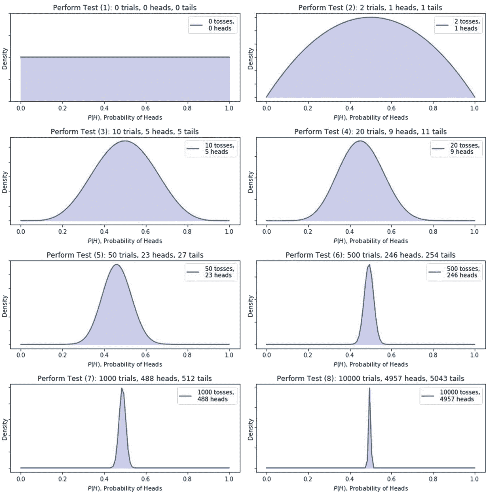

图 5-5 伯努利试验

你可以观察到，随着试验次数的增加，“正面概率”会越来越接近你所期望的公平的 50%。

你可以保存你的 notebook，或者使用以下参数进行实验：`number_of_trials = [0, 2, 10, 20, 50, 500, 1000, 10000]`

参见：`Chapter 005 Example 006A.ipynb`，了解一个包含 20 次试验的斐波那契示例。

接下来，我们将讨论执行 IML 通常需要了解的常识。

## 基于案例的推理

基于案例的推理（CBR）（图 5-6），通常解释为，基于过去类似问题的解决方案来解决新问题的过程。

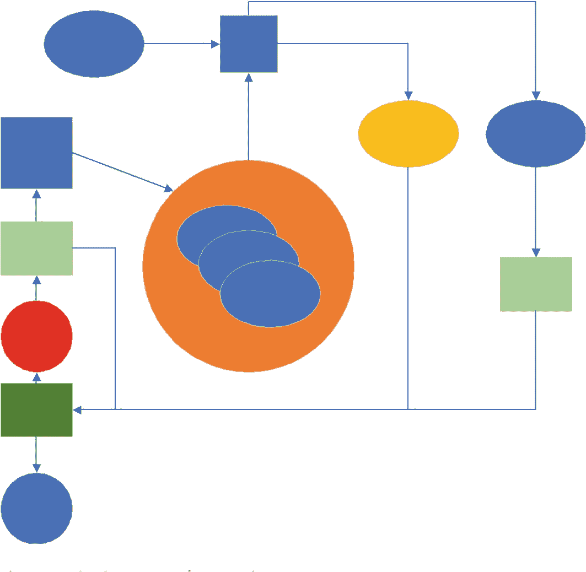

图 5-6 基于案例的推理

为了计算机推理的目的，基于案例的推理被形式化为一个四步过程。

### 检索

给定一个目标问题，从记忆中检索与解决该问题相关的案例。一个案例包括一个问题、其解决方案，以及通常关于如何推导出该解决方案的解释。例如，假设安格斯想准备肉桂咖啡。作为一名新手咖啡师，他能回忆起的最相关经历是他成功制作纯咖啡的一次经历。他制作纯咖啡所遵循的步骤，以及沿途决策的解释，构成了安格斯的参考案例。

### 复用

将先前案例的解决方案映射到目标问题。这可能涉及根据需要调整解决方案以适应新情况。在咖啡的例子中，安格斯必须调整他的参考解决方案，以加入肉桂。

### 修正

将先前的解决方案映射到目标情况后，在现实世界（或模型）中测试新解决方案，并在必要时进行修正。假设安格斯通过向热水中添加肉桂棒来调整他的咖啡解决方案。混合后，他发现咖啡里有肉桂棒碎片，而不仅仅是味道——这是一个不期望的效果。这提示了以下修正：将水加入咖啡的步骤推迟到水过滤之后，然后再用过滤后的水来制作咖啡。

### 保留

在解决方案成功适应目标问题后，将由此产生的经验作为新案例存储在记忆中。因此，安格斯记录了他新发现的制作肉桂咖啡的方法，从而丰富了他存储的经验集，并为未来的咖啡制作需求做好了更充分的准备。

## 强化学习

强化学习（RL）（图 5-7）是机器学习的一个子学科。它被认为是监督学习和无监督学习的混合体。它模拟了基于试错的人类学习方式，就像安格斯现在会做肉桂咖啡一样。我们将在第 9 章详细讨论这一点。

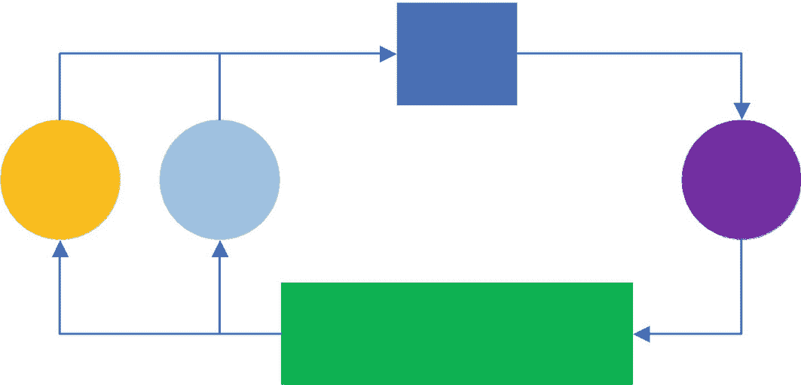

图 5-7 强化学习

### 归纳逻辑编程

归纳逻辑编程（ILP）是一个在机器学习和逻辑编程交叉领域形成的研究领域。

### 高斯过程回归

在概率论和统计学中，高斯过程是一种随机过程，其任意有限个随机变量的集合都服从多元正态分布，也就是说，任意有限个值的线性组合都服从正态分布。高斯过程的分布是随机变量的联合分布，也是连续域（例如时间或空间）内函数的分布。

涉及高斯过程的机器学习算法使用惰性学习和点之间的相似性度量（核函数），根据训练数据预测未见点的值。

示例：

在你的 `Jupyter` 软件中打开示例 `Jupyter Notebook`：`Chapter 005 Example 007.ipynb`。

我使用了 `sklearn.gaussian_process.GaussianProcessRegressor` 引擎。

我使用这个机器学习过程也是为了演示，向函数 `y = 1.968 ∗ (x ∗ np.cos(x))` 的观测值中添加噪声如何提高正确预测值的概率。

对于 A 部分，你只需直接使用观测值，即无噪声。

```
gp = GaussianProcessRegressor(kernel=kernel,
optimizer='fmin_l_bfgs_b',
alpha=1e-10,
n_restarts_optimizer=10,
random_state=0)
```

在 B 部分，你通过 Tikhonov 正则化将噪声添加到 `GaussianProcessRegressor` 引擎的 `alpha` 超参数中：

```
y = f(X).ravel(); dy = 0.5 + 1.0 * np.random.random(y.shape);
noise = np.random.normal(0, dy); y += noise
gp = GaussianProcessRegressor(kernel=kernel,
optimizer='fmin_l_bfgs_b',
alpha=dy ** 2,
n_restarts_optimizer=10,
random_state=0)
```

你的结果如图 5-8 和图 5-9 所示。

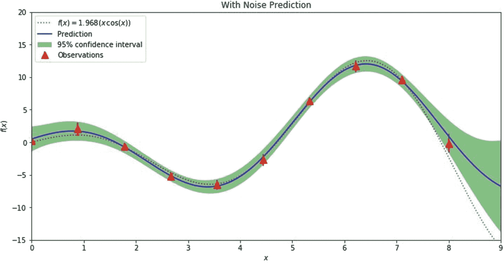

图 5-9 高斯过程回归（2）

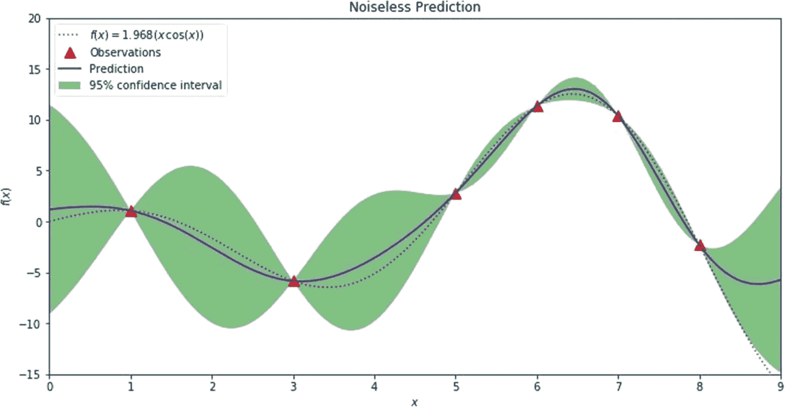

图 5-8 高斯过程回归（1）

你可以清楚地看到，添加噪声后的改进效果非常显著。

### 提示

通过对许多现实生活中的机器学习训练集添加噪声来进行惩罚，是一种确保模型能训练更多观测值并提高预测质量的良好实践。

现在你可以关闭此笔记本。

以下示例将介绍更多应用噪声来解决更复杂需求的技术。

在你的 `Jupyter` 软件中打开示例 `Jupyter Notebook`：`Chapter 005 Example 008.ipynb`。

方案 A 的解决方案覆盖了核心观测值，但在处理异常值时效果不佳。

你的结果显示在图 5-10 中。

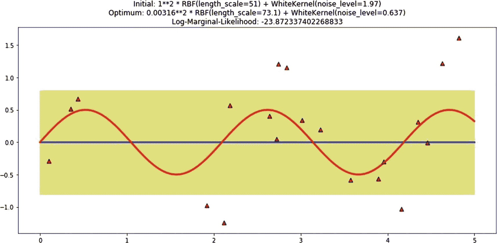

图 5-10 使用 Tikhonov 正则化的高斯过程回归 (1)

概率带也导致了预测问题，并且得分不准确，仅为 -4.3556%。

你需要通过核函数更好地添加噪声。

方案 B 的解决方案以更好的方式覆盖了核心观测值和异常值。

概率带表现更好，得分为 66.6001%。

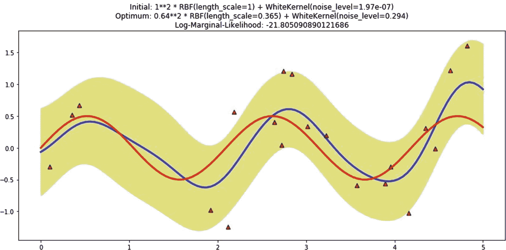

图 5-11 使用 Tikhonov 正则化的高斯过程回归 (1)

方案 C 的解决方案以更好的方式覆盖了核心观测值和异常值。

概率带表现更好，得分为 66.6001%。

你可以关闭此笔记本。

现在你应该明白，通过添加一部分噪声可以改进模型的预测。

### 核密度估计

核密度估计是一种估计连续随机变量概率密度函数（PDF）的非参数方法。它是非参数的，因为它不假设变量具有任何潜在分布。

示例：

在你的 `Jupyter` 软件中打开示例 `Jupyter Notebook`：`Chapter 005 Example 009.ipynb`。

在此示例中，我们研究一组已知值，即手写数字；然后推断出一组我们可能期望的数字。
```

### 使用PCA、网格搜索与随机森林

你将使用主成分分析（PCA）过程，通过对数据进行奇异值分解来执行线性降维，从而将数据投影到低维空间。

之后，你将使用网格搜索交叉验证进行五次循环的核密度估计。

```
{'cv': 10,
'error_score': 'raise-deprecating',
'estimator__algorithm': 'auto',
'estimator__atol': 0,
'estimator__bandwidth': 1.0,
'estimator__breadth_first': True,
'estimator__kernel': 'gaussian',
'estimator__leaf_size': 40,
'estimator__metric': 'euclidean',
'estimator__metric_params': None,
'estimator__rtol': 0,
'estimator': KernelDensity(algorithm='auto', atol=0, bandwidth=1.0, breadth_first=True,
kernel='gaussian', leaf_size=40, metric="euclidean",
metric_params=None, rtol=0),
'fit_params': None,
'iid': True,
'n_jobs': -1,
'param_grid': {'bandwidth': array([ 0.1       ,  0.1274275,  0.16237767,  0.20691381,  0.26366509,
0.33598183,  0.42813324,  0.54555948,  0.6951928,  0.88586679,
1.12883789,  1.43844989,  1.83298071,  2.33572147,  2.97635144,
3.79269019,  4.83293024,  6.15848211,  7.8475997, 10.        ]),
'leaf_size': array([35, 36, 37, 38, 39, 40, 41, 42, 43, 44, 45, 46, 47, 48, 49, 50, 51, 52, 53, 54]),
'kernel': array(['gaussian', 'tophat'], dtype='<U8'),
'algorithm': array(['kd_tree', 'ball_tree'], dtype='<U9')},
'pre_dispatch': '2*n_jobs',
'refit': True,
'return_train_score': 'warn',
'scoring': None,
'verbose': 1}
```

最佳参数为：

```
{'algorithm': 'kd_tree',
'bandwidth': 3.79269019073225,
'kernel': 'gaussian',
'leaf_size': 51}
```

网格搜索已为解决方案的训练数据找到了最佳参数集。

结果显示在图 5-12 中。

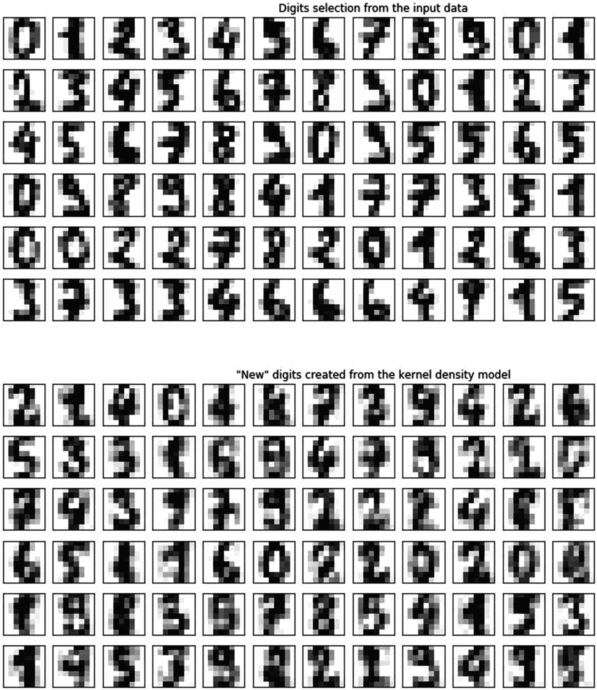

使用网格搜索交叉验证的核密度估计

生成的第二组数字显然与模型对 0、1、2、3、4、5、6、7、8 或 9 范围内手写数字的匹配结果一致。

你现在可以成功使用核密度估计了。

请关闭此笔记本。

### Mayavi 三维可视化工具

接下来，我想向你介绍我在数据科学和机器学习项目中使用的 Mayavi 科学数据三维可视化工具。

```
参见：https://docs.enthought.com/mayavi/mayavi/
```

要在 Python 中使用 Mayavi 进行 3D 科学数据可视化和绘图，你需要：

```
conda install -c anaconda mayavi
```

在你的 Jupyter 软件中打开示例 Jupyter Notebook：`Chapter 02 Example 010A.ipynb`。

这个可视化工具包使你能够创建非常精细的 3D 可视化效果。

如果你执行此笔记本，你将在结果目录中得到以下 3D 图像（图 5-13）。

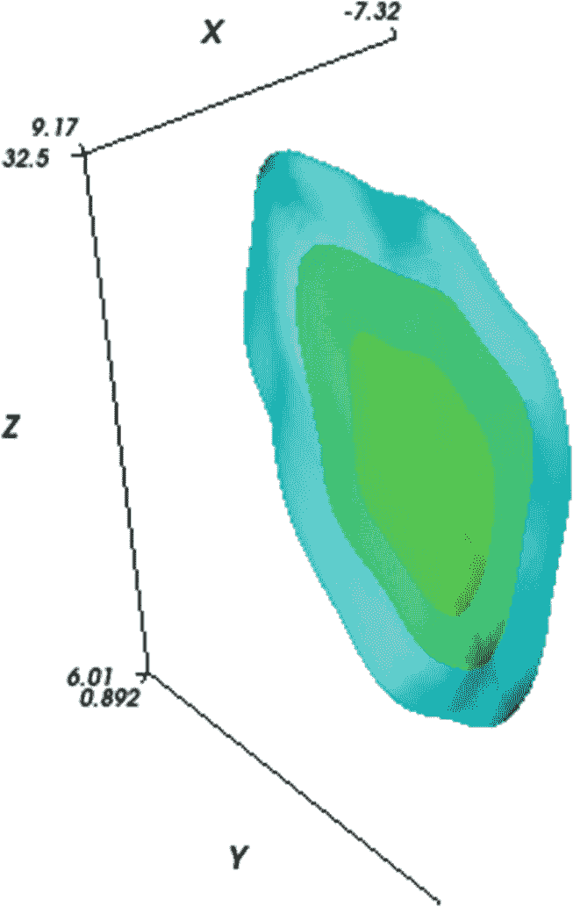

使用 Mayavi 3D 引擎的核密度估计 3D 图

#### 注意

你可以通过放大、缩小或旋转来与这些图像进行交互。

如果你探索 `Chapter 02 Example 010B.ipynb` 和 `Chapter 02 Example 010C.ipynb`，你将看到可能实现的可视化复杂性。

这是一个很棒的可视化工具包。请花时间了解 Mayavi 的功能。

### 随机森林

随机森林是树形预测器的组合，其中每棵树都依赖于一个随机向量的值，该向量独立采样，并且对于森林中的所有树具有相同的分布。随着森林中树木数量的增加，森林的泛化误差会收敛到一个极限。

树分类器森林的泛化误差取决于森林中单棵树的强度以及它们之间的相关性。

#### 示例

在你的 Jupyter 软件中打开示例 Jupyter Notebook：`Chapter 005 Example 011.ipynb`。

运行整个笔记本。

你正在研究两个重要的随机森林引擎。

你的结果将是：

`RandomForestClassifier` 引擎达到：

得分 83.140%

混淆矩阵为：`(tn=2101, fp=396, fn=447, tp=2056)`

`ExtraTreesClassifier` 引擎达到：

得分 87.080%

混淆矩阵为：`(tn=2205, fp=292, fn=354, tp=2149)`

这表明对于这个特定数据集，`ExtraTreesClassifier` 更好。

你可以关闭此笔记本，接下来我们将观察它如何针对一些真实数据进行表现。

在你的 Jupyter 软件中打开示例 Jupyter Notebook：`Chapter 005 Example 012.ipynb`。

运行整个笔记本。

你的结果将对三种颜色的玫瑰数据进行分类。

| 预测种类 | 丰花月季（白色） | 科德斯玫瑰（红色） | 蔷薇科（蓝色） |
| --- | --- | --- | --- |
| **实际种类** |  |  |  |
| 蔷薇科（蓝色） | 0 | 0 | 41 |
| 丰花月季（白色） | 53 | 4 | 0 |
| 科德斯玫瑰（红色） | 0 | 45 | 0 |

四个特征对结果的影响百分比为：

```
叶长 (mm)   :  9.3581%
叶宽 (mm)    :  3.2167%
茎长 (mm)  : 43.2882%
茎宽 (mm)   : 44.1370%
```

你现在可以关闭笔记本了。

你已经完成了随机森林的学习。

接下来，我将向你展示如何处理那些不够完美、需要一些预处理才能变得有用的数据。

### 处理不平衡数据集

不平衡的类别让“准确率”失去了意义。这是机器学习（尤其是分类任务）中一个非常常见的问题，通常出现在各类别观测值比例悬殊的数据集中。

标准的准确率不再能可靠地衡量模型性能，这使得模型训练变得更加棘手。

我将通过展示如何预处理数据集以修复数据结构中的不平衡问题，来教你如何处理这些不准确的数据集。

在我们的第一个示例中，我们将解释这些目标变量如何包含三个类别。

`R` 代表右偏重，即当 `var3 ∗ var4 > var1 ∗ var2` 时


`L` 代表左偏重，即当 `var3 ∗ var4 < var1 ∗ var2` 时


`B` 代表平衡，即当 `var3 ∗ var4 = var1 ∗ var2` 时


使用 `imbalanced-learn` 库

```
conda install -c conda-forge imbalanced-learn
```

我们将使用的 `imbalanced-learn` 库由 Fernando Nogueira 于 2014 年 8 月创建。

在你的 Jupyter 软件中打开示例 Jupyter Notebook：`Chapter 005 Example 013.ipynb`。

在本示例中，你将使用几个标准数据集，以便比较机器学习引擎及其在这些数据集上的表现。

你的结果如图 5-14 所示。

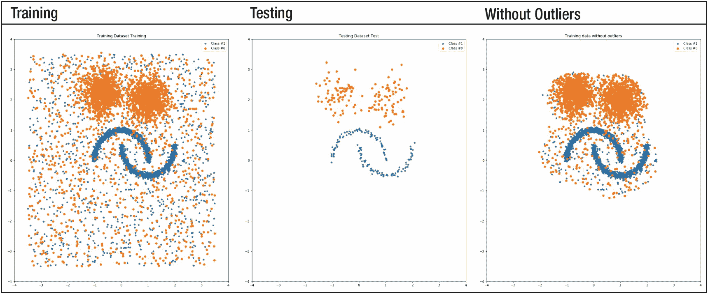

图 5-14

## 处理不平衡数据

不平衡类别出现在许多领域，包括以下这些。

### 欺诈检测

欺诈检测是一个富有挑战性的问题。事实上，欺诈交易在组织数据中本身就很少见；在现实中，它们只占组织活动的一小部分。挑战在于，如果没有合适的工具和系统，这一小部分活动很快就会转化为金钱损失。

犯罪分子非常狡猾。随着老式欺诈手段失效，欺诈者已经学会了改变策略。好消息是，随着机器学习的进步，系统可以学习、适应并发现新兴模式以预防欺诈。

### 垃圾邮件过滤

电子邮件过滤是根据指定标准对电子邮件进行处理的过程。最先进的阶段是对传入消息进行自动处理。

### 疾病筛查

在医学中，筛查是一种在人群中使用的策略，用于识别个体中可能存在的、尚未被诊断出的疾病，这些个体没有表现出任何体征或症状。这通常包括患有症状前或未被识别的症状性疾病的个体。筛查测试相对不常见，因为它们主要针对实际上身体健康的人进行。

### 广告点击率

广告点击率（CTR）是指点击特定链接的用户数与查看页面、电子邮件或广告的总用户数之比。它通常用于衡量特定网站在线广告活动的成功程度以及电子邮件活动的有效性。

## 应用

### 生物信息学

生物信息学是一个跨学科领域，旨在改进用于研究生物数据的方法和软件工具。它是一个结合了信息工程、生物学、计算机科学、数学和统计学的跨学科领域，用于检查和理解生物数据。生物信息学通过应用高级数学和统计技术的机器学习技术得以应用。生物信息学共同致力于在 DNA 研究中识别候选基因和单核苷酸多态性（SNP）。机器学习处理过程的极快速度和巨大容量使其成为优秀数据科学家和机器学习工程师手中的非凡工具。

工业化机器学习在该领域的应用，其有效发现已经超越了许多先前技术数年之久；我们现在正在进行的研究水平，如果没有机器学习的进步，是不可能达到的。

### 数据库营销

数据库营销是一种直接营销形式，它利用客户数据库生成用于直接营销通信的定向列表。数据库包括客户的姓名和地址、电话号码、电子邮件、信息请求、购买历史以及任何其他可以合法准确收集的相关数据。这些数据库的信息是在客户日常进行基本业务活动时收集的。在当今时代，这些重要的数据库被视为高度保密的公司资产，也是监督学习领域中备受追捧的资源。

### 人在回路中

然而，由于监督学习系统依赖于经过正确验证的数据进行训练，机器学习的出现也为人类创造了新的工作岗位。

这些过程被称为“人在回路中”，这种技术使得机器学习能够对已明确分类的数据执行监督学习；但对于那些模棱两可或明显是异常值的数据项，决策权则交还给人类操作员。这个新的决策随后被添加到训练数据中，模型会重新训练。

数据标注在全球范围内已成为一项大生意。许多合法的数据公司收集个人信息，并出售从众多公共来源收集到的客户数据。公共记录只是其中一种选择，但人们通过社交媒体和商业社交网站自愿反复分享的信息，为构建客户数据库提供了更为丰富的资源。

这就造成了一种情况：那些拥有并不违法、但通过非法手段获取的数据，可以在数据源所有者之间流转，而无法识别出那些非法的数据库是如何与专注于公共信息的合法数据库混合在一起的。个人数据随后便在其公开可用性中根深蒂固，尽管这些数据一开始就不应该被公开。

最终的结果可能是，几乎完整的个人隐私信息和生活史都可以出售，而且价格前所未有的低廉。

### 警告

在将数据简单地接入你的机器学习环境之前，请确保你拥有完整的数据溯源以及处理这些数据的法律许可。

我建议你研究一下诸如《通用数据保护条例 2016/679》之类的法规。这是欧盟法律中关于欧盟及欧洲经济区内所有个人数据保护和隐私的法规，以及《2018 年数据保护法》。

在美国，请查阅《联邦贸易委员会法》（15 U.S.C. §§41–58）（FTC 法案）以了解数据保护规则和原则，包括数据控制者的义务和数据主体的同意；访问个人数据或反对其收集的权利；以及安全要求。它还涵盖了 Cookie 和垃圾邮件、第三方数据处理以及数据的国际传输。这些规则详细说明了数据监管机构的权力、其执法权力以及制裁和补救措施。

### 警告

如果在这方面出错，将使你和你的公司面临罚款和其他法律诉讼。

## 机器学习方法论

我想向你介绍一种跨行业的数据挖掘标准流程，通常以其缩写 `CRISP-DM` 而闻名。这是一个数据挖掘过程模型，为数据科学家定义了通用方法，用于处理机器学习项目。

机器学习的七个步骤如图 5-15 所示。

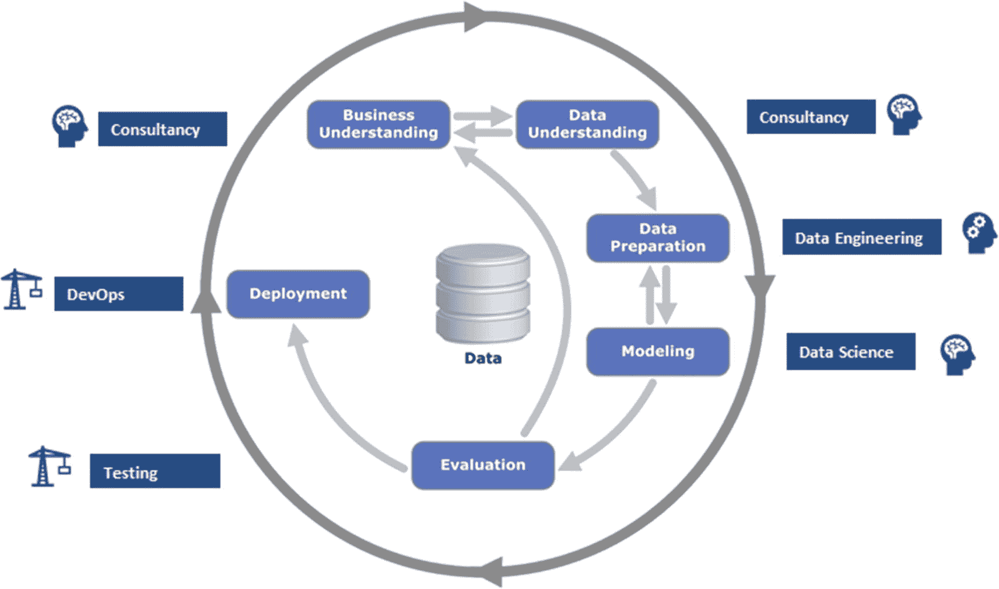

图 5-15

跨行业数据挖掘标准流程 (`CRISP-DM`)

### `CRISP-DM` 中各角色的职责是什么？

####  数据科学家

数据科学家帮助团队选择并实施最高效、最有效的算法和机器学习方法。数据科学家将数据转化为可操作的见解。

####  数据工程师

数据工程师帮助团队提取、转换所需数据并将其加载到数据科学结构中，同时开发用于建模的数据特征。

####  DevOps

`DevOps` 通过自动化、持续测试和集成，确保受控、管理有序地发布到生产环境，从而持续获得高效且有效的投资回报。

### `CRISP-DM` 循环

参见图 5-15。

### 业务理解

`CRISP-DM` 的第一个阶段要求你详细了解业务的需求。你很可能会收到关于业务真实需求的相互竞争或冲突的要求。如果这个阶段没有 100% 正确完成，你最终最多只能为错误的问题提供正确的答案。确保你收集了所有相关的功能性和非功能性需求，以全面了解业务的期望。

#### 项目的预期产出是什么？

此时需要检查的主要事项是确定业务需求的优先级，并将相关的预期产出进行聚类，以提高团队数据科学和数据工程能力的吞吐量。

### 注意

我使用敏捷 Scrum 风格的项目管理方法，首先将所有期望的产出放入待办事项列表中。然后，我们作为一个团队，将待办事项列表处理成合乎逻辑的工作冲刺。

在流程的这一点上，你的工作列表已经确定。

#### 设定目标

在此阶段，你必须从业务角度找到主要目标。这个核心或主要目标是你必须始终回答的唯一答案。

示例：如果你的主要目标是：“如何阻止高价值客户流失？”

你所有的目标都必须支持这一个问题。

次要目标可能是：

*   谁是我的高价值客户？

*   他们为什么离开？

*   我该如何阻止他们？

系统目标必须支持这些主要问题。

*   需要哪些数据？

*   数据是什么格式？

#### 制定项目计划

机器学习解决方案需要与其他任何项目相同的项目计划。此时，应用你标准的项目管理规则。我通常使用敏捷项目流程，因为它对我的客户很有效。

#### 业务成功标准

你必须确定业务认为项目成功的最低标准。

我使用 SMART 标准：

*   **具体性** – 精确说明你要实现的目标。例如，减少 1,000 名客户流失就是好的。

*   **可衡量性** – 所需结果是否可以量化？你能确定状态是什么吗？

*   **可实现性** – 目标是否可能实现？每月阻止 100,000 名客户流失不是一个合理的目标。

*   **现实性** – 确保目标是可以实现的。

*   **时限性** – 必须有一个达成目标的时间期限。

#### 评估当前状况

对当前业务状况的各个方面进行详细的事实调查。确保每个人都接受你的调查结果是起始基线。

确保所有相关人员都理解这些标准。

#### 确定数据目标

确定机器学习过程的详细目标。始终与业务需求相关联。

#### 业务成功标准

描述项目的预期产出，这些产出有助于实现业务目标。

**数据科学、数据工程和机器学习的成功标准**

用技术术语定义项目成功结果的标准。为此，请解释你将如何衡量以及衡量哪些成功标准。

#### 制定项目计划

为所有数据处理目标制定一个预期计划，并说明这些目标如何帮助实现业务目标。你的计划应指定在项目剩余阶段要执行的步骤，包括初步选择机器学习工具和开发新技术。

### 数据理解

CRISP-DM 流程的第二阶段是确定数据和元数据的真实状态。理解数据的来源（数据来自哪里？）和谱系（在你使用数据之前，对数据进行了哪些处理？）。

## 探索数据

这包括你将使用的查询、数据可视化和报告。这些可能包括：

- 关键属性的分布（例如，预测任务的目标属性）
- 成对或少量属性之间的关系
- 简单聚合的结果
- 重要子群体的属性
- 简单的统计分析

这些分析必须有助于或完善数据描述和质量报告，并为进一步分析所需的转换和其他数据准备步骤提供输入。

### 数据探索报告

对所有数据子集执行结构化的数据探索和检查。

## 验证数据质量

检查数据质量，解决诸如以下问题：

- 数据是否完整（是否涵盖了所有必需的项目）？
- 基础数据是否正确，还是包含错误？如果存在错误，错误有多普遍？
- 数据中是否存在缺失值？如果存在，它们是如何表示的，出现在哪里，有多普遍？

### 数据质量报告

生成数据质量验证报告。通常，数据质量问题的解决方案在很大程度上取决于数据和业务知识。

## 数据准备

### 选择你的数据

决定你将用于分析的数据。

#### 包含/排除的理由

确定要包含或排除的数据，以及这些决定的详细信息。

### 清理你的数据

通过清理数据质量，你将减少下游分析技术处理中的工作量，例如通过建模估算缺失数据。

#### 数据清理报告

描述你为解决数据质量问题所做的决定和采取的行动。

#### 特征工程

规划`特征工程`，以提取由一个或多个现有属性构建的新属性。

## 建模

### 选择建模技术

作为建模的第一步，你需要选择将要使用的具体建模技术。尽管在业务理解阶段你可能已经选定了一个工具，但在此阶段，你需要确定具体的建模技术，例如，使用`C5.0`构建决策树，或使用反向传播生成神经网络。如果应用了多种技术，请为每种技术分别执行此任务。

#### 测试设计

规划模型的训练、测试和评估。规划将样本数据集处理为训练集、测试集和验证集所需的操作。

#### 构建模型

在准备好的数据集上运行模型，以创建一个或多个模型。

#### 参数设置

任何模型都有可以调整的特定参数。列出这些参数及其选定的值，并说明选择这些参数设置的理由。

#### 模型

这些是建模工具实际生成的模型。

#### 模型评估

总结所生成模型的结果（例如，从准确率方面），并对其质量进行相互排序。

#### 修订参数设置

在模型评估中规划改进，修订参数设置，并为下一次建模运行进行调整。迭代进行模型构建和评估，直到你确信已经找到了最佳模型。

## 评估

### 数据科学与机器学习结果评估

根据业务成功标准总结评估结果，包括关于项目是否已达到初始业务目标的最终陈述。

### 获批模型

在根据业务成功标准评估模型后，满足一系列标准的已生成模型将成为获批模型。

### 流程回顾

总结流程回顾，并突出显示被遗漏以及应重复执行的活动。

### 确定后续步骤

规划评估和流程回顾；现在你需要决定如何推进。

## 部署

总结你的部署策略，包括必要的步骤以及如何执行这些步骤。

### 监控与维护计划

总结监控与维护策略，包括必要的步骤以及如何执行这些步骤。

### 经验文档

总结在项目过程中获得的重要经验。

干得不错；你已经完成了 CRISP-DM 方法论的全部内容。

## 如何运用这些新知识？

现在你已经掌握了 CRISP-DM 的基本标准方法论，我想向你介绍一个我个人在过去 10 多年里一直在使用的处理系统。它曾是两项硕士研究项目的核心课题，而我的博士研究也将其基本原理用于新的研究流程。

我的数据科学团队也在使用它。

同时，作为数据科学主管，我也在向我的客户传授并建议他们如何使用这一流程。

以下书籍中对此有详细介绍：

- 《实用 Hive：Hadoop 数据仓库系统指南》，作者：Scott Shaw、Andreas François Vermeulen、Ankur Gupta 和 David Kjerrumgaard（Apress，2016 年）。
- 《实用数据科学：构建将数据湖转化为业务资产的技术堆栈指南》，作者：Andreas François Vermeulen（Apress，2018 年）。

## 快速信息工厂生态系统

快速信息工厂生态系统是我用于个人处理开发的一套技术惯例。本书的处理路径将基于此构建，但你并非必须完全使用它。我在本章中讨论的工具对你来说没有使用限制。你可以根据自己特定生态系统的需要，以任何配置或组合方式使用这些工具。

我建议你开始着手构建自己的生态系统，或者直接采用我的。你已经具备了熟悉并熟练部署一套工具的前提条件。

请记住，你的数据湖有其自身的属性和特征。因此，请根据你所处生态系统的特定特性来调整你的工具。

## 使用数据湖的 R-A-P-T-O-R 数据科学流程

### 什么是 R-A-P-T-O-R？

它代表检索-评估-处理-转换-组织-报告。参见图 5-16。

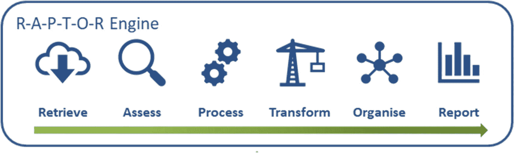

*图 5-16 R-A-P-T-O-R 引擎*

快速信息工厂的 `R-A-P-T-O-R` 引擎引导数据从数据湖出发，依次经过数据管道阶段：检索（导入外部数据源）、评估（数据质量）、处理（合并）、转换（单一事实版本）、组织（特征工程）和报告（业务洞察）。

`R-A-P-T-O-R` 引擎（图 5-16）在数据于数据湖的不同区域之间分布时对其进行转换。


将数据从源系统检索到数据工程环境中。这是源系统中的原始数据。


评估检索到的数据，以识别任何数据质量问题，并修复数据，确保获得更高质量的数据科学数据源。


处理评估阶段的数据，合并同类数据，以生成当前的“单一事实版本”。


将当前“单一事实版本”的快照转换为存储历史的数据仓库。数据特征工程在此处生成数据科学辅助资料。


将“数据仓库”组织成一系列数据集合，供数据科学模型处理。生成数据仓库、数据集市、训练集、测试集和结果数据集。


将数据科学的结果作为每个数据科学案例预先批准的可交付成果进行报告，供标准报告工具使用。

## 什么是数据湖？

数据湖是一个用于存储海量原始数据的存储库。它以原生格式存储数据，以备未来之需。在本书中，您将了解到为什么这对于实际的数据科学和工程解决方案至关重要。与采用写时模式（schema-on-write）的数据仓库将数据存储在预定义的数据库、表和记录结构中不同，数据湖采用限制较少的读时模式（schema-on-read）架构来存储数据。数据湖中的每个数据元素都会被分配一个独特的标识符，并附带一组全面的元数据标签。

数据湖通常使用分布式数据对象存储来部署，以实现读时模式结构。这意味着业务分析和数据挖掘工具无需复杂的模式即可访问数据。使用读时模式方法，您可以按原样加载数据，并立即开始从中获取价值。

我将在第 6、7、8 和 9 章中详细讨论并说明使用读时模式存储方法的原因。

我们部署到云端的方案是一种经济高效的解决方案，它使用 `Amazon Simple Storage Service (Amazon S3)` 来存储数据湖的基础数据。

我将演示如何切实可行地使用云技术来配置您的数据科学工作。不过，本书中的示例无需上云，因为它们可以轻松地在笔记本电脑上处理。

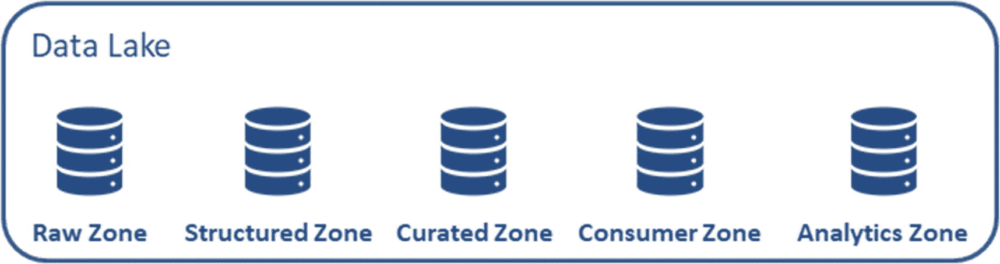

*图 5-17 数据湖六大区域*

这种方法可以利用现有的技术栈，从而降低风险和成本。

### 数据湖区域

参见图 5-17。

# 数据湖区域划分

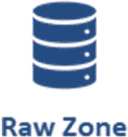

原始区域是所有数据湖外部数据的入口点。它是多个数据提取处理解决方案的端点。


结构化区域用于将原始数据转换为增强型数据源。该区域的数据采用统一格式，以辅助下一区域的处理能力。任何数据质量问题都在此区域解决。


策展区域是整个数据湖当前的单一事实来源。该区域中的数据仓库和数据仓库能够整合和合并来自结构化区域的数据源。“活跃”的数据科学模型结果存储在此区域。


消费区域是存储用于业务洞察的不同数据集市的地方，供最终用户可视化其业务洞察。这是大多数业务人员提出问题的首要区域。

**提示：** 消费区域是唯一根据已批准的服务级别协议（SLA）向活跃客户群开放的区域，以确保系统的其余部分能够进行适当的维护和能力的演进。


分析区域是数据湖的“沙盒”。该区域用于设计、开发和训练新颖的数据科学和机器学习解决方案，然后由 DevOps 将其转移到策展区域。

## 什么是数据仓库？

数据仓库建模由 Dan Linstedt 设计，是一种数据库建模方法，其结构旨在控制来自多个操作系统的数据的长期历史存储。

数据仓库化过程将读时模式的数据湖转换为写时模式的数据仓库。

数据仓库被设计为读时模式查询请求，然后针对数据湖执行。

我也见过将结果存储为写时模式格式，以便为将来的查询持久化结果。

这两种技术的细节将在第 8 章中讨论。目前，我只期望您理解构建数据仓库所需的基本结构。

该结构由三种基本数据结构构建而成：中心表、链接表和附属表。

让我们检查一下这些特定的数据结构，以阐明它们为何是必需的。

### 中心表

中心表包含一个独特的业务键列表，这些键的变更倾向较低。中心表为每个中心表项包含一个代理键，以及业务键来源的元数据分类。

中心表是您数据仓库的核心支柱，我将在第 9 章中更详细地讨论如何以及为何使用这种结构。

### 链接表

业务键之间的关联或事务使用链接表进行建模。这些表本质上是多对多连接表，并带有特定的附加元数据。

链接表是中心表之间的单一关系，以确保准确记录业务关系，从而为实际业务完成数据模型。

在第 9 章中，我将解释您为何需要特定的关系以及如何实现。

### 附属表

中心表和链接表构成了模型的结构，但不存储数据的任何时间特征或描述性特征。这些特征存储在被称为附属表的专用表中。

附属表是存储业务特征全面信息层次的结构，通常是整个数据仓库数据结构中容量最大的部分。在第 9 章中，我将解释这些结构为何以及如何如此有效地对实际业务特征进行建模。

中心表、链接表和附属表的适当组合支持数据科学家构建和存储必要的业务关系。作为数据建模师，这是一项非常受欢迎的技能。

向这种写时模式数据结构的转换将在第 9 章中详细讨论，以指出特定结构为何支持处理方法。

我将在第 9 章中解释……您为何需要特定的中心表、链接表和附属表。

## 下一步做什么？

您已成功完成第 3 章。

现在，您已经对监督学习机器学习过程有了良好的实践知识。

您熟悉 CRISP-DM 方法论，这确保了您的机器学习从实验和假设过渡到 IML。

我分享了自己作为机器学习顾问在日常工作中通过 RIF 使用的知识和流程。

这个过程将在第 15 章的全规模工业化项目中介绍，届时我们将涵盖这些技术的实际应用以及 RIF 的框架。

接下来，我将在第 6 章中介绍无监督机器学习。