# 6. 无监督学习：使用未标记数据

无监督学习是一种机器学习类型，它通过推断一个函数来描述未标记、未分类数据中的隐藏结构，从而获取洞见。训练观测数据中不包含分类或归类。因此，对学习器没有正确或错误的评估，也不对相关算法输出的学习洞见的准确性进行评估。

一方面，无监督学习算法可以执行比监督学习系统更复杂的处理任务。另一方面，无监督学习可能比其他机器学习模型更难以预测。

## 算法

我将讨论在使用无监督学习进行数据处理时的一些核心且常用的算法。我将从最常用的算法之一开始。

### K-最近邻算法

`BallTree` 用于快速处理广义的 N 点问题。

在你的 Jupyter 软件中打开示例 Jupyter Notebook：`Chapter-006A-001- k-Nearest-Neighbor.ipynb`。

你正在研究最近的四个和八个邻居。

使用 `ball_tree` 引擎的 `NearestNeighbors` 执行处理。

```python
nbrs1 = NearestNeighbors(n_neighbors=ncnt1,  algorithm='ball_tree' ).fit(X)
```

你的结果显示在图 6-1（四个邻居）和图 6-2（八个邻居）中。

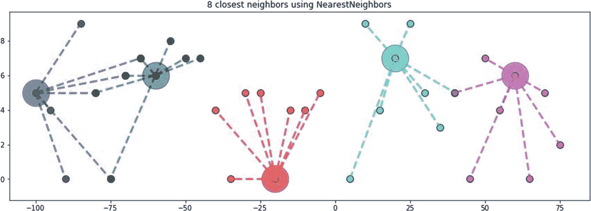
图 6-2

八个最近邻

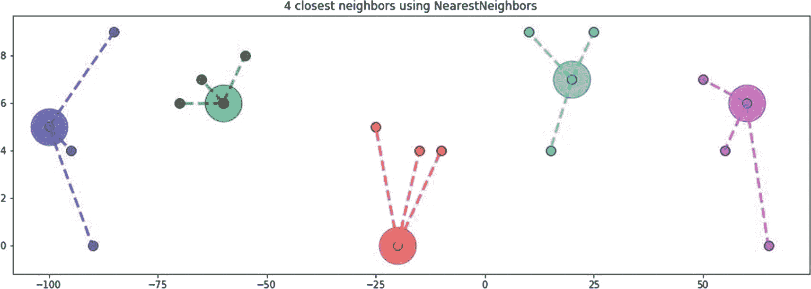
图 6-1

四个最近邻

你可以观察到最近的四个邻居没有共同的邻居，但当扩展到最近的八个邻居时，你开始观察到共同的邻居。这种共同邻居的研究在电子商务中用于决定在你的区域内你会推荐谁或与谁互动，或在医疗保健中用于推断在冬季你可能将讨厌的流感传染给了谁。

请查看 Jupyter Notebook：`Chapter-006B- 001-k-Nearest-Neighbor.ipynb` 和 Jupyter Notebook：`Chapter-006C- 001-k-Nearest-Neighbor.ipynb`，以观察如何将相同的算法应用于英国和美国的邮政编码解决方案。

还有 Jupyter Notebook：`Chapter-006D- 001-k-Nearest-Neighbor.ipynb` 和 Jupyter Notebook：`Chapter-006E- 001-k-Nearest-Neighbor.ipynb`。你能确定这些地点在世界上的位置吗？

确定最近兴趣点（最近邻）的能力是 IML 在机电一体化中用于确定特定资源或工作空间的最短或最近来源的能力。

在第 15 章中，我将演示如何使用它来确定采矿位置。

### 聚类 K-Means

#### Voronoi 单元

K-means 聚类是一种向量量化方法，最初来自信号处理，在数据挖掘的聚类分析中很流行。K-means 聚类旨在将 n 个观测值划分为 k 个聚类，其中每个观测值属于具有最近均值的聚类，该均值作为该聚类的原型。这导致数据空间被划分为 Voronoi 单元。

打开名为 `Chapter-006-002-Clustering-K-Means-01-02.ipynb` 的 Jupyter notebook。

我现在将向你展示五个聚类的真实数据分布（见图 6-3）。

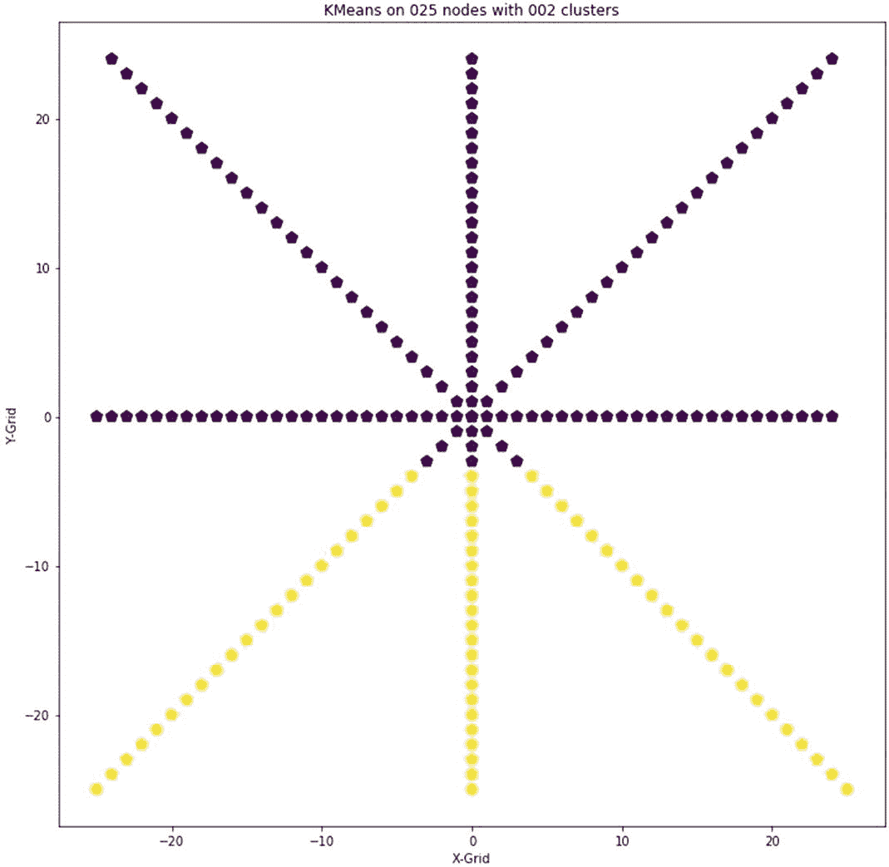
图 6-3

2 个聚类的交叉网格

K-Means 生成了数据的两个聚类分割。

### 警告

此数据集上的 K-Means 并非 100% 分割成两个聚类。

你得到以下结果：

(k-means++) 聚类 1：1450 (58.0000%) vs. 聚类 2：1050 (42.0000%)

(随机) 聚类 1：1050 (42.0000%) vs. 聚类 2：1450 (58.0000%)

这表明由于机器学习算法的起始状态不同，两种算法导致了不同的结果。

让我们研究这两个聚类形成的 Voronoi 单元（见图 6-4）。

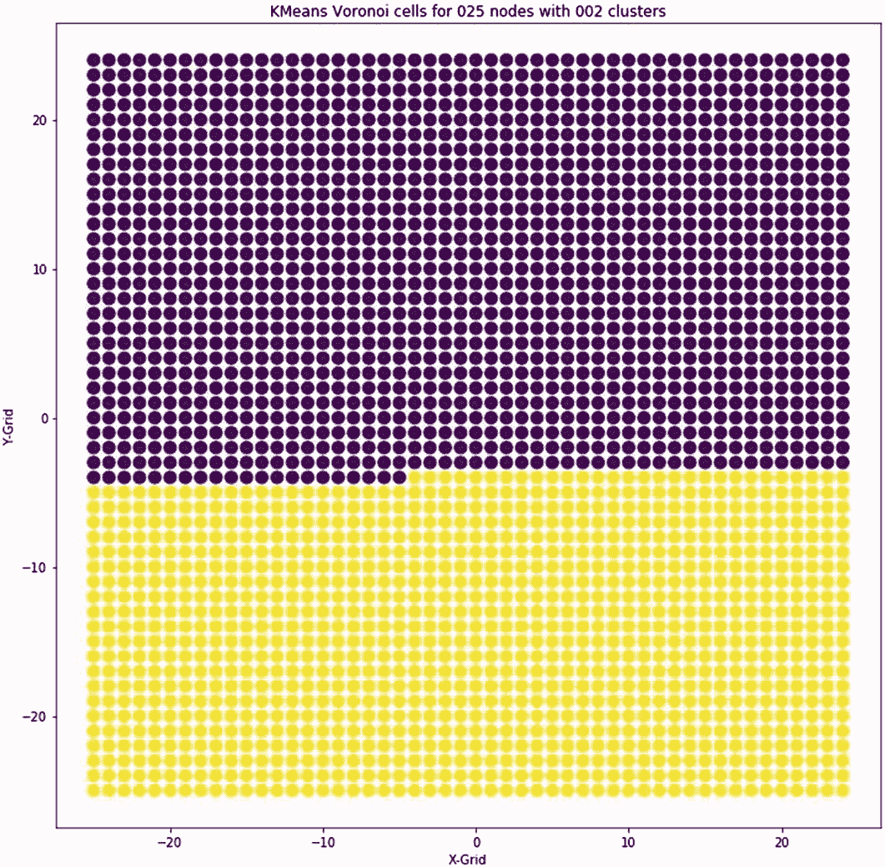
图 6-4

两个 Voronoi 单元

这些结果清楚地表明这两个聚类形成了 2 个 Voronoi 单元。

如果你想对聚类进行实验，可以在这段代码中修改聚类数量：

* `N=int(2)` 是所需的聚类数。

* `M=int(25)` 是网格中的节点数。

如果你打开名为 `Chapter-006-002-Clustering-K-Means-01-13.ipynb` 的 Jupyter notebook。

本次研究的基础是：

* `N=int(13)`

* `M=int(25)`

因此，我们期望有 13 个聚类。你的结果显示在图 6-5 和 6-6 中。

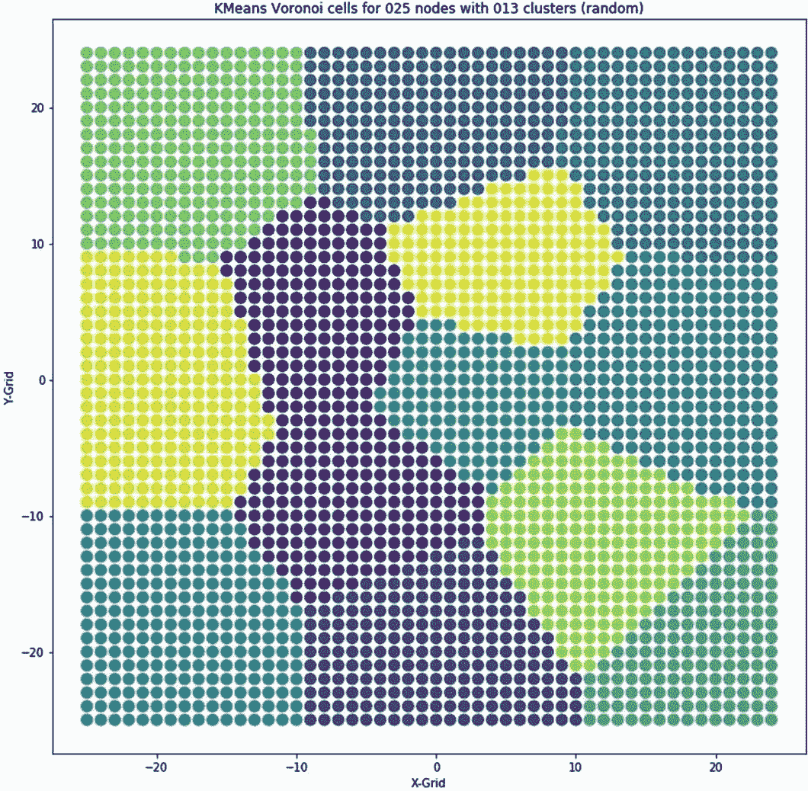
图 6-6

13 个 Voronoi 单元

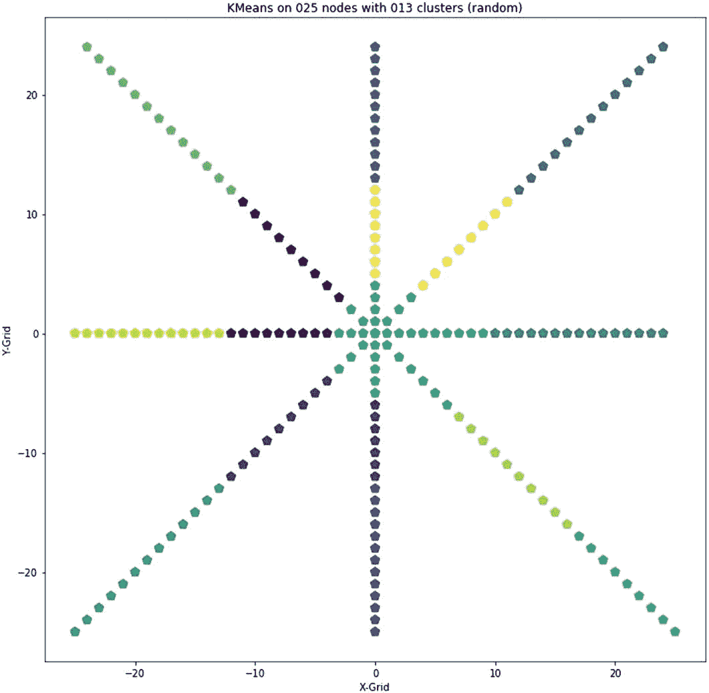
图 6-5

13 个聚类的交叉网格

我建议你观察以下洞见：

在训练期间，聚类过程如下：

```
Cluster   1 :   42 ( 21.000 %)
Cluster   2 :   10 (  5.000 %)
Cluster   3 :   12 (  6.000 %)
Cluster   4 :   16 (  8.000 %)
Cluster   5 :   19 (  9.500 %)
Cluster   6 :   13 (  6.500 %)
Cluster   7 :    9 (  4.500 %)
Cluster   8 :   13 (  6.500 %)
Cluster   9 :   16 (  8.000 %)
Cluster  10 :   12 (  6.000 %)
Cluster  11 :   10 (  5.000 %)
Cluster  12 :   10 (  5.000 %)
Cluster  13 :   18 (  9.000 %)

Cluster     :  200
```

但是当测试 Voronoi 单元时，你会发现不同的分布：

```
Cluster   1 :  142 (  5.680 %)
Cluster   2 :  173 (  6.920 %)
Cluster   3 :  209 (  8.360 %)
Cluster   4 :  227 (  9.080 %)
Cluster   5 :  166 (  6.640 %)
Cluster   6 :  226 (  9.040 %)
Cluster   7 :  149 (  5.960 %)
Cluster   8 :  240 (  9.600 %)
Cluster   9 :  234 (  9.360 %)
Cluster  10 :  204 (  8.160 %)
Cluster  11 :  187 (  7.480 %)
Cluster  12 :  186 (  7.440 %)
Cluster  13 :  157 (  6.280 %)

Cluster     : 2500
```

Voronoi 单元是模型真实的预测分布。

我生成了少量额外的组合，请研究：

* `Chapter-006-002-Clustering-K-Means-01-04.ipynb`

* `Chapter-006-002-Clustering-K-Means-01-07.ipynb`

* `Chapter-006-002-Clustering-K-Means-01-09.ipynb`

这些都展示了分布如何随聚类数量的增加而变化。

下一步是观察一个更大的聚类过程的变化。

```
Chapter-006-002-Clustering-K-Means-01-20.ipynb
N=int(20)
M=int(100)
```

你将观察到两种算法如何给出不同的结果：

# 聚类分析与 K-Means 引擎实践

## 聚类结果对比

聚类 1: (`k-means++`) 1653 (4.133 %) vs (随机) 1356 (3.390 %) (净差: 297)
聚类 2: (`k-means++`) 1342 (3.355 %) vs (随机) 2663 (6.657 %) (净差: -1321)
聚类 3: (`k-means++`) 2929 (7.322 %) vs (随机) 2649 (6.623 %) (净差: 280)
聚类 4: (`k-means++`) 2667 (6.667 %) vs (随机) 2679 (6.698 %) (净差: -12)
聚类 5: (`k-means++`) 1238 (3.095 %) vs (随机) 2996 (7.490 %) (净差: -1758)
聚类 6: (`k-means++`) 1770 (4.425 %) vs (随机) 1478 (3.695 %) (净差: 292)
聚类 7: (`k-means++`) 2657 (6.643 %) vs (随机) 2556 (6.390 %) (净差: 101)
聚类 8: (`k-means++`) 2704 (6.760 %) vs (随机) 1378 (3.445 %) (净差: 1326)
聚类 9: (`k-means++`) 2759 (6.897 %) vs (随机) 1329 (3.322 %) (净差: 1430)
聚类 10: (`k-means++`) 2602 (6.505 %) vs (随机) 2364 (5.910 %) (净差: 238)
聚类 11: (`k-means++`) 1449 (3.623 %) vs (随机) 1077 (2.692 %) (净差: 372)
聚类 12: (`k-means++`) 2668 (6.670 %) vs (随机) 1711 (4.277 %) (净差: 957)
聚类 13: (`k-means++`) 2153 (5.382 %) vs (随机) 1123 (2.808 %) (净差: 1030)
聚类 14: (`k-means++`) 2668 (6.670 %) vs (随机) 2400 (6.000 %) (净差: 268)
聚类 15: (`k-means++`) 1569 (3.923 %) vs (随机) 1514 (3.785 %) (净差: 55)
聚类 16: (`k-means++`) 1528 (3.820 %) vs (随机) 2701 (6.753 %) (净差: -1173)
聚类 17: (`k-means++`) 1304 (3.260 %) vs (随机) 2360 (5.900 %) (净差: -1056)
聚类 18: (`k-means++`) 1711 (4.277 %) vs (随机) 1588 (3.970 %) (净差: 123)
聚类 19: (`k-means++`) 1286 (3.215 %) vs (随机) 2672 (6.680 %) (净差: -1386)
聚类 20: (`k-means++`) 1343 (3.357 %) vs (随机) 1406 (3.515 %) (净差: -63)

聚类总数: 40000

### 提示

始终测试 Voronoi 单元，以确保你报告的是模型的真实结果。

## 通过真实数据示例检验新知识

现在，我们将用真实解决方案来检验我们的新知识。接下来，我将通过一个来自真实聚类问题的数据示例来引导你。

### 玫瑰数据集介绍

该数据集具有以下结构：

玫瑰数据集是一个特征明显且易于处理的多类分类数据集。

| 类别数 | 3 |
| --- | --- |
| 每类样本数 | 50 |
| 样本总数 | 150 |
| 维度 | 4 |
| 特征 | 实数，正数 |

## 在 Jupyter Notebook 中实践 K-Means

### 基础聚类实践

打开名为 `Chapter-06-003-Clustering-K-Means-02.ipynb` 的 Jupyter notebook。

如果你执行该 notebook，你会观察到该过程通过将 K-Means 引擎作为一组估计器运行来创建一系列引擎（参见 C 部分）。你的结果由 D 部分生成（图 6-7 至 6-10）。

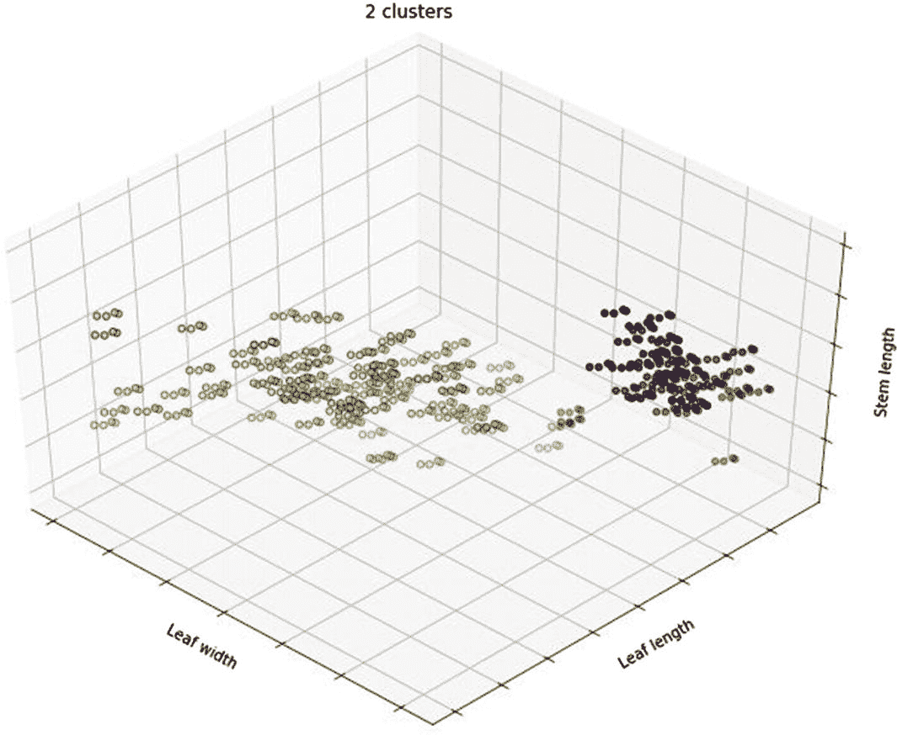

图 6-10 两个聚类上的玫瑰

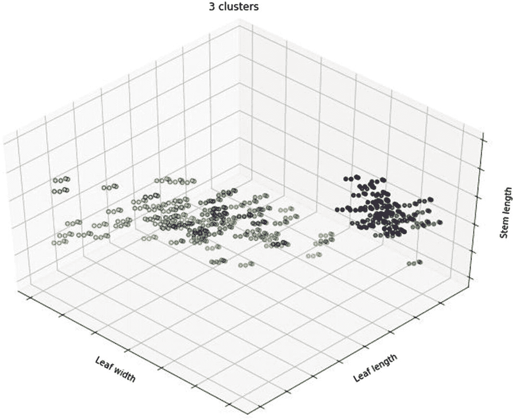

图 6-9 三个聚类上的玫瑰

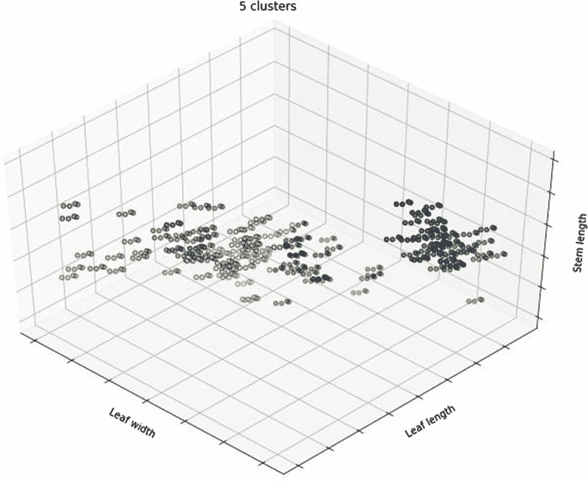

图 6-8 五个聚类上的玫瑰

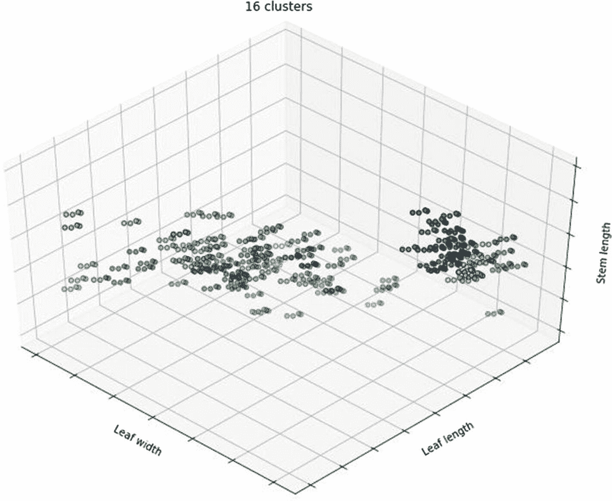

图 6-16 十六个聚类上的玫瑰

真实数据图显示，三个聚类最接近数据的真实分布。现在你可以关闭该 notebook，因为我们接下来要讨论 K-Means 引擎的另一个常见用途。

### K-Means 在图像处理中的应用

我将向你展示如何利用关于 K-Means 算法的新知识来处理一个名为“China.jpg”的示例图像。

打开名为 `Chapter-006-004A-Clustering-K-Means-China.ipynb` 的 Jupyter notebook。运行该 notebook，观察 K-Means 引擎如何用于减少图片中的颜色。如需更多见解，你应该研究 `Chapter-006-004B-Clustering-K-Means-Flower.ipynb`。

你能看出使用 K-Means 如何帮助处理图像吗？

既然你已经掌握了基本流程，我建议我们针对一个著名地标——爱丁堡城堡——来尝试这项技术。

打开名为 `Chapter-006-004C-Clustering-K-Means-Edinburgh.ipynb` 的 Jupyter notebook。爱丁堡的照片清晰地展示了 K-Means 引擎如何与图像交互。你应该会得到如图 6-11 至 6-13 所示的结果。


图 6-13 量化后的图片


图 6-12 64 色图片


图 6-11 原始图片

这种分析在处理闭路电视图像或机器人视觉时非常有用。为了磨练你的技能，请研究 `Chapter-006-004D-Clustering-K-Means-Horses.ipynb`。你会观察到，你首先需要执行几个小的图像处理任务，以找到你想要处理的马。这在现实世界的应用中通常是必需的。

### 确定最佳 K 值

接下来你需要的关键见解是：如何确定最佳的 K 值？

打开名为 `Chapter-006-005A-Clustering-K-Means-Optimum.ipynb` 的 Jupyter notebook。找到最佳值的解决方案是执行肘部法，该方法能为你提供给定数据集中合适的聚类数量。

我为你提供了两个数据集：Alpha 和 Beta。我建议你绘制数据集 Alpha 的 K 值与误差平方和（SSE）的关系图。

请注意，本例中成本的计算是误差平方和。SSE 是每个点与其分配到的聚类中心之间差值的平方和。这是衡量给定数据聚类内变异性的常用指标。本示例使用给定 K 值下可比较的可接受成本来找到最佳 K 值（图 6-14）。

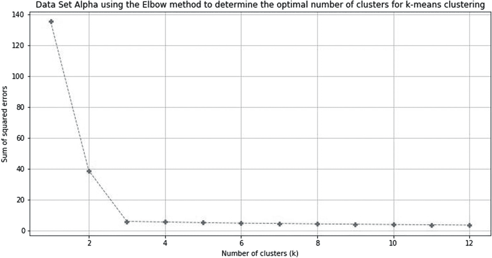

图 6-14 给定 K 值下可比较的可接受成本，用于寻找最佳 K 值

Alpha 数据集的最佳 K 值为 `k=3`，如肘部移动所示。我建议你查看数据集 Beta 的 K 值与 SSE 的关系图（图 6-15）。

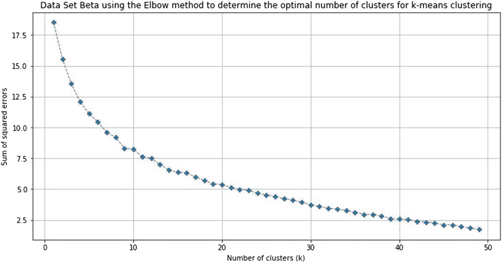

图 6-15

数据集 Beta 的 K 值与 SSE 的关系图

缺乏肘部移动意味着聚类的最佳值不那么清晰。现在，你可以使用这种基本的肘部技术来确定数据集的最佳 K 值。恭喜！你现在可以执行多种聚类 K-Means 解决方案了。在第 11、12、13、14 和 15 章中，我将引导你了解其他一些示例，说明如何通过使用工业化的聚类 K-Means 版本来解决现实世界的问题。

现在，我将引导你学习第二种无监督算法。

### 高斯混合模型

高斯混合模型是一种概率模型，它假设所有数据点都是由有限个具有未知参数的高斯分布混合生成的。可以将混合模型视为对 K-Means 聚类的泛化，它除了考虑潜在高斯分布的中心点外，还整合了数据的协方差结构信息。

示例：

打开名为 `Chapter-006-006-Gaussian-Mixture-01.ipynb` 的 Jupyter notebook。

你将使用 Rose series 7 数据集来解释高斯模型。该解决方案遍历了四种不同的协方差参数：

*   `‘full’` - 每个分量拥有自己的一般协方差矩阵。
*   `‘tied’` - 所有分量共享同一个一般协方差矩阵。
*   `‘diag’` - 每个分量拥有自己的对角协方差矩阵。
*   `‘spherical’` - 每个分量拥有自己的单一方差。

你的结果如图 6-16 所示。

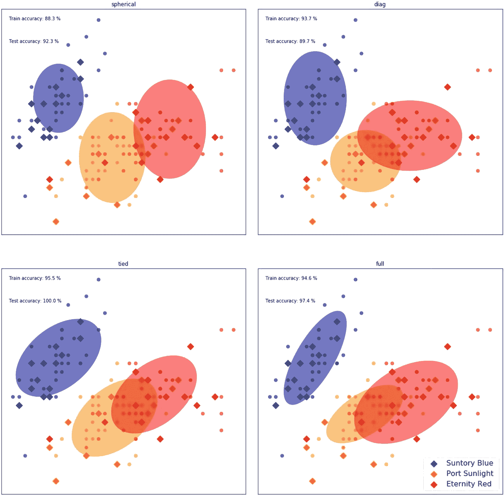

图 6-16

高斯混合模型结果

你能看出不同的协方差类型如何影响聚类的结果吗？

### 提示

我建议你始终针对自己的数据集测试这些协方差参数，因为我有好几次发现，仅仅是最细微的改变就能带来更好的结果。

打开名为 `Chapter-006-007-Gaussian-Mixture-02.ipynb` 的 Jupyter notebook。这个过程是为给定的数据集找到最佳的协方差参数超参数。

你的结果可以在图 6-17 中看到。

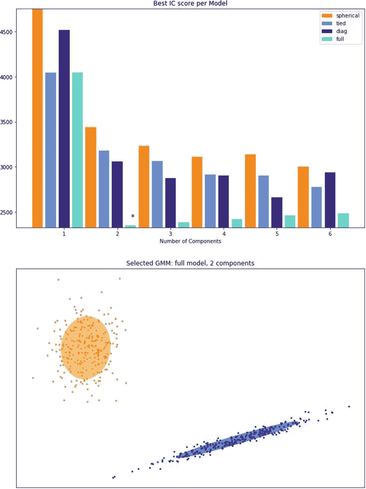

图 6-17

最佳高斯混合模型结果

做得好；你现在可以成功执行高斯混合模型解决方案了。在第 11、12、13、14 和 15 章中，我将引导你了解几个额外的示例，说明如何通过使用工业化的高斯混合模型版本来解决现实世界的问题。

现在，我将引导你学习第三种无监督算法。

### 层次聚类

层次聚类，也称为层次聚类分析，是一种将相似对象分组到称为簇的组中的算法。其终点是一组簇，其中每个簇都与其他簇不同，并且每个簇内的对象彼此大致相似。

打开名为 `Chapter-006-008-Hierarchical-clustering-01.ipynb` 的 Jupyter notebook。

用于计算链接的度量。从 “Euclidean”、“l1”、“l2”、“manhattan”、“cosine” 中选择。选择要使用的链接准则。链接准则控制在观测集之间使用哪种距离。该算法将合并使该准则最小化的簇对。

*   Ward 最小化被合并簇的方差。
*   Average 使用两个集合中每个观测值距离的平均值。
*   Complete 或 maximum linkage 使用两个集合中所有观测值之间的最大距离。
*   Single 使用两个集合中所有观测值之间的最小距离。

结果如图 6-18 所示。

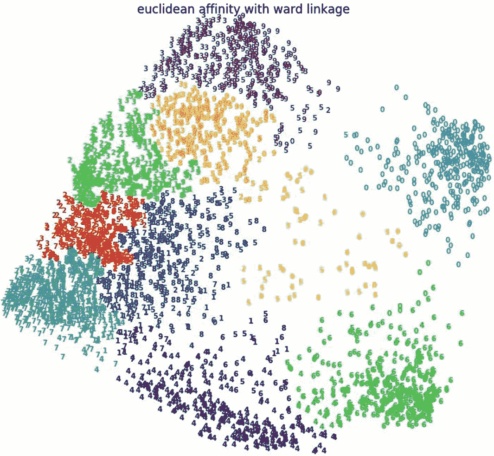

图 6-18

层次聚类（1/8）

聚类的参数表明，这些参数上的差异对聚类的成功有正面或负面的影响。我建议我们以更可控的方式来看待这种影响。

让我们研究一下链接和亲和度组合的影响。打开名为 `Chapter-009-009-Hierarchical-clustering-02.ipynb`、`Chapter-009-010-Hierarchical-clustering-02.ipynb` 和 `Chapter-009-011-Hierarchical-clustering-02.ipynb` 的 Jupyter notebook。

你将使用带噪声的圆形、带噪声的月牙形、斑点和无结构数据配置来生成一个数据集，在其中你可以测试不同超参数的行为。

### 提示

我个人在我的 IML 模型选择中使用这个测试，因为它能快速向你展示特定模式如何影响你的结果。

执行这些 notebook 并观察结果。你应该会观察到，不同的参数会产生一些有趣且反直觉的结果。这就是为什么人类总体上仍然更擅长识别复杂模式的主要原因。

我发现最佳组合是人机协同的方法。先让机器学习执行分析，然后研究发现的模式，并根据需要通过人工干预进行调整。

你的结果如图 6-19 至 6-21 所示。

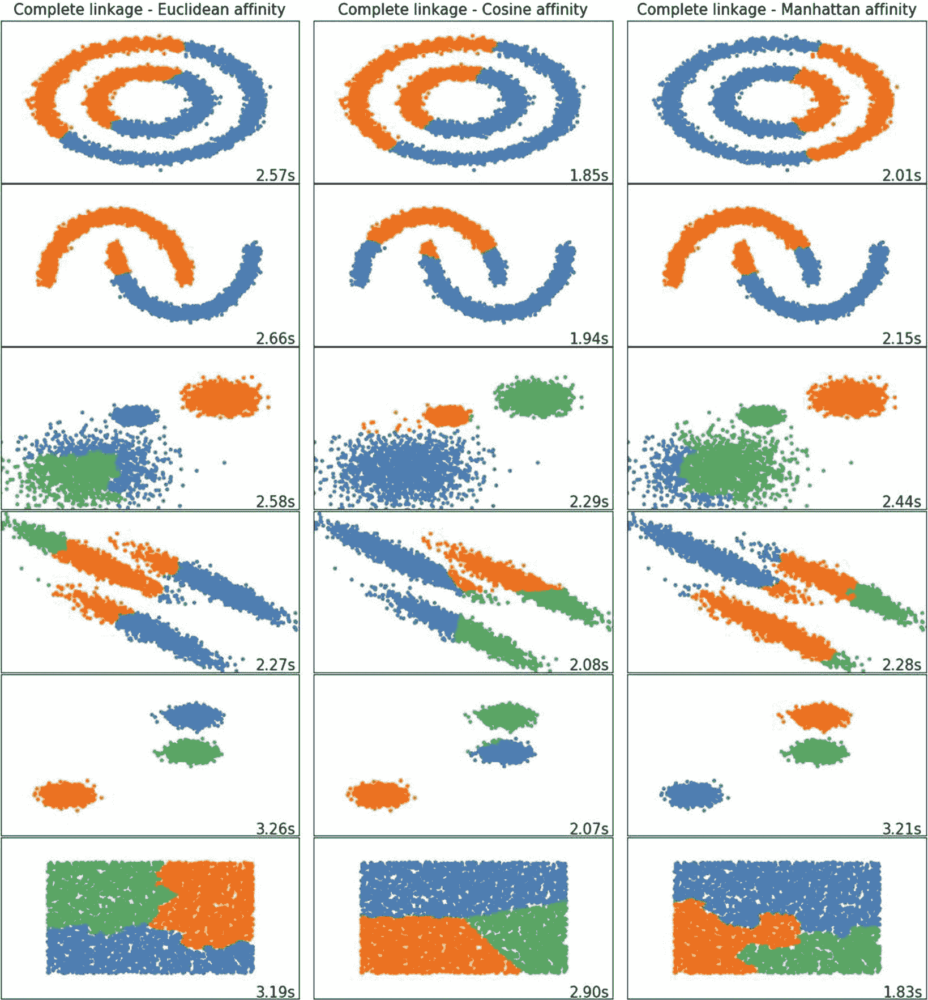

图 6-21

层次聚类 – 亲和度影响（完全链接）

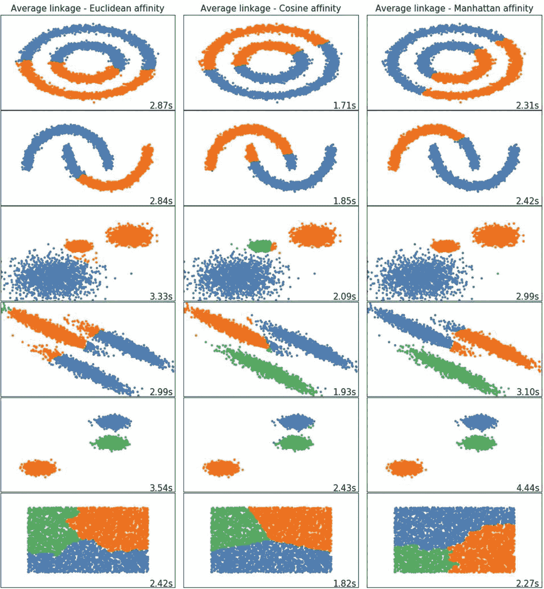

图 6-20

层次聚类 – 亲和度影响（平均链接）

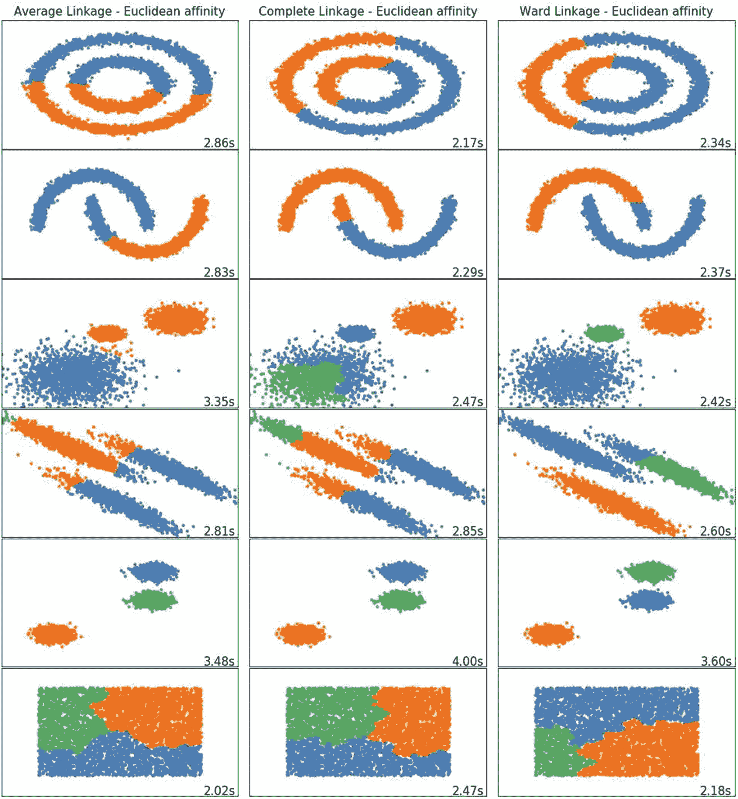

图 6-19

层次聚类 – 链接影响

结果表明，亲和度对聚类算法有明显的影响。

### 建议

能够选择精确的参数并调整你所使用的算法，是普通数据科学家和专家级数据科学家之间最大的区别。我建议你针对每种算法，使用具有多种模式的不同数据集进行练习，以理解每个算法的参数对机器学习过程结果的影响。

你正在取得巨大进步，现在可以成功执行层次聚类解决方案了。在第 11、12、13、14 和 15 章中，我将引导你了解几个补充示例，说明如何通过使用工业化的层次聚类模型版本来解决现实世界的问题。

现在，我将引导你学习一项对现实世界解决方案非常重要的关键技术。

## 异常检测

异常检测是一种用于识别不符合预期行为的异常模式（称为离群点）的技术。简单来说，它们不符合常规或行为异常。

异常通常可以分为以下几种类型。

### 点异常

如果单个数据实例与总体中其他数据的值相差太远，则该实例是异常的。

业务用例：基于“消费金额”检测信用卡欺诈。

### 上下文异常

异常性是上下文相关的。这种类型的异常在时间序列数据中很常见。

业务用例：在假期期间每天在食物上花费 150.00 美元是正常的，但在其他时间可能很奇怪。突然开始在你从未去过的地方花钱，或者在一个不切实际的时间段内在两个地点花钱，都属于上下文异常。

### 集体异常

一组数据实例共同帮助检测异常。

业务用例：有人试图意外地将数据从远程机器复制到本地主机，这种异常会被标记为潜在的网络攻击。

打开名为 `Chapter-006-012-Anomaly-Detection-01.ipynb` 的 Jupyter 笔记本。

我们将调查你在哪里购买咖啡。如果有人在这些集群之外使用你的卡购买咖啡，那就是 `潜在` 的欺诈行为。

我将向你展示如何使用以下检测程序：

*   鲁棒协方差
*   单类支持向量机
*   孤立森林
*   局部异常因子

执行该笔记本。蓝色圆点不是你的交易记录。我建议我们联系你的银行，因为你显然是两张卡中其中一张的持有者。你的卡被克隆了！！

结果显示在图 6-22 中。

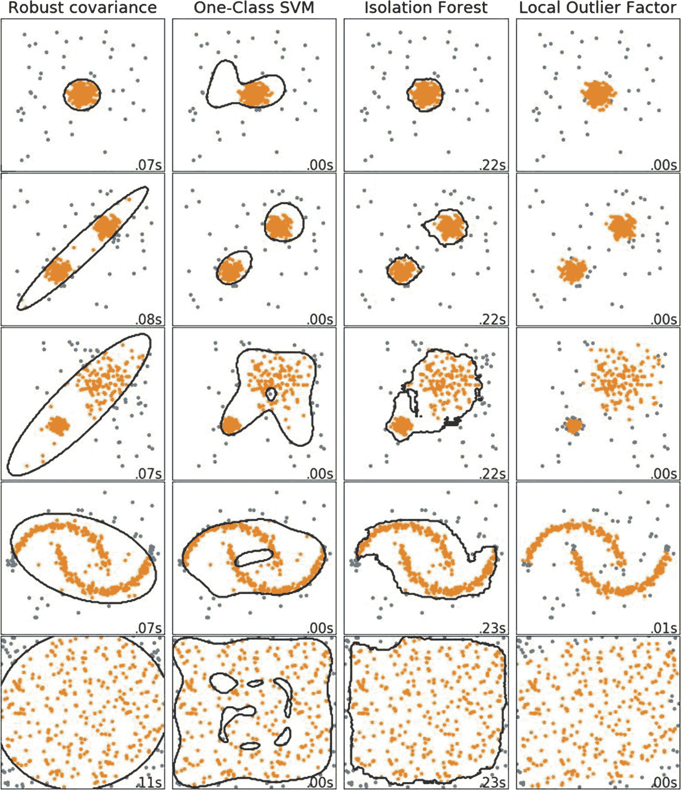

图 6-22

结果

干得好；你已经完成了无监督机器学习三个部分中的第一部分。在第 11、12、13、14 和 15 章中，我将引导你学习几个补充示例，了解如何通过使用工业化版本的异常检测模型来解决现实世界的问题。

## 下一步是什么？

你现在已经成功完成了无监督机器学习的第一部分。我建议你练习一下知识库中新增的算法。无监督机器学习的第二部分将涵盖更多可用于处理海量数据的高级算法。