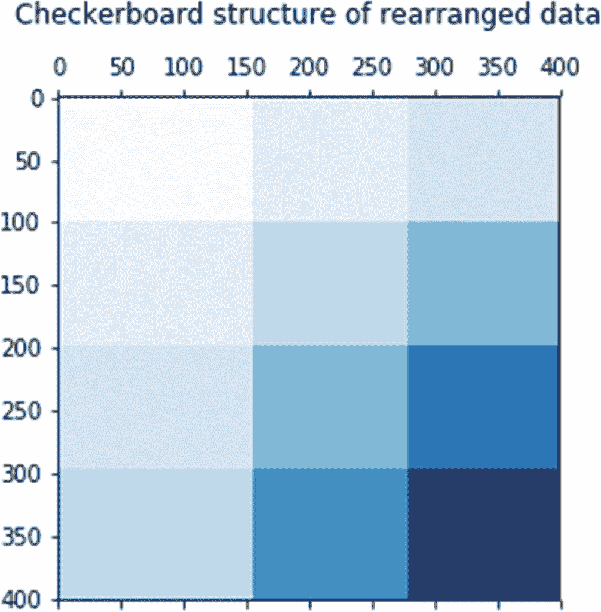
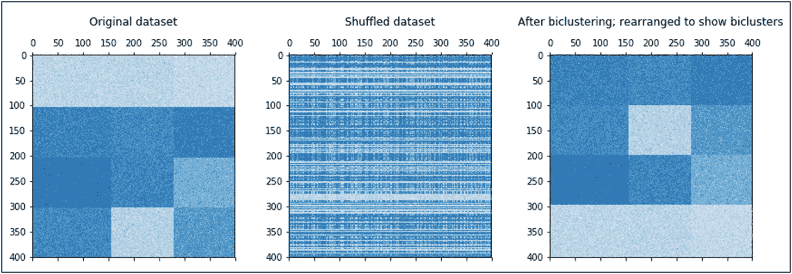
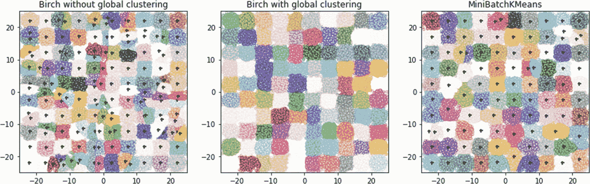

# 7. 无监督学习：神经网络工具包

下一个无监督学习技术将把无监督过程向前推进一步。

我很荣幸向你介绍自编码器。它们是发现和探索我们在工业化世界中部署的庞大数据湖的未来，这些数据湖由我们日常生活中产生的数据构成。

## 神经网络自编码器

自编码器是一种人工神经网络，用于以无监督的方式学习高效的数据编码。自编码器的目标是学习一组数据的表示；这通常用于降维。最近，自编码器概念已更广泛地用于学习数据的生成模型。在当前商业世界中，一些最强大的人工智能成就涉及堆叠在深度神经网络内部的稀疏自编码器。这是一种处理数据集极其强大的技术。

打开名为 `Chapter-007-001-Neural-Networks-Autoencoder-01.ipynb` 的 Jupyter 笔记本。

这些示例为你提供了一个简单的自编码器，它解释了该过程的原理，以便你可以将其用作其他自编码器解决方案的基础。

```
你的输入是：[[0 0 1], [0 1 1], [1 0 1], [1 1 1]]
你需要的输出是：[[0], [0], [1], [1]]
训练后的输出：[[0.00966553], [0.00786406], [0.99359009], [0.99211908]]
阶梯函数后的输出：[[0.], [0.], [1.], [1.]]
```

基本原理是，你应用一个 `sigmoid` 函数，然后应用一个阶梯函数来实现期望的结果。这些自编码器可以很容易地转移到集成电路生态系统中，以协助带有传感器的解决方案进行边缘处理。

你已成功将三个传感器缩减（自编码）为一个输出。

接下来研究 `Chapter-007-002-Neural-Networks-Autoencoder-02.ipynb`。

这个自编码器使用两层将输入处理成输出。请运行该笔记本以观察这个过程。你正在取得巨大进步，现在可以成功执行两个自编码器解决方案。

在第 11、12、13、14 和 15 章中，我将引导你学习几个进一步的示例，了解如何通过使用工业化版本的自编码器模型来解决现实世界的问题。

现在我将引导你学习一种对现实世界解决方案有用的新技术。

接下来我们将讨论生成对抗网络。

## 生成对抗网络（GAN）

生成对抗网络（GAN）是一类用于无监督机器学习的人工智能算法，由两个神经网络在零和博弈框架中相互对抗实现。这种相互竞争的机器学习过程会产生一种快速学习的协作解决方案，从而轻松地将解决方案演化为最优解。

那么，我们来讨论一下零和博弈：

在博弈论和经济理论中，零和博弈是一种数学表示，其中每个参与者的效用得失与其他参与者的效用得失完全平衡。如果将参与者的总收益相加并减去总损失，结果将为零。

因此，与爱人分享一杯咖啡时，如果某人喝掉较大份额的咖啡，可能会减少其他人可获得的咖啡量，但只要所有参与者对每单位咖啡的价值评估相同，这仍然是一个零和博弈。换句话说，每个人都很开心！

接下来我将介绍 PyTorch。

`PyTorch` 是一个基于 Python 的科学计算包，它利用图形处理单元（`GPU`）的能力来辅助处理。

基于 `Theano` 引擎的 `TensorFlow` 和使用 `Torch` 的 `PyTorch` 之间的根本区别在于这些框架在硬件中定义计算图的方式。因此，`Torch` 框架在大多数情况下与 `TensorFlow` 一样快，但在处理循环神经网络时 `Torch` 更快。众所周知，`Keras` 搭配 `TensorFlow` 速度较慢，但 `Keras` 搭配 `TensorFlow` 正在赢得竞争。主要原因是，与许多其他当前流行的深度学习框架相比，`TensorFlow` 提供了出色的功能和服务。`Keras` 与 `TensorFlow` 的集成现在使深度学习部署更加容易。因此，许多新项目都将 `Keras` 搭配 `TensorFlow` 作为标准配置。

你需要安装用于 CPU 的 `Torch` 库：

```
conda install -c pytorch pytorch-cpu
```

打开名为 `Chapter-007-003-GAN-01.ipynb` 的 Jupyter notebook 并运行它。

你的结果：

```
Using data [Data and variances]
0: D: 0.7086962461471558/0.6972255110740662 G: 0.6868060827255249 (Real: [3.7825968647003174, 1.2327905192370257], Fake: [0.09708623103797435, 0.009256606334190703])
5000: D: 0.6805199980735779/0.6616045236587524 G: 0.8273075819015503 (Real: [4.117388695478439, 1.274467621457445], Fake: [4.077913434505462, 1.0943474129771693])
10000: D: 0.37435632944107056/0.8348380327224731 G: 0.4132739007472992 (Real: [3.9343803453445436, 1.3165514626757275], Fake: [3.7064030361175537, 1.3515258142353932])
15000: D: 0.024186545982956886/2.411825656890869 G: 0.9955140948295593 (Real: [4.019607482552528, 1.3916774260541982], Fake: [4.100582712888718, 1.3490263347503852])
20000: D: 0.8105971813201904/0.08567392826080322 G: 1.3057440519332886 (Real: [3.8651703649759295, 1.291156659436279], Fake: [4.00323578953743, 1.2979101588489939])
25000: D: 0.00010073692101286724/1.0811676474986598e-05 G: 12.61683464050293 (Real: [4.023330308198929, 1.1151899002588046], Fake: [14.387419891357421, 0.6251815240638156])
30000: D: 9.059946023626253e-06/-5.972999872483342e-14 G: 26.81680679321289 (Real: [4.0317733579874035, 1.3068207970685468], Fake: [37.9575638961792, 0.9236522286831534])
35000: D: 2.3841761276344187e-07/-9.841016890277388e-13 G: 27.20176887512207 (Real: [4.068414183855057, 1.3843235577079283], Fake: [62.59007144927978, 1.5635452696977525])
40000: D: 0.0002785713004413992/-1.000088900582341e-12 G: 27.63102149963379 (Real: [4.057045288085938, 1.1723868704134213], Fake: [68.872311668396, 8.993019130772057])
45000: D: 2.5033971269294852e-06/-1.000088900582341e-12 G: 27.63102149963379 (Real: [3.9334994852542877, 1.190026090616771], Fake: [69.51191040039062, 8.09731438960914])
```

你取得了巨大进步，现在可以成功执行 `GAN` 解决方案了。

在第 11、12、13、14 和 15 章中，我将引导你学习更多示例，了解如何通过使用工业化的 `GAN` 版本来解决现实世界的问题。

### 注意

生成对抗网络是一种无监督学习算法，目前正以指数级速度发展，因为它正在医疗保健、金融和智慧城市等领域产生新的见解。

### 有趣的事实

一个 `GAN` 系统创作了 2018 年的画作《埃德蒙·德·贝拉米》，该画作以 432,500 美元的价格售出。这证明了机器学习能够轻松学习甚至掌握类似人类的技艺。

## 卷积神经网络（CNN）

在机器学习中，卷积神经网络（`CNN` 或 `ConvNet`）是一类深度前馈人工神经网络，最常用于分析视觉图像。`CNN` 采用多层感知器的变体，旨在减少预处理需求。

`ConvNet` 或 `CNN` 是一类神经网络，在图像识别和分类等领域已被证明非常有效。除了为机器人和自动驾驶汽车提供视觉能力外，`ConvNet` 在识别人脸、物体和交通标志方面也取得了成功。

打开名为 `Chapter-007-004A-CNN-01.ipynb` 的 Jupyter 笔记本。

该过程使用传统的 MNIST 数据生成一个 CNN。

执行该笔记本以获取所需的数据集。

在 `data` 目录中，你应该会得到两个文件：`Train-28x28_CNN_text.txt` 和 `Test-28x28_CNN_text.txt`。

现在打开名为 `Chapter-03-017B-CNN-01.ipynb` 的 Jupyter 笔记本。

`Part A` 加载所需数据。

通过使用独热编码结构来实现数字检测：

```
label:  0  in one-hot representation:  [1 0 0 0 0 0 0 0 0 0]
label:  1  in one-hot representation:  [0 1 0 0 0 0 0 0 0 0]
label:  2  in one-hot representation:  [0 0 1 0 0 0 0 0 0 0]
label:  3  in one-hot representation:  [0 0 0 1 0 0 0 0 0 0]
label:  4  in one-hot representation:  [0 0 0 0 1 0 0 0 0 0]
label:  5  in one-hot representation:  [0 0 0 0 0 1 0 0 0 0]
label:  6  in one-hot representation:  [0 0 0 0 0 0 1 0 0 0]
label:  7  in one-hot representation:  [0 0 0 0 0 0 0 1 0 0]
label:  8  in one-hot representation:  [0 0 0 0 0 0 0 0 1 0]
label:  9  in one-hot representation:  [0 0 0 0 0 0 0 0 0 1]
```

在 `Part B` 中，你创建一个 sigmoid 函数。在 `Part C` 中，你使用一个类来创建神经网络。

以下命令激活神经网络：

```
ANN = NeuralNetwork(no_of_in_nodes = image_pixels,
no_of_out_nodes = 10,
no_of_hidden_nodes = 100,
learning_rate = 0.1)
```

在 `Part D` 中，你训练你的神经网络。

训练是在上传的 MNIST 数据中的 60,000 张图像上进行的。

在 `Part E` 中，你针对上传的 MNIST 数据中的 10,000 张图像测试你的神经网络。

`Part F` 展示你的成果：

```
Accuracy Train => 0.949
Accuracy Test ==> 0.9477
====================================================
[[5797    1   43   24   17   46   42   15   15   22]
[   1 6633   62   38   13   32   21   62  109   14]
[   5   23 5479   43    4    8    3   45    8    2]
[   4   23  104 5779    1   87    1   19   82   57]
[  10   10   45    7 5505   31    7   48   34   64]
[   5    6    5   44    0 4992   43    1   12    5]
[  29    2   61   18   67   82 5778    8   36    4]
[   0    6   40   44    4    9    0 5820    4   28]
[  51   11   93   52    4   52   23   10 5427   22]
[  21   27   26   82  227   82    0  237  124 5731]]
====================================================
Digit: 0 Precision: 0.9787 Recall: 0.9626
Digit: 1 Precision: 0.9838 Recall: 0.9496
Digit: 2 Precision: 0.9196 Recall: 0.9749
Digit: 3 Precision: 0.9426 Recall: 0.9386
Digit: 4 Precision: 0.9423 Recall: 0.9556
Digit: 5 Precision: 0.9209 Recall: 0.9763
Digit: 6 Precision: 0.9763 Recall: 0.9495
Digit: 7 Precision: 0.929 Recall: 0.9773
Digit: 8 Precision: 0.9275 Recall: 0.9446
Digit: 9 Precision: 0.9634 Recall: 0.874
```

`Part G` 测试 epochs = 5 时的过程：

```
Epoch: 0
Accuracy Train=> 0.9457
Accuracy Test==> 0.9462
Epoch: 1
Accuracy Train=> 0.9607
Accuracy Test==> 0.956
Epoch: 2
Accuracy Train=> 0.9684
Accuracy Test==> 0.9603
Epoch: 3
Accuracy Train=> 0.9736
Accuracy Test==> 0.963
Epoch: 4
Accuracy Train=> 0.9726
Accuracy Test==> 0.9613
```

这表明 CNN 是稳定的，并且达到了 > 94% 的准确率。

### 循环神经网络（RNN）

循环神经网络（RNN）是一类人工神经网络，其节点之间的连接沿序列形成有向图。这使得它能够针对时间序列展现出时间动态行为。与前馈神经网络不同，RNN 可以利用其内部状态来处理输入序列。这赋予了它们记忆先前行为以及如何根据这些知识进行调整的能力。

这使得它们适用于诸如非分割的连续手写识别或语音识别等任务。

打开名为 `Chapter-007-005-RNN-01.ipynb` 的 Jupyter notebook。

E 部分是主要引擎，并处理以下结果：

# 训练日志输出与技术说明

```
===============================================
Cycle: 0
===============================================
Error:[0.3217455]
Pred:[1 0 0 0 1 0 0 1]
True:[1 0 0 0 1 0 0 1]
108 + 29 = 137
===============================================
===============================================
Cycle: 1000
===============================================
Error:[0.19121145]
Pred:[1 0 1 1 1 1 0 1]
True:[1 0 1 1 1 1 0 1]
76 + 113 = 189
===============================================
===============================================
Cycle: 2000
===============================================
Error:[0.12260766]
Pred:[0 0 1 0 1 0 1 0]
True:[0 0 1 0 1 0 1 0]
10 + 32 = 42
===============================================
===============================================
Cycle: 3000
===============================================
Error:[0.25359378]
Pred:[1 0 0 1 0 0 0 1]
True:[1 0 0 1 0 0 0 1]
108 + 37 = 145
===============================================
===============================================
Cycle: 4000
===============================================
Error:[0.27286803]
Pred:[1 0 0 0 1 0 1 0]
True:[1 0 0 0 1 0 1 0]
123 + 15 = 138
===============================================
===============================================
Cycle: 5000
===============================================
Error:[0.27208995]
Pred:[1 1 0 1 0 0 0 1]
True:[1 1 0 1 0 0 0 1]
83 + 126 = 209
===============================================
===============================================
Cycle: 6000
===============================================
Error:[0.17898913]
Pred:[1 1 0 1 0 1 0 0]
True:[1 1 0 1 0 1 0 0]
112 + 100 = 212
===============================================
===============================================
Cycle: 7000
===============================================
Error:[0.17206773]
Pred:[0 1 0 1 1 0 0 1]
True:[0 1 0 1 1 0 0 1]
79 + 10 = 89
===============================================
===============================================
Cycle: 8000
===============================================
Error:[0.21744059]
Pred:[1 0 1 0 1 1 1 1]
True:[1 0 1 0 1 1 1 1]
82 + 93 = 175
===============================================
===============================================
Cycle: 9000
===============================================
Error:[0.18515105]
Pred:[0 1 0 0 0 1 1 1]
True:[0 1 0 0 0 1 1 1]
51 + 20 = 71
===============================================
===============================================
Cycle: 10000
===============================================
Error:[0.12941404]
Pred:[0 1 1 1 1 1 1 0]
True:[0 1 1 1 1 1 1 0]
76 + 50 = 126
===============================================
===============================================
Cycle: 11000
===============================================
Error:[0.22409284]
Pred:[1 1 1 1 0 0 0 0]
True:[1 1 1 1 0 0 0 0]
118 + 122 = 240
===============================================
===============================================
Cycle: 12000
===============================================
Error:[0.16455129]
Pred:[1 0 1 0 1 1 0 0]
True:[1 0 1 0 1 1 0 0]
49 + 123 = 172
===============================================
===============================================
Cycle: 13000
===============================================
Error:[0.20210813]
Pred:[1 0 1 1 1 0 0 0]
True:[1 0 1 1 1 0 0 0]
106 + 78 = 184
===============================================
===============================================
Cycle: 14000
===============================================
Error:[0.10140656]
Pred:[0 1 0 1 1 0 1 1]
True:[0 1 0 1 1 0 1 1]
18 + 73 = 91
===============================================
===============================================
Cycle: 15000
===============================================
Error:[0.17551984]
Pred:[1 0 0 0 1 0 0 0]
True:[1 0 0 0 1 0 0 0]
111 + 25 = 136
===============================================
```

你能观察到状态是如何从一个周期传递到下一个周期的吗？

## 注意

现代图像识别和特征化中使用的 LSTM（长短期记忆）神经网络，其工作原理是将 RNN 与 ConvNet 相结合，在一个过程中进行识别和分类。

## 谱双聚类算法

双聚类、块聚类、共聚类或双模式聚类是一种数据挖掘技术，它允许同时对矩阵的行和列进行聚类。

# 机器学习工具包

机器学习工具包是一系列数据分析方法的集合，它通过支持一组预先调优、能够无缝协作的技术，来自动化分析模型的构建。

## 谱双聚类算法

数据使用`make_checkerboard`函数生成，然后进行打乱，并传递给谱双聚类算法。打乱后的矩阵的行和列会被重新排列，以显示算法找到的双聚类。

打开名为`Chapter-03-019-Spectral-Biclustering-01.ipynb`的 Jupyter notebook。

核心引擎是：

```
model = SpectralBiclustering(n_clusters=n_clusters, method="log",   random_state=1968)
```



图 7-2 双聚类最终结果



图 7-1 双聚类结果

你的处理结果显示在图 7-1 和图 7-2 中。你可以清晰地看到这些聚类，这在需要对图像进行分类时非常有用。

## BIRCH 聚类算法

BIRCH 算法（利用层次结构的平衡迭代归约和聚类）是一种无监督数据处理算法，用于在超大数据集上实现层次聚类。

我们的示例在一个包含 100,000 个样本和 2 个特征（使用`make_blobs`生成）的合成数据集上，比较了 BIRCH（带和不带全局聚类步骤）和 `MiniBatchKMeans` 的运行时间。

如果`n_clusters`设置为`None`，则数据将从 100,000 个样本减少到一组 158 个聚类。这可以看作是最终（全局）聚类步骤之前的预处理步骤，该步骤进一步将这些 158 个聚类减少到 100 个聚类。

打开名为`Chapter-007-007-Birch-clustering-01.ipynb`的 Jupyter notebook。

你的结果可以在图 7-3 中看到。



图 7-3 BIRCH 聚类结果

```
Birch without global clustering as the final step took 2.08 seconds
n_clusters : 158
Birch with global clustering as the final step took 2.06 seconds
n_clusters : 100
Time taken to run MiniBatchKMeans 2.62 seconds
```

## Scikit-Learn

Scikit-learn（原名 scikits.learn）是一个用于 Python 的开源机器学习库。它包含各种分类、回归和聚类算法，包括支持向量机、随机森林、梯度提升、K-Means 和 DBSCAN。

你在本书前面部分已经使用过这个库。

安装：

```
conda install -c conda-forge scikit-learn
```

这是我发现的一个友好界面：`Chapter-007-008-scikit-learn-01.ipynb`

## Keras

Keras 是一个用 Python 编写的开源神经网络库。它可以运行在 TensorFlow、Microsoft Cognitive Toolkit 或 Theano 之上。Keras 旨在支持深度神经网络的快速实验，专注于用户友好、模块化和可扩展性。

安装：

```
conda install -c conda-forge keras
pip install tensorflow
conda install -c conda-forge tensorflow
```

打开名为`Chapter-007-009A-Keras-01.ipynb`的 Jupyter notebook。

### 提示

请使用 TensorFlow Keras 实现，因为它运行效果更好，并且能为你开启 Keras 和 TensorFlow 的强大功能。

你的结果：

```
0 -> 0.9875 =>  1 =>  1 # 是
1 -> 0.0170 =>  0 =>  0 # 是
2 -> 0.9954 =>  1 =>  1 # 是
3 -> 0.0006 =>  0 =>  0 # 是
4 -> 0.9954 =>  1 =>  1 # 是
5 -> 0.0113 =>  0 =>  0 # 是
6 -> 0.9773 =>  1 =>  1 # 是
7 -> 0.0070 =>  0 =>  0 # 是
8 -> 0.0000 =>  0 =>  1 # 否
9 -> 0.9984 =>  1 =>  1 # 是
```

你可以观察到，Keras 和 TensorFlow 的组合是未来的绝配，将对 IML 生态系统产生重大影响。

## XGBoost

Scalable、Portable 和 Distributed Gradient Boosting（GBDT、GBRT 或 GBM）Python 库是一种常见的机器学习解决方案。

XGBoost 是一个增强型、分布式的梯度提升库，旨在实现极高的效率、灵活性和可移植性。它在梯度提升框架下实现机器学习算法。XGBoost 提供并行树提升（也称为 GBDT、GBM），能够快速准确地解决多个数据科学问题。类似的代码可以在主要的分布式环境（Hadoop、SGE 和 MPI）中运行，并能解决数十亿条记录的问题。

安装库：

```
conda install -c conda-forge xgboost
```

打开名为`Chapter-007-010- xgboost-01.ipynb`的 Jupyter notebook。

结果：

```
0   -> [9.0, 102.0, 76.0, 37.0, 0.0, 32.9, 0.665, 46.0]   => 0 => 1 # 否
1   -> [9.0, 119.0, 80.0, 35.0, 0.0, 29.0, 0.263, 29.0]   => 1 => 1 # 是
2   -> [7.0, 159.0, 64.0, 0.0, 0.0, 27.4, 0.294, 40.0]    => 1 => 0 # 否
3   -> [7.0, 106.0, 92.0, 18.0, 0.0, 22.7, 0.235, 48.0]   => 0 => 0 # 是
4   -> [2.0, 71.0, 70.0, 27.0, 0.0, 28.0, 0.586, 22.0]    => 0 => 0 # 是
```

### 提示

XGBoost 是目前在数据集上能快速取得结果的机器学习算法之一，享有盛誉。我个人会定期使用它。在更广泛的社区中，XGBoost 是任何数据科学实践中使用最多的算法之一。这是你一定会用到的算法！

## StatsModels

StatsModels 是一个 Python 模块，提供了用于估计多种不同统计模型、进行统计检验和统计数据探索的类和函数。

安装库：

```
conda install -c conda-forge statsmodels
```

打开名为`Chapter-007-011-statsmodels-01.ipynb`的 Jupyter notebook。

```
执行该 notebook 以了解该库的多种功能。
```

### 提示

使用 StatsModel 库能够帮助大多数统计学家顺利过渡到机器学习生态系统。

## LightGBM

LightGBM 是一个使用基于树的算法的梯度提升框架。

安装库：

```
conda install -c conda-forge lightgbm
```

打开名为`Chapter-007-012-LightGBM-01.ipynb`的 Jupyter notebook。执行该 notebook。

你的结果：

```
混淆矩阵
[[64  4]
[ 5 27]]
====================
```

准确率：0.91。该库整体表现良好，我预计在未来五年内，它将进一步演变为你应该了解的十大算法之一的有力竞争者。

## CatBoost

基于决策树的梯度提升库。

“CatBoost”这个名字来源于“Category”和“Boosting”这两个词。

安装库：

```
conda install -c conda-forge catboost
```

打开名为`Chapter-007-013-CatBoost-01.ipynb`的 Jupyter notebook。执行该 notebook。

```
bestTest = 0.8358208955
bestIteration = 428
```

这证明该算法在 500 个周期中的第 428 个周期找到了最佳结果。这节省了近 20% 的处理时间。

机器学习工具包的内容到此结束。掌握这些知识将为你未来处理新的数据解决方案提供很大帮助。

## 下一步是什么？

现在，你已经成功完成了无监督机器学习的第二部分。

本章最大的两个成就是你学会了如何使用`TensorFlow`和`XGBoost`。

使用某种形式的`神经网络算法`现在已成为一项必备技能。因此，请确保你理解最后两章的内容，因为这是机器学习领域工作量增长最大的地方。

你做得很好，因为你已经涵盖了最常见的机器学习类型。下一章是第三部分，我将向你介绍`深度学习算法`。