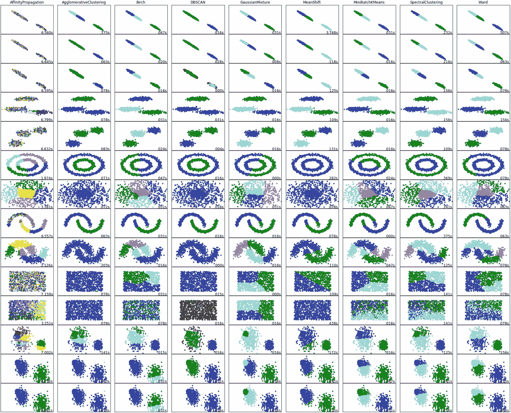
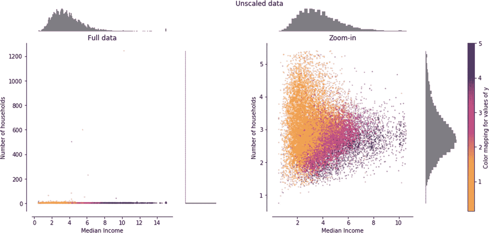
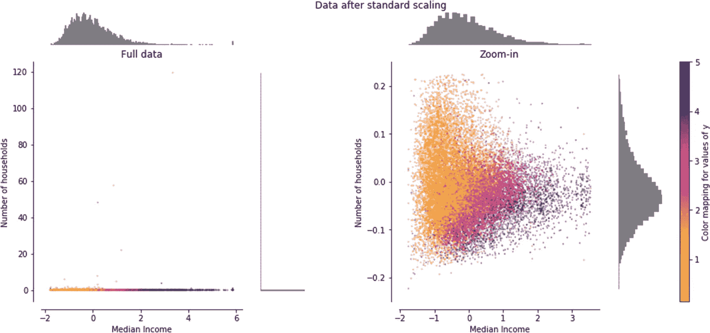
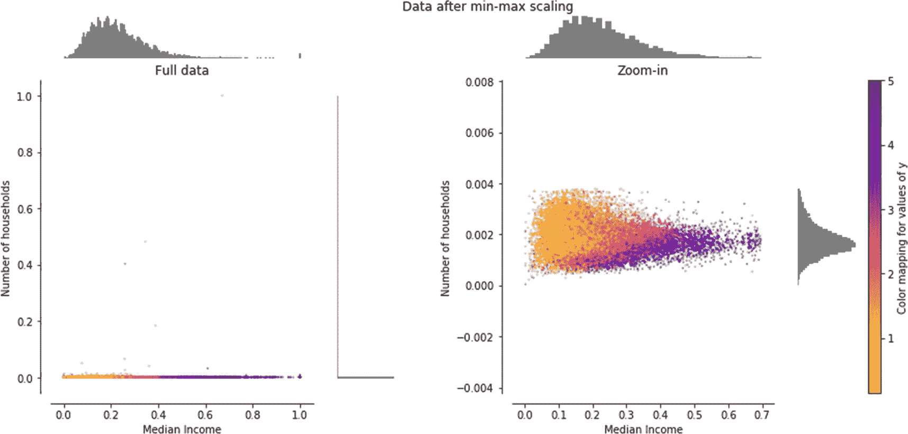
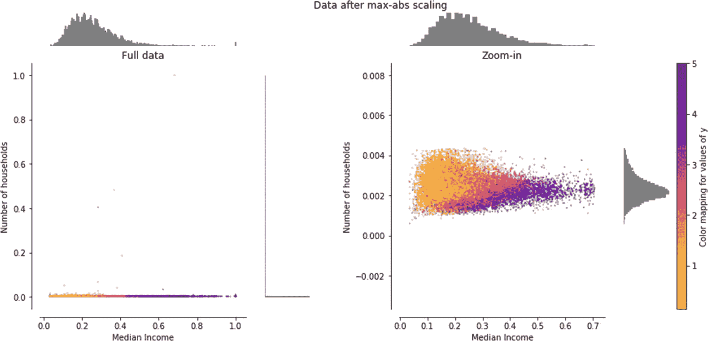
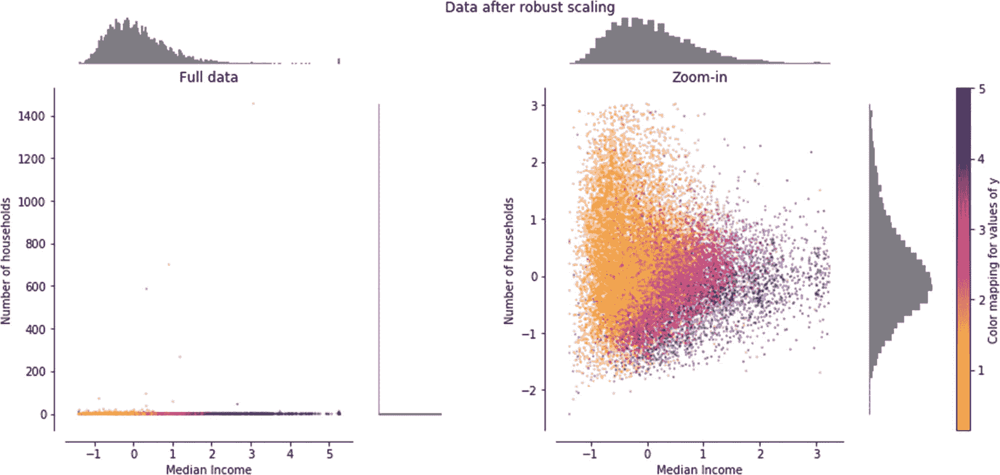
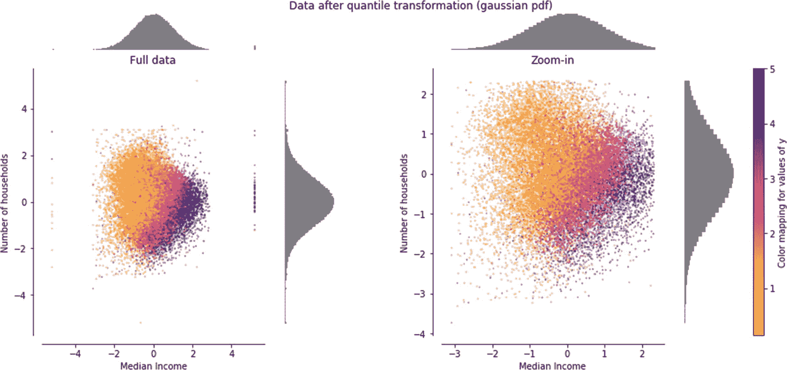
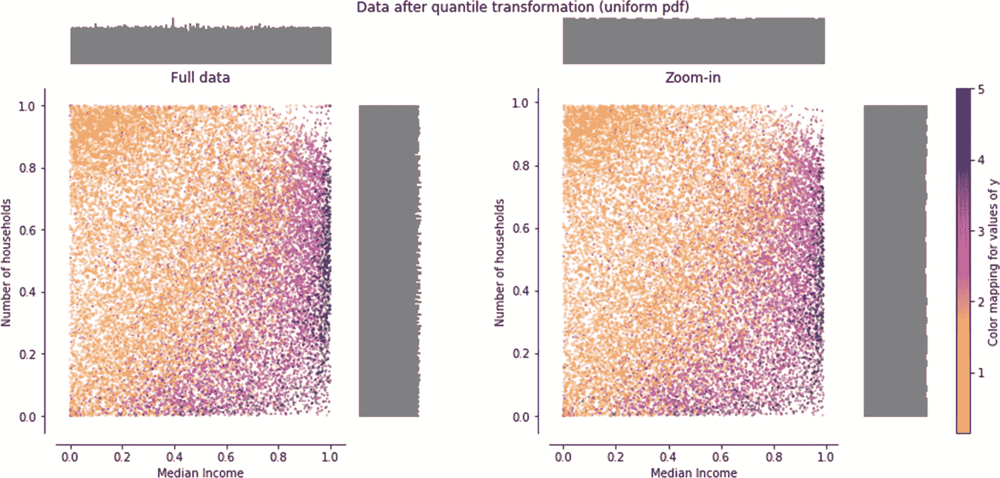
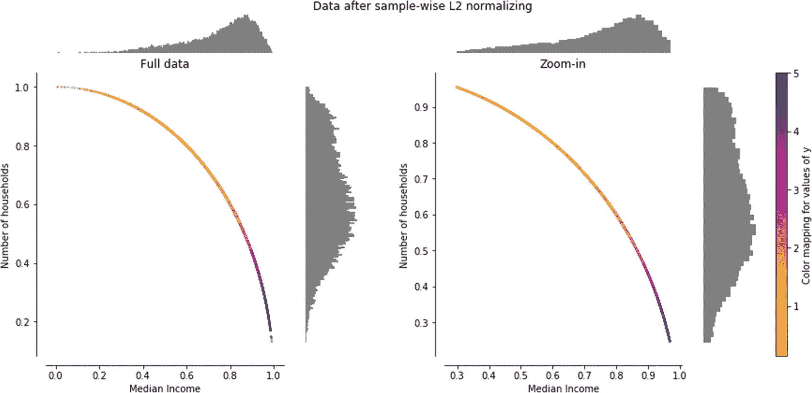
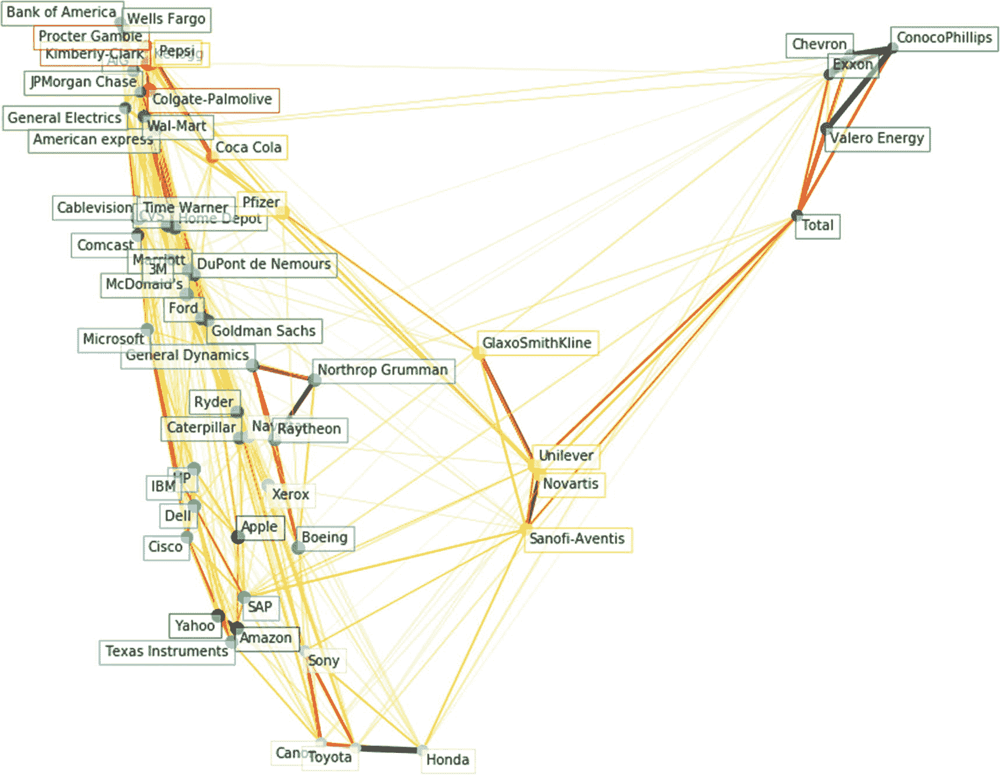

# 8. 无监督学习：深度学习

接下来的一组无监督学习技术将无监督过程引入神经网络。

人工神经网络（ANN）是一种通过模拟类似于[大脑](https://en.wikipedia.org/wiki/Brain)活动的过程（即一系列具有共同结果的活动）来计算解决方案的生态系统。

## 深度学习

深度学习是机器学习的一个子领域，专注于生成人工神经网络的算法。

### TensorFlow

`TensorFlow`（[`https://www.tensorflow.org/`](https://www.tensorflow.org/)）是一个用于数值计算的开源软件库，它使用数据流图进行计算。图中的节点代表数学运算，而图的边代表它们之间传递的多维数据数组（张量）。其灵活的架构允许你通过单个 API 将计算部署到桌面、服务器或移动设备中的一个或多个 CPU 或 GPU。

要安装它，你可以使用以下任何一种方法：

*   `conda install -c anaconda tensorflow`（我在我的笔记本电脑上使用了这个）
*   `conda install -c conda-forge tensorflow`
*   `conda install -c anaconda tensorflow-gpu`（我在我的支持 GPU 的台式工作站上使用这个）

你在前面的章节中已经使用过这个处理过程。

打开名为 `Chapter-008-001-Tensorflow-01.ipynb` 的 Jupyter notebook。

执行该 notebook，使用 `TensorFlow` 求解数学公式 `y = m ∗ x + k`。

解：`y = (0.196810 ∗ x) + 0.201904`

该处理过程通过尝试匹配训练数据集来学习这些值。

打开名为 `Chapter-008-002-Tensorflow-02.ipynb` 的 Jupyter notebook。

### 警告

在 Mac 上，加载 `mnist` 数据集时存在一个已知问题，即证书验证失败。你需要在 Python 安装目录中执行 `/Applications/Python/3.6/Install/Certificates.command` 来解决此问题。

你的结果：损失：`0.149082`，准确率：`0.957300`。`14.9%` 的损失和 `95.7%` 的准确率是一个不错的结果，处理过程运行良好。

### PyTorch

`PyTorch` 是一个基于 `Torch` 的 Python 开源机器学习库，用于自然语言处理等应用。

`PyTorch` 是一个针对使用 GPU 和 CPU 进行深度学习而优化的张量库。

`PyTorch` 通过混合前端、分布式训练以及丰富的工具和库生态系统，实现了快速、灵活的试验和高效的生产。

请参阅：[`https://pytorch.org/`](https://pytorch.org/) 以获取有关此引擎的更多详细信息。

安装：

```
conda install pytorch torchvision cudatoolkit=10.0 -c pytorch
```

如果你只想或只能使用 CPU 安装：`conda install pytorch-cpu torchvision-cpu -c pytorch`

现在打开 Jupyter notebook：`Chapter-008-003-Torch-01.ipynb`

我们将比较 `NumPy` 和 `PyTorch`，以向你介绍机器学习技术。

`NumPy` 提供了一个 n 维数组对象以及许多用于操作这些数组的函数。

一方面，`NumPy` 是一个用于科学计算的通用框架；它对计算图、深度学习或梯度一无所知。另一方面，我们可以通过使用 `NumPy` 操作手动实现网络的前向和反向传播，轻松地使用 `NumPy` 将一个两层网络拟合到随机数据上。

`PyTorch` 是一个基于 [Torch](https://en.wikipedia.org/wiki/Torch_%28machine_learning%29) 生态系统的 [Python](https://en.wikipedia.org/wiki/Python_%28programming_language%29) [开源](https://en.wikipedia.org/wiki/Open-source_software) [机器学习](https://en.wikipedia.org/wiki/Machine_learning) [库](https://en.wikipedia.org/wiki/Library_%28computing%29)，支持两种处理类型：

*   具有强大 [GPU 加速](https://en.wikipedia.org/wiki/General-purpose_computing_on_graphics_processing_units) 能力的张量计算（可与 [NumPy](https://en.wikipedia.org/wiki/NumPy) 相媲美）。
*   构建在基于磁带的自微分系统上的 [深度神经网络](https://en.wikipedia.org/wiki/Deep_neural_networks)。

因此，我建议我们研究一下它比纯 `NumPy` 解决方案好多少。

我将最大值分别设置为 `1968` 和 `19680` 进行了两次运行。

在处理 `1968` 条记录时，`Torch`（`10.753` 秒）比 `NumPy`（`14.803` 秒）快 `1.38` 倍。

在处理 `19680` 条记录时，`Torch`（`104.135` 秒）比 `NumPy`（`149.317` 秒）快 `1.43` 倍。

### 提示

事实证明，`Torch` 平均比 `NumPy` 快 `40%`。当你启用 GPU 时，这个数字会更高。

### Theano

`Theano` 是一个 Python 库，允许你定义、优化和高效地评估涉及多维数组的数学表达式。这是一个用于在 CPU 和 GPU 上评估数学表达式的优化编译器。该引擎自 2007 年以来一直在使用，因此在公司中被广泛使用。核心开发者蒙特利尔学习算法研究所（MILA）已于 2017 年 9 月通知机器学习社区，将停止主要开发工作。

此后，我协助了几位客户将其 `Theano` 解决方案转换为 `Keras TensorFlow` 解决方案。

安装库：

```
conda install -c conda-forge theano
```

打开名为 `Chapter-008-004-Theano.ipynb` 的 Jupyter notebook。

运行该 notebook。这将向你展示 `Theano` 引擎如何执行机器学习。

你的结果应如下所示：

```
print('Difference: ')
print(result[0])
Difference:
[[ 1.  0.]
 [-1. -2.]]
print('Absolute Difference: ')
print(result[1])
Absolute Difference:
[[1. 0.]
 [1. 2.]]
print('Squared Difference: ')
print(result[2])
Squared Difference:
[[1. 0.]
 [1. 4.]]
print('Powered Difference: ')
print(result[3])
[[ 1.    1.  ]
 [-1.    0.25]]
```

### 提示

我建议你通过该引擎收集一系列数据源，以确保你理解成功使用此引擎所需的技术。

我还建议你花一些时间研究该引擎，以便能够维护现有代码或将代码移植到其他引擎。

## 比较聚类

以下在聚类示例中的比较将测试你对整个聚类过程的理解。

打开名为 `Chapter-008-005-Compare-clustering-01.ipynb` 的 Jupyter notebook。

显示结果（图 8-1）展示了数据轮廓最微小的变化如何在相同的机器学习算法和超参数上产生不同的结果。



图 8-1

聚类比较结果

### 提示

通过使用不同的数据模型创建一个标准测试平台来研究机器学习算法及其超参数，以确保你理解机器学习的行为。

结果如图 8-1 所示。

## 预处理数据集

机器学习生态系统中最大的时间消耗者是数据的预处理，以匹配机器学习解决方案所需的模型或特征。

一个典型的数据科学和机器学习解决方案需要三到四个人进行数据准备，才能支撑一位机器学习工程师一小时的开发工作。

根据我的经验，一个初创团队每周会花四天时间准备数据，用一天时间进行机器学习。

### 警告

我建议你使用敏捷持续开发方法每天运行你的机器学习，以确保你的机器学习开发取得了正确的结果，并定期与业务领域负责人核对结果，以确保我们走在正确的轨道上。让你的见解与业务的变化保持同步。

你需要了解的另一个比例是，在你的敏捷待办任务中，数据预处理将消耗你 `80%` 的开发项。机器学习组件通常已经开发好，只需要合适的超参数。

因此，在规划项目时，数据工程人员与数据科学人员的比例应为 1 比 4，并按照工作任务完成比例 1 比 9 来估算你的完成时间。

现在让我们开始我们的基本预处理任务。

### 预处理数据

打开名为 `Chapter-008-006-Preprocessing-Data-01.ipynb` 的 Jupyter notebook。C 部分是一个缩放处理器：

该处理器通过将数据集沿任意轴居中到均值，并将每个数据项的分量缩放到单位方差，从而对数据集进行标准化。

```
X_scaled = preprocessing.scale(X_train,
axis=0,
with_mean=True,
with_std=False,
copy=True
)
```

D 部分是一个 `RobustScaler` 处理器：

该处理器通过将数据集沿任意轴居中到中位数，并根据四分位距进行分量缩放，从而对数据集进行标准化。

```
scaler = preprocessing.RobustScaler(with_centering=True,
with_scaling=True,
quantile_range=(25.0, 75.0),
copy=True
).fit(X_train)
```

`sklearn.preprocessing` 库包含几个有用的预处理引擎。我建议你全面研究它们，以确定它们能为你的预处理需求提供哪些支持。

| 处理器 | 描述 |
| --- | --- |
| `preprocessing.Binarizer([threshold, copy])` | 根据阈值对数据进行二值化（将特征值设置为 0 或 1）。 |
| `preprocessing.FunctionTransformer([func, ...])` | 从任意可调用对象构造一个转换器。 |
| `preprocessing.KBinsDiscretizer([n_bins, ...])` | 将连续数据分箱为区间。 |
| `preprocessing.KernelCenterer()` | 对核矩阵进行中心化。 |
| `preprocessing.LabelBinarizer([neg_label, ...])` | 以一对多的方式对标签进行二值化。 |
| `preprocessing.LabelEncoder` | 将标签编码为 0 到 `n_classes-1` 之间的值。 |
| `preprocessing.MultiLabelBinarizer([classes, ...])` | 在可迭代对象的可迭代对象与多标签格式之间进行转换。 |
| `preprocessing.MaxAbsScaler([copy])` | 通过每个特征的最大绝对值来缩放每个特征。 |
| `preprocessing.MinMaxScaler([feature_range, copy])` | 通过将每个特征缩放到给定范围来转换特征。 |
| `preprocessing.Normalizer([norm, copy])` | 将样本单独归一化为单位范数。 |
| `preprocessing.OneHotEncoder([n_values, ...])` | 将分类整数特征编码为独热数值数组。 |
| `preprocessing.OrdinalEncoder([categories, dtype])` | 将分类特征编码为整数数组。 |
| `preprocessing.PolynomialFeatures([degree, ...])` | 生成多项式特征和交互特征。 |
| `preprocessing.PowerTransformer([method, ...])` | 按特征应用幂变换，使数据更接近高斯分布。 |
| `preprocessing.QuantileTransformer([...])` | 使用分位数信息转换特征。 |
| `preprocessing.RobustScaler([with_centering, ...])` | 使用对异常值鲁棒的统计量来缩放特征。 |
| `preprocessing.StandardScaler([copy, ...])` | 通过移除均值并缩放到单位方差来标准化特征。 |
| `preprocessing.add_dummy_feature(X[, value])` | 向数据集添加一个额外的虚拟特征。 |
| `preprocessing.binarize(X[, threshold, copy])` | 对类数组或 `scipy.sparse` 矩阵进行布尔阈值处理。 |
| `preprocessing.label_binarize(y, classes[, ...])` | 以一对多的方式对标签进行二值化。 |
| `preprocessing.maxabs_scale(X[, axis, copy])` | 将每个特征缩放到 `[-1, 1]` 范围，同时不破坏稀疏性。 |
| `preprocessing.minmax_scale(X[, ...])` | 通过将每个特征缩放到给定范围来转换特征。 |
| `preprocessing.normalize(X[, norm, axis, ...])` | 将输入向量单独缩放到单位范数（向量长度）。 |
| `preprocessing.quantile_transform(X[, axis, ...])` | 使用分位数信息转换特征。 |
| `preprocessing.robust_scale(X[, axis, ...])` | 沿任意轴标准化数据集。 |
| `preprocessing.scale(X[, axis, with_mean, ...])` | 沿任意轴标准化数据集。 |
| `preprocessing.power_transform(X[, method, ...])` | 幂变换是一族参数化的单调变换，用于使数据更接近高斯分布。 |

这仅仅是标准集合。我还发现，预处理器的串联通常可以进一步改善数据，从而在最终机器学习模型的性能和调优能力方面获得更好的结果。

### 提示

我建议你花几周时间，基本上将已知数据集与这些处理器进行匹配，以了解它们如何转换和修改你的机器学习结果。在实际应用中，我发现使用适当的预处理可以为你节省数小时的复杂模型超参数调优时间。

那么，让我们看一个真实的数据集，来演示你可以获得的一些有趣见解。

打开名为 `Chapter-008-007-Preprocessing-Data-02.ipynb` 的 Jupyter notebook。

运行该 notebook 并跟踪你的进度。基本概念是通过可视化方式，了解给定数据集中两个选定特征之间的关系和分布。我个人对于首次收到的任何数据集都会执行此过程，以了解数据的分布和特征。

那么，我们开始吧……让我们研究一下数据。见图 8-2。

```
make_plot(1)
```



**图 8-2**

预处理运行 0 结果

请注意，家庭数量都分布在数值范围的较低部分。

如果应用标准缩放器，你会观察到更好的分布。见图 8-3。



**图 8-3**

预处理运行 1 结果

```
make_plot(1)
```

如果应用最小-最大缩放器，你会发现数据主要分布在均值周围。见图 8-4。



**图 8-4**

预处理运行 2 结果

```
make_plot(2)
```

最小绝对值处理器给出这种分布。见图 8-5。



**图 8-5**

预处理运行 3 结果

```
make_plot(3)
```

鲁棒缩放器给出这种分布。见图 8-6。



**图 8-6**

预处理运行 4 结果

```
make_plot(4)
```

更多结果见图 8-7。



**图 8-7**

# 预处理运行 5 结果

```
make_plot(5)
```

更多结果见图 8-8。



图 8-8

# 预处理运行 6 结果

```
make_plot(6)
```

更多结果见图 8-9。



图 8-9

# 预处理运行 7 结果

```
make_plot(7)
```

## 特征

特征是机器学习过程的支柱；如果你未能识别出数据中的模式（即特征），你的机器学习模型将无法表现良好。我建议你研究以下 notebook，以深入了解特征的能力以及你可以用来增强其能力的技术。

打开名为以下内容的 Jupyter notebook：

- `Chapter-008-008-Features-01.ipynb`
- `Chapter-008-009-Model-Bagging.ipynb`
- `Chapter-008-010-Model-Boosting.ipynb`
- `Chapter-008-011-Model-Stacking.ipynb`

## 应用

接下来，我将引导你完成一个无监督学习应用，以演示如何将你学到的知识应用于实际解决方案中。

### 股票市场

该应用是一家股票市场交易公司，专门交易特定的蓝筹客户投资组合。您将主要挖掘特定的蓝筹股并追踪其价值。

打开名为 `Chapter-008-012-Stock-Market.ipynb` 的 Jupyter notebook。参见图 8-10。



**图 8-10**

股票市场结果

进展顺利！您已完成股票市场解决方案。

### 警告

机器学习建议需要为读者提供大量的咖啡和茶。

现在，我将分享一些非机器学习工具，您可以用它们来工业化地交付您的机器学习成果。请记住，机器学习是决策科学生态系统的一部分，该扩展研究领域中的任何解决方案都适用于您的数据科学。

### 提示

我建议您研究适用于决策科学、运筹学和商业管理的解决方案，以便为您的机器学习解决方案找到正确且合适的方案。

# 下一步是什么？

现在，您已成功完成无监督机器学习的学习。您已准备好轻松处理几乎任何数据。由于您现在可以在没有任何预先标记的情况下处理数据，这种无监督方法将支持几乎任何数据需求。

您做得很好，因为您已经涵盖了最常见的机器学习类型。下一章是关于强化学习的内容。