# 9. 强化学习：利用新获得的知识获取洞察

在强化学习中，每个数据点都会执行一个动作。动作的执行会产生一个奖励信号，指示该决策的好坏程度。然后，该算法会修改其动作策略，以增强在特定环境中获得最高奖励的可能性。

由于缺少训练数据，智能体通过重复经验进行学习。它通过记录（“这个动作好，那个动作坏”）来收集知识。它通过试错来学习，尝试修改和执行以获得更好的奖励任务，其唯一目标是最大化从应用环境中获得的长期奖励。

本章还涵盖了深度学习，它增强了深度强化学习的概念，以解决当前的业务问题。

## 马尔可夫决策过程 (MDP)

马尔可夫决策过程 (MDP) 是一个离散时间的随机控制过程。它提供了一个数学框架，用于在结果部分随机、部分受决策者控制的情况下对决策进行建模。MDP 对于研究通过动态规划和强化学习解决的优化问题非常有用。

使转换得以工作的基本数据流和交互如图 9-1 所示。

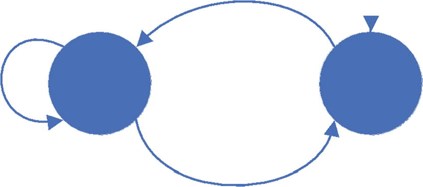

**图 9-1**

转换图

我们将通过打开 Jupyter Notebook 将这些转换转换为代码：

`Chapter-009-001-Markov-Decision-Process-01.ipynb`

## 机器人行走

以下转换图解释了机器人 (1, 1) 如何通过避开 (2, 4) 到达 (3, 4)。机器人有 80% 的可能性朝其面对的方向移动，但也有 10% 的可能性转向过度，最终向左或向右移动。参见图 9-2。

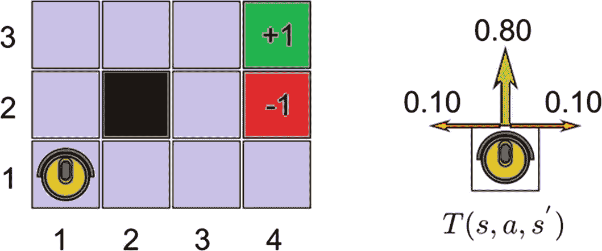

**图 9-2**

机器人行走转换

要创建这些机器人转换，您需要 Jupyter Notebook：`Chapter-009-002-Robot-Walk-01.ipynb`

请跟随代码，它将转换图转换为代码，以解决让“罗比”回家的方案。

## 动态规划

动态规划 (DP) 既是一种数学优化方法，也是一种计算机编程方法。DP 通过将“复杂问题”分解为子集，然后解决已发现的子问题，同时利用已发现的信息来解决更困难的原始复杂问题。您只需将问题分解为更小的可解问题，并整合结果来解决更大的问题。使用 DP，您通常将结果存储在表中以跟踪进度。DP 是一种强大的技术，它允许您在 `O(n²)` 或 `O(n³)` 时间内解决不同类型的问题，而朴素方法则需要指数时间。

### 迪杰斯特拉算法

用于最短路径问题的迪杰斯特拉算法可以通过遵循一系列较小的循环来解决，这些循环共同达成一个解决方案。要研究该算法的工作原理，请打开 notebook：`Chapter-009-003-Dijkstra-algorithm-01.ipynb`

代码演示了如何使用该算法来解决寻找各个节点之间最短路径的问题。

```
print (Graph.dijkstra(graph,'a','e'))
结果：
deque(['a', 'b', 'd', 'e'])
```

下一个解决方案演示了如何解决更复杂的问题。打开名为 `Chapter-009-004-Dijkstra-algorithm-02.ipynb` 的 Jupyter Notebook。

结果如下：

```
名称：
类型：图
节点数：6
边数：9
平均度数：3.0000
迪杰斯特拉路径：
['a', 'b', 'd', 'e']
```

我还建议您研究此代码生成的其他图形。

### 提示

`networkx` 库对于处理节点（即智能体）之间的关系非常有用。

### 活动选择问题

该问题要求您选择可以在给定时间段内执行的活动列表。

### 注意

以下实现假设活动已根据其结束时间进行了排序。结果应显示一个人可以一次完成的最大活动集。

报告内容：

*   `n` --> 活动总数
*   `s[]` --> 包含所有活动开始时间的数组
*   `f[]` --> 包含所有活动结束时间的数组

打开名为 `Chapter-009-005-Activity-Selection-Problem-01.ipynb` 的 Jupyter Notebook。

```
已选择以下活动：
活动：A 开始时间：1:00 结束时间：2:00
活动：B 开始时间：3:00 结束时间：4:00
活动：D 开始时间：5:00 结束时间：7:00
活动：E 开始时间：8:00 结束时间：9:00
```

## 汉诺塔

“汉诺塔”游戏使用三根柱子。若干圆盘按从下到上递减的顺序叠放在一根柱子上，即最大的圆盘在底部，最小的在顶部，这些圆盘构成一个锥形塔。游戏的目标是将整座圆盘塔从一根柱子移动到另一根柱子上。见图 9-3。

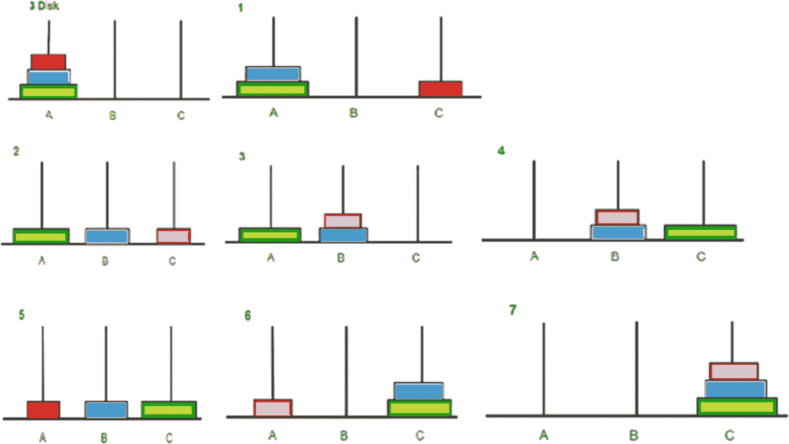

**图 9-3**

汉诺塔

必须遵守以下规则：

*   每次只能移动一个圆盘。
*   每次移动只能移动某根柱子最顶端的圆盘。
*   该圆盘可以放在另一根柱子上，前提是该柱子为空，或者该柱子最顶端的圆盘比要移动的圆盘大。

示例 – 仅 3 个圆盘：

打开名为 `Chapter-009-006-Towers-of-Hanoi-01.ipynb` 的 Jupyter Notebook。

```
结果：
开始：([3, 2, 1], 'source') ([], 'helper') ([], 'target')
移动 1 从 source 到 target
移动 2 从 source 到 helper
移动 1 从 target 到 helper
移动 3 从 source 到 target
移动 1 从 helper 到 source
移动 2 从 helper 到 target
移动 1 从 source 到 target
结束：([], 'source') ([], 'helper') ([3, 2, 1], 'target')
```

3 到 11 个圆盘的示例：

现在看看更多圆盘的情况，这将证明该过程适用于任意数量的圆盘。打开名为 `Chapter-009-007-Towers-of-Hanoi-02.ipynb` 的 Jupyter Notebook。你可以看到，圆盘数量的增加会延长过程的运行时间，但只要遵守规则，它仍然能解决问题。这看起来可能只是一个游戏，但我有一个客户，其自动仓储解决方案使用了相同的求解域，来计算顶部堆垛机器人处理箱子的顺序，以满足正确的重量堆叠标准。

## 旅行商问题

旅行商问题（TSP）提出以下问题：“给定一系列城市以及每对城市之间的距离，求一条访问每个城市并返回起始城市的最短可能路线。” 这是组合优化中的一个 NP 难问题。打开名为 `Chapter-009-008-Travelling-Salesman-01.ipynb` 的 Jupyter Notebook。你的结果如图 9-4 所示。

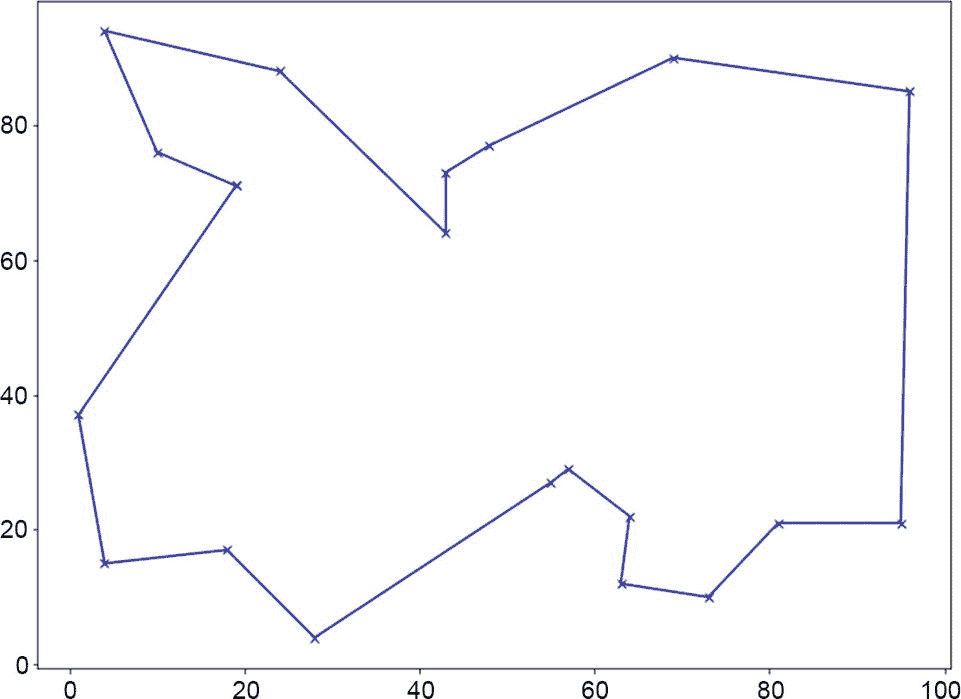

**图 9-4**

旅行商问题

旅行采购问题和车辆路径问题同样是 TSP 的泛化形式。它常用于解决公共交通或公交线路的路线规划问题。现在我将向你展示同一问题的一个更优优化版本的使用。打开名为 `Chapter-009-009-Travelling-Salesman-02.ipynb` 的 Jupyter Notebook。你的结果如图 9-5 所示。

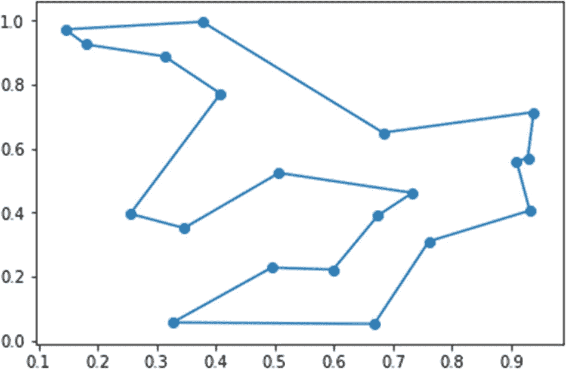

**图 9-5**

旅行路线问题

路线：`[ 0 13 12 4 17 7 11 15 18 2 6 14 8 3 1 5 10 16 9 19]`

距离：`4.033827398325876`

### 囚徒困境

囚徒困境是博弈论中分析的一个标准博弈示例，它展示了为什么两个完全理性的人可能不会合作，即使合作看起来符合他们的最佳利益。打开名为 `Chapter-009-010-Prisoner-Dilemma-01.ipynb` 的 Jupyter Notebook。

结果：

结果用于调查议员是否会选择合作组建联盟（`C`）还是背叛（`D`）。当政党在选举中未能获得明确多数席位时，这种测试很常见。假设 A 党的收益如下：

*   当 B 合作且 A 合作时，A 获得 3 个单位的政治收益
*   当 B 合作且 A 背叛时，A 获得 5 个单位的政治收益
*   当 B 背叛且 A 合作时，A 获得 0 个单位的政治收益
*   当 B 背叛且 A 背叛时，A 获得 1 个单位的政治收益

以下是可能的选项：

*   A 选择的策略：`[('D', 'D'), ('C', 'D')]`

## 多类排队网络（MQN）

*   B 选择的策略：`[('D', 'D'), ('C', 'D')]`
*   纯策略纳什均衡为：`('D', 'D')`

这表明，在给定的收益下，不组建联盟是更好的选择。

多类排队网络是一种网络模型，它模拟了现实世界处理场景中常见的网络结构，其中不同处理点之间存在依赖关系，而队列则充当这些点之间的缓冲区。

打开名为 `Chapter-009-011-MQN-01.ipynb` 的 Jupyter Notebook。

### 提示

重新运行该过程，直到获得一个收敛的组合。

该解在 5,572 步后收敛。

队列 A：

```
[[1.47025168 0.83294556]
[0.68592644 0.36197673]
[0.2433538  1.72692295]
[2.0728354  1.49116639]
[0.64876782 1.38615141]
[0.30623    0.64057238]
[1.35141951 0.78225212]
[0.64335072 1.63394717]]
```

队列 B：

```
[[2.17254805 3.64517471]
[3.16230687 2.97824253]
[2.79010516 4.11028026]
[2.38418286 4.05329159]
[2.69742024 3.57219974]
[3.03045585 2.64732508]
[1.74762308 3.58107411]
[3.09587674 2.65190328]]
```

队列 C：

```
[[ 2.83518099e+00  1.67734127e-03]
[ 3.08180062e+00  1.68267411e-01]
[ 2.71948131e+00 -3.15558079e-01]
[ 2.79336116e+00 -4.95018881e-01]
[ 2.52133725e+00  8.35166780e-01]
[ 2.95958847e+00  3.69114538e-01]
[ 2.79235514e+00  5.09964946e-01]
[ 4.46361008e+00  4.24490087e-01]]
```

## 推荐系统

推荐系统是一种信息过滤系统，它旨在有效预测任何用户对某个项目的“评分”或“偏好”。它通过观察特定用户过去的行为，或寻找使用相同服务的其他用户之间的共同匹配模式，来尝试预测未来。这是电子商务系统中的常见流程。例如，它会向你推荐新的购买物品，或推荐其他用户购买的类似物品。在行业中，这被称为“向上销售”或“交叉销售”。

### 电影推荐系统

打开名为 `Chapter-009-012-Recommender-01.ipynb` 的 Jupyter Notebook。

你的结果如图 9-6 所示。

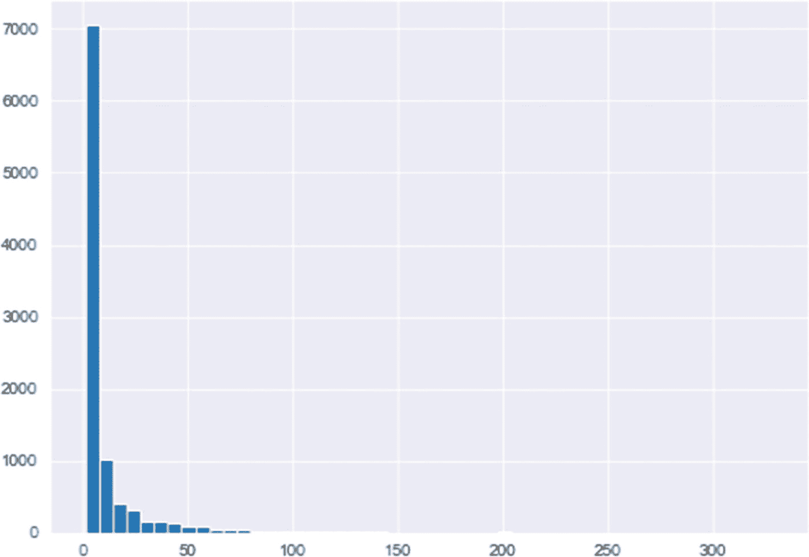

图 9-6

推荐系统 – 评分计数直方图

你的结果如图 9-7 所示。

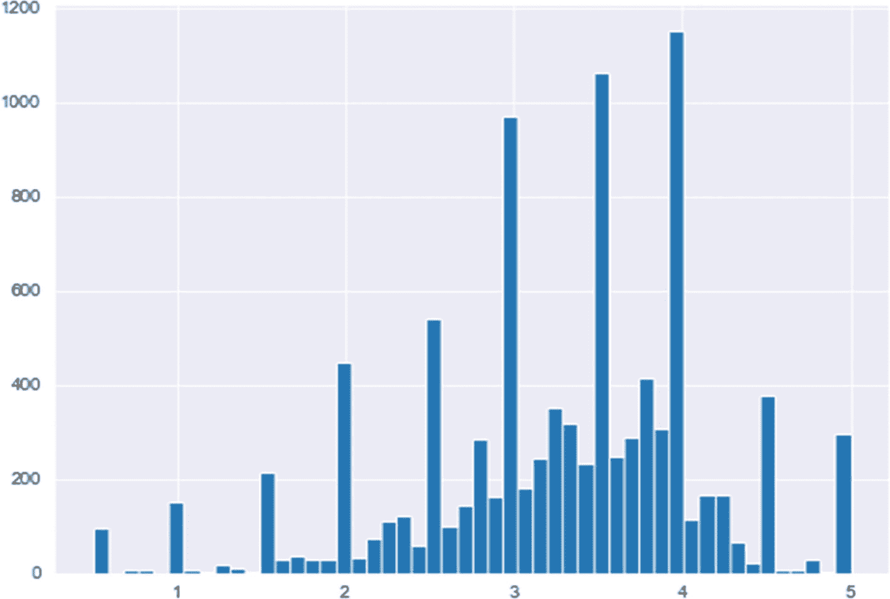

图 9-7

推荐系统 – 评分直方图

你的结果如图 9-8 所示。

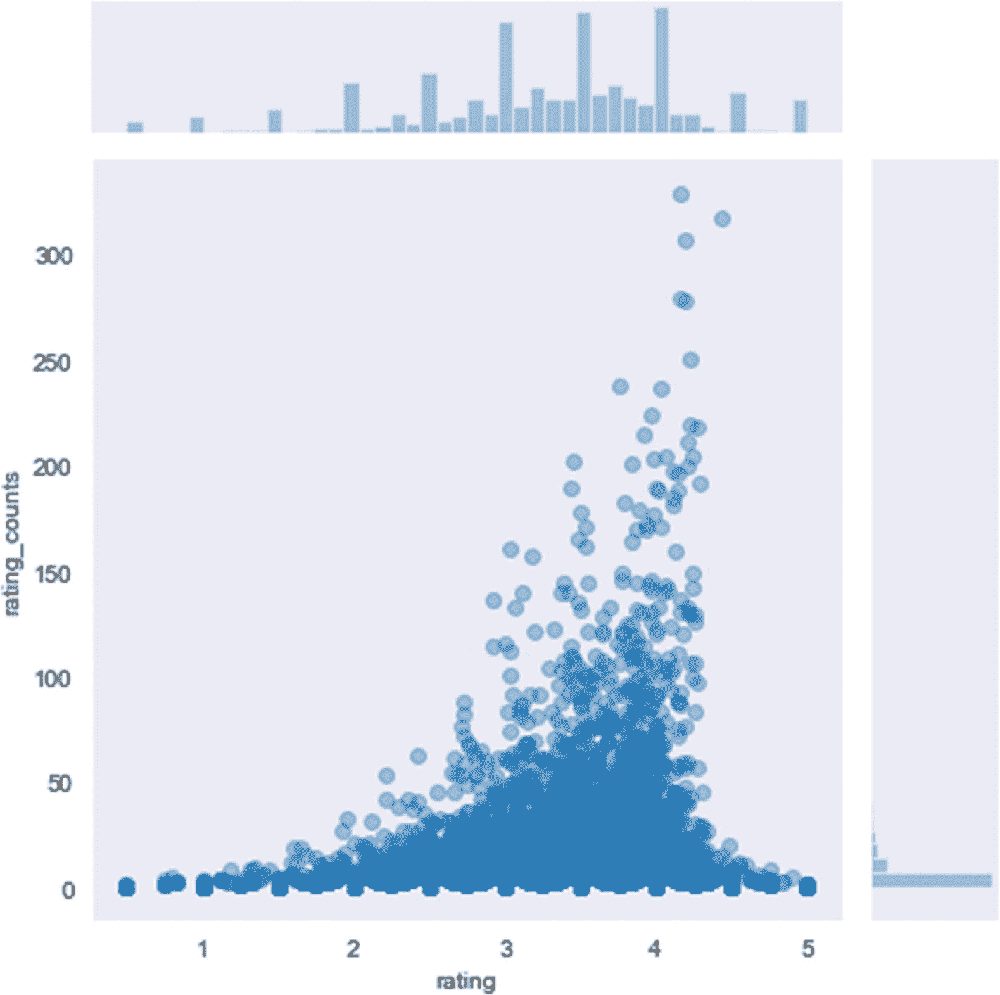

图 9-8

推荐系统 – 联合图

| 标题 | 相关性 | 评分计数 |
| --- | --- | --- |
| 阿甘正传 (1994) | 1 | 329 |
| 霍兰先生的乐章 (1995) | 0.652144 | 80 |
| 风中奇缘 (1995) | 0.550118 | 68 |
| 脾气更坏的老男人 (1995) | 0.534682 | 52 |
| 疯狂高尔夫 (1980) | 0.520328 | 52 |

```
Correlation
title
'burbs, The (1989)                 0.197712
(500) Days of Summer (2009)        0.234095
*batteries not included (1987)     0.892710
...And Justice for All (1979)      0.928571
10 Cent Pistol (2015)             -1.000000
Correlation
title
Lost & Found (1999)                                1.0
Century of the Self, The (2002)                    1.0
The 5th Wave (2016)                                1.0
Play Time (a.k.a. Playtime) (1967)                 1.0
Memories (Memorîzu) (1995)                         1.0
Playing God (1997)                                 1.0
Killers (2010)                                     1.0
Girl Walks Home Alone at Night, A (2014)           1.0
Tampopo (1985)                                     1.0
Correlation  rating_counts
title
'burbs, The (1989)                 0.197712             17
(500) Days of Summer (2009)        0.234095             42
*batteries not included (1987)     0.892710              7
...And Justice for All (1979)      0.928571              3
10 Cent Pistol (2015)             -1.000000              2
print(corr_forrest_gump[corr_forrest_gump ['rating_counts']>50].sort_values('Correlation', ascending=False).head())
```

下一个推荐系统使用了一些共享文章。

打开名为 `Chapter-009-013-Recommender-02.ipynb` 的 Jupyter Notebook。

```
Loaded 3122 articles with 13 columns
Loaded 72312 articles with 8 columns
```

你的结果如图 9-9 所示。

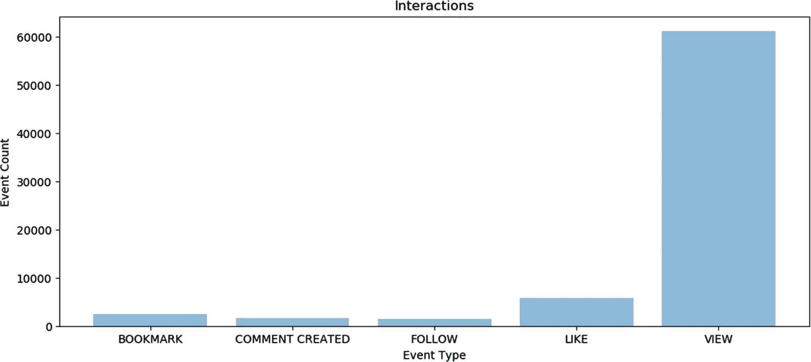

图 9-9

事件传播 – 交互

*   交互数量：72312
*   用户数量：1895
*   至少有 5 次交互的用户数量：1140
*   来自至少有 5 次交互的用户的交互数量：69868
*   唯一用户/物品交互数量：39106
*   训练集上的交互数量：31284
*   测试集上的交互数量：7822

你的结果：

```
Evaluating Popularity recommendation model...
1139 users processed
Global metrics:
{'modelName': 'Popularity', 'recall@5': 0.2418818716440808, 'recall@10': 0.3725389925850166}
print(pop_detailed_results_df.head(10))
```

你的结果：

| | `_person_id` | `hits@10_count` | `hits@5_count` | `interacted_count` | `recall@10` | `recall@5` |
|---|---|---|---|---|---|---|
| `76` | `3609194402293569455` | `50` | `28` | `192` | `0.260417` | `0.145833` |

| `17` | `-2626634673110551643` | `25` | `12` | `134` | `0.186567` | `0.089552` |
| `16` | `-1032019229384696495` | `23` | `13` | `130` | `0.176923` | `0.100000` |
| `10` | `-1443636648652872475` | `9` | `5` | `117` | `0.076923` | `0.042735` |
| `82` | `-2979881261169775358` | `40` | `26` | `88` | `0.454545` | `0.295455` |
| `161` | `-3596626804281480007` | `18` | `12` | `80` | `0.225000` | `0.150000` |
| `65` | `1116121227607581999` | `34` | `20` | `73` | `0.465753` | `0.273973` |
| `81` | `692689608292948411` | `23` | `17` | `69` | `0.333333` | `0.246377` |
| `106` | `-9016528795238256703` | `18` | `14` | `69` | `0.260870` | `0.202899` |
| `52` | `3636910968448833585` | `28` | `21` | `68` | `0.411765` | `0.308824` |

### 基于内容的过滤模型

基于内容的过滤方法利用用户交互过的物品的描述或属性来推荐相似的物品。它仅依赖于用户之前的选择，这使得该方法能够稳健地避免冷启动问题。当收集的数据集不足以让引擎提供最佳推荐结果时，就会发生“冷启动”。

忽略英语和葡萄牙语中的停用词（无语义的词）（因为你的语料库包含混合语言）：

```python
get_ipython().system('pip install -U nltk')
```

让我们在你的系统上设置 NLTK 内容。

```python
import nltk
nltk.download
```

现在你可以启动程序来演示 NLTK 的使用方式。

```python
from nltk.tokenize import sent_tokenize, word_tokenize
from nltk.corpus import stopwords
from sklearn.feature_extraction.text import TfidfVectorizer
stopwords_list = stopwords.words('english') + stopwords.words('portuguese')
```

现在你训练一个向量大小为 5000 的模型，该模型由语料库中的核心一元组和二元组组成，并忽略停用词。

```python
vectorizer = TfidfVectorizer(analyzer='word',
ngram_range=(1, 2),
min_df=0.003,
max_df=0.5,
max_features=5000,
stop_words=stopwords_list)
item_ids = articles_df['contentId'].tolist()
tfidf_matrix = vectorizer.fit_transform(articles_df['title'] + "" + articles_df['text'])
tfidf_feature_names = vectorizer.get_feature_names()
print(tfidf_matrix.shape)
```

你的结果：

```
(3047, 5000)
```

你现在可以遍历结果：

*   我只遍历前 20 条记录。

```python
for i in range(20):
print(' %2.0d => %0.4f - %0.4f' % (i, tfidf_matrix[i,0], tfidf_matrix[i,1]))
```

你的结果：

```
0 => 0.0000 - 0.0000
1 => 0.0957 - 0.0000
2 => 0.0000 - 0.0000
3 => 0.0000 - 0.0000
4 => 0.0000 - 0.0398
5 => 0.0000 - 0.0000
6 => 0.0000 - 0.0000
7 => 0.0000 - 0.0134
8 => 0.0000 - 0.0151
9 => 0.0000 - 0.0000
10 => 0.0000 - 0.0000
11 => 0.0104 - 0.0000
12 => 0.0000 - 0.0000
13 => 0.0000 - 0.0145
14 => 0.0000 - 0.0000
15 => 0.0000 - 0.0000
16 => 0.0000 - 0.0276
17 => 0.0000 - 0.0000
18 => 0.0000 - 0.0000
19 => 0.0000 - 0.0300
```

干得好……你已经掌握了基本的强化学习模型。既然你已经了解了该技术的入门知识，我建议你研究这些更复杂的模型。

### 提示

我建议你使用不同类型和组合的数据与分布来练习你的机器学习模型。这是实现有效且高效的 IML 的唯一途径。

### 解决强化学习问题的框架

#### 最短路径问题

让我通过一个示例（图 9-10）来为你阐明。

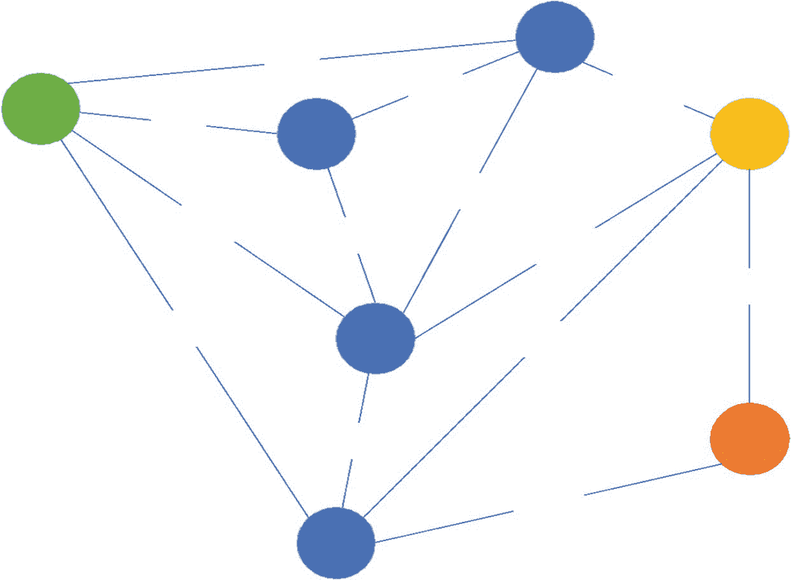

图 9-10 最短路径问题

这是一个最短路径问题的表示。任务是从地点 `A` 到达地点 `F`，并尽可能降低总成本。两个地点之间每条边上的数字代表穿越该距离所需的成本。负成本代表沿途的某些收益。你必须将**价值**定义为在采用给定策略时获得的总累积奖励。

这里，
*   状态集是节点 `{A, B, C, D, E, F, G}`
*   要执行的动作是从一个地点移动到另一个地点 `{A -> B, C -> D 等}`
*   奖励函数是由边表示的值，即成本
*   策略是完成任务所采用的“路径” `{A -> ? -> F}`
*   你能解出这条路线吗？

打开名为 `Chapter-009-014-Recommender-Network-03.ipynb` 的 Jupyter Notebook。

```python
n = ['A','B','C','D','E','F']
import networkx as nx
G=nx.Graph()
G.add_nodes_from(n)
print ("Nodes of graph: ")
print(G.nodes())
```

结果：

Nodes of graph: ['A', 'B', 'C', 'D', 'E', 'F']
G.add_edge('A', 'B', weight=25)
G.add_edge('A', 'C', weight=150)
G.add_edge('A', 'D', weight=25)
G.add_edge('A', 'E', weight=22)
G.add_edge('B', 'C', weight=100)
G.add_edge('B', 'D', weight=15)
G.add_edge('C', 'E', weight=333)
G.add_edge('C', 'F', weight=280)
G.add_edge('D', 'F', weight=150)
G.add_edge('E', 'F', weight=60)
G.add_edge('E', 'G', weight=180)
G.add_edge('F', 'G', weight=390)
print("Nodes of graph: ")
print(G.nodes())
print("Edges of graph: ")
print(G.edges())
Nodes of graph:
['A', 'B', 'C', 'D', 'E', 'F', 'G']
Edges of graph:
[('A', 'B'), ('A', 'C'), ('A', 'D'), ('A', 'E'), ('B', 'C'), ('B', 'D'), ('C', 'E'), ('C', 'F'), ('D', 'F'), ('E', 'F'), ('E', 'G'), ('F', 'G')]
%matplotlib inline
import matplotlib.pyplot as plt
pos = nx.circular_layout(G, dim=2, scale=2)
nx.draw(G, pos=pos, node_size=800, node_shape="D")
labels = nx.draw_networkx_labels(G, pos=pos)
edge_labels = nx.draw_networkx_edge_labels(G, pos=pos)
plt.draw()
```

你的结果如图 9-11 所示。

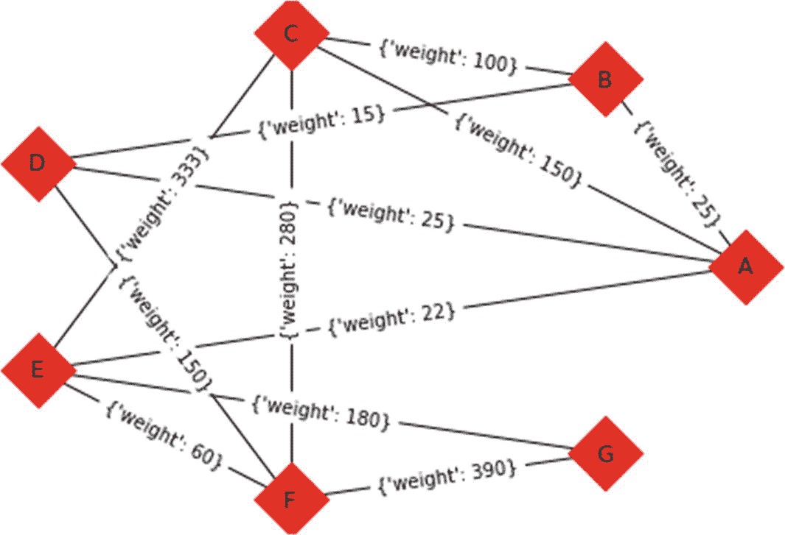

图 9-11

最短路径解

```python
print(nx.shortest_path(G, source="A", target='F', weight="weight"))
```

结果：['A', 'E', 'F']

```python
print(nx.shortest_path_length(G, source='A', target='F', weight="weight"))
```

结果：82

```python
print(nx.shortest_path(G, source='A', target='G', weight="weight"))
```

结果：['A', 'E', 'G']

```python
print(nx.shortest_path_length(G, source='A', target='G', weight="weight"))
```

结果：202

```python
for c in range(3):
    print('Cut-off:', c)
    print('=================')
    p = nx.single_source_shortest_path_length(G, source="A", cutoff=c)
    for key, value in p.items():
        print(key, ' => ', value)
    print('=================')
```

你的结果：

*   因此，这里你的策略是选择 `['A', 'E', 'F']`，其价值为 82。

*   另一条路线 `['A', 'E', 'G']` 的价值为 202。

```
Cutoff: 0
=================
A => 0
=================
Cutoff: 1
=================
A => 0
B => 1
C => 1
D => 1
E => 1
=================
Cutoff: 2
=================
A => 0
B => 1
C => 1
D => 1
E => 1
F => 2
G => 2
=================
```

恭喜！你刚刚实现了一个强化学习算法。

### 强化学习的一个实现

你将使用深度 Q 学习算法。Q 学习是一种基于策略的学习算法，其函数通过神经网络进行估计。

你首先会了解什么是“推车杆”问题，然后继续编写解决方案的代码。

当我还是个孩子的时候，我记得我会拿起一根棍子，试着用一只手让它保持平衡。我和朋友们过去常常比赛，谁平衡的时间更长，谁就能得到“奖励”——一块巧克力！

让我们来编写代码吧！

为了设置代码，你首先需要安装一些东西。打开名为 `Chapter-009-015-Q-Learn-01.ipynb` 的 Jupyter Notebook。

你需要安装以下内容：

```bash
pip install keras-rl
pip install h5py
pip install gym
```

让我们开始构建你的 Q 学习过程：

```python
import numpy as np
import gym
from keras.models import Sequential
from keras.layers import Dense, Activation, Flatten
from keras.optimizers import Adam
from rl.agents.dqn import DQNAgent
from rl.policy import EpsGreedyQPolicy
from rl.memory import SequentialMemory
ENV_NAME = 'CartPole-v0'
```

你必须获取环境并提取推车杆问题中可用的动作数量。

```python
env = gym.make(ENV_NAME)
np.random.seed(20)
env.seed(20)
nb_actions = env.action_space.n
```

你需要创建一个单隐藏层的神经网络模型来支持环境的动作。

```python
model = Sequential()
model.add(Flatten(input_shape=(1,) + env.observation_space.shape))
model.add(Dense(16))
model.add(Activation('relu'))
model.add(Dense(nb_actions))
model.add(Activation('linear'))
```

现在你可以查看你的模型了。

```python
print(model.summary())
```

接下来，你配置并编译我们的智能体。

我建议你使用 Epsilon 贪婪策略，并将记忆设置为顺序记忆，因为你必须存储你的推车杆执行的动作结果以及每个动作获得的奖励。

```python
policy = EpsGreedyQPolicy()
memory = SequentialMemory(limit=50000, window_length=1)
dqn = DQNAgent(model=model, nb_actions=nb_actions, memory=memory, nb_steps_warmup=10, target_model_update=1e-2, policy=policy)
dqn.compile(Adam(lr=1e-3), metrics=['mae'])
现在是时候执行训练过程了。
```

### 警告

这可能需要一些时间，具体取决于你生态系统的计算能力。

在云端运行时，请关闭可视化。

```python
try:
    dqn.fit(env, nb_steps=5000, visualize=True, verbose=2)
except:
    dqn.fit(env, nb_steps=5000, visualize=False, verbose=2)
```

你的结果：

训练 5000 步...

## 增加复杂性

以下领域是强化学习已取得巨大成功应用的地方：

### 博弈论

目前顶尖的人工智能（AI）系统是建立在单个智能体执行特定任务的概念之上的，或者，在对抗模型的情况下，则是建立在多个相互竞争以改善系统整体行为的智能体之上。

### 多智能体交互

当我们模拟任何由在同一生态系统中相互作用的团队组成的系统时，多智能体系统很常见。某些行为会积极增强其他智能体的努力，或消极地阻碍它们。

- 机器人集群
- 群体智能
- 车辆导航
- 医学研究
- 工业流程控制物流
- 计算机网络
- 交通控制
- 智慧城市

环顾你周围的环境，你能看到这项技术的应用吗？

以下这些环境的工业化版本非常有趣：

AlphaGo - `https://deepmind.com/research/alphago/`

你还记得在新闻中看到过这个吗……AlphaGo 是第一个击败职业人类围棋选手的计算机程序？

这个处理引擎现在也在尝试解决一些关键的现实世界问题。

以下是当前活跃在世界上的强化学习的一个小子集（表 9-1）。

表 9-1 强化学习子集

| 算法 | 描述 | 模型 | 策略 | 动作空间 | 状态空间 | 算子 |
| --- | --- | --- | --- | --- | --- | --- |
| `Monte Carlo` | `蒙特卡洛模拟` | `无模型` | `离策略` | `离散` | `离散` | `样本均值` |
| [`Q-learning`](https://en.wikipedia.org/wiki/Q-learning) | `状态-动作-奖励-状态` | `无模型` | `离策略` | `离散` | `离散` | `Q 值` |
| [`SARSA`](https://en.wikipedia.org/wiki/State%25E2%2580%2593action%25E2%2580%2593reward%25E2%2580%2593state%25E2%2580%2593action) | `状态-动作-奖励-状态-动作` | `无模型` | `在策略` | `离散` | `离散` | `Q 值` |
| [`Q-learning`](https://en.wikipedia.org/wiki/Q-learning) `- Lambda` | `带资格迹的状态-动作-奖励-状态` | `无模型` | `离策略` | `离散` | `离散` | `Q 值` |
| [`SARSA`](https://en.wikipedia.org/wiki/State%25E2%2580%2593action%25E2%2580%2593reward%25E2%2580%2593state%25E2%2580%2593action) `- Lambda` | `带资格迹的状态-动作-奖励-状态-动作` | `无模型` | `在策略` | `离散` | `离散` | `Q 值` |
| `DQN` | `深度 Q 网络` | `无模型` | `离策略` | `离散` | `连续` | `Q 值` |
| `DDPG` | `深度确定性策略梯度` | `无模型` | `离策略` | `连续` | `连续` | `Q 值` |
| `A3C` | `异步优势演员-评论家算法` | `无模型` | `离策略` | `连续` | `连续` | `Q 值` |
| `NAF` | `带归一化优势函数的 Q 学习` | `无模型` | `离策略` | `连续` | `连续` | `优势` |
| `TRPO` | `信任区域策略优化` | `无模型` | `在策略` | `连续` | `连续` | `优势` |
| [`PPO`](https://en.wikipedia.org/w/index.php%253Ftitle%253DProximal_Policy_Optimization%2526action%253Dedit%2526redlink%253D1) | `近端策略优化` | `无模型` | `在策略` | `连续` | `连续` | `优势` |

关于这些强化学习过程，我可以讨论大量的信息书籍，因为全球数据科学家和机器学习社区正在开发无数不同的选项。

这是科学领域中最活跃的研究和开发生态系统。

我预测，这个生态系统将在未来 200 年内对人类产生最大的影响。强化学习是第一个真正有能力大规模替代或取代人类的过程。

### 提示

如果本书中有一项技术值得你学好，那应该是强化学习。

现在，我将转向本章剩余部分的一个更普遍的趋势。

## 建模环境

我想解释一个通用术语，叫做“模拟器”。

“模拟是对一个系统内一组真实世界过程随时间运行的模仿。”

本质上，一个系统有多个输入，它对选定的输入应用近似的数学函数，并返回以数据形式呈现的输出，这些数据可以被可视化，以观察系统在那一刻正在做什么。

回想一下 `CartPole`。那是一个简单的可视化，但你可以看到小车试图平衡杆子。

你会发现的问题是你的模型或模拟的范围。由于现实世界中的大多数事件都以某种方式相互关联，你需要在你开始之前确定你的项目范围有多大。

- 问题是：你如何确定范围？
- 那么，你有一个带杆子的小车……这就是范围吗？

让我们想得更大一些……比如一辆完整的汽车？见图 9-13。

```
10/5000: episode: 1, duration: 0.005s, episode steps: 10, steps per second: 1825, episode reward: 10.000, mean reward: 1.000 [1.000, 1.000], mean action: 0.000 [0.000, 0.000], mean observation: 0.135 [-1.986, 3.027], loss: --, mean_absolute_error: --, mean_q: --
/usr/local/lib/python3.6/dist-packages/rl/memory.py:39: UserWarning: Not enough entries to sample without replacement. Consider increasing your warm-up phase to avoid oversampling!
warnings.warn('Not enough entries to sample without replacement. Consider increasing your warm-up phase to avoid oversampling!')
```

（为节省书籍篇幅，已移除步骤 2 到 4999。详情请参见 notebook。）

```
4976/5000: episode: 234, duration: 0.143s, episode steps: 50, steps per second: 349, episode reward: 50.000, mean reward: 1.000 [1.000, 1.000], mean action: 0.460 [0.000, 1.000], mean observation: -0.167 [-0.756, 0.225], loss: 2.869326, mean_absolute_error: 10.015974, mean_q: 19.497936
done, took 14.771 seconds
```

或者开启可视化，见图 9-12。

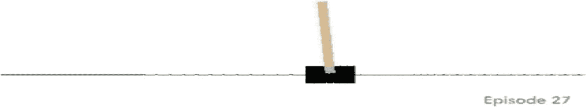

图 9-12 推车杆

你现在可以针对学习结果测试强化学习模型了。

```python
try:
    dqn.test(env, nb_episodes=5, visualize=True, verbose=2)
except:
    dqn.test(env, nb_episodes=5, visualize=False, verbose=2)
```

结果：

```
Episode 1: reward: 200.000, steps: 200
Episode 2: reward: 82.000, steps: 82
Episode 3: reward: 119.000, steps: 119
Episode 4: reward: 187.000, steps: 187
Episode 5: reward: 83.000, steps: 83
```

## 注意

五次测试产生了不同的结果。结果由随机的起始点驱动，但它们最终都实现了平衡。

如果你有一个像上面那样试图自我平衡的推车机器人，那么你已经成功获得了一个 Q 学习解决方案。

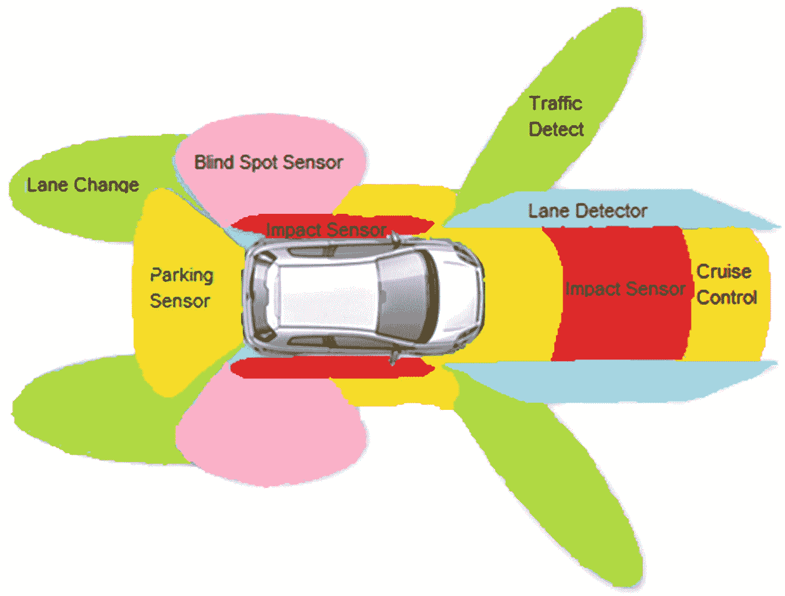

图 9-13：汽车的范围

让我们再大一些……许多车辆？每一辆穿过城镇的车辆都可以绘制城市地图，然后共享信息（图 9-14）。

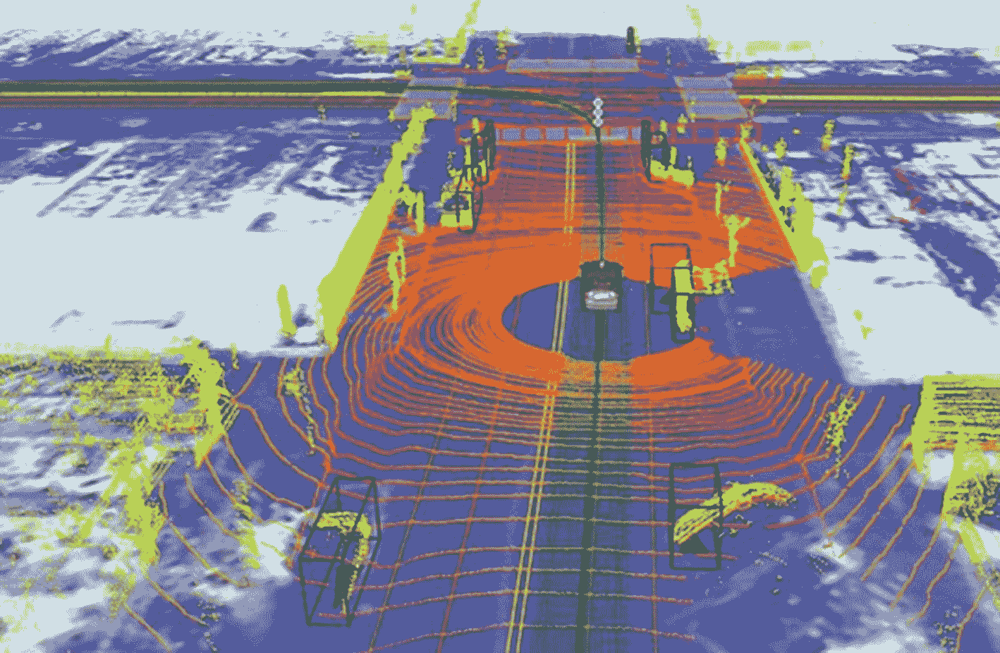

图 9-14：城镇中的所有车辆

甚至更大……全球所有的车辆？见图 9-15。


图 9-15：世界上所有的车辆

如果世界上的每一辆车都连接起来呢？可能但不太可能实现的范围？所以，我的意思是，你的范围越大，需要处理的数据量就越大，并且你在单个给定系统上无法解析模型的可能性就越大。

## 状态特征创建

下一步是识别模型中的特征。我建议你为你的模型拍一张照片，然后为每一个独特的特征打上标签。以下是已标记的车辆模型（图 9-16）。

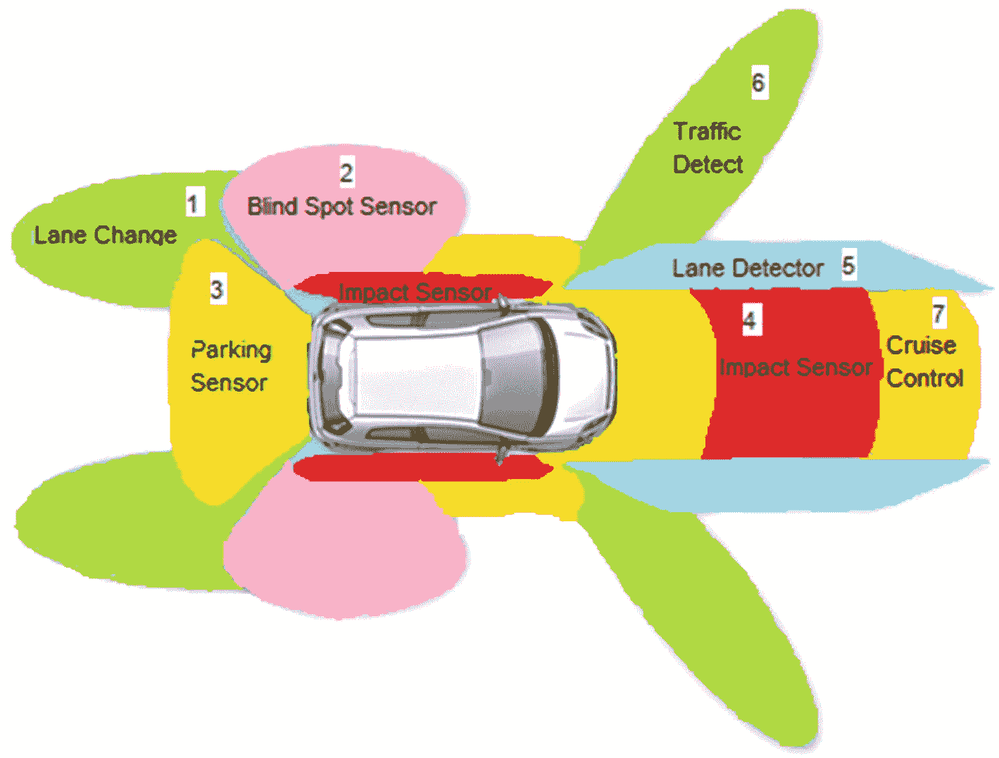

图 9-16：车辆模型

现在，我将引导你了解我所识别的特征。

**特征 1：** 变道特征是一个二元传感器，因为该传感器只报告 0 或 1 的值。

**特征 2：** 盲点传感器特征是一个二元传感器，其值也为 0 或 1。

**特征 3：** 泊车传感器特征是一个五级传感器，其值在 0.0 到 1.0 之间。它在车辆内部通过一组 LED 灯进行报告，显示你与后方物体的相对距离。第二个输出是，当权重正确时，1.0 对应五米距离，误差为正负十分之一米。

**特征 4：** 碰撞传感器特征是一个十级传感器，其值也在 0.0 到 1.0 之间。第二个输出是，当权重校正正确时，1.0 对应十五米距离，误差为正负四分之一米。

**特征 5：** 车道检测器特征是一个四级传感器，其值也在 0.0 到 1.0 之间。第二个输出是，当权重正确时，1.0 对应十五米距离，误差为正负四分之一米。

**特征 6：** 交通检测器特征是一个五级传感器，其值也在 0.0 到 1.0 之间。第二个输出是，当权重正确时，1.0 对应十五米距离，误差为正负四分之一米。

**特征 7：** 巡航传感器特征是一个五级传感器，其值在 -1.0 到 1.0 之间。如果巡航控制系统检测到值 < 0.0，传感器报告 0.0，并开始降低车辆速度以使其回到 0.0；如果值 > 0.0，速度将增加，直到达到正确速度。

现在你有了七个特征，因此有七个维度来提供关于模型整体状态的信息。

## 奖励函数

奖励是一个七阶段奖励公式。七个特征分别返回奖励。你可以在此处使用七乘七相关算法来检查传感器之间是否存在显著相关性。

### 警告

在现实世界中，这个过程已经进行了多年，使用了数百万小时的驾驶训练数据，但仍然会出现异常值。预测是，一个能够突然解决未知输入导致意外结果问题的算法，将立即对大多数强化学习系统的能力造成重大颠覆。

## 动作生成

所应用的动作范围从警告灯到主动改变车辆速度，甚至施加制动。车道检测甚至可以将车辆带回道路。

### 警告

不止一个可能的动作可能导致相同的结果，或者导致环境完全失败的灾难性负奖励。我建议将你的动作保持为小的增量步骤，而不是大的激进改变。

## 最终模型

我希望你现在明白，一些现实世界项目的模型可能会迅速演变成数百甚至数千个特征、状态和动作。

### 建议

我至少创建三个具有不同基础特征的模型，然后检查建议动作中的相关性，以验证整个系统的动作。这样，你就不容易达到灾难性的失败状态。

## 逆向强化学习

逆向强化学习（IRL）是从观察到的行为中推导出奖励函数的过程。普通的“强化学习”涉及使用奖励和惩罚来学习行为，而在 IRL 中，方向是相反的。这种建模过程允许系统尝试任何新动作，然后计算一个二元结果来决定是否重复该建议动作。

这是一个在处理大量可能动作列表时使用的简单模型。例如，为了防止车辆驶离道路，汽车可以施加制动或转动方向盘。在 IRL 中，车辆会分别尝试每个单独选项以及它们的组合，以了解单个动作或动作组合的结果。所有动作的总和，即行为，会得到奖励。这减少了奖励测量的数量。在大型现实项目中效果很好。

IRL 也用于进化计算中，以开发能够自动发现环境建模的动作和奖励。这将在第 10 章中详细讨论。

## 深度强化学习

深度学习是机器学习领域内一条新的研究路径。深度学习背后的核心知识是创建由多层表示组成的架构，以学习高级抽象。深度学习的基础在于，模型能够处理复杂的特征集，因为它将复杂的特征交互作为一系列较小的交互来处理，并返回一个净结果。

一个典型的深度学习人工神经网络使用 IRL 模型，通过反向传播来确定哪些动作取得了最大效果。反向传播是人工神经网络中使用的一种方法，用于计算网络中权重计算所需的梯度。反向传播是“误差的反向传播”的简称，因为误差在输出端计算，并向后分布到网络的各层。它通常用于训练深度神经网络。

这种通过深度神经网络学习实现的训练，开创性地将多种方法与深度强化学习相结合，从而产生了第一批在多个具有挑战性的领域达到人类水平性能的人工智能体。

你现在可以创建能够通过选择好动作而非坏动作来持续进行价值判断的智能体。这种知识由一个 Q 网络表示，该网络估计智能体在采取特定动作后可以期望获得的总奖励。

随着越来越多的现实世界问题被这些由数万个输入特征、数千个隐藏层以及输出端仅有一个或少数几个系统行为组成的庞大深度学习模型所解决，该领域正在加速发展。这是一个在未来几年将带来许多伟大成果的领域。

## 多智能体强化学习

多智能体强化学习是指一个系统的观察结果被传递给另一个系统模型，以增强其状态和奖励收集的概念。例如，可以部署两个车辆相互通信，告知对方它们将要采取某个动作。另一种选择是，环境默认从其各自的角度将状态传递给个体。一个例子是，道路上的压力激活部件通过激活另一个智能体可以检测到的信号，来防止车辆驶离道路。

例如，在一个智慧城市中，“车辆的巡航控制系统与城市的交通系统交互，以确保城市内更顺畅的交通流。或者，重型货物车辆会被引导绕行，避开那些对于其负载来说太低的桥梁。多智能体世界是物联网（IoT）的核心世界。物联网革命将把数十亿个智能体连接成一个由传感器和状态记录器组成的单一集群。

在未来五年内，多智能体环境将成为系统的常态。你的机器学习将需要能够处理这些工业化规模的物联网系统，结合我在第 6 章和第 7 章中讨论的新机器人能力，这将在未来十年内从物理上改变世界。

## 你取得了哪些成就？

在本书的这个阶段，你已经完成了核心机器学习方法论的学习。现在，你应该能够执行监督学习、无监督学习和强化学习。你还应该理解，最优解决方案是这三种核心方法论技术的集成。

### 提示

我建议你针对给定的建模需求，尽可能多地尝试不同的方案，因为所需解决方案的复杂性将要求更具创造性的方法。

## 接下来是什么？

后续的第 14 章和第 15 章将向你解释如何将本书迄今所学知识转化为工业化级别的行动，以生成 IML 颠覆者风格的解决方案。接下来，我们将在第 10 章中介绍进化计算的世界。

### 提示

我建议你花几个小时重新回顾前面的章节，以确保你理解知识库中现已掌握的信息。现在，为本书的下一个阶段做好准备。下一章将使你能够通过进化计算自动生成部分模型。