# 10. 进化计算

进化计算是一类受生物进化过程启发的全局优化算法，也是研究这些算法的人工智能（AI）和软计算子领域。从技术角度讲，它们是一类基于种群的试错问题求解器，具有元启发式或随机优化的特性。

进化计算领域正在支撑许多新一代 AI 算法，以动态方式生成新的处理规则，使算法能够自动适应新的数据集。这使得机器学习能够适应其需要处理的数据湖。

## 进化过程

基本的进化过程分为三个步骤：

### 第一步

随机生成初始个体种群（第一代）。

### 第二步

评估该种群中每个个体的适应度（时间限制、是否达到足够适应度等）。

### 第三步

重复以下再生步骤，直到满足终止条件：

1.  选择最适合繁殖的个体（父代）。
2.  通过交叉和变异操作培育新个体，产生子代。
3.  评估新个体的个体适应度。
4.  用新个体替换适应度最低的种群。

进化计算技术主要涉及元启发式优化算法。广义上讲，该领域包括我将在本章剩余部分讨论的算法和方法论。然而，这是一个正在飞速扩展的领域。

我的预测是，五年内，我们周围 90%以上的产品要么由某种进化计算生态系统设计，要么由其测试。

## 蚁群优化

蚁群优化算法（ACO）是一种用于解决计算问题的概率技术，这些问题可以简化为在图中寻找良好路径。人工蚂蚁代表了受真实蚂蚁行为启发的多智能体方法。生物蚂蚁基于信息素的通信通常是主要采用的范式。

人工蚂蚁与局部搜索算法的结合已成为许多涉及某种图的优化任务的首选方法，例如车辆路径规划和互联网路由。

从第 10 章示例目录中加载名为 `Chapter-10-01-Ant-Colony.ipynb` 的 Jupyter Notebook。

运行解决方案：

```
ant_colony = AntColony(distances, 1, 1, 100, 0.95, alpha=1, beta=1)
shortest_path = ant_colony.run()
```

输出为：

结果如下：

```
([(0, 1), (1, 2), (2, 3), (3, 4), (4, 0)], 16.0)
([(0, 1), (1, 3), (3, 4), (4, 2), (2, 0)], 17.0)
([(0, 1), (1, 2), (2, 3), (3, 4), (4, 0)], 16.0)
```

（为节省本书篇幅，省略了部分结果。完整结果集请参见笔记本输出。）

```
([(0, 1), (1, 2), (2, 3), (3, 4), (4, 0)], 16.0)
([(0, 2), (2, 3), (3, 4), (4, 1), (1, 0)], 9.0)
```

下一步打印最短路径的结果：

```
print ("\n Shortest Path: {}".format(shortest_path))
```

结果为：

```
Shortest Path: ([(0, 1), (1, 4), (4, 3), (3, 2), (2, 0)], 9.0)
```

## 文化算法

文化算法（CA）是进化计算的一个分支，除了种群组件外，还有一个称为信念空间的知识组件。从这个意义上说，CA 可以看作是标准遗传算法的一种扩展。

信念空间的类别列表如下。

### 规范性知识

种群组件中个体可取值的范围集合，例如种群中智能体的可接受行为。规范性是人类社会中将某些行为或结果指定为好的、可取的或允许的，而将其他行为或结果指定为坏的或不可取的过程。

规范性过程通过使用精确的指南来进化其控制的环境，这些指南由机器学习生成的动作引发，从而在机器学习模型所管理的解决方案内部产生进化过程。机器学习正在迫使环境匹配规则所规定的规范。

### 领域特定或领域通用知识

领域特定的学习发展理论认为，机器学习拥有众多独立、专门化的知识结构，而非一个统一的知识结构。这种机器学习训练仅覆盖一个领域，不会影响另一个独立的知识领域。核心知识理论家认为，机器学习应拥有高度专门化的机器学习模型和特征，这些模型和特征彼此独立。

领域通用理论则将进化知识视为机器学习模型和特征内部一个被共同采用的统一知识结构，倾向于采用自学习种子模型激活以来所有进化知识总和所创建的领域通用学习模型。

### 情境知识

重要事件的具体实例，例如成功/不成功的解决方案，现在将进行讨论。

情境感知是网络、战争、经济、商业、人际关系等领域的重要组成部分，通常不可能掌握所有可能的信息，因此基于场景的训练有助于在信息不完整的情况下做出决策，并能够感知到比所见更多的东西。

机器学习通常通过分类学习来实现。这意味着通常有两种不同的分类学习方式。

基于规则——机器学习制定一组规则来对情境进行分类，并将这些规则存储为所观察情境的类别。

基于信息——机器学习针对信息制定一组特征，以成功地对情境进行分类，并将这些特征的二元存在性存储为所观察情境的类别。

### 时间知识

时间知识涉及机器学习在特征状态中观察到的与时间或顺序相关的信息。

提示 阅读 Allen 的区间代数。该演算定义了时间区间之间可能的关系，并提供了一个组合表，可作为推理事件时间描述的基础。

示例如下。

### 空间知识

空间知识是对机器学习模型空间搜索地形中所有可能状态的洞察。它也可用于描述机器学习可以学习的信息种群的 spatial 分布。

示例如下。


## 分布式进化算法

Python 中的分布式进化算法（DEAP）是一个用于快速原型设计和想法测试的进化计算框架。它包含了实现大多数常见进化计算技术所需的数据结构和工具，例如遗传算法、遗传编程、进化策略、粒子群优化、差分进化、交通流以及分布估计算法。该框架自 2009 年起在拉瓦尔大学开发。

安装库：

```
conda install -c conda-forge deap
```

从第 10 章的示例目录中加载名为 `Chapter-10-02-Distributed-Evolutionary-Algorithms.ipynb` 的 Jupyter Notebook。

我建议你逐步执行该 notebook，以深入了解其技术工作原理。

请注意，由于此进化过程中随机函数的特性，你得到的结果可能与下方打印的结果略有不同。

结果：

```
### Population #########################################
[[9.521215056326895, 7.345527981285888], [4.8329426999153355, 6.20495203951839], [10.466145449758365, 7.299748993495174], [9.756259353772032, 4.805180288174137], [8.9728086099149, 6.435624543518433]]
### Log Book ###########################################
gen   evals  avg         std          min          max
0     5      0.0629536   0.0591294    0.00108562   0.16031
1     5      0.081051    0.0361767    0.0180054    0.126552
2     5       0.0916668   0.0385386     0.0312551     0.141644
3     5        0.0663885   0.0164441      0.0541062      0.0985648
4     5        0.0759395   0.0385668      0.0148436      0.136325
5     5        0.0851483   0.0419408      0.00816126   0.133337
```

<< 第 6 行至第 996 行 - 因答案篇幅过长已移除 >>>

```
997   5      0.291057      0.150004       0.106485       0.44331
998   5      0.545407      0.481211       0.196919       1.4909
999   5      0.356074      0.108138       0.153049       0.476002
```

最佳得分是：

```
[8.647687147637413, 6.772257466226377]
```

打开第 10 章中名为 `Chapter-10-03-Distributed-Evolutionary-Algorithms-Loop.ipynb` 的 Jupyter Notebook。

注意 `main()` 函数中的变化：

```
for i in range(10):
pop, logbook, best = main_proc()
print('### Population #########################################')
print(pop)
print('### Best ###############################################')
print(best)
```

执行该 notebook 以验证示例的随机性以及进化过程的求解速度。

## 进化算法

我将引导你完成以下进化算法示例，以详细演示该过程的工作原理。

打开第 10 章目录中名为 `Chapter-10-04-Evolutionary-Algorithm-01.ipynb` 的 Jupyter Notebook。

此进化算法使用一种灭绝规则，即只保留种群中唯一的最佳成员存活到下一代。

加载库

```
import numpy as np
import matplotlib.pyplot as plt
Setup the parameters
DNA_SIZE = 1             # DNA (实数)
DNA_BOUND = [0, 5]       # 解的上限和下限
N_GENERATIONS = 200
POP_SIZE = 100           # 种群大小
N_KID = 50               # 每代子代数量
```

寻找此函数的最大值：

```
def F(x): return np.sin(10*x)*x + np.cos(2*x)*x
```

为选择操作寻找非零适应度：

```
def get_fitness(pred): return pred.flatten()
```

生成新的种群成员：

```
def make_kid(pop, n_kid):
# 生成空的子代容器
kids = {'DNA': np.empty((n_kid, DNA_SIZE))}
kids['mut_strength'] = np.empty_like(kids['DNA'])
for kv, ks in zip(kids['DNA'], kids['mut_strength']):
# 交叉（大致一半来自 p1，一半来自 p2）
p1, p2 = np.random.choice(np.arange(POP_SIZE), size=2, replace=False)
cp = np.random.randint(0, 2, DNA_SIZE, dtype=np.bool)  # 交叉点
kv[cp] = pop['DNA'][p1, cp]
kv[~cp] = pop['DNA'][p2, ~cp]
ks[cp] = pop['mut_strength'][p1, cp]
ks[~cp] = pop['mut_strength'][p2, ~cp]
# 变异（基于正态分布改变 DNA）
ks[:] = np.maximum(ks + (np.random.rand(*ks.shape)-0.5), 0.)    # 必须 > 0
kv += ks * np.random.randn(*kv.shape)
kv[:] = np.clip(kv, *DNA_BOUND)    # 裁剪变异后的值
return kids
```

淘汰不适应的种群成员：

```
def kill_bad(pop, kids):
for key in ['DNA', 'mut_strength']:
pop[key] = np.vstack((pop[key], kids[key]))
fitness = get_fitness(F(pop['DNA']))
idx = np.arange(pop['DNA'].shape[0])
good_idx = idx[fitness.argsort()][-POP_SIZE:]
for key in ['DNA', 'mut_strength']:
pop[key] = pop[key][good_idx]
return pop
```

生成一个种群：

```
pop = dict(DNA=5 * np.random.rand(1, DNA_SIZE).repeat(POP_SIZE, axis=0),
mut_strength=np.random.rand(POP_SIZE, DNA_SIZE))
```

跨代进化：

```
%matplotlib inline
plt.ion()
x = np.linspace(*DNA_BOUND, 200)
for g in range(N_GENERATIONS):
plt.plot(x, F(x))
plt.scatter(pop['DNA'], F(pop['DNA']), s=200, lw=0, c="red", alpha=0.5)
plt.text(0, -8, 'Generation=%.0f' % (g+1))
plt.pause(0.05)
kids = make_kid(pop, N_KID)
pop = kill_bad(pop, kids)   # 用于精英策略的优秀父代
plt.ioff()
plt.show()
```

结果：

第一代的表现并不理想（图 10-1）。

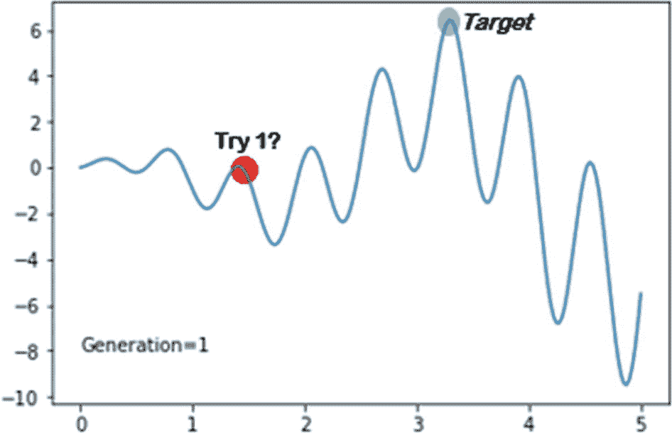

图 10-1

第 1 代图

红色的猜测点甚至远未接近绿色的目标。幸运的是，这正是进化开始发挥作用的地方。

第 1 代：

让我们监控几代的情况。

第 10 代：

在第 10 代，我们现在有了不止几个潜在的下一代候选者（图 10-2）。

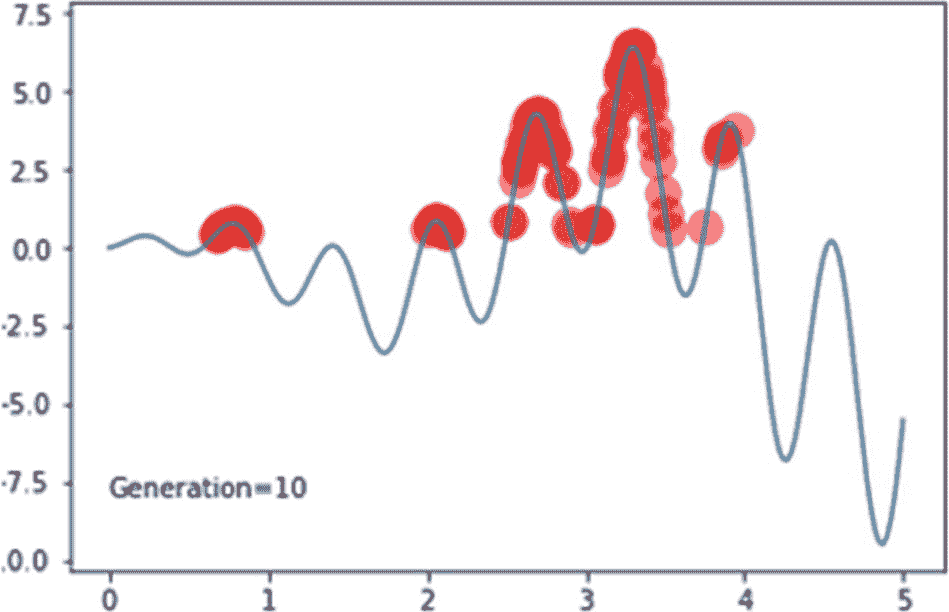

图 10-2

第 10 代图

通过进一步的进化，该过程正在得到改善。

第 200 代：

唯一的幸存者！见图 10-3。

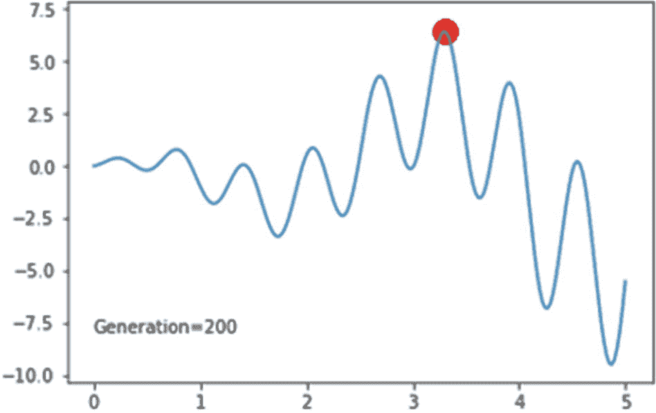

图 10-3

第 200 代图

大功告成——在 200 个周期或代内解决了问题。


### 提示

进化计算通常给人一种混乱的印象，但根据我的经验，算法要么快速收敛，要么持续运行。后者通常是由于某个你未测量或尚未发现的未知特征所致。

打开第 10 章目录中的 Jupyter Notebook，文件名为：`Chapter-10-05-Evolutionary-Algorithm-02.ipynb`

进化算法还使用一条灭绝规则，该规则仅保留当前状态与先前状态之间的最佳成员，使其存活至下一代。接下来，我将向你展示这条灭绝规则在世代更迭中的影响。

```
import numpy as np
import matplotlib.pyplot as plt
DNA_SIZE = 1             # DNA (实数)
DNA_BOUND = [0, 5]       # 解的上限和下限
N_GENERATIONS = 200
MUT_STRENGTH = 5\.        # 初始步长（动态变异强度）
def F(x): return np.sin(10*x)*x + np.cos(2*x)*x     # 寻找此函数的最大值
# 为选择过程寻找非零适应度
def get_fitness(pred): return pred.flatten()
def make_kid(parent):
# 无交叉，仅变异
k = parent + MUT_STRENGTH * np.random.randn(DNA_SIZE)
k = np.clip(k, *DNA_BOUND)
return k
def kill_bad(parent, kid):
global MUT_STRENGTH
fp = get_fitness(F(parent))[0]
fk = get_fitness(F(kid))[0]
p_target = 1/5
if fp  ps = 1 (成功子代)
else:
ps = 0.
# 调整全局变异强度
MUT_STRENGTH *= np.exp(1/np.sqrt(DNA_SIZE+1) * (ps - p_target)/(1 - p_target))
return parent
parent = 5 * np.random.rand(DNA_SIZE)   # 父代 DNA
plt.ion()       # 与绘图相关
x = np.linspace(*DNA_BOUND, 200)
for g in range(N_GENERATIONS):
kid = make_kid(parent)
py, ky = F(parent), F(kid)       # 用于后续绘图
parent = kill_bad(parent, kid)
plt.cla()
plt.plot(x, F(x))
plt.scatter(parent, py, s=200, lw=0, c="red", alpha=0.5,)
plt.scatter(kid, ky, s=200, lw=0, c="blue", alpha=0.5)
plt.text(0, -7, '变异强度=%.2f' % MUT_STRENGTH)
plt.text(0, -8, '世代=%.0f' % (g+1))
plt.pause(0.05)
plt.ioff()
plt.show()
```

结果：

第 1 代（图 10-4）。

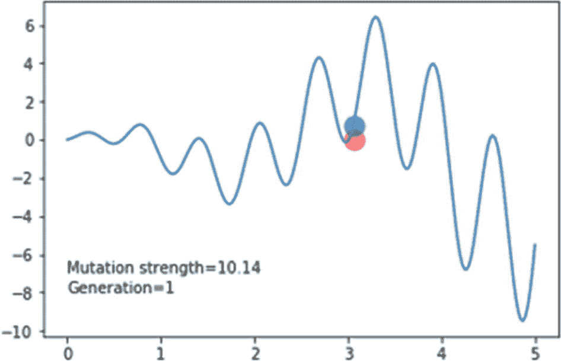

图 10-4

第 1 代图 – 多世代

让我们监控几个有代表性的世代。

第 10 代（图 10-5）：

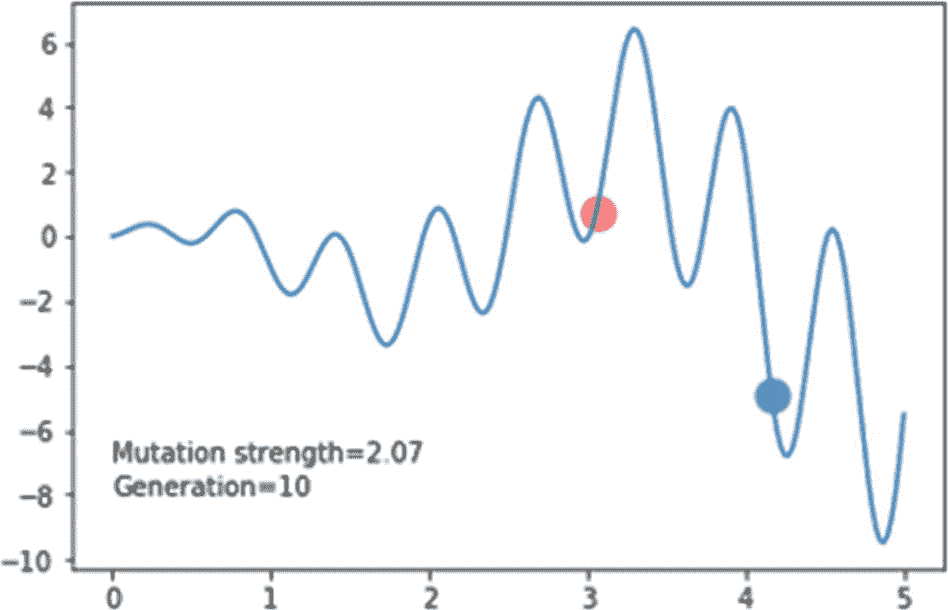

图 10-5

第 10 代图 – 多世代

看起来更糟了！！！

***是不是哪里出错了……？***

不，随机变异正在帮助世代克服任何可能导致其收敛到次优解的局部最大值。这是该版本算法的一个主要优势。

该算法最终会稳定在一个最优解上，因为导致负面影响的世代会在一个世代内重置为之前更优的父代。

第 200 代（图 10-6）。

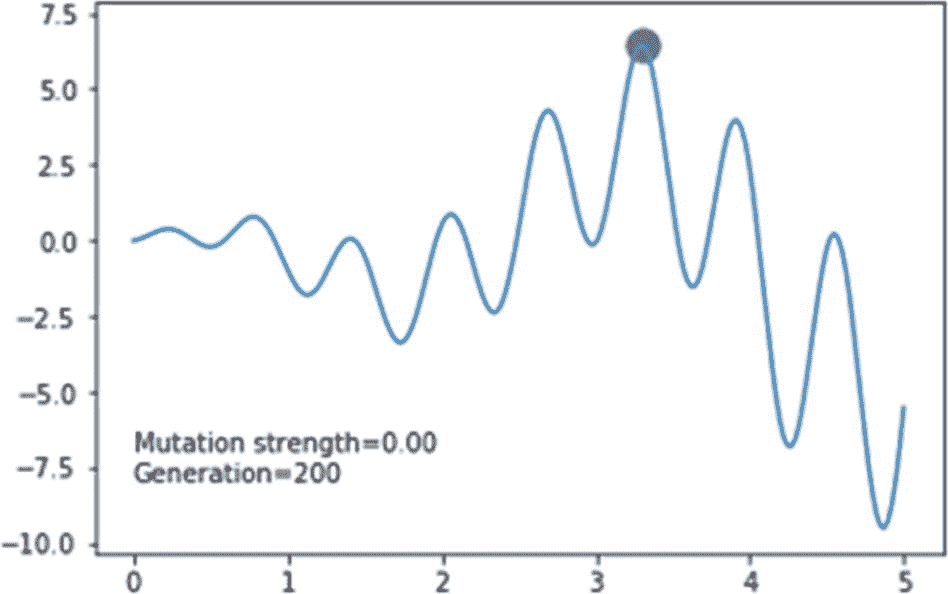

图 10-6

第 200 代图 – 多世代

找到的解是最优的！

### 提示

尝试使用提前停止选项，看看如何通过一个“足够好”的解来节省一个时钟周期。设置 `mtype='B'`，且变异强度 > 0.001。

它花费了 76 代，仅使用了 200 代总计算量的 38.000%。

接下来，我们将针对同一个问题展示一种不同的算法。该解决方案引入了一个称为交叉的概念。

这意味着新世代是存活父代的混合体，即交叉。

打开第 10 章目录中的 Jupyter Notebook，文件名为：`Chapter-10-06-Evolutionary-Algorithm-03.ipynb`

你的结果：

第 1 代（图 10-7）。

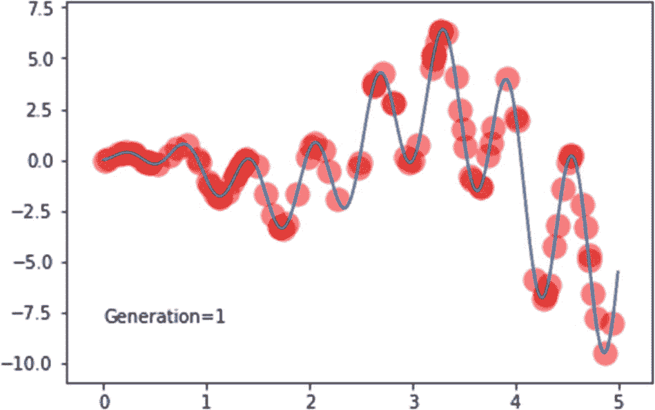

图 10-7

交叉中的第 1 代

交叉操作在过程中会产生更多子代，然后只有最适应的子代才能存活下来，作为父代生成下一代。见图 10-8。

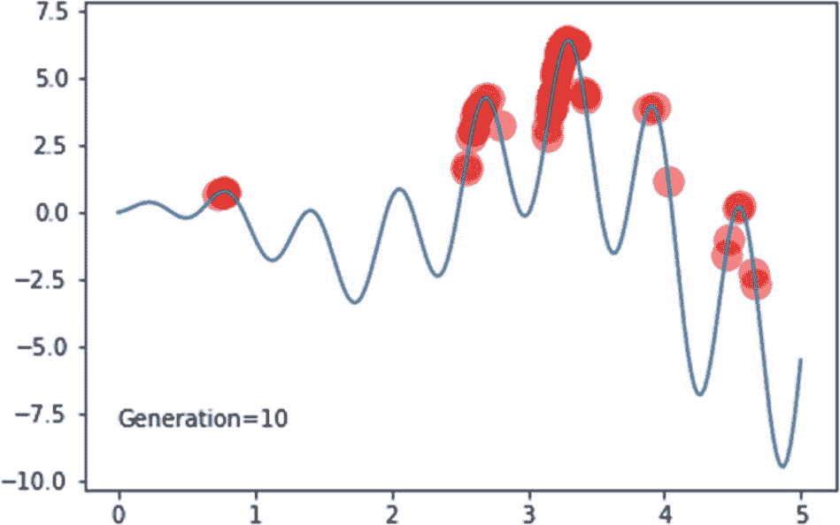

图 10-8

交叉中的第 10 代

注意子代数量的减少，因为交叉现在将共同的优良特质从一代传播到下一代。

让我们观察它的收敛过程。见图 10-9。

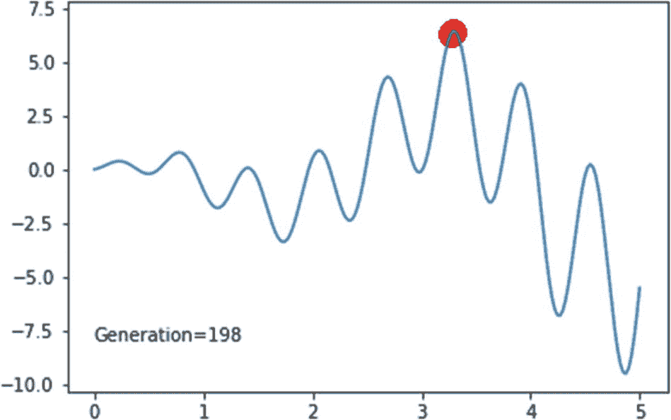

图 10-9

交叉中的第 198 代

*   成功！

我建议你自行查看下一个选项：

*   打开第 10 章目录中的 Jupyter Notebook，文件名为：`Chapter-10-07-Evolutionary-Algorithm-04.ipynb`

*   基本要求是你的世代需要在两点之间移动。

*   这是一个常见问题，这些算法可以轻松解决。

我建议你现在评估你的结果。

检查以下内容：

*   检查何时已找到最佳路径。

*   检查何时 95% 的世代都处于显著接近目标的范围内。

以下是我的发现（图 10-10）。

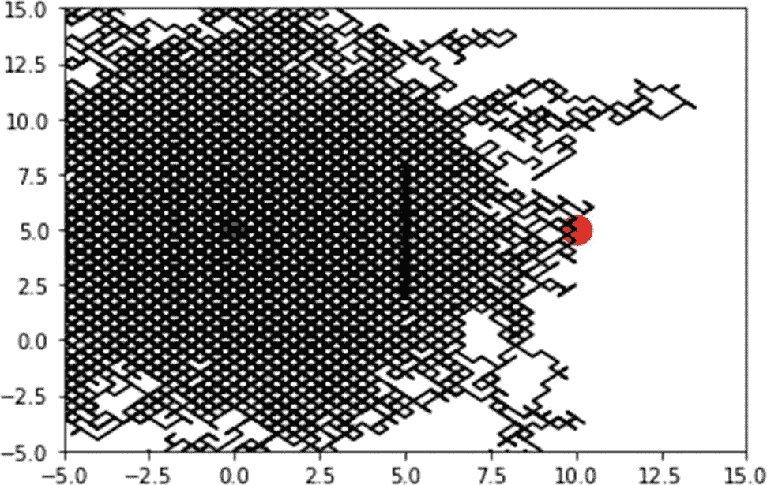

图 10-10

第 0 代

```
Gen: 0 | best fit: 0.023423059056103604
```

在随机游走过程中，300 个世代中只有 2 个穿过了终点。成功率为 0.667%。见图 10-11。

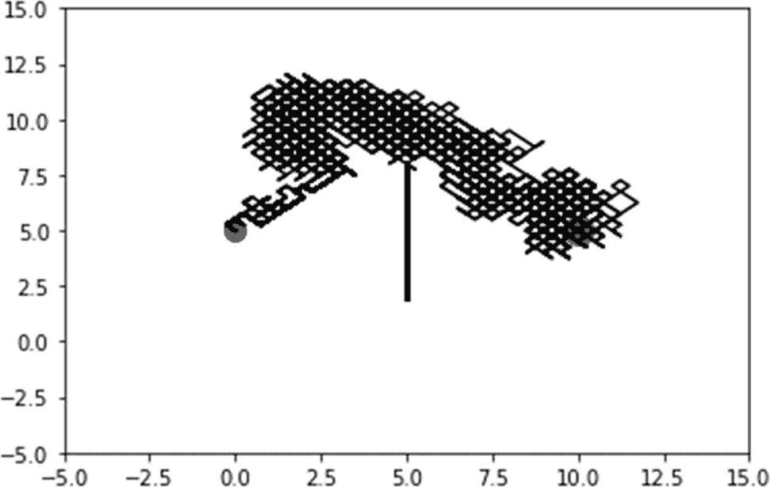

图 10-11

第 20 代

```
Gen: 20 | best fit: 0.545819714368591
```

到第 20 代时，95% 以上的世代都到达了终点。

这很好，但由于设计上完成了固定次数的循环，我白白浪费了另外 279 个周期，没有任何收益！

如果你查看最后一代，即第 299 代（图 10-12）：


图 10-12

第 299 代

```
Gen: 299 | best fit: 0.545819714368591
```

从第 20 代到第 299 代，收益为 0%。

### 警告

在进化编程中，务必研究提前退出策略，因为你的目标是找到一个足够好的解，而非最优解；并且，如果你试图寻找最优解，由于维数灾难，进化解通常无法在高维空间中 100% 收敛到目标。你根本没有足够的数据，或者在这种情况下，没有足够大的种群来找到所有可能的变异或交叉，从而获得 100% 的解。

打开第 10 章目录中的 Jupyter Notebook，文件名为：`Chapter-10-08-Evolutionary-Algorithm-05.ipynb`

通过更改以下参数进行实验：

```
POP_SIZE_MIN = 30
POP_SIZE_MAX = 31
POP_SIZE_STEP = 1
N_GENERATIONS_MIN = 30
N_GENERATIONS_MAX = 31
N_GENERATIONS_STEP = 1
N_MOVES_MIN = 300
N_MOVES_MAX = 301
N_MOVES_STEP = 1
```

问题：

*   种群规模有什么影响？

*   针对该环境，最优的世代数是多少？

*   移动步数有什么影响？


## 线性规划

线性规划是指针对某种情境下的各种线性不等式，找出在这些条件下所能获得的“最优”值的过程。一个典型例子是考虑材料和劳动力的限制，然后确定在这些条件下实现利润最大化的“最佳”生产水平。这是数学中一个名为“优化技术”的重要领域。这一应用研究领域在组织中每天都被用于资源分配。

考虑以下问题：

最小化：

```
f = -1*x[0] + 4*x[1]
约束条件：
-3*x[0] + 1*x[1] = -3
其中：-inf <= x[0] <= inf
```

打开第 10 章目录下的 Jupyter Notebook，文件名为：Chapter-10-09- Linear-programming-01.ipynb

```
import scipy.optimize as opt
c = [-1, 4]
A = [[-3, 1], [1, 2]]
b = [6, 4]
x0_bounds = (None, None)
x1_bounds = (-3, None)
res = opt.linprog(c, A_ub=A, b_ub=b, bounds=(x0_bounds, x1_bounds),
options={"disp": True})
print(res)
```

结果：

```
Optimization terminated successfully.
Current function value: -22.000000
Iterations: 1
fun: -22.0
message: 'Optimization terminated successfully.'
nit: 1
slack: array([39.,  0.])
status: 0
success: True
x: array([10., -3.])
```

线性规划表明，当 X0=10 且 X1=-3 时，该公式达到最优解。

你是否注意到，由于只需应用一系列数学公式，求解过程非常迅速？这正是线性规划的特点。

### 警告

如果约束条件精确或涉及多个方面，线性规划的公式可能会变得极其复杂。

如果你有任何公式优化需求，我建议你了解一下 SymPy（[`www.sympy.org`](http://www.sympy.org)）。

打开第 10 章目录下的 Jupyter Notebook，文件名为：Chapter-10-10-SymPy.ipynb

```
from sympy import *
solve(Eq(f, -1*x + 4*y),f) => [-x + 4*y]
solve(3*x + 1*y  (-oo  (-oo  (-oo  (-oo = -3) => (-3 <= y) & (y < oo)
```

这为你提供了一种快速确定 ***scipy opt.linprog*** 编程中取值范围的方法。

线性规划领域在我许多客户的系统中被广泛使用，因为有许多简单的计算需求有助于机器学习的创建。

恭喜你，现在你已经掌握了线性规划。

## 粒子群优化

粒子群优化（PSO）是一种计算方法，它通过迭代地尝试根据给定的质量度量来改进候选解，从而优化问题。它通过维护一组候选解（这里称为粒子），并根据关于粒子位置和速度的简单数学公式，在搜索空间中移动这些粒子来解决问题。

每个粒子的运动都受到其自身已知最佳位置的影响，同时也被引导向搜索空间中的全局已知最佳位置，这些位置会随着其他粒子发现更优位置而更新。这有望将整个群体推向最优解。

示例：

打开第 10 章目录下的 Jupyter Notebook，文件名为：Chapter-10-11-Particle-Swarm-01.ipynb

结果：

```
Running PSO ...
Iteration 0: Best Cost = 132.48185745142655
Iteration 1: Best Cost = 132.48185745142655
Iteration 2: Best Cost = 132.48185745142655
Iteration 3: Best Cost = 132.48185745142655
Iteration 4: Best Cost = 132.48185745142655
Iteration 5: Best Cost = 132.48185745142655

Iteration 46: Best Cost = 1.8639730250806885
Iteration 47: Best Cost = 1.8639730250806885
Iteration 48: Best Cost = 1.8471628852322097
Iteration 49: Best Cost = 1.845248848436588
Global Best:
{'position':
array([-0.11522734, -0.04638722,  0.41577969,  0.21634509, -0.4200067,
-0.84273085, -0.08707212,  0.83846401, -0.10769234, -0.03660312]),
'cost': 1.845248848436588}
```

这应该能让你对 PSO 有一个基本的了解。

## 强化学习

你之前已经完整学习过一章关于强化学习（RL）的内容，但我在这里介绍这两种特定的算法，是将其作为进化编程的一部分，因为该技术更偏向于进化基础。

### 强化学习算法一

打开第 10 章目录下的 Jupyter Notebook，文件名为：Chapter-10-12-RL-01.ipynb

结果：

```
Optimized Policy:
[ 0\.  1\.  2\.  3\.  4\.  5\.  6\.  7\.  8\.  9\. 10\. 11\. 12\. 12\. 11\. 15\. 16\. 17.
18\.  6\. 20\. 21\.  3\. 23\. 24\. 25\.  1\.  2\.  3\.  4\.  5\.  6\.  7\.  8\.  9\. 10.
11\. 12\. 38\. 11\. 10\.  9\. 42\.  7\. 44\.  5\. 46\. 47\. 48\. 49\. 50\.  1\.  2\.  3.
4\.  5\.  6\.  7\.  8\.  9\. 10\. 11\. 12\. 13\. 11\. 10\.  9\. 17\.  7\. 19\.  5\. 21.
22\. 23\. 24\. 25\.  1\.  2\.  3\.  4\.  5\.  6\.  7\.  8\.  9\. 10\. 11\. 12\. 12\. 11.
10\.  9\.  8\.  7\.  6\.  5\.  4\.  3\.  2\.  1.]
Optimized Value Function:
[0.00000000e+00 7.24792480e-05 2.89916992e-04 6.95257448e-04
1.16010383e-03 1.76906586e-03 2.78102979e-03 4.03504074e-03
4.66214120e-03 5.59997559e-03 7.08471239e-03 9.03964043e-03
1.11241192e-02 1.56793594e-02 1.61464431e-02 1.69517994e-02
1.86512806e-02 1.98249817e-02 2.24047303e-02 2.73845196e-02
2.83388495e-02 3.04937363e-02 3.61633897e-02 3.84953022e-02
4.44964767e-02 6.25000000e-02 6.27174377e-02 6.33700779e-02
6.45857723e-02 6.59966059e-02 6.78135343e-02 7.08430894e-02
7.46098323e-02 7.64884604e-02 7.93035477e-02 8.37541372e-02
8.96225423e-02 9.58723575e-02 1.09538078e-01 1.10939329e-01
1.13360151e-01 1.18457374e-01 1.21977661e-01 1.29716907e-01
1.44653559e-01 1.47520113e-01 1.53983246e-01 1.70990169e-01
1.77987434e-01 1.95990576e-01 2.50000000e-01 2.50217438e-01
2.50870078e-01 2.52085772e-01 2.53496606e-01 2.55313534e-01
2.58343089e-01 2.62109832e-01 2.63988460e-01 2.66803548e-01
2.71254137e-01 2.77122542e-01 2.83372357e-01 2.97038078e-01
2.98439329e-01 3.00860151e-01 3.05957374e-01 3.09477661e-01
3.17216907e-01 3.32153559e-01 3.35020113e-01 3.41483246e-01
3.58490169e-01 3.65487434e-01 3.83490576e-01 4.37500000e-01
4.38152558e-01 4.40122454e-01 4.43757317e-01 4.47991345e-01
4.53440603e-01 4.62529268e-01 4.73829497e-01 4.79468031e-01
4.87912680e-01 5.01265085e-01 5.18867627e-01 5.37617932e-01
5.78614419e-01 5.82817988e-01 5.90080452e-01 6.05372123e-01
6.15934510e-01 6.39150720e-01 6.83960814e-01 6.92560339e-01
7.11950883e-01 7.62970611e-01 7.83963162e-01 8.37972371e-01
0.00000000e+00]
```

这是第一个完整的强化学习算法。

### 强化学习算法二

这是第二个强化学习算法。

打开第 10 章目录下的 Jupyter Notebook，文件名为：Chapter-10-13-RL-02.ipynb

结果如图 10-13 所示。

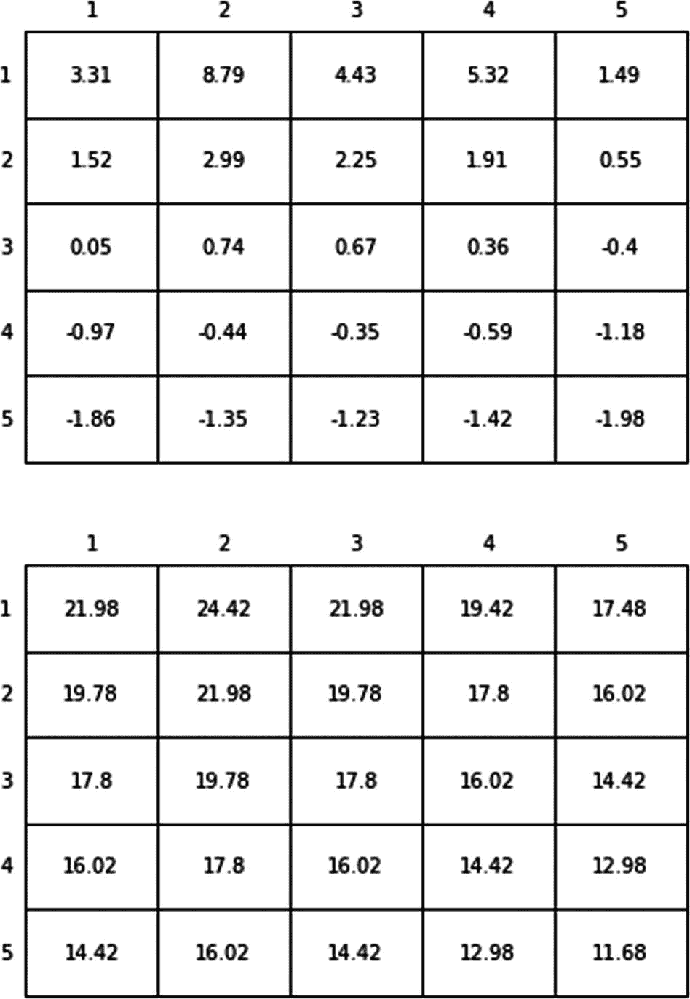

图 10-13

第二个强化学习算法


## 旅行商问题

我之前介绍过这个问题，现在我将向你展示如何使用进化编程来处理同样的问题。

*   打开第 10 章目录下的 Jupyter Notebook，文件名为：Chapter-10-14-TSP-01.ipynb

你的结果如图 10-14 所示。

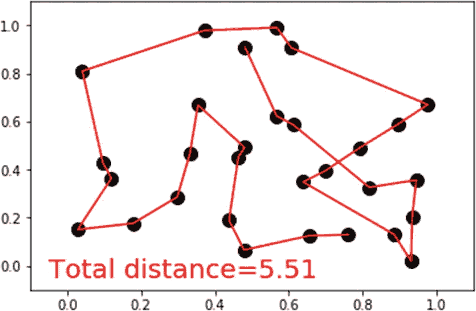

图 10-14

旅行商

*   代数：499 | 最佳适应度：53661.69

示例 2：

*   对于 25 个城市，暴力破解方法需要测试超过 ***300 万亿亿条路线***！进化编程同样有效，但在许多因素上效率更高。

*   打开第 10 章目录下的 Jupyter Notebook，文件名为：Chapter-10-15-TSP-02.ipynb

结果如图 10-15 所示。

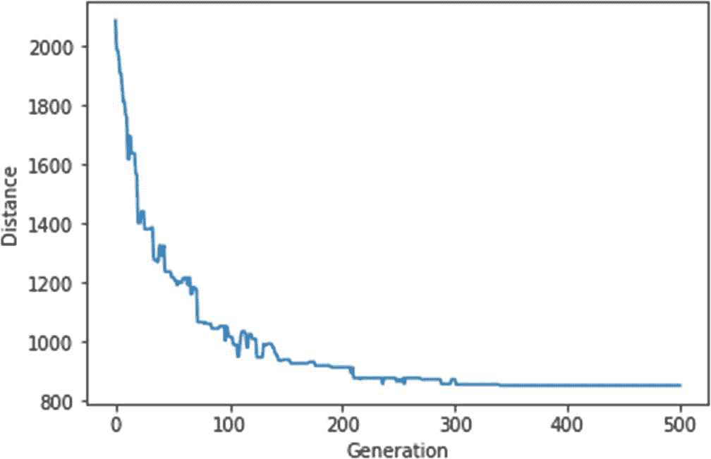

图 10-15

25 个城市的 TSP

```
初始距离：2052.2221426003775
最终距离：  802.6666546711987
```

## 请破解我的句子！

我之前提到过，进化编程擅长寻找具有高维度的数据集，因为它能在发现生态系统的过程中适应这个过程。

我将带你对我写的一个句子进行简单测试，你的程序必须破解它。

打开第 10 章目录下的 Jupyter Notebook，文件名为：Chapter-10-16-Words-01.ipynb

代码应输出一个文本句子：

*   在 14 个字母上，EP 比暴力破解快 240.8000 倍。

*   这表明 EP 在发现文本字符串方面是多么有效和高效。

```
'我非常爱丹尼斯！'
```

我将向你展示下一个示例，演示如何使用 EP 在地图上找到不同的路线。

## 柯尼斯堡七桥问题

柯尼斯堡七桥问题是数学史上一个著名的问题。莱昂哈德·欧拉在 1736 年给出的否定解答奠定了图论的基础，并预示了拓扑学的思想。

普鲁士的柯尼斯堡（今俄罗斯加里宁格勒）坐落在普雷格尔河两岸，包括两个大岛——克奈普霍夫岛和洛姆塞岛——它们通过七座桥相互连接，或与城市的两块大陆部分相连。问题是要设计一条穿过城市的路线，要求恰好经过每座桥一次且仅一次。

为了明确地说明这个逻辑任务，任何涉及通过桥梁以外的方式到达岛屿或河岸，或者在不走到桥另一端的情况下上桥的解决方案都被明确视为不可接受。欧拉证明该问题无解。

*   看看你是否能解决它。

*   打开第 10 章目录下的 Jupyter Notebook，文件名为：Chapter-10-17-Konigsberg-01.ipynb

```
import matplotlib
import numpy as np
matplotlib.use('TkAgg')
%matplotlib inline
import networkx as nx
import matplotlib.pyplot as plt
# 创建图
graph = nx.MultiGraph()
graph.add_nodes_from([0, 3])
edges = [
(0, 1, {'key': '绿桥', 'color': 'blue', 'width': 5}),
(0, 1, {'key': '科特尔桥', 'color': 'red', 'width': 2}),
(1, 2, {'key': '商人桥', 'color': 'blue', 'width': 5}),
(1, 2, {'key': '铁匠桥', 'color': 'red', 'width': 2}),
(2, 3, {'key': '木桥', 'color': 'blue', 'width': 5}),
(3, 1, {'key': '教堂桥', 'color': 'blue', 'width': 5}),
(3, 0, {'key': '高桥', 'color': 'blue', 'width': 5})
]
graph.add_edges_from(edges);
# 绘制图
plt.figure()
labels = {}
for i, j, label in graph.edges(data='key'):
if (i, j) not in labels:
labels[(i, j)] = label
else:
labels[(i, j)] += '\n' + label
colors = [x for _, _, x in graph.edges(data='color')]
widths = [x for _, _, x in graph.edges(data='width')]
pos = nx.spring_layout(graph)
nx.draw_networkx(graph, pos, edge_color=colors, with_labels=True, width=widths)
nx.draw_networkx_edge_labels(graph, pos, edge_labels=labels);
```

结果如图 10-16 所示——柯尼斯堡七桥问题。

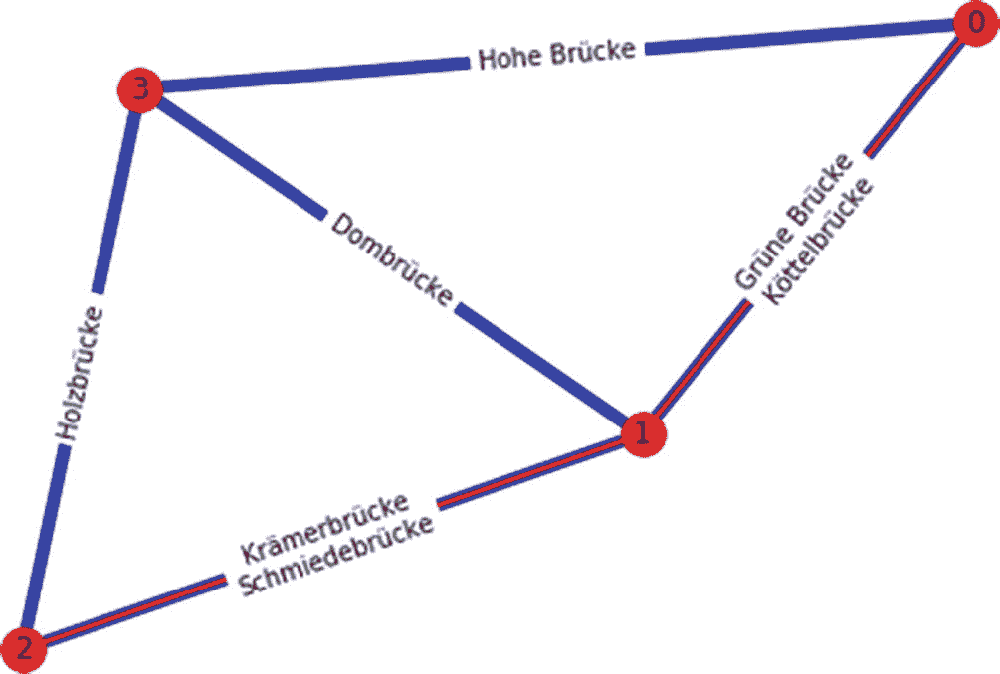

图 10-16

柯尼斯堡七桥问题

做得好；你已经对问题进行了建模，但如前所述，这个问题没有公认的解决方案。

### 提示

并非所有问题都有解决方案。知识的标志在于，你能以最小的努力确定这一事实，从而获得既有效又高效的解决方案。

接下来，我们将看一个有解的问题。

## 多车场车辆调度问题

使用朴素贪心算法进行多车辆路径模拟。

*   红/绿三角形：车辆
*   蓝色圆圈：尚未到达的目标
*   粉色圆圈：已经到达的目标

示例：

打开第 10 章目录下的 Jupyter Notebook，文件名为：Chapter-10-18-MVRS-01.ipynb

卡车在给定点之间重新规划路线，直到它们能够访问所有点。

结果如图 10-17 所示。

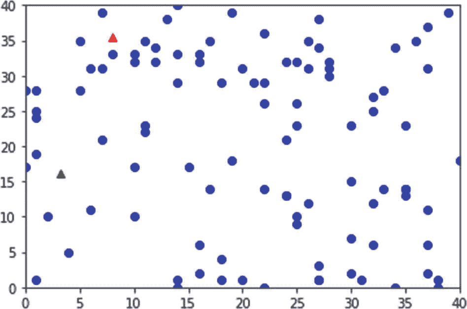

图 10-17

多车场车辆配送


## 使用计划表进行模拟

我将向你介绍一个我之前发现的 Python 库，它能够让你模拟一个调度解决方案。

我建议你在第 10 章的目录中打开名为 `Chapter-10-19-Basic-Scheduling-01.ipynb` 的 Jupyter Notebook。

*   `pip install pyschedule`

*   # 加载 pyschedule 并创建一个包含十个步骤规划周期的场景

```
from pyschedule import Scenario, solvers, plotters
S = Scenario('dog_pyschedule',horizon=10)
# 创建两个资源
Angus, Jock = S.Resource('Angus'), S.Resource('Jock')
# 创建三个任务，长度分别为 1、2 和 3
mail, food, hole = S.Task('steal_mail',1), S.Task('eat_food',2), S.Task('dig_hole',3)
# 将任务分配给资源，可以是 Angus 或 Jock，
# % 运算符用于连接任务和资源
mail += Angus|Jock
food += Angus|Jock
hole += Angus|Jock
# 求解并打印结果
S.use_makespan_objective()
solvers.mip.solve(S,msg=1)
# 打印解决方案
print(S.solution())
```

结果如图 10-18 所示。

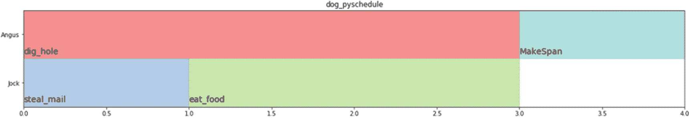

**图 10-18**

**Jock 和 Angus 在工作**

让我们研究一个更复杂的模拟调度。

示例：

我建议你在第 10 章的目录中打开名为 `Chapter-10-20-Bicycle-Shop.ipynb` 的 Jupyter Notebook。

*   **Andre 和 Laurence 使用 pyschedule 优化他们的自行车喷漆车间**

Andre 和 Laurence 经营着一家自行车喷漆车间，他们用鲜艳的颜色翻新旧自行车。今天，他们需要喷一辆绿色和一辆红色的自行车。首先，他们导入 pyschedule 并创建一个新场景。我们以小时为粒度，并预计工作日最多为 10 小时，因此将规划周期设置为 10。某些求解器不需要此参数，但默认求解器需要：

```
from pyschedule import Scenario, solvers, plotters
S = Scenario('Bicycle_Paint_Shop', horizon=10)
```

然后，他们将自己创建为资源：

```
Andre = S.Resource('Andre')
Laurence = S.Resource('Laurence')
```

喷一辆自行车需要两个小时。此外，自行车喷漆完成后，需要进行后处理（例如，给轮胎打气），这需要一个小时（这是默认值）。这总共转化为四个任务：

```
Green_Paint, Red_Paint = S.Task('Green_Paint', length=2), S.Task('Red_Paint', length=2)
Green_Prep, Red_Prep = S.Task('Green_Prep'), S.Task('Red_Prep')
```

显然，只能在喷漆完成后进行后处理，中间可以有任意间隔。对于红色喷漆，我们要求更严格一些；我们希望在后处理正好在喷漆后一小时开始，因为这是油漆干燥所需的时间：

```
S += Green_Paint < Green_Prep, Red_Paint + 1 <= Red_Prep
```

每个任务都可以由 Andre 或 Laurence 完成：

```
Green_Paint += Andre|Laurence
Green_Prep += Andre|Laurence
Red_Paint += Andre|Laurence
Red_Prep += Andre|Laurence
```

那么，让我们来看看这个场景：

```
S.clear_solution()
print(S)
```

我们还没有定义目标。我们希望尽可能早地完成所有任务，因此我们使用 MakeSpan 并再次检查场景：

```
S.use_makespan_objective()
print(S)
```

因此，我们希望最小化 MakeSpan 任务的位置，前提是它被安排在所有其他任务之后。因此，MakeSpan 的位置就是我们计划表的长度。现在我们有了场景的第一个版本，让我们求解并绘制它：

为任务设置一些颜色：

```
task_colors = { Green_Paint   : '#A1D372',
Green_Prep    : '#A1D372',
Red_Paint     : '#EB4845',
Red_Prep      : '#EB4845',
S['MakeSpan'] : '#7EA7D8'}
```

一个用于求解和绘制场景的小辅助方法：

```
def run(S) :
if solvers.mip.solve(S):
get_ipython().run_line_magic('matplotlib', 'inline')
plotters.matplotlib.plot(S,task_colors=task_colors,fig_size=(15,2))
else:
print('no solution exists')
run(S)
```

结果见图 10-19。

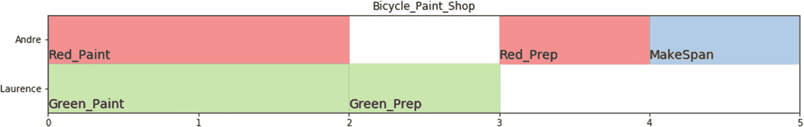

**图 10-19**

**车间 (1)**

请注意，可能会出现有人需要喷红色自行车，然后做绿色后处理的情况。这会很麻烦；切换自行车太费时间。我们使用以下约束来确保绿色/红色喷漆和后处理始终由同一个人完成：

```
# 如果资源需求存在重叠，Green_Prep 将使用与 Green_Paint 相同的资源
Green_Prep += Green_Paint*[Andre,Laurence]
# Red_Prep 和 Red_Paint 同理
Red_Prep += Red_Paint*[Andre,Laurence]
run(S)
```

结果如图 10-20 所示。

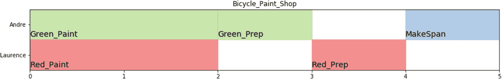

**图 10-20**

**车间 (2)**

这个计划表在四小时后完成，并建议同时喷两辆自行车。然而，Andre 和 Laurence 只有一个喷漆车间，他们需要共用：

```
Paint_Shop = S.Resource('Paint_Shop')
Red_Paint += Paint_Shop
Green_Paint += Paint_Shop
run(S)
```

结果如图 10-21 所示。


**图 10-21**

**车间 (3)**

太棒了；大家仍然可以在五小时后回家，吃个晚午餐！不幸的是，Andre 接到电话说红色自行车要两小时后才能到：

```
S += Red_Paint > 2
run(S)
```

结果如图 10-22 所示。

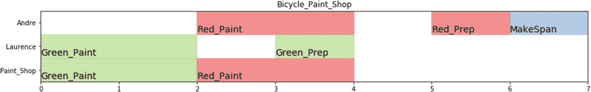

**图 10-22**

**车间 (4)**

太糟糕了；现在所有事情都需要六个小时才能完成。因此，Andre 和 Laurence 决定在第三小时之后、第五小时之前安排午餐：

```
Lunch = S.Task('Lunch')
Lunch += {Andre, Laurence}
S += Lunch > 3, Lunch < 5
task_colors[Lunch] = '#7EA7D8'
S.clear_objective() # 我们需要移除目标并重新添加，因为新增了午餐任务
S.use_makespan_objective()
task_colors[S['MakeSpan']] = '#7EA7D8'
run(S)
```

结果如图 10-23 所示。

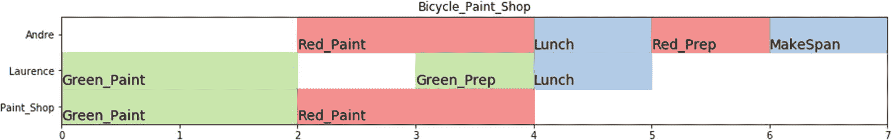

**图 10-23**

**车间 (5)**

Andre 是个喜欢早起的人，他想在午餐前，也就是第三小时之前，完成三个小时的工作：

```
S += Andre['length'][0:3] >= 3
run(S)
```

结果如图 10-24 所示。

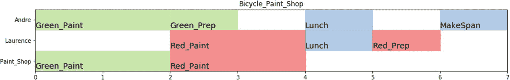

**图 10-24**

**车间 (6)**

天气预报说下午天气非常好，所以 Andre 和 Laurence 决定午餐后关闭车间，也就是说，他们将规划周期固定为 5 小时。不幸的是，发生了以下情况：

```
S.horizon = 5
run(S)
```

结果：

*   不存在解决方案。Andre 和 Laurence 需要 7 小时，他们将规划周期固定为 7 小时。

```
S.horizon = 7
run(S)
```

结果如图 10-25 所示。


**图 10-25**

**车间 (7)**

做得好；你可以运行喷漆车间了。

额外内容：

*   `Chapter-10-21-Basic-Scheduling-Three-Way.ipynb`。

*   `Chapter-10-22-Bicycle-Shop-Three-way.ipynb`。

*   我建议你看看这两个额外的示例。两者都有三个资源，研究它们将向你展示如何规划更大的团队。


### 提示

我已成功使用多达 20 个资源和超过 100 个任务。你也可以将此流程应用于更大的流程。

## 你取得了什么成就？

干得好；你现在可以创建一个需要进化计算的调查性机器学习问题。

你可以处理小规模的调度问题。

## 接下来是什么？

你已经成功完成了进化计算章节。

你现在可以使用模拟和进化技术来发现并学习解决你环境中日常问题的方法。

本书的其余部分将涵盖你通过完成本章所获得的知识的应用。

接下来，我将在第 11 章中向你介绍机电一体化这个有趣的领域。

