# 11. 机电一体化：让不同科学协同工作

机电一体化是一个多学科的工程领域，它结合了机械工程、电子工程、计算机工程、电信工程、系统工程和控制工程。

该领域最突出的单一物理实例就是我们驾驶的机动车辆。

下一个例子是越来越多开始在我们的日常生活中变得常见的机器人系统。

我将在本章中解释机电一体化解决方案的构建模块，并向你说明这些单独的构建模块如何通过你的机器学习技能得到增强。

## 计算机工程

计算机工程是一门整合了开发计算机硬件和软件所需的众多计算机科学和电子工程领域的学科。

### 计算机系统

计算机系统要求我们具备设计架构、并行处理以及整个生态系统（从物理硬件到使其能够在世界各地交互所需的通信网络）可靠性的能力。

从事计算机系统工作的工程师致力于研究项目，以构建可靠、安全且高性能的计算机系统。这些项目正在设计用于多线程和并行处理的处理器，其处理能力和机器学习需求不断提升。

我将引导你完成几个基本的发现过程，以了解你自己的计算机系统。

从示例目录第 11 章加载名为以下内容的 Jupyter notebook：

```
Chapter-011-01-Computer-System-01.ipynb
```

让我们获取你的系统名称：

*   你的系统上运行的是什么操作系统？

```
import platform
print(platform.node())
```

*   你的系统使用什么 CPU？

```
import platform
print(platform.system())
```

*   你的 CPU 有多忙？

```
import platform, subprocess
def get_processor_info():
if platform.system() == "Windows":
return platform.processor()
elif platform.system() == "Darwin":
return subprocess.check_output(['/usr/sbin/sysctl', "-n", "machdep.cpu.brand_string"]).strip()
elif platform.system() == "Linux":
command = "cat /proc/cpuinfo"
return subprocess.check_output(command, shell=True).strip()
return ""
cpustr = get_processor_info()
print(cpustr)
```

*   你的 IP 地址是什么？

```
import psutil
print(psutil.cpu_percent())
有多少可用磁盘空间？
import shutil
total, used, free = shutil.disk_usage('/')
print('总计:', total)
print('已用:', used)
print('可用:', free)
```

*   你的网络连接速度有多快？

```
import socket
s = socket.socket(socket.AF_INET, socket.SOCK_DGRAM)
s.connect(('10.255.255.255', 1))
print('你的 IP 地址是', s.getsockname()[0])
s.close()
```

```
from pythonping import ping
response_list = ping('8.8.8.8', count=20, size=100, timeout=1, verbose=False)
print('最小返回时间 %5.2f 毫秒' % (response_list.rtt_min_ms))
print('平均返回时间 %5.2f 毫秒' % (response_list.rtt_avg_ms))
print('最大返回时间 %5.2f 毫秒' % (response_list.rtt_max_ms))
```

既然你已经掌握了一些调查生态系统的基本技巧，我建议我们处理数据以展示你的生态系统执行机器学习的能力。

我现在将向你展示如何使一个进程并行运行。

从示例目录第 11 章加载名为以下内容的 Jupyter notebook：

```
Chapter-011-02-Multi-Processing-01.ipynb
```

在第一种处理技术中，你将需要一个名为“threading”的新库。

### 提示

我将命令 `%%time` 添加到我的代码中。这将为你提供进程执行时所花费时间的反馈。

我们将研究使用线程进行并行处理。

线程的定义：

*   1 - 处理完成：2 个线程进行 10000000 次计算：3.27 秒

*   2 - 处理完成：4 个线程进行 10000000 次计算：3.17 秒

*   3 - 处理完成：8 个线程进行 10000000 次计算：3.19 秒

*   4 - 处理完成：16 个线程进行 10000000 次计算：3.11 秒

*   5 - 处理完成：32 个线程进行 10000000 次计算：3.01 秒

*   6 - 处理完成：64 个线程进行 10000000 次计算：2.81 秒

*   7 - 处理完成：128 个线程进行 10000000 次计算：2.61 秒

*   执行线程是由计算机调度程序独立管理的最小程序指令序列。

*   我们将针对同一进程测试一系列线程数 [2, 4, 8, 16, 32, 64, 128]。

使用并行线程过程，时间会减少：

*   从 2 到 4 提高了 3.06%

*   从 2 到 8 提高了 2.45%

*   从 2 到 16 提高了 4.89%

*   从 2 到 32 提高了 7.95%

*   从 2 到 64 提高了 14.07%

*   从 2 到 128 提高了 20.18%

这清楚地表明线程提高了程序的处理能力。

### 提示

我通常会在每台新服务器上或服务器发生任何重大更改后执行一次测试，以确定给定负载下的“最佳”线程数。

我现在将带你了解另一种称为并行进程的技术。

你基本上是在服务器上创建相互独立运行的独立进程。

### 警告

在下一个示例中，有一个计数器 totalsize = int(10e7)；这将运行很长时间。

如果你愿意，可以将其更改为 totalsize = int(10e3) 以加快速度。

从示例目录第 11 章加载名为以下内容的 Jupyter notebook：

```
Chapter-011-03-Multi-Processing-02.ipynb
我们开始吧。
首先，你需要一个名为“multiprocessing”的新库，它允许你在系统上创建新进程。
```

我们将针对同一进程测试一系列线程数 [2, 4, 8, 16, 32, 64, 128]。

*   1 - 处理完成：2 个线程进行 10000000 次计算：2.08 秒

*   2 - 处理完成：4 个线程进行 10000000 次计算：1.78 秒

*   3 - 处理完成：8 个线程进行 10000000 次计算：1.74 秒

*   4 - 处理完成：16 个线程进行 10000000 次计算：1.72 秒

*   5 - 处理完成：32 个线程进行 10000000 次计算：1.64 秒

*   6 - 处理完成：64 个线程进行 10000000 次计算：1.61 秒

*   7 - 处理完成：128 个线程进行 10000000 次计算：1.53 秒

使用并行线程过程，时间会减少：

*   从 2 到 4 提高了 2.25%

*   从 2 到 8 提高了 3.38%

*   从 2 到 16 提高了 7.61%

*   从 2 到 32 提高了 9.72%

*   从 2 到 64 提高了 14.08%

*   从 2 到 128 提高了 20.56%

性能提升几乎相同，但最大的区别在于，使用并行过程相比线程，速度有所提升：

这些过程平均快 220%。

因此，运行 threads=4 与 procs=8 所需的时间大致相同。

### 提示

通过正确的编程，使用并行过程可以为你节省大量时间。

试想一下，运行两小时的深度学习算法与运行四小时的进程之间的差异对你的生产力意味着什么。


### 机器人学的计算机视觉

计算机工程师专注于开发视觉传感技术，用于感知环境、表征环境以及操控环境。

IML 生态系统通过视觉识别物体的能力，是机器学习生态系统中的一个主要发展领域。这些技能的最大应用场景是机器人学（第 12 章）和第四次工业革命（第 13 章），这要求你理解这个复杂但回报丰厚的知识领域。

从示例目录第 11 章加载名为 `Chapter-011-04-Webcam-01.ipynb` 的 Jupyter notebook。

### 警告

请确保已安装 OpenCV 系统。

使用以下命令安装：

```
pip install opencv-python
```

### 提示

如果你的系统显卡支持最新的 OpenCV 软件，我建议你安装它。较新的显卡在核心驱动中拥有改进的处理算法，能使处理更高效。

我将通过三个步骤的示例，向你展示如何将视频处理能力添加到你的机器学习知识库中。

你从一种处理硬盘上存储图像的技术开始，这样你就可以在固定图像上看到处理效果。之后，我会引导你进入完整的实时网络摄像头数据流。

现在，我们将与一张小狗的图片进行交互。

从示例目录第 11 章加载名为 `Chapter-011-04-Webcam-01.ipynb` 的 Jupyter notebook。

首先加载你需要的库：

```
import cv2 as cv
```

加载这张我们小狗的图片：

```
imgfile = '../../data/dog.png'
img = cv.imread(imgfile, cv.IMREAD_UNCHANGED)
```

现在提取图片的信息：

```
imgdim = img.shape
imgheight = img.shape[0]
imgwidth = img.shape[1]
imgchannels = img.shape[2]
print('Image Dimension    : ',imgdim)
print('Image Height       : ',imgheight)
print('Image Width        : ',imgwidth)
print('Number of Channels : ',imgchannels)
```

你的结果是：

```
Image Dimension    :  (2421, 2513, 4)
Image Height       :  2421
Image Width        :  2513
Number of Channels :  4
这表明图片尺寸为 2421 x 2513 像素，包含 4 个通道。
接下来的步骤将向你展示这张图片：
```

这就是那只小狗……它看起来是蓝色的。

现在我将向你展示如何将图片缩放至原始尺寸的 30%。

### 提示

缩放图片可以为你节省大量存储空间。机器学习在较小的图片上运行速度也更快。

开始吧……你将把小狗缩小到 30%……10%……5%……现在你得到了一只超迷你的蓝色小狗。

### 警告

当你存储训练数据时，我建议缩放比例不要超过原始尺寸的 50%，因为你会丢失 75% 的像素。记住，你是在两个轴向上同时进行缩放。

如果机器学习是在 1000x1000 像素的图片上进行训练，我建议你将所有图片缩放到这个尺寸。机器学习在特征一致性上表现最佳，而这些特征不应有助于最终需求的特征。在这种情况下，图片尺寸并不携带用于判断是否为狗的特征。因此，如果图片尺寸不能增强处理过程，就不要引入额外的尺寸差异。

### 警告

不要只缩放一个轴向，因为变形会使大多数机器学习失效。始终要保持原始比例。

现在你可以关闭示例并停止 Jupyter notebook。

下一步是找回你的小狗，但执行一个处理算法来从图片中提取一组特征。在我们要研究的示例中，我们希望将图片转换为一组轮廓线，这之后将有助于机器学习发现增强特征。

从示例目录第 11 章加载名为 `Chapter-011-05-Webcam-02.ipynb` 的 Jupyter notebook。

机器人处理了“Weener”的图片，但只需要“Weener”的形状就知道它是那只狗。

### 提示

机器学习观察世界的方式与我们不同。

结果如图 11-1 所示。

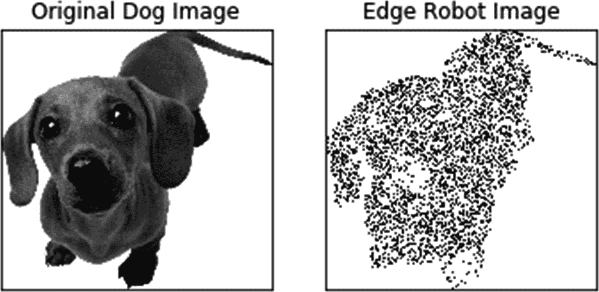

图 11-1

狗视觉（1）

右侧的图片在屏幕上可能不清晰，但如果你从 Jupyter notebook 中下载它，你会看到机器人所看到的景象（图 11-2）。

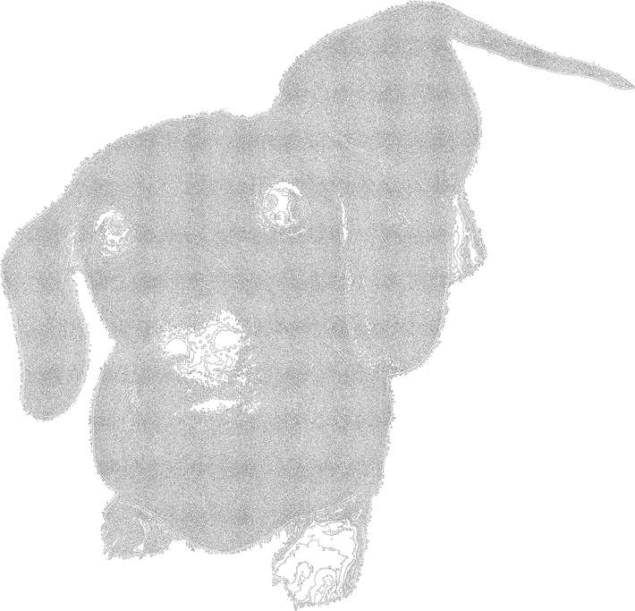

图 11-2

狗视觉（2）

复杂的灰度图像现在被简化为小狗的黑白轮廓图像。机器学习可以更容易地从这张图片中提取特征，以确定它是一只狗，并且你可以观察到它正面向机器人。

*   所以，你的机器人能看见了！

*   现在我将带你通过一个示例，在一张人物图片中找出人脸和眼睛。

*   从示例目录第 11 章加载名为 `Chapter-011-06-Webcam-03.ipynb` 的 Jupyter notebook。

*   这段代码将处理两个人的图片，并使用针对每个功能预训练的模型来识别人脸和眼睛。

*   做得好；你的机器学习模型现在可以识别人脸和眼睛的位置了。

*   所以现在我们将通过网络摄像头观察你，来探索一个更动态的环境。

### 警告

此示例将使用你的网络摄像头。但它不会将图像发送给任何人。

*   从示例目录第 11 章加载名为 `Chapter-011-07-Webcam-01.ipynb` 的 Jupyter notebook。

*   该过程将动态捕获网络摄像头画面，然后检测你的脸和眼睛。

*   做得好；你的机器学习模型现在可以识别看向你网络摄像头的人的脸和眼睛位置了。

如果你在机器人上使用此功能作为机器学习的输入，你可以通过发现看向你网络摄像头的人来收集信息。

### 提示

这个解决方案很基础，但如果你使用多个网络摄像头，它足以作为一个安全系统。

既然我们已经让机器人能看见你，接下来我将继续让你的机器人能与你对话。

### 信号与语音处理

该领域的计算机工程师致力于改善人机交互，包括语音识别与合成、医学与科学成像，或通信系统。


#### 信号处理

当您使用传感器并需要将连续范围的值转换为离散值时，信号处理非常有用。

从示例目录中加载第 11 章的 Jupyter notebook，文件名为：Chapter-011-08-Signal-01.ipynb

```
import matplotlib
matplotlib.use('TkAgg')
%matplotlib inline
import numpy as np
import scipy.signal as signal
import matplotlib.pyplot as plt
b1 = signal.firwin(1963, 0.5, pass_zero=False)
w1, h1 = signal.freqz(b1)
p1 = 20*np.log10(np.abs(h1))
plt.title('Digital filter frequency response - Low Pass')
line1, = plt.plot(w1, p1)
plt.setp(line1, color="b", linewidth=1.0)
plt.ylabel('Amplitude Response (dB)')
plt.xlabel('Frequency (rad/sample)')
plt.grid()
plt.show() (Figure 11-3)
```

图 11-3 展示了一个低通滤波器的响应图。

```
b2 = signal.firwin(1963, 0.5, pass_zero=True)
w2, h2 = signal.freqz(b2)
p2 = 20*np.log10(np.abs(h2))
plt.title('Digital filter frequency response - High Pass')
line2, = plt.plot(w2, p2)
plt.setp(line2, color="y", linewidth=1.0)
plt.ylabel('Amplitude Response (dB)')
plt.xlabel('Frequency (rad/sample)')
plt.grid()
plt.show() (Figure 11-4)
```

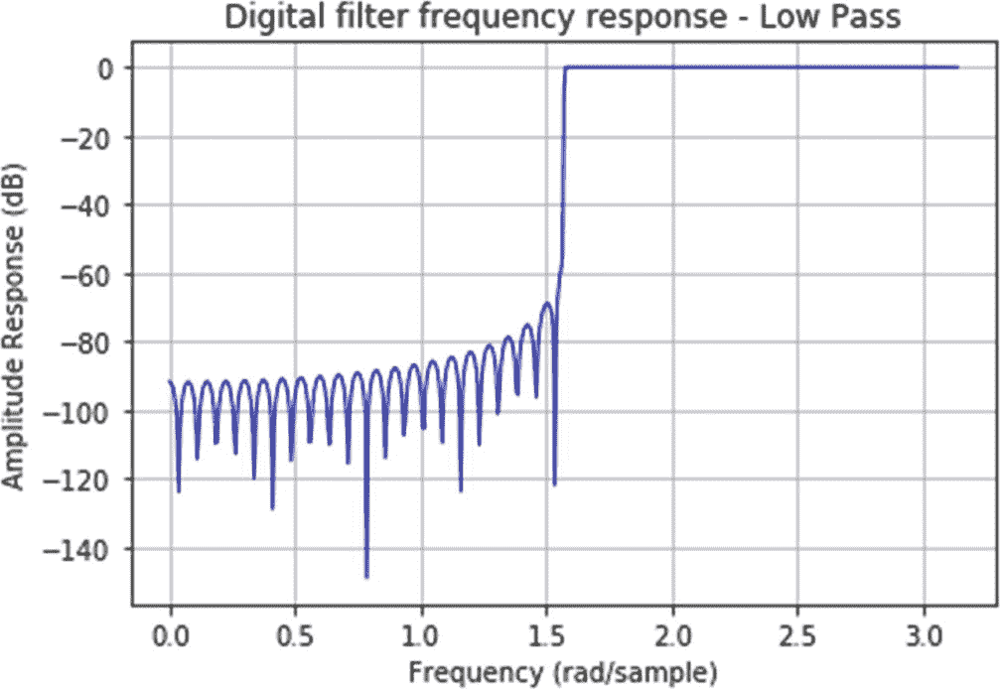

图 11-3

数字滤波器频率响应 – 低通

图 11-4 展示了一个高通滤波器的响应图。

```
b3 = signal.firwin(1963, [0.3, 0.8], pass_zero=False)
w3, h3 = signal.freqz(b3)
p3 = 20*np.log10(np.abs(h3))
plt.title('Digital filter frequency response - Band Stop')
line3, = plt.plot(w3, p3)
plt.setp(line3, color="r", linewidth=1.0)
plt.ylabel('Amplitude Response (dB)')
plt.xlabel('Frequency (rad/sample)')
plt.grid()
plt.show()  (Figure 11-5)
```

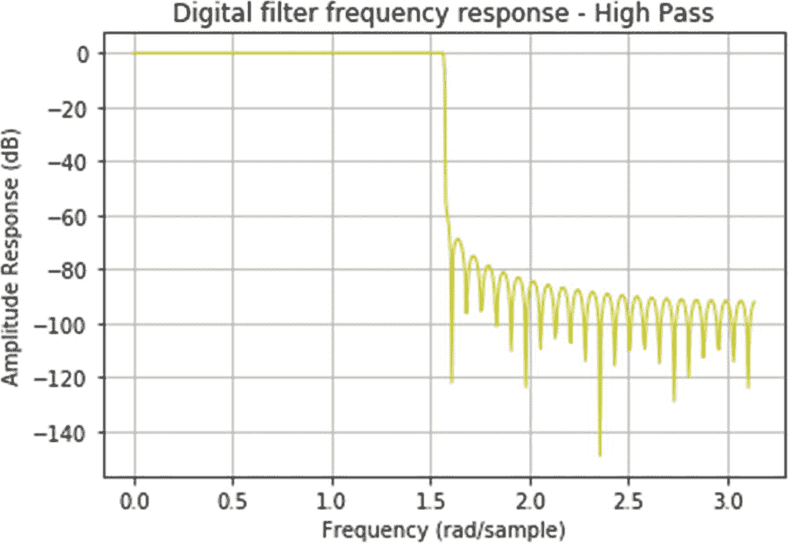

图 11-4

数字滤波器频率响应 – 高通

图 11-5 展示了一个带阻滤波器的响应图。

```
b4 = signal.firwin(1963, [0.3, 0.8], pass_zero=True)
w4, h4 = signal.freqz(b4)
p4 = 20*np.log10(np.abs(h4))
plt.title('Digital filter frequency response - Band Pass')
line4, = plt.plot(w4, p4)
plt.setp(line4, color="g", linewidth=1.0)
plt.ylabel('Amplitude Response (dB)')
plt.xlabel('Frequency (rad/sample)')
plt.grid()
plt.show()  (Figure 11-6)
```

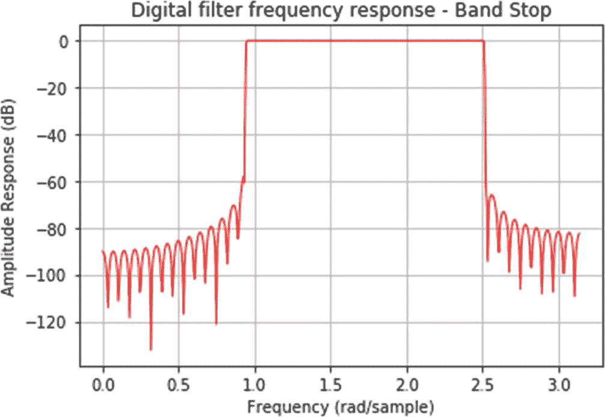

图 11-5

数字滤波器频率响应 – 带阻

图 11-6 展示了一个带通滤波器的响应图。

```
b5 = signal.firwin(2019, [0.1, 0.2, 0.4, 0.8], pass_zero=True)
w5, h5 = signal.freqz(b5)
p5 = 20*np.log10(np.abs(h5))
plt.title('Digital filter frequency response - Band Pass')
line5, = plt.plot(w5, p5)
plt.setp(line5, color="k", linewidth=1.0)
plt.ylabel('Amplitude Response (dB)')
plt.xlabel('Frequency (rad/sample)')
plt.grid()
plt.show() (Figure 11-7)
```

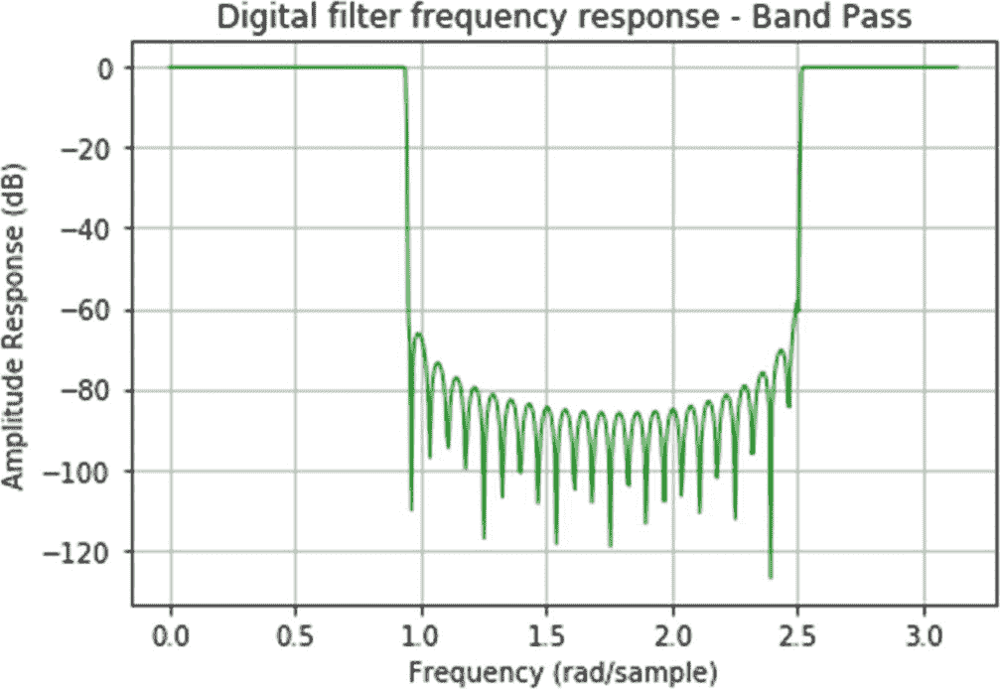

图 11-6

数字滤波器频率响应 – 带通

图 11-7 展示了一个多频带通滤波器的响应图。

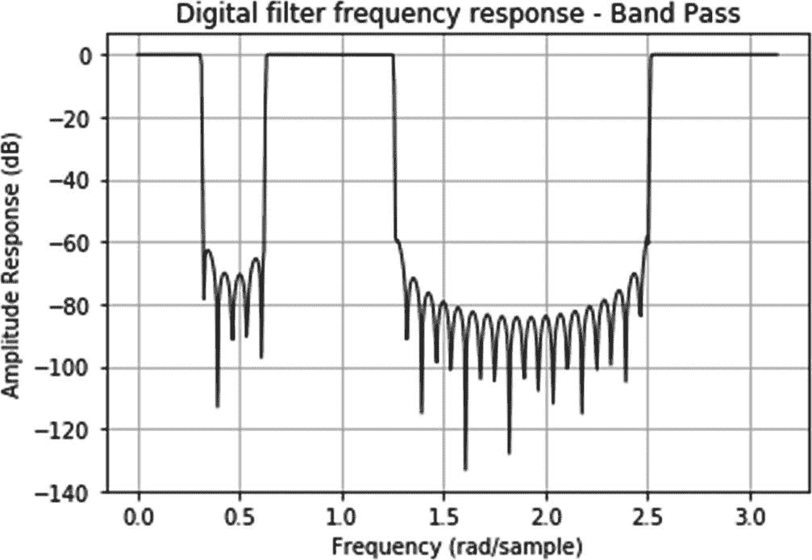

图 11-7

数字滤波器频率响应 – 带通 – 多频带

#### 语音处理

现在我将向您展示如何为您的机器学习赋予语音能力。在 Windows 系统上，请添加 pywin32 扩展。

通过执行以下命令完成：conda install -c anaconda pywin32

从示例目录中加载第 11 章的 Jupyter notebook，文件名为：Chapter-011-09-Speak-01.ipynb

需要学习的主要命令是：`engine.say('Hello Friend.')`

### 提示

能够对人类进行语音回复，是我们正在构建的智慧城市中一项广泛应用的特性。这些语音已经能够通过警告危险或提供指引，来回应人类的行为。

## 机械工程

机械工程是一门运用工程学、物理学、工程数学和材料科学原理来设计、分析、制造和维护机械系统的学科。它是工程学科中历史最悠久、范围最广泛的学科之一。

机械工程领域需要理解核心领域，包括力学、动力学、热力学、材料科学、结构分析和电学。

该领域不断发展以融合技术进步；如今，机械工程师正在复合材料、机电一体化和纳米技术等领域进行探索。

机器人学是应用机电一体化技术来创造机器人的学科，这些机器人常用于工业领域，执行危险、令人不适或重复性的任务。这些机器人可以有各种形状和尺寸，但都是预先编程的，并与物理世界进行实际交互。为了制造机器人，工程师通常运用运动学（确定机器人的运动范围）和力学（确定机器人内部的应力）。

机器人在工业工程中被广泛使用。它们使企业能够节省劳动力成本，执行对人类来说过于危险或精度过高而无法经济地完成的任务，并确保更高的质量。许多公司采用机器人装配线，尤其是在汽车工业中，一些工厂的自动化程度之高，甚至可以实现自主运行。在工厂之外，机器人已被用于拆弹、太空探索以及许多其他领域。机器人也被用于各种住宅应用，从娱乐到家务。

### 滑轮系统

人类使用滑轮来移动重物已有数千年历史。我为什么要向您介绍滑轮呢？

在第 12、13、14 和 15 章中，我将详细讨论滑轮如何成为通过工业化机器学习使机器学习能够操控现实世界的重要组成部分。

在本章中，我将介绍一些关于滑轮的基本入门概念，但我会描述一个非常具体的设置。如果您对这个领域感兴趣，我建议您找一本关于滑轮和索具原理的书。

这个领域本身就是一个专业化的领域。


### 提示

我建议你作为一名机器学习工程师，理解你所建模系统的真实世界参数，以确保在得出结果后你的模型是可实现的。

目前尚未由数据决策驱动的物联网传感器和机器，正让数据科学和机器学习工程师接触到这些领域中的主题见解，而这些见解通常并非其专业领域的常规部分。

在处理拖拽负载时，我将介绍几个入门概念；你需要了解一些术语。

#### 自重

指你想要移动的负载重量，以千克为单位。

#### 拖拽重量

当你将物体拖过任何表面时，物体会产生运动阻力。这种阻力称为拖拽阻力，并以拖拽阻力系数的形式表示，该系数是拖拽负载所需额外努力的百分比。

计算公式：

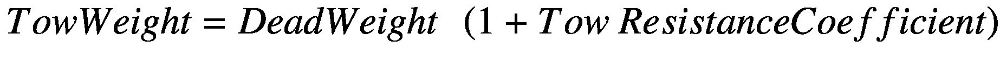

#### 机械优势

机械优势是滑轮系统提供的增强倍数，由以下原理决定：

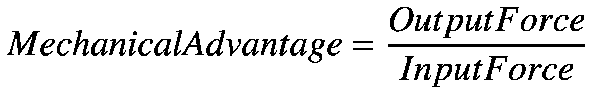

#### 方向优势

方向优势是指能够引导来自特定方向的力来移动物体的能力。

我将向你展示如何使用网格原理来部署特定的支点，使你的机器学习能够控制这些支点的位置，从而让你的机器学习能够改变自身环境，并学习如何发现和管理真实世界。

#### 缆绳长度

滑轮系统需要一定长度的缆绳来操作。它通常缠绕在某种卷筒上，以安全存放。缆绳长度是指施力点到第一个滑轮的距离，加上滑轮系统与负载之间的缆绳段数之和。

它主要由以下四个点的位置决定：

*   施力引擎的 X Y 坐标
*   滑轮支点的 X Y 坐标
*   负载的 X Y 坐标
*   滑轮系统的设计（即滑轮数量）

#### 基本滑轮系统

现在我将展示一些基本计算，以解释滑轮系统的作用。

从示例目录的第 11 章加载 Jupyter notebook，文件名为：Chapter-011-10-Pulleys-01.ipynb

我们研究的第一个滑轮系统的机械优势为 1（图 11-8）。

这个滑轮系统没有提供机械优势，但它确实提供了方向上的改变。因此，你可以通过将缆绳拉向你的牵引引擎，将负载拖向你的锚点。

### 提示

当你想将负载绕过其他物体进行拖拽时，方向的改变非常重要。

我将在第 15 章设计我们的全尺寸工业解决方案时，更详细地讨论这个概念。

图 11-8 展示了一个包含一个施力点、一个滑轮和一个负载的基本滑轮系统。

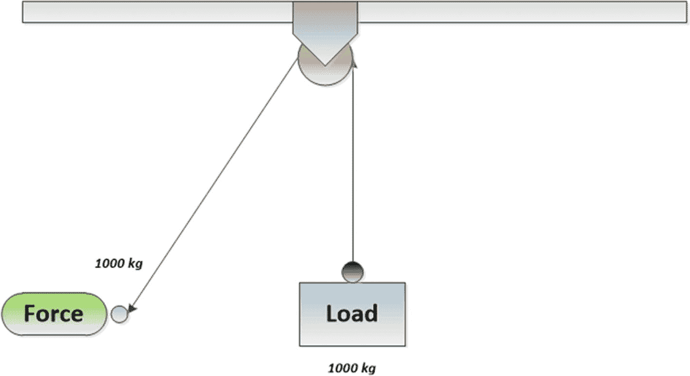

图 11-8

基本滑轮系统

让我们研究一下我们需要的三个计算。

```
import math
import numpy as np
from matplotlib import pyplot as plt
Pulleys=1
Force_Loc = [0,0]
Load_Loc = [100,0]
Pulley_Loc = [20,100]
dead_weight = 1000
tow_resistance = 0.01
data = np.array([
Force_Loc,
Pulley_Loc,
Load_Loc
])
x, y = data.T
plt.plot(x, y, 'black', linestyle="--", marker="D", linewidth=2.0)
plt.show() (Figure 11-9)
```

图 11-9 展示了该滑轮的程序化结果。

```
x1=Force_Loc[0]
y1=Force_Loc[1]
x2=Pulley_Loc[0]
y2=Pulley_Loc[1]
dist_force_pulley = math.hypot(x2 - x1, y2 - y1)
print('You are %0.5f meters from pulley system' % dist_force_pulley)
You are 101.98039 meters from pulley system
x1=Pulley_Loc[0]
y1=Pulley_Loc[1]
x2=Load_Loc[0]
y2=Load_Loc[1]
dist_pulley_load = math.hypot(x2 - x1, y2 - y1)
dist_pulleys_load = dist_pulley_load * Pulleys
print('You are %0.5f meters from load and need %0.5f meters of cable in pulleys when using %0d pulleys' % (dist_pulley_load, dist_pulleys_load, Pulleys))
You are 128.06248 meters from load and need 128.06248 meters of cable in pulleys when using 1 pulleys.
minimum_cable_length = (dist_force_pulley + dist_pulleys_load)
print('You need minimum %0.5f meters of cable in system when using %0d pulleys' % (minimum_cable_length, Pulleys))
```

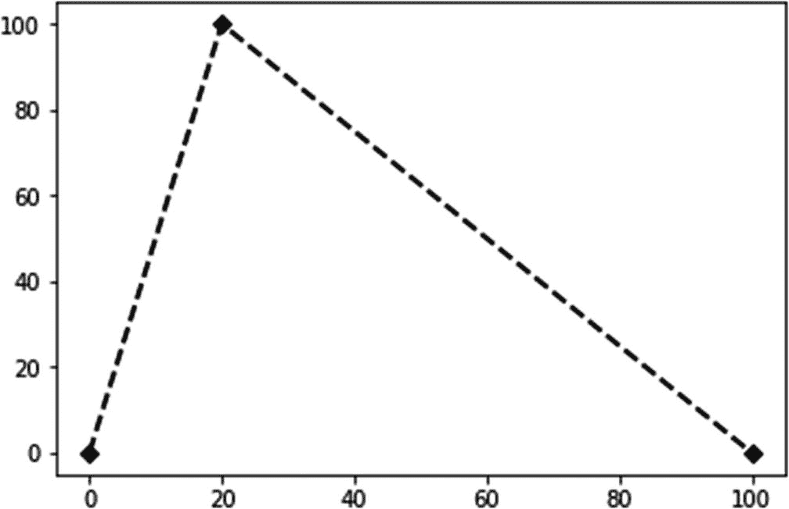

图 11-9

基本滑轮系统图

使用 1 个滑轮时，系统至少需要 230.04288 米缆绳。

```
tow_weight = dead_weight  * (1 + tow_resistance)
Load_Needed = (tow_weight * 9.80665)
mechanical_advantage = Pulleys
Force_Needed = Load_Needed/mechanical_advantage
print('System needs a %0.5f newton force when using %0d pulleys for a %0.5f newton load (%0.3f kg of dead weight with tow resistance of %0.3f %%)' % (Force_Needed, Pulleys, Load_Needed, dead_weight, tow_resistance*100))
```

使用 1 个滑轮时，系统需要 9904.71650 牛顿的力来拉动 9904.71650 牛顿的负载（1000.000 千克自重，拖拽阻力为 1.000%）。

做得好；你现在可以计算如何使用滑轮系统了。

你将在第 12、13、14 和 15 章中再次用到这个知识。

我们研究的第二个滑轮系统的机械优势为 2（图 11-10）。

为了处理两个滑轮的新需求，你可以简单地更改当前 notebook 中的变量：

Pulleys=2

或者从示例目录的第 11 章加载 Jupyter notebook，文件名为：Chapter-011-11-Pulleys-02.ipynb

图 11-10 展示了一个包含一个施力点、一个负载但有两个动滑轮的复式滑轮系统。请注意，第三个滑轮由于固定锚点而不移动。

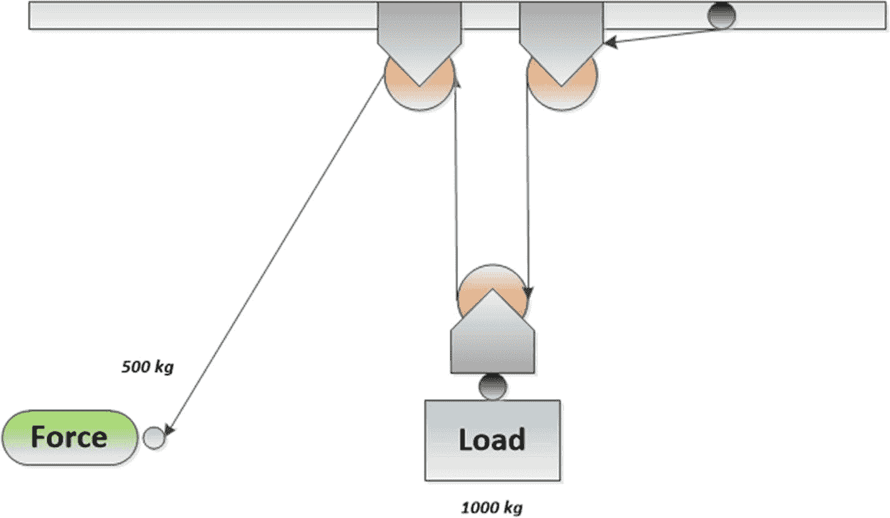

图 11-10

复式滑轮系统

结果如下：

*   你距离滑轮系统 101.98039 米。
*   你距离负载 128.06248 米，使用两个滑轮时，滑轮间需要 256.12497 米缆绳。
*   使用两个滑轮时，系统至少需要 358.10536 米缆绳。
*   使用两个滑轮时，系统需要 4952.35825 牛顿的力来拉动 9904.71650 牛顿的负载（1000.000 千克自重，拖拽阻力为 1.000%）。


*   因此，单个滑轮需要 9904.71650 牛顿的力，而两个滑轮则只需 4952.35825 牛顿。

*   现在，你可以用相同的力移动两倍的负载。

我们考察的第三个滑轮系统具有 4 倍的机械优势（图 11-11）。

为了处理四个滑轮的新需求，你可以简单地更改当前笔记本中的变量：

*   `Pulleys=4`

*   或者从示例目录第 11 章加载名为 `Chapter-011-12-Pulleys-03.ipynb` 的 Jupyter 笔记本。

图 11-11 展示了一个带有固定锚点的更复杂的四滑轮系统。

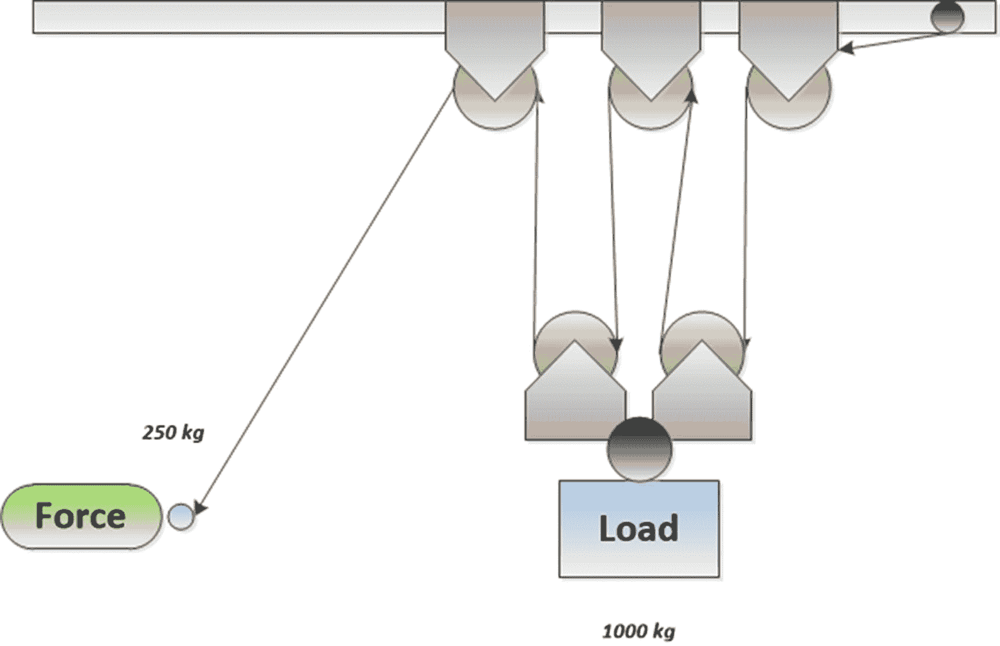

图 11-11

复杂滑轮系统

结果：

*   你距离滑轮系统 101.98039 米。

*   你距离负载 128.06248 米，使用四个滑轮时，滑轮组中需要 512.24994 米长的绳索。

*   使用四个滑轮时，系统中至少需要 614.23033 米长的绳索。

*   对于 9904.71650 牛顿的负载（1000.000 公斤静载，牵引阻力为 1.000%），使用四个滑轮时系统需要 2476.17912 牛顿的力。

*   因此，单个滑轮需要 9904.71650 牛顿的力，而四个滑轮则只需 2476.17912 牛顿。

我建议你查看以下内容：

*   从示例目录第 11 章加载名为 `Chapter-011-12-Pulleys-04.ipynb` 的 Jupyter 笔记本。

该笔记本的结果如图 11-12 所示。

图 11-12 展示了随着滑轮数量增加，复杂滑轮系统所需的绳索长度。

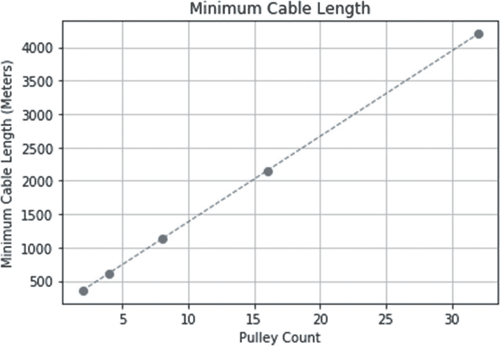

图 11-12

绳索长度图

力的结果如图 11-13 所示。

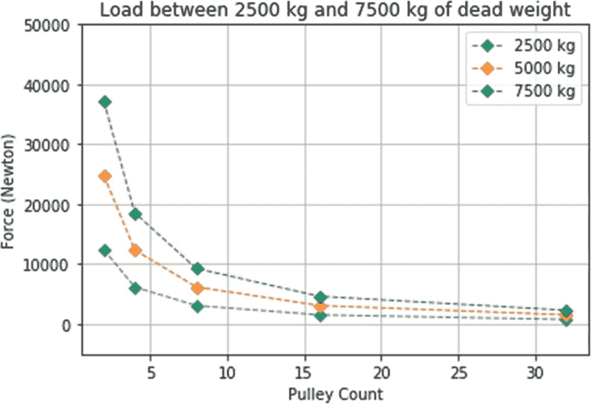

图 11-13

力与滑轮数量关系图

做得好；你已经掌握了滑轮的基本概念。我将在第 14 章讨论这个主题，最后在第 15 章展示你的知识如何助力解决一个全尺寸的工业化机器学习问题。

### 齿轮

齿轮是一种带齿的机器轮或圆柱体，它与另一个带齿的部件啮合，以传递运动或改变速度或方向。这个基本原理为你的机器学习提供了操纵现实世界的机械能力。

我将为你提供关于此过程的基本见解。

根据 ISO（国际标准化组织）指南，模数被指定为表示齿轮齿尺寸的单位。

### 警告

其他尺寸标注方法也在使用中！请检查以确保齿轮正确匹配。

```
模数 (m)
m = 1 (p = 3.1416)
m = 2 (p = 6.2832)
m = 4 (p = 12.566)
```

如果将模数乘以圆周率 π，就可以得到齿距 (p)。

齿距是相邻齿上对应点之间的距离。

### 提示

只有齿距相同的齿轮才能一起使用。

p = π × 模数 = πm

#### 单个齿轮

从示例目录第 11 章加载名为 `Chapter-011-14-Gears-01A.ipynb` 的 Jupyter 笔记本。

基本原理是以下公式：

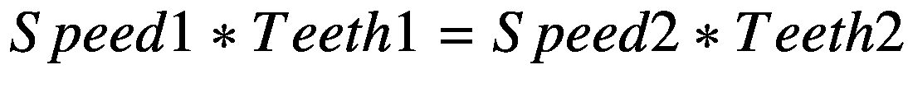

图 11-14 展示了一个简单的双齿轮系统。

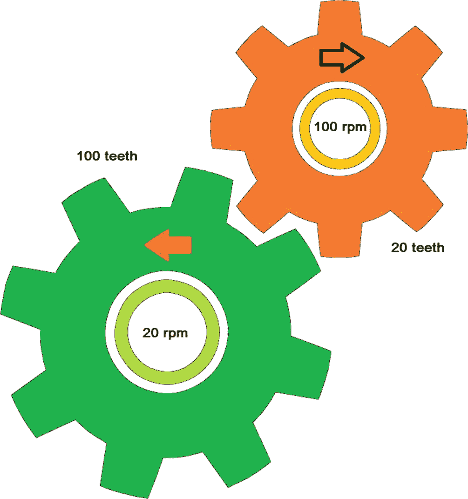

图 11-14

单个齿轮

该示例演示了如何计算所示齿轮的齿轮比、速度和功率比（图 11-14）。

结果：

```
施加绿色齿轮 1.500 kW ( 716.197 牛·米) 于 100 齿，转速 20.000 rpm
输出琥珀色齿轮 1.500 kW ( 143.239 牛·米) 于 20 齿，转速 100.000 rpm
功率比：0.200 倍
速度比：5.000 倍
```

从示例目录第 11 章加载名为 `Chapter-011-15-Gears-01B.ipynb` 的 Jupyter 笔记本。

更改：

```
n1 = 20   # 绿色齿轮齿数
n2 = 100  # 琥珀色齿轮齿数
```

结果：

```
施加绿色齿轮 1.500 kW ( 716.197 牛·米) 于 20 齿，转速 20.000 rpm 输出琥珀色齿轮 1.500 kW (3580.986 牛·米) 于 100 齿，转速 4.000 rpm
功率比：5.000 倍
速度比：0.200 倍
```

参见：[`https://www.engineersedge.com/gear_formula.htm`](https://www.engineersedge.com/gear_formula.htm)

#### 复合齿轮

该齿轮系统由四个齿轮组成（绿色、琥珀色、黄色和红色）。琥珀色和黄色齿轮通过一根驱动杆连接（即，如果琥珀色齿轮以 10 rpm 旋转，黄色齿轮也以 10 rpm 旋转，并且施加到琥珀色齿轮上的所有功率 100% 传递给黄色齿轮）。见图 11-15。

### 注意

这些复合齿轮系统是任何应用中最常用的类型。

从示例目录第 11 章加载名为 `Chapter-011-16-Gears-02A.ipynb` 的 Jupyter 笔记本。

图 11-15 展示了一个提高齿轮效率的复合齿轮系统。


图 11-15

复合齿轮

请注意，星形齿轮通过一根轴连接。这创建了一个在实际应用中很常见的复合齿轮系统。

结果：

*   施加绿色齿轮 1.500 kW (716.197 牛·米) 于 100 齿，转速 20.000 rpm。
*   输出琥珀色齿轮 1.500 kW (143.239 牛·米) 于 20 齿，转速 100.000 rpm。
*   施加黄色齿轮 1.500 kW (143.239 牛·米) 于 200 齿，转速 100.000 rpm。
*   输出红色齿轮 1.500 kW (10.743 牛·米) 于 15 齿，转速 1333.333 rpm。
*   功率比：0.015 倍。
*   速度比：66.667 倍。
*   你将 20 rpm 改变为超过 1300 rpm。
*   做得好；你已经完成了第一个齿轮示例。
*   从示例目录第 11 章加载名为 `Chapter-011-17-Gears-02B.ipynb` 的 Jupyter 笔记本。
*   你只需进行以下更改，即可将齿轮从增速改为增力。

```
n1 = 20  # 绿色齿轮齿数
n2 = 100 # 琥珀色齿轮齿数
n3 = 15  # 黄色齿轮齿数
n4 = 200 # 红色齿轮齿数
施加绿色齿轮 1.500 kW ( 716.197 牛·米) 于 20 齿，转速 20.000 rpm
输出琥珀色齿轮 1.500 kW (3580.986 牛·米) 于 100 齿，转速 4.000 rpm
施加黄色齿轮 1.500 kW (3580.986 牛·米) 于 15 齿，转速 4.000 rpm
输出红色齿轮 1.500 kW (47746.483 牛·米) 于 200 齿，转速 0.300 rpm
功率比：66.667 倍 速度比：0.015 倍
```

做得好；你现在已经掌握了齿轮使用的基础知识。我将在第 12、13、14 和 15 章中介绍这些知识的更实际应用，届时我将解释如何使用这些知识。


### 杠杆

杠杆原理被广泛用于通过施加较小的力来产生所需的较大力。

杠杆（图 11-16）是一种简单机械，由两个材料组件和两个工作组件构成：

*   一根横梁或实心杆
*   一个支点或枢轴点
*   一个输入力（动力）
*   一个输出力（负载或阻力）

从示例目录的第 11 章加载名为 `Chapter-011-18-Lift-01.ipynb` 的 Jupyter notebook。

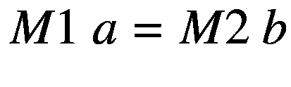

```
M1 - 支点一端的质量（输入力）
a  - 从支点到 M1 的距离
M2 - 支点另一端的质量（输出力）
b  - 从支点到 M2 的距离
```

图 11-16 是一个简单的杠杆。

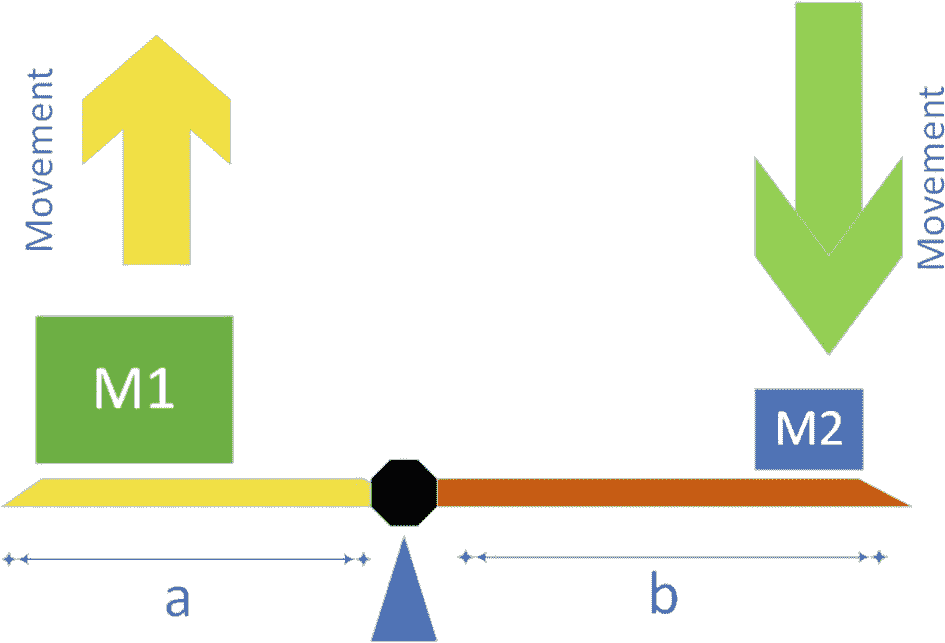

图 11-16

基本杠杆

我将快速向您展示如何绘制一个像示例中那样的杠杆（图 11-17）。

```
from PIL import ImageFont, Image, ImageDraw
im = Image.new('RGBA', (600, 200), (255, 255, 255, 255))
draw = ImageDraw.Draw(im)
draw.line((10,100, 200,100), fill=128, width=10)
draw.line((210,100, 550,100), fill=128, width=10)
draw.ellipse((195, 105, 215, 170), fill=(255,0,0,255))
draw.ellipse((155, 155, 255, 170), fill=(0,0,0,255))
f = ImageFont.load_default()
draw.text( (5, 80), "a x M1",  font=f, fill=255)
draw.text( (535, 80), "b x M2",  font=f, fill=255)
im.show() (Figure 11-17)
```

图 11-17 是简单杠杆的绘制结果。

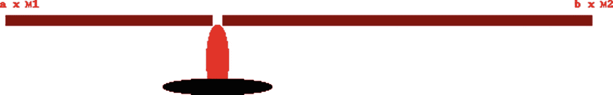

图 11-17

杠杆绘图

杠杆的四个组件可以以三种基本方式组合，从而产生三类杠杆。

#### 第 1 类杠杆

这是一种常见配置，其中支点位于输入力和输出力之间。现实世界中的应用包括秤或撬棍等工具。见图 11-18。

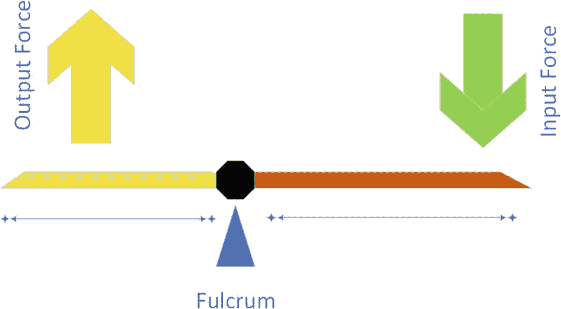

图 11-18

第 1 类杠杆

#### 第 2 类杠杆

阻力位于输入力和支点之间；现实世界中的应用是独轮手推车。见图 11-19。

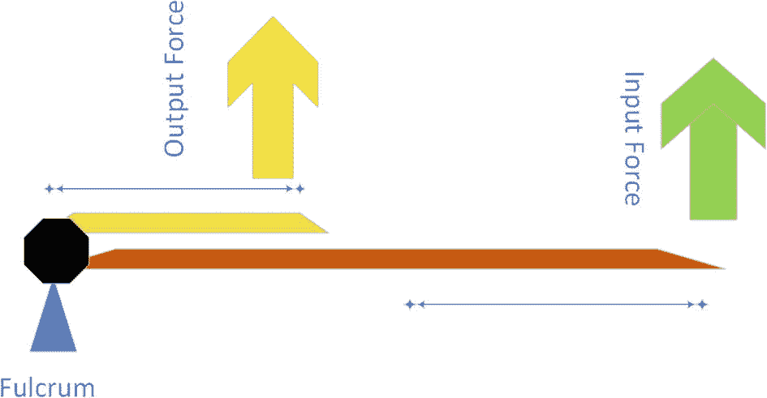

图 11-19

第 2 类杠杆

#### 第 3 类杠杆

支点在一端，阻力在另一端，动力位于两者之间，例如镊子或烧烤夹。见图 11-20。

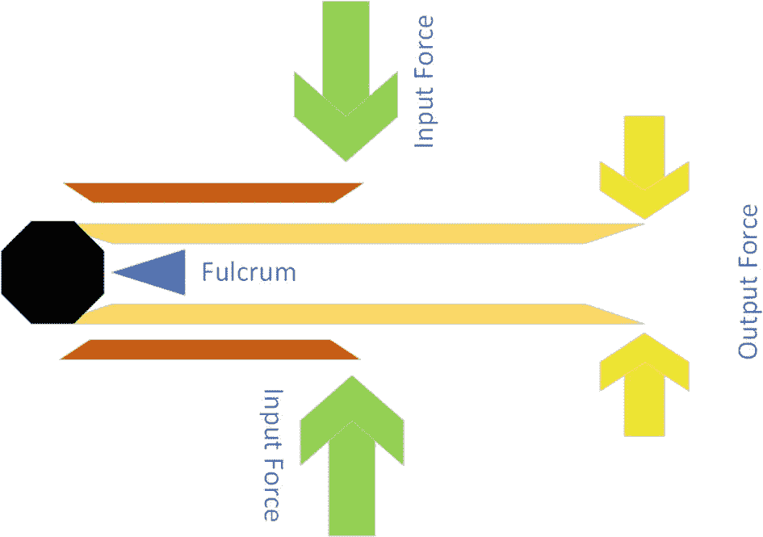

图 11-20

第 3 类杠杆

杠杆是简单的机械装置，能够传递动力和运动，从而迫使机器执行学习所需的动作。

对您来说，最常见的应用是机器人和工业制造。我将在第 12、13、14 和 15 章中详细讨论如何利用这些知识让您的机器学习改变现实世界。

## 电子工程

电子工程（也称为电子与通信工程）是电气工程的一个分支，它利用非线性有源电气元件（例如半导体器件，特别是晶体管、二极管和集成电路）来设计电子电路、设备、超大规模集成电路及其系统。该学科通常也设计无源电气元件，通常基于印刷电路板。

信号与系统是拉普拉斯变换、连续时间和离散时间傅里叶级数、连续时间和离散时间傅里叶变换、z 变换的定义和性质的实现。

从示例目录的第 11 章加载名为 `Chapter-011-19-Electronics-01.ipynb` 的 Jupyter notebook。

我想向您介绍一套简单的电子设备。电子工程领域有更多复杂的系统，但就本书而言，我仅解释一些基础知识。


### 逻辑门

逻辑电子门是电子集成电路世界的基本构建模块。这些基本电路组合起来形成更复杂的逻辑电路，可被编程以执行决策或监控机器学习过程中的状态。

我将向你介绍一些基本电路，让你初步了解这些工具，从而洞察如何利用它们来辅助你的 IML（工业机器学习）流程。

#### 与门

与门是嵌入在电子电路中的一种逻辑决策过程。该门电路对两个输入 a 和 b 进行运算，产生一个输出 x。见图 11-21。

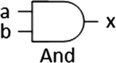

图 11-21

与门

共有四种基本选项：

*   a=0, b=0 则 x=0

*   a=0, b=1 则 x=0

*   a=1, b=0 则 x=0

*   a=1, b=1 则 x=1

```
for a in range (2):
for b in range (2):
x= a and b
print(' %0d and %0d => %0d' % (a, b, x))
```

结果：

```
0 and 0 => 0
0 and 1 => 0
1 and 0 => 0
1 and 1 => 1
```

#### 或门

或门有以下几种选项（图 11-22）。

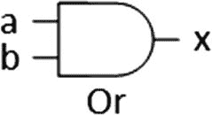

图 11-22

或门

*   a=0, b=0 则 x=0

*   a=0, b=1 则 x=1

*   a=1, b=0 则 x=1

*   a=1, b=1 则 x=1

```
for a in range (2):
for b in range (2):
x= a or b
print(' %0d or %0d => %0d' % (a, b, x))
```

结果：以下是或门的四个结果：

```
0 or 0 => 0
0 or 1 => 1
1 or 0 => 1
1 or 1 => 1
```

#### 非门

非门有以下几种选项（图 11-23）：

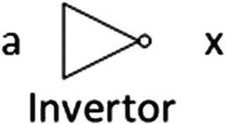

图 11-23

非门

*   a=0 则 x=1

*   a=1 则 x=0

```
for a in range (2):
x= not a
print(' %0d => %0d' % (a, x))
```

#### 基本逻辑系统

该电路是两个与门、一个或门和一个非门的组合（图 11-24）。

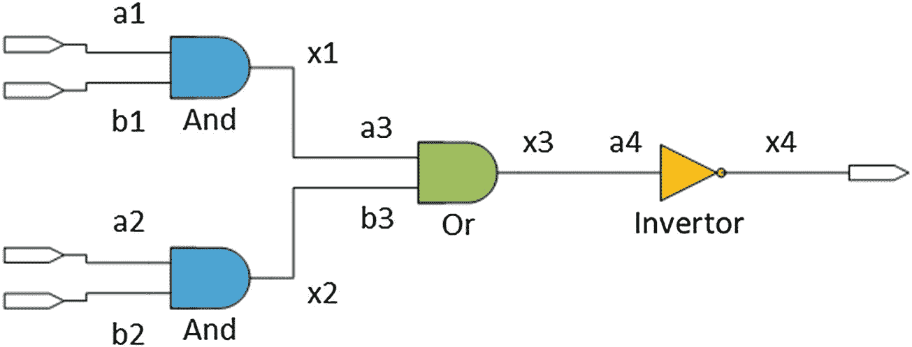

图 11-24

基本逻辑系统

这是一个简单但常见的逻辑电路，用于检查四个输入（a1, b1, a2, b2）以产生一个输出（x4）。

让我们一步步解释这个过程。

```
t=0
for p1 in range (2):
for p2 in range (2):
for p3 in range (2):
for p4 in range (2):
a1=p1
b1=p2
a2=p3
b2=p4
t+=1
print('====================================')
print('c= %0d:p1=%0d p2=%0d p3=%0d p4=%0d' % (t, p1, p2, p3, p4))
print('====================================')
x1=a1 and b1
print('%0d and %0d => %0d' % (a1,b1,x1))
x2=a2 and b2
print('%0d and %0d => %0d' % (a2,b2,x2))
a3 = x1
b3 = x2
x3=a3 or b3
print('%0d or %0d => %0d' % (a3,b3,x3))
a4 = x3
x4= not a4
print('not %0d => %0d' % (a4, x4))
p5=a4
print('====================================')
print('p5=%0d' % (p5))
print('====================================')
====================================
c= 1:p1=0 p2=0 p3=0 p4=0
====================================
0 and 0 => 0
0 and 0 => 0
0 or 0 => 0
not 0 => 1
====================================
p5=0
====================================
```

## 电信工程

电信工程是一门以电气和计算机工程为中心的工程学科，旨在支持和增强电信系统。

发射器（信息源）获取信息并将其转换为用于传输的信号。

信号传输的传输介质：

*   有线通信

*   无线通信

接收器（信息接收端）接收信号并将其转换回所需信息。

从示例目录 Chapter 11 加载 Jupyter 笔记本，文件名为：Chapter-011-20-Telecomms-01.ipynb

运行该笔记本以深入了解以下电信网络模拟的工作原理：

*   有线电信

该网络只有两个节点：一个发送，另一个接收。这是一个典型的物联网生态系统。模拟结果保存在 Point-to-Point Chapter-011-20-Telecomms-01-01.txt 中。

*   中心无线电信

该网络有一个中心节点发送，两个节点接收。这是一个典型的机器人控制生态系统。模拟结果保存在 Point-to-Point Chapter-011-20-Telecomms-01-02.txt 中。

*   单信道无线电信

该网络有三个节点在相同带宽上发送，三个节点接收。这是一个典型的非管理型生态系统。模拟结果保存在 Point-to-Point Chapter-011-20-Telecomms-01-03.txt 中。

### 警告

这种类型的网络在通信方面并不有效或高效。我建议你避免使用此模型，因为它会导致通信混乱并浪费带宽。

*   三网孔无线电信

该网络有三个节点在网孔带宽上发送，三个节点接收。模拟结果保存在 Point-to-Point Chapter-011-20-Telecomms-01-04.txt 中。

### 提示

网孔网络是受管理的，并且非常有效和高效。

## 系统工程

系统工程是工程和工程管理的一个跨学科领域，专注于如何在其生命周期内设计和管理复杂系统。见图 11-25。

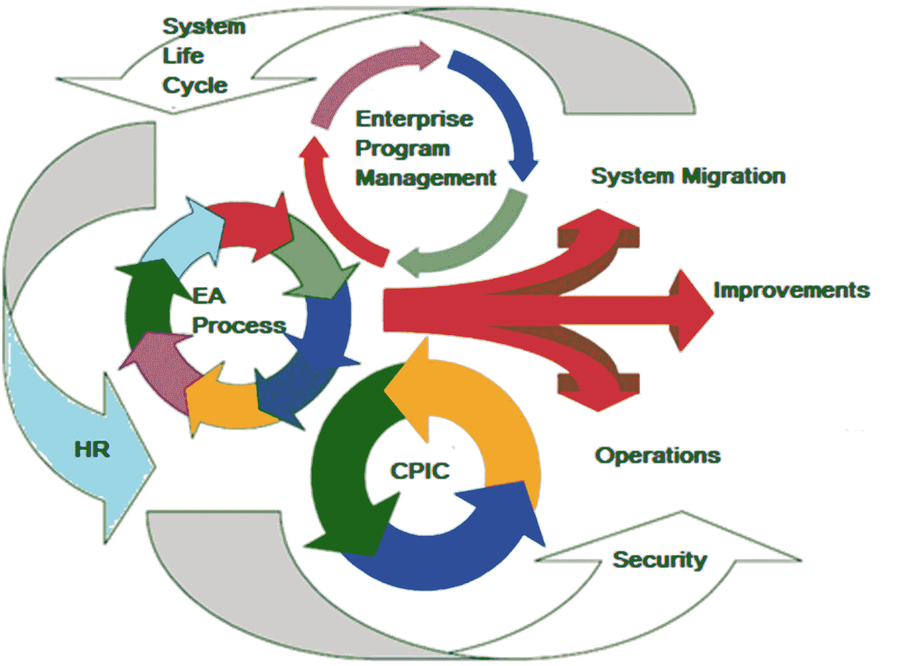

图 11-25

企业生命周期生态系统

系统工程本身就是一个复杂的领域。由于这不是我经常使用的领域，我将仅展示这个快速介绍。我建议你阅读关于生态系统管理流程的内容，因为它们对于在高度工业化的生态系统中使用非常重要。

基本组成部分如下。

### 企业项目管理

该单元确保工作项目按时并在预算内完成。作为机器学习工程师，你与该单元的主要联系是通过技术项目经理。

他们处理你将承担的工作的所有功能性和非功能性需求。

### 企业架构流程

企业架构单元处理与硬件和物联网设备相关的所有事务。他们将为你提供执行工业化机器学习的物理设备。他们还拥有机器人和通信设备。

### 人力资源

他们使你的人力在环资源保持最佳状态，并确保在正确的时间有合适的人可用。没有软技能和管理人员的能力，你将无法取得成功。

### 系统生命周期

这是一个确保旧系统按照退役协议被移除，并确保新系统上线而不中断机器学习环境日常服务的过程。

### 中央处理信息中心（CPIC）

CPIC 是机器学习在生态系统中的所在地。在你通过 DevOps 流程移交新的机器学习模型后，所有处理都在该单元进行。他们是其系统中所有活跃机器学习模型的保管人，并确保按照你作为数据科学家和机器学习工程师的指令，针对企业数据源进行处理。


### 安全性

机器学习生态系统的网络安全和物理安全是该生态系统中的一个重要单元，因为当前需要将物联网设备部署在无保护的环境中，因此对这些设备的非法访问或滥用几乎不可避免。您的安全团队将负责确保您的机器学习不被用于不公正或具有破坏性的目的。

## 控制工程

控制工程或控制系统工程是一门工程学科，它应用自动控制理论来设计在控制环境中具有所需行为的系统。

它使用传感器和探测器来测量被控过程的输出性能；这些测量结果用于提供纠正性反馈，帮助实现所需的性能。设计为无需人工输入即可运行的系统称为自动控制系统。

时间序列是按时间顺序索引（或列出或绘制）的一系列数据点。最常见的是，时间序列是在时间上连续等间隔点采集的序列。因此，它是一组离散时间数据。

### 控制仿真

安装：

```
conda install -c conda-forge control
安装一个 Fortran 编译器。
```

从示例目录 Chapter 11 中加载名为 Chapter-011-21-Control-01.ipynb 的 Jupyter notebook。

```
import matplotlib
matplotlib.use('TkAgg')
%matplotlib inline
from scipy import *
from pylab import *
a = zeros(500)
a[:100]=1
b = fft(a)
plot(abs(b))
show()  (图 11-26)
```

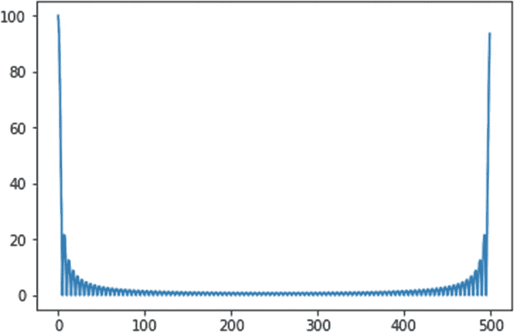

图 11-26

傅里叶变换图

此 notebook 包含多种可供您研究的控制风格配置。

### 自行车的双环控制器

下一个示例将带您了解自行车的顺序双环控制器，以模拟机器学习如何通过简单地控制平衡和行驶方向来控制自行车。

这是以与人类骑自行车相同的方式实现的。

从示例目录 Chapter 11 中加载名为 Chapter-011-22-Control-02.ipynb 的 Jupyter notebook。

此 notebook 模拟了自行车的平衡。

以下是该过程的控制向量。代码将提供有关过程如何工作的见解。参见图 11-27。

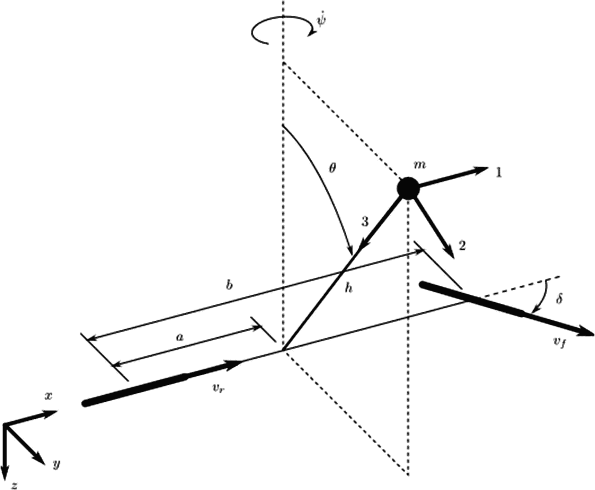

图 11-27

自行车控制设计

控制器的结构如下图所示（图 11-28）。

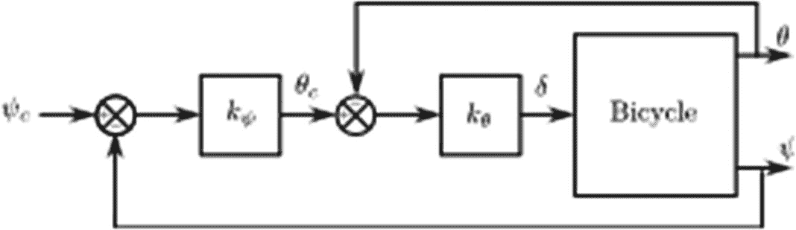

图 11-28

自行车控制概念

从示例目录 Chapter 11 中加载名为 Chapter-011-23-Control-03.ipynb 的 Jupyter notebook。

```
安装：pip install harold
```

该 notebook 通过 Harold 创建模型，该模型定义了两个类来表示动态模型：Transfer 类和 State 类。

以下是该过程的传递状态：

![$$ {G}_1=\frac{z-1}{z³-{zs}²+z},\kern0.5em {G}_2=\left[\begin{array}{cc}\frac{1}{s+2}&amp; \frac{s+3}{s²+s-4}\\ {}0&amp; \frac{s+2}{s-3}\end{array}\right],\kern0.5em {G}_3=\left[\left.\begin{array}{cc}0&amp; 1\\ {}-2&amp; -0.5\\ {}0&amp; 3.5\end{array}\right|\begin{array}{c}0\\ {}1\\ {}1\end{array}\right],\kern0.5em {G}_4\left[\left.\begin{array}{ccc}-4&amp; -2&amp; 2\\ {}0&amp; -5&amp; 2\\ {}4&amp; -3&amp; -4\\ {}-1&amp; 5&amp; 2\end{array}\right|\begin{array}{cc}1&amp; 1\\ {}0&amp; 1\\ {}2&amp; -1\\ {}0&amp; 0\end{array}\right] $$](images/466154_1_En_11_Chapter/466154_1_En_11_Chapter_TeX_Eque.png)

您的结果是：

```
离散时间传递函数，采样时间：0.100 (10.000 Hz.)
1 个输入和 1 个输出
极点(实部)    极点(虚部)    零点(实部)    零点(虚部)
-------------  -------------  -------------  -------------
0              0              1              0
1              0
1              0
```

您可以直接识别该过程的零极点结构。

MIMO 状态表示是首选，而 MIMO 传递模型明确要求使用列表的列表结构。

![$$ {G}_5=\frac{1}{s²+5s+1}\left[\begin{array}{cc}s+1&amp; 2\\ {}s+3&amp; 4\end{array}\right] $$](images/466154_1_En_11_Chapter/466154_1_En_11_Chapter_TeX_Equf.png)

结果：

```
[[-4\. -2\.  2.]
[ 0\. -5\.  2.]
[ 4\. -3\. -4.]]
```

最后，您可以通过 random_stable_model 创建随机状态模型。

您应该通过更改所选极点的概率分布，强制随机模型有更多机会具有振荡模式。

假设您想要一个离散时间模型，其大部分极点位于虚轴上，并偶尔有积分器。

结果是：

```
连续时间状态表示
5 个状态，2 个输入，3 个输出
极点(实部)    极点(虚部)  零点(实部)    零点(虚部)
-------------  -------------  -------------  -------------
-7.36961        6.61705
-7.36961       -6.61705
-3.03534        0
-7.30188        0
-5.08623        0
离散时间状态表示，采样时间：0.010 (100.000 Hz.)
20 个状态，2 个输入，3 个输出
极点(实部)    极点(虚部)  零点(实部)    零点(虚部)
-------------  -------------  -------------  -------------
0.991056      0.133444
0.991056     -0.133444
0.995934      0.0900819
0.995934     -0.0900819
1.06971       0
0.99681       0.079816
0.99681      -0.079816
0.998778      0.0494188
0.998778     -0.0494188
1             0
0.999386      0.0350363
0.999386     -0.0350363
0.999515      0.0311479
0.999515     -0.0311479
0.999561      0.0296121
0.999561     -0.0296121
0.999602      0.0281987
0.999602     -0.0281987
0.999592      0.0285679
0.999592     -0.0285679
```

模型转换用于将一种模型表示转换为另一种，相关函数是 transfer_to_state() 和 state_to_transfer()。

### 注意

通常，从传递模型到状态模型的转换会导致非最小表示。

```
连续时间状态表示
4 个状态，2 个输入，2 个输出
极点(实部)    极点(虚部)    零点(实部)    零点(虚部)
-------------  -------------  -------------  -------------
-2              0             -2    9.55463e-08
3              0             -2   -9.55463e-08
2              0              2    0
-2              0
离散时间传递函数，采样时间：0.100 (10.000 Hz.)
1 个输入和 1 个输出
极点(实部)    极点(虚部)    零点(实部)    零点(虚部)
-------------  -------------  -------------  -------------
-0.25       0.193649     -0.0251582              0
-0.25      -0.193649     -3.97484                0
```

#### 最小实现

最小化是任何用于可靠计算的表示的基本属性，因此我们可以使用 minimal_realization() 函数。此函数使用距离度量来找到状态模型的最接近秩亏矩阵束，并对传递表示进行直接的零极点遍历。

### 注意

决策的容差可以调整。

### 警告

即使 MIMO 的极点和零点数值相同，它们也不一定会相互抵消。这是因为对于 MIMO 表示，极点和零点的方向性可能不同。

您可以在之前获得的表示 H 中看到这一点。

```
连续时间状态表示
3 个状态，2 个输入，2 个输出
极点(实部)    极点(虚部)    零点(实部)    零点(虚部)
-------------  -------------  -------------  -------------
-2              0              2              0
2              0             -2              0
3              0
```


## 离散化与非离散化

模型的离散化在很大程度上是一门艺术或经验积累的结果，而非纯粹的科学。尽管这些方法本身是合理的，但选择合适的方法以及相关的采样周期，是机器学习者的决策。

```
Discrete-Time Transfer function with sampling time: 0.300 (3.333 Hz.)
1 input and 1 output
Poles(real)    Poles(imag)    Zeros(real)    Zeros(imag)
-------------  -------------  -------------  -------------
0.792052       0.172336      -0.869152              0
0.792052      -0.172336
Here are the current known discretization methods:
Discretization methods
=============================
bilinear
tustin
zoh
foh
forward difference
forward euler
forward rectangular
backward difference
backward euler
backward rectangular
lft
>>
<<
```

现在你可以将这些模型转换回来；G3 将使用默认方法 `Tustin` 进行转换，而 G6d 将通过零阶保持器方法进行转换。

### 注意

如果缺少这些信息，最终得到的连续模型将与初始模型略有不同。

```
Continuous-Time Transfer function
1 input and 1 output
Poles(real)    Poles(imag)  Zeros(real)    Zeros(imag)
-------------  -------------  -------------  -------------
-0.7       0.714143
-0.7      -0.714143
Continuous-Time Transfer function
1 input and 1 output
Poles(real)    Poles(imag)    Zeros(real)    Zeros(imag)
-------------  -------------  -------------  -------------
-0.705414       0.708951        6.66667              0
-0.705414      -0.708951      -95.2327               0
```

## 模型代数

基本的代数运算和反馈运算通过典型的 `*`、`+`、`-`、`@` 和 `feedback()` 函数实现。在执行运算前，会检查模型的形状和采样时间是否兼容，若不匹配则会引发错误。一个例外是单输入单输出（SISO）模型与多输入多输出（MIMO）模型之间的运算。例如，G1 是一个 SISO 模型，而 G3 是一个采样时间匹配的 MIMO 模型；因此，允许将 G1 与 G3 的每个元素相乘。对于 MIMO 模型的乘法，遵循矩阵乘法规则，因此使用矩阵乘法运算符 `@`。

```
print(G1 * G3)
Discrete-Time state representation with sampling time: 0.100 (10.000 Hz.)
5 states, 1 input, and 1 output
Poles(real)    Poles(imag)    Zeros(real)    Zeros(imag)
-------------  -------------  -------------  -------------
-0.25       0.193649     -0.0251582              0
-0.25      -0.193649     -3.97484                0
0          0             1                      0
1          0
1          0
print(G4 @ G2)
Continuous-time state representation
7 states, 2 inputs, and 1 output
Poles(real)    Poles(imag)  Zeros(real)    Zeros(imag)
-------------  -------------  -------------  -------------
-6.76735        0
-3.11633        1.45258
-3.11633       -1.45258
-2              0
3              0
2              0
-2              0
CL = feedback(G3, G1)
CL_min = minimal_realization(CL)
print(CL)
Discrete-Time state representation with sampling time: 0.100 (10.000 Hz.)
5 states, 1 input, and 1 output
Poles(real)    Poles(imag)    Zeros(real)    Zeros(imag)
-------------  -------------  -------------  -------------
-1.30016          0           -0.0251582              0
0.912951         1.46766     -3.97484                0
0.912951        -1.46766     -0                      0
1                0            1                      0
-0.0257453        0            1                      0
```

你应该会观察到在 1 处存在一个极点/零点对消，该对消在后续过程中被移除。

```
Discrete-Time state representation with sampling time: 0.100 (10.000 Hz.)
4 states, 1 input, and 1 output
Poles(real)    Poles(imag)    Zeros(real)    Zeros(imag)
-------------  -------------  -------------  -------------
-1.30016          0          5.76839e-15              0
-0.0257453        0         -0.0251582                0
0.912951         1.46766    1                        0
0.912951        -1.46766   -3.97484                  0
```

## 基本绘图功能

常用的绘图功能已经内置。

对于频域绘图，默认单位为赫兹（Hz），幅度采用十的幂次表示。

```
impulse_response_plot(G4)
```

参见图 11-29。

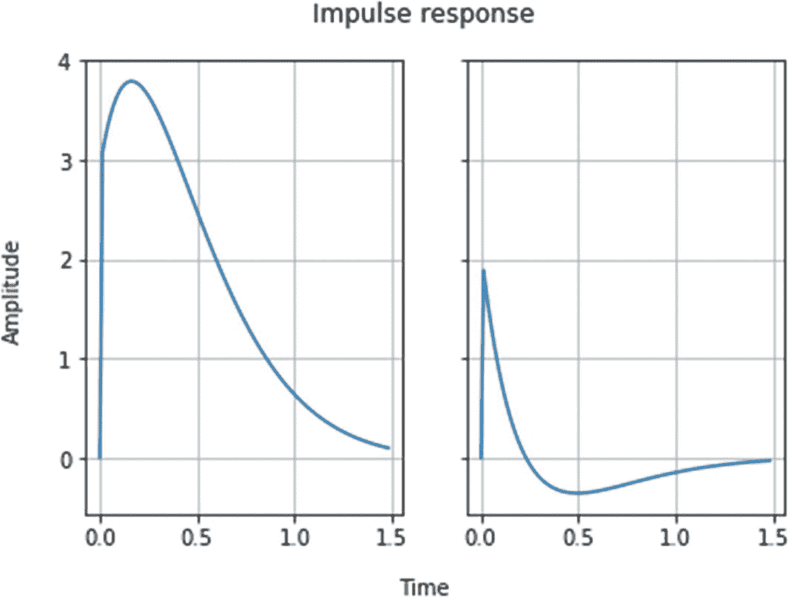

图 11-29

脉冲响应 (1)

离散时间对象的绘图会自动以阶梯图形式呈现。

```
G4_d = discretize(G4, 0.1, method="zoh")
impulse_response_plot(G4_d)
(参见图 11-30)
```

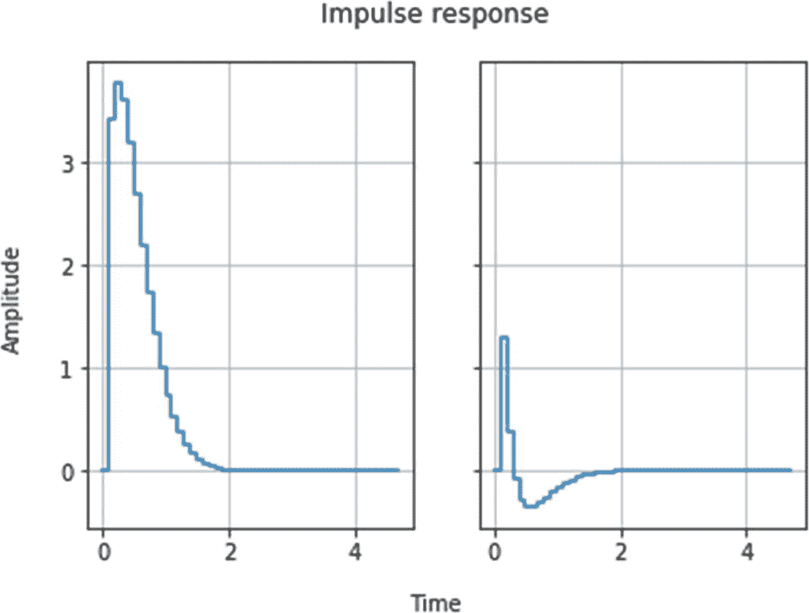

图 11-30

脉冲响应 (2)

```
可以通过可用的关键字更改绘图单位。
bode_plot(G4)
```

(参见图 11-31。)

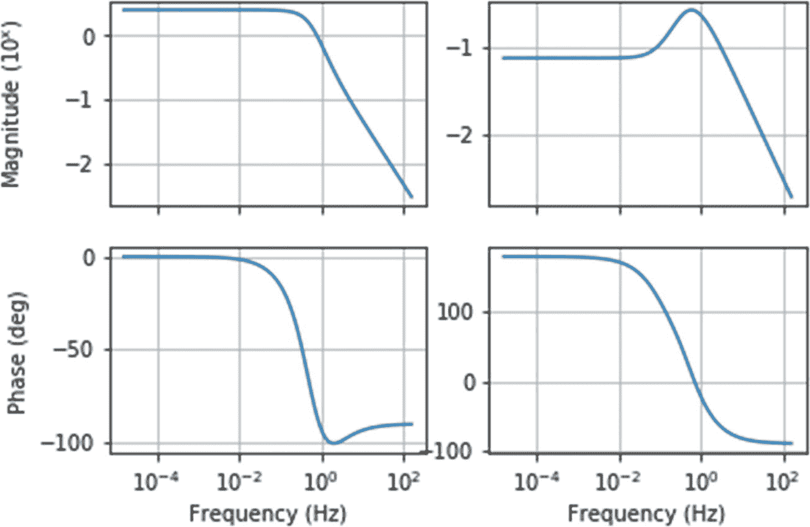

图 11-31

脉冲响应 (3)

```
bode_plot(G4, use_db=True, use_hz=False, use_degree=False)
```

(参见图 11-32。)

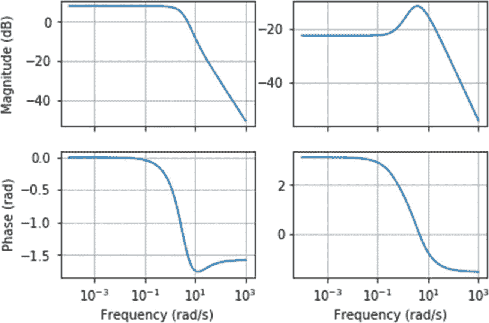

图 11-32

脉冲响应 (4)

```
nyquist_plot(G2);
```

(参见图 11-33。)

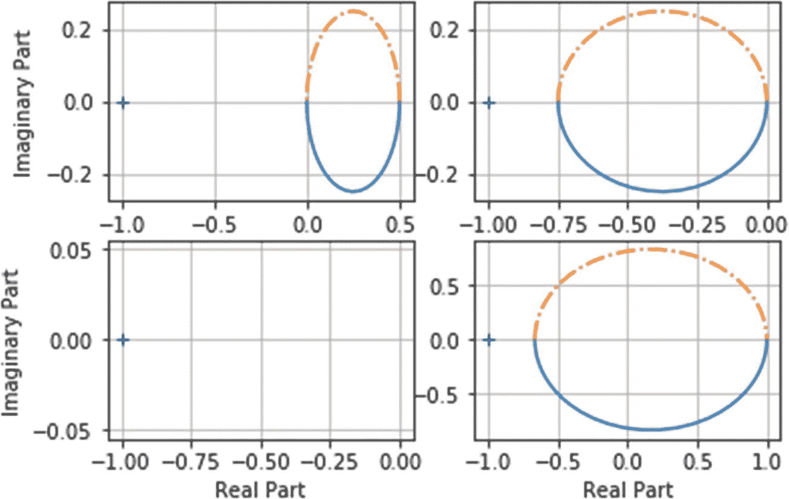

图 11-33

脉冲响应 (5)

## 一个 LQR 示例

为了向你展示你能做什么，我将引导你完成一个针对倒立摆的 LQR 示例：用于控制器设计的状态空间方法。

你的结果如图 11-34 所示。

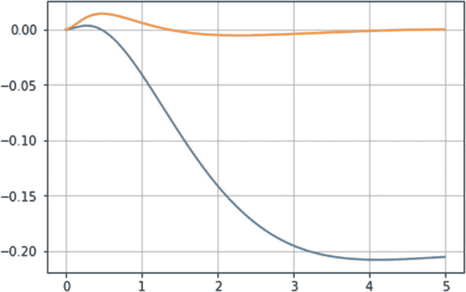

图 11-34

卡尔曼控制增益

现在，增加位置状态上的权重。

你的结果如图 11-35 所示。

新的控制器增益：[[-70.71067812 -37.83445399 105.52978192 20.92384375]]

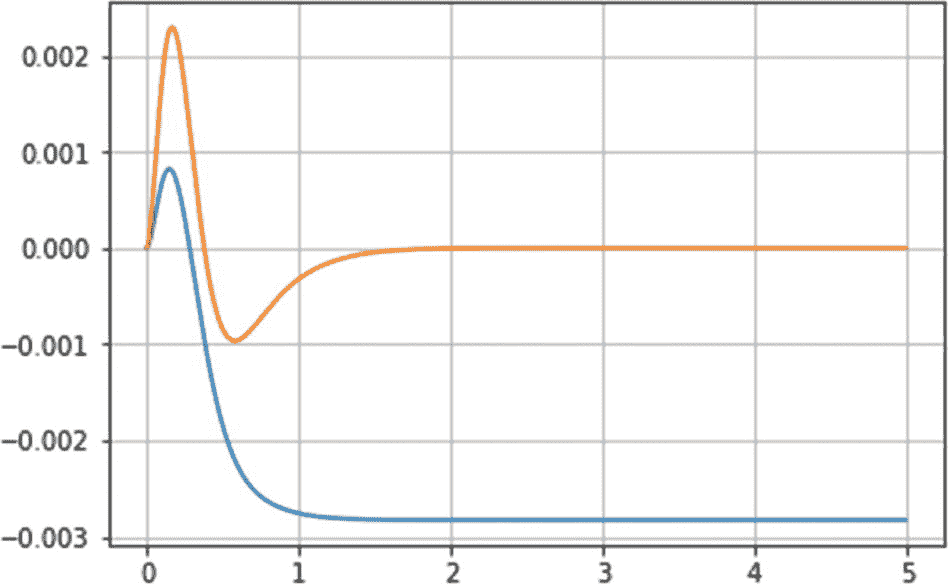

图 11-35

新的控制器增益

### 现代控制理论

现代控制理论在状态空间中进行，能够处理多输入多输出（MIMO）系统。

弹性控制系统将传统上仅关注计划内不稳定的范畴扩展到框架层面，并试图处理多种类型的意外干扰；具体而言，是控制系统针对恶意行为者、非典型故障模式以及不良人为行为所采取的特定、自适应和变形活动。

进化计算是一类受遗传进化启发的全局优化算法，也是人工智能和计算学习在这些系统上的一个子领域。它们是一类基于种群的试错问题求解器，具有元启发式或随机优化的特性。

## 主动干扰者

现代机器学习的进化特性正在悄无声息但高效地干扰着某些特定的人类不良活动。


### 会计服务

在云会计平台中，机器学习系统已在后台运行。会计技术公司正应用机器学习原理，来应对许多不精通会计的小企业主在将交易编码到正确的会计科目表代码等领域所面临的挑战。每当会计师纠正客户文件中的错误时，机器学习系统就会得到训练，此后将自动检测并纠正这些会计错误。

当小企业着手执行、创建下一张发票时，系统会自动推荐会计科目代码，以避免客户错误地重复犯同样的错误。这为会计师节省了清理这些不良错误的宝贵时间。

随着机器学习正在取代人工会计流程，避免报告、重复付款或不可接受的发票中代价高昂的错误，会计领域的许多工作已经看到了变革。

基于人工智能的系统正在减少律师和贷款官员用于评估金融行业协议的时间。大公司已经安装了自然语言处理软件，用于筛选数万份商业贷款协议，将整理这些协议所需的时间从数十万小时减少到几秒钟。

我见过初创公司要求机器学习提供创新方法来打击网络犯罪和恶意黑客，因为它们不再雇佣人员来保护自己免受这些攻击。这创造了一个领域，在这个领域里，小型、高度专业化的参与者可以通过简单地使用这些人工智能系统，与大型公司在平等的基础上竞争。这些系统的另一个优势是，人工智能的分布式特性意味着，一旦人工智能找出如何破坏不受欢迎的攻击，它就能立即将这一知识传播给所有关联客户。

### 基于用户的保险

在 Progressive 公司购买车险的司机可以选择安装一个公司提供的远程信息处理设备，该设备根据他们超速和急刹车（分心或跟车过近的标志）的频率，来衡量他们发生事故的风险程度。安全驾驶的司机可以获得保费折扣。

### 减少事故

车队开始采用一种机器学习辅助的方法来识别高风险驾驶员，称为预测性或规范性分析。这些算法利用驾驶员行为记录以及各种人口统计和行业数据，来预测他们在未来 12 个月内发生碰撞的概率。一旦识别出风险最高的驾驶员，车队就可以通过额外的培训和指导来纠正他们的不良驾驶行为。

实时维修估价即将成为现实。许多保险公司正在试验基于机器学习的技术，帮助发生事故的驾驶员通过智能手机摄像头拍摄车辆损坏照片，从而获得实时维修估价。该应用程序是基于数千张损坏车辆图像及其维修成本数据构建的。

### 预测性维护

基于历史数据，已经开发出能够预测汽车零部件或系统何时可能发生故障，并在这些故障发生前建议更换的程序。

一个能够将借款人从申请带到成交的人工智能抵押贷款聊天机器人，现在正在完成 200 多名呼叫中心员工的工作。

支持人工智能的可穿戴设备可以帮助医疗专业人员在医院病房或家中监测患者。该可穿戴设备可捕获血氧饱和度、呼吸频率、脉搏率、体温、运动和姿势。机器学习还可以与环境中的其他设备交互：血压袖带、体重秤，以及通过无针智能贴片实现的血糖监测仪，从而实现对患者的全天候监测。

一个在人工智能帮助下开发的数学公式，已能正确确定给器官移植患者服用的免疫抑制药物的合适剂量。

医疗行业管理着成本高昂的后台问题和低效环节。与患者护理无关的活动消耗了护士超过一半（51%）的工作量，以及医生近五分之一（16%）的活动。基于人工智能的技术，如语音转文字转录，可以改善行政工作流程，并消除耗时的非患者护理活动，例如撰写病历记录、开处方和安排检查。我们估计，这些应用每年可为该行业节省 180 亿美元。

有一种人工智能算法已被证明在识别皮肤癌方面具有优于 21 名皮肤科医生的能力。

然而，数据管理不善仍然是人工智能临床应用的主要障碍。要改善人工智能未来所依赖的数据，仍有大量繁重的工作要做。我们需要打破数据孤岛，使其能够被轻松访问、查询和分析。利用人工智能正确识别、分类和共享信息，将为未来突破性的分析奠定基础。

## 3D 打印

3D 打印的新技术正在制造定制机器和工具的能力方面取得重大进展，以协助工业机器学习通过创造自己的定制工具来颠覆其周围的世界。

它也在颠覆工业界使用的传统制造工艺。

现在，原型可以在数小时内创建，并在数天内进行测试，从而将反馈信息输入 3D 打印过程，以改进工具，使其更好地适应其用途，从而获得更有效、更高效的解决方案。

将 3D 打印引入机器学习解决方案，使得机器学习算法能够赋能“人在回路中”，通过由机器学习算法预测创建的机器人增强功能来改变生态系统。

原则上，你可以按需制造任何商业物品，这将使得在产品售出之前，库存和投资几乎为零。你的机器学习可以并行地建议消费者购买那些只有在通过系统付款后才计划发布的产品。

这种商业模式现在正使小企业能够在工业化机器学习的帮助下，与它们正在颠覆的传统行业领导者竞争。

## 机器人技术

由工业化机器学习与机器人技术结合创造的人工智能辅助机器人技术，与外科医生单独操作相比，使手术并发症减少了五倍。当正确应用于骨科手术时，我们的分析发现，人工智能辅助的机器人手术还可以使患者术后住院时间减少 21%，这是因为并发症和错误更少，并且每年可创造 400 亿美元的节省。

我将在本书的后续部分详细讨论这一领域。


## 练习数学

我想与你一起探讨以下实用数学知识，因为我发现许多商业解决方案中，最简单的公式就能改变机器学习算法的执行速度。

你已经使用过一个名为 SymPy 的强大库（[`www.sympy.org`](http://www.sympy.org)），我们在第 4 章末尾使用过它。

其核心原因是 SymPy 是一个用于符号数学的 Python 库。它的目标是成为一个功能完备的计算机代数系统（CAS）。这意味着，如果你正确地编写程序流程，它就能执行数学运算。

我个人认为这个 CAS 系统是简化数学和公式的绝佳工具。它还创建了一个生态系统，让你能够证明公式在数学和统计学上是合理的。

从示例目录第 11 章加载名为 `Chapter-011-24-Solve-Math-01.ipynb` 的 Jupyter notebook。

该 notebook 求解了以下方程。

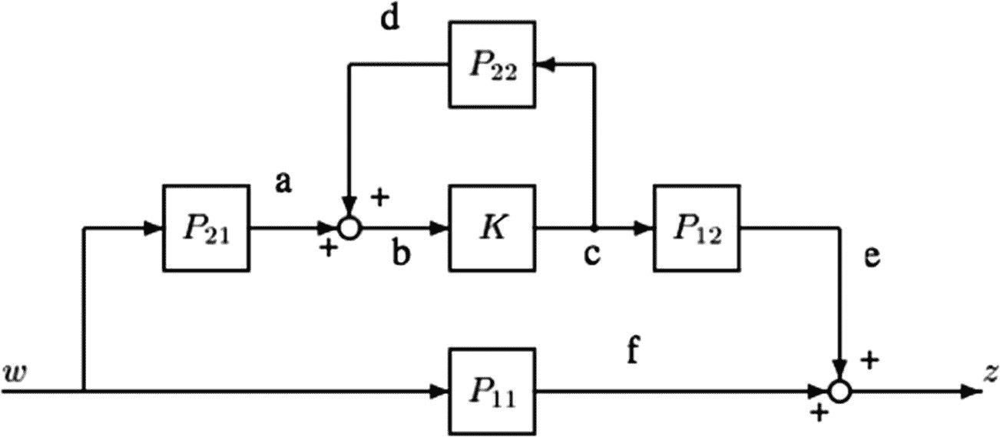

以下是基本流程：

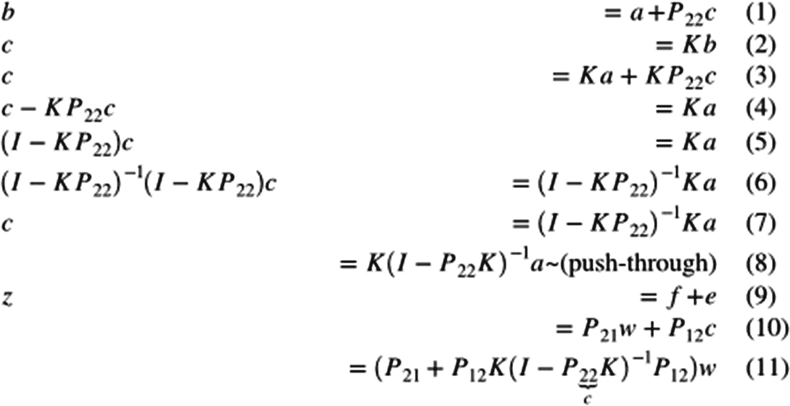

我将向你展示这些知识的另一个用途：

从示例目录第 11 章加载名为 `Chapter-011-25-Solve-Math-02.ipynb` 的 Jupyter notebook。

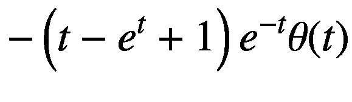

```
import matplotlib
matplotlib.use('TkAgg')
%matplotlib inline
from matplotlib import pyplot as plt
import sympy
import numpy
import mpmath
sympy.init_printing()
x = sympy.var('x')
expression = sympy.expand((x + 1)*(x + 2)*(x + 3))
print(sympy.solve(expression))
[-3, -2, -1]
s, t = sympy.var('s, t')
G = 1/(s + 1)**2
u = 1/s
gt = sympy.inverse_laplace_transform(G*u, s, t)
print(gt)
gt
-(t - exp(t) + 1)*exp(-t)*Heaviside(t)
```

```
sympy.plot(gt, (t, 0, 10))
plt.show() (图 11-36)
```

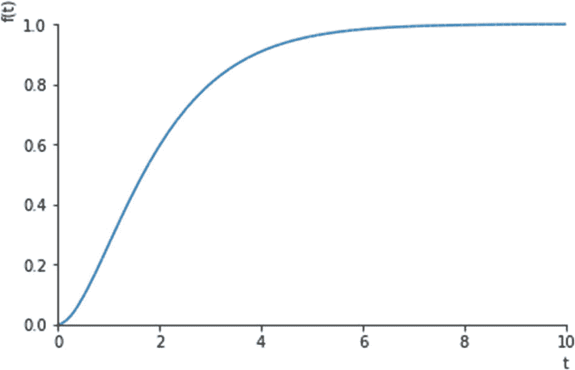

图 11-36

逆拉普拉斯变换

```
Gfunc = sympy.lambdify(s, G)
omega = numpy.logspace(-1, 2)
Gomega = Gfunc(1j*omega)
plt.loglog(omega, abs(Gomega))
plt.show() (图 11-37)
```

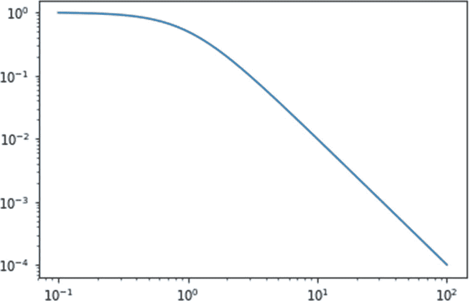

图 11-37

G-Omega 图

```
mpmath.cplot(Gfunc, [-10, 10], [-10, 10], points=10000)
plt.show()(图 11-38)
```

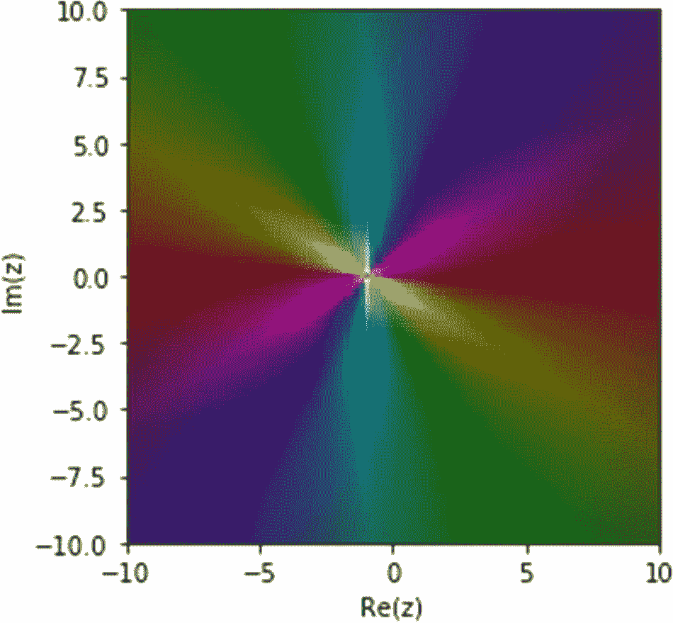

图 11-38

G 图 (1)

```
mpmath.cplot(sympy.lambdify(s, 1/(s**2 + s + 1)), [-5, 5], [-5, 5], points=20000)
plt.show() (图 11-39)
```

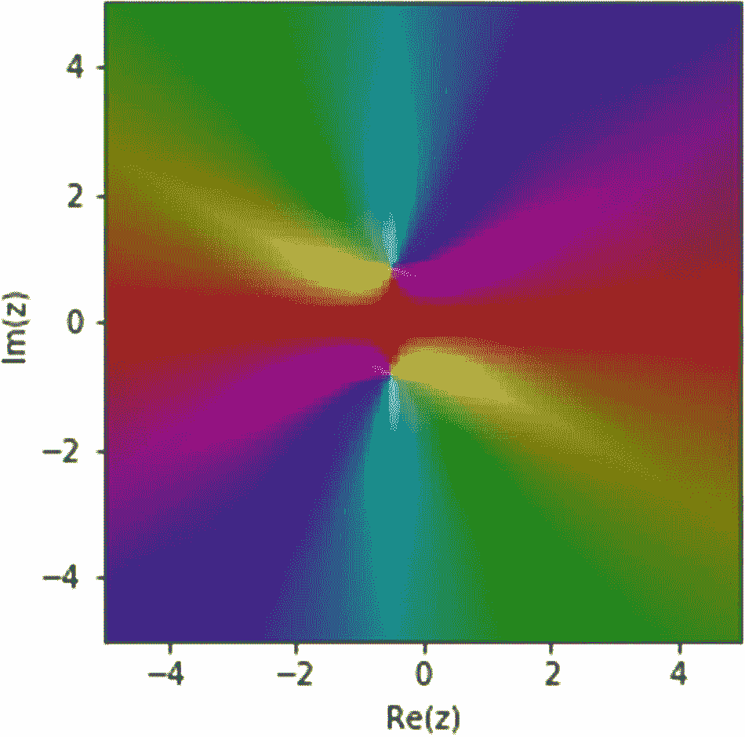

图 11-39

G 图 (2)

```
a = 2
s = 1 + a*1j
s = complex(1, 2)
print(numpy.exp(s))
(-1.1312043837568135+2.4717266720048188j)
print(numpy.exp(1)*complex(numpy.cos(2), numpy.sin(2)))
(-1.1312043837568135+2.4717266720048188j)
s = sympy.var('s')
t = sympy.var('t')
s, t = sympy.var('s t')
f = sympy.inverse_laplace_transform(1/(s**2 + s + 1), s, t)
sympy.plot(f, (t, 0, 10))
plt.show() (图 11-40)
```

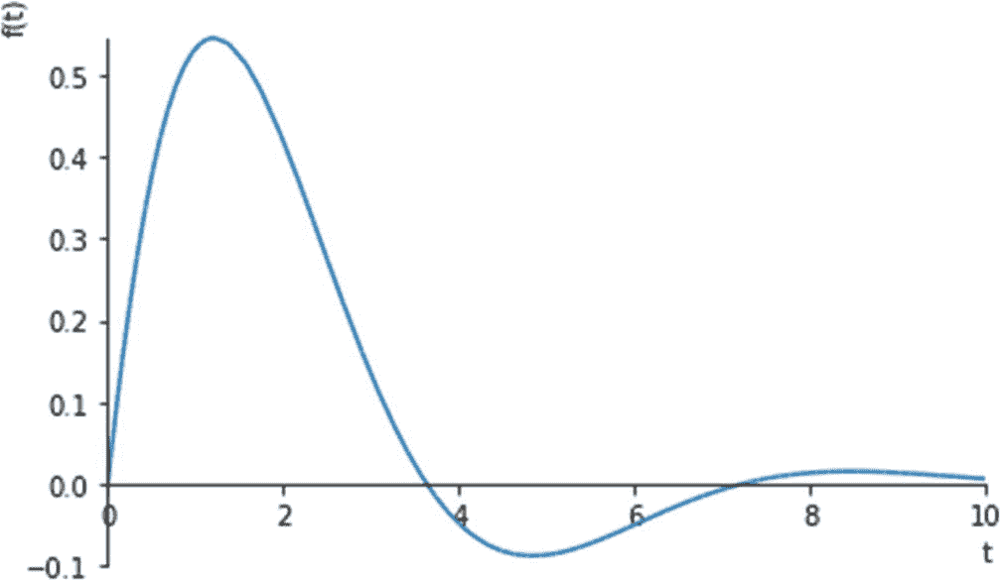

图 11-40

逆拉普拉斯变换

```
omega = numpy.logspace(-2, 2)
s = 1j*omega
Gw = 1/(s**2 + s + 1)
plt.loglog(abs(Gw))
plt.show() (图 11-41)
```

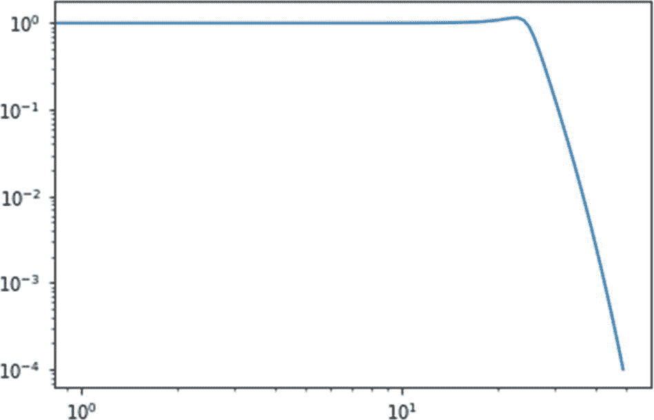

图 11-41

对数空间图

```
plt.semilogx(numpy.angle(Gw))
plt.show() (图 11-42)
```

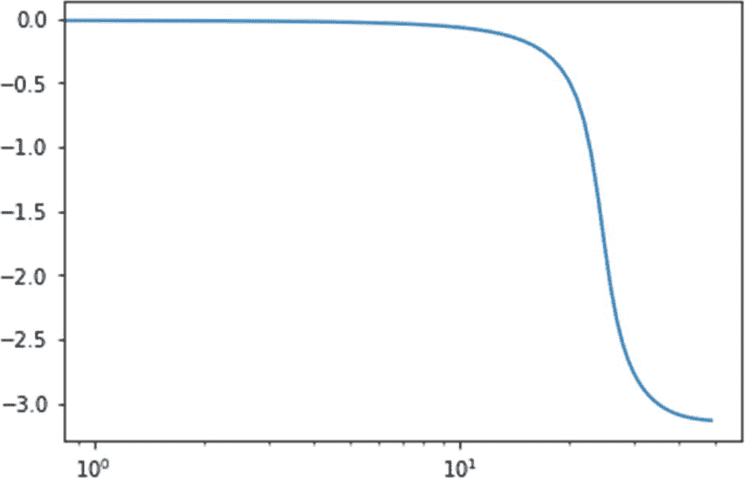

图 11-42

半对数图

```
def plotvector(x, color="blue"):
plt.plot([0, x[0,0]], [0, x[1,0]], color=color)
A = numpy.matrix([[1, 2], [4, 5]])
def vectdemo(theta):
x = numpy.matrix([[numpy.cos(theta)],
[numpy.sin(theta)]])
y = A*x
#print(x)
plotvector(x)
plotvector(y, color="red")
plt.axis([-10, 10, -10, 10])
plt.axhline(0, color="black")
plt.axvline(0, color="black")
for theta in numpy.linspace(0, 2*numpy.pi):
vectdemo(theta);
plt.axis('equal');
plt.show() (图 11-43)
```

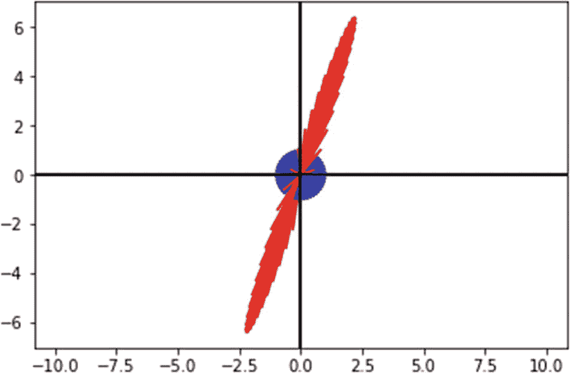

图 11-43

Theta 图

我将引导你完成一个处理太阳黑子的实际解决方案，向你展示如何应用本章所学到的理论与实践知识。

从示例目录第 11 章加载名为 `Chapter-011-26-Sunspot-01.ipynb` 的 Jupyter notebook。

```
import matplotlib
matplotlib.use('TkAgg')
%matplotlib inline
import pandas as pd
import matplotlib.pyplot as plt
import numpy as np
def movingaverage(interval, window_size):
window = np.ones(int(window_size))/float(window_size)
return np.convolve(interval, window, 'same')
data = pd.read_csv('../../data/sunspots.csv', header=None)
#print(data.shape)
data.columns = ['year', 'spots']
x = data['year']
xm = x.min()
y = data['spots']
mn = int(y.min()) - 10
mx = int(y.max()) + 10
plt.plot(y, "k.")
xlabelstr="自 " + str(xm) + " 以来的月份数"
y_av = movingaverage(y, 10)
plt.plot(y_av,"r")
plt.xlim(mn,mx)
plt.xlabel(xlabelstr)
plt.ylabel("太阳黑子数量")
plt.show() (图 11-44)
```

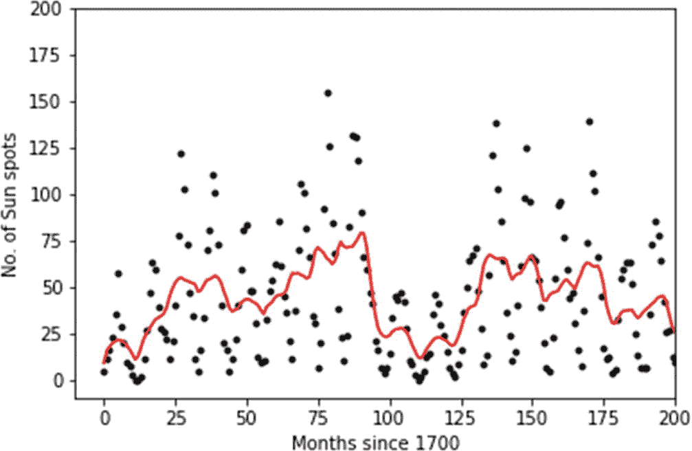

图 11-44

每年太阳黑子数量

## 你应该了解什么？

### 机电一体化

要理解机电一体化是一个庞大的领域（图 11-45）。


图 11-45

机电一体化

我个人将其简化为以下四个组成部分（图 11-46）。


图 11-46

简化的组成部分

### 数据科学

这整合了你执行工业化机器学习所需的技能和知识。

你所需的整体技能来自以下三个领域。

#### 数学与统计学

你需要具备在机器学习中进行计算的知识。这项技能是核心要求。

#### 技术

你需要具备处理多样化技术的能力，从物联网设备中的嵌入式机器学习到云端的大规模并行处理，以准备你的机器学习。你需要了解机器人如何工作，并知道需要哪些通信渠道。

#### 商业策略

你需要了解客户的业务。没有这种洞察力，你就无法执行工业化机器学习。你需要推销你的机器学习。

你需要产生影响！

## 接下来是什么？

第 12 章全是关于机器人学的。我将利用你在前十一章中积累的所有知识，开始将这些知识应用于如何辅助软硬机器人，将工业化机器学习应用到我们周围的现实世界中。

下一章将让你有能力将机器学习作为颠覆周围世界的力量。


