# 12. 机器人革命

在本章中，你将学习机器人的基本工作原理。我将向你介绍一些商业产品，它们使用机器人工具包，通过软体或硬体机器人的直接动作模型，实现工业化机器学习（IML）。

## 机器人

机器人是一种真实或虚拟的机器，其核心目标是执行人的工作，并且该工作是通过设计或由计算机方法控制的。

### 通用机器学习

通用机器学习，也称为人类水平机器学习或强机器学习，是一种能够像人类一样在其环境中理解和推理的机器学习。

*通用机器学习一直难以实现。*

我预测，认为这些机器人能比人类表现更好的保留意见，将阻碍这项研究，直到我们创造出`人工超级智能`。

### 人工超级智能机器学习

当`人工超级智能`类型的机器人在几乎所有领域（包括科学创造力、普遍智慧和社会技能）都变得比最优秀的人类大脑更聪明时，它们就实现了人工超级智能机器学习。

根据大多数专家的说法，通用人工智能与超级人工智能之间的差距将通过机器学习技术能力的短暂飞跃而产生。由此产生的机器学习将改变现实世界，以改进其自身的学习曲线，从而超越人类。

### 狭义机器学习

狭义机器学习是人类迄今为止唯一真正实现的机器学习形式。这种机器学习擅长执行单一任务，例如玩游戏、提供购买建议、销售预测和天气预报。计算机视觉、自然语言处理目前仍处于狭义机器学习的成熟阶段。

我在本章中讨论的机器学习仅仅是狭义机器学习。因此，我只会介绍那些执行单一活动的单一用途机器人。有两种类型的机器学习机器人……软体机器人和硬体机器人。

## 软体机器人

软体机器人学的概念是构建一个智能体，以一致且可重复的方式代表人类执行特定任务。

机构面临着压力，需要用日益稀缺的资源更加勤奋地工作并取得更好的成果。每天，工作人员都在努力完成无数耗时且需要精确度和速度的专业流程。软体机器人是一种更好的方式。人类容易犯错，并且反复承担相同的工作责任是劳动力中沮丧的根源。

机器学习和机器人技术的融合创造了一个完美的生态系统，帮助人类更有效地利用时间。你应该只在流程中的异常情况或需要人工介入的时刻使用它们。

为了说明我日常组织的内容，我将讨论一个基本的扫描邮件分类流程机器人。

*   首先，你需要从示例目录第 07 章加载以下 Jupyter Notebook：`Chapter-012-01-Soft-Robot-01A.ipynb`

*   处理器通过创建模拟邮局在磁盘上创建一个虚拟邮件系统。

*   此 Notebook 创建一个虚拟邮局模拟，它将作为下一个 Notebook 的基础。

### 提示

如果你愿意，可以通过增加 Notebook 开头的参数来放大模拟。

当前：

```
postcodecnt=2
subpostcodecnt=3
```

这支持：6 个邮局，共 36 个邮件项目

尝试：

*   这支持：25 个邮局，共 625 个邮件项目

*   我现在将向你展示如何创建和执行在虚拟邮局之间分类邮件的软体机器人。

*   其次，你需要从示例目录第 07 章加载 Jupyter Notebook，名为：`Chapter-012-01-Soft-Robot-01B.ipynb`

*   此 Notebook 创建并执行六个软体机器人，每个邮局一个，用于分类邮件。

```
postcodecnt=5
subpostcodecnt=5
```

你已经成功构建了你的第一个软体机器人。

干得好；你现在可以执行简单的流程了。你可以利用在前几章学到的知识来生成机器学习方法，这些方法可以使用训练集来训练机器人预测它应该对任何未来数据执行的操作或必须采取的行动。

### 工业软体机器人

我使用一个工业级平台，通过准备监督学习、无监督学习或强化学习算法的机器学习解决方案来执行我需要的任务。然后将结果移植到 UIPath（`www.uipath.com/`）的工具中（图 12-1）。

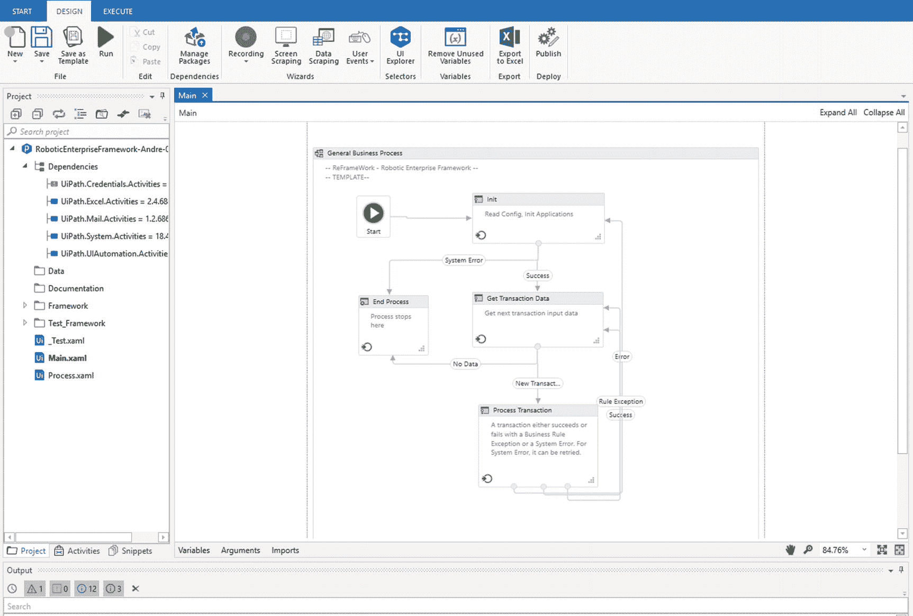

图 12-1

基本 UIPath 工具布局

该工具编排了一个包含众多软体机器人的生态系统，然后这些机器人代表我执行工作。

我的机器人处理我生活中涉及将先前确定的程序和方法重复应用于匹配的传入数据的各个方面。

## 硬体机器人

最新的发展正在创造基于精确古老概念（如折纸）的超强机器人。此外，机器学习过程也在不断发展，具备了与现实世界交互的能力。虽然这些机器人的骨架由传统金属或塑料制成，但突破在于它们被折叠成特定的图案。折纸风格的内部结构赋予了机器人惊人的力量——使其能够举起自身重量 1000 倍的物体。人造纳米纤维肌肉为这些骨架提供动力，以执行伟大的工作任务。

机器人每天都在进化，并且它们将长期存在。

我现在将介绍一些基本的数学概念，这些概念将有助于理解机器人技术。

## 基础三角学

机器人的运动由基础三角学数学驱动（图 12-2）。

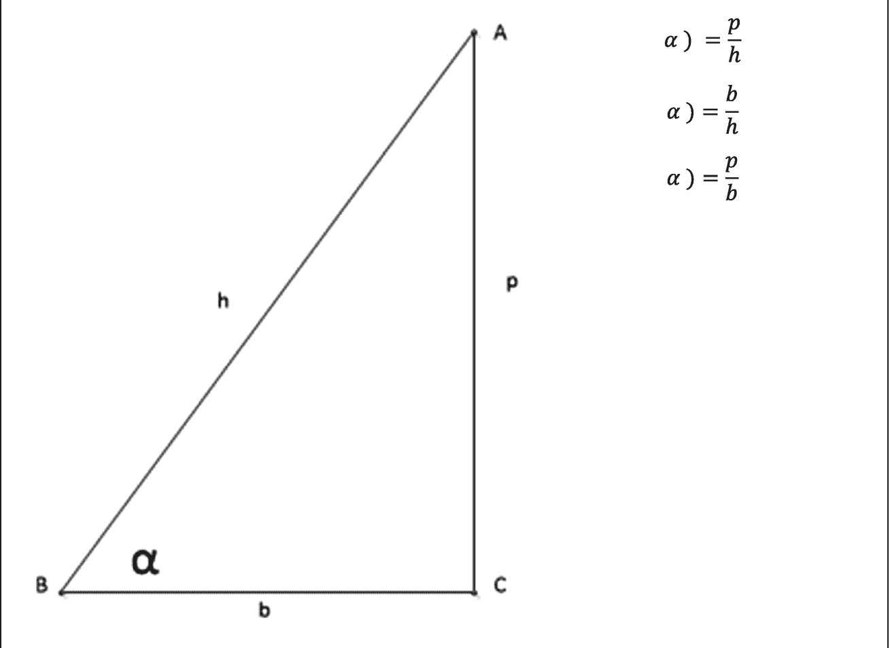

图 12-2

基础三角学

从示例目录第 07 章加载 Jupyter Notebook，名为：`Chapter-012-03-Hard-Robot-01.ipynb`

我将快速向你介绍针对三角学公式的基础数学：

```python
import numpy as np
b=4
p=3
tan_Q1=p/b
print('Tan(Q):', tan_Q1)
Tan(Q): 0.75
Q1r=np.arctan(tan_Q1)
print('Radians:', Q1r)
Radians: 0.6435011087932844
Q1d=np.degrees(Q1r)
print('Degrees:', Q1d)
Degrees: 36.86989764584402
tan_Q2=b/p
print('Tan(Q2):', tan_Q2)
Tan(Q2): 1.3333333333333333
Q2r=np.arctan(tan_Q2)
print('Radians:', Q2r)
Radians: 0.9272952180016122
Q2d=np.degrees(Q2r)
print('Degrees:', Q2d)
Radians: 0.9272952180016122
Q2d=np.degrees(Q2r)
print('Degrees:', Q2d)
Degrees: 53.13010235415598
Q = Q1d + Q2d + 90
print('Test Sum Angles:', Q)
Test Sum Angles: 180.0
h = p / np.sin(Q1r)
print('Length h from length p and angle Q:', h)
Length h from length p and angle Q: 5.0
h= b / np.cos(Q1r)
print('Length h from length b and angle Q:', h)
Length h from length b and angle Q: 5.0
p = h * np.sin(Q1r)
print('Length p from length h and angle Q:', p)
Length p from length h and angle Q: 3.0
b = h * np.cos(Q1r)
print('Length b from length h and angle Q:', b)
Length b from length h and angle Q: 4.0
```

既然你已经理解了基础三角学数学，让我们将这些概念扩展到控制硬体机器人上。

刚体机器人技术是当前最常用的机器人技术类型。

### 基础机器人

图 12-3 是一个基础机器人的示例。

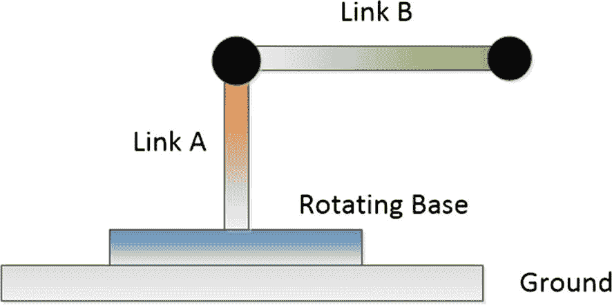

图 12-3

*基础机器人*

从示例目录 Chapter 07 中加载名为 `Chapter-012-04-Hard-Robot-1DOF-01A.ipynb` 的 Jupyter Notebook。

图 12-4 展示了一个基础机器人网格。

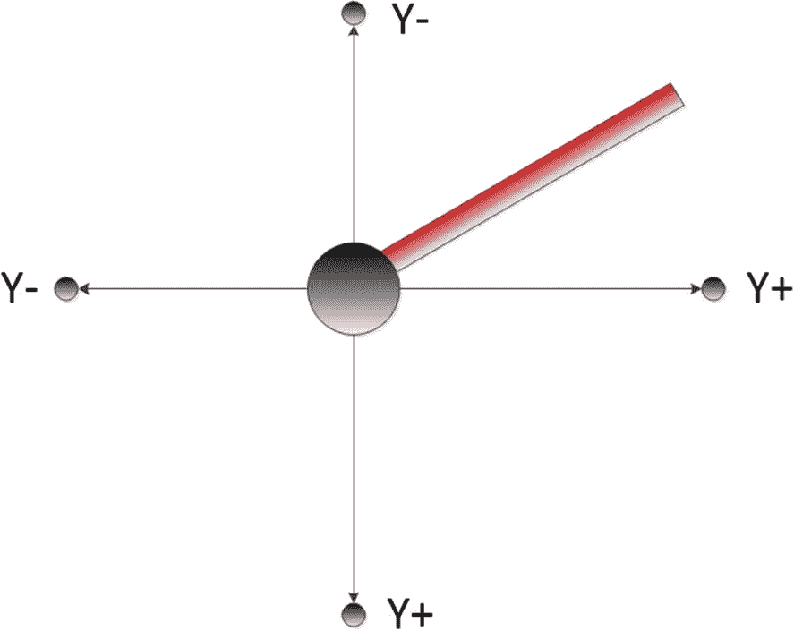

图 12-4

*基础机器人* *网格*

你的结果如图 12-5 所示。

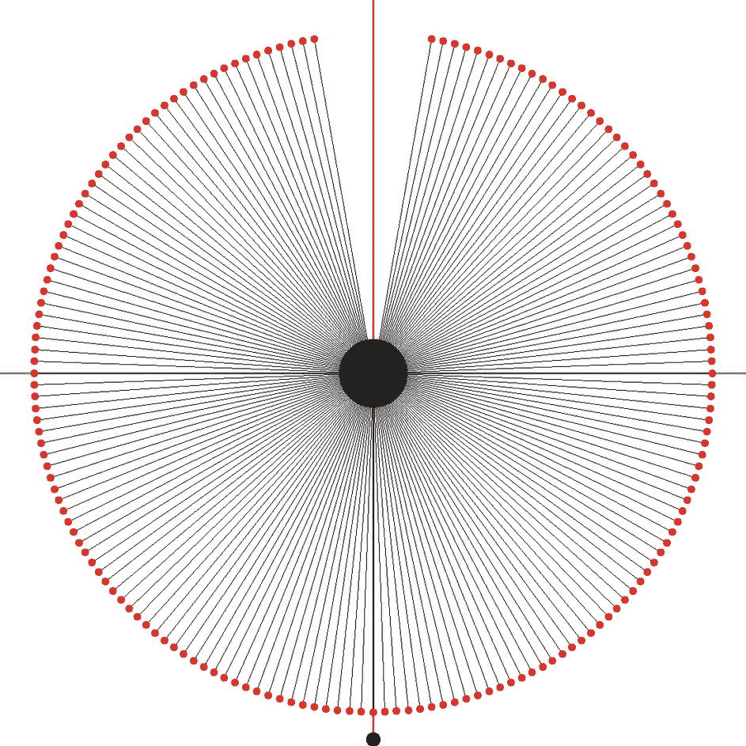

图 12-5

*基础机器人可达范围* *示意图* *(170 度)*

该图清晰地展示了在给定参数下机器人的可达范围。

从示例目录 Chapter 07 中加载名为 `Chapter-012-04-Hard-Robot-1DOF-01B.ipynb` 的 Jupyter Notebook。

与前一个示例的唯一区别在于，可达范围从 170 度变为了 45 度（图 12-6）。由于机器人在环境中自由移动的能力有所下降，其可达范围轮廓也随之缩小。

### 提示

务必研究机器人的可达范围轮廓，因为如果在此阶段出现错误，这将在机器人安装完成后为你节省数小时的重新调整时间。

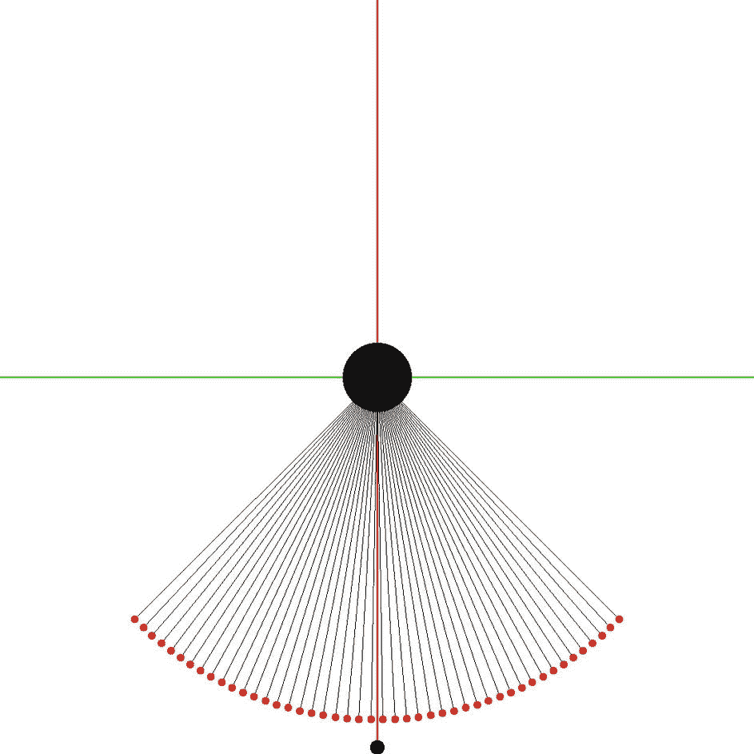

图 12-6：基础机器人可达范围示意图（45 度）

图 12-7 展示了一个带有旋转底座的简单 2 自由度机器人，这是目前最常用的机器人类型。

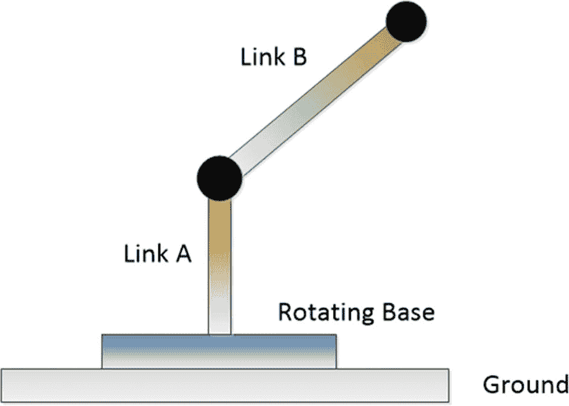

图 12-7：`2自由度机器人`

从示例目录 Chapter 07 中加载名为 `Chapter-012-05-Hard-Robot-2DOF-01A.ipynb` 的 Jupyter Notebook。

你的结果如图 12-8 所示。

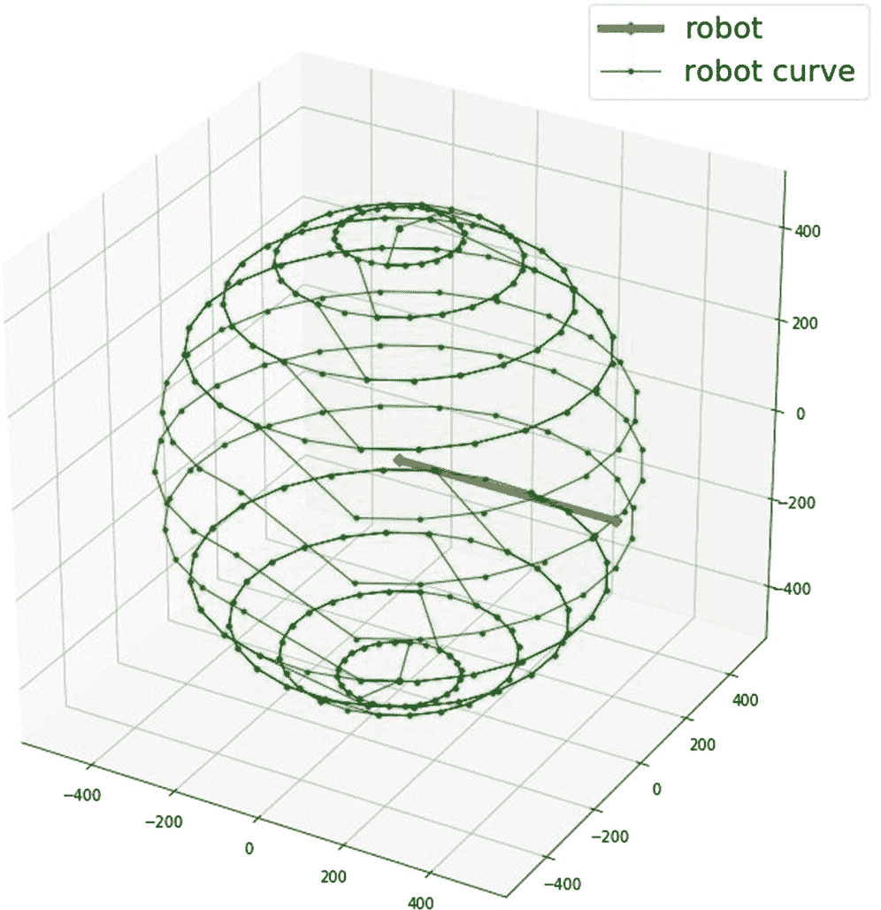

图 12-8：`2自由度机器人可达范围示意图`

从示例目录 Chapter 07 中加载名为 `Chapter-012-05-Hard-Robot-2DOF-01B.ipynb` 的 Jupyter Notebook。

同样，可达范围轮廓缩小了！（见图 12-9。）

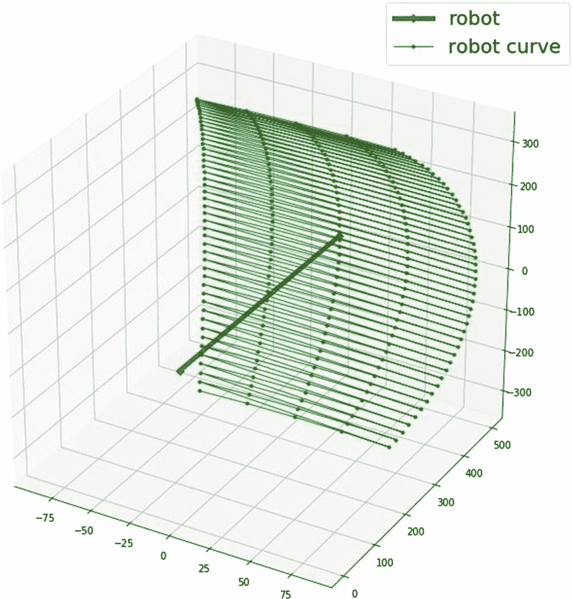

图 12-9：`受限的2自由度机器人可达范围示意图`

### 机器人的路径

机器人的路径是指机器人能够到达的路线或区域。固定式机器人通常只有球形的可达路径，而移动机器人则可能拥有更好的路径，因为它可以将球形的可达能力移动到当前范围之外的物体附近。我将向你展示如何模拟这种能力，使球形可达范围沿直线路径移动，从而增加机器人的可达范围。

从示例目录 Chapter 07 中加载名为 `Chapter-012-06-Hard-Robot-2DOF-Path-01.ipynb` 的 Jupyter Notebook。

该 Notebook 还演示了可达范围轮廓包含路径的情况。这些机器人可以沿着给定的固定路径移动其可达范围轮廓。这使得机器人能更有效、更高效地适应环境变化，但请注意，路径仍然限制了机器人自由移动到任何地方的能力。

### 带履带的机器人

为机器人增加履带为其打开了新世界的大门，因为其可达范围现在几乎不受限制。我将向你展示如何模拟这种能力，以研究你的机器人是否适合执行所需的任务。

从示例目录 Chapter 07 中加载名为 `Chapter-012-07-Hard-Robot-2DOF-Tracks-01.ipynb` 的 Jupyter Notebook。

这个可达范围轮廓确实很棒！（图 12-10。）

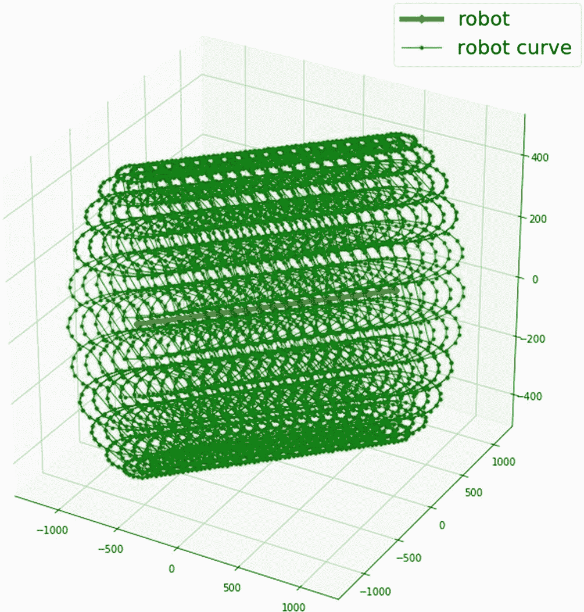

图 12-10：带线性移动的 2 自由度机器人可达范围示意图

既然你现在能够计算机械臂的基本可达范围轮廓，我建议我们研究更复杂的机器人配置。

### 硬机器人的解剖结构

每个机器人的解剖结构都是独一无二的，这为每个机器人创造了一个独特的环境。深入了解每个机器人的能力至关重要。

软机器人的改动通常非常容易，因为它们可以在较短的开发周期内进行更改和重新部署。

然而，硬机器人存在局限性，因为所使用的物理机器人或机器人组不易改变其形状或性能特征。见图 12-11。

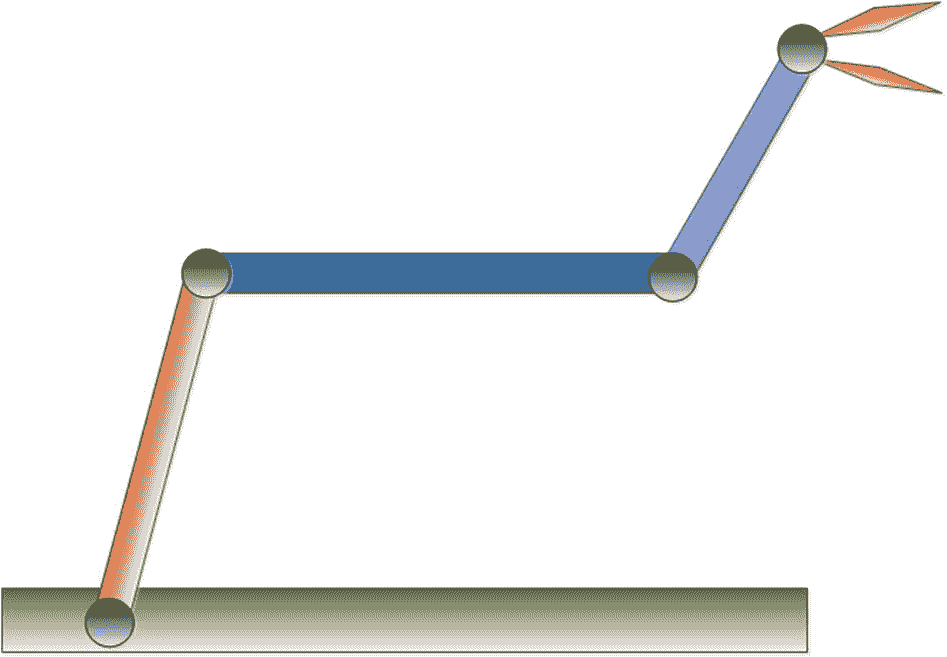

图 12-11：硬机器人的解剖结构

运动学领域是帮助你理解物理环境以及如何通过 IML 与之交互的工具。

## 运动学

运动学是经典力学的一个分支，它定义了点、物体（对象）以及物体系统（对象组）的运动，而不考虑引起运动的力。

机器人可达范围的概念是机器学习在现实世界中成功部署的基本但必要的条件。机器人拥有足够可达范围来执行任务这一简单能力，使得机器学习的结果能够成功实现。可达范围是通过机器人组件设计的运动链所形成的预先批准的路径来实现的。

### 运动链

运动链是由已知固定数量的构件以允许彼此沿预定路径相对运动的方式连接或排列而成的组合。如果构件以特定方式连接导致无法运动，则形成锁定链或结构。

#### 闭式运动链

闭式运动链是指具有多个固定锚点的链。这些多点锚点限制了所有相连构件的运动。见图 12-12。

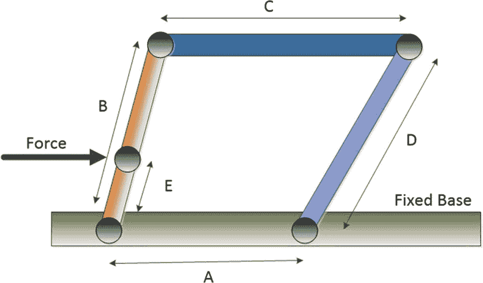

图 12-12：闭式运动链

施加力将导致整个链响应一个固定的预设路径。

当需要确保预定的运动得到保证时，这非常有用。

#### 锁定链或结构

锁定链或结构是一种仅有一个可能位置的运动链。见图 12-13。

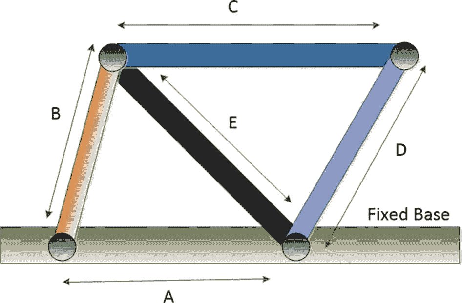

图 12-13：锁定链

当需要为解决方案的其余部分提供一个确定的参考点时，这种结构非常有用。

我发现，通过 3D 打印从机器学习模型创建，可以确保将模型的解决方案转化为一个固定的解决方案。

#### 开式运动链

开式运动链在机器人环境中很常见，因为大多数机器人都是开式运动链的一种形式。见图 12-14。

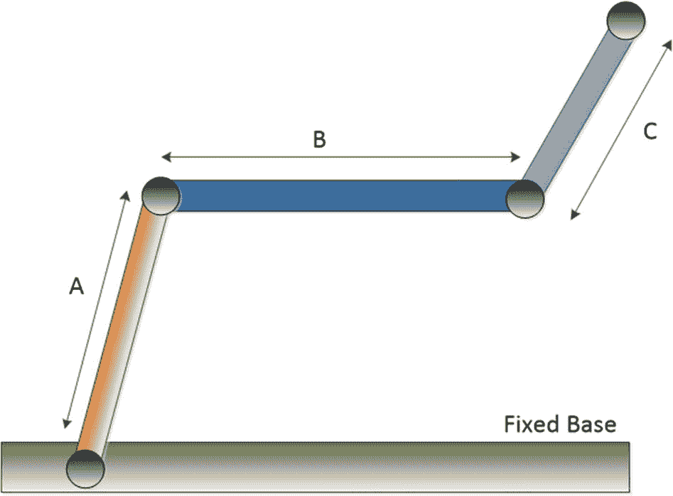

图 12-14：开式运动链

开式运动链通常包含以下部分。

##### 固定点

固定点是不支持任何运动的点，因为它们类似于结构。

任何方向上的任何力都无法改变其在现实世界中的位置。它在 X、Y、Z 参考坐标系中有一个预设的固定点。

这通常是机器人基座与环境连接的部分。任何机器人必须至少有一个固定点才能实现运动能力。

##### 固定旋转点

固定旋转点是无法从 X、Y、Z 参考坐标系中的预设固定点改变自身位置的点。

它可以使与其相连的任何构件通过参考坐标系沿预设的 X、Y、Z 路径运动。

这些是机器人中的典型关节。

##### 非固定旋转点

非固定旋转点是能够沿 X、Y、Z 参考坐标系中预设的固定路径改变自身位置的点。

它们可以使与其相连的任何构件通过参考坐标系沿预设的固定 X、Y、Z 路径运动。

这些是机器人中的典型关节。

##### 端点

端点是现实世界接触的点，并且能够沿 X、Y、Z 参考坐标系中预设的固定路径改变自身位置。见图 12-15。

这些通常是执行诸如拾取和放置物体等任务的工具。

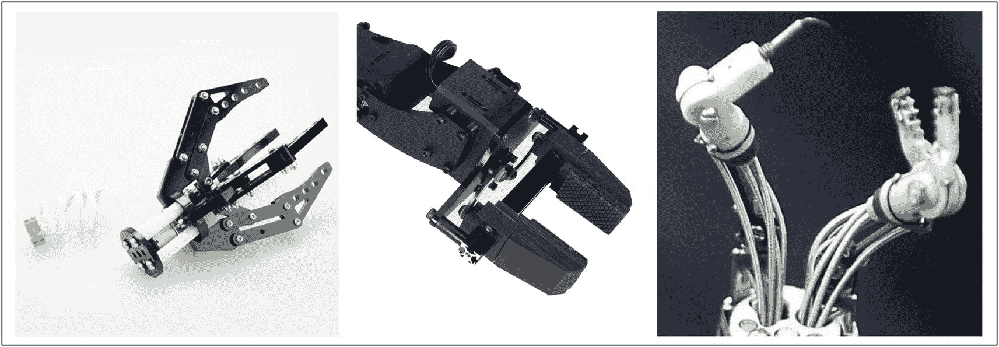

图 12-15：端点

这些端点可以是简单的夹爪，但通常是非常精密的工具，需要复杂的机器学习才能实现高效且有效的结果。

#### 自由度 (DOF)

运动链的自由度是根据构件数量以及关节的数量和类型，使用运动链的`自由度公式`计算得出的。

### 逆运动学

利用逆运动学，您可以计算机器人的设置，以在现实世界网格系统中达到给定的目标或位置。见图 12-16。

我将从一个简单的双臂机器人开始解释这个概念。

从示例目录 Chapter 07 加载名为 `Chapter-012-08-Inverse-kinematics -2DOF-01.ipynb` 的 Jupyter Notebook。

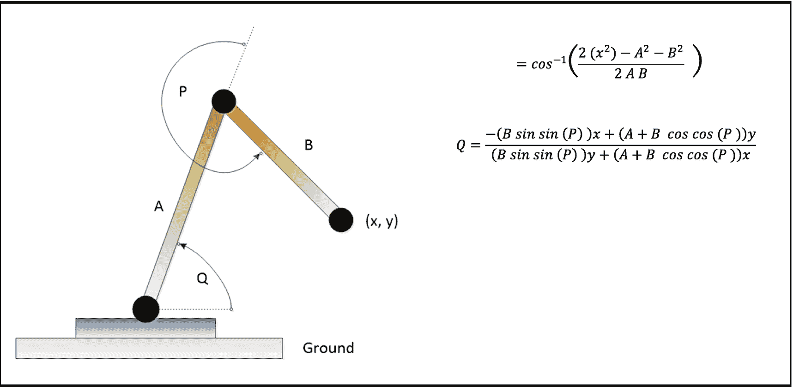

图 12-16：逆运动学

该 Notebook 展示了如何计算达到可达范围内给定点所需的设置（图 12-17）。

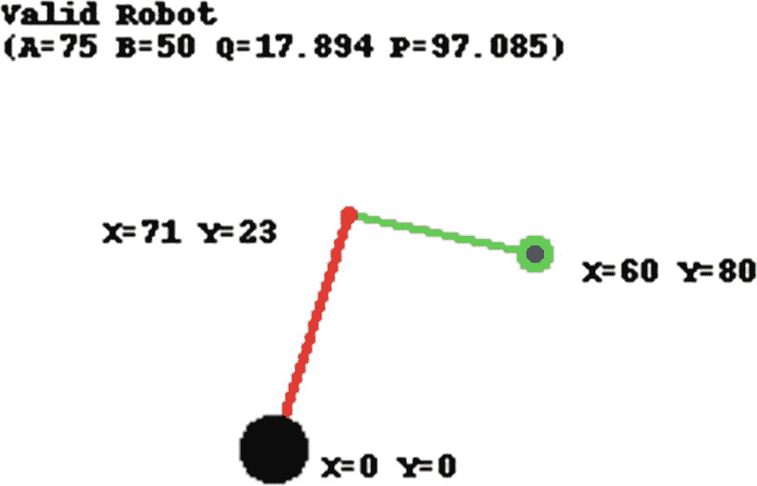
图 12-17 逆运动学图 (1)

从示例目录 `Chapter 07` 加载名为 `Chapter-012-09-Inverse-kinematics -2DOF-02.ipynb` 的 Jupyter Notebook。
```
x=float(130)
```
见图 12-18。

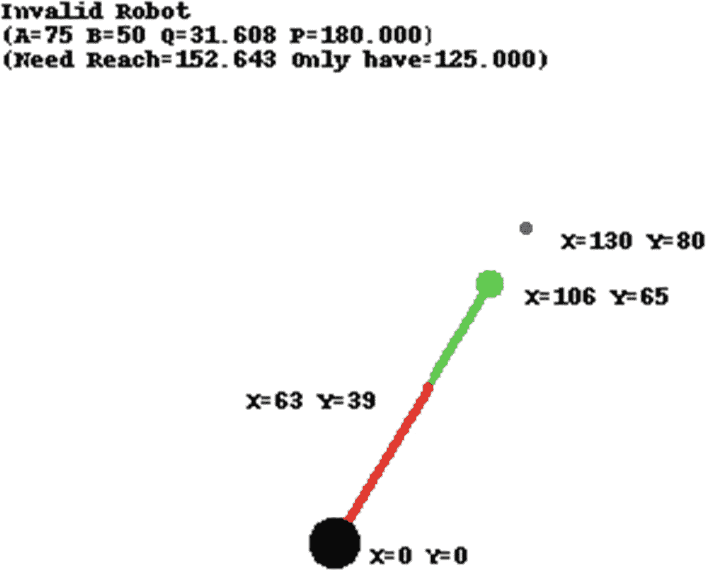
图 12-18 逆运动学图 (2)

从示例目录 `Chapter 07` 加载名为 `Chapter-012-10-Inverse-kinematics -2DOF-03.ipynb` 的 Jupyter Notebook。
```
x=float(60)
y=float(20)
```
见图 12-19。

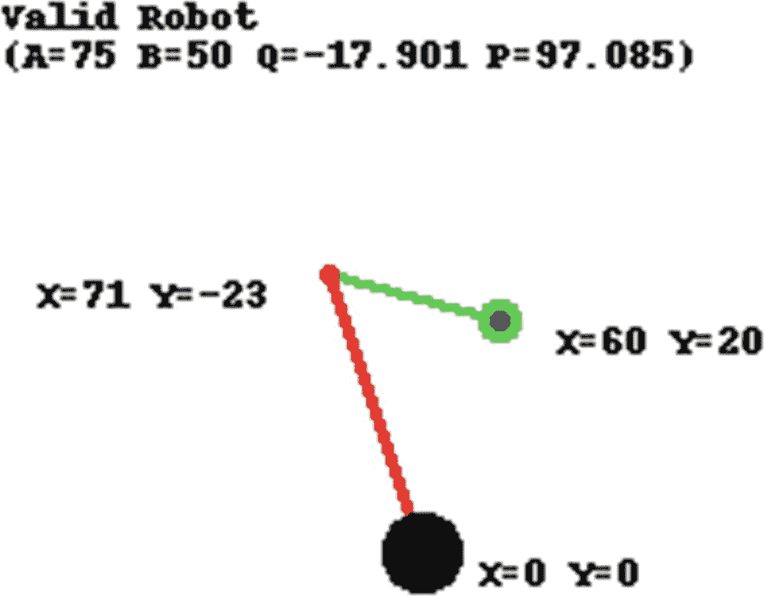
图 12-19 逆运动学图 (3)

从示例目录 `Chapter 07` 加载名为 `Chapter-012-11-Inverse-kinematics -2DOF-04.ipynb` 的 Jupyter Notebook。
```
x=float(-20)
y=float(50)
A=float(50)
B=float(50)
```
见图 12-20。

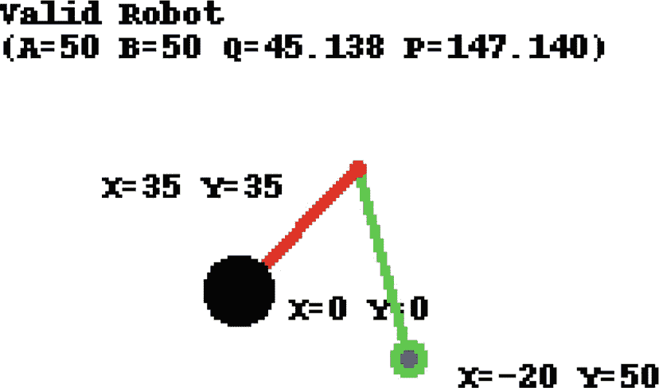
图 12-20 逆运动学图 (4)

## 微分运动学

微分运动学的示例见图 12-21。

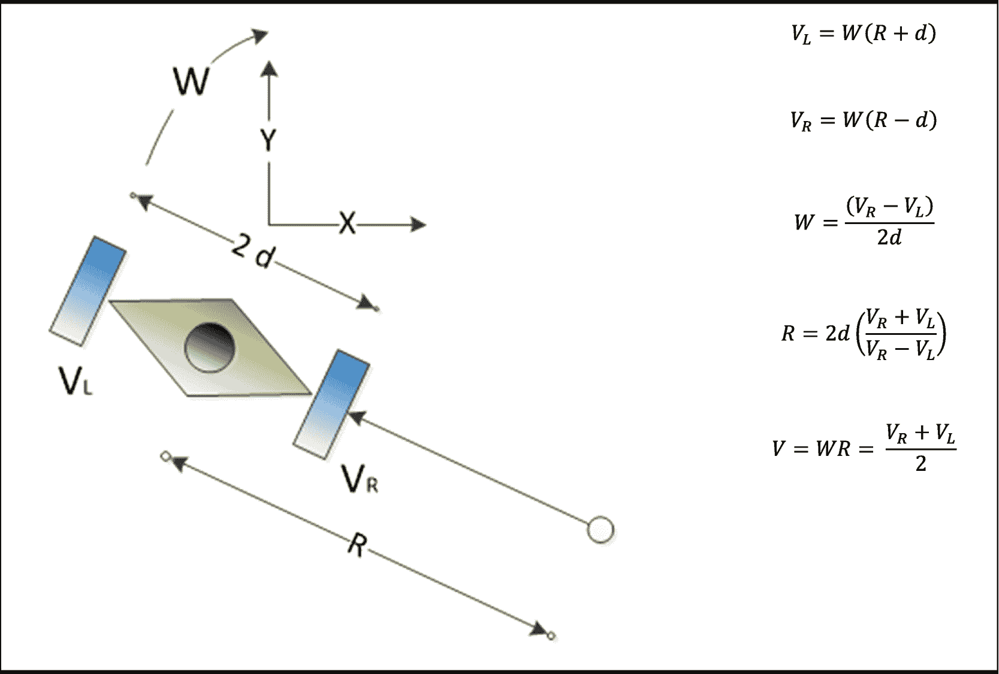
图 12-21 微分运动学

从示例目录 `Chapter 07` 中加载 Jupyter Notebook，文件名为：`Chapter-012-12-Differential-kinematics-01.ipynb`。该 Notebook 演示了如何计算机器人的微分运动学。见图 12-22。

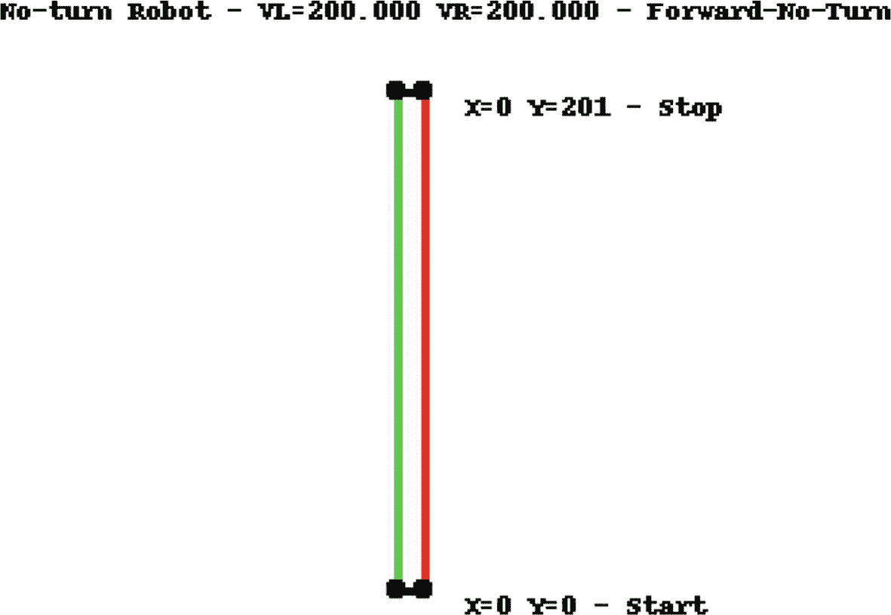
图 12-22 微分运动学 (1)

从示例目录 `Chapter 07` 中加载 Jupyter Notebook，文件名为：`Chapter-012-13-Differential-kinematics-02.ipynb`。
```
T=1
```
见图 12-23。

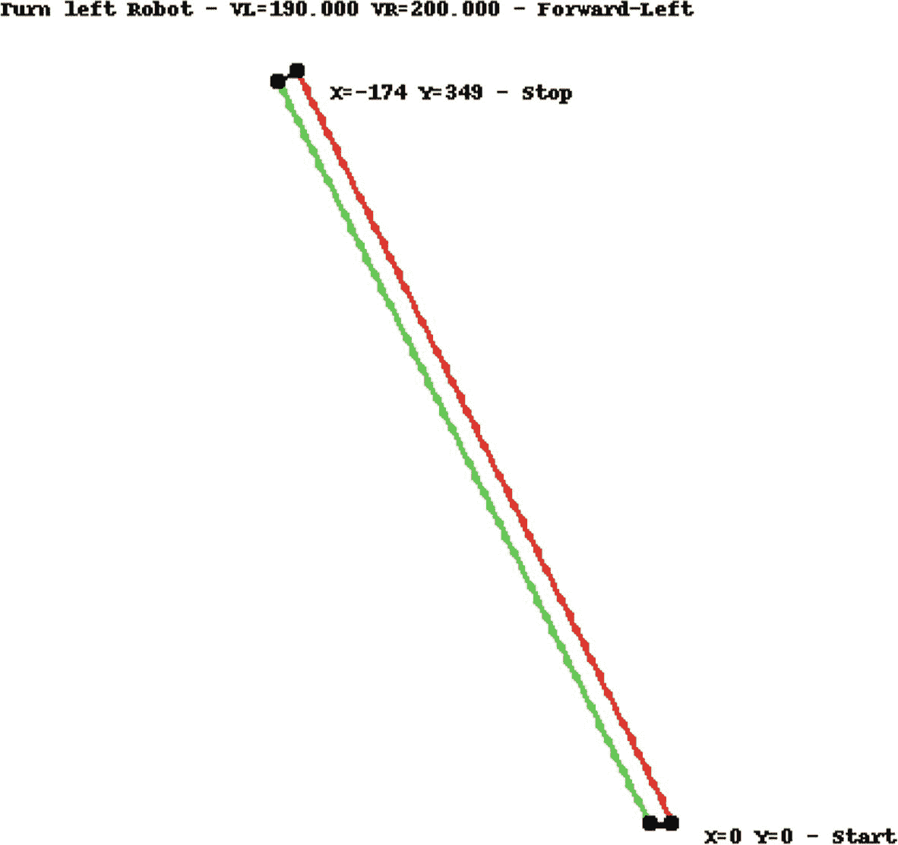
图 12-23 微分运动学 (2)

从示例目录 `Chapter 07` 中加载 Jupyter Notebook，文件名为：`Chapter-012-14-Differential-kinematics-03.ipynb`。
```
T=2
```
见图 12-24。

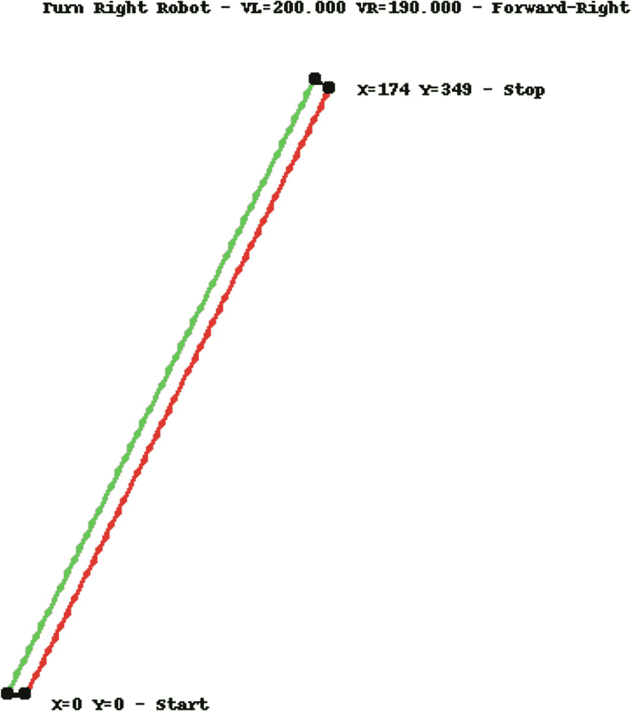
图 12-24 微分运动学 (3)

从示例目录 `Chapter 07` 中加载 Jupyter Notebook，文件名为：`Chapter-012-15-Differential-kinematics-04.ipynb`。
```
T=3
```
见图 12-25。

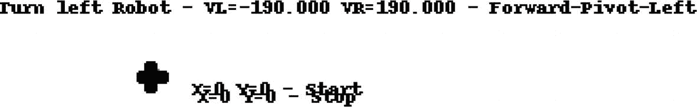
图 12-25 微分运动学 (4)

从示例目录 `Chapter 07` 中加载 Jupyter Notebook，文件名为：`Chapter-012-16-Differential-kinematics-05.ipynb`。
```
T=4
```
见图 12-26。

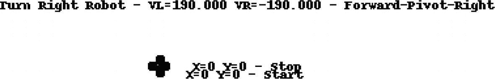
图 12-26 微分运动学 (5)

从示例目录 `Chapter 07` 中加载 Jupyter Notebook，文件名为：`Chapter-012-17-Differential-kinematics-06.ipynb`。
```
T=1
B=0.75
```
见图 12-27。

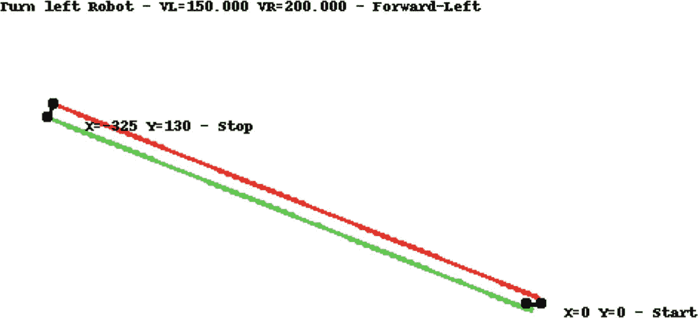
图 12-27 微分运动学 (6)

从示例目录 `Chapter 07` 中加载 Jupyter Notebook，文件名为：`Chapter-012-18-Differential-kinematics-07.ipynb`。
```
B=0.55
```
见图 12-28。

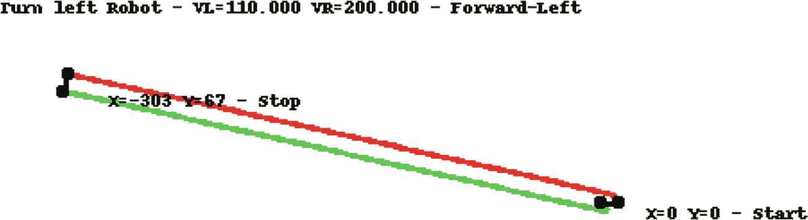
图 12-28 微分运动学 (7)

## 进化机器人学

进化机器人学是一种概念，即机器人能够构建出可适应当前生态系统的机器人，其方式是通过替换或修改机器人的某个部件，因为机器人具有模块化结构。

我将通过演示如何修改机器人以获得更好的可达性，或更精确地说，自适应可达能力，来展示这一趋势。

从示例目录 `Chapter 07` 中加载 Jupyter Notebook，文件名为：`Chapter-012-19-Evolutionary-01.ipynb`。该 Notebook 创建了一个能够适应环境的进化机器人配置（图 12-29）。

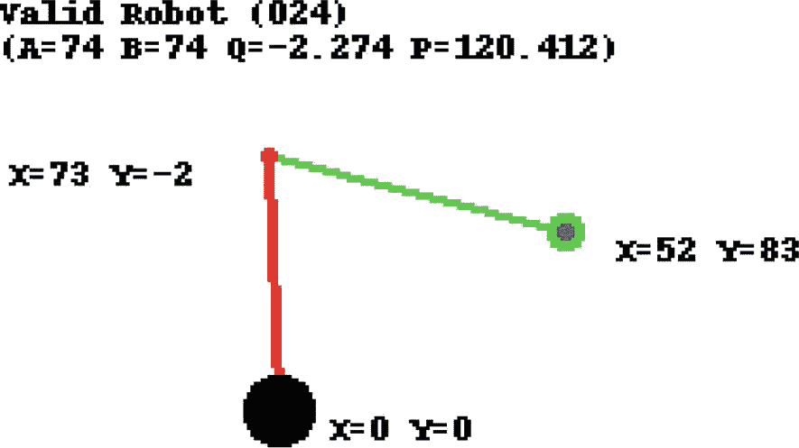
图 12-29 自适应机器人

## 多智能体系统

多智能体机器人是指使用多个机器人协同工作以完成特定任务。这些机器人通常由一个控制系统控制，也被称为机器人集群或工作单元。

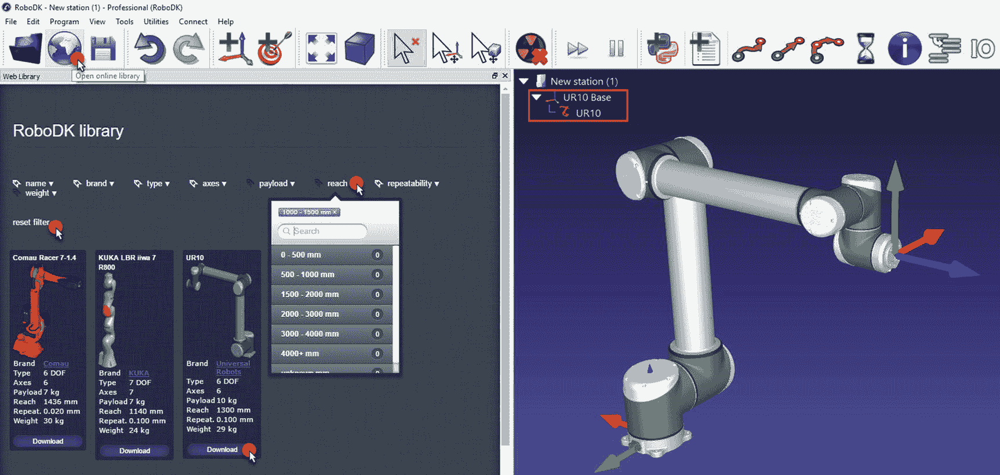
图 12-30 RoboDK 工具

*   有一个好用的工具：[`https://robodk.com/`](https://robodk.com/)
*   我通常用它来模拟多智能体环境。
*   该库（[`https://robodk.com/library`](https://robodk.com/library)）有助于获取工业机器人信息。
*   该工具使您能够为整个多智能体环境创建仿真。
*   利用离线环境（[`https://robodk.com/offline-programming`](https://robodk.com/offline-programming)），您可以使用 Python 知识来模拟一个完整的工业解决方案（图 12-30）。

## 群体机器人学

群体机器人学是一种协调多个机器人的方法，该系统由大量通常结构简单的物理机器人组成。其设计目的是，通过这些机器人之间的交互以及机器人与分配环境之间的交互，涌现出所期望的协作行为。

群体机器人的优势在于单个物理机器人成本低廉。机器人通过简单的指令进行编程，这些指令会被复制数千或数百万次，以支持整个群体应实现的单一动作。

示例：

*   可以编程让一架无人机在两个 GPS 点之间飞行，以在两个点之间运送包裹。
*   当无人机遇到积压时，系统只需用相同的任务指令编程更多无人机。
*   当无人机没有积压时，它们只需返回基地等待重新分配。
*   这就在无需任何复杂调度的情况下，形成了包裹的自然流动。

### 机器人技术在智能仓储中的作用

现代仓库需要将许多不同类型和能力的机器人集群在一起，形成一个由IML支持的集成工业化流程。

机器人从之前与其他机器人的协作中学习到，特定活动只有在其他机器人处于特定的预先约定状态时才能发生。

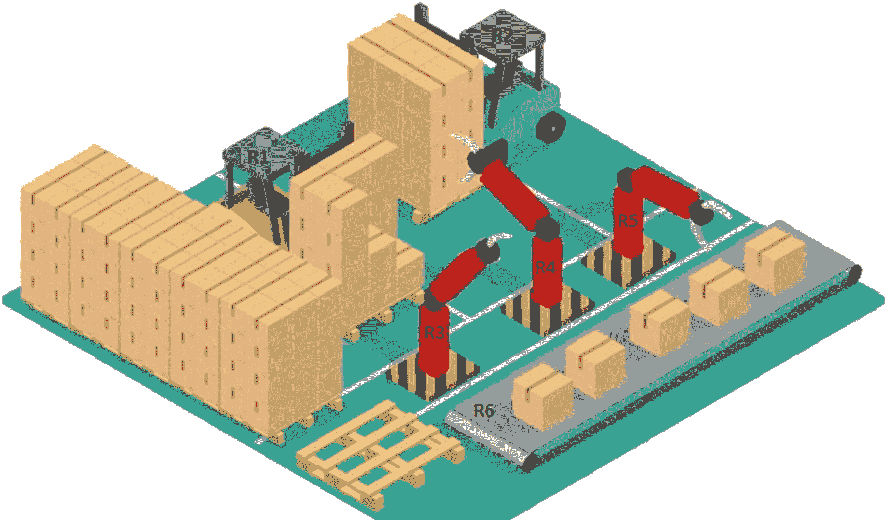
图 12-31
*智能仓储示意图*

机器人`R1`（图 12-31）必须处于较低位置，且其包装架未满，这样机器人`R3`才能向包装架上添加更多包裹。机器人`R3`也只有在`R6`有包裹准备好拾取时，才能在`R6`和`R1`之间移动包裹。同样，机器人`R2`需要避免在`R1`已装载的包装架上继续堆叠。

仓库中所有机器人的同步协作交互确保了最佳性能、有效性和效率的实现。

良好同步的机器人能够：

*   帮助准备待发运的物品
*   能够举升和搬运负载
*   帮助仓库人员满足人员配置需求
*   机器人无人机提供仓库库存视图

## 机器人模拟器

使用机器人模拟器将为您节省数百万因错误和变更而产生的成本。我建议您始终构建机器人之间交互的虚拟模型，并测试机器人的所有可能选项。

像我们在本章前面所做的那样，一个简单的连线图式测试，其成本总是低于实际物理构建机器人。我发现，一个模拟接触点的简单Python程序能够快速找出性能不符合预期的点。

## 什么是 ROS？

机器人操作系统（`ROS`）是一套帮助您构建机器人应用的软件库和工具。其基础发行版包含了从驱动程序到最先进算法的所有内容，同时还支持强大的开发者工具。当我需要一个定制化项目时，我总是首先考虑`ROS`，因为该软件在全球范围内拥有庞大的支持体系，它能确保您的下一个机器人项目取得成功。

```
查看：http://www.ros.org/
```

我通常使用`ROS`标准，因为它能让您将设计轻松地移植到任何支持`ROS`标准的机器人上。（[`http://www.ros.org/core-components/`](http://www.ros.org/core-components/)）

我基于`ROS`完成了核心机器人技术的开发，效果很好。多年来，`ROS`在将我的机器学习成果工业化方面给予了极大的个人帮助。

### 提示

即使是在较小的项目上，也请开始使用`ROS`方法，因为如果您的项目成功，大多数小型机器人最终都会发展成大型机器人。从一开始就投入时间。

## 下一步是什么？

在本章中，我解释了如何利用机器学习和编程，在现实世界的基础上模拟机器人技术。

我介绍了软体机器人，即创建能够为您执行工作的软件代理。我模拟了一个邮件分拣机。

我还介绍了硬体机器人，即您可以物理创建一个代理或机器人，将您的机器学习结果应用到现实世界中。我模拟了多个机器人。

现在，您应该能够使用监督学习或无监督学习来发现所需的预测或结果。然后，您可以使用软体或硬体机器人将这些结果应用到现实世界中。

利用种类繁多的物联网传感器，您可以获得反馈并调整您的机器学习模型。

在本章中，您了解了机器人的基本工作原理；并了解了一些商业产品，这些产品使用机器人工具包，通过软体或硬体机器人的直接动作模型来实现工业机器学习（`IML`）。

下一章将介绍第四次工业革命，向您展示您的新知识如何让您改变和改善周围的世界。