# 13. 第四次工业革命（4IR）

让我们先回顾一下第一、第二和第三次工业革命，然后再深入探讨第四次。

***第一次工业革命（1IR）*** 利用 ***水力和蒸汽动力*** 实现了 ***生产机械化***。典型的农业、乡村文明转变为制造业和城市文明。由于蒸汽机的发展，钢铁和纺织业迅速兴起。这一项发现将人们从土地推向了工厂。蒸汽机始于 1698 年，到 1733 年，英国仅有 104 台蒸汽机在使用。1753 年，它传到了美国，至今仍有蒸汽机在运行。它来了，并持续改变着周围的世界。

***第二次工业革命（2IR）*** 利用 ***电力*** 实现了 ***大规模生产***。它从 1870 年持续到 1914 年。它简单地利用了钢铁、石油和电力，并用电能创造了至今仍在全球产生影响的大规模生产。它催生了电话、电灯、留声机和内燃机。后者导致了人员和货物 ***不受限制地流通*** 的 ***更快速移动***。

***第三次工业革命（3IR）*** 利用 ***电子和信息技术*** 实现了 ***生产自动化***。这场 ***数字革命*** 将技术从模拟电子和机械设备推进到数字技术。自 1980 年以来，它催生了个人电脑、互联网以及信息和通信技术（ICT）产业。这导致了人与机器之间的 ***即时通信***。

***第四次工业革命（4IR）*** 建立在第三次工业革命的基础上，这是一场数字革命，其特点是 ***技术融合***，这种融合正在 ***模糊***  ***物理、数字和生物领域*** 之间的界限。

您正站在一场 ***技术*** 和 ***社会革命*** 的边缘，这场革命将从根本上改变人类生活、工作和相互交往的方式。就其规模、范围和复杂性而言，这场变革将与人类历史上经历的一切形成鲜明对比。当前 4IR 面临的问题是 ***速度***、***范围*** 和 ***系统影响***。当前突破性进展的速度在历史上没有先例。

当我将 4IR 与 1IR、2IR 甚至 3IR 进行比较时，4IR 正以 ***指数级速度*** 发展，而非以往近乎线性的速度。此外，它正在 ***颠覆*** 每个国家的几乎所有行业。这些变革的广度和深度迫使生产、管理和权威的整个系统发生转变。

4IR 现在正在 ***直接动摇当前的现实世界流程***。

4IR 被预测为人类未来进化道路上的下一步。与之前的几次革命一样，4IR 有潜力提高全球收入水平，并改善世界各地人口的生活质量。到目前为止，从中获益最多的是那些能够负担得起并接入数字世界的消费者，但全球组织为连接未联网人群而开展的新活动将迅速改变这种接入不足的状况。4IR 正在挑战工业化机器学习（IML）的应用，并将影响您体验和影响周围世界的方式。

## 使能技术

第四次工业革命（4IR）的标志是多个领域新兴技术的突破，包括机器人技术、人工智能（AI）、纳米技术、量子计算、生物技术、物联网（IoT）、3D 打印和自动驾驶汽车。这些技术具有巨大的潜力，能够实时连接数十亿人上网，从根本上提高企业和组织的效率，并通过更好的资产管理帮助再生自然环境。

制造商需要了解增材制造（如 3D 打印）、机器人和自主生产、人工智能、虚拟现实、分析学以及材料科学的进步。

4IR 由多个领域的新兴技术突破驱动，涵盖机器人技术、人工智能、生物技术、物联网、3D 打印、量子计算、纳米技术和自主交通工具。

### 全机器人闭环制造单元

闭环制造是 IML 用于监控制造过程和精度要求的众多方法和必要条件的技术。

我使用以下步骤：

1.  为所需的制造方法规划工序的顺序和迭代。

2.  预制造作为更大开发项目一部分的较小模块。可重复的质量是成功的衡量标准。整个系统必须按照标准并在公差范围内构建。为每个步骤和模块获取关键绩效指标（KPI）。

3.  测量过程中每个 KPI 的实际值是必要条件。传感器在组织的这一层级至关重要。

4.  计算所需 KPI 与测量 KPI 之间的显著差距。如果显著差距小于所需精度，则停止。完美型的 KPI 成本极高。

5.  通过使用自适应学习近乎实时地纠正质量，以所需的质量持续生产产品。

6.  根据需要从步骤 3 重复多次，以交付您所需的产品。


### 提示

处理制造业问题时，务必首先明确范围，因为若没有固定范围就试图实现闭环制造，最终得到的解决方案将缺乏所有必要的输入和输出。随后，范围的缺失会导致无法形成闭环单元。

三维打印是该领域的一项重大进步，因为这种单一类型的制造工具能够适应制造各种组件，而无需进行重大的重新装备。我预测，未来我们将看到更多按需生产而非大规模制造的产品；超个性化将是制造业的下一步发展方向。

### 机器学习的模块化构建

通过自适应学习和机器人技术，IML（集成机器学习）的应用得以借助 3D 打印实现。你可以让自己能够分析机器学习规则设定的未来预测需求，并在那一刻完成物理交付。

模块化构建描述了流程中的重要元素，旨在标准化并创建可供机器学习工厂随时使用的通用子组件。预制造通用组件的优势在于，你能够利用 IML 预测所需内容，然后工业化生产所需的通用部件。多年来我发现，如果你将大部分 IML 步骤准备为更高质量的通用组件，并将其作为通用工具库，那么通过将合适的组件组装成单独的解决方案来执行特定的机器学习任务，将更容易交付你的解决方案。

### 提示

在将解决方案的初稿作为定制方案部署时，我发现任何高质量的 IML 中，80%都只是通用的预设计解决方案，仅需少量个性化调整。

据预测，到 2020 年，全球工业制造业领域将在物联网技术上花费约 8900 亿美元。这些物联网传感器将生成越来越多的数据，使你能够利用 IML 开发数据湖。你将需要增加对生成高效 IML 解决方案的必要投资，以满足这一需求。

## 当今世界的颠覆者

你拥有具备自适应学习能力的 IML、人工智能、机器人技术、物联网、3D 打印、纳米技术、生物技术、材料科学、能源存储和量子计算，用以改进你和你客户周围的解决方案。我已经向你介绍了来自 IML 学习的知识库，这将使你能够帮助你的客户利用这些颠覆性技术来改善你们周围的世界。

那么，我现在将讨论 IML 生态系统中一些最活跃的解决方案。你只需从小处着手，并在进步过程中不断发展你的技能。你只能通过实践和努力磨练现有技能来学习。

以下是我看到的一些当前解决方案，它们正在我所工作的领域带来巨大变革。

### 机器辅助机器人手术

IML 在医疗保健领域的预计价值为 400 亿美元，它创造出了能够分析术前医疗记录数据以在手术中引导外科医生器械（[`https://www.davincisurgery.com/`](https://www.davincisurgery.com/)）的机器人，这可以使患者的住院时间减少 21%。机器人辅助手术被认为是“微创”的，因此患者无需从大切口愈合。通过人工智能，IML 机器人可以利用历史手术数据来为新的手术技术提供建议。对骨科患者的研究表明，与外科医生单独操作相比，人工智能辅助的机器人手术导致的并发症减少了五倍。

在眼科手术中使用 IML 驱动的机器人，造就了最先进的手术机器人；达芬奇机器人使医生能够以比传统方法更强的控制力执行多方面的程序。

心脏外科医生在手术中借助一种微型机器人，该机器人通过胸部的一个小切口进入，在心脏表面进行标测和治疗，以探索特定独特的心脏，并调整学习以适应特定的手术。

### 虚拟护理助手

虚拟护理助手的引入现在能够主动与患者互动，将患者引导至最有效的护理环境；虚拟护理助手每年可为医疗保健行业节省 200 亿美元。

具有主动自适应学习能力的 IML 现在充当着全天候可用的虚拟护士；它们可以回答问题，通过物联网监控患者，并提供快速答复。如今，虚拟护理助手的最佳应用允许患者和护理提供者在门诊之间进行更频繁的沟通，以防止再次入院或不必要的医院就诊。虚拟护理助手可以通过语音和人工智能进行健康检查。

我预测，IML 在机器人技术中作为虚拟护理助手的应用将增加机器学习的部署。

### 辅助临床判断或诊断

带有辅助算法的 IML 分析了人们所说的话、语气和背景噪音，并检测出心脏骤停（[`https://www.resuscitationjournal.com`](https://www.resuscitationjournal.com)），成功率达到 93%，而人类仅为 73%。

IML 使用深度学习算法表明，在识别乳腺癌转移时，诊断现在可以胜过人类。这些算法将检查来自患者历史诊断的健康研究中的医疗记录、习惯和遗传信息。

我建议，随着对历史健康数据访问的改善，IML 算法将增强未来的健康服务。

### 工作流程与行政任务

IML 有助于行政任务的自动化。你未来部署的 IML 将能够改善客户所需的日常流程。凭借你到目前为止在本书中获得的理解，你可以通过使用监督学习和无监督学习来增强客户的解决方案，从而实现高质量的解决方案。

规划飞行路线或火车时刻表的 IML 解决方案很常见。我还完成了几个轮班计划解决方案或为维护项目匹配动态技能的方案。如果你需要一个可控且自适应的调度系统，IML 就是答案。

你可以设计和生产的 IML 学习解决方案的有效性和效率，就是好的机器学习。

### 图像分析

对于人类医疗提供者来说，图像分析非常耗时，但机器学习算法分析 3D 扫描的速度可以比当前能力快一千倍。这种近乎实时的评估可以为正在手术的外科医生提供关键输入。带有机器学习的先进健康传感器将推动下一代放射学工具的发展，服务于医疗保健提供者和远程医疗机器人。患者可以使用他们的手机摄像头发送皮疹、割伤或瘀伤的照片，以立即确定需要何种护理才能进行有效治疗。

IML 简化了复杂的医疗保健世界，IML 工具可以支持人类医疗提供者负责更快的服务、诊断问题以及分析数据以识别可能预示疾病的趋势或遗传信息。节省几分钟可能意味着挽救生命，机器学习不仅对医疗保健具有变革性，对每一个与 IML 相连的患者也是如此。


### 农业

地球人口的增长正逼近引发全球性饥荒的水平。全球人口预计将在 2030 年达到 85 亿，2050 年增至 97 亿，2100 年达到 112 亿（[`https://www.un.org/en/sections/issues-depth/population/`](https://www.un.org/en/sections/issues-depth/population/)）。由此导致的饥荒将是大范围的粮食短缺，其成因包括战争、通货膨胀、作物歉收、人口失衡或政府政策等多种因素。

#### 土地测绘

IML 利用农场的电子围栏来捕获数据，并通过农业中的特定传感器开发所需的投入要素。如今，借助能够检测土地质量并提升耕作质量的广域传感器，土地利用测绘已成为可能。

电子围栏可以控制特定作物在哪些区域能够或不能生长。它能让农民了解其耕作土地所缺失的元素，从而通过补充必要的养分来支持特定作物的生长。它还能在农民之间分享关于问题和解决方案的知识，使耕作成为 IML 与农民之间的协作。

#### 活动日历

IML 使农业机器人能够在一个农场学习如何提高产量以实现更好的耕作，然后将这些学习成果传递给所有机器人。现在，可以通过自适应学习为每种作物制定量身定制的耕作计划。

#### 农民管理系统

一个集成的农业平台通过将农民与买家和卖家直接连接起来，为农民赋能。这个闭环流程需要合适的传感器来输入需求和收获后的反馈。

你为 IML 提供的输入越多，整体粮食生产的效果就越好。

#### 集装箱农场

在集装箱中垂直种植香草和蔬菜正成为农业领域的一个新兴趋势。

通过借助 IML 流程改造 40 英尺长的集装箱，我们现在能够利用这样一个集装箱，每年产出相当于五英亩传统农田的作物；而且速度更快，用水量仅为传统农田的 1%。鱼菜共生系统结合了水产养殖（养殖鱼类和其他水生动物）和水培（无土栽培植物），并与 IML 相结合，在提高未来生存所需作物的种植能力方面取得了普遍良好的产量。我曾见过集装箱在地下室里生产食物，而无需使用一杯传统土壤。这将改变人类未来的生存方式。

### 金融

金融业已在机器学习的核心范式和算法上建立了坚实的基础，因为它有资金和能力为强大的机器学习算法带来投资回报。

银行正在招聘一流的数据科学家，这些科学家还需了解市场如何应对瞬息万变的全球活动。机器最适合做出中短期的交易决策，但仍需要大量人力来获取、清理和评估数据，以训练机器学习模型。

你不需要成为机器学习专家；但你需要成为杰出的领域专家和出色的程序员，才能理解如何使用 IML 来协助你的客户。

## 保险

你会发现，63% 的保险公司相信智能技术将彻底改变其行业。那些能够从机器学习应用中获益最大的保险公司，将是那些准备重新思考其人员、流程和数据策略的公司。IML 将通过一个智能框架颠覆其传统商业模式，该框架能够增强员工的工作能力，通过智能自动化重新思考运营方式，并通过数据解锁增长。

### 值得信赖的机器人顾问

想象一下，你拥有一位真正理解你个人复杂需求、目标和风险承受能力的虚拟财务顾问。它会主动采取行动，为你保障应得的未来。它会不知疲倦地全年无休、每天 24 小时工作；通过你授权其访问的个人数据流，来理解你不断变化的生活方式。它会发现节省保险费用的机会，并为你的投资找到更好的回报。

几乎所有与我接触的公司都在开发某种聊天机器人来与客户互动。许多客户甚至不知道回答他们问题或处理他们交互的，是 IML 解决方案还是真人。

## 流内分析 (ISA)

如今的机器学习往往是一种“开环”系统——例如，离线收集海量数据，批量处理，并生成洞察以供最终行动，而这通常需要数天时间。

一种新兴的 IML 业务用例类别被称为“流内分析”(ISA)。你使用 IML 在数据从现实世界到达的瞬间进行处理，并快速生成洞察。由于处理过程是实时的，响应时间仅为毫秒级。

目前，行动可能是在离线状态下采取的，而行动的效果并不会立即反馈到学习过程中。IML 的下一步是走向近实时，根据观察到的行动，在需要时立即以正确的行动做出响应。

## 自适应机器学习

你所追求的系统是自适应机器学习 (AML)，其中“时间”至关重要。实时应用使用传感器、软体机器人甚至硬体机器人，通过向生态系统做出“正确”的行动响应来立即为你赋能，然后衡量该“行动”的即时成功。适应生态系统变化的能力，甚至更胜一筹的是引发变化的能力，至关重要。一个成功的 AML 解决方案对其管理的闭环系统拥有 95% 的控制权。

### 欺诈检测

在欺诈检测中，基于历史客户交易信息、画像甚至技术信息的规则和评分，能够在欺诈支付交易发生的近实时阶段进行检测并阻止。

### 金融市场交易

一个自动化的高频交易系统能够检测市场中的模式，然后通过改变执行交易的软体机器人来应对这些模式，这些改变遵循客户投资组合的风险状况规定。

### 物联网与资本密集型行业

你可以部署对重型制造设备维护、电网和交通控制系统的优化，以确保这些公用设施在发生任何重大故障或损坏之前保持运行并维持其性能。

### 营销效果

这意味着检测手机使用模式，以便在你需要时触发针对你所需产品的个性化优惠。客户已不再接受批量营销。

### 零售优化

你的店内购物模式和交叉销售直接与个性化的店内价格查询相关联。

个性化购物体验正日益成为消费者的主要卖点。

### 提示

利用你目前在这本书中已经掌握的知识，这些系统是可行的。你只需要设计和构建它们。


## 实时闭环系统

实时交互的必要性源于这些用例的闭环特性。在每种情况下，当外部事件发生时，分析模块会确定一个推荐操作，并生成一个能及时影响该外部事件的响应。

“实时”的具体含义因情况而异。……数据收集、分析和行动发生的速率可能是毫秒级、小时级、天级……这种系统在行业中的名称是事件流处理（Event Stream Processing）或 ISA。

分析模块会确定一个推荐操作，并生成一个能影响外部事件的响应；你还应该衡量该操作的影响，以便实现以下目标：

*   你的 IML 应能知晓所推荐的操作是否有效。
*   你的 IML 会记录任何不足之处以改进 ISA，从而使下一次 ISA 事件获得更好的结果。
*   你的 IML 能够将结果的正确部分归因于 ISA 的操作。

如果学习是从经验中概括的过程，那么你可以更明确地说，学习是从过去的经验和新行动的结果中进行概括——这才是学习的真正定义！

如果你实现了 100% 的因果平衡，那么你就成功创建了一个实时闭环系统。

IML 也已经历了多次变革。我可以识别出 IML 的四个通用世代。

## 工业化机器学习的四代演进

我想告诉你，要实现 100% 的自适应学习，你的机器学习需要经历四个不同的阶段。

### 第一代：规则

第一代机器智能意味着人们手动创建规则。例如，在文本分析中，你可以创建一条规则：单词“*Mickey*”后跟“*Mouse*”表示“*Mickey*”指的是一个卡通人物；同时创建另一条规则：“*Mickey*”前面有“*Rourke*”时，表示“*Mickey*”指的是一个真实人物。

基于规则的方法既耗时又不够精确。即使你穷尽了所有能想到的单词和短语，总会有其他语境和新的创新未被涵盖。对于你的一个客户来说，他们的专家分析师使用规则只能捕获不到 11% 的目标分析文档：这显然太有限了。

不过，规则可以处理传感器级别的简单决策以及二元决策的领域。

*   门开了……触发警报。
*   植物干了……给它们浇水。

你可以使用这些第一代 IML 解决方案来处理精确且特定的问题。你将创建一个能在特定生态系统中运行的窄域机器学习解决方案。随着越来越多的物联网设备被创造出来，以满足未来几年你将经历的自动化普及，这类系统的数量将会增加。

### 预测

我个人预测，你未来多达 90% 的数据源将来自目前尚不存在的物联网设备。这个领域将因机器学习应用而迎来爆发式增长。

### 第二代：简单机器学习

当今机器智能的主要形式是简单机器学习。简单机器学习使用统计方法对数据处理做出决策。例如，一个句子中可能包含被标记为“人物”的单词“*Mickey*”，而机器学习算法会自行学习到，紧随其后的单词“*Mouse*”是证据，表明在此语境下“*Mickey*”是一个卡通人物。

简单机器学习可以很快，前提是你已经拥有用于“监督学习”的带标签示例。它通常也更准确，因为在决定哪些特征（如单词和短语）重要时，统计通常优于人类直觉。监督式机器学习的主要缺点是你需要带标签的示例：如果标签太少，或者标签不能代表整个数据集，那么准确率就会很低，或者仅限于特定领域。

### 预测

第二代 IML 是未来两到五年内你将需要处理的最常见的机器学习形式。

### 第三代：深度学习

我观察到机器学习出现了一股新的热潮，即学习特征之间更复杂的关系，这被称为深度学习。例如，如果你有这样一个句子：“街角商店卖了一个苹果给*Mickey Mouse*或*Mickey Rourke*”，那么关于“*Mickey*”是人物还是卡通角色，在“*Mickey Mouse*”和“*Mickey Rourke*”之间就存在相互矛盾的证据。

我发现深度学习通常能够学会在决策时如何使用特征的排列组合。对于简单机器学习，人类必须告诉算法要考虑哪些特征组合。深度学习通常能减少所需的人工时间，并且在应用于与训练数据同源的数据时，对于文本分析任务，其准确率通常比简单机器学习高出 5%。

### 警告

如果你将深度学习模型的应用领域从街角商店切换到电影领域，那么你新获得的深度学习价值会立刻丧失。

### 提示

成功的 IML 关键在于训练数据的上下文。你引入的任何偏差或方差都会成为其学习规则的一部分，并将影响其未来处理未知数据时的成功率。

### 第四代：自适应学习

自适应学习在每一步流程中都有人类分析师的参与。你成为了处理异常情况的“人在回路中”。这与基于规则、简单机器学习和深度学习的方法形成对比，后三者中人类仅在流程开始时创建规则和标记数据。例如，如果你有这样一个句子：“你将帮助*Mickey Mouse*越狱”，而你的系统从未见过任何关于“*Mickey Mouse*”的示例，或者不理解“*卡通*”的概念，那么你就需要人工输入来构建知识库。

自适应学习系统所需的人工工作量最少，因为你只在最关键的时候需要人工输入，并且在遇到新信息时能持续扩展知识。当你设定好上下文后，这些发现将变得最为准确。你成功地将其他三种机器智能类型结合起来，并添加了新型的“无监督机器学习”以及用于优化来自多个可能意见不一的人类输入的方法。

### 提示

自适应学习是你想要实现的目标，但我预测，在实现这一目标之前，我们还需要在机器学习领域进行更多的研究和取得更多进展。

## 快速信息工厂

快速信息工厂（RIF）是我在过去十年中开发的一个机器学习和数据处理解决方案，目前我在数据科学家和大学研究员的工作中每天都在使用它（图 13-1）。

在本章的剩余部分，我将与你分享其基本流程。

该解决方案是一个不断演进的系统，每当我开始新的 IML 项目时，我都会对其进行调整。它建立在我过去三十年的经验之上，因此解决方案的大部分内容都包含一组核心工作，这些工作必须达到特定的质量、效率和效果，才能在 IML 环境中取得成功。

以下是基本的解决方案背景以及一些简单示例。我还会在第 15 章中带你了解一个完整的解决方案。

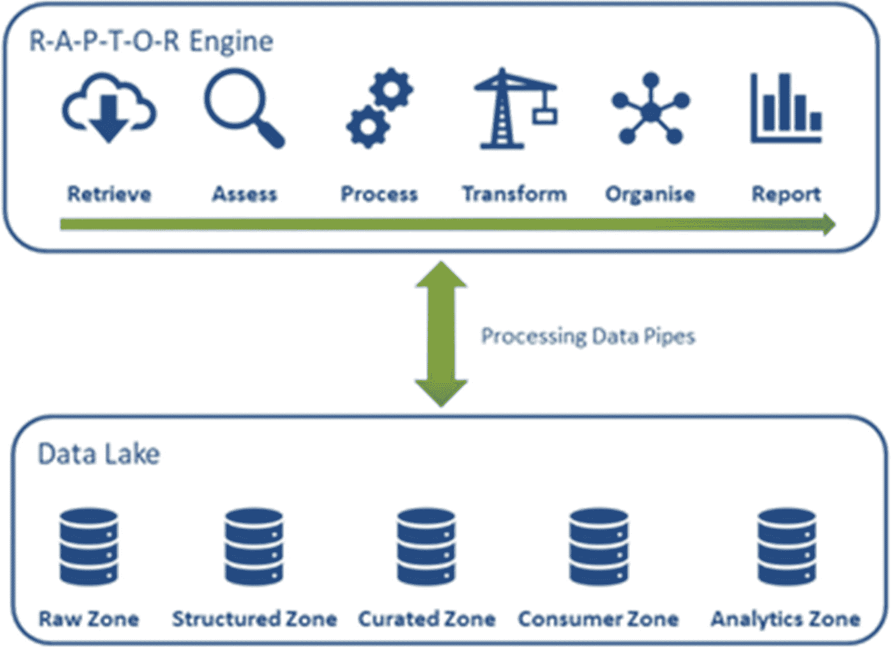

图 13-1

快速信息工厂

## 五个系统层

该基本解决方案设计为跨越机器学习流程的五个核心层。

你首先需要从示例目录 Chapter 013 中加载以下 Jupyter Notebook：Chapter-013-01-Setup.ipynb

我将引导你创建基本的 RIF，然后是五区数据湖。


### 注意

在创建所需的结构后，我将详细解释每个组件。

我将通过图 13-2 中的内容进行详细说明，向您展示如何将机器学习打包到第四次工业革命解决方案中。

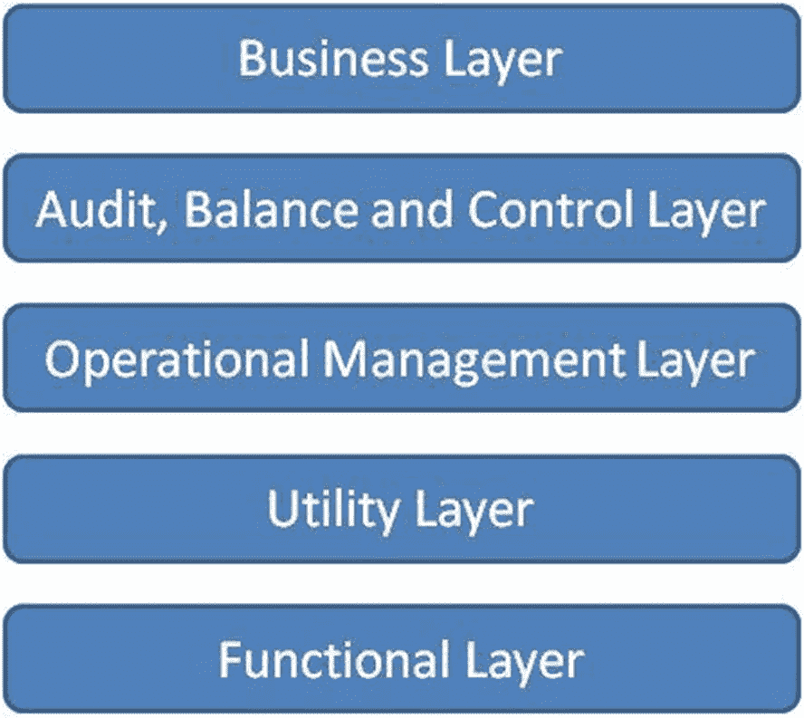

图 13-2

五层架构

您需要以下 Python 库：

```
import os
import time
import shutil
```

您应该创建 RIF。

此路径指示您希望创建物理 RIF 的代码位置。

```
pathRIFname='../../Results/Chapter 013/000-RIF/'
```

### 警告

如果运行以下部分，将删除现有的 RIF。

```
if os.path.exists(pathRIFname):
shutil.rmtree(pathRIFname)
time.sleep(0.5)
```

### 警告

由于我已创建了一个示例设置，因此下一命令已被注释掉。如果您创建了该目录，复制命令将不会传输示例 Python 脚本。

```
#os.makedirs(pathRIFname)
```

### 提示

如果您想预先复制基础快速信息工厂，请执行以下命令。

```
pathRIFInName='../../Code/Chapter 013/000-RIF/'
pathRIFOutName='../../Results/Chapter 013/000-RIF/'
if not os.path.exists(pathRIFOutName):
shutil.copytree(pathRIFInName, pathRIFOutName)
```

接下来，创建功能层，如下所示：

```
dirLayerpath='100-Functional-Layer'
dirname = os.path.join(pathRIFname, dirLayerpath)
if not os.path.exists(dirname):
os.makedirs(dirname)
```

现在，您将按照图 13-3 扩展功能层。

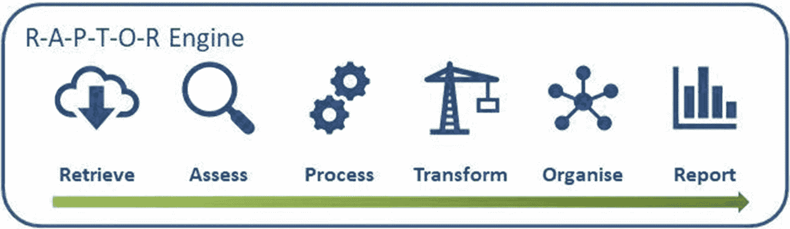

图 13-3

RAPTOR 引擎

接下来，创建功能层 – 检索步骤。


检索步骤使 RIF 能够从 RIF 生态系统外部将数据导入 RIF。

```
dirpath='100-Retrieve'
dirname = os.path.join(pathRIFname, dirLayerpath, dirpath)
if not os.path.exists(dirname):
os.makedirs(dirname)
```

接下来，创建功能层 – 评估步骤。


评估步骤在 RIF 内部实现质量保证。

```
dirpath='200-Assess'
dirname = os.path.join(pathRIFname, dirLayerpath, dirpath)
if not os.path.exists(dirname):
os.makedirs(dirname)
```

接下来，创建功能层 – 处理步骤。


处理步骤对 RIF 中的所有数据执行数据合并与信息整合。

```
dirpath='300-Process'
dirname = os.path.join(pathRIFname, dirLayerpath, dirpath)
if not os.path.exists(dirname):
os.makedirs(dirname)
```

接下来，创建功能层 – 转换步骤。


转换步骤是执行大部分机器学习的地方。它利用合并后的数据源为数据科学和机器学习提供特征。

```
dirpath='400-Transform'
dirname = os.path.join(pathRIFname, dirLayerpath, dirpath)
if not os.path.exists(dirname):
os.makedirs(dirname)
```

接下来，创建功能层 – 组织步骤。


组织步骤对机器学习结果进行划分，以便为业务用户提供业务洞察。

```
dirpath='500-Organize'
dirname = os.path.join(pathRIFname, dirLayerpath, dirpath)
if not os.path.exists(dirname):
os.makedirs(dirname)
```

接下来，创建功能层 – 报告步骤。


报告步骤包含所有可视化和业务报告，用于提供业务洞察。

```
dirpath='600-Raport'
dirname = os.path.join(pathRIFname, dirLayerpath, dirpath)
if not os.path.exists(dirname):
os.makedirs(dirname)
```

接下来，创建运营管理层。

```
dirLayerpath='200-Operational-Management-Layer'
dirname = os.path.join(pathRIFname, dirLayerpath)
if not os.path.exists(dirname):
os.makedirs(dirname)
```

该层将在本书后面详细讨论。

接下来，创建审计、平衡和控制层。

```
dirLayerpath='300-Audit-Balance-Control-Layer'
dirname = os.path.join(pathRIFname, dirLayerpath)
if not os.path.exists(dirname):
os.makedirs(dirname)
```

该层将在本书后面详细讨论。

接下来，创建实用工具层。

```
dirLayerpath='400-Utility-Layer'
dirname = os.path.join(pathRIFname, dirLayerpath)
if not os.path.exists(dirname):
os.makedirs(dirname)
```

该层将在本书后面详细讨论。

接下来，创建实用工具层 – 维护实用工具。

```
dirpath='100-Maintenance-Utilities'
dirname = os.path.join(pathRIFname, dirLayerpath, dirpath)
if not os.path.exists(dirname):
os.makedirs(dirname)
```

接下来，创建实用工具层 – 数据实用工具。

```
dirpath='200-Data-Utilities'
dirname = os.path.join(pathRIFname, dirLayerpath, dirpath)
if not os.path.exists(dirname):
os.makedirs(dirname)
```

接下来，创建实用工具层 – 处理实用工具。

```
dirpath='300-Processing Utilities'
dirname = os.path.join(pathRIFname, dirLayerpath, dirpath)
if not os.path.exists(dirname):
os.makedirs(dirname)
```

接下来，创建业务层。

```
dirLayerpath='500-Business-Layer'
dirname = os.path.join(pathRIFname, dirLayerpath)
if not os.path.exists(dirname):
os.makedirs(dirname)
```

该层将在本书后面详细讨论。

接下来，创建业务层 – 功能需求。

```
dirpath='100-Functional-Requirements'
dirname = os.path.join(pathRIFname, dirLayerpath, dirpath)
if not os.path.exists(dirname):
os.makedirs(dirname)
```

接下来，创建业务层 – 非功能需求。

```
dirpath='200-Non-functional-Requirements'
dirname = os.path.join(pathRIFname, dirLayerpath, dirpath)
if not os.path.exists(dirname):
os.makedirs(dirname)
dirpath='300-Data-Profiles'
dirname = os.path.join(pathRIFname, dirLayerpath, dirpath)
if not os.path.exists(dirname):
os.makedirs(dirname)
dirpath='400-Sun-Models'
dirname = os.path.join(pathRIFname, dirLayerpath, dirpath)
if not os.path.exists(dirname):
os.makedirs(dirname)
```

现在，按照图 13-4 创建六区数据湖。

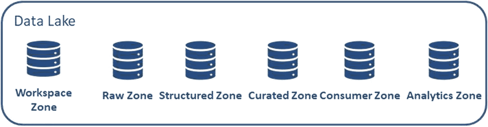

图 13-4

数据湖结构

删除现有的数据湖。

```
pathDLname='../../Results/Chapter 013/990-DL/'
if os.path.exists(pathDLname):
shutil.rmtree(pathDLname)
time.sleep(0.5)
```


### 提示

以下被注释的命令将阻止示例传输。

```
#os.makedirs(pathDLname)
```

传输示例数据湖。

```
pathDLInName='../../code/Chapter 013/990-DL/'
pathDLOutName='../../Results/Chapter 013/990-DL/'
if not os.path.exists(pathDLOutName):
shutil.copytree(pathDLInName, pathDLOutName)
```

接下来，创建工作区区域，如图 13-4 所示。


```
dirpath='000-Workspace-Zone'
dirname = os.path.join(pathDLname, dirpath)
if not os.path.exists(dirname):
os.makedirs(dirname)
```

接下来，创建原始区域，如图 13-4 所示。


```
dirpath='100-Raw-Zone'
dirname = os.path.join(pathDLname, dirpath)
if not os.path.exists(dirname):
os.makedirs(dirname)
```

接下来，创建结构化区域，如图 13-4 所示。


```
dirpath='200-Structured-Zone '
dirname = os.path.join(pathDLname, dirpath)
if not os.path.exists(dirname):
os.makedirs(dirname)
```

接下来，创建策展区域，如图 13-4 所示。


```
dirpath='300-Curated-Zone'
dirname = os.path.join(pathDLname, dirpath)
if not os.path.exists(dirname):
os.makedirs(dirname)
```

接下来，创建消费区域，如图 13-4 所示。


```
dirpath='400-Consumer-Zone'
dirname = os.path.join(pathDLname, dirpath)
if not os.path.exists(dirname):
os.makedirs(dirname)
```

接下来，创建分析区域，如图 13-4 所示。


```
dirpath='500-Analytics-Zone'
dirname = os.path.join(pathDLname, dirpath)
if not os.path.exists(dirname):
os.makedirs(dirname)
```

接下来，清理 Python 检查点。

### 提示

使用 Jupyter Notebook 时，进程会存储笔记本先前保存的副本。在将版本保存到源代码管理之前，我会将这些副本从发布版本中移除。这可以避免开发过程中产生重复副本。

```
pathRIFname='../../Results/Chapter 013/000-RIF/'
for root, dirs, files in os.walk(pathRIFname, topdown=True):
for name in dirs:
fullDir=os.path.join(root, name)
print(fullDir)
if name=='.ipynb_checkpoints':
print('Remove:', fullDir)
if os.path.exists(fullDir):
shutil.rmtree(fullDir)
time.sleep(0.1)
```

干得漂亮；现在你已经拥有了一个 RIF 和五区域数据湖（图 13-5）。

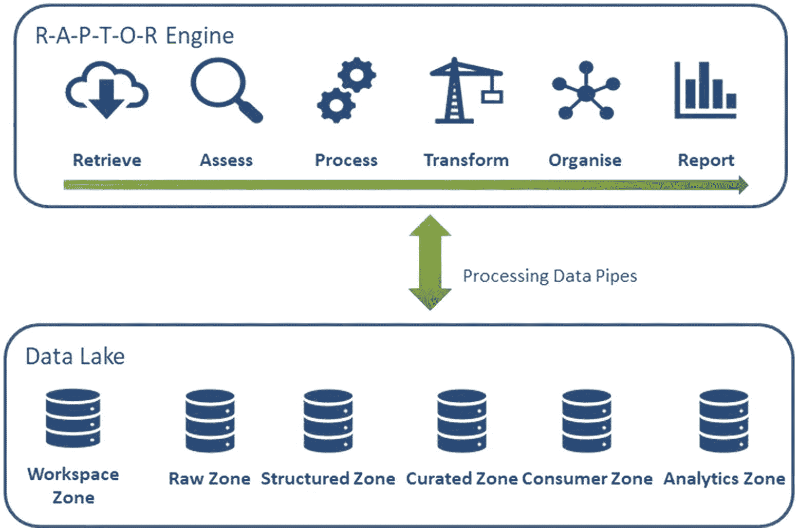

图 13-5

RIF 加数据湖

我将快速展示你所创建的结构。

先来看 RIF：

以下是你需要的目录。

```
pathRIFname='../../Results/Chapter 013/000-RIF/'
for root, dirs, files in os.walk(pathRIFname, topdown=True):
for name in dirs:
print(os.path.join(root, name))
```

以下是示例文件。

```
pathRIFname='../../Results/Chapter 013/000-RIF/'
for root, dirs, files in os.walk(pathRIFname, topdown=True):
for name in files:
print(os.path.join(root, name))
```

再来看数据湖。

以下是你需要的目录。

```
pathDLname='../../Results/Chapter 013/990-DL/'
for root, dirs, files in os.walk(pathDLname, topdown=True):
for name in dirs:
print(os.path.join(root, name))
for name in files:
print(os.path.join(root, name))
```

以下是示例文件。

```
pathDLname='../../Results/Chapter 013/990-DL/'
for root, dirs, files in os.walk(pathDLname, topdown=True):
for name in dirs:
print(os.path.join(root, name))
for name in files:
print(os.path.join(root, name))
```

现在我将详细说明 RIF 和数据湖的每个部分，以展示它们在 IML 生态系统中的用途。

### 功能层

功能层（图 13-2）是 IML 工厂的核心处理能力。核心功能数据处理方法是 R-A-P-T-O-R 框架（见图 13-6）。

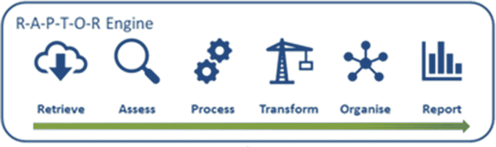

图 13-6

RAPTOR 引擎的六个步骤


#### 检索超级步骤


检索超级步骤（图 13-6）支持外部数据源（000-ExternalData）与工厂（000-RIF）之间的交互，工厂通过将数据原样加载到原始区域（000-RIF/100-RawZone），从而将数据加载到数据湖（990-DL）中。

此处理步骤的目的是启动 IML 所需数据的数据工程。

这些数据可能来自其他数据库、数据仓库、传感器，或由人在回路流程中输入。

你需要从示例目录 Chapter 013 中加载以下 Jupyter Notebook：

Chapter-013-02-01-Retrieve.ipynb

首先，启动一个时钟来记录代码的运行时长。

```
import datetime
nowStart = datetime.datetime.now()
# 
```

在功能层内设置检索步骤的路径：

```
pathRIFname='./000-RIF/100-Functional-Layer/100-Retrieve/'
```

你需要通用库。

```
import subprocess
```

名为 `subprocess` 的库，该模块允许你生成新进程、连接到它们的输入/输出/错误管道，并获取它们的返回码。

```
(https://docs.python.org/3/library/subprocess.html)
这有助于你执行或调用其他进程作为解决方案的一部分。
import os
```

名为 `os` 的库，该模块提供了一种使用操作系统相关功能的可移植方式。

```
(https://docs.python.org/2/library/os.html)
import time
```

该模块提供了各种与时间相关的函数。

```
(https://docs.python.org/2/library/time.html)
import sys
```

该模块提供对解释器使用或维护的一些变量以及与解释器强交互的函数的访问。

```
(https://docs.python.org/2/library/sys.html)
import numpy as np
```

NumPy 是科学计算的基础包。

```
(http://www.numpy.org)
```

要调用 python.exe，你需要在系统上找到 Python。

寻找它的逻辑位置是系统路径。

以下代码将找到可执行文件 “python.exe”：

```
path=np.array(sys.path)
print(path.shape)
for i in range(path.shape[0]):
pathTestPython=os.path.join(path[i],'python.exe')
if os.path.exists(pathTestPython):
pathPython=pathTestPython
pathPython=pathPython.replace('\\','/')
print(pathPython)
holddir=os.getcwd()
print(holddir)
```

你需要一个函数来处理解决方案中 Python 程序的执行：

```
def run_command(command, wait=True):
try:
if (wait):
p = subprocess.Popen(
[command]
, stdout = subprocess.PIPE
, shell = True)
p.wait()
else:
p = subprocess.Popen(
[command],
shell = True,
stdin = None, stdout = None, stderr = None, close_fds = True)
(result, error) = p.communicate()
except subprocess.CalledProcessError as e:
sys.stderr.write(
"common::run_command() : [ERROR]: output = %s, error code = %s\n"
% (e.output, e.returncode))
return result
```

你需要将绝对路径转换为真实路径：

```
pathRealRIFname=os.path.realpath(pathRIFname)
pathRealRIFname=pathRealRIFname.replace('\\','/')
print(pathRealRIFname)
```

检查设置程序是否运行正确，如果运行正确，系统会找到 Python 程序并通过你创建的函数执行它们：

```
if not os.path.exists(pathRealRIFname):
print(' Please run the Chapter-013-01-Setup program first to setup your examples')
else:
os.chdir(pathRealRIFname)
for root, dirs, files in os.walk(pathRealRIFname, topdown=True):
for name in files:
fullfilename=os.path.join(root, name)
fullfilename=fullfilename.replace('\\','/')
filename, file_extension = os.path.splitext(name)
if file_extension.lower()=='.py':
#print(filename)
commandstr=name
print(commandstr,'\n')
res = run_command(commandstr)
time.sleep(0.5)
print('###################\n')
print(res)
print('###################\n')
```

该过程确保工作目录重置为程序启动时的同一目录。

```
os.chdir(holddir)
print(os.getcwd())
```

现在你可以测量系统运行完成所花费的时间：

```
nowStop = datetime.datetime.now()
runTime=nowStop-nowStart
print('Start:', nowStart.strftime('%Y-%m-%d %H:%M:%S'))
print('Stop: ', nowStop.strftime('%Y-%m-%d %H:%M:%S'))
print('Time: ', runTime)
```

恭喜你完成了这个运行程序。

现在我想向你展示你通过上述步骤运行程序所运行的基本 Python 程序。

你需要在示例目录中查看以下子目录：IML\Code\Chapter 013\000-RIF\100-Functional-Layer\100-Retrieve

```
Open Chapter-013-02-Retrieve-01-Time.ipynb
```

加载时间库：

```
import datetime
nowStart = datetime.datetime.now()
```

设置原始区域的路径：

```
dirname = '../../../../Chapter 013/990-DL/100-Raw-Zone/'
filename='08-02-Retrieve-Time-Date.csv'
fileZipname=filename + '.gz'
print(fileZipname)
```

加载通用库：

```
import pandas as pd
import os
```

在生态系统中找到原始区域的完整路径：

```
pathRealName=os.path.realpath(dirname)
print(pathRealName)
fullRealZipName = os.path.join(pathRealName, fileZipname)
```

如果原始区域不存在，则创建该路径。

```
if not os.path.exists(pathRealName):
print('Make:', pathRealName)
os.makedirs(pathRealName)
```

现在你将开始通过从原始区域外部上传来在原始区域中创建一个新的日期数据集。

Pandas 的 date_range 函数将创建 2017/01/01 到 2018/12/31 之间的日期。

```
dates = pd.date_range(start='2017-1-1', end='2018-12-31', freq="D")
```

将范围转换为格式为 ‘2017-01-01’ 的数据框，以及格式为 ‘D20170101’ 的键：

```
datesNameDF = pd.DataFrame(dates.strftime('%Y-%m-%d'))
datesNameDF.index.name='DateID'
datesNameDF.columns=['Date']
datesKey=dates.strftime('D%Y%m%d')
datesKeyDF=pd.DataFrame(datesKey)
datesKeyDF.index.name='DateID'
datesKeyDF.columns=['DateKey']
datesDF=datesKeyDF
datesDF=datesDF.merge(datesNameDF, how="inner", left_on="DateID", right_on="DateID")
```

将生成的数据框存储为通过 GZip 压缩的逗号分隔值文件。

```
datesDF.to_csv(fullRealZipName, index=False, encoding='utf-8', compression="gzip")
print(fullRealZipName)
```

关闭运行统计。

```
nowStop = datetime.datetime.now()
runTime=nowStop-nowStart
print('Start:', nowStart.strftime('%Y-%m-%d %H:%M:%S'))
print('Stop: ', nowStop.strftime('%Y-%m-%d %H:%M:%S'))
print('Time: ', runTime)
你现在有了一个包含日期的数据集。
```

现在你需要为正常一天中的每一分钟生成一个数据集：

为一天中每分钟级别的时间构建一个数据集：

```
import datetime
nowStart = datetime.datetime.now()
dirname = '../../../../Chapter 013/990-DL/100-Raw-Zone/'
filename='08-02-Retrieve-Time-Time.csv'
fileZipname=filename + '.gz'
print(fileZipname)
import pandas as pd
import os
pathRealName=os.path.realpath(dirname)
print(pathRealName)
fullRealZipName = os.path.join(pathRealName, fileZipname)
if not os.path.exists(pathRealName):
print('Make:', pathRealName)
os.makedirs(pathRealName)
times = pd.date_range(start='2018/01/01 00:00', end='2018/01/01 23:59', freq="1min")
timesNameDF = pd.DataFrame(times.strftime('%H:%M'))
timesNameDF.index.name='TimeID'
timesNameDF.columns=['Time']
timesKeyDF = pd.DataFrame(times.strftime('T%H%M'))
timesKeyDF.index.name='TimeID'
timesKeyDF.columns=['TimeKey']
timesDF=timesKeyDF
timesDF=timesDF.merge(timesNameDF, how="inner", left_on="TimeID", right_on="TimeID")
timesDF.to_csv(fullRealZipName, index=False, encoding='utf-8', compression="gzip")
print(fullRealZipName)
nowStop = datetime.datetime.now()
runTime=nowStop-nowStart
print('Start:', nowStart.strftime('%Y-%m-%d %H:%M:%S'))
print('Stop: ', nowStop.strftime('%Y-%m-%d %H:%M:%S'))
print('Time: ', runTime)
```

你现在有了一个以分钟级别表示一天的时间数据集。

下一个数据集需要同时包含日期和时间。

```
import datetime
nowStart = datetime.datetime.now()
dirname = '../../../../Chapter 013/990-DL/100-Raw-Zone/'
filename='08-02-Retrieve-Time.csv'
fileZipname=filename + '.gz'
print(fileZipname)
import pandas as pd
import os
pathRealName=os.path.realpath(dirname)
print(pathRealName)
fullRealZipName = os.path.join(pathRealName, fileZipname)
if not os.path.exists(pathRealName):
print('Make:', pathRealName)
os.makedirs(pathRealName)
```

以下是时间部分：

```
dates = pd.date_range(start='2017-1-1', end='2018-12-31', freq="D")
datesKey=dates.strftime('D%Y%m%d')
datesKeyDF=pd.DataFrame(datesKey)
datesKeyDF.index.name='DateID'
datesKeyDF.columns=['DateKey']
datesKeyDF['Key1']='1'
times = pd.date_range(start='2018/01/01 00:00', end='2018/01/01 23:59', freq="1min")
timesKeyDF = pd.DataFrame(times.strftime('T%H%M'))
timesKeyDF.index.name='TimeID'
timesKeyDF.columns=['TimeKey']
timesKeyDF['Key1']='1'
datetimesDF=datesKeyDF
datetimesDF=datetimesDF.merge(timesKeyDF, how="inner", left_on="Key1", right_on="Key1")
datetimesDF.drop('Key1', axis=1, inplace=True)
datetimesDF.to_csv(fullRealZipName, index=False, encoding='utf-8', compression="gzip")
print(fullRealZipName)
nowStop = datetime.datetime.now()
runTime=nowStop-nowStart
print('Start:', nowStart.strftime('%Y-%m-%d %H:%M:%S'))
print('Stop: ', nowStop.strftime('%Y-%m-%d %H:%M:%S'))
print('Time: ', runTime)
```

这样就得到了日期时间信息。

接下来是人员数据集。

你需要生成一个包含“名字”、“姓氏”的人员数据集。

```
import datetime
nowStart = datetime.datetime.now()
dirname = '../../../../Chapter 013/990-DL/100-Raw-Zone/'
filename='08-02-Retrieve-Person.csv'
fileZipname=filename + '.gz'
print(fileZipname)
import pandas as pd
import os
pathRealName=os.path.realpath(dirname)
print(pathRealName)
fullRealZipName = os.path.join(pathRealName, fileZipname)
if not os.path.exists(pathRealName):
print('Make:', pathRealName)
os.makedirs(pathRealName)
```

从外部数据源获取数据：

```
dirDataName = '../../../../../Data/Chapter 013/000-ExternalData/02-Person/'
pathRealDataName=os.path.realpath(dirDataName)
print(pathRealDataName)
fileDataName='FirstNamesBoy2018.csv'
fileFullDataName= os.path.join(pathRealDataName, fileDataName)
print(fileFullDataName)
firstNameDF=pd.read_csv(fileFullDataName, header=0)
firstNameDF.set_index("ID", inplace = True)
firstNameDF.columns=['FirstName']
print(firstNameDF.shape)
print(firstNameDF.head())
fileDataName='LastNames150.csv'
fileFullDataName= os.path.join(pathRealDataName, fileDataName)
print(fileFullDataName)
lastNameRawDF=pd.read_csv(fileFullDataName, header=0)
lastNameRawDF.index.name='IDKey'
lastNameRawDF.shape
lastNameRawDF.head()
lastName1DF=pd.DataFrame(lastNameRawDF.loc[:, ['ID1','Name1','Cnt1']])
lastName1DF.columns=['ID','LastName','Cnt']
lastName1DF.set_index("ID", inplace = True)
print(lastName1DF.shape)
print(lastName1DF.head())
lastName2DF=pd.DataFrame(lastNameRawDF.loc[:, ['ID2','Name2','Cnt2']])
lastName2DF.columns=['ID','LastName','Cnt']
lastName2DF.set_index("ID", inplace = True)
print(lastName2DF.shape)
print(lastName2DF.head())
lastName3DF=pd.DataFrame(lastNameRawDF.loc[:, ['ID3','Name3','Cnt3']])
lastName3DF.columns=['ID','LastName','Cnt']
lastName3DF.set_index("ID", inplace = True)
print(lastName3DF.shape)
print(lastName3DF.head())
DFs = [lastName1DF, lastName2DF, lastName3DF]
lastNameDF=pd.DataFrame(pd.concat(DFs))
lastNameDF.drop(['Cnt'], axis=1, inplace=True)
print(lastNameDF.shape)
print(lastNameDF.head())
firstNameDF['keyid']=0
lastNameDF['keyid']=0
NameDF=pd.merge(firstNameDF, lastNameDF, how="inner")
NameDF.drop(['keyid'], axis=1, inplace=True)
NameDF.reset_index(inplace=True)
NameDF.index.name='KeyID'
NameDF.columns=['ID','FirstName','LastName']
print(NameDF.shape)
print(NameDF.head())
NameDF.to_csv(fullRealZipName, index=False, encoding='utf-8', compression="gzip")
print(fullRealZipName)
nowStop = datetime.datetime.now()
runTime=nowStop-nowStart
print('Start:', nowStart.strftime('%Y-%m-%d %H:%M:%S'))
print('Stop: ', nowStop.strftime('%Y-%m-%d %H:%M:%S'))
print('Time: ', runTime)
```

干得好；你现在有了一个内部生成的时间数据集和一个从数据湖外部导入的数据集。这两种数据类型是 RIF 生态系统中大多数数据工程需求的支柱。

接下来你将能够创建“对象”数据集。这是一个外部数据源读取过程。你将像之前一样导入和导出数据。

```
import datetime
nowStart = datetime.datetime.now()
dirname = '../../../../Chapter 013/990-DL/100-Raw-Zone/'
filename='08-02-Retrieve-Object.csv'
fileZipname=filename + '.gz'
print(fileZipname)
import pandas as pd
import os
dirDataName = '../../../../../Data/Chapter 013/000-ExternalData/03-Object/'
pathRealDataName=os.path.realpath(dirDataName)
print(pathRealDataName)
fileDataName='Object.csv.gz'
fileFullDataName= os.path.join(pathRealDataName, fileDataName)
print(fileFullDataName)
objectFullDF= pd.read_csv(fileFullDataName, encoding='utf-8', compression="gzip")
print(objectFullDF.shape)
pathRealName=os.path.realpath(dirname)
print(pathRealName)
fullRealZipName = os.path.join(pathRealName, fileZipname)
if not os.path.exists(pathRealName):
print('Make:', pathRealName)
os.makedirs(pathRealName)
```

保存对象数据集：

```
objectFullDF.to_csv(fullRealZipName, index=False, encoding='utf-8', compression="gzip")
print(fullRealZipName)
nowStop = datetime.datetime.now()
runTime=nowStop-nowStart
print('Start:', nowStart.strftime('%Y-%m-%d %H:%M:%S'))
print('Stop: ', nowStop.strftime('%Y-%m-%d %H:%M:%S'))
print('Time: ', runTime)
```

你现在有了一个对象数据集。

接下来准备一个位置数据集。

```
import datetime
nowStart = datetime.datetime.now()
dirname = '../../../../Chapter 013/990-DL/100-Raw-Zone/'
filename='08-02-Retrieve-Location.csv'
fileZipname=filename + '.gz'
print(fileZipname)
import pandas as pd
import zipfile as zp
import os
pathRealName=os.path.realpath(dirname)
print(pathRealName)
fullRealZipName = os.path.join(pathRealName, fileZipname)
if not os.path.exists(pathRealName):
print('Make:', pathRealName)
os.makedirs(pathRealName)
dirDataName = '../../../../../Data/Chapter 013/000-ExternalData/04-Location/'
pathRealDataName=os.path.realpath(dirDataName)
print(pathRealDataName)
fileZipName='ukpostcodes.zip'
fileDataName='ukpostcodes.csv'
fileFullZipName= os.path.join(pathRealDataName, fileZipName)
print(fileFullZipName)
```


### 提示

此 CSV 文件位于一个 zip 文件中，因此你需要先用解压工具打开它，然后读取 CSV 文件。

```
with zp.ZipFile(fileFullZipName) as z:
with z.open(fileDataName) as f:
locationDF = pd.read_csv(f, header=0, delimiter=',')
locationDF.index.name='IDKey'
print(locationDF.shape)
print(locationDF.head())
locationDF.to_csv(fullRealZipName, index=False, encoding='utf-8', compression="gzip")
print(fullRealZipName)
nowStop = datetime.datetime.now()
runTime=nowStop-nowStart
print('Start:', nowStart.strftime('%Y-%m-%d %H:%M:%S'))
print('Stop: ', nowStop.strftime('%Y-%m-%d %H:%M:%S'))
print('Time: ', runTime)
```

现在你已准备好一个可供使用的位置数据集。

你需要的下一个数据集是事件数据。

```
import datetime
nowStart = datetime.datetime.now()
dirname = '../../../../Chapter 013/990-DL/100-Raw-Zone/'
filename='08-02-Retrieve-Event.csv'
fileZipname=filename + '.gz'
print(fileZipname)
import pandas as pd
import os
dirDataName = '../../../../../Data/Chapter 013/000-ExternalData/05-Event/'
pathRealDataName=os.path.realpath(dirDataName)
print(pathRealDataName)
fileDataName='Event.csv.gz'
fileFullDataName= os.path.join(pathRealDataName, fileDataName)
print(fileFullDataName)
objectFullDF= pd.read_csv(fileFullDataName, encoding='utf-8', compression="gzip")
print(objectFullDF.shape)
pathRealName=os.path.realpath(dirname)
print(pathRealName)
fullRealZipName = os.path.join(pathRealName, fileZipname)
if not os.path.exists(pathRealName):
print('Make:', pathRealName)
os.makedirs(pathRealName)
objectFullDF.to_csv(fullRealZipName, index=False, encoding='utf-8', compression="gzip")
print(fullRealZipName)
nowStop = datetime.datetime.now()
runTime=nowStop-nowStart
print('Start:', nowStart.strftime('%Y-%m-%d %H:%M:%S'))
print('Stop: ', nowStop.strftime('%Y-%m-%d %H:%M:%S'))
print('Time: ', runTime)
```

干得好；现在你已拥有一个完整的时间-人员-对象-位置-事件结构。

你可以用这五个结构来描述任何业务活动。

示例：约翰·史密斯于 2018 年 1 月 4 日 12 点 45 分在南岸银行西街分行向他的信用卡存入 30 英镑现金。

这将被记录为：

*   时间 => 2018-01-04 12:45

*   人员 => 约翰·史密斯

*   对象 => 现金、信用卡和南岸银行

*   位置 => 西街分行的经纬度

*   事件 => 存款

这种基本结构可以轻松描述其他现实世界中的行为，并为你的 IML 提供了一个标准基础。

你已成功将五种类型的数据集（T-P-O-L-E）加载到数据湖生态系统中。

接下来，你将进入对所加载数据的评估环节。

#### 评估超级步骤

评估超级步骤（图 13-6）支持工厂中的元数据提取和数据质量清理。


你需要从示例目录 Chapter 013 加载以下 Jupyter Notebook：

```
Chapter-013-02-Assess.ipynb
```

你按照与检索步骤相同的方式（图 13-6）为评估运行器进程设置工厂。

```
import datetime
nowStart = datetime.datetime.now()
```

这是主要变化。它指向工厂中的评估进程。

```
pathRIFname='./000-RIF/100-Functional-Layer/200-Assess/'
import subprocess
import os
import time
import sys
import numpy as np
path=np.array(sys.path)
print(path.shape)
for i in range(path.shape[0]):
pathTestPython=os.path.join(path[i],'python.exe')
if os.path.exists(pathTestPython):
pathPython=pathTestPython
pathPython=pathPython.replace('\\','/')
print(pathPython)
holddir=os.getcwd()
print(holddir)
def run_command(command, wait=True):
try:
if (wait):
p = subprocess.Popen(
[command]
, stdout = subprocess.PIPE
, shell = True)
p.wait()
else:
p = subprocess.Popen(
[command],
shell = True,
stdin = None, stdout = None, stderr = None, close_fds = True)
(result, error) = p.communicate()
except subprocess.CalledProcessError as e:
sys.stderr.write(
"common::run_command() : [ERROR]: output = %s, error code = %s\n"
% (e.output, e.returncode))
return result
pathRealRIFname=os.path.realpath(pathRIFname)
pathRealRIFname=pathRealRIFname.replace('\\','/')
print(pathRealRIFname)
if not os.path.exists(pathRealRIFname):
print(' Please run the Chapter-013-01-Setup program first to setup your examples')
else:
os.chdir(pathRealRIFname)
for root, dirs, files in os.walk(pathRealRIFname, topdown=True):
for name in files:
fullfilename=os.path.join(root, name)
fullfilename=fullfilename.replace('\\','/')
filename, file_extension = os.path.splitext(name)
if file_extension.lower()=='.py':
#print(filename)
commandstr=name
print(commandstr,'\n')
res = run_command(commandstr)
time.sleep(0.5)
print('###################\n')
print(res)
print('###################\n')
os.chdir(holddir)
print(os.getcwd())
nowStop = datetime.datetime.now()
runTime=nowStop-nowStart
print('Start:', nowStart.strftime('%Y-%m-%d %H:%M:%S'))
print('Stop: ', nowStop.strftime('%Y-%m-%d %H:%M:%S'))
print('Time: ', runTime)
```

现在你已拥有一个用于 RAPTOR 流程的评估运行器。

你使用以下子目录中的示例目录：IML\Code\Chapter 013\000-RIF\100-Functional-Layer\200-Assess

打开 Chapter-013-02-Assess-01-Time.ipynb

```
import datetime
nowStart = datetime.datetime.now()
dirname = '../../../../Chapter 013/990-DL/200-Structured-Zone/'
filename='Chapter-013-02-Assess-Time.csv'
fileZipname=filename + '.gz'
print(fileZipname)
import pandas as pd
import os
dirDataName = '../../../../Chapter 013/990-DL/100-Raw-Zone/'
pathRealDataName=os.path.realpath(dirDataName)
print(pathRealDataName)
fileDataName='Chapter-013-02-Retrieve-Time.csv.gz'
fileFullDataName= os.path.join(pathRealDataName, fileDataName)
print(fileFullDataName)
timeFullDF= pd.read_csv(fileFullDataName, encoding='utf-8', compression="gzip")
print(timeFullDF.shape)
```

你现在将执行数据质量检查。


### 警告

我已将您正在处理的数据集限制为 500 条。如果您想处理完整数据，请在下一个代码块中将 `B=timeFullDF.head(500)` 简单替换为 `B=timeFullDF`。

```
A=timeFullDF
print('A',A.shape)
B=timeFullDF.head(500)
print('B',B.shape)
D=pd.concat([A,B], axis=0)
print('D',D.shape)
E=D.drop_duplicates(keep='last')
print('E',E.shape)
TimeFinalDF=E
pathRealName=os.path.realpath(dirname)
print(pathRealName)
fullRealZipName = os.path.join(pathRealName, fileZipname)
if not os.path.exists(pathRealName):
print('Make:', pathRealName)
os.makedirs(pathRealName)
```

现在您可以保存清洗后的日期数据集。

```
TimeFinalDF.to_csv(fullRealZipName, index=False, encoding='utf-8', compression="gzip")
print(fullRealZipName)
nowStop = datetime.datetime.now()
runTime=nowStop-nowStart
print('Start:', nowStart.strftime('%Y-%m-%d %H:%M:%S'))
print('Stop: ', nowStop.strftime('%Y-%m-%d %H:%M:%S'))
print('Time: ', runTime)
下一个时间处理步骤将评估时间数据集：
import datetime
nowStart = datetime.datetime.now()
dirname = '../../../../Chapter 013/990-DL/200-Structured-Zone/'
filename='08-02-Assess-Time-Time.csv'
fileZipname=filename + '.gz'
print(fileZipname)
import pandas as pd
import os
dirDataName = '../../../../Chapter 013/990-DL/100-Raw-Zone/'
pathRealDataName=os.path.realpath(dirDataName)
print(pathRealDataName)
fileDataName='08-02-Retrieve-Time-Time.csv.gz'
fileFullDataName= os.path.join(pathRealDataName, fileDataName)
print(fileFullDataName)
timeFullDF= pd.read_csv(fileFullDataName, encoding='utf-8', compression="gzip")
print(timeFullDF.shape)
```

对时间数据执行数据质量检查。

```
A=timeFullDF
print('A',A.shape)
B=timeFullDF.head(500)
print('B',B.shape)
D=pd.concat([A,B], axis=0)
print('D',D.shape)
E=D.drop_duplicates(keep='last')
print('E',E.shape)
TimeFinalDF=E
pathRealName=os.path.realpath(dirname)
print(pathRealName)
fullRealZipName = os.path.join(pathRealName, fileZipname)
if not os.path.exists(pathRealName):
print('Make:', pathRealName)
os.makedirs(pathRealName)
TimeFinalDF.to_csv(fullRealZipName, index=False, encoding='utf-8', compression="gzip")
print(fullRealZipName)
nowStop = datetime.datetime.now()
runTime=nowStop-nowStart
print('Start:', nowStart.strftime('%Y-%m-%d %H:%M:%S'))
print('Stop: ', nowStop.strftime('%Y-%m-%d %H:%M:%S'))
print('Time: ', runTime)
import datetime
nowStart = datetime.datetime.now()
dirname = '../../../../Chapter 013/990-DL/200-Structured-Zone/'
filename='08-02-Assess-Time-Date.csv'
fileZipname=filename + '.gz'
print(fileZipname)
import pandas as pd
import os
dirDataName = '../../../../Chapter 013/990-DL/100-Raw-Zone/'
pathRealDataName=os.path.realpath(dirDataName)
print(pathRealDataName)
fileDataName='08-02-Retrieve-Time-Date.csv.gz'
fileFullDataName= os.path.join(pathRealDataName, fileDataName)
print(fileFullDataName)
timeFullDF= pd.read_csv(fileFullDataName, encoding='utf-8', compression="gzip")
print(timeFullDF.shape)
```

执行数据质量检查。

```
A=timeFullDF
print('A',A.shape)
B=timeFullDF.head(500)
print('B',B.shape)
D=pd.concat([A,B], axis=0)
print('D',D.shape)
E=D.drop_duplicates(keep='last')
print('E',E.shape)
TimeFinalDF=E
pathRealName=os.path.realpath(dirname)
print(pathRealName)
fullRealZipName = os.path.join(pathRealName, fileZipname)
if not os.path.exists(pathRealName):
print('Make:', pathRealName)
os.makedirs(pathRealName)
TimeFinalDF.to_csv(fullRealZipName, index=False, encoding='utf-8', compression="gzip")
print(fullRealZipName)
nowStop = datetime.datetime.now()
runTime=nowStop-nowStart
print('Start:', nowStart.strftime('%Y-%m-%d %H:%M:%S'))
print('Stop: ', nowStop.strftime('%Y-%m-%d %H:%M:%S'))
print('Time: ', runTime)
import datetime
nowStart = datetime.datetime.now()
dirname = '../../../../Chapter 013/990-DL/200-Structured-Zone/'
filename='08-02-Assess-Person.csv'
fileZipname=filename + '.gz'
print(fileZipname)
```

下一个评估步骤是针对人员数据。

```
import pandas as pd
import os
dirDataName = '../../../../Chapter 013/990-DL/100-Raw-Zone/'
pathRealDataName=os.path.realpath(dirDataName)
print(pathRealDataName)
fileDataName='08-02-Retrieve-Person.csv.gz'
fileFullDataName= os.path.join(pathRealDataName, fileDataName)
print(fileFullDataName)
personFullDF= pd.read_csv(fileFullDataName, encoding='utf-8', compression="gzip")
print(personFullDF.shape)
```

执行数据质量检查：

```
A=personFullDF
E=A.drop_duplicates(keep='last')
print('E',E.shape)
PersonFinalDF=E
pathRealName=os.path.realpath(dirname)
print(pathRealName)
fullRealZipName = os.path.join(pathRealName, fileZipname)
if not os.path.exists(pathRealName):
print('Make:', pathRealName)
os.makedirs(pathRealName)
print(fullRealZipName)
PersonFinalDF.to_csv(fullRealZipName, index=False, encoding='utf-8', compression="gzip")
print(fullRealZipName)
nowStop = datetime.datetime.now()
runTime=nowStop-nowStart
print('Start:', nowStart.strftime('%Y-%m-%d %H:%M:%S'))
print('Stop: ', nowStop.strftime('%Y-%m-%d %H:%M:%S'))
print('Time: ', runTime)
```

加载对象数据集：

```
import datetime
nowStart = datetime.datetime.now()
dirname = '../../../../Chapter 013/990-DL/200-Structured-Zone/'
filename='08-02-Assess-Object.csv'
fileZipname=filename + '.gz'
print(fileZipname)
import pandas as pd
import os
dirDataName = '../../../../Chapter 013/990-DL/100-Raw-Zone/'
pathRealDataName=os.path.realpath(dirDataName)
print(pathRealDataName)
fileDataName='08-02-Retrieve-Object.csv.gz'
fileFullDataName= os.path.join(pathRealDataName, fileDataName)
print(fileFullDataName)
objectFullDF= pd.read_csv(fileFullDataName, encoding='utf-8', compression="gzip")
print(objectFullDF.shape)
现在执行数据质量检查：
A=objectFullDF
print('A',A.shape)
E=A.drop_duplicates(keep='last')
print('A',E.shape)
objectFinalDF=E
pathRealName=os.path.realpath(dirname)
print(pathRealName)
fullRealZipName = os.path.join(pathRealName, fileZipname)
if not os.path.exists(pathRealName):
print('Make:', pathRealName)
os.makedirs(pathRealName)
```

现在保存对象数据集。

```
print(fullRealZipName)
objectFinalDF.to_csv(fullRealZipName, index=False, encoding='utf-8', compression="gzip")
print(fullRealZipName)
nowStop = datetime.datetime.now()
runTime=nowStop-nowStart
print('Start:', nowStart.strftime('%Y-%m-%d %H:%M:%S'))
print('Stop: ', nowStop.strftime('%Y-%m-%d %H:%M:%S'))
print('Time: ', runTime)
```

对位置数据集执行质量评估：

```
import datetime
nowStart = datetime.datetime.now()
dirname = '../../../../Chapter 013/990-DL/200-Structured-Zone/'
filename='08-02-Assess-Location.csv'
fileZipname=filename + '.gz'
print(fileZipname)
import pandas as pd
import os
dirDataName = '../../../../Chapter 013/990-DL/100-Raw-Zone/'
pathRealDataName=os.path.realpath(dirDataName)
print(pathRealDataName)
fileDataName='08-02-Retrieve-Location.csv.gz'
fileFullDataName= os.path.join(pathRealDataName, fileDataName)
print(fileFullDataName)
locationFullDF= pd.read_csv(fileFullDataName, encoding='utf-8', compression="gzip")
print(locationFullDF.shape)
```

对位置数据集执行数据质量检查：

```
A=locationFullDF
print('A',A.shape)
E=A.drop_duplicates(keep='last')
print('E',E.shape)
locationFinalDF=E
pathRealName=os.path.realpath(dirname)
print(pathRealName)
fullRealZipName = os.path.join(pathRealName, fileZipname)
if not os.path.exists(pathRealName):
print('Make:', pathRealName)
os.makedirs(pathRealName)
```

保存位置数据集。

```
locationFinalDF.to_csv(fullRealZipName, index=False, encoding='utf-8', compression="gzip")
print(fullRealZipName)
nowStop = datetime.datetime.now()
runTime=nowStop-nowStart
print('Start:', nowStart.strftime('%Y-%m-%d %H:%M:%S'))
print('Stop: ', nowStop.strftime('%Y-%m-%d %H:%M:%S'))
print('Time: ', runTime)
```

下一个评估是针对事件数据集。

```
import datetime
nowStart = datetime.datetime.now()
dirname = '../../../../Chapter 013/990-DL/200-Structured-Zone/'
filename='08-02-Assess-Event.csv'
fileZipname=filename + '.gz'
print(fileZipname)
import pandas as pd
import os
dirDataName = '../../../../Chapter 013/990-DL/100-Raw-Zone/'
pathRealDataName=os.path.realpath(dirDataName)
print(pathRealDataName)
fileDataName='08-02-Retrieve-Time.csv.gz'
fileFullDataName= os.path.join(pathRealDataName, fileDataName)
print(fileFullDataName)
eventFullDF= pd.read_csv(fileFullDataName, encoding='utf-8', compression="gzip")
print(eventFullDF.shape)
对事件数据集执行数据质量检查：
A=eventFullDF
print('A',A.shape)
E=A.drop_duplicates(keep='last')
print('E',E.shape)
EventFinalDF=E
pathRealName=os.path.realpath(dirname)
print(pathRealName)
fullRealZipName = os.path.join(pathRealName, fileZipname)
if not os.path.exists(pathRealName):
print('Make:', pathRealName)
os.makedirs(pathRealName)
EventFinalDF.to_csv(fullRealZipName, index=False, encoding='utf-8', compression="gzip")
print(fullRealZipName)
nowStop = datetime.datetime.now()
runTime=nowStop-nowStart
print('Start:', nowStart.strftime('%Y-%m-%d %H:%M:%S'))
print('Stop: ', nowStop.strftime('%Y-%m-%d %H:%M:%S'))
print('Time: ', runTime)
```

至此，数据处理的评估步骤已完成。


#### 流程超级步骤

流程超级步骤（图 13-6）将数据转换为数据仓库。


你需要从示例目录 Chapter 013 中加载以下 Jupyter Notebook：Chapter-013-02-Process.ipynb

下一步将五个数据集整合成一个单一数据集。

```
import datetime
nowStart = datetime.datetime.now()
pathRIFname='./000-RIF/100-Functional-Layer/300-Process/'
import subprocess
import os
import time
import sys
import numpy as np
path=np.array(sys.path)
print(path.shape)
for i in range(path.shape[0]):
pathTestPython=os.path.join(path[i],'python.exe')
if os.path.exists(pathTestPython):
pathPython=pathTestPython
pathPython=pathPython.replace('\\','/')
print(pathPython)
holddir=os.getcwd()
print(holddir)
def run_command(command, wait=True):
try:
if (wait):
p = subprocess.Popen(
[command]
, stdout = subprocess.PIPE
, shell = True)
p.wait()
else:
p = subprocess.Popen(
[command],
shell = True,
stdin = None, stdout = None, stderr = None, close_fds = True)
(result, error) = p.communicate()
except subprocess.CalledProcessError as e:
sys.stderr.write(
"common::run_command() : [ERROR]: output = %s, error code = %s\n"
% (e.output, e.returncode))
return result
pathRealRIFname=os.path.realpath(pathRIFname)
pathRealRIFname=pathRealRIFname.replace('\\','/')
print(pathRealRIFname)
if not os.path.exists(pathRealRIFname):
print(' Please run the Chapter-013-01-Setup program first to setup your examples')
else:
os.chdir(pathRealRIFname)
for root, dirs, files in os.walk(pathRealRIFname, topdown=True):
for name in files:
fullfilename=os.path.join(root, name)
fullfilename=fullfilename.replace('\\','/')
filename, file_extension = os.path.splitext(name)
if file_extension.lower()=='.py':
#print(filename)
commandstr=name
print(commandstr,'\n')
res = run_command(commandstr)
time.sleep(0.5)
print('###################\n')
print(res)
print('###################\n')
os.chdir(holddir)
print(os.getcwd())
nowStop = datetime.datetime.now()
runTime=nowStop-nowStart
print('Start:', nowStart.strftime('%Y-%m-%d %H:%M:%S'))
print('Stop: ', nowStop.strftime('%Y-%m-%d %H:%M:%S'))
print('Time: ', runTime)
```

此流程运行器实现了 RAPTOR 流程（图 13-6）中的处理步骤。

你需要在示例目录的以下子目录中查找：IML\Code\Chapter 013\000-RIF\100-Functional-Layer\300-Process

打开 Chapter-013-02-Process-01-Time.ipynb

```
import datetime
nowStart = datetime.datetime.now()
dirname = '../../../../Chapter 013/990-DL/300-Curated-Zone/'
filename='08-02-Process-Time.csv'
fileZipname=filename + '.gz'
print(fileZipname)
import pandas as pd
import os
dirDataName = '../../../../Chapter 013/990-DL/200-Structured-Zone/'
pathRealDataName=os.path.realpath(dirDataName)
print(pathRealDataName)
fileDataName='08-02-Assess-Time.csv.gz'
fileFullDataName= os.path.join(pathRealDataName, fileDataName)
print(fileFullDataName)
time1DF= pd.read_csv(fileFullDataName, encoding='utf-8', compression="gzip")
print(time1DF.shape)
fileDataName='08-02-Assess-Time-Date.csv.gz'
fileFullDataName= os.path.join(pathRealDataName, fileDataName)
print(fileFullDataName)
time2DF= pd.read_csv(fileFullDataName, encoding='utf-8', compression="gzip")
print(time2DF.shape)
fileDataName='08-02-Assess-Time-Time.csv.gz'
fileFullDataName= os.path.join(pathRealDataName, fileDataName)
print(fileFullDataName)
time3DF= pd.read_csv(fileFullDataName, encoding='utf-8', compression="gzip")
print(time3DF.shape)
time4DF=pd.merge(time1DF,time2DF)
timeFullDF=pd.merge(time4DF,time3DF)
print(timeFullDF.shape)
pathRealName=os.path.realpath(dirname)
print(pathRealName)
fullRealZipName = os.path.join(pathRealName, fileZipname)
if not os.path.exists(pathRealName):
print('Make:', pathRealName)
os.makedirs(pathRealName)
timeFullDF.to_csv(fullRealZipName, index=False, encoding='utf-8', compression="gzip")
print(fullRealZipName)
nowStop = datetime.datetime.now()
runTime=nowStop-nowStart
print('Start:', nowStart.strftime('%Y-%m-%d %H:%M:%S'))
print('Stop: ', nowStop.strftime('%Y-%m-%d %H:%M:%S'))
print('Time: ', runTime)
```

处理人员数据集。

```
import datetime
nowStart = datetime.datetime.now()
dirname = '../../../../Chapter 013/990-DL/300-Curated-Zone/'
filename='08-02-Process-Person.csv'
fileZipname=filename + '.gz'
print(fileZipname)
import pandas as pd
import os
dirDataName = '../../../../Chapter 013/990-DL/200-Structured-Zone/'
pathRealDataName=os.path.realpath(dirDataName)
print(pathRealDataName)
fileDataName='08-02-Assess-Person.csv.gz'
fileFullDataName= os.path.join(pathRealDataName, fileDataName)
print(fileFullDataName)
personFullDF= pd.read_csv(fileFullDataName, encoding='utf-8', compression="gzip")
print(personFullDF.shape)
pathRealName=os.path.realpath(dirname)
print(pathRealName)
fullRealZipName = os.path.join(pathRealName, fileZipname)
if not os.path.exists(pathRealName):
print('Make:', pathRealName)
os.makedirs(pathRealName)
personFullDF.to_csv(fullRealZipName, index=False, encoding='utf-8', compression="gzip")
print(fullRealZipName)
nowStop = datetime.datetime.now()
runTime=nowStop-nowStart
print('Start:', nowStart.strftime('%Y-%m-%d %H:%M:%S'))
print('Stop: ', nowStop.strftime('%Y-%m-%d %H:%M:%S'))
print('Time: ', runTime)
```

处理对象数据集。

```
import datetime
nowStart = datetime.datetime.now()
dirname = '../../../../Chapter 013/990-DL/300-Curated-Zone/'
filename='08-02-Process-Object.csv'
fileZipname=filename + '.gz'
print(fileZipname)
import pandas as pd
import os
dirDataName = '../../../../Chapter 013/990-DL/200-Structured-Zone/'
pathRealDataName=os.path.realpath(dirDataName)
print(pathRealDataName)
fileDataName='08-02-Assess-Object.csv.gz'
fileFullDataName= os.path.join(pathRealDataName, fileDataName)
print(fileFullDataName)
objectFullDF= pd.read_csv(fileFullDataName, encoding='utf-8', compression="gzip")
print(objectFullDF.shape)
pathRealName=os.path.realpath(dirname)
print(pathRealName)
fullRealZipName = os.path.join(pathRealName, fileZipname)
if not os.path.exists(pathRealName):
print('Make:', pathRealName)
os.makedirs(pathRealName)
objectFullDF.to_csv(fullRealZipName, index=False, encoding='utf-8', compression="gzip")
print(fullRealZipName)
nowStop = datetime.datetime.now()
runTime=nowStop-nowStart
print('Start:', nowStart.strftime('%Y-%m-%d %H:%M:%S'))
print('Stop: ', nowStop.strftime('%Y-%m-%d %H:%M:%S'))
print('Time: ', runTime)
```

处理位置数据集。

```
import datetime
nowStart = datetime.datetime.now()
dirname = '../../../../Chapter 013/990-DL/300-Curated-Zone/'
filename='08-02-Process-Location.csv'
fileZipname=filename + '.gz'
print(fileZipname)
import pandas as pd
import os
dirDataName = '../../../../Chapter 013/990-DL/200-Structured-Zone/'
pathRealDataName=os.path.realpath(dirDataName)
print(pathRealDataName)
fileDataName='08-02-Assess-Location.csv.gz'
fileFullDataName= os.path.join(pathRealDataName, fileDataName)
print(fileFullDataName)
locationFullDF= pd.read_csv(fileFullDataName, encoding='utf-8', compression="gzip")
print(locationFullDF.shape)
pathRealName=os.path.realpath(dirname)
print(pathRealName)
fullRealZipName = os.path.join(pathRealName, fileZipname)
if not os.path.exists(pathRealName):
print('Make:', pathRealName)
os.makedirs(pathRealName)
locationFullDF.to_csv(fullRealZipName, index=False, encoding='utf-8', compression="gzip")
print(fullRealZipName)
nowStop = datetime.datetime.now()
runTime=nowStop-nowStart
print('Start:', nowStart.strftime('%Y-%m-%d %H:%M:%S'))
print('Stop: ', nowStop.strftime('%Y-%m-%d %H:%M:%S'))
print('Time: ', runTime)
```

处理事件数据集。至此，RAPTOR 流程（图 13-6）中的数据集处理完成。

```
import datetime
nowStart = datetime.datetime.now()
dirname = '../../../../Chapter 013/990-DL/300-Curated-Zone/'
filename='08-02-Hub-Event.csv'
fileZipname=filename + '.gz'
print(fileZipname)
import pandas as pd
import os
dirDataName = '../../../../Chapter 013/990-DL/200-Structured-Zone/'
pathRealDataName=os.path.realpath(dirDataName)
print(pathRealDataName)
fileDataName='08-02-Assess-Event.csv.gz'
fileFullDataName= os.path.join(pathRealDataName, fileDataName)
print(fileFullDataName)
eventFullDF= pd.read_csv(fileFullDataName, encoding='utf-8', compression="gzip")
print(eventFullDF.shape)
pathRealName=os.path.realpath(dirname)
print(pathRealName)
fullRealZipName = os.path.join(pathRealName, fileZipname)
if not os.path.exists(pathRealName):
print('Make:', pathRealName)
os.makedirs(pathRealName)
eventFullDF.to_csv(fullRealZipName, index=False, encoding='utf-8', compression="gzip")
print(fullRealZipName)
nowStop = datetime.datetime.now()
runTime=nowStop-nowStart
print('Start:', nowStart.strftime('%Y-%m-%d %H:%M:%S'))
print('Stop: ', nowStop.strftime('%Y-%m-%d %H:%M:%S'))
print('Time: ', runTime)
```

至此，RAPTOR 流程（图


#### 转换超级步骤

转换超级步骤（图 13-6）通过太阳模型（详见术语表）将数据仓库转换为维度建模，从而形成数据仓库。本章后续部分将更详细地讨论太阳模型。


你需要从示例目录 Chapter 013 中加载以下 Jupyter Notebook：

Chapter-013-02-03-Transform.ipynb

```
import datetime
nowStart = datetime.datetime.now()
pathRIFname='./000-RIF/100-Functional-Layer/400-Transform/'
import subprocess
import os
import time
import sys
import numpy as np
path=np.array(sys.path)
print(path.shape)
for i in range(path.shape[0]):
pathTestPython=os.path.join(path[i],'python.exe')
if os.path.exists(pathTestPython):
pathPython=pathTestPython
pathPython=pathPython.replace('\\','/')
print(pathPython)
holddir=os.getcwd()
print(holddir)
def run_command(command, wait=True):
try:
if (wait):
p = subprocess.Popen(
[command]
, stdout = subprocess.PIPE
, shell = True)
p.wait()
else:
p = subprocess.Popen(
[command],
shell = True,
stdin = None, stdout = None, stderr = None, close_fds = True)
(result, error) = p.communicate()
except subprocess.CalledProcessError as e:
sys.stderr.write(
"common::run_command() : [ERROR]: output = %s, error code = %s\n"
% (e.output, e.returncode))
return result
pathRealRIFname=os.path.realpath(pathRIFname)
pathRealRIFname=pathRealRIFname.replace('\\','/')
print(pathRealRIFname)
if not os.path.exists(pathRealRIFname):
print(' Please run the Chapter-013-01-Setup program first to setup your examples')
else:
os.chdir(pathRealRIFname)
for root, dirs, files in os.walk(pathRealRIFname, topdown=True):
for name in files:
fullfilename=os.path.join(root, name)
fullfilename=fullfilename.replace('\\','/')
filename, file_extension = os.path.splitext(name)
if file_extension.lower()=='.py':
#print(filename)
commandstr=name
print(commandstr,'\n')
res = run_command(commandstr)
time.sleep(0.5)
print('###################\n')
print(res)
print('###################\n')
os.chdir(holddir)
print(os.getcwd())
nowStop = datetime.datetime.now()
runTime=nowStop-nowStart
print('Start:', nowStart.strftime('%Y-%m-%d %H:%M:%S'))
print('Stop: ', nowStop.strftime('%Y-%m-%d %H:%M:%S'))
print('Time: ', runTime)
```

你需要在示例目录中查看以下子目录：IML\Code\Chapter 013\000-RIF\100-Functional-Layer\400-Transform

```
Open Chapter-013-02-Transform-02-Person-01.ipynb
```

如果运行该流程，它将生成一个名为 Chapter-013-02-Transform-Person.csv.gz 的新文件。

#### 组织超级步骤

组织超级步骤将数据仓库细分为数据集市。


你需要从示例目录 Chapter 013 中加载以下 Jupyter Notebook：

```
Chapter-013-02-05-Organize.ipynb
```

如果通过完整运行来执行该流程，它将运行所有 Python 程序。

你需要在示例目录中查看以下子目录：IML\Code\Chapter 013\000-RIF\100-Functional-Layer\500-Organize

```
Open Chapter-013-02-Organize-02-Person-01.ipynb
```

如果运行该流程，它将生成一个名为 Chapter-013-02-Organize-Person.csv.gz 的新文件。

#### 报告超级步骤

报告超级步骤是工厂的虚拟化能力。


*   你需要从示例目录 Chapter 013 中加载以下 Jupyter Notebook：Chapter-013-02-Report.ipynb

*   如果通过完整运行来执行该流程，它将运行所有 Python 程序。

*   你需要在示例目录中查看以下子目录：IML\Code\Chapter 013\000-RIF\100-Functional-Layer\600-Report

*   打开 Chapter-013-02-Raport-02-Person-01.ipynb

*   如果运行该流程，它将生成一个名为 08-02-Raport-Person.csv.gz 的新文件。

查看：

```
d=personFullDF
d['Cnt'] = 1
print(d.shape)
import numpy as np
p=pd.pivot_table(d, values="Cnt", index=['LastName'], columns=['FirstName'], aggfunc=np.sum)
print(p.shape)
p.to_csv(fullRealZipName, index=True, encoding='utf-8', compression="gzip")
```

此报告流程会生成一个关于 FirstName 和 LastName 的数据透视表。

### 运营管理层

#### 机器学习定义与管理

框架的这一部分存储了所有机器学习算法，随时准备部署到 RIF 中以处理数据湖。此部分保存了 IML 的所有预配置技术，并由数据科学家通过深入研发构建而成。

#### 参数

参数部分是数据科学家存储所有设置的地方，旨在为特定类型的数据提供高效且有效的解决方案。

#### 调度

IML 的所有调度都集中存储在一个中央调度器中，以确保数据科学家能够单一视图查看 RIF 中所有已调度的 IML 流程。

#### 监控

此部分包含所有为 RIF 提供监控能力的程序，以确保 IML 在可用资源下高效且有效地运行。

#### 通信

此部分包含中央通信流程，支持经批准且集中支持的通信渠道。

通信类型可以是与流程直接握手的直接通信，也可以通过电子邮件、短信或使用 Kafka 流式传输的消息传递。

#### 告警

此部分处理 IML 流程中的所有告警。系统根据预先约定的容错级别处理任何错误或警告的通信。

#### 代码管理

此部分存储系统的所有通用代码。这确保了在评估处理过程中有统一的代码用于数据比对。

#### 工作单元

此部分处理物理工作站（物理或虚拟）的所有配置，以确保 IML 为 IML 算法和技术的特定工作负载创建合适的工作单元。

### 审计、平衡与控制层

#### 执行统计

此部分存储 IML 流程的数据，并支持创建机器学习算法来预测 IML 何时会失败或需要何种工作负载。我将其称为“数据科学之上的数据科学”。

### 提示

使用 python -m cProfile -o <test-stats>.profile <test>.py 来确定程序的执行统计信息。

我将快速介绍 Python 中的日志记录，以展示其可能性：


### 提示

详情请参阅 (docs.python.org/3/library/logging.html)。

你需要从示例目录 Chapter 013 中加载以下 Jupyter Notebook：000-RIF/300-Audit-Balance-Control-Layer/100-Audit/Chapter-013-01-Audit-01.ipynb

*   我将仅向你介绍日志记录的基本工作原理。在讨论实际解决方案时，我会用到第 9 章中的一些概念。

你需要：

```
import logging
```

该库为你的解决方案提供了完整的日志记录功能。

以下是快速功能演示。

```
import logging
import os
import time
import datetime
logging.basicConfig(level=logging.DEBUG)
logDateTime = datetime.datetime.now()
print(logDateTime)
logFilePath = logDateTime.strftime('%Y/%m/')
logFileName = logDateTime.strftime('%Y-%m-%d-%H-%M') + '.log'
print(logFileName)
pathLog=os.getcwd() + '/0100-Logs/'
pathFixedLog=pathLog.replace('\\','/')
print(pathFixedLog)
dirname = os.path.join(pathFixedLog, logFilePath)
if not os.path.exists(dirname):
os.makedirs(dirname)
logfile= os.path.join(dirname, logFileName)
print(logfile)
logger=logging.basicConfig(filename=logfile, filemode="w", format='%(name)s - %(levelname)s - %(message)s')
rootLogger = logging.getLogger(")
rootLogger.debug('This is a debug message')
logging.debug('This is a debug message')
logging.info('This is an info message')
logging.warning('This is a warning message')
logging.error('This is an error message')
logging.critical('This is a critical message')
```

这将为你的机器学习生成基本的日志记录。

你需要从示例目录 Chapter 013 中加载以下 Jupyter Notebook：

```
000-RIF/300-Audit-Balance-Control-Layer/100-Audit/08-02-Audit-02.ipynb
```

这段代码演示了日志记录甚至可以在跨线程进程中工作，这对于并行处理机器学习解决方案非常有用。

```
import logging
import threading
import time
def worker(arg):
while not arg['stop']:
logging.debug('Hi from Worker Process')
time.sleep(0.5)
def main():
logging.basicConfig(level=logging.DEBUG, format='%(relativeCreated)6d %(threadName)s %(message)s')
info = {'stop': False}
thread = threading.Thread(target=worker, args=(info,))
thread.start()
l=0
while True:
try:
logging.debug('Hello from Main Process')
time.sleep(0.75)
l+=1
if l > 10:
info['stop'] = True
break
except KeyboardInterrupt:
info['stop'] = True
break
thread.join()
if __name__ == '__main__':
print('Start')
time.sleep(0.2)
main()
time.sleep(1)
print('Done')
```

这只是对日志记录的基本介绍，但我建议你与机器学习团队讨论所需的日志记录级别，并在需要时实施。

### 警告

使用 `logging.basicConfig(level=logging.DEBUG)` 会生成巨大的日志文件！

### 提示

在运行机器学习的初次运行时，请使用 `logging.basicConfig(level=logging.DEBUG)`；但一旦你有了一个正在运行的 IML 解决方案，请将日志级别降低到需求允许的最低限度。

#### 平衡

本节主动平衡 IML 系统资源，以确保在分配的资源内最有效、最高效地完成 IML 处理。当你的云提供商按使用量收费时，这一节在 IML 中变得越来越重要，因为很容易上线那些在云上执行时效率不高的资源。

#### 控制

本节是 IML 进程的主动控制器，因为现代 IML 系统高度超订，而控制器通过完全控制整个进程，使你能够用有限的资源处理所有 IML 进程。

#### 拒绝与错误处理

本节处理 IML 进程产生的任何拒绝和错误。本节中的进程应能从系统中的任何拒绝和错误中恢复。

### 工具层

这些是支持其他层的通用组件。

#### 维护工具

维护工具旨在执行特定的维护任务。这些工具通常由 AI 进程驱动，该进程将使用机器学习来激活这些工具。


#### 数据工具

数据工具是通用工具，旨在支持数据湖的特定数据处理规则，并作为所有 IML 流程的通用接口。

我将向您展示一个我为本书创建的数据分析工具，以解释如何创建通用工具并多次使用它们。

您需要从示例目录 Chapter 013 加载以下 Jupyter Notebook：Chapter 013/000-RIF/400-Utility-Layer/200-Data-Utilities/Chapter-013-01-Utility-Data-Profiler-01.ipynb

```
import numpy as np
import pandas as pd
import pandas_profiling as pdp
import string
rowcnt=10
columncnt=4
columnset=list(string.ascii_uppercase)
columnheader=columnset[0:columncnt]
print(columnheader)
df=pd.DataFrame(
np.random.rand(rowcnt, columncnt),
columns=columnheader
)
print(df.shape)
(10, 4)
print(df.describe())
```

您的结果：

```
A          B          C          D
count  10.000000  10.000000  10.000000  10.000000
mean    0.577240   0.393707   0.717630   0.595825
std     0.253877   0.234504   0.258501   0.129100
min     0.217619   0.141275   0.213244   0.401486
25%     0.329668   0.246237   0.604736   0.513982
50%     0.633584   0.321634   0.746785   0.581329
75%     0.743054   0.451565   0.929597   0.666288
max     0.943685   0.843606   0.994838   0.859670
print(df.info())

RangeIndex: 10 entries, 0 to 9
Data columns (total 4 columns):
A    10 non-null float64
B    10 non-null float64
C    10 non-null float64
D    10 non-null float64
dtypes: float64(4)
memory usage: 400.0 bytes
profile = pdp.ProfileReport(df)
%%javascript
IPython.OutputArea.auto_scroll_threshold = 9999;
Profile
```

此分析支持数据的许多良好特性，如图 13-7、13-8、13-9、13-10、13-11 和 13-12 所示。

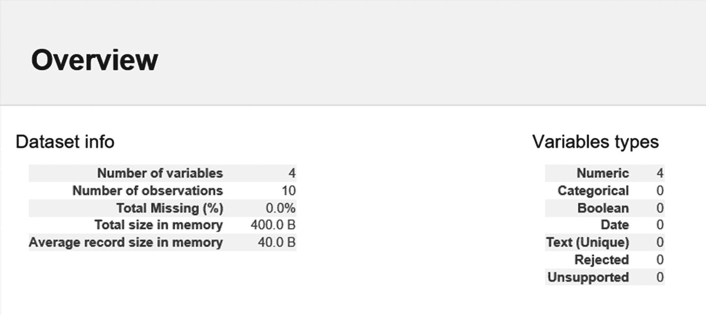

图 13-7

分析 – 概览

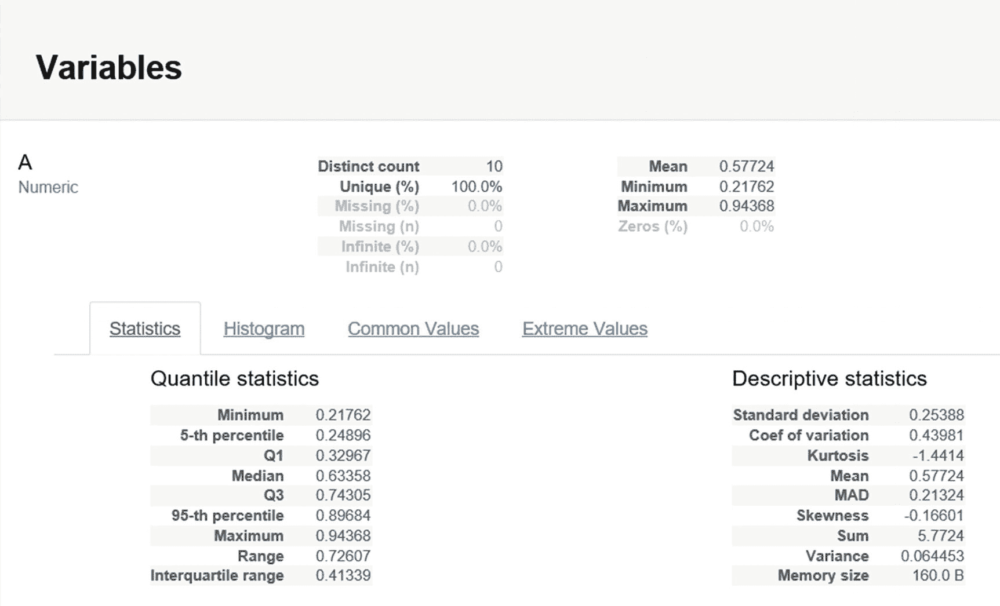

图 13-8

分析 – 变量 – 统计信息

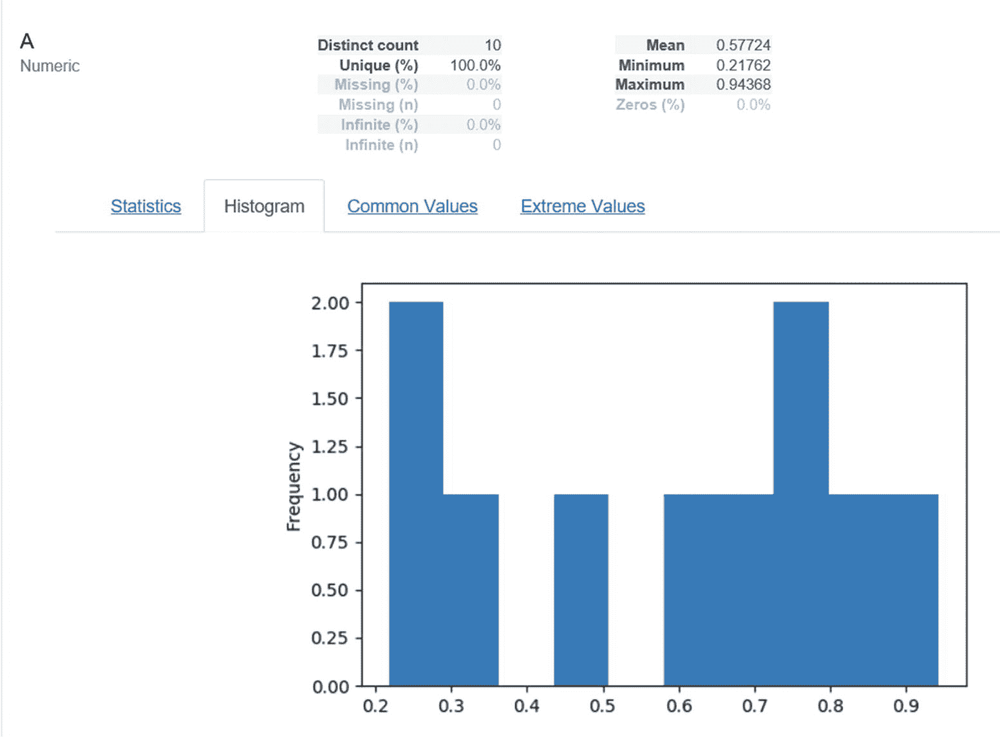

图 13-9

分析 – 变量 – 直方图

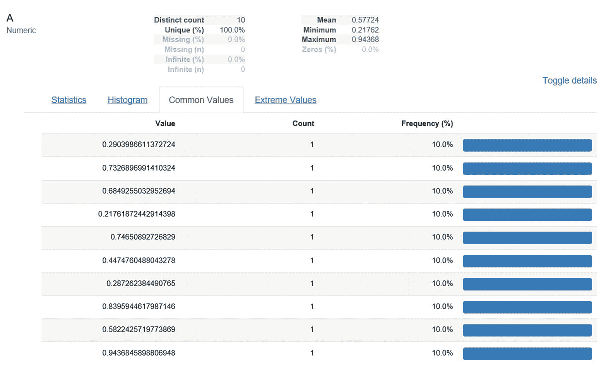

图 13-10

分析 – 变量 – 常见值

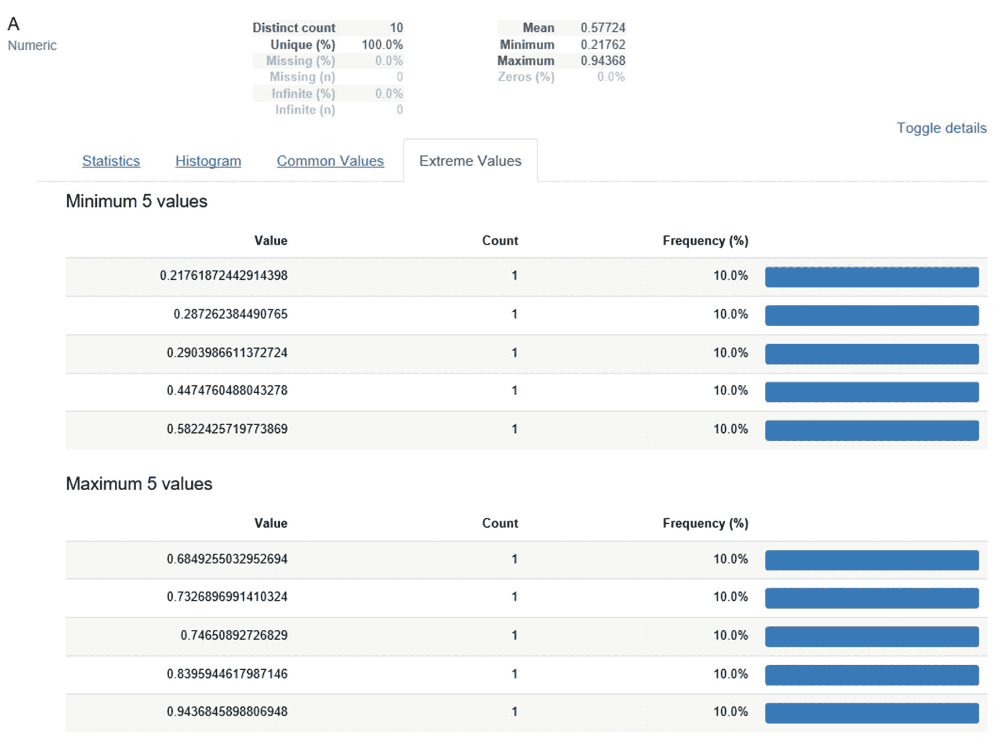

图 13-11

分析 – 变量 – 极值

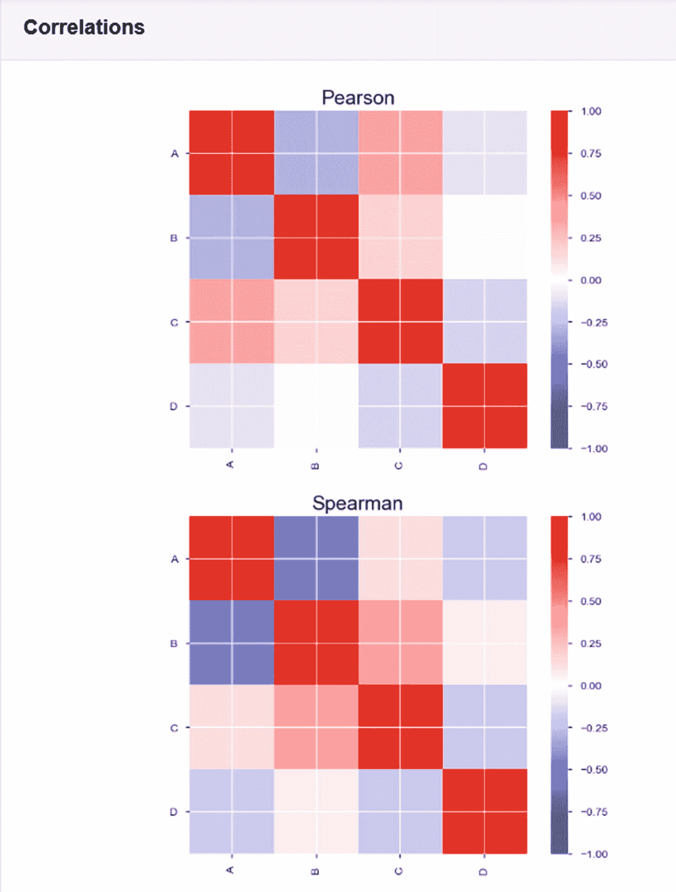

图 13-12

分析 – 相关性

皮尔逊相关系数是衡量两个变量 X 和 Y 之间线性相关性的指标。

两个变量之间的斯皮尔曼相关性等于这两个变量秩值的皮尔逊相关性；皮尔逊相关性评估线性关系，而斯皮尔曼相关性评估单调关系（无论是否线性）。参见图 13-13。

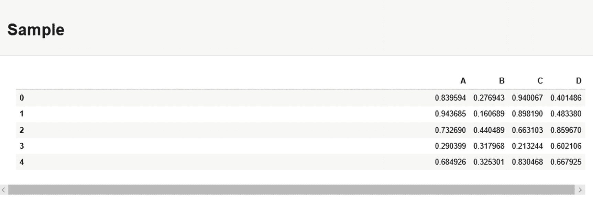

图 13-13

分析 – 样本

```
rejected_variables = profile.get_rejected_variables(threshold=0.9)
print(rejected_variables)
profile.to_file(outputfile="./100-Data-Profiles/08-Utility-Data-Profiler-01.html")
```

请使用网页浏览器检查 08-Utility-Data-Profiler-01.html：

```
import webbrowser
import os
wwwRealfile=os.path.realpath(wwwfile)
print(wwwRealfile)
webbrowser.open_new_tab(wwwRealfile)
```

现在您应该会打开一个网页浏览器，其中显示您的结果。

此分析将向您展示数据的许多特性，这些特性在未来的处理过程中非常有用。

现在您已经了解了基本流程，让我们尝试一些真实世界的数据源。

您需要从示例目录 Chapter 013 加载以下 Jupyter Notebook：Chapter 013/000-RIF/400-Utility-Layer/200-Data-Utilities/08-02-Utility-Data-Profiler-01-Time.ipynb

运行完整的分析，您的结果应为：

```
Date     Time
count      1051200  1051200
unique         730     1440
top     2017-09-06    08:07
freq          1440      730

Int64Index: 1051200 entries, 0 to 1051199
Data columns (total 2 columns):
Date    1051200 non-null object
Time    1051200 non-null object
dtypes: object(2)
memory usage: 24.1+ MB
```

### 警告

由于分析库的限制，此数据集无法进行分析。

您需要从示例目录 Chapter 013 加载以下 Jupyter Notebook：Chapter 013/000-RIF/400-Utility-Layer/200-Data-Utilities/08-03-Utility-Data-Profiler-02-Person.ipynb

运行完整的分析，您的结果应如图 13-14 所示。

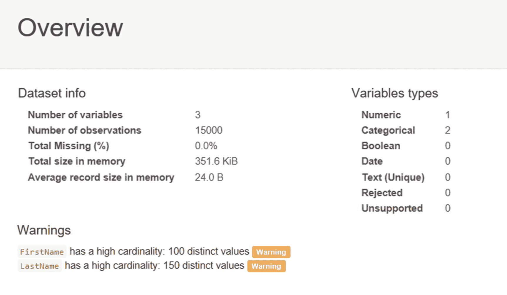

图 13-14

分析人员

您需要从示例目录 Chapter 013 加载以下 Jupyter Notebook：Chapter 013/000-RIF/400-Utility-Layer/200-Data-Utilities/08-04-Utility-Data-Profiler-03-Object.ipynb

运行完整的分析，您的结果应如图 13-15 所示。

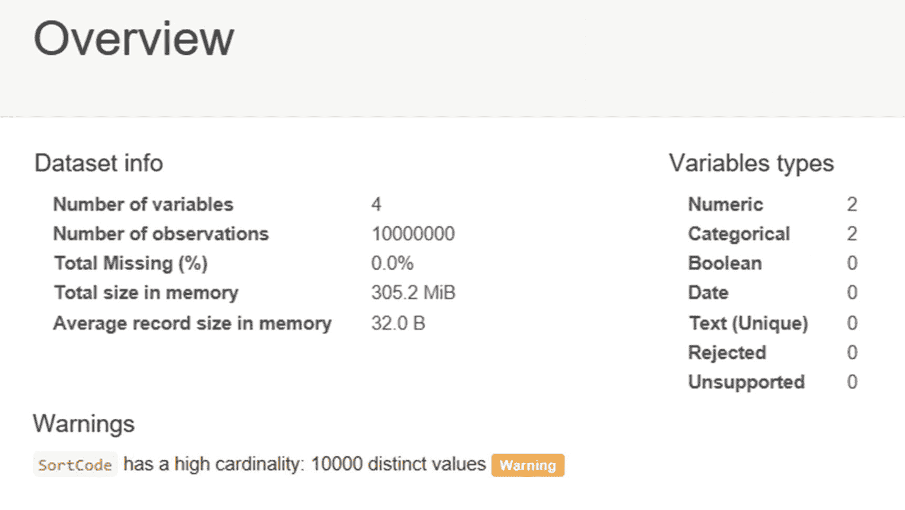

图 13-15

分析 – 人员

您需要从示例目录 Chapter 013 加载以下 Jupyter Notebook：Chapter 013/000-RIF/400-Utility-Layer/200-Data-Utilities/ 08-05-Utility-Data-Profiler-04-Location.ipynb

运行完整的分析，您的结果应如图 13-16 所示。

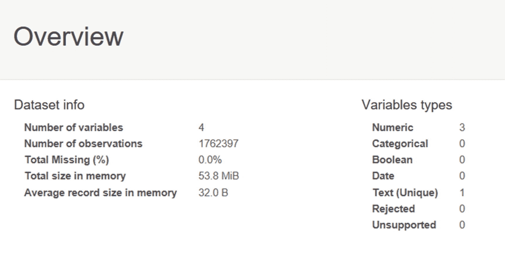

图 13-16

分析器-位置结果

您需要从示例目录 Chapter 013 加载以下 Jupyter Notebook：Chapter 013/000-RIF/400-Utility-Layer/200-Data-Utilities/08-06-Utility-Data-Profiler-05-Event.ipynb

运行完整的分析，您的结果应如图 13-17 所示。

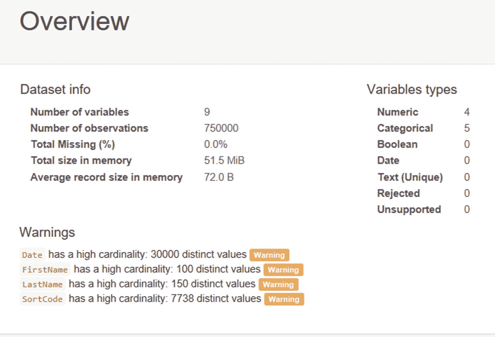

图 13-17

分析 – 事件

#### 处理工具

处理工具是作为 RIF 中 IML 算法和技术的处理能力的通用接口的工具。相同的 IML 算法可以从一个处理引擎移植到另一个处理引擎，以确保未来的能力。

### 业务层

该层包含业务需求（功能性和非功能性）。

我还将在此层中存储我准备的所有子模型，以确保我对它们的开发拥有一套完整的业务和技术文档。

该层中存储以下内容。

#### 业务需求

业务需求是交付后能提供价值的规范；它从系统最终用户的角度定义了拟议机器学习生态系统的特性。


### 警告

请记住，你构建的算法是为了支持更大的业务目标。

#### 太阳模型

太阳模型是一系列技术图表，用于在数据科学家与其客户之间沟通数据科学需求。

##### 外伸维度

外伸维度（图 13-18）通过将一个较小的维度直接通过外键附加到主公共维度上，从而扩展公共数据特征。

示例：所有日期，如出生日期、离校日期、毕业日期等，现在都可以通过公共特征进行扩展，这些特征有助于机器学习找到共同的相关性。

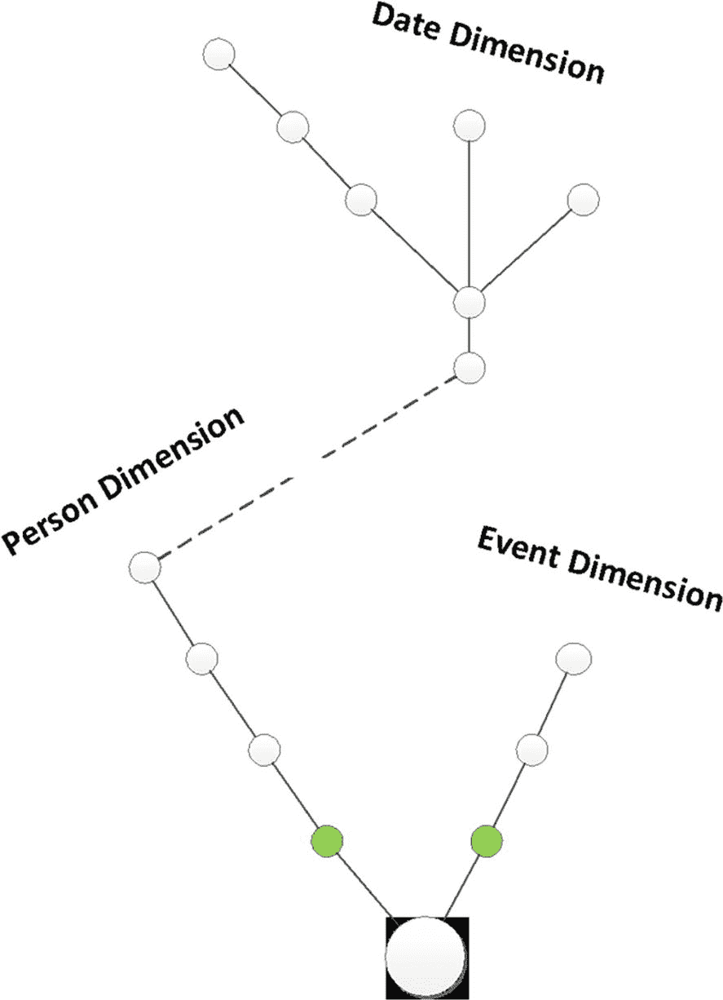

图 13-18

外伸维度

##### 微维度

微维度通过将一组新的数据维度特征链接到该维度的主键上，从而引入这些特征。

微维度用于通过机器学习实现分类、聚类或预测，从而支持数据科学。参见图 13-19。

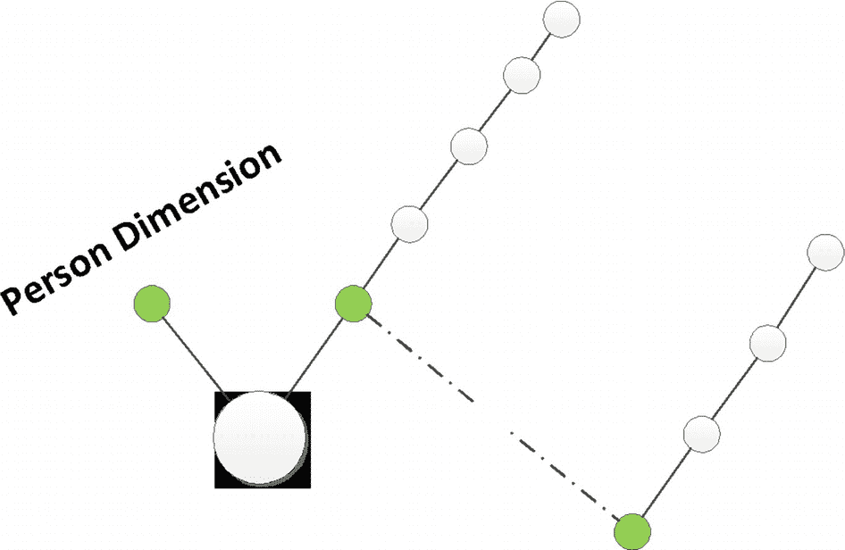

图 13-19

微维度

### 提示

我使用标准数据仓库原则加上机器学习，用机器学习成果来增强传统数据仓库。

微维度是数据仓库与数据科学之间的交付纽带。

##### 桥接维度

桥接维度允许在两个维度之间创建多对多关系，以处理一个维度通过同一组键被多次链接的情况。参见图 13-20。

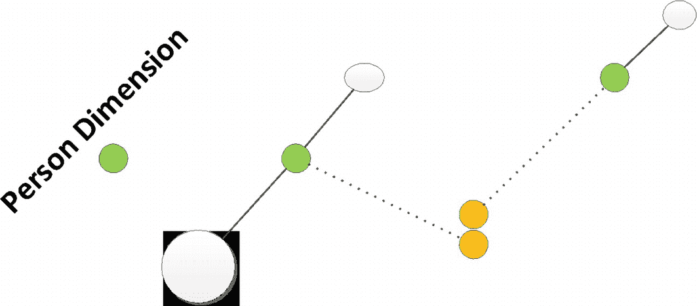

图 13-20

桥接维度

这种桥接常见于数据维度之间存在复杂关系的情况。我发现，当聚类分类存在重叠，或者由于不确定性导致特定实体在任意时间点可能属于多个维度时，这种情况很常见。

### 警告

请谨慎使用这些维度，因为它们可能会扩展到巨大的维度空间，对处理能力要求很高。

以上是对太阳模型的快速基础介绍。

如需更多信息，请参阅以下书籍：

*   *《实用 Hive：Hadoop 数据仓库系统指南》*，作者：Scott Shaw、Andreas François Vermeulen、Ankur Gupta 和 David Kjerrumgaard（Apress，2016 年）。

*   *《实用数据科学：构建技术栈将数据湖转化为业务资产指南》*，作者：Andreas François Vermeulen（Apress，2018 年）。

我现在将更详细地介绍这些概念。

#### 数据剖析

数据剖析是对当前信息源中可访问的数据进行探索性调查的过程，并通过一系列数据科学流程收集统计数据或揭示关于这些数据的摘要信息。

### 提示

数据剖析是核心流程，它将为你提供关于数据的真实信息。

数据剖析还将揭示数据中的洞察，这些洞察可以确定特定类别的机器学习算法是否适合解决数据科学家提交给它的数据。

#### 数据可追溯性

可追溯性，在处理链可追溯性中，是指识别、跟踪和追溯数据流程元素的能力，这些元素沿着处理链从原始数据移动到完整的数据科学洞察。

此过程会生成两份重要报告。

##### 数据来源

这精确地说明了数据的来源，并向使用你结果的业务人员阐明了原始来源的有效性。

示例：提取自 2019-01-10 06:00 的伦敦 CRM – 意味着不包含来自纽约的数据，也不包含伦敦 06:00 之后的数据。

### 警告

缺乏数据来源可能会因缺乏信任而使出色的机器学习结果变得毫无用处。

##### 数据沿袭

数据沿袭指的是数据随时间推移所经历的来源和转换。基本上，数据沿袭讲述了特定数据片段的故事。这使您能够了解数据的来源，以及它在何时何地与其他数据分离和合并。

### 提示

请记住包含机器学习洞察的来源和沿袭信息，这将为你的结果奠定信任基础。

至此，五个系统层介绍完毕。我将在第 15 章中解释如何在实际解决方案中使用它们。

现在，我将向你介绍用于存储数据以持久化你的 IML 数据工程和数据科学的数据湖。

## 六个数据湖区域

共有六个数据湖区域（图 13-21）。

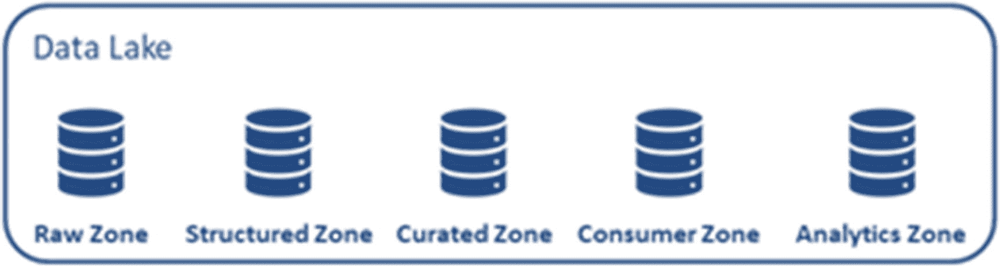

图 13-21

数据湖区域

### 工作区


工作区是数据湖中的一个临时区域，IML 流程在处理数据以生成洞察的过程中，可以在此短期存储结果。

### 警告

此区域中的数据应始终被视为不正确、不完整和不准确的，除非你在当前运行的 IML 生态系统批次中自己创建了这些数据。

### 提示

始终在工作区中每个批次运行前后执行清理操作，以确保数据湖高效且有效。

我有一个个人应用的比例：如果工作区超过数据湖的 10%，则说明你没有正确使用它。如果我发现超出此配额，我将开始调查为何使用了如此多的临时空间。

### 原始区域


原始区域是所有数据湖外部数据的入口点。原始区域是多个数据提取处理解决方案的终点。

此区域中数据的唯一要求是每个数据集都有其唯一的标识符。数据集本身的内容与该区域无关。

此区域中的所有数据都是读取时定义模式。

可选的额外功能如下：

*   每个数据集都包含一个唯一可识别的源系统 ID。

*   每个数据集的完整元数据描述。

*   对该区域活动的完整审计。

数据集可以通过以下任何途径到达：

*   批量上传 – 这是进入数据湖最常见的途径。

*   通过消息系统（如 Apache Kafka ([`http://kafka.apache.org/`](http://kafka.apache.org/) )、Apache NIFI ([`https://nifi.apache.org/`](https://nifi.apache.org/)) 或 Apache Flink ([`https://flink.apache.org/`](https://flink.apache.org/))）进行流式传输。

*   通过物联网流程。

### 注意

原始区域应始终独立于其他数据工程工作，即，它绝不应持有或阻塞数据的处理。

### 警告

在执行 IML 处理时，切勿从原始区域删除数据。请使用单独的独立清理策略。

请记住，特定类型的数据可能只有有限的有效生命周期。示例：如果一张安全卡允许某人进入特定房间，并且该操作被记录为该人现在在该房间内。那么逻辑上可以接受的是，如果一周后此人仍在房间内，则数据存在错误。


### 结构化区域


结构化区域用于将原始数据转换为增强型数据源。该区域的数据采用统一格式，以辅助下一区域的处理能力。所有数据质量问题都在此区域解决。

结构化区域是经过处理的原始数据的存储空间，处理方式是通过识别与所处理数据集相关的元数据。此时，这些数据在每个数据集级别上都携带一个唯一 ID，以及详细的数据类型和字段名称。

结构化区域中数据集的格式通常是一种，或尽可能少的几种格式。

其设计理念是将整个结构化区域的数据简化为一种通用格式。

### 提示

像 HDF5（[`https://www.hdfgroup.org/`](https://www.hdfgroup.org/)）这样的数据格式在此环境中表现良好，因为它可以同时存储数据和元数据。

#### HDF5

HDF5 是一种用于存储和管理数据的数据模型、库和文件格式。它支持无限多种数据类型，专为灵活高效的 I/O 以及处理海量复杂数据而设计。HDF5 具有可移植性和可扩展性，允许应用程序在使用中不断演进。参见图 13-22。

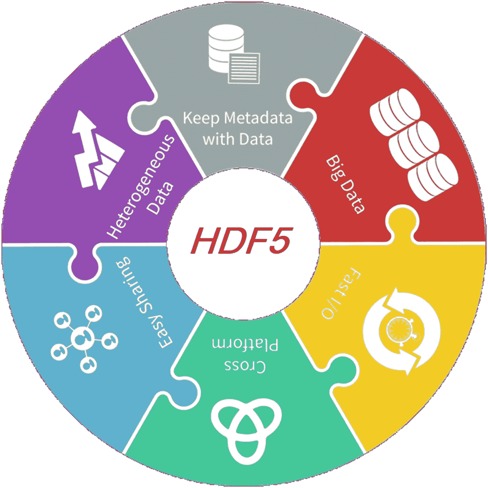

图 13-22

HDF5 生态系统

你需要从示例目录 Chapter 013 加载以下 Jupyter Notebook：打开 Chapter 013/000-RIF/100-Functional-Layer/100-Retrieve/08-03-Retrieve-04-Location-HDF5-01.ipynb

你可以看到简单的 Python 命令：

```
locationDF.to_hdf(fullRealName1, format="fixed", key="location", index=False, encoding='utf-8')
```

这为系统启用了 HDF5 格式。

#### Parquet

Apache Parquet 是一种列式存储格式，可供 Hadoop 生态系统中的任何项目使用。

`(`[`https://parquet.apache.org/`](https://parquet.apache.org/)`)`

你研究这种格式的主要原因是它在 Hadoop 生态系统中被广泛使用。

使用它将确保将来你可以从本地环境迁移到云生态系统，而无需更改格式。

你可能需要一个额外的库来启用 Parquet 引擎。我通常使用 pyarrow，因为它是云生态系统中最常用的引擎。

```
conda install -c conda-forge pyarrow
```

我将指导你了解 Parquet 的两种选项。

你需要从示例目录 Chapter 013 加载以下 Jupyter Notebook：

打开 Chapter 013/000-RIF/100-Functional-Layer/100-Retrieve/08-03-Assess-04-Location-Parquet-01.ipynb

你可以看到简单的 Python 命令：

```
locationDF.to_parquet(fullRealName1, engine="auto", compression="snappy")
```

以及

```
locationDF.to_parquet(fullRealName2, engine="auto", compression="gzip")
```

这为系统启用了 Parquet 格式。

### 警告

Snappy 压缩的文件大小是 GZip 压缩文件大小的 1.496 倍。因此，如果可能，请使用 GZip。这种文件大小的缩减将使你能够在需要更多磁盘之前，在数据湖中存储更多数据。

我对结构化区域的介绍到此结束，后续内容将在第 15 章继续。

### 策展区域


策展区域是整个数据湖中当前的“***唯一事实来源***”。该区域中的数据仓库和数据仓库实现了来自结构化区域的数据源的整合与合并。“实时”数据科学模型的结果存储在此区域。

### 消费区域


消费区域是存储用于业务洞察的不同数据集市的地方，供最终用户可视化其业务洞察。

这是大多数业务人员提问的主要区域。

### 分析区域


分析区域是数据湖的“沙盒”。此区域用于设计、开发和训练新的创新数据科学和机器学习解决方案，之后 DevOps 会将新版本的 IML 移交给策展区域。

### 提示

按照计划的和按需的更新周期，将策展区域设置为分析区域，因为你不希望在创新性 IML 工作进行到一半时发生意外更新。我通常在每个为期 10 天的冲刺周期的第二个周期开始时执行一次更新，且该周期不与月末在同一周，因为这样我的团队有一个月的时间来完成工作，并且不会在繁忙的月末冲刺期间因更新而感到压力。

这是 IML 使用的最后一个数据湖区域。

### Delta Lake

我将简要讨论一个已发布为开源的新创新处理引擎。

Delta Lake 是一个开源存储层，为 Apache Spark™ 和大数据工作负载带来了 ACID 事务。（参见 [`https://delta.io/`](https://delta.io/)）

提醒一下，ACID（原子性、一致性、隔离性和持久性）是数据湖事务的一组属性，旨在即使在处理过程中发生错误或失败时也能保证有效性。

这对于将数据湖用作 IML 生态系统的核心数据存储来说是一个重大推动。

### 提示

我将使用标准文件目录讨论接下来的概念，但我也会引用如何使用 Delta Lake 执行相同操作。

你需要：

*   pip install --upgrade pyspark 然后 pyspark --packages io.delta:delta-core_2.12:0.1.0

*   打开 Chapter 013/000-RIF/100-Functional-Layer/100-Retrieve/08-03-Assess-04-Location-Parquet-01.ipynb

### 警告

全新的创新机器学习概念即将到来！

## RAPTOR/QUBE

***RAPTOR/QUBE*** 是我在过去八年中一直在开发的一个创新处理框架。它不是行业标准，而是我过去十年收集的知识的自我组合。

### 注意

我将解释这些概念，以便你能够开发自己的自动处理引擎。

### 快速信息框架

***快速信息框架*** 是综合生态系统的处理引擎，我将类似的框架用于我所有的数据科学、机器学习和数据仓库工作。

它是我为客户和我的公司处理数据的通用***平台***。

你需要从示例目录 Chapter 013 加载以下 Jupyter Notebook：打开 Chapter 013/000-RIF/100-Functional-Layer/100-Retrieve/08-03-Setup-RAPTORQUBE.ipynb

你之前见过这个结构，但有两个小改动：

*   RIF 编号为：010-RIF

*   数据湖 (DL) 编号为：995-DL

这样做是为了在本章即将进行的工作中创建一个新的结构。

此时，我建议你运行笔记本中的所有步骤。

如果你想跟随步骤操作，你也可以从上到下运行单元格，以了解该过程的工作原理。

### 警告

当此设置运行时，它会移除 RIF 和 DL 中的任何先前数据。

### 提示

我通常使用多个 RIF，以便为客户提供更精细的处理能力，并能够轻松切换到新版本。


### 提示

仅当数据有高安全性或隐私分离要求时，我才会使用多个数据湖。

现在你可以关闭 Chapter-013-03-Setup-RAPTORQUBE 章节，因为你需要进入下一阶段，构建你的微处理引擎。

你需要从示例目录 Chapter 013 中加载以下 Jupyter Notebook：打开 Chapter 013/000-RIF/100-Functional-Layer/100-Retrieve/08-04-Build-RAPTORQUBE.ipynb

你需要再次使用我们的核心库：

```
import datetime
nowStart = datetime.datetime.now()
import os
import time
import shutil
import pandas as pd
```

设置一些默认值：

```
pathDL='../../Results/Chapter 013/995-DL/'
pathRIFInName='../../Data/Chapter 013/100-Kafka-Data/'
pathRIFOutName='../../Results/Chapter 013/995-DL/100-Raw-Zone/100-Kafka-Data/'
```

通过清理数据湖来执行一些日常维护。

```
if os.path.exists(pathRIFOutName):
shutil.rmtree(pathRIFOutName)
time.sleep(5)
```

重置数据湖核心数据集：

```
if not os.path.exists(pathRIFOutName):
shutil.copytree(pathRIFInName, pathRIFOutName)
```

获取数据湖的完整路径：

```
pathRealDLname=os.path.realpath(pathRIFOutName)
print(pathRealDLname)
```

显示现有结构：

```
for root, dirs, files in os.walk(pathRealDLname, topdown=True):
for name in dirs:
print(os.path.join(root, name))
```

你应该会看到类似如下的结果：

```
.\Results\995-DL\100-Raw-Zone\100-Kafka-Data\01-Time
.\Results\995-DL\100-Raw-Zone\100-Kafka-Data\02-Person
.\Results\995-DL\100-Raw-Zone\100-Kafka-Data\03-Object
.\Results\995-DL\100-Raw-Zone\100-Kafka-Data\04-Location
.\Results\995-DL\100-Raw-Zone\100-Kafka-Data\05-Event
for root, dirs, files in os.walk(pathRealDLname, topdown=True):
for name in files:
print(os.path.join(root, name))
.\Results\995-DL\100-Raw-Zone\100-Kafka-Data\01-Time\Time-Date.csv
.\Results\995-DL\100-Raw-Zone\100-Kafka-Data\01-Time\Time-Time.csv
.\Results\995-DL\100-Raw-Zone\100-Kafka-Data\02-Person\Person.csv
.\Results\995-DL\100-Raw-Zone\100-Kafka-Data\03-Object\Object.csv.gz
.\Results\995-DL\100-Raw-Zone\100-Kafka-Data\04-Location\Location.csv.gz
.\Results\995-DL\100-Raw-Zone\100-Kafka-Data\05-Event\Event.csv.gz
```

#### 检索

检索 IML 脚本存储在此处，用于每种机器学习算法的组合，以将数据从工厂外部提取到数据湖中。

```
kafkaName=os.path.join(pathRealDLname, '01-Time','Time-Date.csv')
print(kafkaName)
DateDF=pd.read_csv(kafkaName, header=0)
print(DateDF.shape)
retrieveName = os.path.join(pathDL, '100-Raw-Zone', '08-02-Time-Date.csv.gz')
DateDF.to_csv(retrieveName, index=False, encoding='utf-8', compression="gzip")
kafkaName=os.path.join(pathRealDLname, '01-Time','Time-Time.csv')
print(kafkaName)
DateDF=pd.read_csv(kafkaName, header=0)
print(DateDF.shape)
retrieveName = os.path.join(pathDL, '100-Raw-Zone', '08-02-Time-Time.csv.gz')
DateDF.to_csv(retrieveName, index=False, encoding='utf-8', compression="gzip")
```

#### 评估

评估 IML 脚本用于每种机器学习算法的组合，根据预先批准的数据质量规则评估数据，以提高数据质量。

```
retrieveName = os.path.join(pathDL, '100-Raw-Zone', '08-02-Time-Date.csv.gz')
DateDF=pd.read_csv(retrieveName, header=0, encoding='utf-8', compression="gzip")
print(DateDF.shape)
(730, 2)
print(DateDF.info())

RangeIndex: 730 entries, 0 to 729
Data columns (total 2 columns):
DateKey    730 non-null object
Date       730 non-null object
dtypes: object(2)
memory usage: 11.5+ KB
None
print(DateDF.describe())
DateKey        Date
count         730         730
unique        730         730
top     D20170410  2017-05-24
freq            1           1
assessName = os.path.join(pathDL,'200-Structured-Zone', 'Time-Date.csv.gz')
DateDF.to_csv(assessName, index=False, encoding='utf-8', compression="gzip")
retrieveName = os.path.join(pathDL, '100-Raw-Zone', '08-02-Time-Time.csv.gz')
DateDF=pd.read_csv(retrieveName, header=0, encoding='utf-8', compression="gzip")
print(DateDF.shape)
(1440, 2)
print(DateDF.info())

RangeIndex: 1440 entries, 0 to 1439
Data columns (total 2 columns):
TimeKey    1440 non-null object
Time       1440 non-null object
dtypes: object(2)
memory usage: 22.6+ KB
None
print(DateDF.describe())
TimeKey   Time
count     1440   1440
unique    1440   1440
top      T1939  13:35
freq         1      1
assessName = os.path.join(pathDL,'200-Structured-Zone', 'Time-Time.csv.gz')
DateDF.to_csv(assessName, index=False, encoding='utf-8', compression="gzip")
```


#### 流程

IML 脚本流程用于每种机器学习算法的组合，这些算法用于将数据加载到时间-人员-对象-地点-事件（T-P-O-L-E）数据仓库中，以创建统一的数据结构。

```
retrieveName1 = os.path.join(pathDL, '100-Raw-Zone', '08-02-Time-Date.csv.gz')
retrieveName2 = os.path.join(pathDL, '100-Raw-Zone', '08-02-Time-Time.csv.gz')
Date1DF=pd.read_csv(retrieveName1, header=0, encoding='utf-8', compression="gzip")
Date2DF=pd.read_csv(retrieveName2, header=0, encoding='utf-8', compression="gzip")
print(Date1DF.info())

RangeIndex: 730 entries, 0 to 729
Data columns (total 2 columns):
DateKey    730 non-null object
Date       730 non-null object
dtypes: object(2)
memory usage: 11.5+ KB
None
print(Date2DF.info())

RangeIndex: 1440 entries, 0 to 1439
Data columns (total 2 columns):
TimeKey    1440 non-null object
Time       1440 non-null object
dtypes: object(2)
memory usage: 22.6+ KB
None
Date1DF['Key'] = 1
Date2DF['Key'] = 1
DateDF=Date1DF.merge(Date2DF, how="outer")
DateDF.drop('Key',axis=1, inplace=True)
DateDF.set_index(['DateKey','TimeKey'], inplace=True)
print(DateDF.info())

Int64Index: 1051200 entries, 0 to 1051199
Data columns (total 4 columns):
DateKey    1051200 non-null object
Date       1051200 non-null object
TimeKey    1051200 non-null object
Time       1051200 non-null object
dtypes: object(4)
memory usage: 40.1+ MB
None
processName = os.path.join(pathDL,'300-Curated-Zone', 'Hub', 'Time', 'Hub-Time.csv.gz')
DateDF.to_csv(processName, index=False, encoding='utf-8', compression="gzip")
print(processName)
TimeMax=DateDF.shape[0]
TimeMax=1000
for i in range(TimeMax):
d0 = str(DateDF['Date'][i] + ' ' + DateDF['Time'][i])
DateDF0 = datetime.datetime.strptime(d0,'%Y-%m-%d %H:%M')
DateDF1 = str(DateDF0)
fulldatetime=DateDF0.strftime('%Y-%m-%d %H:%M:%S')
yearweek = DateDF0.strftime('%Y-%W')
weekdaylong = DateDF0.strftime('%A')
weekdayshort = DateDF0.strftime('%a')
monthlong = DateDF0.strftime('%B')
monthshort = DateDF0.strftime('%b')
ampm = DateDF0.strftime('%p')
timezone = DateDF0.strftime('%Z')
year = DateDF0.strftime('%Y')
quarter = (int(DateDF0.strftime('%m')) % 4)
month = DateDF0.strftime('%m')
day = DateDF0.strftime('%d')
if i==0:
s1=pd.DataFrame([[DateDF1,fulldatetime]])
s2=pd.DataFrame([[DateDF1,yearweek]])
s3=pd.DataFrame([[DateDF1,weekdaylong,weekdayshort]])
s4=pd.DataFrame([[DateDF1,monthlong,monthshort]])
s5=pd.DataFrame([[DateDF1,ampm]])
s6=pd.DataFrame([[DateDF1,timezone]])
s7=pd.DataFrame([[DateDF1,year]])
s8=pd.DataFrame([[DateDF1,month]])
s9=pd.DataFrame([[DateDF1,day]])
s10=pd.DataFrame([[DateDF1,quarter]])
else:
s1a=pd.DataFrame([[DateDF1,fulldatetime]])
s2a=pd.DataFrame([[DateDF1,yearweek]])
s3a=pd.DataFrame([[DateDF1,weekdaylong,weekdayshort]])
s4a=pd.DataFrame([[DateDF1,monthlong,monthshort]])
s5a=pd.DataFrame([[DateDF1,ampm]])
s6a=pd.DataFrame([[DateDF1,timezone]])
s7a=pd.DataFrame([[DateDF1,year]])
s8a=pd.DataFrame([[DateDF1,month]])
s9a=pd.DataFrame([[DateDF1,day]])
s10a=pd.DataFrame([[DateDF1,quarter]])
s1=s1.append(s1a)
s2=s2.append(s2a)
s3=s3.append(s3a)
s4=s4.append(s4a)
s5=s5.append(s5a)
s6=s6.append(s6a)
s7=s7.append(s7a)
s8=s8.append(s8a)
s9=s9.append(s9a)
s10=s10.append(s10a)
s1.columns = (['DateTime','FullDateTime'])
s2.columns = (['DateTime','YearWeek'])
s3.columns = (['DateTime','WeekDayLong','WeekDayShort'])
s4.columns = (['DateTime','MonthDayLong','MonthDayShort'])
s5.columns = (['DateTime','Am-PM'])
s6.columns = (['DateTime','Time-Zone'])
s7.columns = (['DateTime','Year'])
s8.columns = (['DateTime','Month'])
s9.columns = (['DateTime','Day'])
s10.columns = (['DateTime','Quarter'])
s0=s1
s0=s0.merge(s2, on="DateTime")
s0=s0.merge(s3, on="DateTime")
s0=s0.merge(s4, on="DateTime")
s0=s0.merge(s5, on="DateTime")
s0=s0.merge(s6, on="DateTime")
s0=s0.merge(s7, on="DateTime")
s0=s0.merge(s8, on="DateTime")
print(s0.shape)
DateDF=s0
processName = os.path.join(pathDL,'300-Curated-Zone', 'Satellite', 'Hub', 'Time', 'Satellite-Hub-Time-00.csv.gz')
DateDF.to_csv(processName, index=False, encoding='utf-8', compression="gzip")
print(processName)
DateDF=s1
processName = os.path.join(pathDL,'300-Curated-Zone', 'Satellite', 'Hub', 'Time', 'Satellite-Hub-Time-01.csv.gz')
DateDF.to_csv(processName, index=False, encoding='utf-8', compression="gzip")
print(processName)
DateDF=s2
processName = os.path.join(pathDL,'300-Curated-Zone', 'Satellite', 'Hub', 'Time', 'Satellite-Hub-Time-02.csv.gz')
DateDF.to_csv(processName, index=False, encoding='utf-8', compression="gzip")
print(processName)
DateDF=s3
processName = os.path.join(pathDL,'300-Curated-Zone', 'Satellite', 'Hub', 'Time', 'Satellite-Hub-Time-03.csv.gz')
DateDF.to_csv(processName, index=False, encoding='utf-8', compression="gzip")
print(processName)
DateDF=s4
processName = os.path.join(pathDL,'300-Curated-Zone', 'Satellite', 'Hub', 'Time', 'Satellite-Hub-Time-04.csv.gz')
DateDF.to_csv(processName, index=False, encoding='utf-8', compression="gzip")
print(processName)
DateDF=s3
processName = os.path.join(pathDL,'300-Curated-Zone', 'Satellite', 'Hub', 'Time', 'Satellite-Hub-Time-04.csv.gz')
DateDF.to_csv(processName, index=False, encoding='utf-8', compression="gzip")
print(processName)
DateDF=s5
processName = os.path.join(pathDL,'300-Curated-Zone', 'Satellite', 'Hub', 'Time', 'Satellite-Hub-Time-05.csv.gz')
DateDF.to_csv(processName, index=False, encoding='utf-8', compression="gzip")
print(processName)
DateDF=s6
processName = os.path.join(pathDL,'300-Curated-Zone', 'Satellite', 'Hub', 'Time', 'Satellite-Hub-Time-06.csv.gz')
DateDF.to_csv(processName, index=False, encoding='utf-8', compression="gzip")
print(processName)
DateDF=s7
processName = os.path.join(pathDL,'300-Curated-Zone', 'Satellite', 'Hub', 'Time', 'Satellite-Hub-Time-07.csv.gz')
DateDF.to_csv(processName, index=False, encoding='utf-8', compression="gzip")
print(processName)
DateDF=s8
processName = os.path.join(pathDL,'300-Curated-Zone', 'Satellite', 'Hub', 'Time', 'Satellite-Hub-Time-02.csv.gz')
DateDF.to_csv(processName, index=False, encoding='utf-8', compression="gzip")
print(processName)
DateDF=s9
processName = os.path.join(pathDL,'300-Curated-Zone', 'Satellite', 'Hub', 'Time', 'Satellite-Hub-Time-02.csv.gz')
DateDF.to_csv(processName, index=False, encoding='utf-8', compression="gzip")
print(processName)
DateDF=s10
processName = os.path.join(pathDL,'300-Curated-Zone', 'Satellite', 'Hub', 'Time', 'Satellite-Hub-Time-10.csv.gz')
DateDF.to_csv(processName, index=False, encoding='utf-8', compression="gzip")
print(processName)
```

让我们检查一下您创建的原始区域：

```
pathReportname= '../../Results/Chapter 013/995-DL/100-Raw-Zone/'
for root, dirs, files in os.walk(pathReportname, topdown=True):
for name in files :
print(os.path.join(root, name))
../../Results/Chapter 013/995-DL/100-Raw-Zone/08-02-Time-Date.csv.gz
../../Results/Chapter 013/995-DL/100-Raw-Zone/08-02-Time-Time.csv.gz
../../Results/Chapter 013/995-DL/100-Raw-Zone/100-Kafka-Data\01-Time\Time-Date.csv
../../Results/Chapter 013/995-DL/100-Raw-Zone/100-Kafka-Data\01-Time\Time-Time.csv
../../Results/Chapter 013/995-DL/100-Raw-Zone/100-Kafka-Data\02-Person\Person.csv
../../Results/Chapter 013/995-DL/100-Raw-Zone/100-Kafka-Data\03-Object\Object.csv.gz
../../Results/Chapter 013/995-DL/100-Raw-Zone/100-Kafka-Data\04-Location\Location.csv.gz
../../Results/Chapter 013/995-DL/100-Raw-Zone/100-Kafka-Data\05-Event\Event.csv.gz
```

让我们检查一下您创建的结构化区域：

```
../../Results/Chapter 013/995-DL/200-Structured-Zone/Time-Date.csv.gz
../../Results/Chapter 013/995-DL/200-Structured-Zone/Time-Time.csv.gz
```

让我们检查一下您创建的策展区域：

```
pathReportname= '../../Results/Chapter 013/995-DL/300-Curated-Zone/Hub/'
for root, dirs, files in os.walk(pathReportname, topdown=True):
for name in files:
print(os.path.join(root, name))
../../Results/Chapter 013/995-DL/300-Curated-Zone/Hub/Time\Hub-Time.csv.gz
pathReportname= '../../Results/Chapter 013/995-DL/300-Curated-Zone/Satellite/Hub/Time'
for root, dirs, files in os.walk(pathReportname, topdown=True):
for name in files:
print(os.path.join(root, name))
../../Results/Chapter 013/995-DL/300-Curated-Zone/Satellite/Hub/Time\Satellite-Hub-Time-00.csv.gz
../../Results/Chapter 013/995-DL/300-Curated-Zone/Satellite/Hub/Time\Satellite-Hub-Time-01.csv.gz
../../Results/Chapter 013/995-DL/300-Curated-Zone/Satellite/Hub/Time\Satellite-Hub-Time-02.csv.gz
../../Results/Chapter 013/995-DL/300-Curated-Zone/Satellite/Hub/Time\Satellite-Hub-Time-03.csv.gz
../../Results/Chapter 013/995-DL/300-Curated-Zone/Satellite/Hub/Time\Satellite-Hub-Time-04.csv.gz
../../Results/Chapter 013/995-DL/300-Curated-Zone/Satellite/Hub/Time\Satellite-Hub-Time-05.csv.gz
../../Results/Chapter 013/995-DL/300-Curated-Zone/Satellite/Hub/Time\Satellite-Hub-Time-06.csv.gz
../../Results/Chapter 013/995-DL/300-Curated-Zone/Satellite/Hub/Time\Satellite-Hub-Time-07.csv.gz
../../Results/Chapter 013/995-DL/300-Curated-Zone/Satellite/Hub/Time\Satellite-Hub-Time-08.csv.gz
../../Results/Chapter 013/995-DL/300-Curated-Zone/Satellite/Hub/Time\Satellite-Hub-Time-09.csv.gz
../../Results/Chapter 013/995-DL/300-Curated-Zone/Satellite/Hub/Time\Satellite-Hub-Time-10.csv.gz
```


#### 转换

针对每种机器学习算法组合的转换 IML 脚本，用于将数据仓库提取到数据湖中。

这部分处理流程针对已加载的数据建立机器学习模型。

```
processName = os.path.join(pathDL, '300-Curated-Zone','Satellite','Hub','Time', 'Satellite-Hub-Time-00.csv.gz')
DateDF=pd.read_csv(processName, header=0, encoding='utf-8', compression="gzip")
print(DateDF.shape)
(5000, 11)
print(DateDF.describe())
Time-Zone    Year   Month
count        0.0  5000.0  5000.0
mean         NaN  2017.0     1.0
std          NaN     0.0     0.0
min          NaN  2017.0     1.0
25%          NaN  2017.0     1.0
50%          NaN  2017.0     1.0
75%          NaN  2017.0     1.0
max          NaN  2017.0     1.0
print(DateDF.info())

RangeIndex: 5000 entries, 0 to 4999
Data columns (total 11 columns):
DateTime         5000 non-null object
FullDateTime     5000 non-null object
YearWeek         5000 non-null object
WeekDayLong      5000 non-null object
WeekDayShort     5000 non-null object
MonthDayLong     5000 non-null object
MonthDayShort    5000 non-null object
Am-PM            5000 non-null object
Time-Zone        0 non-null float64
Year             5000 non-null int64
Month            5000 non-null int64
dtypes: float64(1), int64(2), object(8)
memory usage: 429.8+ KB
None
import pandas_profiling as pdp
profile=pdp.ProfileReport(DateDF)
%%javascript
IPython.OutputArea.auto_scroll_threshold = 9999;
Profile
```

#### 组织

针对机器学习算法组合的组织 IML 脚本，将数据仓库拆分为适当的、特定主题的数据集市。

```
wwwfile= os.path.join(pathDL, '300-Curated-Zone','Satellite','Hub','Time', 'Satellite-Hub-Time-00.html')
profile.to_file(outputfile=wwwfile)
```

您已存储了包含相关性的数据概况分析结果。

此操作现已组织好数据，可供客户访问。

#### 报告

针对每种机器学习算法组合的报告 IML 脚本，为工厂创建可视化报告，以呈现其形成的知识。

```
import webbrowser
import os
wwwRealfile=os.path.realpath(wwwfile)
print(wwwRealfile)
```

您现在将打开报告（图 13-23）。

```
webbrowser.open_new_tab(wwwRealfile)
```

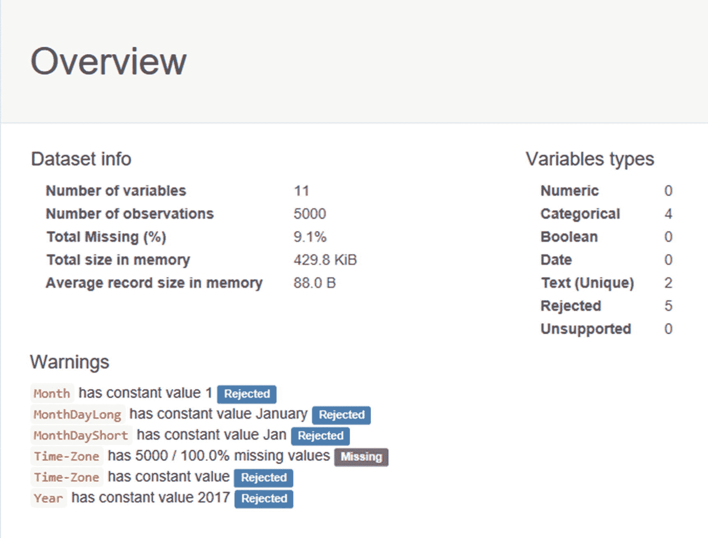

图 13-23

时间概况报告

结果表明，像 Month 和 Time-Zone 这样的字段对于另一种机器学习来说没有用处。

### 提示

通过执行简单的机器学习或数据科学，您可以快速从数据工程特征创建中排除有问题的字段。

干得好；您已使用简单的机器学习分析完成了基本的数据发现过程。

### 深度学习引擎

深度学习引擎是自动 IML 的核心，它监控并控制多个快速信息工厂，以处理数据科学和数据工程需求。

#### 量子

基本引擎由***大量***优化的处理器组成，这些处理器作为无服务器、基于云的数据集成代理运行，使用***群体原则***，能够以最小的数据操作来操纵跨工厂的数据实体。该处理引擎使用***量子原则***，能够同时并行处理通过多个工厂的多个数据流。

这产生了一个***有向无环图 (DAG)***，它通过在***快速信息工厂***之间共享数据来***放大***净处理吞吐量。

### 提示

我创建了一个处理引擎，它以 Python 代码作为输出。是的，我有一个可以编写数据科学和机器学习代码的 Python 系统。

我将仅从概念上提及这个进化代码生成器，因为它目前仍在开发和测试中，之后才能与大众分享。

### 注意

一旦我解决了这个问题，我将用更多细节更新本节。

#### 通用

处理过程由您作为数据科学家和机器学习工程师建立的一套***系统化***且***精确***的规则所指导。

核心设计是，您仅启用特定类型的机器学习，或设计一个***强化学习***算法，该算法使用***进化编程***来发现适用于您数据湖原始区域中每个数据集的所需机器学习。

#### 有界

处理域仅支持一套***有界***的***规则集***，因为它具有***有限种群***。这个有限种群导致了一个在处理需求上可预测的域，因为域中的每一步都针对***有效性***和***效率***进行了单独优化。

#### 引擎

核心是一个***数据处理设备***，它将数据转化为知识，并采用人在回路中来学习如何学习新的数据集。其优势在于，通过***有界规则***和***量子处理计划***对数据进行整合，确保了在引擎控制下的众多数据工厂具有***高度有效***且***高效***的处理特性。

我希望您留意这些自动编码平台，因为我预测在未来五年内，大部分的机器学习将被工业化，然后由这些代理创建。

然而，在此之前，您仍然需要人在回路中的帮助来解决业务洞察问题。

我建议您阅读本章的其余部分，以了解您的需求需要何种类型的人工帮助。它还将指出您在整体机器学习生态系统中的位置。

## 哪种类型的机器学习？

机器学习需要高度专业化的专家才能使其完美运行。现在，我将向您介绍一些您在机器学习生态系统中会听到的通用职位描述。

### 数据分析师

#### 职位描述

您的工作是将数据转化为可执行的业务洞察。您通常是技术团队与业务战略、销售或营销团队之间的桥梁。数据可视化将成为您日常工作的重要组成部分。

#### 为何重要

高技术人员通常难以理解数据分析师为何如此重要，但他们确实是连接业务的纽带。需要有人将经过训练和测试的模型以及大量用户数据调整为易于理解的格式，以便围绕它们设计业务战略和洞察。数据分析师有助于确保数据科学团队不会浪费时间解决无法带来业务价值的问题。

#### 要求

您将使用的技术包括 Python、SQL、Tableau 和 Excel。您还需要具备良好的沟通能力。

#### 问题

您将处理的问题听起来像这样：

*   “是什么推动了我们银行卡的增长数据？”

*   “我们如何向管理层阐明，银行手续费的新一轮上涨正在导致客户流失？”


### 数据工程师

#### 职位描述

你将负责管理处理大量数据的公司的数据管道。这意味着要确保数据能够高效地从其源头被收集和检索，并在需要时进行清洗和预处理。

#### 重要性

如果你只处理过存储在 .csv 或 .txt 文件中相对较小（<5 Gb）的数据集，可能很难理解为什么会有人全职从事构建和维护数据管道的工作。

原因如下：1) 一个 100 Gb 的数据集无法放入你电脑的内存（RAM）中，因此通常需要其他方式将其输入模型；2) 如此大量的数据可能需要极长的处理时间，并且为了完成所需的处理任务，通常必须不必要地将数据存储在交换空间中。

管理如此庞大的存储量需要专业的技术知识。这正是你的用武之地。

#### 技术要求

你将使用的技术包括 Apache Spark、Hadoop 和/或 Hive，以及 Kafka。你很可能需要具备扎实的 SQL 和数据库设计基础。你将是系统和生态系统的构建者。

#### 问题

你将处理的问题听起来像这样：

*   “如何构建一个能够每秒处理 100,000 个请求的管道？”

*   “如何在不将所有数据加载到内存的情况下清洗这个数据集？”

*   “我需要使用 Cuda GPU 来处理我的数据吗？”

### 数据科学家

#### 职位描述

你的工作将是清洗和探索数据集，并做出能够带来商业价值的预测。你的日常工作将涉及训练和优化模型，并经常将其部署到生产环境中。

#### 重要性

当你有一堆数据，大到人类无法解析，但又宝贵到不容忽视时，你需要某种方法从中提取易于理解的见解。这就是数据科学家的基本工作：将数据集转化为易于理解的结论。

#### 技术要求

你将使用的技术包括 Python、scikit-learn、Pandas、SQL，可能还有 Flask、Spark 和/或 TensorFlow/PyTorch。一些数据科学职位纯粹是技术性的，但大多数职位会要求你具备一定的商业头脑，这样你就不会最终去解决那些没人关心的问题。

你需要理解你所使用的每个机器学习算法的详细响应，因为你需要知道在什么设置下，哪些参数能以高效率和高效能提供最优解决方案。

#### 问题

你将处理的问题听起来像这样：

*   “我们到底有多少种不同的用户类型？”

*   “我们能构建一个模型来预测哪些产品会卖给哪些用户吗？”

*   “你能对我的网络聊天数据进行情感分析吗？”

### 提示

数据科学家的角色将变得非常重要或相关，以至于董事会成员将负责机器学习及其对业务和客户的影响。

### 机器学习研究员

#### 职位描述

你的工作将是寻找新的方法来解决数据科学和深度学习中的挑战性问题。你不会使用现成的解决方案，而是会自己创造解决方案。他们是 IML 工作坊中研发部门的一部分。

### 提示

我预测，随着机器学习在未来五年内成为主流，这类人才将非常抢手。

#### 技术要求

你将使用的技术包括 Python、TensorFlow/PyTorch（和/或企业级深度学习框架）以及 SQL。

#### 问题

你将处理的问题范围广泛：

“如何将我们模型的准确率提高到更接近当前最优水平？”

“自定义优化器是否有助于减少训练时间？”

“如何改变数据工程需求以获得更好的结果？”

我在这里列出的五个职位描述并非在所有情况下都独立存在。例如，在早期创业公司，数据科学家可能还必须兼任数据工程师和/或数据分析师。但大多数工作会更明确地属于这些类别之一——而且公司越大，这些类别就越适用。

总的来说，要记住的是，为了获得录用，你最好构建一个更专注的技能组合：如果你想成为数据分析师，就不要学习 TensorFlow；如果你想成为机器学习研究员，就不要优先学习 PySpark。

### 机器学习工程师

职位描述：你的工作将是构建、优化机器学习模型并将其部署到生产环境。你通常会将机器学习模型视为 API 或组件，并将其集成到某种全栈应用或硬件中，但也可能需要你自己设计模型。

技术要求：你将使用的技术包括 Python、JavaScript、scikit-learn、TensorFlow/PyTorch（和/或企业级深度学习框架）以及 SQL 或 MongoDB（通常用于应用数据库）。

你将处理的问题听起来像这样：

*   “如何将这个 Keras 模型集成到我们的 JavaScript 应用中？”

*   “如何降低我们推荐系统的预测时间和预测成本？”

## 你学到了什么？

你应该对 RIF 有了一个基本的设计思路。

你需要理解，该处理过程包含六个不同的超级处理步骤，以确保机器学习有效、高效且可复现。

将传统机器学习转变为 IML，仅仅是应用一个可重复的标准流程，你和你的同事可以轻松地遵循它，为你的客户和你们自己取得成功。

## 下一步是什么？

你现在已经理解了第四次工业革命是什么。

下一章是“工业化人工智能”。我将总结前面的章节，为你提供本书所有知识的实际应用。

所以，我建议你喝杯咖啡或茶，然后我们将进入第 15 章的最后阶段。

