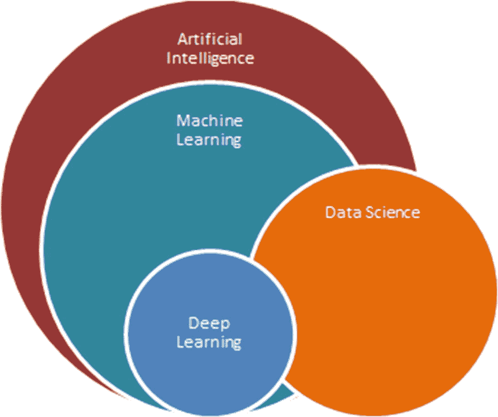
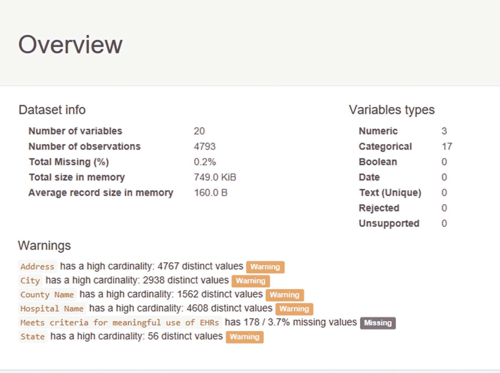
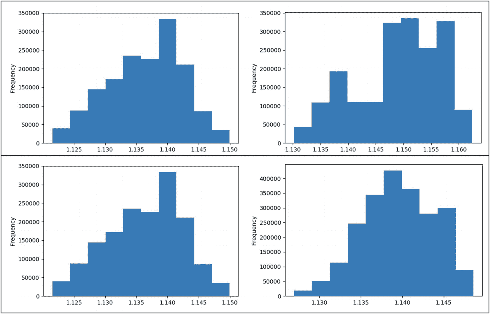
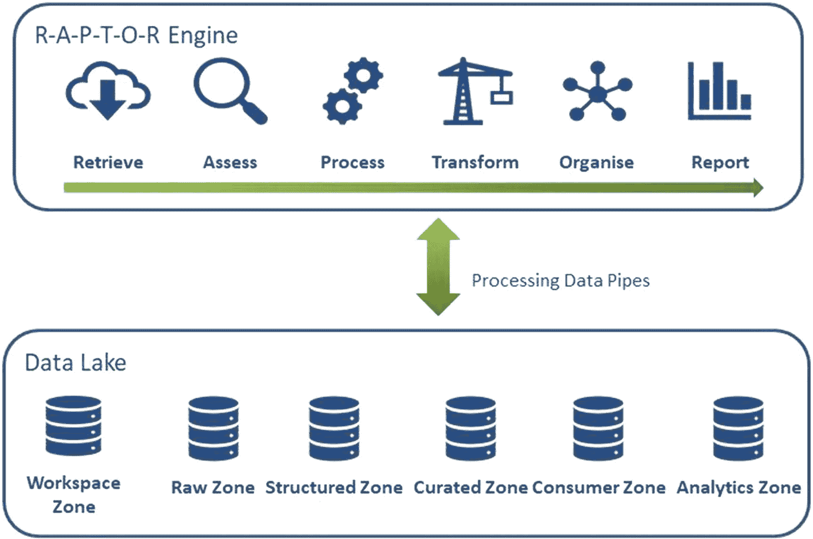

# 14. 工业化人工智能

现实世界中的工业化人工智能（IAI）是一个复杂的过程。你有能力在自己的环境中模拟现实世界的基本构建模块，以针对你的模型测试你的机器学习应用。

## 机器学习在何处适用？

人工智能（AI）由主要技术构成，这些技术终有一天会被用来形成一种通用的方法论，以推动我们的工业化发展。机器学习完全属于 AI 的知识领域。

正如本书前面所讨论的，深度学习是最终的机器学习过程。

现在，我将引导你增强对基础数据科学的理解，以理解机器学习。这将赋予你 IAI 的能力，借助我们现有的能力，它可以帮助你实现自主机器学习的目标。



图 14-1

机器学习示意图

机器学习与 AI、深度学习以及部分数据科学领域存在重叠。

图 14-1 中所示的完整技能集将为你提供成为一名优秀数据科学家所需的大部分技能，从而能够执行出色的机器学习。


## 大数据的影响

预计到 2025 年，全球大数据将惊人地增长至 175 泽字节（ZB）。

这一数据增长将是智能代理融入我们生活的结果，这些智能代理利用机器学习和其他形式的人工智能，来分析我们生活中数字设备所产生的日益增长的数据。我们周围的设备正以前所未有的细节描绘着我们的生活。

这些数据是在开发驾驶辅助和自动驾驶技术、物联网设备（包括我们身体、家庭、工厂和城市中的传感器）、为 360 度视频和增强现实创建高分辨率内容，以及 5G 通信的过程中产生的。这一切都得益于边缘网络和集中式数据中心的建设，它们有助于分析、通信和存储最终数据。这套完整的数字技术创造被称为“*数字化转型*”。

据福布斯（[`www.forbes.com`](http://www.forbes.com)）预测，到 2025 年，全球 49%的存储数据将驻留在公共云环境中，30%的全球数据量将是实时数据。到那时，世界上每个联网的人（约占当时总人口的 75%）每天将进行超过 4900 次数字数据交互，大约每 18 秒一次。产生大部分数据的物联网设备将在 2025 年产生超过 90 ZB 的数据。

接下来讨论四个主要增长领域。

### 医疗保健

IDC（[`www.idc.com`](http://www.idc.com)）预测，医疗保健数据将从 2019 年的不到 1.5 ZB 增长到 2025 年的超过 12 ZB。

#### 规模预测

超过 80%的医疗保健提供商计划使用云解决方案作为其主要存储。

超过 75%的医疗保健提供商计划使用边缘计算来处理决策。

超过 65%的医疗保健提供商将在 2025 年之前使用大数据和机器学习来处理当前的数据需求。

到 2025 年，超过 9 ZB 的数据将是安全且敏感的数据。

到 2025 年，超过 2 ZB 的数据将是近实时的。

到 2025 年，超过 1.5 ZB 的数据将是用于辅助决策的分析数据。

数据访问存在偏差，因为在任何特定时间点，活跃的存储数据占比不到 3%，尽管在紧急情况下，对于不到 2%的关键救命信息，休眠患者数据的所需访问周转时间少于 15 分钟。

#### 挑战

向基于价值的护理转变、消费主义的兴起以及个性化医疗的前景正在推动医疗保健行业的发展。

医疗保健组织必须为数字时代做好准备，但该行业传统上（并且公认地）在技术采用方面落后于其他行业。

正确的身份和安全控制对于组织实现有效的数据治理、防止数据滥用和加速流程自动化至关重要。

IT 技能差距在医疗保健领域更为明显，并且短期内不太可能缩小。医疗保健公司必须寻求外部帮助。

失败将导致生命损失或造成严重的长期损害。

#### 解决方案

医疗保健正在走向线上，当您选择加入服务时，您的物联网设备正成为解决方案的一部分。

为了换取更好的医疗保健，我们允许系统全天候监控我们身体的重要指标。

**警告** 超过 35%的医疗保健数据保管人不确定哪些数据需要何种级别的保护，以及在 IML 处理数据时如何保护它。

示例：

*   打开第 14 章示例中的 Jupyter Notebook，文件名为：Chapter-014-01-Setup.ipynb

*   执行后，您将为第 14 章的处理创建一个完整的快速信息工厂。

*   打开第 14 章示例中的 Jupyter Notebook，文件名为：Chapter-014-02-01-Retrieve.ipynb

*   您现在应该在目录中有一个名为“14-01-Retrieve-Healthcare.csv.gz”的文件。

*   ..\990-DL\100-Raw-Zone

*   您已成功加载您的医疗保健数据。

*   关闭笔记本。

*   打开第 14 章示例中的 Jupyter Notebook，文件名为：Chapter-014-02-01-Assess.ipynb

*   您现在应该在..\990-DL\200-Structured-Zone 中有一个名为 14-01-Assess-Healthcare.csv.gz 的文件。

您的结果如图 14-2 所示。



图 14-2

医疗保健数据概况

您现在可以关闭您的笔记本。

### 提示

在处理医疗保健数据时，请确保您已获得所有正确的安全和伦理批准，因为这类数据受隐私保护，违反将面临严厉罚款。

### 金融服务

预计金融服务数据将从 2019 年的不到 2.5 ZB 增长到 2025 年的超过 10 ZB。

如果市场保持当前的增长预测，这将是 400%的增长。

#### 规模预测

超过 80%的金融服务机构计划使用云解决方案作为其主要存储。

超过 75%的金融服务机构计划使用边缘计算来处理决策。

超过 65%的金融服务机构将在 2025 年之前使用大数据和机器学习来处理当前的数据需求。

到 2025 年，超过 9.5 ZB 的数据将是安全且敏感的数据。

到 2025 年，超过 5.5 ZB 的数据将是近实时的。

到 2025 年，超过 0.3 ZB 的数据将是用于辅助决策的分析数据。

#### 挑战

最大的挑战是在金融服务行业大多数组织的孤岛式结构中管理和创建一个有效的数据环境。每个子行业内的业务线之间没有动力共享数据或合作寻求企业级解决方案。

在解决了数据整合这一关键挑战后，组织接下来必须解决安全性、隐私性和合规性问题。

金融服务公司是与客户相关的一些最敏感和私密数据的保管人。数字信任是服务提供商与客户之间的一种复杂关系，其基础是保护隐私、确保数据安全和防止欺诈。客户忠诚度取决于数字信任。

在所有数字平台上管理客户体验对于提高客户满意度和维持客户忠诚度至关重要。

#### 解决方案

打开第 14 章示例中的 Jupyter Notebook，文件名为：Chapter-014-05-Utility-Data-Profiler-02.ipynb

*   您现在应该在..\990-DL\200-Structured-Zone 中有一个名为 14-01-Assess-Healthcare.csv.gz 的文件。

您的结果应如图 14-3 所示。



图 14-3

金融科技公司的四个直方图


### 制造业

预计数据量将从 2019 年的不足 2.5 ZB 增长至 2025 年的超过 15 ZB

#### 规模预测

超过 90%的制造业企业计划将云解决方案作为其主要存储方式。

超过 95%的制造业企业计划使用边缘计算来处理决策。

到 2025 年，超过 95%的制造业企业将使用大数据和机器学习来处理当前的数据需求。

到 2025 年，超过 9 ZB 的数据将是安全且敏感的。

到 2025 年，超过 7 ZB 的数据将接近实时。

到 2025 年，超过 2.5 ZB 的数据将是用于辅助决策的分析数据。

数据访问存在偏差，即任何存储的数据中，在短时间内需要活跃使用的比例不足 1%。一旦产品完成，需要长期存储的数据比例不足 4%。

#### 挑战

不幸的是，随着物联网的发展，最终被存储的数据并不总能整齐地归入一个通用的数据湖或系统中。

从 IT 基础设施和数据管理的角度来看，制造业是一个由同类企业组成的成熟生态系统。虽然大量产品通过不同的流程制造，但其 IT 和数据管理基础设施是众所周知的，并由经过时间考验的分析、反馈循环以及现在的物联网设备所驱动。这形成了一个理想的行业同行群体，他们经常相互学习，并合理地同步采用各种 IT 技术。

将传感器嵌入日常产品中，为理解客户如何使用产品提供了新的途径。

在过去三年中，我们工厂产生的数据量增长了 100 多倍。新的传感器、流程以及更普遍的连接性，使我们的工程师能够将传感器嵌入到任何事物中。我们仍在努力解决如何从数据孤岛中提取数据的问题，但我们正处于如何利用这些数据的重大变革边缘。

#### 解决方案

机器人通过云端进行通信，以确保支持一致、有效且高效的制造流程。最大的挑战是在保持包容性系统灵活性的同时，整合正确的传感器数据。

### 警告

超过 65%的机器人反馈数据从未离开机器人生态系统，因此数据管理者对其 IML 流程未使用哪些数据一无所知。



图 14-4

采用数据湖结构的 RAPTOR

### 提示

我发现采用结构化数据湖（图 14-4）的 RAPTOR 流程在这些物联网解决方案上运行得非常好，因为你只需要修改读取特定类型传感器的具体检索流程即可适应变化。

我预测物联网的扩张速度将超过当前任何预测。

这个单一市场将成为人类历史上最大的数据生成器。

### 媒体与娱乐

预计数据量将从 2019 年的不足 3.5 ZB 增长至 2025 年的超过 20 ZB。

#### 规模预测

超过 90%的媒体与娱乐企业计划将云解决方案作为其主要存储方式。

超过 85%的媒体与娱乐企业计划使用边缘计算来处理决策。

到 2025 年，超过 80%的媒体与娱乐企业将使用大数据和机器学习来处理当前的数据需求。

到 2025 年，超过 19 ZB 的数据将是安全且敏感的。

到 2025 年，超过 2.5 ZB 的数据将接近实时。

到 2025 年，超过 3.5 ZB 的数据将是用于辅助决策的分析数据。

数据访问存在偏差，即在任何特定时间点，存储的数据中活跃使用的比例不足 90%，但特定人员访问的数据集总量不足 0.5%。人们期望特定的媒体或娱乐项目在不到 1.5 分钟内到达系统边缘。

#### 挑战

媒体与娱乐行业庞大且多样化，涵盖了制作和发行电影、电视节目和广告、体育、流媒体内容、音乐、音频、报纸、书籍、杂志和视频游戏的各种公司。

数据量巨大，尤其是在我们的营销团队实现数字化之后。其中很多工作是由第三方完成的，我们拥有大量数据，但这些数据却存放在他人手中。弄清楚这个数据环境的一个关键部分……就是我们如何取回这些数据并进行存储。

任何经 CPU 处理的事物都具有通缩效应（即，虚拟创造某物比创造实物更便宜）……最终，演员们……布景搭建……突然之间，成本从数百万美元……变成了数十万美元。

通过将数字媒体资产迁移到云端来获得控制权，是许多媒体和娱乐公司重要的第一步。数字版权管理（DRM）和反盗版技术可以得到有效增强。

#### 解决方案

### 警告

媒体与娱乐所包含的数据量对 IML 来说是一个重大挑战。

恭喜！您已读完大数据影响部分。

## 游戏

有一种新型娱乐方式正在收集海量数据，并催生了重大的机器学习机遇。

打开第 14 章示例中的 Jupyter Notebook，文件名为：Chapter-014-06-Games-01.ipynb

你应该了解一下 PyGame，它是 SDL 多媒体库的一个 Python 封装模块，使你能够模拟游戏，这些游戏可用于解决复杂的现实世界问题。

逐步执行该笔记本，以深入了解代码为实现最终目标所使用的技术。

基本要求是解决这个国际象棋挑战：

*   你有一个骑士，必须访问一个 18 x 18 格巨型棋盘上的每一个方格。

### 提示

目前，在世界上，针对游戏数据有效进行机器学习处理是一项非常受欢迎的技能。

## 模拟

模拟是你正在研究的现实世界的一个模型，通过创建过程的虚拟表示，使你的机器学习能够在一个可以多次重置的世界中测试其能力，从而能够应用基于深度学习过程的强化学习。

模拟的艺术源于运筹学、数据科学和机器学习领域。


### SimPy

SimPy 是一个基于标准 Python 的、以进程为基础的离散事件仿真框架。

SimPy 中的进程由 Python 生成器函数定义，例如，可用于对客户、车辆或代理等主动组件进行建模。SimPy 还提供了多种类型的共享资源，用于对有限容量的拥堵点（如服务器、收银台和隧道）进行建模。

仿真可以“尽可能快”地运行，也可以实时（挂钟时间）运行，或者通过手动逐步触发事件来运行。SimPy 库可通过以下命令安装：

```
安装 SimPy
conda install -c mutirri/label/anaconda simpy
```

#### 基本仿真器设置

现在，我将指导你如何构建并测试你的第一个仿真。

基本的仿真将模拟四个进程。

*   **极快处理器** - 每四分之一秒运行一次

*   **快速处理器** - 每半秒运行一次

*   **慢速处理器** - 每秒运行一次

*   **极慢处理器** - 每两秒运行一次

打开第 9 章示例中的 Jupyter Notebook，文件名为：Chapter-014-07-Basic-Sim-01.ipynb

```
import simpy
def clock(env, name, tick):
while True:
print('%6.2f > %s' % (env.now, name))
yield env.timeout(tick)
env = simpy.Environment()
env.process(clock(env, 'very fast', 0.25))
env.process(clock(env, 'fast', 0.5))
env.process(clock(env, 'slow', 1))
env.process(clock(env, 'very slow', 2))
env.run(until=3)
```

你的运行结果如下：

```
0.00 > very fast
0.00 > fast
0.00 > slow
0.00 > very slow
0.25 > very fast
0.50 > fast
0.50 > very fast
0.75 > very fast
1.00 > slow
1.00 > fast
1.00 > very fast
1.25 > very fast
1.50 > fast
1.50 > very fast
1.75 > very fast
2.00 > very slow
2.00 > slow
2.00 > fast
2.00 > very fast
2.25 > very fast
2.50 > fast
2.50 > very fast
2.75 > very fast
```

### 提示

研究一下如果将 `env.run(until=100)` 会发生什么。

请参阅 Chapter-014-07-Basic-Sim-02.ipynb

#### 银行仿真

我将指导你如何运用所学知识，通过模拟一个每 5 秒到达 2000 名客户的银行排队系统，来实现银行系统的工业化。

打开第 9 章示例中的 Jupyter Notebook，文件名为：Chapter-014-07-Bank-Sim-01.ipynb

此笔记本模拟了一个银行队列，其中人们只等待一段时间然后离开。此仿真将产生更真实的数据，为你的数据科学和机器学习提供基础，以展示生态系统的近实时行为。

你的运行结果如下：

```
Bank Withdraw Simulation One
0.0000 Customer-0001-Ready: I have arrived
0.0000 Customer-0001-Ready: Waited for 0.0000
12.6687 Customer-0001-Ready: Finished
16.0343 Customer-0002-Ready: I have arrived
16.0343 Customer-0002-Ready: Waited for 0.0000
18.0321 Customer-0003-Ready: I have arrived
20.0008 Customer-0003-Ready: left bank unserved at 1.9687
41.4728 Customer-0002-Ready: Finished
60.0490 Customer-0004-Ready: I have arrived
60.0490 Customer-0004-Ready: Waited for 0.0000
61.3580 Customer-0005-Ready: I have arrived
62.4971 Customer-0005-Ready: left bank unserved at 1.1391
64.9048 Customer-0004-Ready: Finished
```

### 提示

尝试设置 `NEW_CUSTOMERS = 500`。

你现在正在为 500 名客户服务，但情况不妙！

### 提示

尝试设置 `counter = simpy.Resource(env, capacity=10)`。

你现在正在为 500 名客户服务，并有 10 个柜员 - 情况有所好转！

### 提示

尝试设置 `NEW_CUSTOMERS = 500` 和 `counter = simpy.Resource(env, capacity=20)`，但客户现在离开得更快 `MAX_PATIENCE = 3`

```
哇，它起作用了。我认为你的银行可以正常运作了。
```

你能看到这些仿真的价值吗？你可以通过使用这些简单的构建块轻松地模拟一个真实的银行。

#### 车间仿真

我将指导你如何运用所学知识，实现车间系统的工业化并模拟一个工作坊。

打开第 9 章示例中的 Jupyter Notebook，文件名为 Chapter-014-08-Workshop-Sim-01.ipynb

此仿真支持处理三个不同的车间：

```
两名员工启动
多工位 - 员工不足
多工位 - 员工过多
运行仿真，看看你的车间运行情况如何。
```

结果 1：

*   **小型车间** - 一对一工作流程。

*   在时间 6：工人完成工作：前台登记工作于时间 6。

*   **延迟工单**：在时间 12：工人未完成工作：前台登记工作于时间 10。

*   **延迟工单**：在时间 17：工人未完成工作：前台登记工作于时间 16。

*   在时间 21：工人完成工作：前台登记工作于时间 21。

结果 2：

*   **延迟工单**：在时间 22：供应商人员 B 未完成工作：前台 - 供应商登记工作于时间 21。

```
结果 3：
仍然有问题？
紧急变更：
更好地培训工人。
```

带培训的多流程车间

*   在时间 4：车间工人 000 完成工作：前台 - 车间登记工作于时间 4。

*   在时间 4：车间工人 001 完成工作：前台 - 车间登记工作于时间 4。

*   在时间 6：销售人员 A 完成工作：前台 - 销售登记工作于时间 6。

*   在时间 6：销售人员 B 完成工作：前台 - 销售登记工作于时间 6。

*   在时间 6：供应商人员 A 完成工作：前台 - 供应商登记工作于时间 6。

*   在时间 6：供应商人员 B 完成工作：前台 - 供应商登记工作于时间 6。

*   在时间 8：车间工人 000 完成工作：前台 - 车间登记工作于时间 8。

*   在时间 8：车间工人 001 完成工作：前台 - 车间登记工作于时间 8。

*   在时间 12：销售人员 A 完成工作：前台 - 销售登记工作于时间 12。

*   在时间 12：销售人员 B 完成工作：前台 - 销售登记工作于时间 12。

*   在时间 12：供应商人员 A 完成工作：前台 - 供应商登记工作于时间 12。

*   在时间 12：供应商人员 B 完成工作：前台 - 供应商登记工作于时间 12。

*   在时间 14：车间工人 000 完成工作：前台 - 车间登记工作于时间 14。

*   在时间 14：车间工人 001 完成工作：前台 - 车间登记工作于时间 14。

*   在时间 16：销售人员 A 完成工作：前台 - 销售登记工作于时间 16。

*   在时间 16：销售人员 B 完成工作：前台 - 销售登记工作于时间 16。

*   在时间 16：供应商人员 A 完成工作：前台 - 供应商登记工作于时间 16。

*   在时间 16：供应商人员 B 完成工作：前台 - 供应商登记工作于时间 16。

*   在时间 19：车间工人 000 完成工作：前台 - 车间登记工作于时间 19。

*   在时间 19：车间工人 001 完成工作：前台 - 车间登记工作于时间 19。

*   在时间 20：供应商人员 A 完成工作：前台 - 供应商登记工作于时间 20。

*   在时间 20：供应商人员 B 完成工作：前台 - 供应商登记工作于时间 20。

*   在时间 22：销售人员 A 完成工作：前台 - 销售登记工作于时间 22。

*   在时间 22：销售人员 B 完成工作：前台 - 销售登记工作于时间 22。

现在，你拥有一个成功的工作坊，并且配备了数量恰到好处的经过培训的员工。

#### 电影仿真

我将指导你如何运用所学知识，实现电影系统的工业化，以模拟电影发行商或流媒体服务。

打开第 14 章示例中的 Jupyter Notebook，文件名为：Chapter-014-09-Movies-Sim-01.ipynb

此仿真演示了如何对传输到多个电影盒的三个电影频道进行建模。如果你查看结果，你会发现有些人没有按时收到他们请求的电影。看看你是否能找到正确的参数组合来解决这些问题。

#### 燃料站仿真

我很高兴地报告，我们已经成功进入太空，并且你赢得了为所有航天器加油的合同。

你能解决客户无法获得燃料的问题吗？


#### 洗车模拟

现在我将引导你构建一个洗车模拟器。

打开第 9 章示例中的 Jupyter Notebook，文件名为：Chapter-014-12-Car-Wash-Sim-01.ipynb

你正在经营一家本地洗车店，并希望业务增长 50%；那么你的客户服务能力会发生什么变化？

这比先扩大业务规模要好。

### 提示

如果你在代码中添加一个简单的写入文件功能，就可以利用这些模拟为你的 IML 生成数据。

现在你已经掌握了执行 IAI 所需的知识。

## 工业化人工智能的限制

IAI 能力是现代世界最大的变革，因为它正在改变我们与世界的互动方式。在人类历史上，我们需要他人为我们执行智能工作。

这一新变革也催生了一套新的法律和政策来管理 IAI 生态系统。

其中最重要的新法律是《通用数据保护条例》（GDPR，更多信息见附录），它规定了我们的 IAI 在欧洲如何与人们的个人数据交互。这些规则正在扰乱当前 IAI 生态系统的处理能力。

以下是基本指南的快速总结。

### 知情权

个人有权了解其个人数据的收集和使用情况。这是 GDPR 下的一项关键透明度要求。

你必须向个人提供以下信息：你处理其个人数据的目的、个人数据的保留期限，以及数据将与谁共享。我们称之为“隐私信息”。

### 警告

如果你将人工智能（AI）应用于个人数据：

请坦诚相告，并解释你使用 AI 的目的。

如果处理目的在开始时并不明确，请向人们说明你打算如何处理他们的数据。随着你的处理目的变得更加清晰，请更新你的隐私信息，并主动告知相关人员。

在实际开始处理之前，告知人们个人数据的任何新用途。

如果你使用 AI 对个人做出具有法律或类似重大影响的完全自动化决策，请告知他们你使用了哪些信息、这些信息为何相关，以及可能产生的影响。

### 访问权

个人有权访问其个人数据。

个人有权从你处获得以下信息：

*   确认你正在处理其个人数据。你必须列出你应用于该数据的具体 IML 技术。

*   其个人数据的副本。你必须提供属于请求者的完整数据集。

### 提示

我建议你将处理的任何数据连同处理时使用的元数据一起存储在一个归档中，这样你就能快速响应这些请求，因为根据法律，你不能为此收取费用。因此，我建议你以最具成本效益的方式存储这些数据。

### 更正权

GDPR 赋予个人更正不准确的个人数据，或在数据不完整时进行补全的权利。

个人可以口头或书面形式提出更正请求。

你有一个日历月的时间来响应请求。

在某些情况下，你可以拒绝更正请求。

### 提示

我使用第 13 章中 RAPTOR 引擎六步法的“评估”步骤，以确保默认情况下达到数据质量。这通常能解决任何不准确的个人数据问题。

因此，请确保你处理的数据质量始终良好，并且你能证明已确保这些数据保持良好状态。

### 删除权（被遗忘权）

GDPR 引入了个人有权删除个人数据的规定。

删除权也被称为“被遗忘权”。

个人可以口头或书面形式提出删除请求。

你有一个月的时间来响应请求。

该权利并非绝对，仅适用于特定情况。（参见“何时不应删除”部分。）

### 警告

删除权与儿童个人数据涉及额外的复杂性，即使数据主体不再是儿童，这一规定仍然适用，因为儿童在同意时可能并未完全意识到处理过程中涉及的风险。

这项权利对企业来说是一个重大问题，因为它们持有的大部分数据都是花钱收集的，有时甚至是从信息经纪人那里以额外成本获得的。删除数据将产生财务影响。

### 注意

不要总是删除！

某些特定数据受其他法律保护，不应删除。

如果处理是出于以下原因之一所必需的，则删除权不适用：

*   行使言论和信息自由权；
*   履行法律义务；
*   执行符合公共利益或行使官方权力的任务；
*   出于公共利益、科学研究、历史研究或统计目的的存档，而删除可能使适当处理的实现变得不可能或严重损害其实现；
*   用于法律主张的建立、实施或辩护。

### 注意

如果收到有效的删除请求且没有豁免情况适用，那么你必须采取措施确保从备份系统以及在线系统中删除数据。

### 限制处理权

个人有权请求限制或禁止处理其个人数据。当处理受到限制时，你被允许存储个人数据，但不能使用它。

这意味着你可能拥有数据，但不能对你的数据应用机器学习。

### 警告

在开始任何机器学习处理之前，请确保你拥有完全不受限制的处理权限。

### 注意

该权利与更正权和反对权密切相关。

### 数据可携带权

数据可携带权允许个人获取其个人数据，并在不同服务中为自己的目的重复使用。它允许你以安全可靠的方式将个人数据从一个 IT 环境轻松复制或转移到另一个环境，而不影响其可用性。

这样做使个人能够利用那些可以使用这些数据为他们找到更优惠方案或帮助他们了解消费习惯的应用程序和服务。

开放银行是一个典型的例子，它正式允许发布个人数据以改善个人服务。

我个人也利用数据可携带协议来获取用于研究的数据，这些研究通过我的大学以及我们赞助的其他研究项目进行，旨在推动医疗保健和智慧城市领域的进步。

### 提示

我建议你寻找机会，将你的机器学习应用于改善大众生活。你通常会发现这些项目会得到支持，有时甚至还能获得资金。

### 反对权

GDPR 赋予个人在某些情况下反对处理其个人数据的权利。

个人拥有绝对的权利来阻止其数据被用于直接营销。

你必须告知个人他们的反对权。

这意味着你必须在数据处理中设置相关选项，以停止为特定目的处理数据。

我个人使用第 13 章中 RAPTOR 引擎的“组织”步骤，将数据的使用限制在特定目的上。

### 与自动化决策和用户画像相关的权利


### 警告

IML（可解释机器学习）与 GDPR（通用数据保护条例）有明确的区分。

自动化个体决策（完全通过自动化手段做出决策，无需任何人工参与）和用户画像分析（自动化处理个人数据以评估个体的某些特征）的流程仅在以下情况下才能执行：

你只能在满足以下条件时执行此类决策：

*   对于合同的签订或履行是必要的。

*   受数据控制者适用的法律授权。

*   获得个体的明确同意。

### 警告

用户画像分析被视为自动化决策过程的一部分。

这意味着你机器学习模型的训练需遵守 GDPR 规则。

现在你已经完成了 IML 大部分背景知识的学习。

做得好！！！

## 接下来是什么？

我们已经涵盖了工业化人工智能的内容。下一章是一个最终项目。现在，你将能够运用所有新知识，通过一个项目来实践你在本书中掌握的新技能和技巧。

所以，我建议你先喝杯咖啡或茶，然后我们将进入第 15 章的最终阶段。

