# 15. 最终工业化项目

在本书中，我们探讨了创建一个完整规模化工业化项目所需的工具。该项目是创建一家矿业公司，该公司将在火星上开采矿物，然后将矿物运回地球，并分发到需要特定资源的中心。

## 需求

火星拥有丰富的可开采资源，并且可以运回地球：

硅、氢、氧、铁、镁、[锰](https://tradingeconomics.com/commodity/manganese)、铝、钙、金、银、镍、钛、[铂](https://tradingeconomics.com/commodity/platinum)和铜都可供开采。

### 你的成本

一个采矿太空港造价为 10 万英镑，且只能支持 25 名矿工和 250 艘运输船。它需要两枚火箭才能到达火星。

一枚火箭每次行程花费 2 万英镑，前往火星的行程需要 150 到 300 天。每枚火箭每次只能运送四件采矿设备。

一台矿石采矿机造价 15 万英镑，每天运行成本为 5000 英镑。它每天可开采 1000 磅矿石。

一艘矿石运输船造价 5 万英镑，每天运行成本为 3500 英镑。它每天行驶 100 英里，每次行程可运载 250 磅，装卸货需要 10 分钟。

氢气和氧气提取器每台造价 1 万英镑，每天运行成本为 1500 英镑。一台提取器每天可生产 500 磅氢气或氧气。

每件采矿设备每天需要消耗 200 磅氢气和 100 磅氧气作为动力。

一个 3D 打印厂可以使用 1000 磅硅来打印额外的采矿机，750 磅用于打印矿石运输船，300 磅用于打印提取器，5000 磅用于打印火箭。建造一个新的 3D 打印厂需要 15 天和 7500 磅硅。

制造一台采矿机需要 5 天，制造一艘矿石运输船需要 3 天，制造一台提取器需要 1 天。

3D 打印每天消耗 400 磅氢气和 300 磅氧气。

你获得的初始资金最高为 100 万英镑。

在返航途中，每枚火箭只能运载 50 万磅矿石，并且每天消耗 6000 磅氢气和 2000 磅氧气。

你必须每年向股东返还 20%的利润。

### 你的收入

当前每 1000 磅矿石运抵地球的交易价格：

*   硅（1300 英镑）、铁（80 英镑）、镁（5000 英镑）、[锰](https://tradingeconomics.com/commodity/manganese)（40 英镑）、铝（800 英镑）、钙（220 英镑）、金（1200 英镑）、银（15 英镑）、镍（1500 英镑）、钛（30000 英镑）、[铂](https://tradingeconomics.com/commodity/platinum)（870 英镑）和铜（2500 英镑）。

*   现在你有了这个工业化问题，你需要将需求转化为一个 `IML` 解决方案。

*   我将引导你将新知识转化为一个完整可用的解决方案。

## 基本解决方案

快速信息工厂（`RIF`）和 `R-A-P-T-O-R` 引擎是一种工业级强化的处理方法论，它能够实现数据工程处理引擎的结构化设计和构建（图 15-1）。

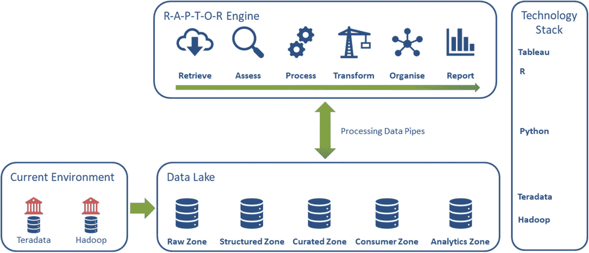

图 15-1

`RAPTOR` 引擎和 `RIF`

这个火星工厂将帮助你保持正轨，成为火星实业家。

那么，请打开第 15 章示例中的 `Jupyter Notebook`，文件名为：`Chapter-015-01-Setup-Mars.ipynb`

运行整个笔记本以设置新的生态系统。

这将通过编号 `010-RIF` 设置一个快速信息工厂，并通过编号 `999-DL` 设置一个数据湖。

## 地理空间知识

在开始你的太空采矿殖民地建设之前，以下内容将为你介绍基本的地理空间解决方案。

*   打开第 15 章示例中的 `Jupyter Notebook`，文件名为：`Chapter-015-02-GeoSpace-01.ipynb`

*   让我们从在地球上旅行开始。我建议我们从纽约旅行到伦敦，以演示地理空间原理。

*   执行该 notebook。

*   注意使用`纬度`和`经度`概念来导航地球。

你的结果：

*   你现在可以成功计算出从纽约到伦敦所需的导航路线。

*   以及从东京到悉尼……干得好，地球人！

*   现在我们可以进入外太空了。让我们看看我们的太阳系。

*   打开第 15 章示例中的 `Jupyter Notebook`，文件名为：`Chapter-015-03-GeoSpace-02.ipynb`

```
('New York to London', 3471.0772526498836, 'miles')
('New York to London', 5586.157350088574, 'kilometers')
('Tokyo to London', 5954.255569830391, 'miles')
('Tokyo to London', 9582.445475773122, 'kilometers')
('Sydney to London', 10556.4943034509, 'miles')
('Sydney to London', 16989.030768292887, 'kilometers')
```

行星的尺寸如下：

```
行星从小到大排列
冥王星     直径：   2376.600 公里
月球      直径：   3474.200 公里
水星      直径：   4879.400 公里
火星      直径：   6779.000 公里
金星      直径：  12104.000 公里
地球      直径：  12742.000 公里
海王星    直径：  49244.000 公里
天王星    直径：  50724.000 公里
土星      直径： 116460.000 公里
木星      直径： 139820.000 公里
```

如果我们测试将两个重要设备放置在地表上：

```
mine_crusher = (0, 0)
mine_shaft = (1, 1)
MineRoute(4)
```

我们得到结果：

```
Mine 004 on Mercury  is     60216.812979 meters (44.996 degrees) from mine to crusher
Mine 004 on Venus    is    149375.805283 meters (44.996 degrees) from mine to crusher
Mine 004 on Earth    is    157249.381272 meters (44.996 degrees) from mine to crusher
Mine 004 on Moon     is     42875.200158 meters (44.996 degrees) from mine to crusher
Mine 004 on Mars     is     83659.830140 meters (44.996 degrees) from mine to crusher
Mine 004 on Jupiter  is   1725522.562348 meters (44.996 degrees) from mine to crusher
Mine 004 on Saturn   is   1437236.143693 meters (44.996 degrees) from mine to crusher
Mine 004 on Uranus   is    625986.314208 meters (44.996 degrees) from mine to crusher
Mine 004 on Neptune  is    607721.592478 meters (44.996 degrees) from mine to crusher
Mine 004 on Pluto    is     29329.687610 meters (44.996 degrees) from mine to crusher
```

我建议我们继续比较地球和火星，因为我们已经在计划相关任务。

打开第 15 章示例中的 `Jupyter Notebook`，文件名为：`Chapter-015-04-GeoSpace-03.ipynb`

好消息；一旦到达火星，由于行星更小，我们可以更快地移动。

结果：

```
地球与火星的比例为：1.83333
```

这意味着在火星上，标准经纬度网格上的位置是可行的，但距离只是地球的 1.8 倍。

这对于标准位置生成非常有用。

## 火星任务模拟器项目

恭喜你；你刚刚赢得了火星采矿合同。你需要运用最佳机器学习技术，确保利润最大化，任务全面成功。

现在你将构建一个火星任务模拟器，以协助你的数据科学工作，为火星任务项目转换步骤中的机器学习做准备。

重要商业事实：

从地球到火星的旅程时间取决于发射速度，需要 150–300 天。

这意味着一次激动人心的往返旅程至少需要 600 天。

*   我建议额外增加 300 天用于采矿作业。

# 火星任务时间计算与采矿模拟

你的模型任务计划为 `1000 天`。这完全符合你现实世界模型的参数范围。

**重要商业事实：**

* 在火星上，一个太阳日持续 24 小时 39 分钟 35 秒。
* 在地球上，一个太阳日持续 23 小时 56 分钟 4 秒。

这意味着你的任务需要 `两个不同的时钟`，即地球时间和火星时间。

由于目前还没有地球人生活在火星上，我建议我们使用任务时间的概念，这意味着在火箭从地球发射的第一天，你只需将地球任务时间和火星任务时间都设置为 `零`，即可同步地球和火星。

## 地球时间与火星时间

让我们为你的任务构建这些有趣的时钟。

* 打开第 15 章示例中的 Jupyter Notebook，文件名为：`Chapter-015-05-Earth-Mars-Time-01.ipynb`

我建议你使用 `pandas` 库来解决这些时钟问题。

你已成功为任务创建了一个有效的时钟：

```
结果：
EarthTime
0 2018-10-20 09:15:30
1 2018-10-20 09:16:30
2 2018-10-20 09:17:30
3 2018-10-20 09:18:30
4 2018-10-20 09:19:30
```

这是你带着财富返回地球前的时刻：

```
结果：
EarthTime
1439995 2021-07-16 09:10:30
1439996 2021-07-16 09:11:30
1439997 2021-07-16 09:12:30
1439998 2021-07-16 09:13:30
1439999 2021-07-16 09:14:30
```

你可以利用这种将索引值转换为列值的方法，将发射后的分钟数添加到数据集中。

### 提示

我建议你始终寻找通过数据工程增加额外价值的创新方法。

你只需重置索引即可获得数据；接下来重命名列，就能在过程中获得一个新特征。

它有效，结果如下：

```
MinutesSinceLaunch           EarthTime
ID
0                    0 2018-10-20 09:15:30
1                    1 2018-10-20 09:16:30
2                    2 2018-10-20 09:17:30
3                    3 2018-10-20 09:18:30
4                    4 2018-10-20 09:19:30
结果：
MinutesSinceLaunch           EarthTime
ID
1439995             1439995 2021-07-16 09:10:30
1439996             1439996 2021-07-16 09:11:30
1439997             1439997 2021-07-16 09:12:30
1439998             1439998 2021-07-16 09:13:30
1439999             1439999 2021-07-16 09:14:30
```

你需要创建一个新特征来添加发射后的秒数。太空旅行的精度要求所有操作都以秒为单位。

又一个特征完成了；查看结果：

```
MinutesSinceLaunch           EarthTime  SecondsSinceLaunch
ID
0                    0 2018-10-20 09:15:30                   0
1                    1 2018-10-20 09:16:30                  60
2                    2 2018-10-20 09:17:30                 120
3                    3 2018-10-20 09:18:30                 180
4                    4 2018-10-20 09:19:30                 240
```

### 火星时钟

下一个特征更复杂，但计算火星时钟使用了类似的原理：

```
def marstime(s):
    #设置为 24 小时 39 分钟 35 秒
    marsdayseconds = (24*60*60)+(39*60)+35
    marsday = round(s/marsdayseconds,6)
    return marsday

dateDF['MarsTime'] = dateDF.apply(lambda row: marstime(row['SecondsSinceLaunch']), axis=1)
```

### 地球时钟

下一个特征是关于我们自身行星——地球——日长的修正。我们的平均日长小于 24 小时，因此才有了闰年。任务必须考虑到这一点。

```
def earthtime(s):
    # 设置为 23 小时 56 分钟 4 秒
    earthdayseconds = (23*60*60)+(59*60)+4
    earthday = round(s/earthdayseconds,6)
    return earthday

dateDF['EarthTime'] = dateDF.apply(lambda row:earthtime(row['SecondsSinceLaunch']), axis=1)
```

成功；你得到了结果：

```
MinutesSinceLaunch  EarthTime  SecondsSinceLaunch  MarsTime
ID
0                    0   0.000000                   0  0.000000
1                    1   0.000695                  60  0.000676
2                    2   0.001390                 120  0.001352
3                    3   0.002085                 180  0.002028
4                    4   0.002780                 240  0.002703
```

### 地球与火星时差

你必须明白，在旅途中，两个行星的日计数时间差会逐渐拉大，因此你需要追踪这个差异：

我建议你添加一个名为“地球与火星时差”的特征，来追踪由于两颗行星日长不同而产生的时间偏移。

```
def findgap(et,mt):
    gaptime = et-mt
    return gaptime

dateDF['EarthMarsGap'] = dateDF.apply(lambda row:findgap(row['EarthTime'],row['MarsTime']), axis=1)
```

你会看到这些特征很完美，但由于引入了“人在回路中”，你现在需要按照老板的要求移动列的顺序：

他想检查这些数字。

因此，请创建老板的文件，路径为：`../../Results/Chapter 09/999-DL/400-Consumer-Zone/015-04-Retrieve-Mars-Time.csv`

### 注意

该文件是普通的 CSV 格式，未压缩。这是因为人类无法读取压缩文件，而大多数人都能加载 CSV 文件。为了适应人类，你需要解压该文件。

现在，通过完成审计来结束此流程。

你现在可以关闭笔记本了。

## 火星采矿

接下来，你将模拟你为火星建议的采矿作业。

你可以在第 15 章的示例中找到名为以下内容的 Jupyter Notebook：`Chapter-015-06-Mars-Mines-01.ipynb`

这段代码为四个不同的采矿点模拟了火星上的一个装载中心。

此模拟所需的核心库是 `SimPy` 进程。

你在本书前面已经使用过它。

我将帮助你巩固之前的知识，并在运行数据模拟的同时创建一些数据集，以便输出与提议的火星采矿流程相匹配的结果。

**要求：**

* 四个装载区，每个矿点一个。
* 一百万个装载矿石的料斗。
* 每 20 秒装载一个新料斗。
* 一个料斗只能在装载区停留 15 到 20 秒。
* 下一个料斗会直接将当前料斗推离装载台。
* 原因是你的驾驶员是自主机器人，其简单的编程导致了这一过程。

你的设置位于 A 部分：

# 火星采矿模拟参数与数据分析

## 模拟参数

```
LOADBAYCNT = 4           # 装载区数量
NEW_HOPPERS = 1000000    # 火星料斗总数
#NEW_HOPPERS = 1000       # 火星料斗总数
INTERVAL_HOPPERS = 20.0  # 大约每 x 秒生成一个新料斗
MIN_WAITLIMIT = 15       # 料斗最小等待时间限制
MAX_WAITLIMIT = 20       # 料斗最大等待时间限制
#DISPLAYRESULTS = True
DISPLAYRESULTS = False
```

你的料斗数据存储在此文件中：

```
../../Results/Chapter 15/999-DL/100-Raw-Zone/015-06-Retrieve-Mars-Hopper.csv
```

## 火星矿石

等等……我们在开采什么？

你需要对矿石进行分类：

```
HopperType
0    silicon
1       iron
2  magnesium
3   aluminum
4    calcium
5  potassium
```

你现在可以开采六种不同的矿石。

## 火星料斗

模拟的 B 部分创建了一个火星料斗：

```
hoppertypes = pd.DataFrame(['silicon',
'hydrogen',
'oxygen',
'iron',
'magnesium',
'manganese',
'aluminum',
'calcium',
'gold',
'silver',
'nickel',
'titanium',
'platinum',
'copper']
)
hoppertypes.columns = ['HopperType']
```

料斗类型：14 种

## 开始采矿

C 部分设置模拟参数。

D 部分运行模拟。

### 模拟时间

最大的要求是你只有 300 天的时间进行采矿。

你的模拟满足这个要求吗？

模拟时间 `20019146.275066` 秒 => 相当于 `225.504323` 个真实火星日。

你成功了。干得好。

根据你的模拟，你应该在 256 天内完成。

### 矿点位置

你需要创建四个矿点位置和你的火星着陆点，即未来 300 天的“家”。

我建议你直接将建议的位置复制到你的代码中：

| ID | MineID | Longitude | Latitude |
| :--- | :--- | :--- | :--- |
| 0 | 0 | 0 | 0 |
| 1 | 1 | -88 | -27 |
| 2 | 2 | 77 | 77 |
| 3 | 3 | -19 | 68 |
| 4 | 4 | 20 | 19 |

将火星矿点保存到 `../../Results/Chapter 15/999-DL/100-Raw-Zone/015-06-Retrieve-Mars-Mines.csv`

现在你有了一个可以为你开采矿石的矿场。

## 机器学习 – 火星任务

既然你已经拥有了一套模拟数据，现在你将应用本书中的一些知识来处理这些数据。

我已经准备了一个完整的 IML 流程，包含数据工程和数据科学，以便你将所学知识应用于你的火星任务。

打开第 15 章示例中的 Jupyter Notebook，名为：

`Chapter-015-07-Build-RAPTOR-Mars-01.ipynb`

设置快速信息工厂（RIF）和数据湖（DL）。

我建议你使用 RIF：`010-RIF` 和 DL：`999-DL`。

### 注意

你将获得一个基础数据湖，复制到你的工作区，以帮助你完成本章剩余部分的学习。

### 警告

该命令将移除之前编号为 `999-DL` 的数据湖。

### 设置数据湖

你的结果：

```
..\Results\Chapter 09\999-DL\100-Raw-Zone\015-04-Retrieve-Mars-Hopper.csv.gz
..\Results\Chapter 09\999-DL\100-Raw-Zone\015-04-Retrieve-Mars-Mines.csv.gz
..\Results\Chapter 09\999-DL\100-Raw-Zone\015-04-Retrieve-Mars-Time.csv.gz
```

这三个文件是你火星任务信息的核心。

### 提示

你可以研究这三个文件，或者直接继续使用此笔记本。这完全取决于你。

文件：`015-04-Retrieve-Mars-Hopper.csv.gz`

你可以使用第 15 章示例中的 Jupyter Notebook，名为：

`Chapter-015-07-Build-RAPTOR-Mars-01.ipynb`

来对该文件执行数据概况分析。

我已将结果（图 5）包含在数据湖原始区域中的 `015-04-Retrieve-Mars-Hopper.html` 文件里。

标准的“describe”命令会给出以下结果：

```
Time       Tonnage     LoadBayID      WaitTime
count  2.919739e+06  2.919739e+06  2.919739e+06  2.919739e+06
mean   1.000863e+07  5.997769e+01  2.501647e+00  1.701870e+01
std    5.779345e+06  2.339773e+01  1.118402e+00  3.660686e+01
min    0.000000e+00  2.000000e+01  1.000000e+00  7.933378e-05
25%    5.003417e+06  4.000000e+01  2.000000e+00  1.000000e-04
50%    1.000357e+07  6.000000e+01  3.000000e+00  1.000000e-04
75%    1.501119e+07  8.000000e+01  4.000000e+00  1.680835e+01
max    2.001915e+07  1.000000e+02  4.000000e+00  6.345246e+02
```

来自“info”命令的更多信息：

```
RangeIndex: 2919739 entries, 0 to 2919738
Data columns (total 7 columns):
Time            float64
Event           object
ObjectHopper    object
ObjectOre       object
Tonnage         int64
LoadBayID       int64
WaitTime        float64
dtypes: float64(2), int64(2), object(3)
memory usage: 155.9+ MB
None
```

### 警告

该文件体积庞大，达 `155.9+ MB`，我已采用抽样处理，仅处理了 `0.01%` 的数据。

此样本概况仍能为您提供对数据的深刻洞察。

从较小样本的“信息”中可以看出，您现在仅使用了该文件的 `1.8 MB` 空间：

```
Int64Index: 29197 entries, 1201809 to 1197298
Data columns (total 7 columns):
Time            29197 non-null float64
Event           29197 non-null object
ObjectHopper    29197 non-null object
ObjectOre       29197 non-null object
Tonnage         29197 non-null int64
LoadBayID       29197 non-null int64
WaitTime        29197 non-null float64
dtypes: float64(2), int64(2), object(3)
memory usage: 1.8+ MB
```

这提供了一个良好的概况（图 5）。

查看笔记本：`Chapter-015-10-Utility-Mines-Profiler-01` 以获取数据概况（图 15-2），即您矿场的财务数据。

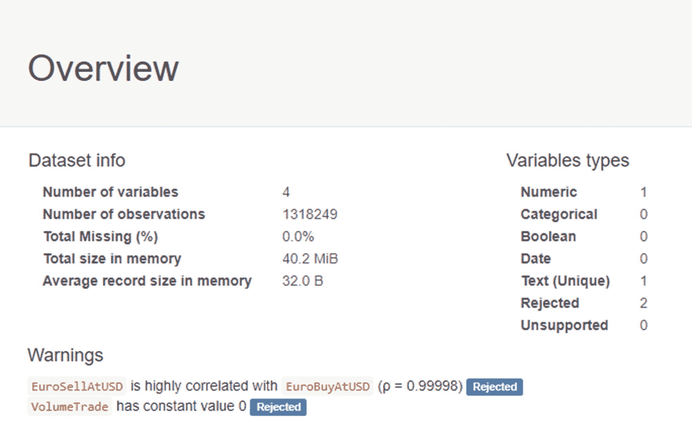

图 15-2

矿场财务数据概况

查看笔记本：`Chapter-015-11-Utility-Data-Profiler-01` 以获取数据概况（图 15-3），即您的料斗信息。

# 第15章

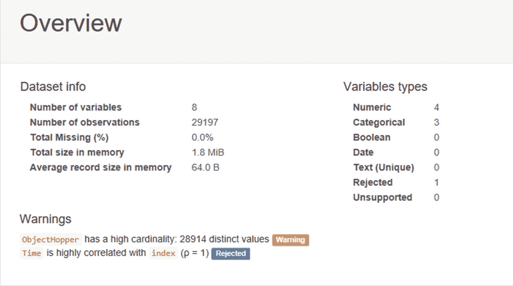

**图 15-3**  
Retrieve-Mars-Hopper 概况

对于文件：`15-04-Retrieve-Mars-Mines.csv.gz`，请使用 `Chapter-015-12-Utility-Data-Profiler-02.ipynb`。

我已将结果包含在数据湖原始区域的：`015-04-Retrieve-Mars-Mines.html` 中。

### 注意
一个洞察是，数据中仅有四个矿场。结果如下（图 15-4）。

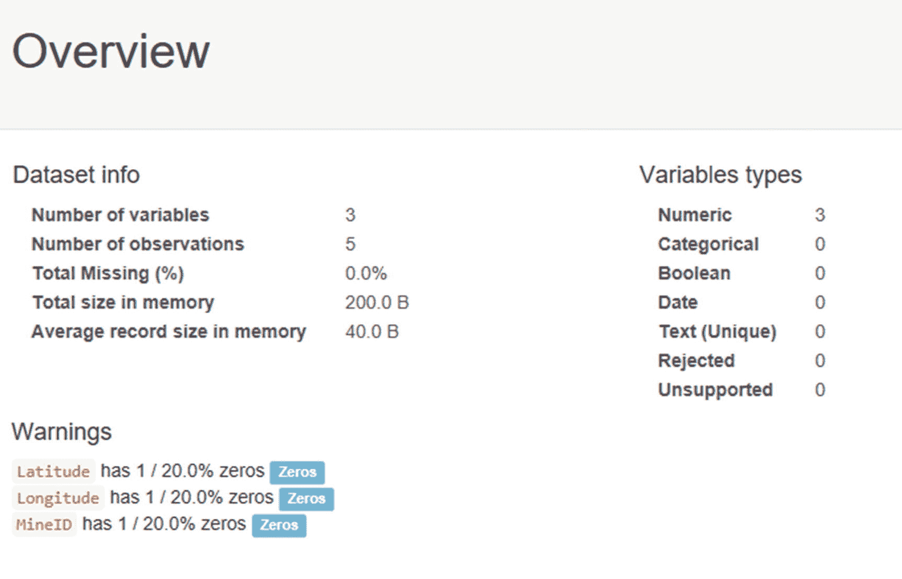

**图 15-4**  
`015-04-Retrieve-Mars-Mines` 概况

对于文件：`15-04-Retrieve-Mars-Time.csv.gz`，请使用 `Chapter-015-13-Utility-Data-Profiler-03.ipynb`。

干得好；您现在已完全了解您的数据。我已将结果包含在数据湖原始区域的：`015-04-Retrieve-Mars-Hopper.html` 中。

- 您会注意到，由于文件体积为 `54.9` MB，我建议您采用 `10%` 的抽样：
```
RangeIndex: 1440000 entries, 0 to 1439999
Data columns (total 5 columns):
MinutesSinceLaunch    1440000 non-null int64
SecondsSinceLaunch    1440000 non-null int64
EarthTime             1440000 non-null float64
MarsTime              1440000 non-null float64
EarthMarsGap          1440000 non-null float64
dtypes: float64(3), int64(2)
memory usage: 54.9 MB
None
```

洞察如下（图 15-5）：

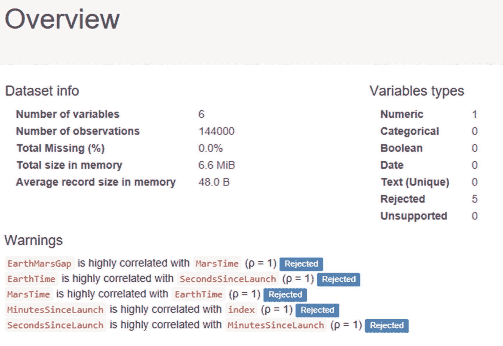

**图 15-5**  
`015-04-Retrieve-Mars-Time` 概况

该数据集包含`高度相关`的数据，这会给特征工程带来问题，因为这种相关性源于连接各列的数学公式，而非现实世界活动的因果关系。

### 提示
您现在已回到推进火星任务工作的流程中。

### 检索步骤
您需要从生态系统外部加载数据。但让我们先检查一下您已加载了哪些数据：
```
for root, dirs, files in os.walk(pathRealDLname, topdown=True):
    for name in files:
        print(os.path.join(root, name))
```

**好消息！** 任务控制中心已经为您提供了原始区域。他们真是太贴心了！

您拥有以下内容：
- 时间、人员、对象、位置和事件检索数据。
- 火星通信系统已将信息从火星传送到您的原始区域。
- 该系统不受您的控制。
- 这意味着无需任何处理即可将数据导入 RIF 生态系统。

### 警告
这也意味着数据可能意外到达，并且格式可能已更改。

### 评估步骤
评估步骤使您能够应用数据质量检查，并修复数据中任何意外的缺陷。您将按照标准的时间-人员-对象-位置-事件（`TPOLE`）步骤进行操作，以确保所有必需的数据都在生态系统中，并且格式正确。

#### 时间
数据集的这一部分包含与任何事件发生时间相关的所有数据。

### 提示
这是您大部分时间序列机器学习的基础。在您创建的数据中，您拥有多个并行的计时特征，可用于您的机器学习。我将协助您将这些特征展现给您的机器学习知识。

那么，让我们加载数据并开始数据工程，以清理数据，为后续的流程步骤做好准备，该步骤将整合和合并数据，以便进入转换步骤，届时您将对其应用机器学习。但首先，我们需要准备好数据：
```
retrieveTimeName = os.path.join(pathDL, '100-Raw-Zone', '015-04-Retrieve-Mars-Time.csv.gz')
TimeDF=pd.read_csv(retrieveTimeName, header=0, encoding='utf-8', compression="gzip")
print(TimeDF.shape)
```

结果：`(1440000, 5)`。洞察是时间数据有 `5` 列，您有 `144` 万条记录。您可以使用“info”命令来调查它们：
```
print(TimeDF.info())

RangeIndex: 1440000 entries, 0 to 1439999
Data columns (total 5 columns):
MinutesSinceLaunch    1440000 non-null int64
SecondsSinceLaunch    1440000 non-null int64
EarthTime             1440000 non-null float64
MarsTime              1440000 non-null float64
EarthMarsGap          1440000 non-null float64
dtypes: float64(3), int64(2)
memory usage: 54.9 MB
None
```

您还可以“描述”数据集：
```
print(TimeDF.describe())
MinutesSinceLaunch  SecondsSinceLaunch     EarthTime      MarsTime \
count        1.440000e+06        1.440000e+06  1.440000e+06  1.440000e+06
mean         7.199995e+05        4.319997e+07  5.003239e+02  4.866231e+02
std          4.156923e+05        2.494154e+07  2.888625e+02  2.809523e+02
min          0.000000e+00        0.000000e+00  0.000000e+00  0.000000e+00
25%          3.599998e+05        2.159998e+07  2.501620e+02  2.433116e+02
50%          7.199995e+05        4.319997e+07  5.003239e+02  4.866231e+02
75%          1.079999e+06        6.479996e+07  7.504859e+02  7.299347e+02
max          1.439999e+06        8.639994e+07  1.000648e+03  9.732463e+02
EarthMarsGap
count  1.440000e+06
mean   1.370079e+01
std    7.910162e+00
min    0.000000e+00
25%    6.850394e+00
50%    1.370079e+01
75%    2.055118e+01
max    2.740158e+01
```

这解释了数据集的基本统计信息。由于数据质量足够好，您可以保存它：
```
assessTimeName = os.path.join(pathDL,'200-Structured-Zone', '015-04-Assess-Mars-Time.csv.gz')
TimeDF.to_csv(assessTimeName, index=False, encoding='utf-8', compression="gzip")
print(assessTimeName)
```

您现在已拥有流程中时间部分的所有数据。请进入下一阶段，因为您现在可以处理与时间相关的数据了。

#### 人员
数据的这一部分涵盖了与机器学习数据中涉及的人员相关的信息。

### 提示
此数据通常用于机器学习，以满足以下需求：了解您的客户、个人偏好和个人购物选择。您必须添加您要派遣执行任务的工作人员：

# 火星采矿数据处理：从人员到对象分析

## 人员数据创建与存储

```
personDF = pd.DataFrame([
['Martin','Marsman','Operations Manager'],
['Angus','Hundfoot','VR Miner'],
['Jock','Mc Bite','VR Driver']
])
print(personDF.shape)
personDF.columns = ['Firstname', 'Lastname', 'Skills']
personDF.index.name = 'ID'
print(personDF.head())
```

您可以看到这如何创建一个适合您机器学习的数据集。

```
Firstname  Lastname              Skills
ID
0     Martin   Marsman  Operations Manager
1      Angus  Hundfoot            VR Miner
2       Jock   Mc Bite           VR Driver
```

### 提示

多年来，我通过处理数据确定，识别一个人的最佳方式是结合名字、中间名、姓氏、出生日期和出生地，这在统计上降低了两个人拥有相同条目但却是不同个体的可能性。

这个人的数据可以存储起来，因为这三个人很可能是火星上仅有的人。

你现在可以将该人员的数据存储在“200-结构化区域”中，供后续机器学习加载：

```
assessPersonName = os.path.join(pathDL, '200-Structured-Zone', '015-04-Assess-Mars-Person.csv.gz')
personDF.to_csv(assessPersonName, index=False, encoding='utf-8', compression="gzip")
print(assessPersonName)
```

你刚刚完成了人员步骤。

## 对象与事件

你现在可以加载火星采矿模拟数据，因为它包含一组复杂的数据，分布在两个主要区域，即对象和事件。

请继续加载火星料斗数据。

```
retrieveObjectName = os.path.join(pathDL, '100-Raw-Zone', '015-04-Retrieve-Mars-Hopper.csv.gz')
objectDF=pd.read_csv(retrieveObjectName, header=0, encoding='utf-8', compression="gzip")
```

你现在可以开始我之前向你展示的标准步骤：

*   **形状** - 数据的基本大小（列数和记录数）
*   **信息** -
*   **描述**

```
print('数据有 %0d 列和 %0d 条记录' % (objectDF.shape[1],objectDF.shape[0]))
```

```
数据有 7 列和 2919739 条记录
```

```
print(objectDF.info())

RangeIndex: 2919739 entries, 0 to 2919738
Data columns (total 7 columns):
Time            float64
Event           object
ObjectHopper    object
ObjectOre       object
Tonnage         int64
LoadBayID       int64
WaitTime        float64
dtypes: float64(2), int64(2), object(3)
memory usage: 155.9+ MB
None
```

你在这里可以获得的洞察是数据集大小为 155.9+ 兆字节

你有两个对象：火星料斗（小型机器人驱动的矿石卡车）和矿石。

这两个对象之间存在关系，因为料斗承载特定吨位的矿石。

装载站和料斗之间存在关系，表现为每次装载矿石时的等待时间。

### 提示

你会发现，大多数特征创建都是数据工程的一部分。我发现，良好的机器学习所需的工作中，多达 90% 是数据工程，因为大多数用于机器学习的数据科学都是标准且稳定的机器算法。

你也可以查看数据的描述结果以获取洞察：

```
print(objectDF.describe())
```

```
       Time       Tonnage     LoadBayID      WaitTime
count  2.919739e+06  2.919739e+06  2.919739e+06  2.919739e+06
mean   1.000863e+07  5.997769e+01  2.501647e+00  1.701870e+01
std    5.779345e+06  2.339773e+01  1.118402e+00  3.660686e+01
min    0.000000e+00  2.000000e+01  1.000000e+00  7.933378e-05
25%    5.003417e+06  4.000000e+01  2.000000e+00  1.000000e-04
50%    1.000357e+07  6.000000e+01  3.000000e+00  1.000000e-04
75%    1.501119e+07  8.000000e+01  4.000000e+00  1.680835e+01
max    2.001915e+07  1.000000e+02  4.000000e+00  6.345246e+02
```

这里的洞察来自吨位：

```
from scipy.stats import kurtosis, skew
x=objectDF['Tonnage']
print( '正态分布的超额峰度（应为 0）: {}'.format( kurtosis(x) ))
```

```
正态分布的超额峰度（应为 0）: -1.2010454999869449
```

```
print( '正态分布的偏度（应为 0）: {}'.format( skew(x) ))
```

```
正态分布的偏度（应为 0）: 0.002058618196855117
```

```
print( '偏度检验: {}'.format( skewtest(x) ))
```

```
偏度检验 : SkewtestResult(statistic=1.4360608846207914, pvalue=0.15098501718218116)
```

*偏度*是衡量数据集对称性的参数，而*峰度*是衡量其尾部与正态分布相比的厚重程度。

偏度值 > 0 表示正态分布的左尾有更多权重。

负峰度：峰度值为负的分布表明该分布具有**比正态分布更轻的尾部和更平坦的峰值**。

偏度检验检验了原假设，即样本所来自总体的偏度与相应正态分布的偏度相同。

你可以绘制数据以更好地观察分布情况：

```
%matplotlib inline
t = np.array(objectDF['Tonnage'])
w = np.array(objectDF['WaitTime'])
import matplotlib.pyplot as plt
f, (ax1, ax2) = plt.subplots(1, 2)
ax1.hist(t, bins="auto")
ax1.set_title('吨位')
ax2.hist(w, bins="auto")
ax2.set_title('等待时间')
plt.tight_layout()
```

你可以看到吨位和等待时间的直方图（图 15-6）。

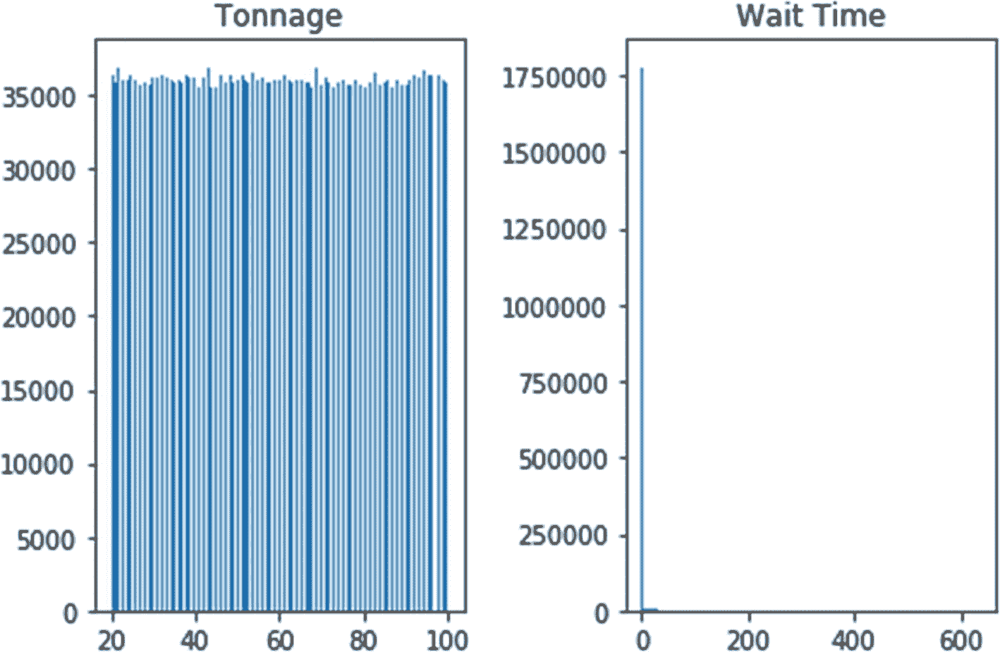

**图 15-6** 使用自动分箱的火星料斗数据直方图

```
%matplotlib inline
t = np.array(objectDF['Tonnage'])
w = np.array(objectDF['WaitTime'])
import matplotlib.pyplot as plt
f, (ax1, ax2) = plt.subplots(1, 2)
ax1.hist(t, bins=20)
ax1.set_title('吨位')
ax2.hist(w, bins=20)
ax2.set_title('等待时间')
plt.tight_layout()
```

你可以在结果中看到（图 15-7）：

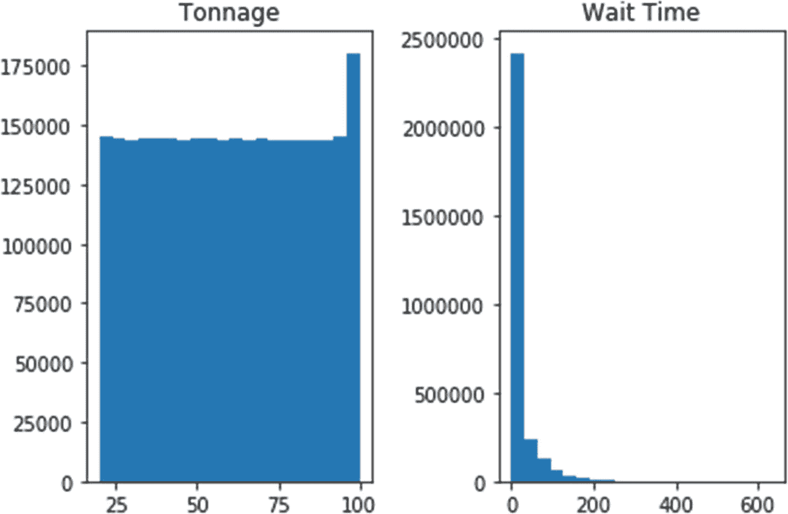

**图 15-7** 使用 20 个分箱的火星料斗数据直方图

*   吨位大多是负载大小的均匀分布。
*   等待时间大多是短暂的等待时间。

你可以同意这里没有异常情况，所以让我们保存数据。


### 对象 – 设备

你刚刚发现你没有计划带到火星的设备的任何数据。经过一封快速的电子邮件，你获得了信息。

使用人工参与的默认回退方式，你按如下方式输入数据：

```python
equipmentDF = pd.DataFrame([
['T101','机器人','履带牵引机器人'],
['T102','机器人','履带牵引机器人'],
['T103','机器人','履带滚动机器人'],
['T104','机器人','履带牵引机器人'],
['T200','机器人','人工参与步行机器人'],
['T300','机器人','6x6 轮式运输机器人'],
['T400','机器人','无人机侦察机器人']
])
```

你现在可以保存设备数据。

```python
assessObjectName2 = os.path.join(pathDL, '200-Structured-Zone', '015-04-Assess-Mars-Robots.csv.gz')
equipmentDF.to_csv(assessObjectName2, index=False, encoding='utf-8', compression="gzip")
print(assessObjectName2)
```

```python
assessObjectName1 = os.path.join(pathDL,'200-Structured-Zone', '015-04-Assess-Mars-Mine-Delivery.csv.gz')
objectDF.to_csv(assessObjectName1, index=False, encoding='utf-8', compression="gzip")
```

### 位置

位置数据存储在火星矿山数据集中。你现在可以加载它。

```python
retrieveName = os.path.join(pathDL, '100-Raw-Zone', '015-04-Retrieve-Mars-Mines.csv.gz')
locationDF=pd.read_csv(retrieveName, header=0, encoding='utf-8', compression="gzip")
```

你应该遵循相同的调查路径：

```python
print('数据有 %0d 列和 %0d 条记录' % (locationDF.shape[1],locationDF.shape[0]))
```

数据有 3 列和 5 条记录

```python
print(locationDF.info())

RangeIndex: 5 entries, 0 to 4
Data columns (total 3 columns):
MineID       5 non-null int64
Longitude    5 non-null int64
Latitude     5 non-null int64
dtypes: int64(3)
memory usage: 200.0 bytes
None
```

这个数据集是干净的；请将其保存到数据湖中：

```python
assessName = os.path.join(pathDL,'200-Structured-Zone', '015-04-Assess-Mars-Mines-Location.csv.gz')
locationDF.to_csv(assessName, index=False, encoding='utf-8', compression="gzip")
```

你已完成评估步骤。

你的数据现在已准备好进入处理步骤。

### 处理步骤

处理步骤是数据工程，它创建机器学习所需数据的整合视图。

### 中心表 – 时间

时间中心表是从火星时间文件中提取出来的。

你可以从`200-Structured-Zone`加载文件：

```python
assessTimeName = os.path.join(pathDL, '200-Structured-Zone', '015-04-Assess-Mars-Time.csv.gz')
timeDF=pd.read_csv(assessTimeName, header=0, encoding='utf-8', compression="gzip")
timeDF.index.name = 'ID'
```

现在你可以检查加载情况：

```python
print(timeDF.info())

RangeIndex: 1440000 entries, 0 to 1439999
Data columns (total 5 columns):
MinutesSinceLaunch    1440000 non-null int64
SecondsSinceLaunch    1440000 non-null int64
EarthTime             1440000 non-null float64
MarsTime              1440000 non-null float64
EarthMarsGap          1440000 non-null float64
dtypes: float64(3), int64(2)
memory usage: 54.9 MB
None
```

你需要将`EarthTime`和`MarsTime`作为时间中心表，用于构建数据仓库。

```python
timeHub=timeDF[['EarthTime','MarsTime']]
print(timeHub.shape)
```

结果是：(1440000, 2)

接下来，移除所有重复项：

```python
timeFixHub=timeHub.drop_duplicates(subset=None, keep="first", inplace=False)
print(timeFixHub.shape)
```

结果是：(1440000, 2)

这表明没有重复项。现在你可以将数据保存到中心表中。

```python
timeHubName = os.path.join(pathDL,'300-Curated-Zone', 'Hub', 'Time', 'Hub-Time.csv.gz')
timeFixHub.to_csv(timeHubName, index=False, encoding='utf-8', compression="gzip")
print(timeHubName)
```

### 时间 – 附属表

完整的时间数据集可以保存为时间附属表，供机器学习将来使用。

```python
timeSatelliteName = os.path.join(pathDL,'300-Curated-Zone', 'Satellite', 'Time', 'Satellite-Time.csv.gz')
timeHub.to_csv(timeSatelliteName, index=False, encoding='utf-8', compression="gzip")
print(timeSatelliteName)
```

接下来，我们对人员执行相同的操作。

### 中心表 – 人员

你之前已经调查过人员信息，所以我建议你采用与时间相同的方式来保存它。

```python
assessPersonName = os.path.join(pathDL, '200-Structured-Zone', '015-04-Assess-Mars-Person.csv.gz')
personDF=pd.read_csv(assessPersonName, header=0, encoding='utf-8', compression="gzip")
personDF.index.name = 'ID'
print(personDF.head())
personHub=personDF[['Firstname','Lastname']]
print(personHub.head())
```

你可以保存人员中心表。

```python
personHubName = os.path.join(pathDL,'300-Curated-Zone', 'Hub', 'Person', 'Hub-Person.csv.gz')
personHub.to_csv(personHubName, index=False, encoding='utf-8', compression="gzip")
print(personHubName)
```

你可以保存人员附属表。

```python
personSatelliteName = os.path.join(pathDL,'300-Curated-Zone', 'Satellite', 'Person', 'Satellite-Person.csv.gz')
personDF.to_csv(personSatelliteName, index=False, encoding='utf-8', compression="gzip")
print(personSatelliteName)
```

### 中心表 – 对象

对象中心表保存了对数据仓库中所有对象的引用。


## 对象中心表

```
assessObjectName = os.path.join(pathDL, '200-Structured-Zone', '015-04-Assess-Mars-Mine-Delivery.csv.gz')
objectDF=pd.read_csv(assessObjectName, header=0, encoding='utf-8', compression="gzip")
objectDF.index.name = 'ID'
```

你需要提取所有对象，我建议你使用以下流程。

```
object1Hub=objectDF[['ObjectHopper']]
object1Hub.columns=['ObjectName']
object1Hub['ObjectType'] = 'MarsHopper'
object1FixHub=object1Hub.drop_duplicates(subset=None, keep="first", inplace=False)
object2Hub=objectDF[['ObjectOre']]
object2Hub.columns=['ObjectName']
object2Hub['ObjectType'] = 'Ore'
object2FixHub=object2Hub.drop_duplicates(subset=None, keep="first", inplace=False)
object3Hub=objectDF[['LoadBayID']]
object3Hub.columns=['ObjectName']
object3Hub['ObjectType'] = 'LoadBay'
object3FixHub=object3Hub.drop_duplicates(subset=None, keep="first", inplace=False)
objectFix0Hub = object1FixHub.append(object2FixHub, sort=False)
objectFixHub = objectFix0Hub.append(object3FixHub, sort=False)
```

现在你有了所有对象的合并集合。你可以将其保存为对象中心表。

```
objectHubName = os.path.join(pathDL,'300-Curated-Zone', 'Hub', 'Object', 'Hub-Object.csv.gz')
objectFixHub.to_csv(objectHubName, index=False, encoding='utf-8', compression="gzip")
print(objectHubName)
```

接下来，保存三个对象附属表：

```
object1SatelliteName = os.path.join(pathDL,'300-Curated-Zone', 'Satellite', 'Object', 'Satellite-Object-MarsHopper.csv.gz')
object1FixHub.to_csv(object1SatelliteName, index=False, encoding='utf-8', compression="gzip")
print(object1SatelliteName)
object2SatelliteName = os.path.join(pathDL,'300-Curated-Zone', 'Satellite', 'Object', 'Satellite-Object-Ore.csv.gz')
object2FixHub.to_csv(object2SatelliteName, index=False, encoding='utf-8', compression="gzip")
print(object2SatelliteName)
object3SatelliteName = os.path.join(pathDL,'300-Curated-Zone', 'Satellite', 'Object', 'Satellite-Object-LoadBay.csv.gz')
object3FixHub.to_csv(object3SatelliteName, index=False, encoding='utf-8', compression="gzip")
print(object3SatelliteName)
```

现在你需要保存料斗和矿石之间的链接：

```
object1Link=objectDF[['ObjectHopper','ObjectOre','LoadBayID','Tonnage']]
object1Link.reset_index(level=0, inplace=True)
```

该链接保存在对象到对象类型的链接表中：

```
object1LinkName = os.path.join(pathDL,'300-Curated-Zone', 'Link', 'Object-Object', 'Link-Object-LoadBay-MarsHopper-Ore.csv.gz')
object1Link.to_csv(object1LinkName, index=False, encoding='utf-8', compression="gzip")
print(object1LinkName)
```

## 中心表 - 位置

位置中心表保存了系统中每个对象或事件物理位置的所有信息。

首先加载数据，然后进行数据工程处理，直到获得一个中心表。

```
assessLocationName = os.path.join(pathDL, '200-Structured-Zone', '015-04-Assess-Mars-Mines-Location.csv.gz')
locationDF=pd.read_csv(assessLocationName, header=0, encoding='utf-8', compression="gzip")
locationDF.index.name = 'ID'
LongitudeDF=pd.DataFrame(np.array(range(-180,180)))
LongitudeDF.columns=['Longitude']
LongitudeDF['Key']='1'
LatitudeDF=pd.DataFrame(np.array(range(-90,90)))
LatitudeDF.columns=['Latitude']
LatitudeDF['Key']='1'
locationHub=pd.merge(left=LongitudeDF, right=LatitudeDF, on= "Key", how= "outer")
locationHub.drop('Key', axis=1, inplace=True)
locationHub.index.name = 'ID'
locationHubName = os.path.join(pathDL,'300-Curated-Zone', 'Hub', 'Location', 'Hub-Location.csv.gz')
locationHub.to_csv(locationHubName, index=False, encoding='utf-8', compression="gzip")
print(locationHubName)
```

现在保存位置附属表：

```
locationSatelliteName = os.path.join(pathDL,'300-Curated-Zone', 'Satellite', 'Location', 'Satellite-Location-MarsMine.csv.gz')
locationDF.to_csv(locationSatelliteName, index=False, encoding='utf-8', compression="gzip")
print(locationSatelliteName)
```

## 中心表 – 事件

```
eventHub=objectDF[['Event']]
eventHub.columns=['EventName']
eventFixHub=eventHub.drop_duplicates(subset=None, keep="first", inplace=False)
print(eventFixHub.shape)
eventHubName = os.path.join(pathDL,'300-Curated-Zone', 'Hub', 'Event', 'Hub-Event.csv.gz')
eventHub.to_csv(eventHubName, index=False, encoding='utf-8', compression="gzip")
print(eventHubName)
```

转换步骤、组织步骤和报告步骤将在单独的笔记本中处理。

### 进度报告

现在，你应该回顾一下自己完成的出色数据工程工作。

接下来，你将获得数据湖中每个区域（图 15-8）的进度报告。

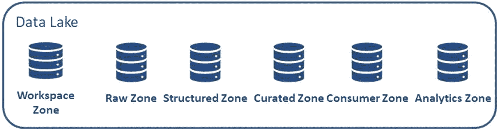

## 数据湖区域

### 原始区域

```python
pathReportname= '../../Results/Chapter 09/999-DL/100-Raw-Zone/'
for root, dirs, files in os.walk(pathReportname, topdown=True):
    for name in files:
        print(os.path.join(root, name))
```
输出：
```
../../Results/Chapter 09/999-DL/100-Raw-Zone/015-04-Retrieve-Mars-Hopper.csv.gz
../../Results/Chapter 09/999-DL/100-Raw-Zone/015-04-Retrieve-Mars-Mines.csv.gz
../../Results/Chapter 09/999-DL/100-Raw-Zone/015-04-Retrieve-Mars-Time.csv.gz
```

### 结构化区域

```python
pathReportname= '../../Results/Chapter 09/999-DL/200-Structured-Zone/'
for root, dirs, files in os.walk(pathReportname, topdown=True):
    for name in files:
        print(os.path.join(root, name))
```
输出：
```
../../Results/Chapter 09/999-DL/200-Structured-Zone/015-04-Assess-Mars-Mine-Delivery.csv.gz
../../Results/Chapter 09/999-DL/200-Structured-Zone/015-04-Assess-Mars-Mines-Location.csv.gz
../../Results/Chapter 09/999-DL/200-Structured-Zone/015-04-Assess-Mars-Person.csv.gz
../../Results/Chapter 09/999-DL/200-Structured-Zone/015-04-Assess-Mars-Robots.csv.gz
../../Results/Chapter 09/999-DL/200-Structured-Zone/015-04-Assess-Mars-Time.csv.gz
```

### 策展区域

```python
pathReportname= '../../Results/Chapter 09/999-DL/300-Curated-Zone/Hub/'
for root, dirs, files in os.walk(pathReportname, topdown=True):
    for name in files:
        print(os.path.join(root, name))
```
输出：
```
../../Results/Chapter 09/999-DL/300-Curated-Zone/Hub/Event\Hub-Event.csv.gz
../../Results/Chapter 09/999-DL/300-Curated-Zone/Hub/Location\Hub-Location.csv.gz
../../Results/Chapter 09/999-DL/300-Curated-Zone/Hub/Object\Hub-Object.csv.gz
../../Results/Chapter 09/999-DL/300-Curated-Zone/Hub/Person\Hub-Person.csv.gz
../../Results/Chapter 09/999-DL/300-Curated-Zone/Hub/Time\Hub-Time.csv.gz
```

笔记本到此结束，请完成最后几个步骤，查看花费了多长时间，然后你就完成了。

```python
nowStop = datetime.datetime.now()
runTime=nowStop-nowStart
print('Start:', nowStart.strftime('%Y-%m-%d %H:%M:%S'))
print('Stop: ', nowStop.strftime('%Y-%m-%d %H:%M:%S'))
print('Time: ', runTime)
```

做得好。你可以关闭笔记本了。

### 转换步骤

现在，你将开始运用监督学习技能来处理火星数据。

#### 监督学习

你已经准备好进行机器学习。我们将应用的第一个机器学习方法是监督学习。

进入下一个笔记本，你将开始看到已完成数据工程的优势。

打开示例中第 15 章下的 Jupyter Notebook，文件名为：`Chapter-015-08-Build-RAPTOR-Mars-02.ipynb`

让我们开始计时。

```python
import datetime
nowStart = datetime.datetime.now()
```

你需要以下库来启动无监督学习过程：

```python
from sklearn.svm import LinearSVC
from sklearn.datasets import make_classification
from sklearn.metrics import f1_score, matthews_corrcoef, confusion_matrix
import matplotlib.pyplot as plt
import numpy as np
import os
import pandas as pd
get_ipython().run_line_magic('matplotlib', 'inline')
```

你将在数据湖`999-DL`中工作。

```python
pathDL='../../Results/Chapter 09/999-DL/'
```

你需要从“300-Curated-Zone”加载数据。

我建议你加载装载湾、火星跳跃者和矿石之间的链接文件。

```python
objectLinkName = os.path.join(pathDL,'300-Curated-Zone', 'Link', 'Object-Object', 'Link-Object-LoadBay-MarsHopper-Ore.csv.gz')
object1DF=pd.read_csv(objectLinkName, header=0, encoding='utf-8', compression="gzip")
object1DF.index.name = 'ID'
```

你可以通过查看列来了解拥有的数据：

```python
print(object1DF.columns)
```
输出：
```
Index(['ID', 'ObjectHopper', 'ObjectOre', 'LoadBayID', 'Tonnage'], dtype="object")
```

让我们描述一下数据；你之前用过这个，应该很容易：

```python
print(object1DF.describe())
```
输出：
```
              ID     LoadBayID       Tonnage
count  2.919739e+06  2.919739e+06  2.919739e+06
mean   1.459869e+06  2.501647e+00  5.997769e+01
std    8.428562e+05  1.118402e+00  2.339773e+01
min    0.000000e+00  1.000000e+00  2.000000e+01
25%    7.299345e+05  2.000000e+00  4.000000e+01
50%    1.459869e+06  3.000000e+00  6.000000e+01
75%    2.189804e+06  4.000000e+00  8.000000e+01
max    2.919738e+06  4.000000e+00  1.000000e+02
```
洞察：吨位值的范围很大，你需要一个缩放器。

现在执行标准信息检查：

```python
print(object1DF.info())
```
输出：
```
<class 'pandas.core.frame.DataFrame'>
RangeIndex: 2919739 entries, 0 to 2919738
Data columns (total 5 columns):
 #   Column        Non-Null Count  Dtype 
---  ------        --------------  ----- 
 0   ID            2919739 non-null  int64 
 1   ObjectHopper  2919739 non-null  object
 2   ObjectOre     2919739 non-null  object
 3   LoadBayID     2919739 non-null  int64 
 4   Tonnage       2919739 non-null  int64 
dtypes: int64(3), object(2)
memory usage: 111.4+ MB
None
```

你应该看不到任何问题；一切看起来都符合预期。

现在你可以查看数据本身：

## 数据探索与预处理

`object1DF`数据集包含矿石和装载点的详细信息。首先查看其前10行数据：

```
print(object1DF.head(10))
ID ObjectHopper  ObjectOre  LoadBayID  Tonnage
ID
0    0  Hopper-0001   aluminum          1       78
1    1  Hopper-0001   aluminum          1       78
2    2  Hopper-0002   aluminum          1       64
3    3  Hopper-0002   aluminum          1       64
4    4  Hopper-0002   aluminum          1       64
5    5  Hopper-0001   aluminum          1       78
6    6  Hopper-0003  magnesium          4       55
7    7  Hopper-0003  magnesium          4       55
8    8  Hopper-0004   aluminum          4       54
9    9  Hopper-0004   aluminum          4       54
10  10  Hopper-0005   aluminum          2       45
```

## 吨位缩放处理

你需要对吨位进行简单的缩放。建议使用 60 作为分割点。如果装载正确，则用 0 或 1 标记跳跃者。

### 提示

如果你将第 `015-05-Mars-Mines-01` 章中跳跃者生成器的分配事实从 `tonnage=random.randint(20, 100)` 改为例如 `tonnage=random.randint(20, 150)`，你也会得到一个新的吨位率，其中大于 1 的表示超载。或者你也可以将缩放器中的 60 改为 40，效果类似。

### 缩放器定义

这是你的缩放器：

```
def loadrate(t):
    rate = int(t/60)
    return rate
```

### 应用缩放器

你需要在此处执行一些数据工程来应用缩放器：

```
objectSub1DF=object1DF[['ObjectOre','LoadBayID','Tonnage']]
objectSub1DF.drop_duplicates(subset=None, keep="first", inplace=True)
objectSub1DF.columns=['OreName','MineID','Tonnage']
objectSub1DF['TonnageRate'] = objectSub1DF.apply(lambda row: loadrate(row['Tonnage']), axis=1)
objectSub1DF.drop('Tonnage', axis=1, inplace=True)
objectSub1DF.drop_duplicates(subset=None, keep="first", inplace=True)
```

### 处理后数据

现在你可以看到新的数据集：

```
print(objectSub1DF.head(10))
OreName  MineID  TonnageRate
ID
0    aluminum       1            1
6   magnesium       4            0
8    aluminum       4            0
10   aluminum       2            0
13    calcium       4            0
15    silicon       3            0
22  magnesium       2            0
28       iron       4            1
30       iron       3            1
34    silicon       3            1
```

### 警告

`OreName` 需要进行替换。`LinearSVC` 算法需要数字才能高效且有效地工作。

## 获取矿石ID

你需要来自矿石卫星的 ID：

```
objectSatelliteName = os.path.join(pathDL,'300-Curated-Zone', 'Satellite', 'Object', 'Satellite-Object-Ore.csv.gz')
object2DF=pd.read_csv(objectSatelliteName, header=0, encoding='utf-8', compression="gzip")
object2DF.index.name = 'ID'
```

这是数据。

现在你有了缺失的 ID，可以通过将 ID 转换为列来修复数据特征。

### 数据集基本信息

以下是数据集的基本信息。

```
print(object2DF.info())

RangeIndex: 6 entries, 0 to 5
Data columns (total 2 columns):
ObjectName    6 non-null object
ObjectType    6 non-null object
dtypes: object(2)
memory usage: 176.0+ bytes
None
```

### 数据样本

以下是数据样本。

```
print(object2DF.head(10))
ObjectName ObjectType
ID
0    aluminum        Ore
1   magnesium        Ore
2     calcium        Ore
3     silicon        Ore
4        iron        Ore
5   potassium        Ore
```

### 修复数据特征

以下是所需的数据特征修复。

```
objectSub2DF=object2DF[['ObjectName']]
objectSub2DF.drop_duplicates(subset=None, keep="first", inplace=True)
objectSub2DF.reset_index(inplace=True)
objectSub2DF.columns=['OreID','OreName']
objectSub2DF.index.name = 'ID'
```

干得好！你已经修复了 ID，现在可以使用它了：

```
print(objectSub2DF.head(20))
OreID    OreName
ID
0       0   aluminum
1       1  magnesium
2       2    calcium
3       3    silicon
4       4       iron
5       5  potassium
```

## 数据集合并

现在你只需用矿石 ID 替换矿石名称。

```
objectDF=pd.merge(left=objectSub1DF, right=objectSub2DF, on="OreName")
objectDF.drop('OreName', axis=1, inplace=True)
objectDF.drop_duplicates(subset=None, keep="first", inplace=True)
```

你已经为机器学习准备好了一个可用的基础数据集。

```
print(objectDF.columns)
Index(['MineID', 'TonnageRate', 'OreID'], dtype="object")
```

### 训练集

你需要一个训练数据集，让机器学习能够理解数据。

### 提示

我通常取数据集的 70% 进行训练，这样会留下 30% 对算法未知的数据集，但你可以用它进行测试，因为你知道结果。

你应该使用以下命令抽取 70% 的样本：

```
objectTrainDF=objectDF.sample(frac=0.7, replace=False)
```

让我们检查一下你的训练集：

```
print(objectTrainDF.shape)
(34, 3)
```

你有 34 个训练点。

对于算法，你需要将特征（`OreID`、`MineID`）与目标（`TonnageRate`）分开，以便机器学习能够工作。

我建议使用 numpy 数组进行如下拆分。

```
Xtrain=np.array(objectTrainDF[['OreID','MineID']])
ytrain=np.array(objectTrainDF[['TonnageRate'][0]])
```

### 测试数据集

接下来，你需要一个测试集，以便稍后测试机器学习的评分。

以下是获取 30% 测试集的方法。

# 机器学习

objectTestDF = objectDF.sample(frac=0.3, replace=True)
# objectTestDF.drop_duplicates(subset=None, keep="first", inplace=True)

和之前一样，我们拆分特征和目标。

Xtest = np.array(objectTestDF[['OreID','MineID']])
ytest = np.array(objectTestDF[['TonnageRate'][0]])

现在你可以创建 `LinearSVC` 引擎。

我建议设置 `max_iter=20000` 和 `dual=True`。

```python
clf = LinearSVC(random_state=0,
max_iter=20000,
dual=True)
```

现在你可以训练模型了。

## 注意

所有的数据工程都归结为这一个命令。这就是 IML 环境的本质。

```python
clf.fit(Xtrain, ytrain)
```

现在你可以检查机器学习的效果：

```python
print('------------------------------------------------')
print('Coefficient:', clf.coef_)
print('------------------------------------------------')
print('Intercept', clf.intercept_)
print('------------------------------------------------')
print('Score', clf.score(Xtrain, ytrain))
print('------------------------------------------------')
```

以下是训练结果：

```
Coefficient: [[ 0.08636684 -0.1258458 ]]

Intercept [0.17640288]

Score 0.5882352941176471
```

现在你可以用测试数据集测试模型了。

```python
IMLresult = np.array(clf.predict(Xtest))
```

以下是测试结果：

```python
print('------------------------------------------------')
print('Score - Test Data', clf.score(Xtest, ytest))
print('------------------------------------------------')
```

```
Score - Test Data 0.42857142857142855
```

现在你可以测试预测结果与模型的匹配情况：

```python
print('Test Data Run')
for i in range(IMLresult.shape[0]):
if ytest[0]==IMLresult[0]:
outcome='Hit!'
else:
outcome='Miss?'
print('%04d - %04d ore with %02d mine => %0.4f true rate => %0.4f predicted - %s' % (i+1, Xtest[i][0],Xtest[i][1],ytest[i],IMLresult[i],outcome))
```

输出为：

```
Test Data Run
0001 - 0002 ore with 04 mine => 0.0000 true rate => 0.0000 predicted - Hit!
0002 - 0005 ore with 04 mine => 0.0000 true rate => 1.0000 predicted - Hit!
0003 - 0002 ore with 03 mine => 1.0000 true rate => 0.0000 predicted - Hit!
0004 - 0004 ore with 03 mine => 1.0000 true rate => 1.0000 predicted - Hit!
0005 - 0004 ore with 03 mine => 0.0000 true rate => 1.0000 predicted - Hit!
0006 - 0001 ore with 04 mine => 1.0000 true rate => 0.0000 predicted - Hit!
0007 - 0005 ore with 01 mine => 0.0000 true rate => 1.0000 predicted - Hit!
0008 - 0002 ore with 02 mine => 0.0000 true rate => 1.0000 predicted - Hit!
0009 - 0001 ore with 03 mine => 0.0000 true rate => 0.0000 predicted - Hit!
0010 - 0000 ore with 02 mine => 1.0000 true rate => 0.0000 predicted - Hit!
0011 - 0002 ore with 01 mine => 1.0000 true rate => 1.0000 predicted - Hit!
0012 - 0003 ore with 02 mine => 1.0000 true rate => 1.0000 predicted - Hit!
0013 - 0001 ore with 04 mine => 0.0000 true rate => 0.0000 predicted - Hit!
0014 - 0000 ore with 02 mine => 1.0000 true rate => 0.0000 predicted - Hit!
```

现在你可以结束机器学习过程了。

```python
nowStop = datetime.datetime.now()
runTime = nowStop - nowStart
print('Start:', nowStart.strftime('%Y-%m-%d %H:%M:%S'))
print('Stop: ', nowStop.strftime('%Y-%m-%d %H:%M:%S'))
print('Time: ', runTime)
```

# 无监督学习

你接下来要学习的机器学习模型是无监督学习。

现在你可以打开示例中第 15 章下的 Jupyter Notebook，文件名为：

`Chapter-015-09-Build-RAPTOR-Mars-03.ipynb`

现在你可以开始无监督学习过程了。

我将引导你为 k-means 算法寻找最优的 k 值。

```python
import datetime
nowStart = datetime.datetime.now()
```

你需要激活图形引擎以在前台运行。

```python
import matplotlib
matplotlib.use('TkAgg')
get_ipython().run_line_magic('matplotlib', 'inline')
```

然后加载用于处理数据和机器学习的库。

```python
import pandas as pd
import os
# The kmeans algorithm is implemented in the scikits-learn library
from sklearn.cluster import KMeans
import numpy as np
from matplotlib import pyplot as plt
```

你将使用位于 `999-DL` 的数据湖。

```python
pathDL = '../../Results/Chapter 09/999-DL/'
```

## Alpha 数据集

加载中心点位置数据。

```python
locationHubName1 = os.path.join(pathDL,'300-Curated-Zone', 'Hub', 'Location', 'Hub-Location.csv.gz')
location1DF = pd.read_csv(locationHubName1, header=0, encoding='utf-8', compression="gzip")
location1DF.index.name = 'ID'
location1DF.columns = ['Longitude','Latitude']
# location1DF['Mine'] = 0
```

以下是数据概况：

```python
print(location1DF.shape)
```

```
(64800, 2)
```

选择 Alpha 数据集。

```python
A = location1DF
```

现在你可以开始在 Alpha 数据集上进行机器学习。

我建议我们运行 k 从 1 到 10 的 k-means 算法，并使用肘部图确定最优的 k 值。

```
resultA=[]
for k in range (1, 10):
# 基于我们的数据创建一个 kmeans 模型，使用 k 个聚类。random_state 有助于确保算法每次返回相同的结果。
kmeans_model = KMeans(n_clusters=k, random_state=1).fit(A.iloc[:, :])
# 这些是我们拟合的聚类标签——第一个聚类的标签为 0，第二个聚类的标签为 1。
labels = kmeans_model.labels_
# 样本到其最近聚类中心的距离之和
interia = kmeans_model.inertia_
print ("k:",k, " cost:", interia)
resultA.append([k, interia])
```

现在你可以绘制 Alpha 的结果图：

```
data = np.array(resultA)
x, y = data.T
plt.plot(x, y, linestyle="--", marker="o", linewidth=1.0)
titlestr='使用肘部法确定 k-means 聚类最优聚类数的 Alpha 数据集'
plt.title(titlestr)
plt.ylabel('误差平方和')
plt.xlabel('聚类数 (k)')
plt.grid()
plt.show()
```

以下是 Alpha 数据集的肘部结果（图 15-9）。

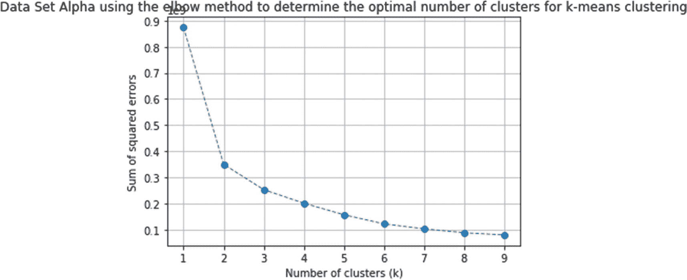

图 15-9

无监督 Alpha 结果

##### Beta 数据集

你需要的下一个数据集是矿场位置数据，这将作为你的 Beta 数据集。

你可以在以下位置找到该数据：

```
locationHubName2 = os.path.join(pathDL,'300-Curated-Zone', 'Satellite', 'Location', 'Satellite-Location-MarsMine.csv.gz')
location2DF=pd.read_csv(locationHubName2, header=0, encoding='utf-8', compression="gzip")
location2DF.index.name = 'ID'
location2DF.columns=['MineID','Longitude','Latitude']
#location2DF['Mine']=1
```

#### 警告

这里有一个并非矿场的“矿场”。它是你的火星任务指挥着陆坪。

```
is_mine=location2DF['MineID'] > 0
location3DF=location2DF[is_mine]
```

将数据加载为你的 Beta 数据集。

```
B = location3DF
```

现在你可以运行 k 从 1 到 (n-1) 的 k-means 算法，其中 n 是数据中矿场的数量。如果你加载更多矿场，此机器学习将自动适应数据。

```
resultB=[]
for k in range (1, B.shape[0]):
# 基于我们的数据创建一个 kmeans 模型，使用 k 个聚类。random_state 有助于确保算法每次返回相同的结果。
kmeans_model = KMeans(n_clusters=k, random_state=1).fit(B.iloc[:, :])
# 这些是我们拟合的聚类标签——第一个聚类的标签为 0，第二个聚类的标签为 1。
labels = kmeans_model.labels_
# 样本到其最近聚类中心的距离之和
interia = kmeans_model.inertia_
print ("k:",k, " cost:", interia)
resultB.append([k, interia])
```

现在你可以绘制 Beta 的结果图：

```
data = np.array(resultB)
x, y = data.T
plt.plot(x, y, linestyle="--", marker="o", linewidth=1.0)
titlestr='使用肘部法确定 k-means 聚类最优聚类数的 Beta 数据集'
plt.title(titlestr)
plt.ylabel('误差平方和')
plt.xlabel('聚类数 (k)')
plt.grid()
plt.show()
```

以下是 Beta 的结果（图 15-10）。

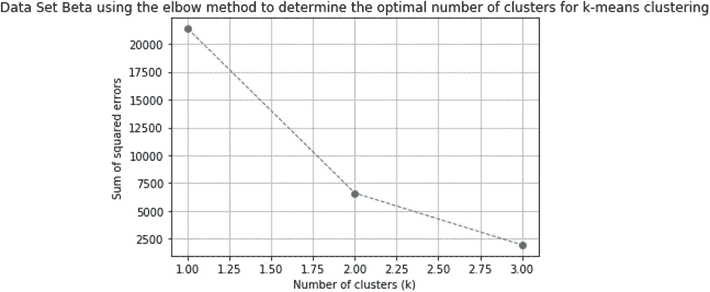

图 15-10

无监督 Beta 结果

从该数据集中得出的见解：

*   由于聚类数量有限，该数据集太小。

*   你需要更多的数据点才能获得良好的无监督学习结果。

*   这就是为什么这些结果中没有明确的 k 最优值。

恭喜！你现在已经完成了无监督机器学习。

现在你可以关闭所有笔记本，因为下一项工作是大型最终项目。

## 火星任务

既然你已经掌握了所需的所有知识，我建议你重新审视一下需求，并打开笔记本：`Chapter-015-14-Setup-Mars-Base.ipynb`。还记得这些吗？

### 需求

火星拥有丰富的可开采资源，这些资源可以运回地球：

硅、氢、氧、铁、镁、[锰](https://tradingeconomics.com/commodity/manganese)、铝、钙、金、银、镍、钛、[铂](https://tradingeconomics.com/commodity/platinum)和铜都已准备就绪，可供开采。

### 你的成本

一个采矿太空港造价 100,000.00 英镑，只能容纳 25 名矿工和 250 辆运输车。它需要两枚火箭才能到达火星。

一枚火箭每次航行费用为 20,000.00 英镑，前往火星需要 150 到 300 天。每枚火箭每次只能运送四件采矿设备。

一台矿石采矿机造价 150,000.00 英镑，每天运行成本为 5,000.00 英镑。它每天可开采 1000 磅矿石。

一辆矿石运输车造价 50,000.00 英镑，每天运行成本为 3,500.00 英镑。它每天行驶 100 英里，每次运输可承载 250 磅，装卸货需 10 分钟。

氢气和氧气提取器每台造价 10,000.00 英镑，每天运行成本为 1,500.00 英镑。一台提取器每天可生产 500 磅氢气或氧气。

每件采矿设备每天消耗 200 磅氢气和 100 磅氧气作为动力。

一个 3D 打印厂可以使用 1000 磅硅来打印一台额外的采矿机，750 磅硅打印一辆矿石运输车，300 磅硅打印一台提取器，5000 磅硅打印一枚火箭。建造一个新的 3D 打印厂需要 15 天和 7500 磅硅。

制造一台采矿机需要 5 天，一辆矿石运输车需要 3 天，一台提取器需要 1 天。

3D 打印每天消耗 400 磅氢气和 300 磅氧气。

你获得的资金上限为 1,000,000.00 英镑。

在返航途中，每枚火箭只能运载 500,000 磅矿石，并且每天消耗 6000 磅氢气和 2000 磅氧气。

你必须每年向股东返还 20% 的利润。

### 你的收入

当前每 1000 磅矿石运抵地球的交易价格：

*   硅（1300 英镑）、铁（80 英镑）、镁（5000 英镑）、[锰](https://tradingeconomics.com/commodity/manganese)（40 英镑）、铝（800 英镑）、钙（220 英镑）、金（1200 英镑）、银（15 英镑）、镍（1500 英镑）、钛（30000 英镑）、[铂](https://tradingeconomics.com/commodity/platinum)（870 英镑）和铜（2500 英镑）。

### 火星任务启动

此笔记本将为你构建一个完整的火星基地，包含实现项目目标所需的所有方面。

还有一些惊喜，但请你自己去发现。

### 提示

在完成每个需求时，请逐步完成笔记本中的内容。

现在，我假设你正在跟随笔记本操作……祝你好运，享受其中！

### 火星任务完成

你刚刚完成了火星任务模拟。

现在你可以阅读本章的其余部分，我将结束一些你应该注意的额外主题，因为你即将踏入由 IML 赋能的新世界。

### 提示

如果你再次浏览这些示例，你会发现几个参数和其他选项。我建议你使用自己的数据或更改参数来尝试这些示例。这是学习 IML 这门手艺的方法。练习，练习，再练习……

***现在，让我们看看你学到了什么。***

### 挑战

你已经投入时间阅读本书至此。我建议你重复第 1 章的挑战。

观察你日常生活所处的环境，并运用你新学到的知识，写下你认为属于机器学习成果的三件事。

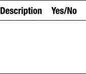

现在，你将能够看到运用新技能的新机遇。

## 建议

我个人每周会花多达 12 个小时进行机器学习实践，纯粹使用我在互联网上发现的新数据集或问题数据集。

只需四处搜索，你就会欣喜地发现大量可供你使用的数据。

## 问题一

你对周围机器学习应用的认知是否发生了改变？

我预测，你对工业机器学习（IML）知识的改变越大，你的认知改变就越大，正如你此刻所体验到的。

现在，让我们继续，写下三件如果能够自动为你完成，会让你的生活变得更好的事情。


## 问题二

凭借你新学到的知识，你能为自己实现这些自动化吗？

我预测，你现在已经掌握了运用自己的工业机器学习（IML）方法和技术来取得成功所需的知识。

## 额外练习

尝试运行`Chapter-015-15-Features-Minerals.ipynb`来练习特征重要性。我们应该挖掘什么？

尝试运行`Chapter-015-16-Mars-Crime.ipynb`来练习从图像中提取特征，并找出是谁偷了我的纸杯蛋糕。

## 总结

恭喜你！现在你已经掌握了将机器学习知识转化为实际项目的能力。

本书到此结束，你现在应该已经准备好将所学知识应用于任何你需要处理的项目。

我最后的建议是，永远不要停止你好奇的头脑；持续学习新技术、实践和方法论。

## 致谢

感谢你抽出时间阅读我的书并跟随示例学习。火星见！

或者任何你选择的其他世界……天空才是极限！

愿你学有所成，为你带来未来所期望的一切美好事物和光明前景。

最后也是最终的提示……

享受工业机器学习的乐趣……去改变你的世界吧！！！

## 索引

### A
准确度测试 ACC 实际负样本 (N) 实际正样本 (P) BM Cohen's kappa DOR 进化计算 FDR FN F1 分数 FOR FP 缺失值插补 LR- LR+ MCC MK NPV PPV 强化学习 ROCC 监督学习 TN TP 无监督学习 动作生成 主动干扰器 事故减少 会计服务 预测性维护 基于用户的保险 自适应提升 (AdaBoost) 分类器 循环 ExtraTreeClassifier RobustScaler StandardScaler SVC 转换器 值域 自适应机器学习 (AML) 广告点击率 (CTR) Anaconda 发行版 异常检测 集体异常 上下文异常 定义 点异常 蚁群优化 (ACO) Apache Parquet 人工智能 (AI) 人工神经网络 (ANN)

### B
基本绘图功能 贝叶斯统计 伯努利试验 偏差-方差权衡 大数据 金融服务 医疗保健 制造业 媒体与娱乐 BIRCH 算法 蓝绿部署框架 Bookmaker Informedness (BM)

### C
基于案例的推理 (CBR) 保留 检索 修订 重用 CatBoost 中央处理信息中心 (CPIC) 闭运动链 闭环制造技术 计算机代数系统 (CAS) 计算机工程 计算机系统 发现过程 工程师工作 多处理 并行进程 线程处理 计算机视觉，机器人 示例，狗 灰度图像 IML 生态系统 网络摄像头 基于内容的过滤模型 控制工程 控制仿真 双环控制器 自行车控制 模型转换 离散时间模型 极点零点结构 随机状态模型 传递状态 控制系统工程 卷积神经网络 (CNN) 跨行业数据挖掘标准流程 (CRISP-DM) 业务成功标准 业务理解 项目计划 需求设定 成功标准 当前状况，访问 数据工程师 数据目标 数据准备 清洗 特征工程 包含/排除 选择 数据科学家 数据理解 探索 质量 部署 经验 监控与维护 DevOps 评估 已批准模型 评估过程 评审 建模 项目计划 文化算法 (CA) 领域特定知识 规范性知识 情境知识 空间知识 时间知识

### D
数据分析 数据湖 Amazon S3 分析 自主机器学习 数据工程 定义 存储 数据区域 数据科学 书籍 商业策略 数学与统计 R-A-P-T-O-R 技术 数据仓库 定义 中心 链接 卫星 数据可视化 决策树 (DTs) 分类器 定义 多输出回归 最近质心分类器 基于最近邻的分类 神经网络回归器 深度学习 聚类，比较 定义 预处理 数据集 特征 中位数和分量缩放 需求 结果 单位方差 PyTorch 股票市场 TensorFlow Theano 深度强化学习 Delta Lake 诊断优势比 (DOR) Dijkstra 算法 离散化与非离散化 颠覆者 行政任务 辅助临床诊断 自主农业 自主采矿 自主铁路维修 农业 金融 医疗系统 图像分析 物联网 传感器 机器辅助机器人手术 机器维护 商品销售 元搜索 卸载 收入增强购物 奖励购物 虚拟护理助手 分布式进化算法 Python 版 (DEAP) 动态规划 (DP) 活动选择问题 Dijkstra 算法

### E
电子工程 进化算法 交叉 世代 灭绝 规则生成 第 1 代图 第 10 代图 第 20 代图 第 200 代图 第 299 代图 库 多代 参数 种群，生成 种群成员 进化计算 进化过程 进化规划 (EP) 技术 进化机器人学

### F
错误发现率 (FDR) 假阴性 (FN) 假阴性率 (FNR) 错误遗漏率 (FOR) 假阳性 (FP) 假阳性率 (FPR) 第四次工业革命 (4IR) AML 颠覆者 五个系统层 参见系统层 ISA 机器学习世代 自适应学习 深度学习，427 条规则 简单机器学习 实时闭环系统 RIF 机器人顾问 6C 系统 六个数据湖区域 参见湖区域 Sun 模型 技术模块化建造 机器人，闭环制造

### G
博弈论 高斯混合模型 定义 影响 参数 结果 高斯朴素贝叶斯算法 高斯过程 齿轮 复合 定义 单一 通用数据保护条例 (GDPR) 生成对抗网络 (GANs) 梯度提升

### H
硬机器人 层次聚类分析 亲和力 影响 定义 链接准则 链接影响 结果

### I
不平衡数据集 类别 CTR 欺诈检测 筛选 垃圾邮件过滤 归纳逻辑编程 (ILP) 工业 AI 蓝绿环境 GDPR 工业化人工智能 (IAI)，限制 访问权 自动化决策和画像权 数据可移植权 删除权 知情权 反对权 限制处理权 更正权 工业化机器学习 (IML) 云端 数据集选择 工业化项目 流内分析 (ISA) 集成电路 (IC) 生态系统 逆强化学习 (IRL) Isomap 嵌入

### J
Jupyter Notebook

### K
Keras 核密度估计 交叉验证 定义 网格搜索 参数 关键绩效指标（KPI） K 折交叉验证 运动学 自由度 微分 逆运动学 闭链或结构、链 开链 端点 固定点 旋转点 非固定旋转点 基于 K 近邻的分类

### L
湖仓分区 原始分区 结构化分区 分析层 Apache Parquet 消费者 精选层 Delta Lake HDF5 工作区 最小角回归（LARS） 提升值 LightGBM 线性判别分析（LDA） 分位数变换器 椭球缩放器 线性规划 线性回归 交叉验证 定义 LASSO 路径 精确率-召回率曲线 结果 稀疏性 变量 局部线性嵌入（LLE） 局部切空间对齐（LTSA）嵌入 逻辑门 与门 基本逻辑系统 定义 非门 或门 逻辑回归 LQR 示例

### M
机器学习 提升法 概念 类型 数据分析师 数据工程师 数据科学家 研究员 机器学习速成课程（MLCC） 机器学习工具包 CatBoost Keras LightGBM Scikit-learn StatsModels XGBoost 标记度（MK） 马尔可夫决策过程（MDP） 火星任务，机器学习流程 步骤 前夕 中心 中心人员 中心时间 对象 中心时间 卫星 进度报告，数据湖分区 检索 步骤 设置数据湖 TPOLE 位置数据 对象与事件 对象 设备 人员 时间 转换步骤，监督学习 阿尔法数据集 贝塔数据集 数据列 数据集 库 机器学习 缩放器 测试数据集 训练集 无监督学习 流程 火星任务模拟器 项目 完成 成本 地球与火星时间 地球时钟 地球与火星差距 地理空间解决方案 收入 火星时钟 火星跳跃者 火星矿场 火星矿石 矿场位置 R-A-P-T-O-R 引擎与 RIF 需求 模拟 开始 马修斯相关系数（MCC） Mayavi 三维可视化工具 机械工程 机电一体化 计算机工程 控制工程/控制系统工程 定义 电子工程 机械工程 系统工程 电信工程 minimal_realization() 函数 模型代数 建模 环境 范围 汽车模拟器 车辆 蒙特利尔学习算法研究所（MILA） 电影推荐系统 文章 事件传播-交互 全局指标 联合图 评分计数直方图 评分直方图 多智能体强化学习 多智能体机器人 多智能体系统 多类排队网络（MQNs） 多车场车辆调度问题 多维缩放（MDS） 多层感知器（MLP） 多项式朴素贝叶斯算法 多输入多输出（MIMO）

### N

# N

朴素贝叶斯分类器（高斯、多项式）、最近质心分类器、阴性似然比（LR-）、阴性预测值（NPV）、神经网络、自编码器、双聚类、BIRCH、卷积神经网络、生成对抗网络、循环神经网络。

# O

## 运营管理

运营管理流程。

# P

## pandas

`pandas` 方法。

## 优化算法

粒子群优化（PSO）。

## 评估指标

阳性似然比（LR+）、阳性预测值（PPV）。

## 概率与统计

实用数学、基本流程、`G-Omega` 图、`G` 图、逆拉普拉斯变换、对数空间图、半对数图、太阳黑子示例、theta 图、用途、概率密度函数（PDF）。

## 机器学习应用

主成分分析（PCA）、囚徒困境。

## 滑轮系统

滑轮系统、基本、缆绳长度、复杂、自重、定向优势、双滑轮 vs. 单滑轮、力、机械优势、牵引重量。

## 编程语言与库

`Python`、优点、缺点、`PyTorch`。

# Q

二次判别分析（QDA）、分位数变换器、椭球示例、结果。

# R

## 机器学习与数据科学

随机森林、快速信息工厂（RIF）、`RAPTOR/QUBE` 深度学习引擎、快速信息框架，IML 脚本、访问、组织、处理、报告、检索、转换、接收者操作特征曲线（ROCC）、循环神经网络（RNN）、强化学习（RL）、强化学习实现。

### 强化学习示例

倒立摆、代码、配置、Q 学习算法、结果、单隐层神经网络模型、训练过程、检索-评估-处理-转换-组织-报告（R-A-P-T-O-R）、奖励函数。

## 机器人学

机器人学、定义、硬、软、机器人操作系统（ROS）、机器人、人工智能、超级智能、机器学习、通用机器学习、运动学、参见运动学、狭义机器学习、智能仓储、图表、`ROS` 模拟器、机器人行走。

# S

## 调度

调度方案、约束、辅助方法、`MakeSpan`、`pyschedule` Python 库。

## 制造与仿真

车间、喷漆。

## 数据科学与分析

`Scikit-learn`、灵敏度/真阳性率（TPR）、柯尼斯堡七桥问题、最短路径问题、信号处理、带通滤波器、带阻滤波器、离散值、高通滤波器、低通滤波器、`SimPy`、银行模拟、洗车模拟、加油站模拟、机加工车间模拟、电影模拟、流程、奇异值分解（SVD）。

## 机器人与自动化

软体机器人、邮件分类流程。

## 工业平台与工具

工业强度平台 `UIPath`、工具、布局。

## 评估指标

特异度（SPC）/真阴性率（TNR）。

## 算法与方法

谱双聚类算法。

## 其他领域

语音处理、`StatsModels`、状态、特征创建、误差平方和（SSE）、太阳模型。

## 机器学习模型与应用

监督学习算法、决策边界、决策树、参见决策树（DTs）、图形与图像、线性回归、逻辑回归、朴素贝叶斯、参见朴素贝叶斯分类器、支持向量机应用、生物信息学、数据库、营销。

## 问题与挑战

人在回路、偏差、偏差-方差权衡、复杂度、函数、数据冗余、维度灾难、异质性、数据、输入空间、维度、交互作用与非线性、多层感知器、多层次交互、输出值中的噪声、非线性、问题解决步骤、训练数据、方差。

## 监控与控制

监控与数据采集（SCADA）。

## 分类与支持向量机

支持向量分类（SVC）、支持向量机（SVM）。

## 群体机器人学

群体机器人学、`SymPy` 库。

## 数据架构与流程

系统层、分析层、审计、平衡与控制、业务、桥接、维度、数据画像、数据可追溯性、微型维度、外接维度、数据湖结构、功能层、评估超级步骤、组织超级步骤、处理超级步骤、报告超级步骤、检索超级步骤、转换超级步骤。

## RAPTOR 引擎

运营管理流程、`RAPTOR` 引擎、报告、设置、`RIF` 加 `DL` 工具、工作区、创建。

## 系统工程

系统工程、`CPIC`、企业架构、企业项目管理、人力资源、生命周期、安全、系统生命周期。

# T

t 分布随机邻域嵌入（t-SNE）、电信工程、`TensorFlow`、检查点、常量、定义、周期、估算器、安装、层、`Matmul` 操作、`Theano`、3D 打印、吉洪诺夫正则化、时间-人员-对象-地点-事件（TPOLE）、汉诺塔、旅行商问题（TSP）、三角学、剖析。

## 基础机器人

基础机器人、图表、自由度、网格、公式、路径、轨迹。

## 评估指标

真阴性（TN）、真阳性（TP）。

# U

## 无监督学习

无监督学习、深度、参见深度学习、定义、K 均值聚类、最优 K 值。

## 沃罗诺伊图

参见沃罗诺伊图。

## K 近邻算法

K 近邻算法。

# V, W

## 沃罗诺伊图

沃罗诺伊图、聚类、数据分布、数据集结构、图像、预测、测试、训练。

# X, Y, Z

XGBoost