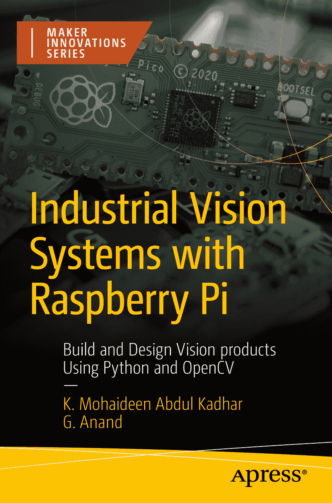

Maker 创新系列

通过 Apress 的 Maker 创新系列，开启你的探索之旅！从基础的电学和元器件知识，到机器人技术和机器学习领域最前沿的选择，你将逐步学会打造精巧的硬件，并用尖端的软件对其进行控制。同时，你将掌握常用工具集的新技能和经验，这些技能可以应用于新项目，甚至开启全新的职业生涯。

Apress 的 Maker 创新系列提供基于项目的学习，同时始终将理论和最佳实践置于核心位置。因此，你不仅能获得动手实践经验，还能学习行业术语，了解企业家、发明家和工程师是如何构思并执行硬件项目的。你将学会设计电路、编写 AI 程序、为家庭甚至城市创建物联网系统，以及更多精彩内容！

无论你是初出茅庐的爱好者，还是在自家地下室或车库里工作的经验丰富的创业者，你都能提升自己的技能，成为硬件设计和工程方面的专家。而且，通常使用的是低成本的开源软件，例如 Raspberry Pi、Arduino、PIC 微控制器和机器人操作系统（ROS）。程序员和软件工程师也有很好的学习机会，因为许多项目和控制环境都基于流行的编程语言和操作系统，如 Python 和 Linux。

如果你想制造一个机器人、搭建智能家居、组装一个气象监测系统，或者使用面包板和电路设计软件创建一个全新的电路，这个系列都能满足你的需求！本系列书籍由富有创造力且经验丰富的创客编写，每一本都探讨了经过验证的和前沿的方法与技术，助你将愿景和项目变为现实。

关于本系列的更多信息，请访问 [`https://link.springer.com/bookseries/17311`](https://link.springer.com/bookseries/17311)。

ISSN 2948-2542 e-ISSN 2948-2550 Maker 创新系列 ISBN 979-8-8688-0096-2 e-ISBN 979-8-8688-0097-9 [`doi.org/10.1007/979-8-8688-0097-9`](https://doi.org/10.1007/979-8-8688-0097-9) © K. Mohaideen Abdul Kadhar 和 G. Anand 2024 本作品受版权保护。所有权利均由出版商独家许可，涉及材料的全部或部分内容，特别是翻译、重印、插图复用、朗诵、广播、微缩胶片复制或任何其他物理形式的复制权，以及信息存储与检索、电子改编、计算机软件或目前已知或未来开发的类似或不同方法的传输权。本出版物中使用的一般描述性名称、注册商标、商标、服务标志等，即使没有明确声明，也不意味着这些名称不受相关保护法律和法规的约束，因此可供公众自由使用。出版商、作者和编辑认为本书中的建议和信息在出版之日是真实准确的。出版商、作者或编辑均不对本书所含材料或可能存在的任何错误或遗漏提供明示或暗示的保证。出版商对已出版地图中的管辖权主张和机构归属保持中立。

本 Apress 印记由 Springer Nature 旗下的注册公司 APress Media, LLC 出版。

注册公司地址为：美国纽约州纽约市纽约广场 1 号，邮编 10004。

*献给我亲爱的父亲，*

*您坚定不移的支持、无条件的爱和智慧一直是我的指路明灯。虽然您已不在我们身边，但您的存在贯穿本书的每一页。感谢您相信我，并激励我追求梦想。谨以此书献给您，献上我所有的爱。*

*永远在我心中，*

*——K. Mohaideen Abdul Kadhar 博士*

*献给我的父母，你们始终支持着我，你们坚定不移的爱和指引照亮了我人生旅程的每一个篇章。我将永远感激你们为我所做的一切，以及你们仍在为我做的一切。*

*——G. Anand*

引言

近年来，由于视觉系统在检测产品质量方面具有非侵入性，工业界对其需求显著增长。工业视觉系统可应用于多种场景，例如识别表面缺陷和故障、验证组件方向和尺寸等。可以利用现代图像处理技术，如图像分割、阈值处理、轮廓提取、特征提取、目标检测、图像分析和帧分析，来创建用于工业质量检测的实时视觉系统。

本书演示了如何使用 Raspberry Pi 实时实现工业视觉系统。本书旨在为研究生、研究人员和初级视觉工程师提供帮助。本书以介绍性章节开篇，为读者提供此类系统的概述。第二章向读者介绍 Raspberry Pi 硬件，指导读者完成操作系统安装和摄像头设置，并附有 Python 软件的实践演示。第三章帮助读者学习和实践用于处理图像和视频的基本 Python 库。

第四章涵盖了开发标准工业视觉系统所涉及的挑战，包括摄像头的选择、放置位置以及所需的照明条件。第五章详细概述了基本的图像处理技术，从图像属性和类型等基本概念开始，逐步深入到滤波、形态学操作和阈值处理等高级图像操作。

第六章专门介绍图形用户界面，让读者亲身体验如何使用 Python tkinter 库提供的各种小部件为视觉系统开发交互式用户界面。第七章向读者介绍主要的图像特征，如 SIFT、SURF 和 FAST，并演示如何从原始图像中提取这些特征，用于识别、分割和匹配等应用。

第八章讨论图像分割技术，这对大多数视觉系统至关重要，向读者介绍常用的分割技术，用于将图像分割成对象或区域。第九章专注于光学字符识别（OCR）系统，为读者提供使用领先云服务提供商提供的预训练 API 和可用的 Python 库来开发此类系统的机会。

第十章讨论机器学习算法，由于计算能力和内存规格的进步，这些算法得到了快速发展。本章快速介绍了传统的机器学习算法，然后详细讨论了神经网络，特别是常用于图像和视频应用的卷积神经网络（CNN）。

在最后一章，即第十一章，读者将有机会利用本书积累的知识，使用 Raspberry Pi 板开发端到端的标准工业视觉系统。

致谢

我深深感谢我的父母和家人，感谢他们在这段旅程中给予我坚定不移的支持和鼓励。他们对我的信任一直是我的力量源泉。

我谨向我的妻子 M. Jashima Parveen 女士致以衷心的感谢，感谢她在此过程中给予的无限耐心、巨大支持和理解。即使在我自我怀疑时，她对我坚定不移的信任也一直是我的精神支柱。她的耐心、爱和鼓励对于本书的成书起到了关键作用。有她在我身边，我深感幸运。

我要向 Sri Eshwar 工程学院院长及管理层表示诚挚的谢意，感谢他们持续的支持与鼓励。特别感谢院长 Sudha Mohanram 博士，感谢她富有远见的领导力，以及在建设“计算成像与机器视觉”高级研究中心过程中给予的坚定支持。她持续的支持、指导、鼓励以及对我能力的信任，对于本书的成书起到了关键作用。她致力于培育创新与卓越文化的奉献精神，着实令人鼓舞。

我衷心感谢我的合著者 G. Anand，感谢他对本书做出的宝贵贡献。他的专业知识、奉献精神和深刻见解丰富了本书的内容与质量。与他合作是一次收获颇丰的经历，我感激他在整个过程中与我并肩同行。

诚挚感谢 Apress 团队，特别是 Shobana Srinivasan、James Markham 和 Jessica Vakili，感谢他们的耐心与支持，使我能够撰写本书的高质量内容。

> —K. Mohaideen Abdul Kadhar

我感谢上苍赐予我这个分享知识的绝佳机会。我感谢我的父母和姐姐，感谢他们无尽的爱、支持与鼓励。

我感谢我的公司 Vismaya Infotech Solutions，允许我在履行组织内职责的同时，推进这个项目。我感谢管理层营造了一种成长与赋权的文化，为个人和职业发展提供了机会。

我深深感激我的合著者 K. Mohaideen Abdul Kadhar 博士，他不断鼓励并推动我发挥出最佳水平。他持续的指导与领域专业知识，极大地帮助我为本书开发了高质量的内容。能与他在此旅程中合作，我满怀感激。

我要向 Apress 团队的 Shobana Srinivasan 表示诚挚的谢意，感谢她对我们保持耐心，并确保项目在我们这边出现一些意外延误的情况下仍能按计划推进。

最后，我要感谢 James Markham 和 Jessica Vakili，感谢他们及时且宝贵的意见，帮助我们交付了高质量的内容。

> —G. Anand

关于作者 关于技术审校

