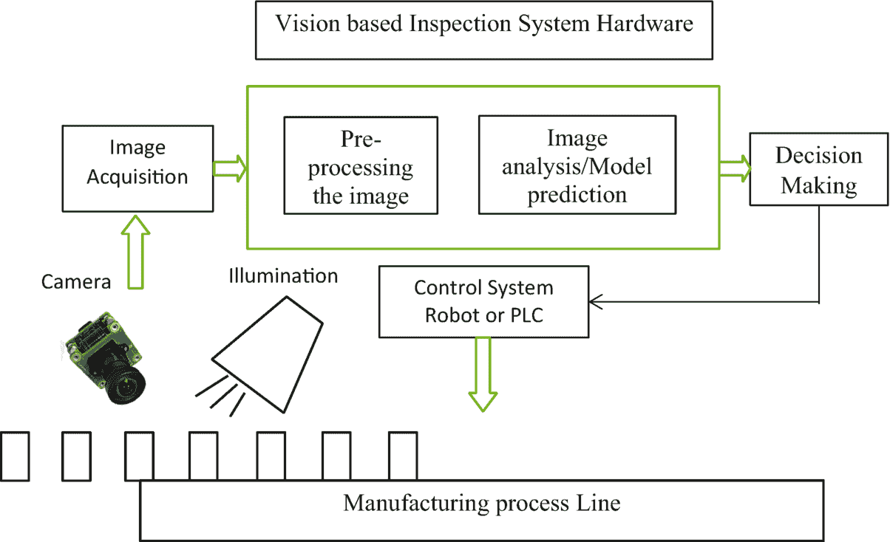

# 1. 工业视觉系统简介

现代制造业依赖于工业视觉系统，这些系统赋予机器以前所未有的效率和精度来观察和理解其周围环境的能力。这些尖端技术通过将原始数据转化为可付诸实践的洞察，彻底改变了质量控制和自动化流程。作为对工业视觉系统的全面介绍，本书可被视为计算机视觉领域初学者的学生、学者和专业人士的综合指南。本书提供了理论见解和实际实现，详细审视了视觉系统所必需的各种组件和前沿技术。读者将获得为工业应用创建可靠视觉系统的实践经验，重点在于使用灵活的 Raspberry Pi 板和 Python 编程。通过这段旅程，读者将掌握设计和开发高效视觉系统所需的知识和能力，为工业自动化领域的新颖想法和突破铺平道路。

## 计算机视觉简介

开发计算机视觉系统的设想最初于 20 世纪 60 年代末由当时引领人工智能领域的大学提出。最初的基本想法是模仿人类视觉系统。从事该领域的学生被分配了暑期项目，通过简单地将摄像头连接到计算机并对其进行编程以描述“它看到了什么”来构建一个视觉系统。随后几年进行的进一步研究为许多现有的视觉系统算法奠定了基础，例如边缘检测、图像分割、物体表示、运动估计等。

图像处理系统通常涉及图像的采集、处理和分析以提取信息，而视觉系统则额外涉及对图像的理解以及基于知识做出决策。根据 IBM 提供的定义，“计算机视觉是人工智能的一个领域，它使计算机和系统能够从数字图像、视频和其他视觉输入中获取有意义的信息，并基于这些信息采取行动或提出建议。”

每次开发视觉系统时都试图模仿人类视觉并非明智之举。为了理解这一点，让我们列举出人类视觉系统与简单计算机视觉系统之间的一些显著差异。在人类视觉系统中，图像采集由眼睛完成，图像处理由大脑执行；而在计算机系统中，图像采集借助摄像头完成，处理则由配备图像处理软件的计算机执行。人类视觉的范围是有限的，因为头部无法转动超过一定限度，而且对图像的感知也会因视野而异。另一方面，计算机视觉系统可以构建为提供跨越 360 度的均匀视觉。

人类视觉系统中的图像通过神经冲动从眼睛的视网膜传递到大脑进行处理，而计算机视觉系统中的图像则通过电脉冲传递。就两个系统的性能而言，最重要的区别在于，人类视觉系统是通过一生的情境经验训练出来的，这使得人类能够在瞬间感知关于场景的大量信息，例如存在的物体类型、它们所处的距离、它们是移动还是静止、移动物体的速度等。另一方面，为特定应用开发的计算机视觉系统只需要针对该应用的情境进行训练，这使得系统能够相对人类视觉更快地执行特定任务。

多年来，计算机视觉已在各个领域找到了大量应用。例如，医学领域目前使用许多成像技术来诊断多种疾病并收集相关信息。计算机视觉自然也进入了生物特征识别领域，其中使用从简单指纹到面部图像等多种成像技术来验证个人身份。另一个计算机视觉日益重要的领域是军事领域，其中使用包括成像传感器在内的多种传感器扫描特定区域，并获取大量有助于及时制定战略决策的信息。计算机视觉系统另一个有趣的应用是自动驾驶汽车的开发，范围从简单的汽车或卡车，到用于太空探索的无人机和漫游车等先进技术，它们通过分析前方场景的图像，实时做出瞬间决策，以执行机动操作甚至更复杂的任务。工业领域是近年来深受计算机视觉技术影响的另一个领域，其目标是提高效率和精度。通过利用计算机视觉，工业视觉系统可以改变制造流程，并保证无与伦比的质量和运营性能。让我们深入探讨一下这些工业视觉系统，以此开启我们的旅程。

## 工业视觉系统

随着过去几十年技术的巨大进步，工业经历了一系列彻底改变制造流程的革命。目前，我们正处于第四次工业革命，简称工业 4.0。这项技术背后的理念是利用传感器网络实现自动化驱动操作，这些传感器能够收集整个工业领域的数据，相互通信以共享数据，并在无需人工干预的情况下相互监控。工业 4.0 的主要组成部分是信息物理系统、物联网（IoT）、云计算和认知计算。本书涵盖了集成视觉系统以满足特定工业需求的过程。从实施所需的硬件和软件开始，本书接着介绍了工业应用（如目标检测和识别）中涉及的核心算法，并提供了关于生产线实时系统的具体案例研究。

在深入探讨工业视觉系统的更多细节之前，让我们先尝试理解实施计算机视觉系统的要求和挑战。视觉系统基本上由两部分组成：图像采集以及图像处理与分析。采集系统包括捕获应用相关目标物体图像所需的所有硬件。无论系统在何种环境中实施，如果我们能够获取到目标物体均匀照明且清晰的图像，就可以构建一个高度可靠和精确的系统。首先，我们需要选择一个非常适合构建视觉系统应用的相机或成像传感器。其次，我们需要确保系统使用环境光线充足，或者所选相机/传感器能够在可变光照条件下提供质量尚可的图像。在条件固定的室内应用中，设置一些光源来均匀照亮视野区域，可以极大地提高系统效率。光源和相机/传感器的定位在决定下一阶段处理算法的准确性方面也起着至关重要的作用。

使用相机/传感器捕获的图像被发送到配备有分析图像所需工具/软件的处理器或计算机。多年来，已经开发出许多能够与计算机以及专用处理器配合使用的软件包。本书将大量讨论的一个此类软件包是 OpenCV，它代表开源计算机视觉库，于 2000 年发布。它基本上是一个开源软件，包含一组主要为计算机视觉开发的编程函数。OpenCV 使用 C++ 编程语言编写，并具有其他编程语言（如 Python、Java 和 MATLAB）的语言绑定。它可以在 Windows、Linux、macOS 等桌面操作系统上运行，也可以在 Android、iOS 等移动操作系统上运行。它还可以安装在单板计算机的专用操作系统上，例如适用于树莓派主板的 Raspberry Pi OS。OpenCV 有许多应用，例如面部识别、手势识别、人机交互（HCI）、目标检测、增强现实等。*树莓派主板是在边缘实施基于视觉的应用以执行自动化任务的不错选择。本书探讨了广泛的树莓派主题，从硬件细节到为工业应用构建独立的计算机视觉任务。*

树莓派是由树莓派基金会与美国半导体制造商博通合作开发的一系列小型单板计算机。该主板最初为教学目的而开发，其受欢迎程度远超预期，随后经历了一系列升级，以满足计算机视觉、机器人技术、本地化云等广泛领域的需求。它支持多种操作系统，具体取决于主板的应用性质。树莓派基金会提供的主要操作系统是树莓派操作系统，以前称为 Raspbian 操作系统，这是一个基于 Debian Linux 发行版的类 Unix 操作系统。它自带一个默认的 Python 集成开发环境（IDE），可用于利用 OpenCV 包实现我们的视觉系统。树莓派主板提供了一个专用接口来连接摄像头，并且还有与所有树莓派型号兼容的树莓派摄像头模块可供使用。Pi 主板还提供 USB 端口，因此也可以连接 USB 网络摄像头。

制造业通常有一条生产线，随后是一条装配线。制造业中的生产线基本上是一条机器和工人组成的线路，产品在生产过程中沿着这条线路移动。例如，一条生产线可能涉及成型、包装、喷漆、染色等工序。来自不同生产线的零件或组件通常会被传递到装配线，在那里它们通过一系列步骤被组装或配置，以得到最终产品。

质量控制是生产线的重要组成部分，因为它有助于满足客户期望并确保满意度，维护强大的品牌声誉以保持竞争力，通过减少缺陷来降低成本，并遵守标准和法规。大多数行业采用在线质量控制，即在生产线上设置多个检测点。这些检测点通常安排人员根据各种标准或规格手动检查产品质量，识别任何不合格或有缺陷的产品，并将其从生产线或装配线上隔离出来。但人类往往容易受到许多缺点的影响，例如有偏见的观点、容易出错的判断以及有限的速度/效率。这是一个可以有效利用视觉系统来减少人工干预并提高过程速度、准确性和效率的领域。因此，我们可以将工业视觉系统视为使用计算机视觉来检查、监控和控制工业过程的自动化系统。这些系统执行诸如产品检查、质量控制和过程监控等任务。

工业视觉利用人工智能和机器视觉技术，以最优方式自动化各种工业过程。这涉及使用摄像头、照明和图像处理技术，在各个检测点检查和分析产品或材料，并根据收集的数据做出决策。通过这种过程自动化，工业视觉系统有助于提高生产力、降低成本和人为错误，并提高质量。这些工业视觉系统被用于许多行业，如制造业、农业、医疗保健、物流和仓储、消费品等。

随着计算硬件及相关软件的巨大进步，工业视觉系统的能力也有了显著提升。一方面，我们见证了各种不同能力的数字摄像头的快速发展；另一方面，处理器计算能力的持续增长导致了机器学习和人工智能技术在实现视觉系统方面的广泛采用。其他极大促进工业视觉系统发展的技术包括：用于从多个角度检查产品的 3D 成像、机器人及传送带等自动化程度的提高、增强的实时能力，以及由于相对用户友好的软件和界面而带来的易用性提升。由于这些进步，当今的工业视觉系统可以执行各种复杂任务，如目标跟踪、目标识别、模式匹配、缺陷检测等。此外，这些系统正与机器人控制器和传送带等其他自动化技术集成，以创建未来型的生产线。

## 工业视觉系统的步骤

尽管工业视觉系统的具体组件可能因应用和需求的性质而异，但就图像处理而言，其涉及的通用步骤如图 1-1 所示。

基于视觉的检测系统硬件框图定义了来自摄像头的输入图像如何经历采集、预处理、分析、模型预测、决策、控制系统（机器人或 PLC）以及制造过程线。

图 1-1

工业视觉系统

*   **图像采集**：此模块负责从工业环境中捕获图像，这可以借助摄像头或其他图像采集设备来实现。此步骤的一个重要方面是确保被检测产品被均匀照明，以获得高质量的图像。图像质量对于提高后续过程的效率至关重要。

*   **预处理**：此步骤主要涉及通过各种手段（如降噪、去模糊、亮度和对比度校正等）增强捕获的图像，以提高其质量。

*   **图像分析/模型预测**：然后在此模块中对预处理后的图像进行分析，以获取诸如物体类型、尺寸、是否为缺陷品分类等信息，这些信息可用于做出决策，并指示机器人控制器执行特定操作，或仅根据某些标准提供警报。这种分析可以通过设计一个学习模型来完成，该模型使用大量图像数据集进行训练，以区分良品和缺陷产品。

*   **控制系统（机器人或 PLC）**：从分析中获得的决策可用于激活机械臂以执行特定操作。例如，如果在分析阶段检测到有缺陷的产品，则可以激活机械臂将该产品从生产线上隔离出来，阻止其继续向下游移动。

## 摘要

本章让我们得以一窥工业视觉系统的世界，我们讨论了以下主题：

*   计算机视觉系统入门简介，涉及其历史、与人类视觉的关联性及其应用
*   工业视觉系统介绍，包括其需求、独特挑战、各种组件及可能的应用
*   开发工业视觉系统所涉及步骤的分解

在掌握了工业视觉系统的基本知识后，我们将开始更详细地探索相关概念。在下一章中，我们将学习并熟悉树莓派板，后续将用它来开发用于工业应用的独立视觉系统。接着，我们将熟悉 Python 库提供的 OpenCV 包，然后在接下来的两章中讨论视觉系统实现中的挑战。我们将学习对实现视觉系统至关重要的图像处理技术基础，然后在接下来的两章中学习开发用户友好的图形用户界面（GUI）。一旦这些基本概念被覆盖，我们将在接下来的四章中开始讨论高级技术，如特征提取、图像分割、OCR 和深度学习算法。最后，我们将在最后一章中，针对一些通用的工业用例，进行视觉系统的实时实现。

在简要介绍了工业视觉系统之后，本书的其余章节将讨论构建一个可运行的工业视觉系统所涉及的每个工具和技术方面。在第 2 章中，我们将简要介绍树莓派板，然后介绍安装操作系统、设置环境以及将摄像头与板卡连接的过程。第 3 章将让我们对 Python 社区提供的 OpenCV 包有一个总体了解。我们将从 Python 编程的简单介绍开始本单元。然后，我们将详细描述 NumPy 数组，这一点非常重要，因为在处理不同的图像处理技术时，图像被视为数值数组。最后，我们将讨论 OpenCV 包及其提供的用于在 Python 中读取和可视化图像的函数。第 4 章将涵盖实现视觉系统时面临的不同挑战，如照明要求、摄像头角度等。第 5 章将完全专注于图像处理，我们将讨论与图像处理相关的广泛算法和技术，以及 OpenCV 包提供的用于实现这些技术的众多函数。第 6 章将介绍图像中的不同特征以及从给定图像中提取这些特征的可用技术。第 7 章将重点介绍图像分割，用于从给定图像中提取特定对象，这是一种可用于视觉系统的强大技术。另一种近年来应用日益广泛的技术是光学字符识别（OCR），可用于识别轴、齿轮、轴承等机械部件上的文本或数字。第 8 章将完全致力于 OCR 技术。机器学习算法可以极大地提高视觉系统的准确性，因此，第 9 章将涵盖在视觉系统中占主导地位的各种学习算法。本书的最后一章将把前几章学到的所有技术应用于实时案例研究。

