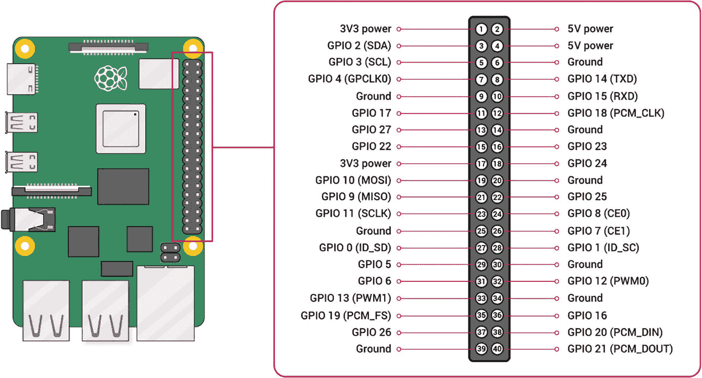
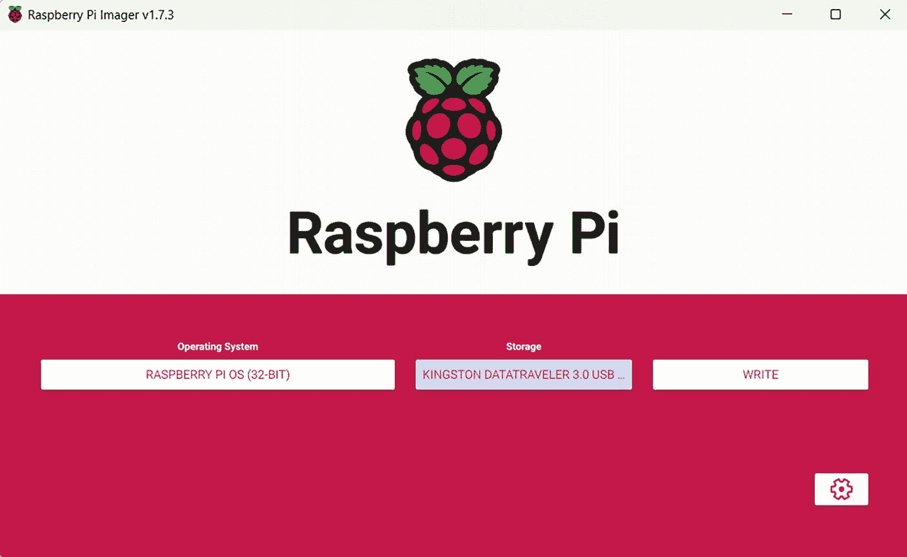
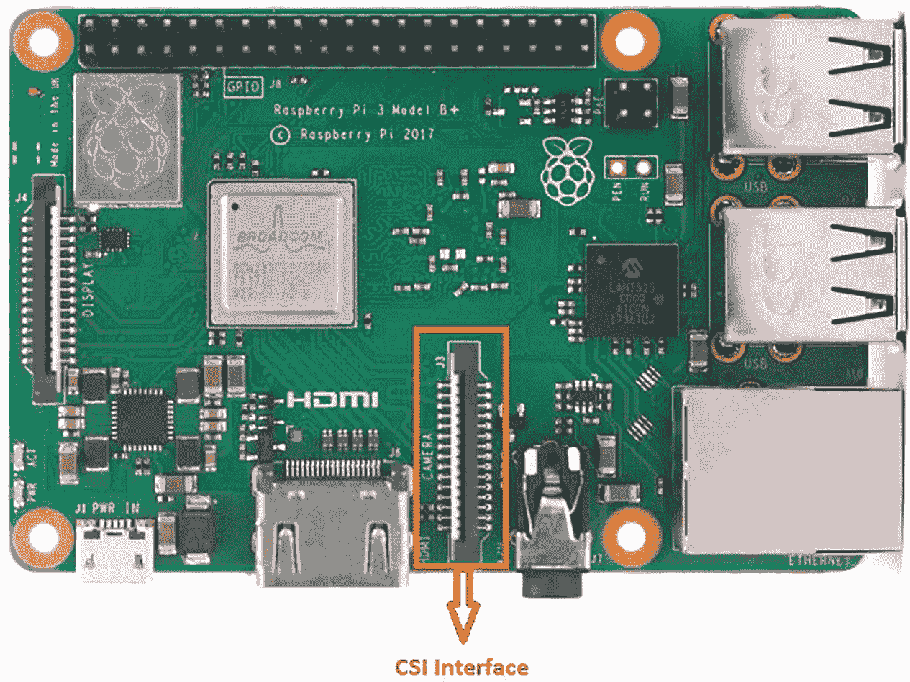

# 2. 树莓派入门

树莓派是伦敦树莓派基金会开发的一系列信用卡大小的单板计算机。这些微型计算机便携且价格低廉，并能与显示器、键盘和鼠标等其他硬件实现互操作，从而有效地将其转变为低成本 PC。这些板卡最初是为教育目的而开发的，后来作为多功能设备变得越来越流行，并在机器人技术、网络管理、天气监测等各个领域找到了应用。它也成为具有计算机或电子背景的人开发业余项目的热门工具。本章首先简要介绍树莓派硬件的组件，让读者感受其能力。然后，深入探讨树莓派操作系统以及 `OpenCV` 库的安装，接着是配置板卡以实现远程访问。本章最后演示了如何将摄像头连接到树莓派板，这将使我们能够实时捕获图像或视频。

## 树莓派主板与引脚详解

树莓派主板的工作原理相当直接。它配备了一个板载处理器和 `SDRAM`，类似于普通计算机，但没有内部存储和额外外设。要使用该主板，我们需要将一张已安装操作系统的外部 `SD` 卡插入主板上的指定插槽。操作系统设置完成后，树莓派便可连接鼠标、键盘等输入设备，以及电脑显示器或 `HDMI` 电视等输出设备，从而将其转变为一台可编程执行各种操作的 `PC`。此外，树莓派主板还提供了多个通用输入/输出（`GPIO`）引脚，可用于连接传感器、`LED`、电机等各种设备。官方树莓派文档^(¹)中提供的主板引脚详情如图 2-1 所示。

目前市面上现有的树莓派主板提供一个 40 引脚的 `GPIO` 排针，包含 4 个电压引脚（两个 5V 引脚和两个 3.3V 引脚）、8 个接地引脚（不可配置）、2 个 `ID EEPROM`（指定为 `GPIO 0` 和 `1` 引脚，但保留用于高级用途）以及 26 个 `GPIO` 引脚。被指定为输入引脚的 `GPIO` 可读取为高电平（3.3V）或低电平（0V）。同样，被指定为输出引脚的 `GPIO` 可设置为高电平（3.3V）或低电平（0V）。这些 `GPIO` 引脚中的任何一个都可以通过软件指定为输入或输出引脚，并可用于多种用途。



树莓派的引脚配置图。它包括 3.3V 电源、`GPIO`、接地和 5V 电源。共有 28 个 `GPIO` 引脚（从 0 到 27）和 8 个接地引脚。

图 2-1 树莓派 `GPIO` 引脚图

第一款树莓派主板于 2012 年发布。自那时起，树莓派系列经历了诸多变革。每一次演进都带来了新特性，并迅速被树莓派社区所接受。表 2-1 展示了多年来发布的不同型号树莓派在功能上的变化。

表 2-1 各种树莓派型号及其特性

| 型号 | 以太网 | Wi-Fi | GPIO 引脚 | 蓝牙 | CPU | 内存 |
| :--- | :--- | :--- | :--- | :--- | :--- | :--- |
| Raspberry Pi 1 B | 是 | 否 | 26 | 否 | 700MHz ARM1176JZF-S | 256/512 MB |
| Raspberry Pi 1 A | 否 | 否 | 26 | 否 | 700MHz ARM1176JZF-S | 256 MB |
| Raspberry Pi 1 B+ | 是 | 否 | 40 | 否 | 700MHz ARM1176JZF-S | 512 MB |
| Raspberry Pi 1 A+ | 否 | 否 | 40 | 否 | 700MHz ARM1176JZF-S | 512 MB |
| Raspberry Pi 2 | 是 | 否 | 40 | 否 | 900 MHz 32 位/64 位四核 [ARM Cortex-A7](https://en.wikipedia.org/wiki/ARM_Cortex-A7) | 1 GB |
| Raspberry Pi Zero | 否 | 否 | 40 | 否 | 1GHz ARM1176JZF-S | 512 MB |
| Raspberry Pi 3 B | 是 | 是 | 40 | 4.1 BLE | 1.2 GHz 64 位四核 [ARM Cortex-A53](https://en.wikipedia.org/wiki/ARM_Cortex-A53) | 1 GB |
| Raspberry Pi Zero (W/WH) | 否 | 是 | 40 | 4.1 BLE | 1GHz ARM1176JZF-S | 512 MB |
| Raspberry Pi 3 B+ | 是 | 是 | 40 | 4.2 BLE | 1.4 GHz 四核 ARM Cortex-A53 | 1 GB |
| Raspberry Pi 3 A+ | 否 | 是 | 40 | 4.2 BLE | 1.4 GHz 四核 ARM Cortex-A53 | 512 MB |
| Raspberry Pi 4 B | 是 | 是 | 40 | 5.0 BLE | 1.5GHz 或 1.8GHz 四核 ARM Cortex-A72 | 1、2、4 或 8 GB |

除了表 2-1 中提供的特性外，树莓派主板还提供了额外的功能，如多个 `USB` 端口、`HDMI` 端口、3.5mm 音频插孔和板载图形处理单元（`GPU`）。所有这些配置使得树莓派主板在多个应用领域备受青睐。接下来，让我们看看如何为这台微型计算机安装操作系统（`OS`），以便开始使用。

## 安装操作系统

现在我们已经基本了解了不同版本树莓派主板所支持的硬件特性，是时候看看如何将主板与 `I/O` 设备连接、安装操作系统，并将其用作 `PC` 了。我们需要一台电脑显示器、键盘和鼠标、树莓派电源，以及一张 `SD` 卡（建议使用至少 8GB 的 `microSD` 卡）。

树莓派社区推荐使用名为 `Raspberry Pi Imager` 的软件来为 `SD` 卡安装操作系统。另一种基于 `SD` 卡的安装程序 `NOOBS`（全新开箱即用软件）以前曾被广泛使用，但树莓派社区不再推荐或支持使用 `NOOBS`。请按照以下步骤在 `SD` 卡中安装树莓派操作系统。



`Raspberry Pi Imager` 1.7.3 版本窗口的截图。窗口中央包含树莓派图标。它显示了操作系统、存储和写入选项，右下角有设置图标。

图 2-2 树莓派安装窗口

1. 在 `PC` 上下载最新版本的 `Raspberry Pi Imager`，并安装它。
2. 使用 `SD` 卡读卡器将 `SD` 卡连接到 `PC`。
3. 打开 `Raspberry Pi Imager` 工具，并从提供的列表中选择所需的操作系统。下拉列表中提供了多种操作系统，其中“`Raspberry Pi OS`”由树莓派社区开发。我们也可以根据自己的需求或专业水平选择其他操作系统。
4. 在“存储”下拉菜单下，选择我们已连接到 `PC` 的 `SD` 卡，如图 2-2 所示。
5. 检查操作系统和存储的选择，然后点击“写入”按钮开始向 `SD` 卡写入数据。

写入过程完成后，我们可以取出 `SD` 卡并将其插入树莓派主板。然后，我们可以将电脑显示器连接到主板的 `HDMI` 端口。如果显示器支持 `VGA` 而非 `HDMI`，我们可以使用 `VGA` 转 `HDMI` 转换器将其连接到主板的 `HDMI` 端口。接着，我们可以使用可用的 `USB` 端口将键盘和鼠标连接到树莓派主板。如果需要，我们可以将扬声器连接到主板上的 3.5mm 音频插孔。只要这些设备以及我们的树莓派主板都支持蓝牙，键盘、鼠标和扬声器也可以通过蓝牙连接。连接好所有 `I/O` 设备后，我们就可以启动主板了。

当树莓派首次启动时，它会引导我们进入一个配置向导，允许我们设置树莓派。该向导首先允许我们配置国际设置和时区信息，之后会提示我们创建一个用户账户，我们可以在其中选择用户名和密码。请注意，某些旧版本的操作系统可能要求我们使用默认用户名“`pi`”。创建用户账户后，我们可以配置屏幕（例如缩小桌面尺寸）和无线网络。无线网络配置完成后，树莓派主板就可以访问互联网了。有时，一旦我们连接到互联网，系统会提示我们将操作系统更新到最新版本。在这种情况下，我们可以继续进行更新，之后系统会提示我们重启树莓派。现在，主板将启动进入树莓派操作系统，该操作系统拥有易于导航的界面，类似于 `Windows` 和 `Linux` 等其他操作系统。

## 在树莓派上安装 OpenCV

`OpenCV` 是一个用于实时计算机视觉的强大开源库，可用于实现高级图像处理任务，例如物体检测、运动追踪等。通过将此 `OpenCV` 包与 `Python` 编程结合使用，我们可以从连接到树莓派主板的摄像头获取图像，并执行实时机器视觉任务。让我们从了解如何在树莓派主板上安装 `OpenCV` 包及其依赖项开始。

在开始安装之前，我们需要在树莓派操作系统中执行一些先决条件操作。首先，打开终端并输入 `sudo raspi-config`。这将打开树莓派软件配置工具，我们需要进入“高级选项”并选择“扩展文件系统”。系统会要求我们重启。采取此步骤主要是为了确保我们正在使用的系统不会出现空间不足的情况。重启后，我们需要通过在终端中输入 `sudo apt-get update && sudo apt-get upgrade` 来更新和升级系统。这样做是为了获取并安装系统上每个过时软件包和依赖项的最新更新。

下一步是安装一个名为 CMake 的软件包。

## 安装 CMake

CMake 是一个开源软件，用于通过独立于编译器的方法来打包和安装软件。要安装 CMake，我们首先需要安装一个名为 snap 的不同包管理工具。snap 和 apt 包管理之间的区别在于，snap 包含了运行应用程序所需的一切，包括其依赖项，而使用 apt 时，依赖项必须作为单独的包进行部署。可以使用终端命令 `sudo apt install snapd` 来安装 snap 包。安装完成后，我们可以继续使用终端命令 `sudo snap install cmake –classic` 来安装 CMake 包。如果此命令报错，请转到“首选项”并点击“树莓派配置”。在出现的窗口中，转到“性能”，并确保“GPU 内存”设置为至少 256。这很可能会清除错误并成功安装 CMake。

## 安装 OpenCV 依赖和源码

接下来，我们将使用终端命令 `sudo apt-get install python3-dev` 安装 Python 3 开发头文件。一些树莓派主板默认安装了 Python 3。在这种情况下，上述命令将显示已安装的版本，而不是再次安装新的副本。

Python 安装完成后，我们将下载 OpenCV 的源代码包并使用 CMake 进行编译。可以使用以下终端命令从 GitHub 下载 OpenCV 的 zip 文件：
```
wget -O opencv.zip https://github.com/opencv/opencv/archive/4.0.0.zip
```

这会将整个 zip 文件下载到我们的树莓派中。之后，我们需要下载 OpenCV contrib zip 文件，该文件包含一个扩展库，对于整个 OpenCV 的正常工作至关重要。这些是 Python 的预构建包，可以使用以下终端命令下载：
```
wget -O opencv_contrib.zip https://github.com/opencv/opencv_contrib/archive/4.0.0.zip
```

现在，我们应该分别使用终端命令 `unzip opencv.zip` 和 `unzip opencv_contrib.zip` 来解压这两个 zip 文件。两个文件夹现在都已解压并可以使用。下一步是安装名为 `numpy` 的 Python 库，该库为处理多维数组和矩阵提供支持。由于图像被表示为数字数组（我们将在第 5 章中对此进行更多讨论），OpenCV 需要 `numpy` 库支持来执行大多数图像处理任务。可以使用终端命令 `pip install numpy` 下载此库。请注意，此 pip 包已随我们的 Python 包一起下载。

我们的主目录中已经有两个解压后的文件夹或目录，分别名为 `opencv-4.0.0` 和 `opencv_contrib-4.0.0`。为了编译 OpenCV 库，我们需要在 `opencv-4.0.0` 目录内创建一个名为 `build` 的新目录，这可以通过以下终端命令完成。
```
cd ~/opencv-4.0.0
mkdir build
cd build
```

## 编译与配置 OpenCV

现在我们已经进入终端窗口中的 `build` 文件夹，下一个重要步骤是为 OpenCV 运行 CMake。在这里，我们可以配置 OpenCV 的编译方式。在终端窗口中输入以下行：
```
cmake -D CMAKE_BUILD_TYPE=RELEASE \
-D CMAKE_INSTALL_PREFIX=/usr/local \
-D OPENCV_EXTRA_MODULES_PATH=~/opencv_contrib-4.0.0/modules \
-D ENABLE_NEON=ON \
-D ENABLE_VFPV3=ON \
-D BUILD_TESTS=OFF \
-D WITH_TBB=OFF \
-D INSTALL_PYTHON_EXAMPLES=OFF \
-D BUILD_EXAMPLES=OFF ..
```

配置完成后，我们应该会看到 “Configuration done” 和 “Generating done” 消息。如果出现任何错误，请确保输入了正确的路径，并且两个解压后的目录存在于主目录路径中。最后，输入终端命令 `make -j4`。这将利用树莓派的全部四个核心来编译所有内容并开始运行 OpenCV。这大约需要 30 分钟才能完成。如果进程中断并显示错误，请尝试命令 `make -j1`，这将使用单个核心。虽然这需要很长时间，但更加稳定。

在测试 OpenCV 之前，让我们使用终端命令 `sudo apt-get install libopencv-dev python-opencv` 安装另一个简单的库。

## 验证安装

我们可以通过在 Python 界面中运行命令 `import cv2` 来检查库是否成功添加。我们可以在 IDE（树莓派默认带有一个名为 Thonny 的 Python IDE）中执行此操作，也可以在终端窗口中执行。在终端窗口中，输入 `python` 并按回车键。这将带我们进入一个带有 `>>>` 符号的 Python 界面。现在，在该符号旁边输入 `import cv2` 并按回车键。如果库成功导入，将不会显示任何消息，我们将在下一行看到 `>>>` 符号。现在，我们可以使用 OpenCV 中所有可用的函数来执行图像处理任务。但如果安装不成功，我们将收到 “ModuleNotFoundError”，并且需要找出安装过程中出错的地方。

## 使用树莓派进行远程访问

在基于树莓派实施工业视觉系统时，通常的做法是在不同位置使用多个树莓派板，并将它们全部连接到本地网络。在这种情况下，我们可能需要远程连接到每个板，而无需单独为它们连接显示器。例如，我们可能需要查看树莓派板上的某些信息，或者访问存储在板载 SD 卡中的某些数据（如图像、视频等）。在这种情况下，远程访问可以省去很多麻烦，而无需亲自为每个板连接显示器、键盘和鼠标来访问它。

任何连接到局域网（LAN）的设备都会被分配一个 IP 地址。因此，我们需要知道树莓派板的 IP 地址，才能从网络中的另一台机器连接到它。主要有两种方法用于建立此连接。第一种方法是使用安全外壳（SSH）协议，通过它我们可以访问树莓派板的命令行（终端）；第二种方法是虚拟网络计算（VNC），它允许我们从一台计算机控制另一台计算机的桌面界面。在详细介绍这两种方法之前，我们先讨论一些可用于获取树莓派板 IP 地址的方法。

查找树莓派 IP 地址最简单的方法是：将显示器连接到板子，启动操作系统，打开终端窗口，然后输入命令 `hostname –I`。这将显示树莓派的 IP 地址。正如我们之前讨论的，当工业视觉系统中有多个树莓派板时，这种方法会变得很繁琐。另一种实现方法是访问连接到局域网路由器的设备列表。路由器通常会在其机身印有 IP 地址和登录凭证。在某些情况下，凭证会随附在路由器的说明文件中。例如，如果路由器的 IP 地址是 `192.168.1.1`，那么我们可以在浏览器中导航到 [https://192.168.1.1](https://192.168.1.1)，并使用给定的凭证登录。然后，我们可以浏览已连接设备的列表，并从那里获取树莓派板的 IP 地址。

我们也可以使用 mDNS 来访问树莓派板，因为树莓派操作系统上的 Avahi 服务原生支持多播 DNS。如果另一台连接到局域网的设备支持 mDNS，我们可以通过使用树莓派板的主机名加上 “.local” 后缀来访问它。在大多数情况下，全新安装的树莓派操作系统上的默认主机名是 “raspberrypi”。因此，默认情况下，任何运行树莓派操作系统的树莓派都会响应命令 `ping raspberrypi.local`。如果我们更改了树莓派的系统主机名，我们可以使用该新主机名加上 “.local” 后缀。如果树莓派可达，那么 `ping` 命令将显示其 IP 地址，如下所示：
```
PING raspberrypi.local (192.168.1.131): 56 data bytes
64 bytes from 192.168.1.131: icmp_seq=0 ttl=255 time=2.618 ms
```

另一种获取树莓派 IP 地址的方法是使用 `nmap` 命令。nmap（网络映射器）命令是一个免费、开源的网络发现工具，适用于 Windows、Linux 和 macOS 等不同操作系统。要在 Windows 上安装 `nmap`，请访问 nmap.org 的下载页面。要使用 `nmap` 命令扫描我们网络上的设备，我们需要知道我们所连接的子网。首先，我们需要找到自己的 IP 地址。例如，在 Windows 上进入“控制面板”，点击“网络和共享中心”下的“查看网络连接”，选择活动的网络连接，然后点击“查看此连接的状态”来查看 IP 地址。一旦我们有了自己电脑的 IP 地址，我们就可以扫描整个子网以查找其他设备。例如，如果电脑的 IP 地址是 `192.168.1.3`，那么子网范围将是 `192.168.1.0/24`。然后我们可以使用 `nmap` 命令 `nmap –sn 192.168.1.0/24`，该命令将对所有 IP 地址进行 ping 扫描，以查看它们是否响应，每个设备的响应将显示主机名和 IP 地址。我们可以在此列表中查找树莓派的主机名（如前所述，默认主机名是 “raspberrypi”），并获取其 IP 地址。

还有其他获取树莓派板 IP 地址的方法，读者可以自行探索。一旦我们有了 IP 地址，就可以使用 SSH 协议或 VNC 来访问我们的树莓派。让我们详细讨论这两种选项。

## 访问树莓派

### 安全外壳（SSH）协议

如前所述，此协议可用于从同一网络上的另一台设备远程访问树莓派的命令行。首先，我们需要确保树莓派已正确设置并连接到我们的本地网络。然后，我们需要在树莓派操作系统中启用 SSH 服务器。这可以通过两种方式完成：从“首选项菜单”启动“树莓派配置”，导航到“接口”选项卡，然后在 SSH 旁边选择“启用”；或者在终端窗口中输入 `sudo raspi-config`，选择“接口选项”，导航到并选择 SSH，选择“是”，然后选择“确定”。

完成此操作后，我们现在可以从使用 2018 年 10 月更新或更高版本的 Windows 10 系统（这是无需任何第三方客户端即可使用 SSH 的必要条件）通过 SSH 连接到树莓派。我们需要在电脑上打开命令窗口，并运行命令 `ssh pi@<IP>`，将 `<IP>` 替换为树莓派的 IP 地址。首次连接时，我们可能会看到安全/真实性警告，只需输入“yes”即可继续。接下来，系统会提示输入 `pi` 的登录密码，我们需要输入密码并按回车键（树莓派操作系统上的默认密码是“raspberry”，但强烈建议在初始配置操作系统时更改默认密码）。现在，我们应该能够看到树莓派的提示符：`pi@raspberrypi ~ $`。这意味着我们已经远程连接到树莓派，可以开始执行命令了。

### 虚拟网络计算（VNC）

VNC 是一种图形化桌面共享系统，它允许我们在一台计算机上运行 VNC 服务器，然后从另一台运行 VNC 查看器的计算机控制该计算机的桌面界面。VNC 查看器的目的是将键盘敲击或鼠标/触摸事件传输到 VNC 服务器，并接收屏幕更新的返回信息。简而言之，树莓派的桌面将显示在我们自己计算机的一个窗口中，使我们能够像直接在树莓派上操作一样控制它。

实现此目的的第一步是在树莓派上安装 VNC，这可以通过终端命令 `sudo apt install real-vnc-vncserver real-vnc-vncviewer` 完成。安装完成后，可以通过运行终端命令 `sudo raspi-config`，导航到“接口选项”，向下滚动，选择“VNC”，然后点击“是”来启用 VNC 服务器。下一步是连接到树莓派，有两种方法可以实现。

第一种方法是与树莓派建立直接连接，这要求我们与树莓派板连接到同一个私有本地网络。我们只需在用于控制树莓派板的设备上下载 VNC 查看器（为获得最佳效果，应使用 RealVNC 的兼容应用程序），然后将树莓派的私有 IP 地址输入到 VNC 查看器中。

第二种方法是与树莓派建立云连接。云连接具有便捷性和端到端加密的优势。如果我们希望通过互联网连接到树莓派，强烈推荐使用此方法。使用此方法的另一个好处是我们不需要知道树莓派的 IP 地址。首先，我们需要注册一个 RealVNC 账户。然后，我们需要使用 RealVNC 账户凭据登录到树莓派上的 VNC 服务器。接下来，我们将在用于控制的设备上下载 RealVNC 的兼容 VNC 查看器应用程序，然后使用相同的 RealVNC 账户凭据登录到 VNC 查看器，最后点击连接我们的树莓派。

要完成直接连接或云连接，我们必须向 VNC 服务器进行身份验证。如果我们尝试从 RealVNC 的兼容 VNC 查看器应用程序建立连接，则需要输入我们通常用于登录树莓派用户账户的用户名和密码。但是，如果我们从非 RealVNC 的查看器应用程序连接，则需要降低 VNC 服务器的身份验证方案级别，指定一个 VNC 服务器专用的密码，然后使用该密码进行连接。为此，我们需要在树莓派上打开 VNC 服务器对话框，选择菜单 ➤ 选项 ➤ 安全，然后从“身份验证”下拉菜单中选择“VNC 密码”。

## 为树莓派连接摄像头

构建基于树莓派的视觉系统最关键的部分是将摄像头与树莓派板连接起来。有两种方法可以实现：使用专用的树莓派兼容摄像头模块，或者使用最常见的 USB 网络摄像头。在本节中，我们将详细讨论这两种方案。

### 使用兼容的摄像头模块

树莓派板的优势之一是其配备了专用的摄像头串行接口（CSI），如图 2-3 所示，我们可以将同样由树莓派基金会开发的 PiCamera 模块连接到该接口。多年来，官方开发了多款 Pi 摄像头模块，从 2013 年发布的原始 500 万像素型号到 2023 年发布的 1200 万像素摄像头模块 3。这些摄像头模块都带有一条与 CSI 接口连接的柔性排线。



图 2-3 树莓派中的摄像头串行接口

要连接摄像头模块，请轻轻向上拉起 CSI 端口的塑料夹，然后将摄像头模块的柔性排线插入端口。插入时，请确保排线底部的连接器朝向端口内的触点。接下来，启动树莓派，进入“首选项”菜单中的“树莓派配置”。选择“接口”选项卡，启用摄像头，然后重新启动树莓派。

有两种方法可以控制摄像头模块。

第一种方法是使用命令行。打开终端窗口并运行以下命令来拍摄静态照片：`raspistill -o Desktop/img.jpg`。这将打开一个持续 5 秒的摄像头预览，然后拍摄一张照片并将其保存在命令中提供的路径下（在我们的例子中，照片以文件名“img.jpg”存储在桌面上）。类似地，我们可以使用终端命令 `raspivid -o Desktop/vid.h264` 来录制视频。

第二种方法是使用名为 `picamera` 的 Python 库来控制摄像头模块。要在树莓派上安装该库，请打开终端窗口，然后输入命令 `sudo apt-get install python-picamera`。安装完成后，下一步是打开一个 Python 3 编辑器，例如树莓派操作系统默认自带的 Thonny Python IDE。在编辑器中，打开一个新文件，并使用“.py”扩展名保存。然后，在文件中输入以下代码并执行，即可获得摄像头预览。

```python
from picamera import PiCamera
from time import sleep
camera = PiCamera()
camera.start_preview()
sleep(5)
camera.capture('/home/pi/Desktop/img.jpg')
camera.stop_preview()
```

代码的前两行用于导入运行代码所需的模块。这里，我们导入了 `PiCamera` 模块和 `sleep` 模块。代码的第三行使用 `PiCamera` 模块创建了一个摄像头对象，该对象可用于预览或捕获图像。在代码的第四行，我们启动了摄像头预览。由于摄像头被激活以感应光线水平，它需要一些时间来适应光照条件。因此，我们在代码的第五行使用 `sleep` 模块，在启动预览后将代码执行延迟 5 秒。然后，使用摄像头对象的 `capture` 函数来捕获图像并将其存储在桌面上。代码的最后一行用于停止预览。如果我们的预览是倒置的，我们可以在创建摄像头对象（代码中的第三行）旁边使用 `camera.rotation = 180` 这一行代码。此外，我们可以使用 `start_recording()` 和 `stop_recording()` 函数代替 `capture()` 函数来录制视频，而不是捕获静态图像。

### 使用 USB 摄像头

由于树莓派主板支持多个 USB 端口，因此更容易设置多个 USB 摄像头。让我们看看如何在树莓派上设置和使用单个 USB 网络摄像头。首先，将摄像头插入 USB 端口，然后在终端窗口中运行命令 `lsusb` 来检查它是否被树莓派识别。此命令会列出连接到树莓派的所有 USB 设备，如果摄像头被成功检测到，它应该会列出摄像头的名称。

为了从终端窗口控制摄像头，我们需要像“fswebcam”和“ffmpeg”这样的软件包。“fswebcam”是一个简单的网络摄像头应用程序，用于捕获图像并将其保存为 PNG 或 JPEG 文件，而“ffmpeg”是一个用于处理多媒体文件（如音频、视频等）的库集合。这些软件包可以通过终端窗口使用以下命令安装：

```bash
sudo apt install fswebcam
sudo apt install ffmpeg
```

我们可以使用以下命令以特定分辨率捕获图像。“-r”字段用于指定所需的分辨率。使用 `fswebcam` 捕获的图像通常带有一个显示捕获时间戳的横幅。因此，我们使用“--no-banner”来移除横幅并获得纯图像。最后，我们指定要保存图像的路径、文件名和格式。

```bash
fswebcam -r 1280x720 --no-banner /images/image1.jpg
```

类似地，我们可以使用以下命令通过 `ffmpeg` 命令录制视频。它同时指定了音频和视频的参数。例如，我们从 `pulseaudio` 声音服务器捕获音频，并将其编码为具有 2 个音频通道（立体声）的无损原始 PCM。对于视频，我们从主显示器 (:0.0) 以 25fps 的帧率和 1366x768 的分辨率抓取视频流，并使用 `libx264` 将其编码为无损 h264。生成的流将保存为 `output.mkv`。

```bash
ffmpeg -f pulse -i default -f x11grab -framerate 25 -video_size 1366x768 -i :0.0 -c:v libx264 -qp 0 -c:a pcm_s16le output.mkv
```

# 第三章

## 3.1 录制视频

### 3.1.1 `ffmpeg`命令

使用以下 `ffmpeg` 命令组合音频和视频源进行录制：
```
ffmpeg -f alsa -ac 2 -i pulse -f x11grab -r 25 -s 1366x768 -i :0.0 -vcodec libx264 \
-preset ultrafast -crf 0 -threads 0 -acodec pcm_s161e -y output.mkv
```

### 3.1.2 Python脚本

要使用 Python 控制网络摄像头，我们可以使用 `OpenCV` 库。以下代码行用于创建一个无限循环来捕获视频并将其显示在屏幕上，直到我们从键盘按下指定的字符键，该键将中断循环并停止视频。
```python
import cv2
webcam = cv2.VideoCapture(0):
while True:
ret, img = webcam.read()
cv2.imshow('video',img)
key = cv2.waitKey(1)
if key == ord("x"):
break
webcam.release()
cv2.destroyAllWindows()
```
第一行用于导入 `OpenCV` 库模块。`VideoCapture(0)` 函数用于创建一个名为“`webcam`”的对象，以从树莓派上的第一个网络摄像头返回视频。“`while True:`”条件是一个无限循环，用于在我们的显示器上创建视频的无限显示。`read()` 函数用于从“`webcam`”对象捕获一帧，而 `OpenCV` 模块中的 `imshow()` 函数用于显示图像。`OpenCV` 模块中的 `waitKey()` 函数用于等待 1 毫秒以检测用户的任何按键。`ord()` 函数用于将字符“`x`”转换为其对应的 `Unicode` 值。我们使用 `if` 条件来检查是否按下了“`x`”键，如果按下则中断循环。一旦我们跳出循环，就会释放“`webcam`”对象，并使用 `destroyAllWindows()` 函数关闭在执行程序时打开的所有窗口（例如用于显示视频的窗口）。

## 总结

在本章中，我们讨论了以下主题：
*   树莓派主板的基本硬件配置和兼容性
*   借助 `microSD` 卡和“树莓派镜像工具”为主板安装操作系统
*   在树莓派操作系统中安装 `OpenCV` 库及其依赖项
*   以两种方式配置到树莓派主板的远程连接：虚拟网络计算（`VNC`）和安全外壳（`SSH`）协议
*   将 `PiCamera` 或网络摄像头连接到树莓派主板以捕获实时图像或视频
在下一章中，我们将进一步讨论如何使用 `OpenCV` 读取和写入图像以及视频，并使用 Python 中名为 `Matplotlib` 的可视化库来显示它们。
脚注 1