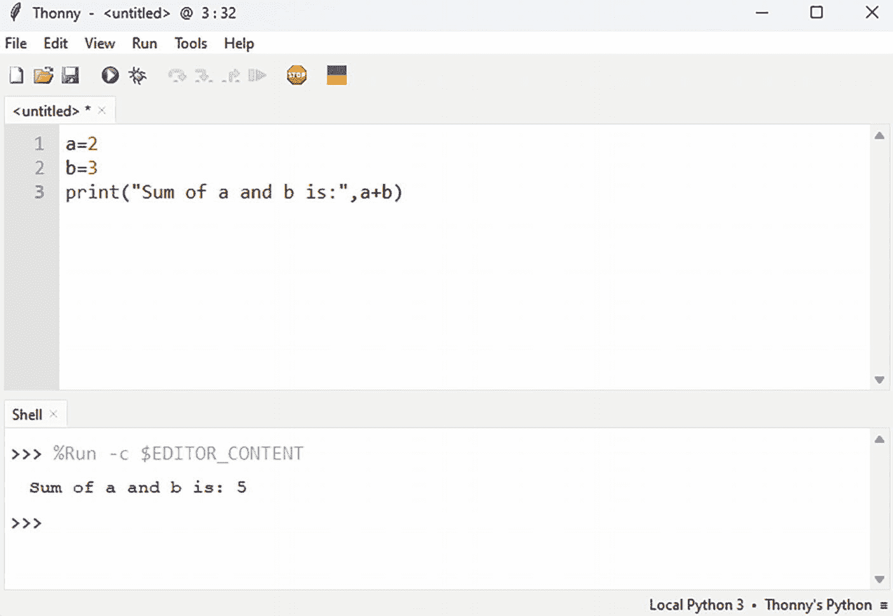
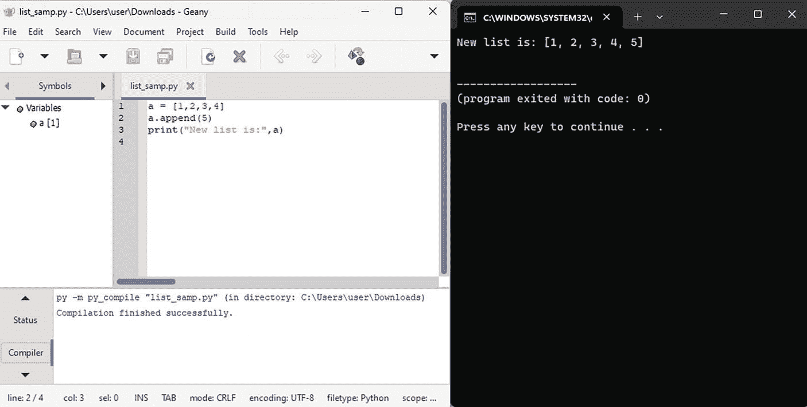
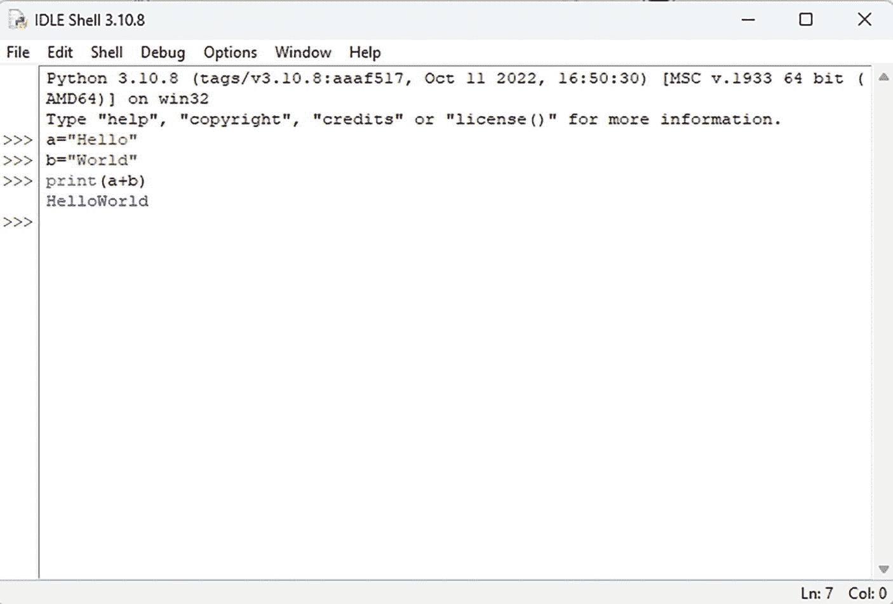
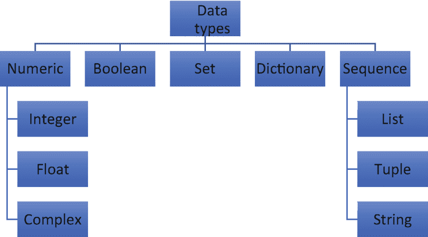
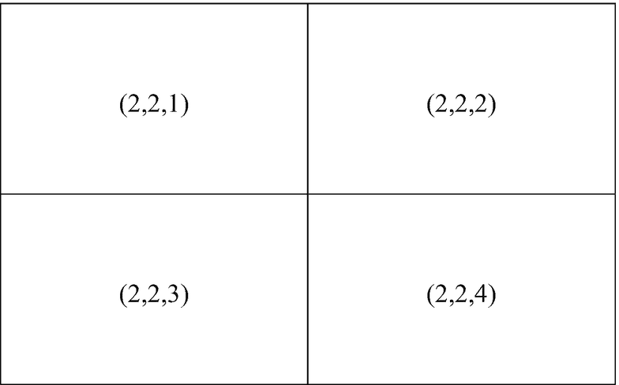
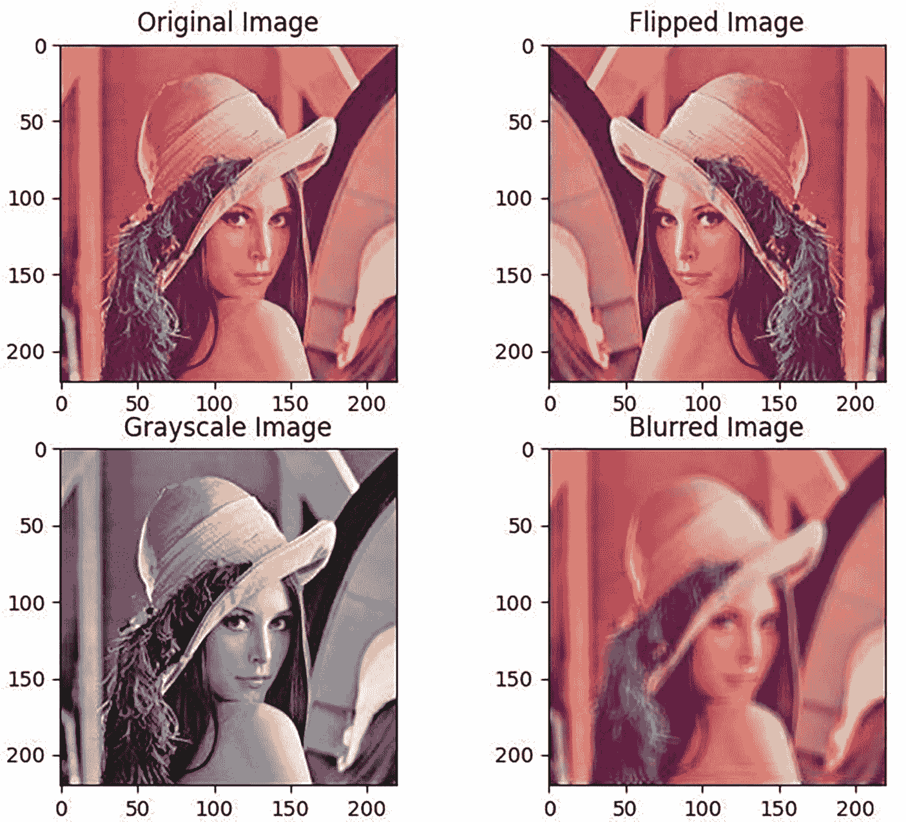
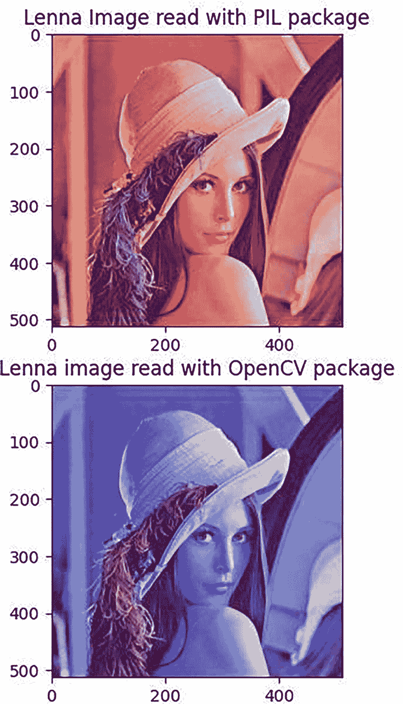
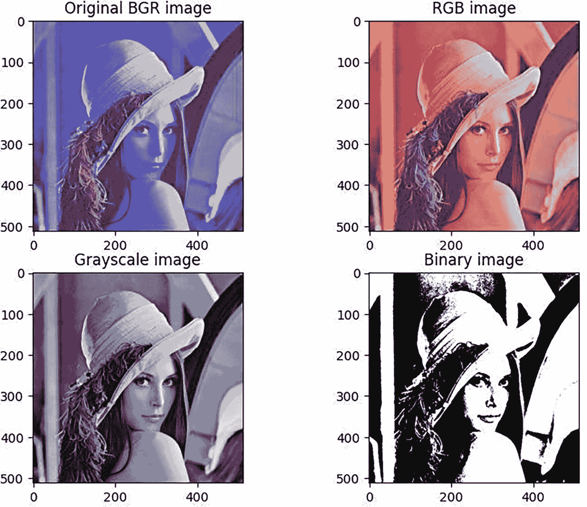
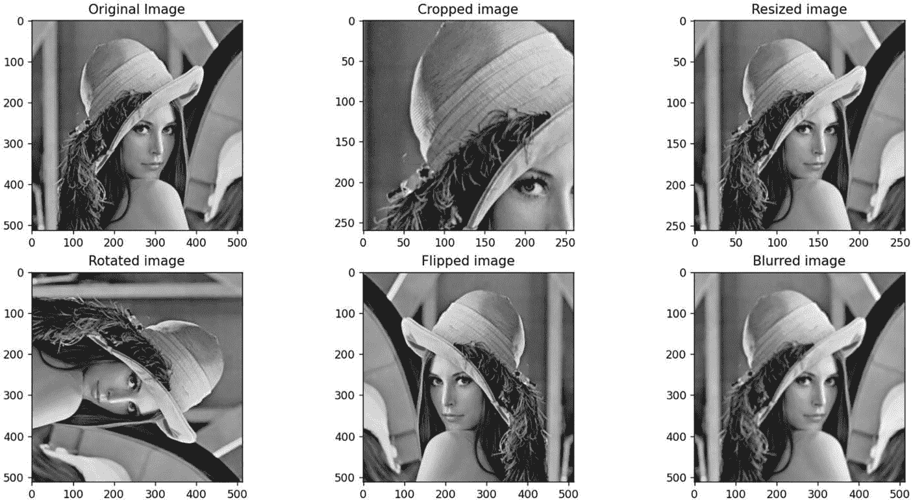

# 3. 用于图像处理的 Python 库

在本章中，我们将介绍 Python 编程，这将为我们学习本书后续使用 Python 的不同概念做好准备。我们将从树莓派可用的不同基于 Python 的 IDE 开始。然后，我们将继续使用两个广泛使用的 Python 库 numpy 和 PIL，它们在图像处理任务中被广泛使用。接下来，我们将看到如何使用 Matplotlib 库可视化（显示）图像。最后，我们将看到如何使用 OpenCV 库捕获和保存图像以及视频。

## 树莓派中的 Python IDE

在树莓派中，有许多不同的集成开发环境（IDE）可用于处理 Python 程序。我们将讨论三种最常见的 IDE，其中两种在树莓派操作系统中默认可用（Thonny 和 Geany），第三种是随 Python 包新安装一起下载的默认 IDE（IDLE）。

### Thonny

这是一个默认的 IDE，随树莓派操作系统一起安装了 Python 3.10。我们可以通过导航到主菜单（树莓派徽标）下的“编程”下拉菜单并点击“Thonny Python IDE”来打开它。该 IDE 具有非常简单的界面，如图 3-1 所示，包含两个部分：代码编辑器是我们输入代码的地方，而 Shell 是我们获取程序输入、显示输出和错误以及执行简单代码行的地方。默认界面可以添加额外的选项卡，这些选项卡在“视图”菜单中可用。例如，如果我们勾选“视图”菜单中的“变量”选项，这将在界面右侧显示“变量”选项卡，其中显示我们在程序中创建的所有变量及其各自的值。同样，读者可以自行探索其他窗口。



一个标题为 Thonny-I D E 的页面截图。页面显示 A = 2, B = 3, 以及打印 A 和 B 的和是 A 加 B。它包含下面的结果，显示 A 和 B 的和是 5。

图 3-1

Thonny IDE

### Geany

Geany 是一个开源轻量级 IDE，支持许多不同的操作系统，如 Windows、Linux、MacOS、Raspberry Pi OS 等。该 IDE 也随树莓派操作系统默认安装。此 IDE 支持多种编程语言以及标记语言，如 C、C++、C#、Java、PHP、HTML、Python、Ruby 等。Geany IDE 的默认界面如图 3-2 所示。如图所示，IDE 打开时带有一个空的未命名编辑器选项卡，我们可以在其中输入代码。状态选项卡显示从我们打开 Geany IDE 开始发生的每个活动的时间戳。符号选项卡将列出我们在程序中创建的所有符号（变量）。一旦我们在编辑器中输入程序，我们可以使用 .py 扩展名保存它，并通过点击“构建”下拉菜单中的“执行”选项或按键盘上的 F5 键来执行程序。输出将显示在一个单独的命令窗口中。



一个标题为 List samples-Geany I D E 的页面截图。右侧，一个窗格在符号选项下显示变量 A 1。左侧，一个窗格显示样本列表，包括 A = 1, 2, 3, 4。左侧提供的输出页面显示一个新列表是 1, 2, 3, 4, 和 5。程序以代码 0 退出。

图 3-2

Geany IDE


### IDLE

IDLE 是随 Python 官方页面下载包一同安装的默认集成开发环境（IDE）。但在树莓派操作系统中，Thonny 是系统自带的默认 Python IDE。由于大多数 Python 程序员习惯在其他操作系统环境中使用 IDLE，因此在树莓派操作系统中继续使用相同的 IDE 会让他们感到舒适。要在树莓派操作系统中安装 IDLE，请在终端窗口中输入以下命令：*sudo apt-get install idle3*。IDLE 界面如图 3-3 所示。我们可以看到，IDE 打开的是一个 Shell 窗口，其功能与 Thonny IDE 中的 Shell 相同。要打开编辑器，请转到“文件”并点击“新建文件”。然后我们可以在编辑器窗口中输入完整的代码，使用 .py 扩展名保存文件，并执行该文件。



一张标题为“IDLE Shell 窗口”的页面截图，其中包含文本：Python 3.10.8，输入 help、copyright、credits 或 license 以获取更多信息。a = hello，b = World，print a + b，以及 Hello World。

图 3-3

IDLE IDE

本书中的所有代码和演示均使用默认的“IDLE”IDE 完成。读者可以自由选择自己喜欢的 IDE，因为 IDE 的选择不会影响书中展示的代码。选定所需的 IDE 后，现在让我们继续了解 Python 支持的基本数据类型。

### 树莓派中的 Python 编程

对 Python 编程所有基本概念的完整讨论超出了本书的范围。本书将仅对部分基本概念进行简单介绍，更深入的内容留给读者自行探索。任何 Python 程序员首先需要了解的概念是 Python 支持的不同数据类型。图 3-4 展示了 Python 支持的所有数据类型的分类。



一张数据类型分类图，分为数值型、布尔型、集合、字典和序列。数值型下包含整数、浮点数和复数，而序列下包含列表、元组和字符串。

图 3-4

Python 中的数据类型

关于数值型数据类型，我们大多数人对其都很熟悉，因此无需多言。Python 的优势在于，一旦我们为变量赋值，数据类型就会被自动检测出来。这一点可以从下面给出的简单示例中看出。`type()` 命令会显示传递给它的变量的数据类型。在表 3-1 中，右侧列显示了 `print` 语句的输出。算术运算符和赋值运算符可用于对这些数据类型执行数学运算。

表 3-1

数值型数据类型示例

| 代码 | 输出 |
| --- | --- |
| `# 整数``a=2``print("a 的数据类型是:",type(a))``# 浮点数``b=3.2``print("b 的数据类型是:",type(b))``# 复数``c=3+4j``print("c 的数据类型是:",type(c))` | `a 的数据类型是: <class 'int'>``b 的数据类型是: <class 'float'>``c 的数据类型是: <class 'complex'>` |

布尔型数据类型仅包含两个值：true 和 false。该数据类型主要与条件语句相关联，其中应用于其他数据类型的条件运算符和逻辑运算符会生成一个布尔型数据类型，并基于该类型执行代码的子集。集合数据类型是一个无序的元素（其他数据类型）集合，元素之间用逗号分隔，并写在花括号内。集合的一个独特特性是不允许重复值。可以对集合执行并集、交集、差集和补集等集合运算。字典用于将数据点存储为键值对，键值对之间用逗号分隔，并写在花括号内。字典中的每个值只能通过其键来访问。这三种数据类型的简单示例如表 3-2 所示。

表 3-2

布尔型、集合和字典数据类型示例

| 代码 | 输出 |
| --- | --- |
| `# 布尔型``a=True``print("a 的数据类型是:",type(a))``# 集合``b={1,2,1,3,2,4}``print("b 的数据类型是:",type(b))``print("集合 b 中的值:",b)``# 字典``c={1:"Hello",2:"world"}``print("c 的数据类型是:",type(c))``print("键=2 对应的值是:",c[2])` | `a 的数据类型是: <class 'bool'>``b 的数据类型是: <class 'set'>``集合 b 中的值: {1,2,3,4}``c 的数据类型是: <class 'dict'>``键=2 对应的值是: world` |


列表是一个有序、可索引且可变的元素集合（元素可以是任何数据类型），元素之间用逗号分隔，并写在方括号内。列表的索引从 0 开始，可以通过索引访问列表中的特定元素。Python 提供了许多列表方法，用于执行追加、移除、排序等操作，读者可以自行探索以熟练掌握列表操作。元组与列表类似，但有两个不同之处：元组是不可变的（值不能被更改），并且元组的元素（可以是任何数据类型）写在圆括号内。类似地，字符串是一个不可变的字母数字字符集合，写在单引号或双引号内。元组和字符串的索引方式与列表相同。与列表一样，元组和字符串也有一些预定义的方法可供读者探索。表 3-3 展示了这些序列数据类型的一些简单示例。

表 3-3

序列数据类型示例

| 代码 | 输出 |
| --- | --- |
| `# list``a=[1,2.3,3+4j,[1,2,3],'hello']``print("datatype of a is:",type(a))``print("Firs value in a is:",a[0])``# set``b=(1,3.1,[1,2,1])``print("datatype of b is:",type(b))``print("Second value in b is:",b[1])``# dictionary``c="Take care"``print("datatype of c is:",type(c))``print("Third character is:",c[2])` | `datatype of a is: <class 'list'>``Firs value in a is: 1``datatype of b is: <class 'tuple'>``Second value in b is: 3.1``datatype of c is: <class 'str'>``Third character is: k` |

一旦我们熟悉了 Python 中的不同数据类型，就可以学习一些高级编程概念，例如循环和控制语句、函数等。让我们通过循环语句和函数的简单示例来了解它们。主要的循环和条件语句有 *if…else*、*for* 和 *while* 循环。*if…else* 语句是条件语句，当条件满足时执行一组代码，当条件不满足时执行另一组代码。表 3-4 中给出的 *if…else* 条件语句用于检查两个给定数字中哪个更大。

表 3-4

if…else 语句示例

| 代码 | 输出 |
| --- | --- |
| `# if..else conditional statement``a=5``b=2``if a>b:`    `print("a is greater than b")``else:`    `print("a is less than b")` | `a is greater than b` |

*for* 循环用于遍历序列（例如列表、元组、字符串、集合或字典）。*for* 循环可以对序列中的每个项目执行一组语句。例如，表 3-5 中的 *for* 循环计算了数字 1 到 5 的和。

表 3-5

for 循环示例

| 代码 | 输出 |
| --- | --- |
| `# for loop``x=0``a=[1,2,3,4,5]``for i in a:`    `x=x+i``print("The sum is:",x)` | `The sum is: 15` |

另一方面，*while* 循环可以在条件为真时重复执行一组语句。数字 1 到 5 的和也可以使用表 3-6 中的代码通过 *while* 循环来计算。

表 3-6

while 循环示例

| 代码 | 输出 |
| --- | --- |
| `# while loop``y=0``i=1``while i<6:`    `y=y+i`    `i+=1``print("The sum is:",y)` | `The sum is: 15` |

接下来，我们将初步了解 Python 函数。函数是一段可以执行特定任务并返回值的代码块。其目的是为程序中不同部分重复执行的任务创建用户自定义函数，并调用该函数，而不是一遍又一遍地编写相同的代码。表 3-7 给出了一个函数示例，该函数接受一个数字列表作为输入，并返回列表中元素的总和。

表 3-7

Python 函数示例

| 代码 | 输出 |
| --- | --- |
| `# define a function``def listsum(a):`    `s=0`    `for i in a:`        `s=s+i`    `return s``# call the function``x=listsum([1,2,3,4,5])``print("The sum is:",x)` | `The sum is: 15` |

现在我们已经介绍了 Python 编程中的一些基本概念，接下来将讨论两个在执行图像处理任务时会很有用的重要库：NumPy 和 PIL。


### NumPy

NumPy 是一个专门用于处理多维数组和矩阵的库。它由美国数据科学家兼企业家特拉维斯·奥利芬特于 2005 年创建，提供了一系列可用于创建数组以及对数组执行数学运算的函数。我们可以使用终端命令 *sudo apt-get install python3-numpy* 在树莓派操作系统中安装 NumPy 包。熟悉 NumPy 数组至关重要，因为我们将用于构建视觉系统的 OpenCV 库正是利用 NumPy 数组来存储和处理图像数据的。这并不奇怪，因为图像在内存中是以数字矩阵（也称为像素值）的形式存储的。那么，让我们深入了解一下 NumPy 库的不同方面。

NumPy 包可以使用 `array()` 函数创建一个 n 维数组，如表 3-8 所示。这里我们使用了三个函数。`ndim` 函数用于获取给定矩阵的维度数量。例如，如果我们有一个 3 x 3 的矩阵，其维度数量为 2，这意味着它是一个二维矩阵。`shape` 函数用于获取每个维度上的元素数量。以同样的 3x3 矩阵为例，`shape` 函数将返回结果 (3,3)，表示它有 3 行和 3 列。`size` 函数用于获取给定矩阵中值的总数。对于一个 3x3 矩阵，其大小为 9，表示它有 9 个值。

表 3-8

NumPy 数组示例

| 代码 | 输出 |
| --- | --- |
| `import numpy as np``#0D array``a=np.array(42)``print(a)``print("Number of dimensions:",a.ndim)``print("Shape of a:",a.shape)``print("Number of elements in a:",a.size)``#1D array``b=np.array([1,2,3])``print(b)``print("Size of b:",b.ndim)``print("Shape of a:",b.shape)``print("Number of elements in a:",b.size)``#2D array``c=np.array([[1,2,3],[4,5,6]])``print(c)``print("Number of dimensions:",c.ndim)``print("Shape of a:",c.shape)``print("Number of elements in a:",c.size)``#3D array``d=np.array([[[1,2,3],[4,5,6]],[[6,5,4],[3,2,1]]])``print(d)``print("Number of dimensions:",d.ndim)``print("Shape of a:",d.shape)``print("Number of elements in a:",d.size)` | `42``Number of dimensions: 0``Shape of a: ()``Number of elements in a: 1``[1 2 3]``Size of b: 1``Shape of a: (3,)``Number of elements in a: 3``[[1 2 3]``[4 5 6]]``Number of dimensions: 2``Shape of a: (2, 3)``Number of elements in a: 6``[[[1 2 3]``[4 5 6]]``[[6 5 4]``[3 2 1]]]``Number of dimensions: 3``Shape of a: (2, 2, 3)``Number of elements in a: 12` |

首先，我们使用较短的别名“np”导入 NumPy 库，之后每当需要调用该包中的数组函数时，只需输入 `np.array()` 即可。当我们在 `array` 函数中只使用单个值时，它会被视为一个 0 维矩阵。但是，当处理更高维度时，必须注意如何使用方括号来创建数组。从表 3-8 可以看出，可以通过在方括号内输入用逗号分隔的元素来创建一维数组。创建二维数组时，可以将每一行的值视为一个一维数组，然后将这些一维数组用逗号分隔，放入另一对方括号内。同样地，创建三维数组时，可以将每个矩阵视为一个二维数组，然后将这些二维数组用逗号分隔，放入另一对方括号内。

NumPy 数组的索引与列表类似，不同之处在于，根据数组的维度数量，可能存在多个索引值。例如，考虑一个存储在变量“a”中的 3x3 矩阵。`a[2,2]` 表示数组 a 中第 3 行和第 3 列交叉处的值（因为索引从 0 开始）。上述索引方式如下表所示。

|   | **0** | **1** | **2** |
| --- | --- | --- | --- |
| **0** | 1 | 2 | 3 |
| **1** | 4 | 5 | 6 |
| **2** | 7 | 8 | 9 |

如我们所见，位于第 3 行、第 3 列交叉处的数字 9，其行索引为 2，列索引也为 2。我们还可以使用格式“start:end+1”对数组的任意维度进行切片。例如，`a[0:2,:]` 表示我们只取第 1 行和第 2 行中所有列的值。如果我们没有为“start”提供值，则起始值默认为“0”（因此我们也可以写 `:2` 代替 `0:2`）；如果没有为“end+1”提供值，则会取到最后一行或最后一列的值。下表将清晰地说明这个例子。

|   | **0** | **1** | **2** |
| --- | --- | --- | --- |
| **0** | 1 | 2 | 3 |
| **1** | 4 | 5 | 6 |
| **2** | 7 | 8 | 9 |

让我们再考虑一个例子来掌握索引的工作原理。这次我们将编写代码来执行操作，如表 3-9 所示。

表 3-9

数组索引示例

| 代码 | 输出 |
| --- | --- |
| `import numpy as np``a=np.array([[1,2,3],[4,5,6],[7,8,9]])``print(a)``print("Middle value of the matrix:",a[1,1])``print(a[:2,:2])``print(a[1:,1:])` | `[[1 2 3]``[4 5 6]``[7 8 9]]``Middle value of the matrix: 5``[[1 2]``[4 5]]``[[5 6]``[8 9]]` |

NumPy 库提供了大量函数，这些函数对于对数组执行各种操作非常有用。同样，讨论所有这些函数超出了本书的范围。表 3-10 列出了其中一些函数及其描述，读者可以自行探索。

表 3-10

用于数组操作的 NumPy 库函数

| 函数 | 描述 |
| --- | --- |
| `sum()` | 返回沿指定轴的数组元素之和 |
| `add()` | 返回两个数组的逐元素加法结果 |
| `subtract()` | 返回两个数组的逐元素减法结果 |
| `sqrt()` | 返回数组的逐元素平方根 |
| `multiply()` | 返回两个数组的逐元素乘法结果 |
| `matmul()` | 返回两个数组的矩阵乘法结果 |
| `copy()` | 创建原始数组的副本；对一个副本的修改不会影响另一个 |
| `view()` | 创建原始数组的视图；对一个视图的修改会影响另一个 |
| `reshape()` | 改变原始数组的形状 |
| `concatenate()` | 沿指定轴合并两个数组 |
| `array_split()` | 将数组分割成多个部分 |
| `where()` | 在数组中搜索特定值，并返回匹配项的索引 |
| `sort()` | 沿指定轴对数组进行排序 |

有了这些基础的 Python 概念作为基础，现在让我们继续学习两个常用于处理图像的 Python 库。


### Python 图像处理库（PIL）

PIL 代表 Python Imaging Library，它是一个免费、开源的 Python 库，可以帮助我们处理不同的图像文件格式。PIL 于 2011 年停止更新，并且不支持 Python 3。后来，一个名为 Pillow 的新库在 PIL 的基础上构建而成，它支持 Python 3，并且可以在所有操作系统上运行。Pillow 支持多种图像文件格式，例如 jpeg、png、bmp、gif、tif 等。我们可以对图像执行各种操作，例如过滤、模糊、调整大小、裁剪、添加水印等。可以使用终端命令 *sudo apt-get install pillow* 将此库安装到我们的树莓派操作系统中。

要读取和显示图像，我们可以分别使用 Pillow 库中的 `open()` 和 `show()` 函数。需要在 `open()` 函数内指定图像的文件名以及路径名，该函数将读取图像并创建一个我们指定名称的对象。然后，必须将该对象名称传递给 `show()` 函数以显示图像。接着，我们可以使用实例属性来获取有关图像的更多详细信息，例如格式、大小和模式。`format` 属性告诉我们图像的类型，例如 jpeg、png、bmp 等。`size` 属性提供一个包含图像宽度和高度的二元组（以像素为单位）。`mode` 属性给出图像中通道的名称，例如“L”表示灰度图像，“RGB”表示真彩色图像等。表 3-11 中给出的代码说明了所有这些函数和属性。

表 3-11

使用 PIL 读取和显示图像

| 代码 | 输出 |
| --- | --- |
| `from PIL import Image``a=Image.open("C:/Users/User/Pictures/Lenna.png")``a.show()``print("Format of a is:",a.format)``print("Size of a is:", a.size)``print("a belongs to category:",a.mode)` | 一张略微放大的年轻女性的输出图像。`Format of a is: PNG``Size of a is: (512, 512)``a belongs to category: RGB` |

我们可以看到该图像是一个 png 文件。图像的大小是 512,512，这意味着它的宽度为 512 像素，高度为 512 像素，并且属于 RGB 图像类别。Pillow 库提供了许多函数来执行各种图像处理任务。我们将看到其中一些函数的实际应用，其余的函数留给读者自行探索。

`crop()` 函数可用于从给定图像中获取一个子矩形区域。子矩形区域的边界由一个四元组指定，其坐标格式为：“crop(left, upper, right, lower)”。换句话说，我们指定子矩形左上角像素的行号和列号，然后是右下角像素的行号和列号。此操作在表 3-12 中进行了说明。

表 3-12

在 PIL 中裁剪图像

| 代码 | 输出 |
| --- | --- |
| `from PIL import Image``a=Image.open("C:/Users/User/Pictures/Lenna.png")``a.show()``# size of the image in pixels``w,h=a.size``b=a.crop((w/2, h/2, 2*w/2, 2*h/2))``b.show()` | 一张经过轻微压缩的年轻女性调整大小后的输出图像。 一张聚焦于年轻女性部分面部和肩膀的图像。图像略微模糊。 |

Pillow 提供了一些可用于执行几何变换的函数。例如，表 3-13 中说明的 `resize()` 函数可用于更改图像的大小，我们需要在函数内指定所需的行数和列数。

表 3-13

在 PIL 中调整图像大小

| 代码 | 输出 |
| --- | --- |
| `from PIL import Image``a=Image.open("C:/Users/User/Pictures/Lenna.png")``a.show()``b=a.resize((150,150))``b.show()` | 一张来自 PIL 导入图像的年轻女性照片。图像在垂直方向上略微拉伸。 一张调整大小后的年轻女性图像，呈现像素化效果。 |

表 3-14 中说明的 `rotate()` 函数可用于逆时针旋转图像，我们需要在函数内指定角度（以度为单位）。

表 3-14

在 PIL 中旋转图像

| 代码 | 输出 |
| --- | --- |
| `from PIL import Image``a=Image.open("C:/Users/User/Pictures/Lenna.png")``a.show()``b=a.rotate((45))``b.show()` | 一张年轻女性的照片在垂直方向上被压缩，使其看起来更显纵向拉伸。 一张女性看着相机的照片。 |

表 3-15 中说明的 `transpose()` 函数可用于执行不同的变换，例如水平或垂直翻转图像，也可用于旋转图像。我们需要在函数内以预定义的模板指定所需操作。例如，要垂直翻转图像，函数将定义为“transpose(Image.Transpose.FLIP_LEFT_RIGHT)”。

我们还可以使用 `convert()` 方法执行颜色变换，需要在函数内指定所需的格式。例如，要将图像转换为灰度格式，函数将定义为“convert(“L”)”。`filter()` 函数可用于执行不同类型的过滤，例如模糊、轮廓、平滑、锐化等。我们需要以预定义的格式在函数内指定过滤器的类型。例如，要对图像应用模糊滤镜，函数将定义为“filter(ImageFilter.BLUR)”。这些函数在表 3-16 中进行了说明。

表 3-16

在 PIL 中对图像进行颜色变换和过滤

| 代码 | 输出 |
| --- | --- |
| `from PIL import Image``a=Image.open("C:/Users/User/Pictures/Lenna.png")``a.show()``# colour transform``b=a.convert("L")``b.show()` | 一张来自 PIL 导入图像的年轻女性照片。 一张经过颜色变换的年轻女性图像。 |
| `# filtering the image``c=a.filter(ImageFilter.BLUR)``c.show()` | 一张经过模糊滤镜处理的年轻女性图像。 |

表 3-15

在 PIL 中翻转图像

| 代码 | 输出 |
| --- | --- |
| `from PIL import Image``a=Image.open("C:/Users/User/Pictures/Lenna.png")``a.show()``b=a.transpose(Image.FLIP_LEFT_RIGHT)``b.show()` | 一张来自 PIL 导入图像的年轻女性照片。 一张翻转后的年轻女性图像。 |

现在让我们看看如何使用一个名为“*Matplotlib*”的可视化库在单个窗口中创建基于网格的多图像显示。


## 使用 Matplotlib 可视化图像

Matplotlib 是一个用于 Python 编程的开源绘图库，可用于在 Python 中创建静态、动画和交互式可视化。Matplotlib 库提供了许多优势，使其成为 Python 中流行的绘图库之一。其中一些优势如下：

*   提供出版级别的质量绘图
*   提供视觉样式和布局方面的自定义选项
*   能够将绘图导出为多种文件格式
*   提供类似 MATLAB 的界面

Matplotlib 库的一个重要特性是能够创建子图，这有助于在单个窗口中可视化多个图形。子图选项基本上将图形窗口划分为多个网格，并允许用户在每个网格中显示不同的视觉效果。创建子图的格式是“subplot(*nrows,ncols,index*)”，其中 *nrows* 表示行数，*ncols* 表示列数，*index* 表示网格编号（以锯齿形方式编号）。例如，“subplot(2,2,x)”将窗口划分为两行两列，x 被替换为我们需要显示视觉效果的网格编号。此过程如图 3-5 所示。



Matplotlib 中的示例网格格式。它有四个分区，第一个网格中标记为 2, 2, 1，第二个网格中标记为 2, 2, 2，第三个网格中标记为 2, 2, 3，第四个网格中标记为 2, 2, 4。

图 3-5

Matplotlib 中子图的网格格式

`imshow()` 函数用于使用 Matplotlib 库可视化图像，我们需要将保存图像的变量传递给该函数。在上一节中，我们讨论了 Pillow 库提供的许多函数。现在，我们将把这些函数应用于我们的图像，并使用子图显示输出图像。此外，我们可以使用 `title()` 函数为每个子图添加标题，我们需要将图像标题（用单引号或双引号括起来）传递给该函数。最后，应在末尾使用 `show()` 函数来显示图形窗口。如果不提供此函数，则不会产生任何视觉效果。以下代码说明了图像处理函数的应用。代码中的注释行使读者更容易理解。代码后面的图形显示了这些函数在子图中可视化的输出。以下代码和图 3-6 说明了我们目前讨论的带有图像处理函数的子图。



一张年轻女性的照片，以子图格式呈现四种不同的图像模式。包括原始图像、翻转图像、单色图像和模糊图像。

图 3-6

子图示例

```
from PIL import Image, ImageFilter
import matplotlib.pyplot as plt
a=Image.open("C:/Users/user/Pictures/Lenna.png")
plt.subplot(221)
plt.imshow(a)
plt.title('Original Image')
# flip image
b=a.transpose(Image.FLIP_LEFT_RIGHT)
plt.subplot(222)
plt.imshow(b)
plt.title('Flipped Image')
# colour transform
c=a.convert("L")
plt.subplot(223)
plt.imshow(c)
plt.title('Grayscake Image')
# filtering the image
d=a.filter(ImageFilter.BLUR)
plt.subplot(224)
plt.imshow(d)
plt.title('Blurred Image')
plt.show()
```

## 使用 OpenCV 读取和写入图像

我们已经讨论了如何使用 Pillow 和 Matplotlib 等库读取和显示图像。在本节中，我们将了解如何使用 OpenCV 库执行相同操作。在某些情况下，我们可能希望保存执行某些操作后获得的图像。因此，我们还将了解如何将图像写入文件目录。与 Pillow 类似，OpenCV 库也支持多种图像文件格式，例如 png、bmp、jpeg、tif 等。

`imread()` 函数可用于读取图像。与 Pillow 库中的情况一样，应将文件名和路径名一起提供给该函数。`imshow()` 函数可用于显示图像。需要向 `imshow()` 函数传递两个参数：显示窗口的标题和包含图像的对象（变量）的名称。`imwrite()` 函数可用于将图像保存到选定位置。将路径名/文件名和包含图像的对象名称（变量）传递给该函数。以下代码和图 3-7 清楚地演示了所有这些函数。


一张戴着帽子的年轻女性的照片。

图 3-7

使用 OpenCV 显示的 Lenna 图像示例

```
import cv2
a=cv2.imread("C:/Users/User/Pictures/Lenna.png")
cv2.imshow("Lenna_image",a)
cv2.imwrite("C:/Users/User/Documents/Lenna_new.jpg",a)
```


### OpenCV 中的图像属性

使用 PIL 包（即使用 `Image.open` 命令）和 OpenCV 包（即使用 `cv2.imread` 命令）读取图像所创建的变量之间存在一个重要区别。使用 PIL 包读取“Lenna”图像创建的变量“a”的数据类型是“PngImageFile”。这种数据类型不支持对图像像素进行索引，因此难以手动使用数学运算来操作像素值。使用 PIL 包处理像素的唯一方法是使用该包提供的预定义命令，例如我们之前讨论过的 `crop()`、`resize()` 等。

使用 OpenCV 包读取“Lenna”图像创建的变量“a”的数据类型是“ndarray”。因此，可以通过索引访问单个像素，并且可以将 numpy 包提供的不同函数应用于此变量。例如，对包含“Lenna”图像的变量“a”应用 `shape()` 命令将得到元组 (512, 512, 3)，这表明该变量是一个 3D 数组，包含三个大小为 512 x 512 的矩阵，分别对应蓝色、绿色和红色三个颜色通道。

这引出了使用 PIL 和 OpenCV 包读取的图像类型之间的另一个显著区别。“png”、“jpeg”以及大多数其他相关文件扩展名的彩色图像基本上由这三个颜色通道组成：蓝色 (B)、绿色 (G) 和红色 (R)。PIL 包使用 RGB 通道顺序，而 OpenCV 包使用 BGR 通道顺序。OpenCV 包中的 `imshow()` 命令会将顺序更改为 RGB，然后显示图像。但是，如果我们使用 Matplotlib 包中的 *imshow* 函数，它将按照相同的 BGR 通道顺序显示图像。

由于图像由三个颜色通道组成，图像中的每个像素都由对应于这三种颜色的三个值组成。从技术上讲，这意味着每个像素的颜色是通过混合蓝色、绿色和红色这三种基本颜色的不同深浅（强度）获得的。由于 OpenCV 实现中包含图像的变量是一个 numpy 数组，因此可以使用本章前面讨论过的常规数组索引来访问像素值。例如，存储在变量“a”中的“Lenna”图像（矩阵）的第一个像素可以使用索引 `a[1,1,:]` 获取，这意味着我们从所有三个颜色通道中访问第一行和第一列交叉处的值。

另一个区别是 PIL 和 OpenCV 中的 size 函数提供不同的值。在 PIL 中，对于包含“Lenna”图像的变量“a”，size 函数产生元组 (512, 512)，这基本上是 2D 图像的尺寸。第三个维度，即颜色通道数，不会在输出中显示，而在 OpenCV 的情况下，可以使用 numpy 的 shape 函数来显示它。OpenCV 中的 size 函数提供图像中的总像素数，这实际上是从 shape 函数获得的元组中三个值的乘积，即 512 x 512 x 3 = 786432 像素。我们上面讨论的所有这些属性都使用表 3-17 中的代码以及代码后的图形进行了说明。图 3-8 显示了这两个不同包中通道顺序引起的差异。



一张年轻女性的照片，呈现两种不同模式。a. 使用 PIL 包读取的 Lenna 图像。b. 使用 OpenCV 包读取的 Lenna 图像。

图 3-8

使用 Matplotlib 显示的来自 PIL 和 OpenCV 的 Lenna 图像

表 3-17

PIL 和 OpenCV 中的图像属性

| 代码 | 输出 |
| --- | --- |
| `import cv2``import matplotlib.pyplot as plt``from PIL import Image``# PIL 实现``a=Image.open("C:/Users/User/Pictures/Lenna.png")``print(type(a))``print(a.size)``plt.subplot(211)``plt.imshow(a)``plt.title('使用 PIL 包读取的 Lenna 图像')``# OpenCV 实现``b=cv2.imread("C:/Users/User/Pictures/Lenna.png")``print(type(b))``print(b.shape)``print(b.size)``plt.subplot(212)``plt.imshow(b)``plt.title('使用 OpenCV 包读取的 Lenna 图像')``plt.show()` | `<class ' PIL.PngImagePlugin.PngImageFile '>``(512, 512)``<class 'numpy.ndarray'>``(512, 512, 3)``786432` |

## 图像数据类型之间的转换

在处理图像时，我们经常发现需要根据每个应用的特定要求来更改图像的数据类型。例如，从前一节的示例中我们看到，Matplotlib 包中的 *imshow* 函数会以 BGR 通道顺序显示使用 OpenCV 包读取的图像。因此，为了正确显示彩色图像，有必要将 BGR 图像转换为 RGB 图像。这可以通过使用 OpenCV 函数 `cv2.cvtColor` 来实现，该函数将包含输入图像的变量和转换类型的函数作为参数。

通过将函数 `cv2.COLOR_BGR2RGB` 作为参数提供给 `cvtColor` 函数，可以实现从 BGR 图像到 RGB 图像的转换。类似地，用于将 BGR 图像转换为 2D 灰度图像的函数是 `cv2.COLOR_BGR2GRAY`。另一方面，转换为二值图像是使用 `cv2.threshold` 函数通过阈值操作完成的。该函数接受四个参数：包含灰度输入图像的变量、阈值、最大值（对于灰度图像为 255）以及阈值方法。两种常用的阈值方法是二值阈值法和 OTSU 阈值法。我们将在本书的第 5 章讨论这两种类型，而在以下代码中，我们将使用 `cv2.THRESH_BINARY` 函数说明二值阈值法。图 3-9 显示了上面讨论的不同图像转换。可以观察到，在 *imshow* 函数中，必须将颜色映射函数“gray”与图像变量一起提供，才能显示单通道图像，如灰度图像和二值图像。鼓励读者从 OpenCV 文档中探索其他图像转换。



一张年轻女性的照片，呈现四种不同模式。a. 原始 BGR 图像。b. RGB 图像。c. 灰度图像。d. 二值图像。

图 3-9

图像数据类型转换

```
import cv2
import matplotlib.pyplot as plt
a=cv2.imread("C:/Users/Lenovo/Pictures/Lenna.png")
plt.subplot(221)
plt.imshow(a)
plt.title('原始 BGR 图像')
b=cv2.cvtColor(a, cv2.COLOR_BGR2RGB)
plt.subplot(222)
plt.imshow(b)
plt.title('RGB 图像')
c=cv2.cvtColor(a, cv2.COLOR_BGR2GRAY)
plt.subplot(223)
plt.imshow(c,cmap='gray')
plt.title('灰度图像')
d=cv2.threshold(c,127,255,cv2.THRESH_BINARY)[1]
plt.subplot(224)
plt.imshow(d,cmap='gray')
plt.title('二值图像')
plt.show()
```


## OpenCV 中的基本图像操作

裁剪、调整大小、旋转、翻转和模糊等基本图像操作也可以使用 OpenCV 执行。在本节中，我们将进行简要讨论并举例说明这些过程。图像的裁剪可以简单地通过我们之前在 numpy 数组部分讨论过的索引切片来执行。调整大小操作可以使用 OpenCV 中的 `resize()` 函数执行。我们必须提供包含输入图像的变量、包含输出数组大小的元组（即输出图像所需行数和列数），以及用于调整大小操作的插值类型。有许多不同类型的插值函数，如 `AREA`、`LINEAR`、`CUBIC` 等。如果未提供该参数，则默认采用 `LINEAR` 插值。

OpenCV 中的 `rotate()` 函数可用于以 90 度的倍数旋转二维数组。包含二维输入图像的变量和旋转函数（例如 `ROTATE_90_CLOCKWISE`）必须作为参数提供给 `rotate()` 函数。OpenCV 中的 `flip()` 函数可用于翻转输入图像。包含输入图像的变量和图像要围绕其翻转的轴（0 表示 x 轴，1 表示 y 轴）必须作为参数提供给该函数。`blur()` 函数可用于模糊输入图像。模糊操作基本上是通过对输入图像应用平滑滤波器（低通滤波器）来执行的，这涉及将图像与核（掩码）矩阵进行卷积。滤波操作的细节将在第 5 章中详细讨论。核矩阵的大小（以元组形式）必须与包含输入图像的变量一起作为参数提供给 `blur()` 函数。所有这些操作都在以下代码中进行了说明，相应的结果显示在图 3-10 中。由于这些操作不需要颜色信息，因此原始图像首先被转换为灰度图像，然后进行上述所有操作。



一张年轻女性的六张照片，以六种不同的图像模式呈现。a. 原始图像。b. 裁剪后的图像。c. 调整大小后的图像。d. 旋转后的图像。e. 翻转后的图像。f. 模糊后的图像。

图 3-10

图像操作

```
import cv2
import matplotlib.pyplot as plt
# 读取输入的 Lenna 图像
img=cv2.imread("/content/Lenna.png",0) # 以灰度模式读取图像
# 使用 opencv 执行图像操作
cropped_image = img[0:320, 0:320]
resized_image = cv2.resize(img, (256, 256))
rotated_image = cv2.rotate(img, cv2.ROTATE_90_CLOCKWISE)
clipped_image = cv2.flip(img, 1)
blurred_image = cv2.blur(img, (3,3))
# 显示图像
plt.subplot(231)
plt.imshow(img, cmap='gray')
plt.title('原始图像')
plt.subplot(232)
plt.imshow(cropped_image,cmap='gray')
plt.title('裁剪后的图像')
plt.subplot(233)
plt.imshow(resized_image, cmap='gray')
plt.title('调整大小后的图像')
plt.subplot(234)
plt.imshow(rotated_image,cmap='gray')
plt.title('旋转后的图像')
plt.subplot(235)
plt.imshow(clipped_image,cmap='gray')
plt.title('裁剪后的图像')
plt.subplot(236)
plt.imshow(blurred_image,cmap='gray')
plt.title('模糊后的图像')
plt.show()
```

## 使用 OpenCV 捕获视频

在本节中，我们将了解如何使用 OpenCV 捕获视频并将视频保存到所需位置。第一步是使用 `VideoCapture(0)` 类创建一个用于捕获视频的对象，正如我们在前一章中所见。然后，我们需要使用 `VideoWriter()` 类创建一个用于写入捕获视频的对象。我们需要向这个 Writer 类提供四个参数。第一个参数是视频要保存到的路径名和文件名。第二个参数是用于压缩帧的编解码器的 4 字符代码。有许多不同的选项，例如 `H264`、`MPG1`、`WMVA`、`XVID` 等。我们可以使用 `VideoWriter_fourcc` 函数来设置所需的编解码器。第三个参数是视频的所需帧率。最后一个参数是一个元组，包含视频帧的大小（分辨率）。

下一步将使用为视频捕获创建的对象的 `read()` 方法捕获帧，然后使用为写入捕获视频创建的对象的 `write()` 方法将帧保存到输出视频。这两个操作将在无限循环中执行，该循环可以通过指定的按键终止，正如我们在前一章中讨论的那样。循环终止后，我们可以销毁所有窗口并释放 Capture 和 Writer 对象。我们还可以使用 `imshow()` 函数来显示我们正在录制的帧。以下代码总结了使用 OpenCV 捕获和保存视频的整个过程。

```
import cv2
vid=cv2.VideoCapture(0)
filename = "C:/Users/User/Pictures/out.mp4"
codec = cv2.VideoWriter_fourcc('H','2','6','4')
framerate = 30
resolution = (640,480)
vid_out =cv2.VideoWriter(filename,codec,framerate,resolution)
while(True):
ret,frame=vid.read()
vid_out.write(frame)
cv2.imshow('frame',frame)
key = cv2.waitKey(1)
if key == ord("x"):
break
vid.release()
vid_out.release()
cv2.destroyAllWindows()
```

### 视频变换

在大多数应用中，视频帧在分析信息之前需要进行变换。上一节讨论的图像操作可以应用于实时捕获的视频帧。例如，如果颜色信息不重要，则可以在进一步处理之前将帧转换为灰度图像。以下代码说明了实时应用于视频帧的三种不同操作。首先，将捕获的帧转换为灰度图像。接下来，将灰度图像裁剪成更小的尺寸。裁剪操作通常用于捕获感兴趣的区域。在此示例中，使用帧的高度和宽度来创建用于裁剪图像数组的索引。请注意，使用双斜杠（`//`）运算符进行除法，这表示整数除法，因为数组索引必须是整数。最后，使用模糊操作来平滑帧。

```
import cv2
vid=cv2.VideoCapture(0)
framerate = 30
resolution = (640,480)
while(True):
ret,frame=vid.read()
gray = cv2.cvtColor(frame, cv2.COLOR_BGR2GRAY)
h=gray.shape[0]
w=gray.shape[1]
gaussianblur = cv2.GaussianBlur(gray[h//2:3*h//2,w//2:3*w//2], (5, 5), 0)
cv2.imshow('blur',gaussianblur)
key = cv2.waitKey(1)
if key == ord("x"):
break
vid.release()
cv2.destroyAllWindows()
```

## 总结

以下是我们在本章中涵盖的主题：

*   可在树莓派操作系统中使用的集成开发环境（IDE）

*   Python 编程的基本概念，例如数据类型、循环和条件语句、numpy 数组和函数

*   使用 Python 图像库（PIL）进行基本图像操作

*   借助 *Matplotlib* 包在网格中显示图像

*   使用 OpenCV 理解图像数据类型和属性

*   使用 OpenCV 捕获和变换视频帧

在下一章中，我们将讨论为工业视觉系统设置和校准视觉系统所涉及的各种挑战。


