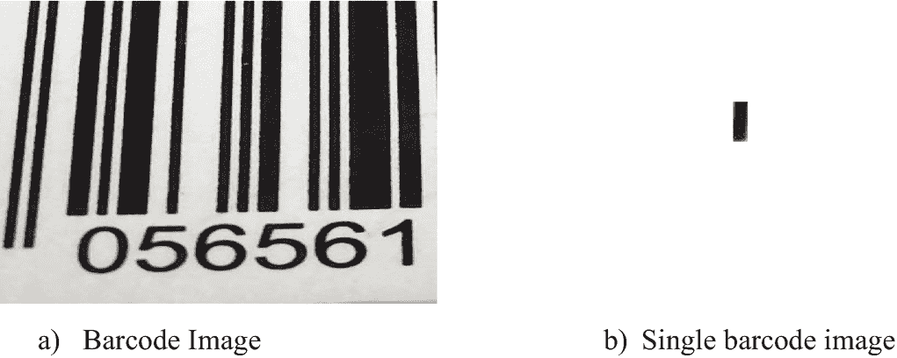
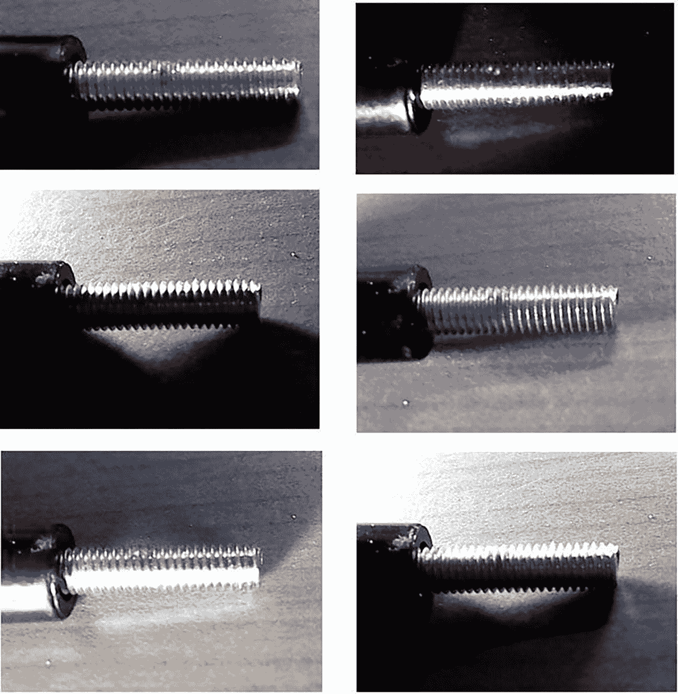

# 4. 机器视觉系统面临的挑战

由于多种因素，实施机器视觉系统可能颇具挑战。其中一个挑战是需要对相机和传感器进行精确校准与对齐，以确保精准的图像采集。此外，实时处理大量视觉数据的复杂性需要强大的计算资源和高效的算法。再者，将机器视觉系统集成到现有的制造业基础设施中，可能需要在硬件和软件升级方面进行大量投资。实施机器视觉系统的挑战可分为技术、环境、集成、性能和人为因素。在本章中，我们将更深入地探讨这些挑战。

## 技术挑战

主要的技术挑战之一是硬件与软件集成的复杂性。将机器视觉系统集成到行业现有基础设施中，通常涉及将相机和传感器连接到现有网络和系统，这可能是一项需要硬件和软件专业知识的复杂任务。此外，确保不同硬件组件和软件平台之间的兼容性也可能具有挑战性，因为它们可能具有不同的协议或要求。然而，在某些情况下，软件集成可以相对简单。例如，如果硬件和软件来自同一制造商，并且设计为无缝协作，那么集成过程可能很顺利，挑战极小。此外，如果所集成的软件是开源且得到广泛支持的，它可能拥有预构建的连接器和库，从而简化集成过程。本书使用 Python 环境来实现工业视觉系统概念。Python 是一种开源编程语言，因其简洁性和可读性而被广泛使用，这使得开发者更容易理解和修改代码。此外，Python 拥有庞大的计算机视觉库和框架生态系统，为各种任务提供了现成的解决方案，从而节省了板级实现的时间和精力。市面上有多种与 Python 环境兼容的相机和板卡，可用于构建机器视觉系统产品。此外，我们使用了 Raspberry Pi 来实时实现机器视觉系统概念，这减少了技术挑战，并最大限度地降低了机器视觉系统产品开发的成本。

### 选择并优化合适的图像处理算法

选择并优化合适的图像处理算法是集成机器视觉系统的另一个关键方面。这涉及确定需要执行的特定图像处理任务，并选择能够高效、准确地处理这些任务的算法。此外，针对应用的特定要求优化这些算法，对于在速度、准确性和可靠性方面达到预期结果至关重要。例如，在制造过程的质量控制应用中，机器视觉系统可用于识别产品缺陷。此处的特定图像处理任务是检测和分类不同类型的缺陷，例如划痕或凹痕。为此，可以选择并优化边缘检测和模式识别等算法，以实时准确地识别和分类这些缺陷。

### 选择相机型号

确保准确可靠的图像采集和分析对于质量控制应用的成功至关重要。这可以通过使用高分辨率相机和实施稳健的照明条件来实现，以捕获清晰详细的产品图像。此外，定期校准和维护机器视觉系统对于确保一致且精确的缺陷检测结果是必要的。例如，在制造电子元件的工厂中，机器视觉系统可用于检查印刷电路板（PCB）是否存在焊接错误或元件缺失等缺陷。高分辨率相机可以捕获 PCB 的详细图像，而精心控制的照明条件可确保任何缺陷都清晰可见。定期校准和维护机器视觉系统有助于保持其准确性和可靠性，确保实时准确地识别和分类任何缺陷。

为机器视觉系统选择相机型号是另一个关键挑战，因为需要根据工业环境中不同的光照条件准确采集图像。基本上有三种类型的相机可用，它们是：(1) 线阵相机，(2) 面阵相机，以及 (3) 3D 相机。

线阵相机是一种通过逐行扫描来捕获图像的相机。它通常用于需要连续检测的高速应用，例如生产线。使用线阵相机的优势在于其能够以非常高的速度捕获图像，从而实现实时的缺陷检测和分类。

面阵相机是另一种类型的相机，它通过一次性扫描整个区域来捕获图像。它通常用于需要高分辨率图像的应用，例如摄影或文档扫描。使用面阵相机的优势在于其能够捕获具有高清晰度和准确性的详细图像。

最后，3D 相机是一种在捕获视觉数据的同时还能捕获深度信息的相机。它们通常用于 3D 建模、虚拟现实和增强现实等应用。

#### 选择合适的面阵扫描相机

市面上有多种相机，它们在色彩、分辨率、快门技术和接口方面各有不同特性。为了更好地理解，这里提出了一套简单的步骤，用于根据应用场景选择合适的面阵扫描相机。选择面阵扫描相机的原因是它在机器视觉系统产品中应用广泛。

**步骤 1：根据应用选择相机支持的色彩特性。** 例如，某些行业生产的金属制品只有白色、银色或黑色。因此，我们可以选择黑白相机，而无需使用彩色相机。而在制药等行业，则需要检查瓶子的颜色变化。此时，可以选择彩色相机来满足应用需求。

**步骤 2：选择相机分辨率。** 相机分辨率可根据显示物体细节所需的最小像素数来选择。例如，对于图 4-1 中给出的条形码，显示一条条码线所需的最小像素数 (NMP) 为 5，物体细节尺寸 (ODS) 约为 0.2mm，物体尺寸 (OS) 为 55mm（可由用户设定，或通过试错法由用户选择长度）。分辨率可使用以下公式 (4.1) 计算。

两张照片。照片 a 是一个显示 056561 的条形码，照片 b 是一个类似深色垂直堆叠的单一条形码。

图 4-1
条码图形图像

  分辨率 = (NMP x OS) / ODS  … (4.1)

其中 NMP – 物体细节所需的最小像素数

*   OS – 物体尺寸

*   ODS – 物体细节尺寸

在本例中，分辨率 = (5 x 55) / 0.2 = 1375 水平分辨率

因此，基于此值，可从表 4-1 中为此应用选择合适的百万像素相机。选择能提供清晰图像信息的相机分辨率。

表 4-1
基于分辨率的相机选择

| 序号 | 百万像素 | 宽度 | 高度 | 宽高比 |
| --- | --- | --- | --- | --- |
| 1 | 0.1 | 320 | 240 | 4:3 |
| 2 | 0.3 | 640 | 480 | 16:9 |
| 3 | 0.5 | 800 | 600 | 4:3 |
| 4 | 0.9 | 1280 | 720 | 5:4 |
| 5 | 1.2 | 1280 | 960 | 4:3 |
| 6 | 1.3 | 1280 | 1024 | 16:9 |
| 7 | 1.9 | 1600 | 1200 | 4:3 |
| 8 | 2.1 | 1920 | 1080 | 4:3 |
| 9 | 3.1 | 2048 | 1536 | 4:3 |

## 机器视觉系统中的环境挑战

处理动态和不可预测的环境能够真实地呈现被检测物体，从而实现更精确的分析和决策。此外，在实时环境中捕获的图像还能考虑到光照条件的动态变化，确保机器视觉系统能够适应并持续有效运行。这在制造和质量控制等行业尤为重要，因为一致性和精确性至关重要。机器视觉系统中光照条件的变化会对图像质量产生重大影响。对于物体识别、缺陷检测和测量等任务而言，照明是影响图像数据质量和可靠性的重要因素。以下是光照条件影响机器视觉系统图像质量的一些重要因素：

*   **照明均匀性：** 不均匀的照明会在视野内的物体上产生阴影和高光。这会使机器视觉算法难以准确识别和分析物体。为缓解此问题，整个视野的均匀照明至关重要。

*   **强度和亮度：** 不同的光照强度会影响图像的整体亮度。过暗或过亮的图像可能导致关键细节和信息的丢失。将光照强度调整到最佳水平对于保持图像质量至关重要。

*   **照明方向：** 照明的角度和方向会影响物体某些特征或表面不平整度的可见性。例如，当光线以特定角度照射时，可能会产生镜面反射，使得捕获清晰图像变得困难。选择合适的照明角度对于最小化此类问题至关重要。

*   **频闪照明与连续照明：** 频闪照明可以冻结快速移动的物体，减少运动模糊，而连续照明则提供稳定的光源。这两种照明方法的选择取决于机器视觉应用的具体要求。

*   **波长和光谱特性：** 某些应用需要特定波长的光来突出显示某些特征或材料。例如，紫外线 (UV) 照明可以揭示在可见光谱中不可见的某些类型的缺陷。了解照明和物体的光谱特性至关重要。

*   **动态光照条件：** 环境光照条件的变化，例如来自窗户的自然光或室内照明的波动，会导致图像质量的变化。为缓解此问题，可能需要采用具有一致照明的受控环境，或能够适应变化条件的自适应照明系统。

*   **眩光和反射：** 强光源或反射表面会产生眩光和反射，从而遮挡图像细节。使用偏振照明或滤光片可以通过减少不必要的反射来帮助缓解这些问题。

*   **噪声和图像伪影：** 不充分的光照条件会导致图像噪声增加，从而影响图像分析的准确性。可能需要采用降噪技术，例如图像滤波或调整传感器设置。

*   **校准与监控：** 定期校准和监控照明系统对于确保其持续为机器视觉应用提供一致且最佳的照明至关重要。

这表明光照条件在机器视觉系统中起着关键作用，理解各种因素如何影响图像质量对于获得准确可靠的结果至关重要。设计合理且受控的照明系统有助于缓解光照条件变化带来的挑战，并提升机器视觉应用的性能。图 4-2 展示了在实时环境中，不同光照条件对物体的影响。

六张照片，展示了一个带有线圈或绕组的圆柱形螺丝状样本，在不同色调、亮度和对比度的光照下。

图 4-2
在实时环境中不同光照条件下捕获的图像

## 集成挑战

与现有系统和技术的兼容性包括与现有系统和设备（如传送带或机器人）的兼容性，以便将机器视觉系统无缝集成到生产线中。集成还涉及确保机器视觉系统能够与生产过程中的其他组件（如质量控制数据库或库存管理系统）有效通信和共享数据。此外，集成挑战可能包括培训和教育人员如何有效使用和解读机器视觉系统提供的数据。例如，在制造工厂中，可以将机器视觉系统集成到装配线上，以检查并验证正在装配的组件的准确性。该系统可以捕获每个组件的图像，并将其与参考图像数据库进行比较，以检测任何缺陷或偏差。然后，机器视觉系统可以将此信息传达给质量控制数据库，必要时触发警报或启动纠正措施。培训和教育人员如何解读机器视觉系统提供的数据，对于有效的决策制定至关重要。

将机器视觉系统无缝集成到整体工作流程中，需要与各个部门进行仔细规划和协调。这可能涉及对现有流程进行彻底评估，并确定可以在不中断生产力的情况下集成系统的领域。此外，定期维护和校准机器视觉系统对于确保其长期准确可靠的结果至关重要。此外，培训员工如何有效使用机器视觉系统对于最大化其潜力是必要的。这包括教育他们如何解读和分析系统生成的数据，以及排查可能出现的任何问题。通过投入时间和资源来正确实施和维护机器视觉系统，企业可以增强其决策能力，并在其领域获得竞争优势。例如，在制造业中，一家公司可以实施机器视觉系统来自动检查并检测其产品中的缺陷。该系统可以分析每个产品的形状、颜色和尺寸，以确保它们符合质量标准。通过培训员工如何解读机器视觉系统生成的数据，他们可以快速识别并解决任何质量问题，从而减少生产错误并提高整体效率。

将机器视觉系统与其他传感器和数据源集成以进行全面分析的挑战之一，是不同技术和数据格式的兼容性。合并来自不同来源的数据并确保它们实时同步可能是一项复杂的任务。此外，不同的传感器可能具有不同的精度和可靠性水平，这会影响整体分析的准确性。因此，需要对这些传感器进行仔细的校准和同步，才能获得可靠且准确的结果。例如，在一个智慧城市项目中，需要集成来自交通摄像头、空气质量传感器和气象站等多种来源的数据以进行全面分析。挑战在于协调不同的数据格式，并确保信息实时同步。此外，每个传感器的精度和可靠性可能各不相同，因此正确校准和同步它们对于获得关于交通模式、污染水平和天气状况的可靠洞察，以进行有效的城市规划至关重要。

## 性能挑战

机器视觉系统的以下性能问题对于满足用户或客户至关重要：

*   实时处理与响应需要识别在实施机器视觉系统时可能出现的性能方面的潜在限制和障碍，例如处理大量数据或应对复杂的产品变化。

*   制定优化机器视觉系统性能的策略，例如改进图像处理算法或增强硬件能力，以确保准确高效的缺陷检测。

*   通过定期进行性能评估和分析相关指标，评估机器视觉系统在减少生产错误和提高整体效率方面的有效性。

*   处理大量数据并确保可扩展性，以应用机器学习技术来持续改进机器视觉系统的缺陷检测能力，并适应新的生产挑战和变化。

*   与跨职能团队合作，收集反馈和见解，以进一步增强机器视觉系统的性能并解决任何问题或限制。

*   定期更新和维护机器视觉系统，确保其与行业标准和技术进步保持同步。例如，在制造环境中，可以使用机器学习技术持续分析并学习缺陷产品的图像，从而使机器视觉系统能够随着时间的推移以更高的精度识别和分类缺陷。这使得系统能够在遇到新情况时适应并改进其缺陷检测能力。

## 人为因素挑战

与维护机器视觉系统的人为因素相关的常见挑战之一是确保操作员经过充分培训，能够解读和理解系统的输出。这包括提供关于如何准确分析和分类缺陷产品图像的培训，以及理解系统的局限性。此外，在将机器视觉系统与其他人工操作流程（如质量控制检查或决策过程）有效集成方面可能存在挑战。这需要机器视觉系统与人工操作员之间进行清晰的沟通与协作，以优化其性能并确保在工作流程中无缝集成。

此外，定期维护和校准机器视觉系统对于保持其准确性和可靠性至关重要。这包括定期清洁镜头、保持适当的光照条件，以及进行周期性调整以确保性能一致。定期更新系统使用的软件和算法也很重要，以适应不断变化的缺陷模式，并提高其准确分类缺陷的能力。总体而言，一个实施良好的机器视觉系统可以极大地提高缺陷分析的效率和准确性，但必须承认并解决其局限性，并致力于持续改进。

## 总结

本章提供了关于实施机器视觉系统时在定期维护和校准方面所面临挑战的信息，这些维护和校准工作应执行以确保其持续的准确性和可靠性。这包括：

*   清洁镜头和传感器
*   检查是否存在任何硬件故障
*   校准系统以获得最佳性能
*   选择合适的光照，以最小损失获取图像，从而显著改进决策制定
*   为将要使用和维护系统的操作员和技术人员提供适当的培训，这对于最大化其效益至关重要

通过持续投资于该系统并解决其不足之处，组织可以实现最佳结果，并确保其缺陷分析过程的持续成功。在下一章中，我们将讨论使用 OpenCV 的各种常用图像处理技术。

