# 5. 使用 OpenCV 进行图像处理

许多具有不同复杂程度的图像处理技术被应用于医学成像、多媒体处理、计算机视觉等多种应用中。OpenCV 提供了大量的算法和函数，可以帮助我们执行广泛的图像处理操作，例如滤波、边缘检测、目标检测、图像分割等等。在本章中，我们将首先探讨图像的各种属性和类型，以及可能影响图像的各种噪声。然后，我们将继续探索各种处理技术，如图像增强方法、用于边缘检测的图像滤波技术、形态学操作、阈值处理技术、斑点检测和轮廓检测。

## 图像采集

图像采集是任何视觉系统的首要部分。它是使用相机或其他成像传感器等硬件捕获图像的过程。有几个因素决定了捕获图像的质量，例如用于采集的设备类型、采集图像的分辨率、光照条件等。在数码摄影中，采集过程从光线进入相机镜头并照射到图像传感器的那一刻开始，传感器进而捕获光线并将其转换为可由相机软件处理的数字信号。

数字图像传感器主要有两类：电荷耦合器件（`CCD`）传感器和互补金属氧化物半导体（`CMOS`）传感器。采集图像的质量受相机中使用的传感器类型影响。例如，`CCD` 传感器对光线更敏感，因此可以产生高质量的图像，但它们功耗更高且价格更昂贵。另一方面，`CMOS` 传感器比 `CCD` 传感器便宜得多且功耗更低，但它们产生的图像质量较低且噪声更多。

图像的分辨率也是影响质量的一个主要因素。高分辨率图像将包含更多像素，从而产生更清晰、更细致的图像。然而，像素数量的增加将需要更多的存储空间和处理能力。影响图像质量的另一个重要因素是图像采集时的光照条件。光照条件不佳可能导致图像曝光不足、曝光过度或模糊，这可能会在后续处理中增加复杂性。因此，在捕获图像时需要对照明条件进行一定的控制。这可以通过调整相机设置或使用外部光源来实现。

工业中使用的视觉系统通常面临恶劣的环境。因此，构建一个能在这些条件下可靠运行的稳健系统至关重要。通过优化上述因素，可以捕获高质量的图像，进而提供准确的结果。

## 图像及其属性

图像是物体、人物或场景等事物的视觉表示。图像在计算机中存储为称为像素的元素数组，其中像素以二进制数表示。像素是图像元素的简称，指的是数字图像中可以在数字显示器的矩形网格上显示的单个点或最小单元。数字图像在数学上可以表示为一个二维函数 `f(x,y)`，其中 `x` 和 `y` 称为空间坐标，而任何一对坐标 `(x,y)` 处的振幅“f”称为该点图像的强度，其中坐标和强度值都是有限的离散量。图像具有几个决定其感知方式的固有属性。这些属性列举如下。

### 分辨率

分辨率指的是构成图像的像素数量。简单来说，分辨率描述了图像的细节水平。例如，分辨率越高，图像看起来就越清晰、越细致。对于数字图像，图像分辨率通常以像素数来衡量。更一般地，图像分辨率用 `PPI`（每英寸像素数）或 `DPI`（每英寸点数）来描述，它表示每英寸图像显示了多少像素。例如，一个 `300 ppi` 的图像意味着图像的每一平方英寸都由 `300` 个像素组成。更高的分辨率意味着每英寸有更多的像素（`PPI`），从而产生具有更多细节的高质量图像。但像素的增加也会增加存储需求。换句话说，高分辨率图像需要更多的存储空间，并且加载时间可能更长。

### 宽高比

宽高比是图像高度和宽度之间的关系。它本质上决定了图像的形状，并可能影响图像的显示或打印方式。宽高比通常用两个由冒号分隔的数字表示。当我们说图像的宽高比是 `w:h` 时，意味着图像宽为“w”个单位，高为“h”个单位。例如，正方形图像的宽高比为 `1:1`，因为宽度和高度相等。其他常见的宽高比有 `4:3`（标准电视）和 `16:9`（宽屏电视）。

### 颜色深度

颜色深度指的是图像中能够表示的最大颜色数量。它也被称为位深度，因为它定义了每个像素颜色的位数。例如，深度为 `1` 位的像素只有两个值：黑色和白色。位深度越大，图像能包含的颜色就越多，颜色表示就越准确。例如，一个 `8` 位图像最多可以包含 `2⁸ = 256` 种颜色，而一个 `24` 位图像可以包含 `2²⁴ = 16,777,216` 种颜色（约 `1600` 万种）。我们将在后续章节中讨论这些不同的图像。尽管图像包含多种颜色，但屏幕上显示的图像受显示器支持的颜色数量限制。例如，一个 `8` 位显示器每个通道可以支持 `256` 种颜色。

### 图像尺寸

图像的尺寸，也称为其尺寸或像素尺寸，以“宽度 x 高度”的格式给出，单位为像素。换句话说，它给出了在显示器上沿水平和垂直方向表示图像所使用的像素数量。例如，我们在前几章中使用的 `Lenna` 图像的尺寸为 `512 x 512`，这意味着该图像在水平和垂直方向上都使用 `512` 个像素来表示。图像尺寸也可以通过将高度和宽度（以英寸为单位）乘以 `dpi` 来确定。例如，一张以 `300 dpi` 扫描的 `4 x 6` 英寸照片的像素尺寸为 `1200 x 1800`（`4x300=1200` 且 `6x300=1800`）。

### 图像文件格式

图像的文件格式决定了图像如何在计算机或其他设备上保存和存储。有许多针对不同用途（如网页显示、打印或编辑）进行优化的文件格式。一些流行的图像文件格式包括 `JPEG`、`PNG`、`BMP`、`GIF` 等。

## 噪声

图像噪声通常指的是数字图像中不属于所拍摄原始场景或物体的亮度或颜色信息的随机变化。导致这些噪声的因素有很多，例如相机传感器的质量、使用的相机设置、可用光量等等。根据原因和特性，图像中可能出现几种不同类型的噪声。这些噪声可以通过使用滤波技术来消除或最小化，我们将在本章后面讨论这些技术。下面讨论一些常见的噪声类型。

### 高斯噪声

这是大多数图像在采集过程中最常见的一种噪声。这种噪声的主要成因是光照强度的变化。之所以被称为高斯噪声，是因为其概率分布函数（`pdf`）与正态分布（也称为高斯分布）相同。它在性质上是加性的，在每个像素处独立存在，并且不依赖于信号强度。它在图像中表现为遍布整个图像的细微颗粒状图案。图 5-1 展示了一个螺母图像受到均值为 `0`、标准差为 `10` 的高斯噪声影响的效果。为了获得更好的观看效果，我们将显示该螺母图像的灰度版本，而非 `RGB` 图像。我们将在下一节的图像类型部分讨论这些类型的图像。

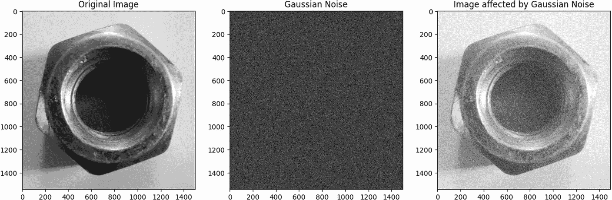

三幅插图。左侧为原始照片，描绘了一个金属螺栓。中间的图是类似灰色像素的高斯噪声。右侧的图描绘了受高斯噪声影响的照片，金属螺母上布满了无数微小像素点。

图 5-1：受高斯噪声影响的图像示例

### 椒盐噪声

椒盐噪声，也称为脉冲噪声，表现为散布在整个图像中的黑白点。更准确地说，出现在图像较亮区域的黑点称为胡椒噪声，而出现在图像较暗区域的白点称为盐粒噪声。这两种噪声随机分布在图像中，可能会严重影响边缘检测、图像复原等过程。造成此类错误的原因有很多，例如模数转换器错误、传输中发生的比特错误等。图 5-2 展示了椒盐噪声对螺母图像的影响。

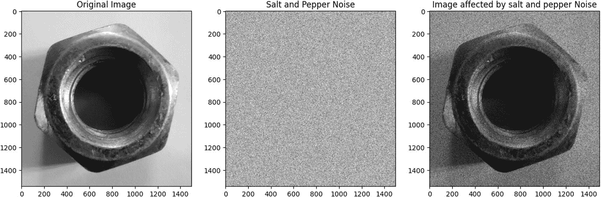

三幅插图。左侧为原始照片，描绘了一个金属螺栓。中间的图是类似灰色马赛克视图的椒盐噪声。右侧的图描绘了受椒盐噪声影响的照片，金属螺母颜色较深。

图 5-2：受椒盐噪声影响的图像示例

### 散斑噪声

散斑噪声是一种颗粒状的噪声纹理，它在图像中表现为颗粒状图案，从而降低图像质量。这种噪声主要出现在合成孔径雷达（`SAR`）图像、医学超声图像、全息图像等中。散斑噪声可以通过将图像的像素与随机噪声值相乘来人工生成。与高斯噪声一样，散斑噪声在统计上也独立于信号，但区别在于散斑噪声是乘性的，而高斯噪声是加性的。图 5-3 展示了散斑噪声对螺母图像的影响。

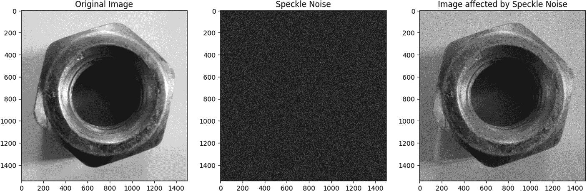

三幅插图。左侧为原始照片，描绘了一个金属螺栓。中间的图是类似深灰色马赛克视图的散斑噪声。右侧的图描绘了受散斑噪声影响的照片，其背景比原始照片更暗。

图 5-3：受散斑噪声影响的图像示例

## 图像类型

根据位深度，即图像中的颜色信息以及用于表示一个像素的位数，图像可以分为以下几类。

### 二值图像

这类图像只取两种可能的像素值。像素值 `0` 表示黑色，像素值 `1` 表示白色。这些图像也称为黑白图像或 `1` 位图像，因为单个比特就足以表示像素值（它们只能取 `0` 和 `1` 这两个值）。在本节中，我们将使用同一个螺母图像来展示不同类型的图像。图 5-4 显示了螺母图像的黑白版本。右侧的矩阵显示了与图像中红色框标出的矩形区域相对应的像素值。我们可以看到，像素值为 `0` 的区域是暗的（黑色），像素值为 `1` 的区域是亮的（白色）。黑白区域之间的过渡提供了两个区域之间的边缘感。

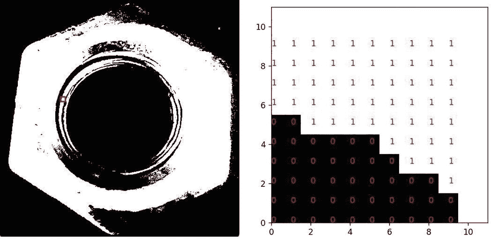

两幅插图。左侧。深色背景下的金属螺栓轮廓图。右侧。一个绘制了 `10x10` 网格的图表，其中包含数字 `0` 和 `1`。下三角矩阵的左下角为 `0`，并以深色突出显示。

图 5-4：二值图像示例

### 灰度图像

# 灰度图像

灰度图像是那些完全由灰色阴影组成的图像。这些图像也称为单色图像或 8 位图像，因为该图像中的每个像素都使用 8 位来表示。这意味着一个像素有 2⁸ = 256 个可能的值。这些值的范围从 0 到 255，其中值为 0 的像素是黑色像素，值为 255 的像素是白色像素。介于两者之间的值代表了从暗区向亮区移动时的不同强度级别，提供了不同的灰色阴影。图 5-5 显示了螺母图像的灰度版本，以及与图像中红色框标出的矩形区域相对应的像素值矩阵。我们可以看到，矩形暗区对应的像素值小于亮区对应的像素值。

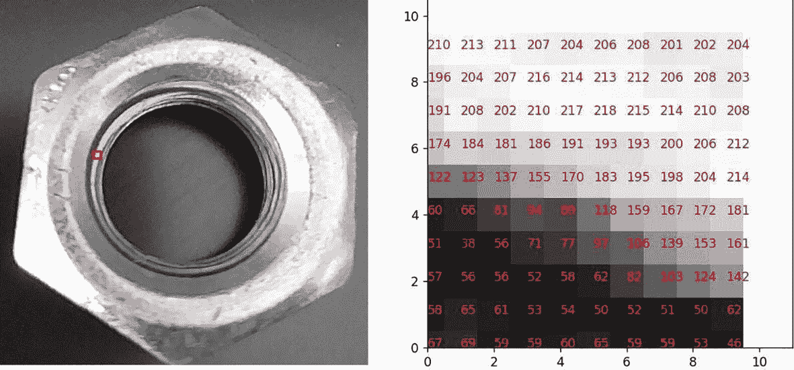
*两幅插图。左侧。深色背景下的金属螺栓照片。它突出显示了左上角螺母内环的一部分。右侧。一个绘制了 10x10 网格的图表，其中包含数字。下三角矩阵的左下角以深色突出显示。*
**图 5-5**
**灰度图像示例**

# 彩色图像

彩色图像基本上由三个单色（灰度）图像数据波段组成，每个波段的数据对应一种不同的颜色。换句话说，彩色图像在每个光谱波段（颜色波段）中存储灰度级信息。图像中的每个像素将由对应于每个颜色波段的三个值来表示，并且这些值中的每一个都使用 8 位来表示。因此，表示一个像素值所需的位数为 3x8=24 位。大多数彩色图像中最常用的颜色波段是红色、绿色和蓝色。这些图像也称为 RGB 图像或 24 位图像。图 5-6 显示了螺母图像的真彩色版本。我们可以看到，有三个对应于三种颜色的单色像素值波段。每个值代表相应颜色的强度，这些颜色的不同组合共同作用，生成了图像中的各种颜色。

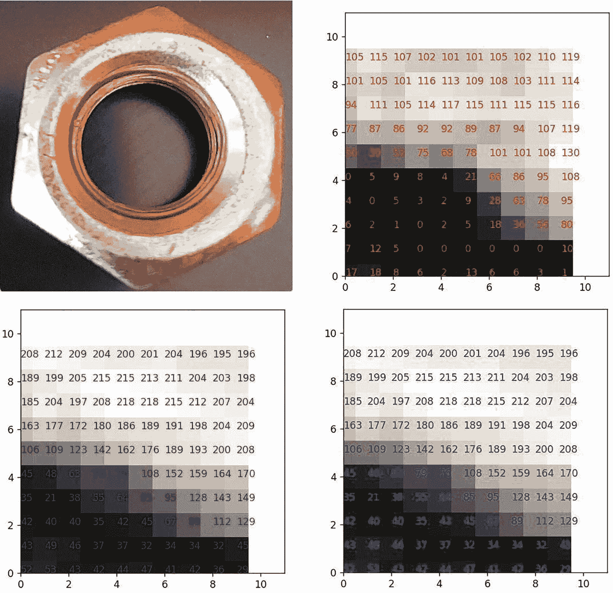
*四幅插图。左上角。深色背景下的金属螺栓照片。它突出显示了左上角螺母内环的一部分。其余为图表。每个图表都有一个 10x10 的网格，其中包含数字。下三角矩阵的左下角以深色突出显示。*
**图 5-6**
**彩色图像示例**

# 调整图像大小

调整图像大小的核心理念是在保持图像宽高比的同时修改其尺寸。图像缩放对于存储、显示和传输等多种用途至关重要。例如，如果显示设备的分辨率对显示尺寸有限制，那么我们需要调整图像大小以适应显示能力。同样，如果通信信道的带宽有限，我们可能需要使用更小的图像尺寸以实现更快的传输。在机器学习中，缩放也很常见。例如，我们可能希望在训练前减小图像尺寸，因为较大的图像往往会增加内存和计算需求，从而拖慢训练过程。此外，为数据集收集的原始图像可能尺寸不一，因此，它们应被调整为相同尺寸，因为大多数深度学习模型架构可能要求输入图像具有相同的大小。

在空间域中，有两种流行的图像缩放方式，即放大和缩小。顾名思义，放大是增加图像尺寸的过程，这需要重建图像；而缩小是减小图像尺寸的过程，这需要对像素进行重采样。这些缩放操作通过一种称为插值的过程来执行，该过程利用已知数据估算未知点的值。有许多可用的插值技术，详细阐述所有这些技术超出了本书的范围。一些最常用的插值技术包括最近邻、双线性、双三次和 Lanczos 插值。读者可以自行探索每种技术背后的原理。

我们需要了解的另一件重要事情是，不同的库对这些技术有不同的实现，从而产生不同质量的缩放图像。在本节中，我们将使用 Python 中两个流行的图像处理库 Pillow 和 OpenCV 来演示缩放操作。读者可以尝试其他可用的包，如 TensorFlow、PyTorch 等，并自行判断哪个库能提供更好的缩放质量。因此，我们将使用我们的螺母图像，应用不同的缩放技术，并比较 Pillow 和 OpenCV 库的结果。以下代码演示了将图像缩小到一半大小（即缩小到 128x128）的过程。从图 5-7 可以看出，相同过程的结果因所使用的库类型而异。

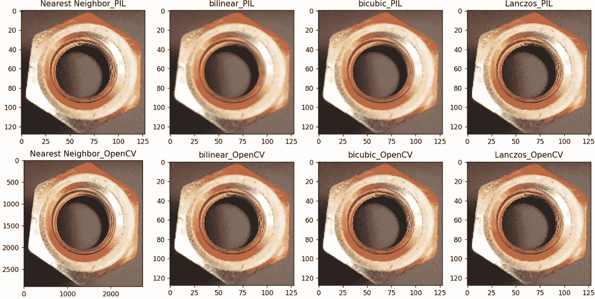
*八张照片展示了 PIL 和 OpenCV 的最近邻、双线性、双三次和 Lanczos 图像处理技术。每张照片都是在深色背景下带有光泽表面的金属螺栓。所有照片几乎相似。*
**图 5-7**
**使用不同插值技术调整图像大小**

```python
import cv2
from PIL import Image
import matplotlib.pyplot as plt
import numpy as np
# Pillow library methods
img=Image.open("C:/Users/user/Pictures/Nut.jpg")
imgn = img.resize((128,128),Image.NEAREST)
imgbl = img.resize((128,128),Image.BILINEAR)
imgbc = img.resize((128,128),Image.BICUBIC)
imgl= img.resize((128,128),Image.LANCZOS)
plt.subplot(2,4,1)
plt.imshow(imgn)
plt.title('Nearest Neighbor_PIL')
plt.subplot(2,4,2)
plt.imshow(imgbl)
plt.title('bilinear_PIL')
plt.subplot(2,4,3)
plt.imshow(imgbc)
plt.title('bicubic_PIL')
plt.subplot(2,4,4)
plt.imshow(imgn)
plt.title('Lanczos_PIL')
# OpenCV library methods
img1 = cv2.imread("C:/Users/user/Pictures/ Nut.jpg")
img1 = cv2.cvtColor(img1, cv2.COLOR_BGR2RGB)
imgn1 = cv2.resize(img1,(128,128),cv2.INTER_NEAREST)
imgbl1 = cv2.resize(img1,(128,128),cv2.INTER_LINEAR)
imgbc1= cv2.resize(img1,(128,128),cv2.INTER_CUBIC)
imgl1= cv2.resize(img1,(128,128),cv2.INTER_LANCZOS4)
plt.subplot(2,4,5)
plt.imshow(imgn1)
plt.title('Nearest Neighbor_OpenCV')
plt.subplot(2,4,6)
plt.imshow(imgbl1)
plt.title('bilinear_OpenCV')
plt.subplot(2,4,7)
plt.imshow(imgbc1)
plt.title('bicubic_OpenCV')
plt.subplot(2,4,8)
plt.imshow(imgn1)
plt.title('Lanczos_OpenCV')
plt.show()
```

# 图像增强

图像增强的目标是处理图像，使其结果比原始图像更适合特定应用。它是一项主要用于改善图像视觉质量的技术。对于视觉系统来说，这是一个关键步骤，因为图像质量会对结果产生重大影响。增强可以被视为一个总括术语，包含许多操作，例如去除模糊、消除噪声、增加对比度等。这些增强操作既可以在空间域进行，也可以在频率域进行。空间域技术直接对像素进行操作，而在频率域技术中，则使用傅里叶变换等变换技术提取图像的频率信息，然后在频率域中进行增强操作。我们将只关注空间域操作。

空间域中的操作可以用数学公式表示为 `g(x,y)=T[f(x,y)]`，其中 `g` 是输出图像，`f` 是输入图像，`T` 是在 `(x,y)` 的邻域上定义的关于 `f` 的算子。根据执行操作的像素邻域，空间域技术可以进一步分为两种类型，即点操作和空间操作。在点操作中，算子应用于“1×1”的邻域，这意味着单个像素。换句话说，所选算子独立地应用于图像中的每一个像素。因此，我们可以将数学变换函数重写为 `s=T(r)`，其中 `T` 是一种将像素值 `r` 映射到像素值 `s` 的变换技术。相反，空间操作应用于多个像素的邻域，例如“n×n”。输出图像中的每个像素都是通过对输入图像中“n×n”像素的邻域应用算子而获得的。滤波是最流行的空间操作之一，将在下一节详细讨论。因此，我们将在本节讨论一些点操作及其应用。

## 图像负片

假设给定图像的强度级别在 `[0, L-1]` 范围内。图像的负片是通过使用变换函数 `s = L - 1 - r` 获得的。例如，如果输入图像是灰度图像，那么它的强度级别将在 `[0, 255]` 范围内。因此，灰度图像的负片可以通过函数 `s = 255 - r` 获得。该函数基本上反转了图像的强度级别，使其看起来像摄影负片。这个函数非常有用，尤其是在医学图像处理领域。以下 Python 代码演示了对螺母图像进行负片操作的过程，结果图像与输入图像一起显示在图 5-8 中，以观察该操作带来的差异。

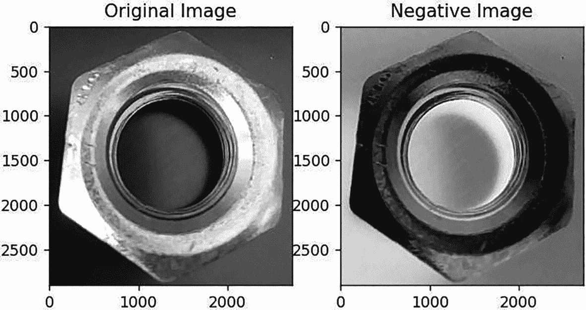
*两幅插图。左侧的原始照片描绘了一个带有光泽表面的金属螺栓。右侧的图描绘了金属螺母的负片照片，其表面比原始照片更暗。*
**图 5-8**
**图像负片示意图**

```
Import `cv2`
import `matplotlib.pyplot` as plt
`r`=`cv2.imread("C:/Users/user/Pictures/Nut.jpg",0)`
`s`=255-`r`
`plt.subplot(1,2,1)`
`plt.imshow(`r`,cmap='gray')`
`plt.title('Original Image')`
`plt.subplot(1,2,2)`
`plt.imshow(`s`,cmap='gray')`
`plt.title('Negative Image')`
`plt.show()`

### 对数变换

对于一幅灰度级范围在 [0, L-1] 的图像，其对数变换可通过变换函数 `s=clog(1+r)` 得到。对数变换用于压缩像素值变化剧烈的图像的动态范围，其原理是扩展低灰度值的范围，同时压缩高灰度值的范围。逆对数变换的情况则相反。当图像的动态范围超出显示设备的显示能力，导致显示器难以忠实再现宽范围的值时，可以使用此变换。为了便于说明，我们将使用相同的螺母图像来观察此变换对图像的影响（其中 `c`=1）。从图 5-9 中可以看出，暗区域得到了增强，这意味着暗像素的范围有所增加。

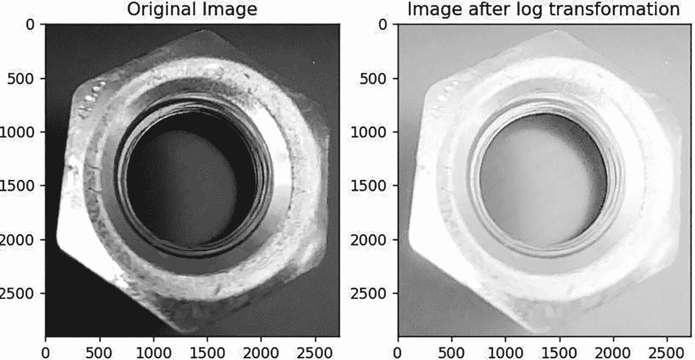

两幅插图。左侧原始照片显示了一个表面光亮的金属螺栓。右侧的图显示了经过对数变换后的金属螺母照片。螺母表面比原始照片更亮。

图 5-9 对数变换示意图

```python
import cv2
import matplotlib.pyplot as plt
import numpy as np
`r`=cv2.imread("C:/Users/user/Pictures/Nut.jpg",0)
`s`=np.log(1+`r`)  # c=1
plt.subplot(1,2,1)
plt.imshow(`r`,cmap='gray')
plt.title('Original Image')
plt.subplot(1,2,2)
plt.imshow(`s`,cmap='gray')
plt.title('Image after log transformation')
plt.show()
```

### 幂律（伽马）变换

幂律变换由数学表达式 `s=cr^γ` 给出，其中 `s` 和 `γ` 是正常数。与对数变换类似，幂律变换也将窄范围的低灰度输入像素值映射到更宽范围的输出值，而对于高输入像素值则相反。但是，与对数变换不同，这里我们可以通过改变伽马值 (`γ`) 来控制变换的程度。因此，幂律现象也称为伽马校正。

伽马校正可用于补偿不同显示设置下不同类型显示器在显示图像时产生的不良效果，例如图像的漂白效果或变暗。这一过程的重要性可以通过以下事实来理解：互联网上的图像会被世界各地的用户使用不同类型的显示设备访问。因此，伽马校正对于图像在不同屏幕上准确显示至关重要。这里演示了使用不同 `γ` 值对螺母图像进行伽马校正的示例（其中 `c`=1）。从图 5-10 中可以看出，随着 `γ` 增大，图像变暗；随着 `γ` 减小，图像变亮。

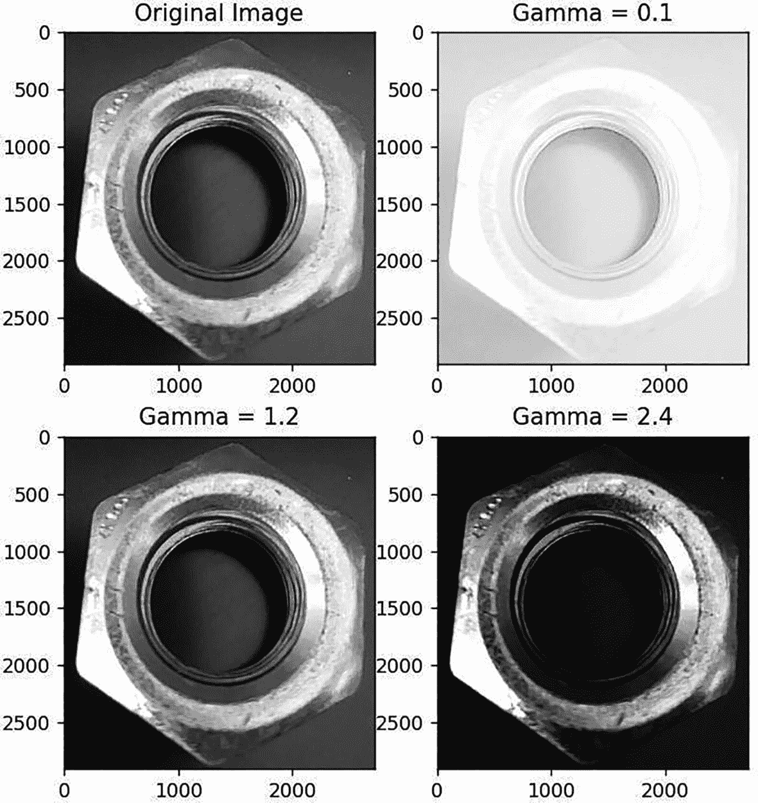

四幅插图。左侧原始照片显示了一个表面光亮的金属螺栓。其余三幅图分别为伽马值 = 0.1、1.2 和 2.4 的效果。每幅图都显示了不同对比度下的螺母。在伽马值 = 0.1 时，螺母比伽马值 = 1.2 和 2.4 时更亮。在伽马值 = 2.4 时，螺母更暗。

图 5-10 幂律变换示意图

```python
import cv2
import numpy as np
import matplotlib.pyplot as plt
`r` = cv2.imread("C:/Users/user/Pictures/Nut.jpg",0)
`gamma_corrected_1` = `r`**0.1  # gamma=0.1
`gamma_corrected_2` = `r`**1.2  # gamma=1.2
`gamma_corrected_3` = `r`**2.4  # gamma=2.4
plt.subplot(2,2,1)
plt.imshow(`r`,cmap='gray')
plt.title('Original Image')
plt.subplot(2,2,2)
plt.imshow(`gamma_corrected_1`,cmap='gray')
plt.title('Gamma = 0.1')
plt.subplot(2,2,3)
plt.imshow(`gamma_corrected_2`,cmap='gray')
plt.title('Gamma = 1.2')
plt.subplot(2,2,4)
plt.imshow(`gamma_corrected_3`,cmap='gray')
plt.title('Gamma = 2.4')
plt.show()
```

### 对比度拉伸

对比度拉伸属于分段线性变换函数的一部分，这类函数本质上并非完全线性。对比度指的是亮度或颜色的差异，这种差异使得一个物体在画面中能够与其他物体区分开来。图像的对比度可以用数学公式表示为

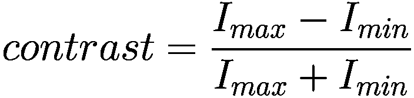

其中 `I[max]` 是图像可能的最大灰度级，`I[min]` 是图像可能的最小灰度级。例如，一幅灰度图像的最大灰度值为 `I[max]=255`，最小灰度值为 `I[min]=0`。

对比度拉伸过程可用于扩展图像中的灰度级范围，使其覆盖相机或显示器的全部可能范围。输入灰度图像与经过对比度拉伸过程得到的输出图像之间的灰度级映射关系如图 5-11 所示，其中虚线表示恒等映射（输出图像等于输入图像），实线表示对比度拉伸的映射。

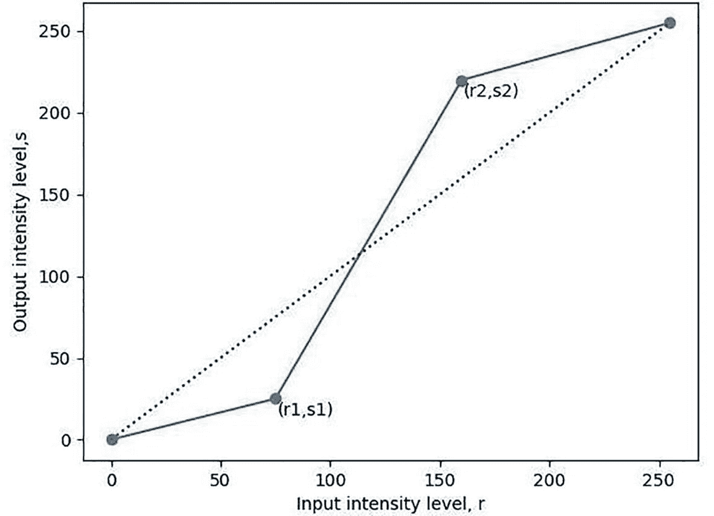

输出灰度级与输入灰度级的点对点关系图。一条线从 (0, 0) 开始，增加到 (75, 25)（标记为 (`r1`, `s1`)），上升到 (150, 225)（标记为 (`r2`, `s2`)），并在 (250, 250) 处结束。一条递增的虚线斜率连接了该趋势的起点和终点。数据为近似值。

图 5-11 对比度拉伸的输入-输出像素映射

我们有三条不同斜率的线段相互连接，而不是一条单一的直线或非线性曲线，因此得名分段线性变换。每条线段对应的映射可以使用直线方程 `s=m*r+c` 计算，其中 `m` 表示斜率，`c` 表示截距。由于每条线段具有不同的斜率，我们将得到三个不同的直线方程。可以使用斜率三角形法计算这些线段的斜率。通过改变参数 (`r[1]`, `s[1]`) 和 (`r[2]`, `s[2]`) 可以修改映射。这里需要注意的一个重要点是，当 `r[1]=s[1]=0` 且 `r[2]=s[2]=255` 时，该函数将等于那条笔直的虚线。以下代码以 (`r[1]`, `s[1]`) = (75, 25) 和 (`r[2]`, `s[2]`) = (160, 220) 为例说明了这一过程，生成的图像如图 5-12 所示。

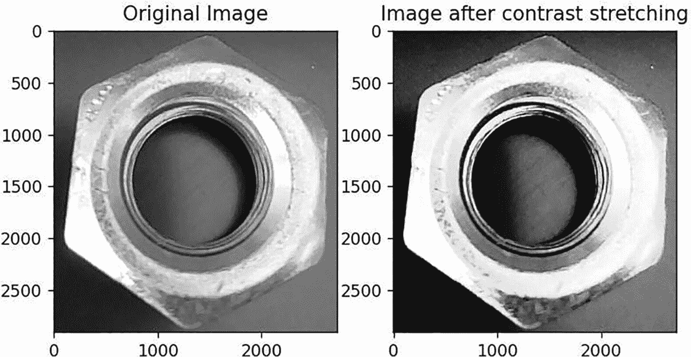

两幅插图。左侧原始照片显示了一个表面光亮的金属螺栓。右侧的插图显示了经过对比度拉伸后的金属螺母照片。螺母表面的对比度更高，并且比原始照片更亮。

图 5-12 对比度拉伸示意图

```python
import cv2
import matplotlib.pyplot as plt
import numpy as np
`r`=cv2.imread("C:/Users/user/Pictures/Nut.jpg",0)
`m`=`r`.shape[0]
`n`=`r`.shape[1]
# enter the parameters
`r1`=75
`s1`= 25
`r2`=160
`s2`=220
# implement the straight lines
`s`=np.empty([`m`,`n`]) # initialize empty array for output image
for `i` in range(`m`):
    for `j` in range(`n`):
        if (0<=`r`[`i`,`j`] and `r`[`i`,`j`]<=`r1`):
            `s`[`i`,`j`]=(`s1`/`r1`)*`r`[`i`,`j`]
        elif (`r1`<`r`[`i`,`j`] and `r`[`i`,`j`]<=`r2`):
            `s`[`i`,`j`]=((`s2`-`s1`)/(`r2`-`r1`))*(`r`[`i`,`j`]-`r1`)+`s1`
        else:
            `s`[`i`,`j`]=((255-`s2`)/(255-`r2`))*(`r`[`i`,`j`]-`r2`)+`s2`
plt.subplot(1,2,1)
plt.imshow(`r`,cmap='gray')
plt.title('Original Image')
plt.subplot(1,2,2)
plt.imshow(`s`,cmap='gray')
plt.title('Image after contrast stretching')
plt.show()
```

## 使用 OpenCV 进行边缘检测与滤波
```

图像处理中的边缘检测是一项基础技术，用于寻找图像中物体的边界。其原理是通过检测亮度的突变来标记边缘，因为边缘处通常伴随着亮度的急剧变化。在计算机视觉中，边缘检测常被用于预处理阶段，为后续的图像分割、物体识别、物体跟踪等分析做准备。边缘检测可以通过在空间域中对图像进行滤波来实现。空间滤波通过修改单个像素的值（基于其周围像素的值）来工作，这通常借助一个被称为核或掩码的小型数字矩阵来完成。除了边缘检测，空间滤波还可用于其他应用，例如噪声去除。边缘检测滤波器是一种空间滤波器，通过检测相邻像素间的强度变化来突出图像中的边缘。

当核中心对准一个像素时，核所覆盖的像素值与核本身的值会以某种方式结合，从而为该中心像素生成一个新值。基本过程是：将核中的每个值与其覆盖的图像中对应位置的像素值相乘，然后将所有乘积结果相加，得到中心像素的新值。核会在图像上滑动，以修改图像中的每一个像素。这种结合了移位、相乘和相加的操作被称为卷积。由于这是在二维图像平面上进行的，因此也称为二维卷积。在本节中，让我们来看一些常用的边缘检测滤波器。

## 均值滤波器

均值滤波器通常用于降低图像中的噪声，其方法是对图像中每个像素周围一个小邻域内的像素值进行平均。均值滤波器通过一个核来实现，该核是一个行数为奇数的方形矩阵，例如 3x3、5x5 和 7x7 等。当核的中心像素位于被处理的像素上时，核所覆盖的所有像素的值被相加，所得总和除以核中的像素总数，得到平均值。然后，这个平均值被用来替换核所覆盖的图像中的中心像素。接着，核在图像上滑动，对图像中的每一个像素执行相同的操作。均值滤波器的效果是平滑图像，这有助于降低图像中存在的高频噪声。由于图像的边缘对应着高频信息，边缘可能会变得模糊，从而降低图像的清晰度。

这在需要保留边缘的应用中可能是一个缺点。解决均值滤波器模糊效应的一种方法是使用加权均值滤波器，其中核的权重基于预定义的分布（如高斯分布）来选择。加权均值滤波器为核的中心分配更高的权重，而离中心越远，权重越低。这有助于保留边缘并减少模糊效应。以下代码展示了均值滤波器和加权均值滤波器对灰度螺母图像的影响。我们可以清晰地观察到，在图 5-13 中，均值滤波器的输出导致了边缘模糊，而加权高斯均值滤波器则缓解了这一问题。

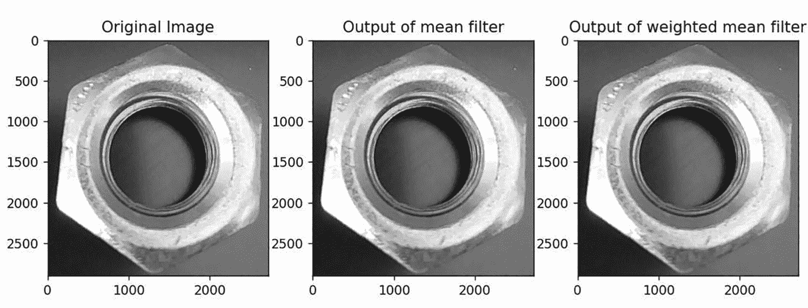

三幅插图。左侧原始照片描绘了一个金属螺栓。中间的图是均值滤波器对螺母图像的处理结果。右侧的插图是加权均值滤波器对螺母图像的处理结果。三者看起来几乎相同。

图 5-13

均值滤波器滤波效果示意图

```python
import cv2
import matplotlib.pyplot as plt
img = cv2.imread("C:/Users/user/Pictures/Nut.jpg",0)
new_img1 = cv2.blur(img,(7,7)) # (7,7) 是核大小
new_img2 = cv2.GaussianBlur(img,(7,7),0)
plt.subplot(131)
plt.imshow(img,cmap='gray')
plt.title('原始图像')
plt.subplot(132)
plt.imshow(new_img1,cmap='gray')
plt.title('均值滤波器输出')
plt.subplot(133)
plt.imshow(new_img2,cmap='gray')
plt.title('加权均值滤波器输出')
plt.show()
```

## 中值滤波器

中值滤波器的思路非常简单。当核放置在图像上时，核所覆盖的像素按升序排序，中心像素被排序后像素列表的中值所替换。中值滤波器在去除椒盐噪声方面非常有用。我们知道，胡椒噪声的强度值接近于零，而盐粒噪声的强度值接近于 255。因此，这些噪声值位于强度谱的两个极端，当我们用核所覆盖邻域的中值替换每个像素时，它们自然会被去除。以下代码使用螺母图像展示了这一滤波过程。在图 5-14 中，我们可以清晰地看到中值滤波器在改善受椒盐噪声影响的图像质量方面的有效性。

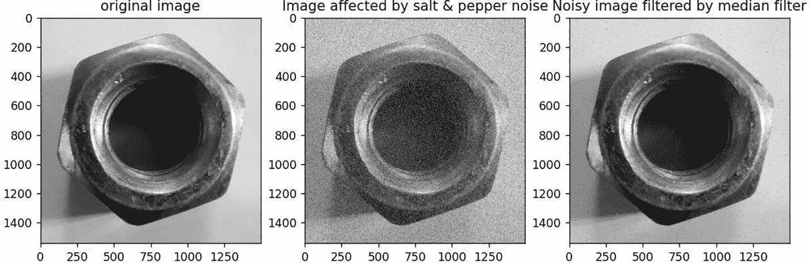

3 幅插图。左侧原始照片描绘了一个金属螺栓。中间的插图是带有微小灰色像素的椒盐噪声。右侧的插图是经过中值滤波器滤波后的含噪图像，螺母的对比度高于原始照片。

图 5-14

中值滤波器滤波效果示意图

```python
import cv2
import numpy as np
import matplotlib.pyplot as plt
img = cv2.imread('C:/Users/user/Pictures/Nut.jpg',0)
# 添加椒盐噪声
img_sn = img.copy()
prob=0.3
probs = np.random.random(img_sn.shape[:2])
img_sn[probs1-(prob/2)] = 255
# 应用中值滤波器
med = cv2.medianBlur(img_sn,3) # 核大小 (3,3)
plt.subplot(131)
plt.imshow(img,cmap='gray')
plt.title('原始图像')
plt.subplot(132)
plt.imshow(img_sn,cmap='gray')
plt.title('受椒盐噪声影响的图像')
plt.subplot(133)
plt.imshow(med,cmap='gray')
plt.title('经中值滤波器滤波后的含噪图像')
plt.show()
```

## Sobel 滤波器

Sobel 滤波器是一种流行的边缘检测算法，其工作原理是测量图像中每个像素的图像强度梯度。它通过寻找每个像素处平滑或突变的强度变化，并判断该像素属于边缘的可能性来检测边缘。它还能确定边缘可能的方向。Sobel 滤波器使用两个 3x3 的卷积核，分别用于水平方向和垂直方向。这两个卷积核如下所示：

| 水平卷积核 |   |   |   | 垂直卷积核 |
| --- | --- | --- | --- | --- |
| -1 | 0 | 1 |   |   | -1 | -2 | -1 |
| -2 | 0 | 2 |   |   | 0 | 0 | 0 |
| -1 | 0 | 1 |   |   | 1 | 2 | 1 |

以下是使用 Sobel 滤波器检测边缘所涉及的步骤：

1. 将图像转换为灰度图；当我们只对检测边缘感兴趣时，不需要颜色信息。

2. 将图像与水平 Sobel 卷积核进行卷积，得到水平梯度 G[x]。

3. 将图像与垂直 Sobel 卷积核进行卷积，得到垂直梯度 G[y]。

4. 使用以下公式计算每个像素处的梯度幅值 G：

    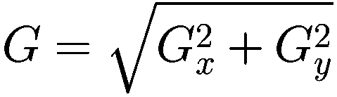

5. 使用以下公式计算梯度的方向：

    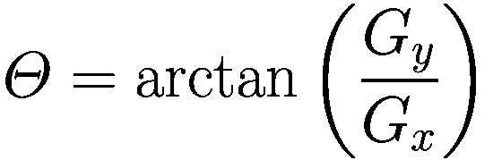

6. 使用阈值获取二值图像，其中高于阈值的值被视为边缘。

Sobel 滤波器在实际示例中的说明将在 Canny 边缘检测滤波器之后的案例研究部分给出。

## Canny 滤波器

Canny 边缘检测器是一种流行的多步骤算法，用于检测给定数字图像中的边缘。该算法由 John Canny 于 1986 年提出，已在计算机视觉和图像处理应用中得到广泛使用。与 Sobel 滤波器类似，Canny 边缘检测滤波器也基于图像的强度梯度来检测图像中的边缘。该算法包含以下几个步骤：

1. **高斯平滑**：首先使用高斯滤波器对图像进行平滑处理，以减少噪声。

2. **梯度计算**：然后使用 Sobel 算子计算平滑后图像的梯度幅值和方向。

3. **非极大值抑制**：执行此操作以细化边缘并减少其宽度。这可以改善边缘定位。

4. **双阈值处理**：然后对图像应用两个阈值，一个高阈值和一个低阈值。如果像素的梯度幅值：
   * 高于高阈值，则将其视为强边缘像素
   * 介于高阈值和低阈值之间，则将其视为弱边缘像素
   * 低于低阈值，则将其视为非边缘像素

   此过程有助于确定保留哪些边缘以及丢弃哪些边缘，从而减少边缘检测过程中的误检。

5. **边缘跟踪**：最后，执行边缘跟踪以将弱边缘连接到强边缘。这有助于在最终图像中产生更连续和连接的边缘。

与 Sobel 滤波器相比，Canny 边缘检测算法的复杂性有助于产生更准确的结果。另一方面，Canny 边缘检测器是一种计算成本更高的算法。Canny 边缘检测器的说明将在以下案例研究中提供。

### 案例研究：提取齿轮齿的边缘

以下 Python 代码说明了在齿轮图像上使用 Sobel 和 Canny 滤波器检测边缘的过程。首先，我们读取齿轮图像并将其转换为灰度图像。然后使用 3x3 卷积核的高斯滤波器对该灰度图像进行模糊处理。接着，对该图像在 x 和 y 方向上应用 3x3 卷积核的 Sobel 滤波器，分别获得水平梯度和垂直梯度。OpenCV 库中的 `Sobel()` 函数用于实现此目的。此函数还接受另一个属性 `CV_64F`，它是输出深度的参数，表示输出数据类型将是精度为 64 位的浮点数。之后，我们分别使用平方根和反正切函数计算每个像素处梯度的幅值和方向，正如在 Sobel 滤波器理论部分所讨论的那样。最后，我们对梯度幅值应用阈值，以获取带有边缘的二值图像，如图 5-15 所示。为此，我们将梯度幅值中大于给定阈值的每个值转换为 1，其他值转换为 0。我们使用 numpy 库中的 `uint8()` 函数将此结果矩阵从之前的浮点表示转换为 8 位无符号整数，以便将图像转换为适合显示的格式。最后，我们将矩阵乘以 255，因为 255 是灰度图像中白色像素的值，这样边缘像素将以白色显示。

对于 Canny 边缘检测，过程则非常简单，因为 OpenCV 提供了一个 `Canny()` 函数，可以轻松检测边缘。此函数将模糊后的图像以及我们在 Canny 滤波器理论部分讨论的两个阈值作为输入。生成的图像显示在图 5-15 中 Sobel 滤波器输出的旁边，使我们能够比较这两幅图像。通过比较这两幅图像可以清楚地看到，与 Sobel 算法相比，Canny 边缘检测算法产生更细且更平滑的边缘。从图中可以注意到的另一个有趣方面是，原始图像中圈出区域的光线反射产生了边缘的假象，而 Canny 边缘检测器比 Sobel 滤波器能更好地捕捉到这一点。

```
import cv2
import matplotlib.pyplot as plt
import numpy as np
img=cv2.imread("C:/Users/user/Downloads/Gear.jpg")
# convert to grayscale image
grayimg=cv2.cvtColor(img,cv2.COLOR_BGR2GRAY)
# Smoothen the image
blurred=cv2.GaussianBlur(grayimg,(3,3),0)
# Apply Sobel Filter
# calculate x and y gradient
sobelx=cv2.Sobel(blurred,cv2.CV_64F,1,0,ksize=3)
sobely=cv2.Sobel(blurred,cv2.CV_64F,0,1,ksize=3)
# Calculate gradient magnitude and direction
grad_mag=np.sqrt(sobelx**2+sobely**2)
grad_dir=np.arctan(sobely,sobelx)
# Apply threshold to obtain binary image
threshold=120
s_edgeimg=np.uint8(grad_mag>threshold)*255
# Apply the Canny edge detector
c_edgeimg = cv2.Canny(blurred, 100, 200)
# Display grayscale image and edge image
plt.subplot(131)
plt.imshow(img)
plt.title('Original Image')
plt.subplot(132)
plt.imshow(s_edgeimg,cmap='gray')
plt.title('Sobel Edge Detection')
plt.subplot(133)
plt.imshow(c_edgeimg,cmap='gray')
plt.title('Canny Edge Detection')
plt.show()
```

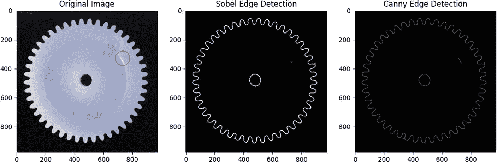

三幅插图。左图：原始图像描绘了一个齿轮。中图：Sobel 边缘检测描绘了齿轮齿的轮廓，中心有一个孔。右图：Canny 边缘检测描绘的齿轮边界比 Sobel 边缘检测方法更亮。

图 5-15 Sobel 和 Canny 边缘检测的说明

## 使用 OpenCV 进行形态学操作

“形态学”一词指的是形式、形状或结构。因此，形态学图像处理涉及一组基于图像形状、大小和结构来处理图像的操作。这些操作非常适合处理二值图像。形态学操作是通过使用结构元素探测图像来执行的。结构元素本质上是一个小型的像素矩阵，其值为 1，形成矩形或圆盘结构。矩阵的维度表示结构元素的大小，1 的图案表示结构元素的形状，其中一个像素通常被视为结构元素的原点。通常的做法是使用奇数维度的矩阵作为结构元素，其中矩阵的中心通常被视为原点。

图像处理中有两种基本的形态学技术，称为腐蚀和膨胀。其他形态学操作，如开运算和闭运算，是通过结合腐蚀和膨胀过程来完成的。腐蚀和膨胀都遵循类似于卷积的过程，其中一个小型的结构元素以逐行的方式在图像上滑动，使得中心像素位于图像中所有可能的位置。在每个位置，它会与相邻像素进行比较，根据结构元素像素与图像像素的匹配方式，我们可以得到三种不同的操作：

*   **完全匹配**：当结构元素中的所有像素都与邻域内图像的所有像素匹配时，我们称之为完全匹配。

*   **部分匹配**：当结构元素中至少有一个像素与图像邻域中的对应像素匹配时，我们称之为部分匹配。

*   **不匹配**：当结构元素中没有像素与图像邻域中的像素匹配时，我们称之为不匹配。

### 腐蚀

为了理解腐蚀的过程，请考虑图 5-16 中所示的二值图像块和结构元素。这里，图像中的暗像素值为“0”，亮像素值为“1”。然后，使用由 1 组成的结构元素遍历图像，并找到该元素与邻域完全匹配的像素值。在完全匹配的情况下，图像块的中心像素保持为“1”，否则将其更改为“0”。发生完全匹配的唯一位置用红色边界框标出，得到的输出图像显示在右侧。腐蚀操作由符号 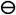（一个中心带有水平线的圆形符号）表示。它表示腐蚀操作。

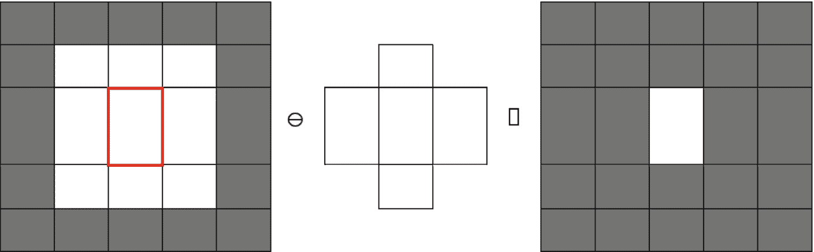

一个带有网格的正方形示意图，中心有一个明亮的边界，周围是深色边界。它经过腐蚀后得到一个带有网格的正方形，除了中心高亮的边界外，整个区域都是深色的。

图 5-16 使用结构元素对二值图像块进行腐蚀

可以看出，使用小型结构元素进行腐蚀会通过剥离区域内部和外部边界上的一层像素来缩小图像中的结构。腐蚀过程可用于分割或拆解连接的对象，并去除对象上的凸起。这可以通过以下代码说明，结果图像如图 5-17 所示。

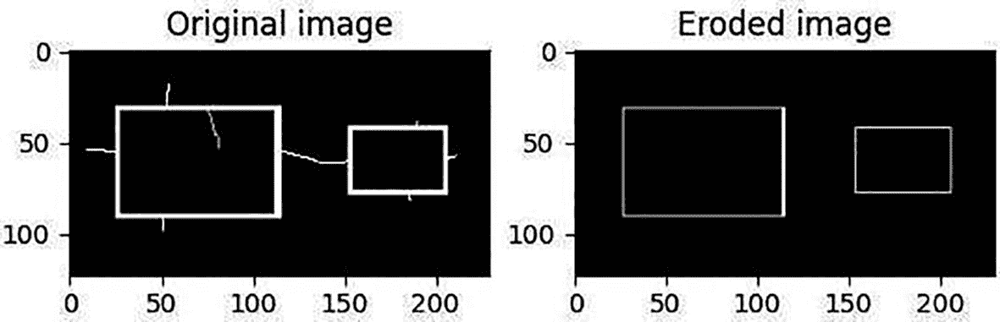

两幅示意图。左图：原始示意图在深色背景上绘制了一个矩形和一个正方形。两个图形在中心有神经状连接。右图：腐蚀后的示意图在深色背景上绘制了一个矩形和一个正方形。

图 5-17 图像腐蚀示意图

```
import cv2
import numpy as np
import matplotlib.pyplot as plt
# 读取图像并将其转换为二值图像
img = cv2.imread('C:/Users/user/Pictures/erosion.jpg', 0)
(thresh, bwImage) = cv2.threshold(img, 127, 255, cv2.THRESH_BINARY)
# 定义结构元素
se = np.ones((3, 3), np.uint8)
# 应用腐蚀
img_erosion = cv2.erode(bwImage, se, iterations=1)
# 显示图像
plt.subplot(121)
plt.imshow(bwImage,cmap='gray')
plt.title('原始图像')
plt.subplot(122)
plt.imshow(img_erosion,cmap='gray')
plt.title('腐蚀后的图像')
plt.show()
```

### 膨胀

另一方面，膨胀的工作原理是：如果结构元素与其覆盖的图像邻域之间至少有一个像素值匹配，则将结构元素中心像素所覆盖的图像像素值更改为“1”。换句话说，如果结构元素与图像邻域发生部分匹配，我们就将中心像素更改为“1”。让我们考虑与之前相同的图像块和结构元素示意图。结构元素与图像邻域发生部分匹配的位置用红色边界框标出，得到的图像显示在图 5-18 的右侧。膨胀操作由符号 ⨁ 表示。

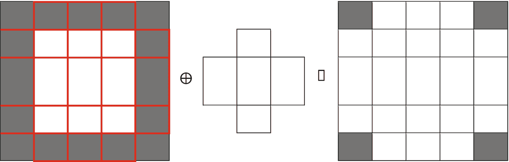

一个带有高亮网格的正方形示意图，中心有一个浅色块，周围是深色边界。它经过膨胀后得到一个带有网格的正方形，其中四条边是深色的。

图 5-18 使用结构元素对二值图像块进行膨胀

# 形态学运算与阈值处理技术

## 膨胀

可以看出，使用小型结构元素进行膨胀会通过向区域内部和外部边界添加一层像素来扩展图像中的结构。膨胀过程可用于修复图像中的任何断裂或损坏，并修复或校正图像中的凹陷。这可以通过以下代码说明，结果图像如图 5-19 所示。

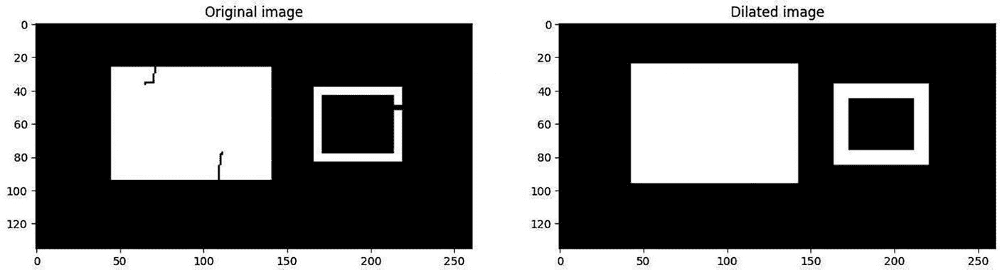

两幅示意图。左图：原始示意图在深色背景上绘制了一个浅色矩形和一个带有浅色边界的正方形。两个图形都有神经状结构。右图：膨胀后的示意图在深色背景上绘制了一个浅色矩形和一个带有浅色边界的正方形。

```python
import cv2
import numpy as np
import matplotlib.pyplot as plt
# 读取图像并将其转换为二值图像
img = cv2.imread('C:/Users/user/Pictures/chapter5_dilation.jpg', 0)
(thresh, bwImage) = cv2.threshold(img, 127, 255, cv2.THRESH_BINARY)
# 定义结构元素
se = np.ones((5,5), np.uint8)
# 应用膨胀
img_erosion = cv2.dilate(bwImage, se, iterations=1)
# 显示图像
plt.subplot(121)
plt.imshow(bwImage,cmap='gray')
plt.title('原始图像')
plt.subplot(122)
plt.imshow(img_erosion,cmap='gray')
plt.title('膨胀后的图像')
plt.show()
```

## 案例研究：用于噪声去除的形态学滤波

形态学运算可用于多种应用，包括图像分割、特征提取、形状分析、噪声去除等。在本案例研究中，我们将了解如何使用简单的形态学运算来去除齿轮图像中散布的微小、不需要的斑点状噪声。以下代码展示了在不同核大小下对齿轮图像进行形态学闭运算的过程。首先，我们读取齿轮图像，将其转换为灰度图像，然后应用高斯模糊来平滑图像。OpenCV 库中的`GaussianBlur()`函数用于实现此目的。可以观察到，我们使用了大小为 `(3,3)` 的高斯核来模糊图像。然后，我们使用大津阈值法将模糊图像转换为黑白图像，我们将在下一节中讨论该方法。简单理解，大津法用于确定模糊图像的全局强度阈值；任何强度高于该阈值的像素将被转换为 255（白色），而强度低于该阈值的像素将被转换为 0（黑色）。

如图 5-20 所示，齿轮部分以及齿轮图像周围的噪声部分被转换为白色，背景被转换为黑色。现在我们使用形态学“开”运算，它本质上就是一次腐蚀运算后跟一次膨胀运算。这将有可能去除齿轮部分周围的小的不规则物，但由于噪声部分大小不一，我们需要相应地选择核的大小。这里，我们使用填充了 1 的不同大小的矩形核，用以演示核大小对滤波操作的影响。这是通过`numpy`库中的`ones()`函数实现的，并且使用同一库中的`uint8()`函数将核中的所有值（全为 1）表示为 8 位无符号整数。然后，使用 OpenCV 库中的`morphologyEX()`函数来执行形态学运算。该函数将黑白阈值图像作为输入，第二个参数是形态学运算参数，在我们的例子中是`MORPH_OPEN`，第三个参数是核。从图中可以看出，大小为 `(7,7)` 的核完全去除了图像中的所有噪声斑点。另一个值得注意的有趣点是，如果我们使用了二进制反阈值，那么白色和黑色区域将会反转，在这种情况下，形态学闭运算将为我们提供所需的结果，`import cv2`。

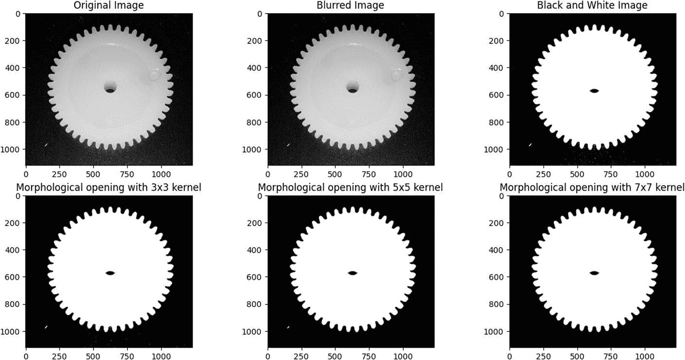

六幅插图：原始图像、模糊图像、黑白图像，以及使用 3x3 核、5x5 核和 7x7 核进行形态学开运算的结果。每幅图都描绘了一个中心有孔的齿轮。使用 3x3 核进行形态学开运算的结果比其他插图更亮。

```python
import matplotlib.pyplot as plt
import numpy as np
# Load the image
img = cv2.imread('C:/Users/Lenovo/Pictures/New Folder/20230917_113122.jpg', cv2.IMREAD_GRAYSCALE)
blurred=cv2.GaussianBlur(img,(3,3),0)
# Perform Otsu's thresholding
thresh = cv2.threshold(blurred, 0, 255, cv2.THRESH_BINARY+cv2.THRESH_OTSU)[1]
# Perform morphological opening
kernel_1 = np.ones((3,3),np.uint8)
kernel_2 = np.ones((5,5),np.uint8)
kernel_3 = np.ones((7,7),np.uint8)
opening_1 = cv2.morphologyEx(thresh, cv2.MORPH_OPEN, kernel_1)
opening_2 = cv2.morphologyEx(thresh, cv2.MORPH_OPEN, kernel_2)
opening_3 = cv2.morphologyEx(thresh, cv2.MORPH_OPEN, kernel_3)
# Display images
plt.subplot(231)
plt.imshow(img,cmap='gray')
plt.title('Original Image')
plt.subplot(232)
plt.imshow(blurred,cmap='gray')
plt.title('Blurred Image')
plt.subplot(233)
plt.imshow(thresh, cmap='gray')
plt.title('Black and White Image')
plt.subplot(234)
plt.imshow(opening_1,cmap='gray')
plt.title('Morphological opening with 3x3 kernel')
plt.subplot(235)
plt.imshow(opening_2,cmap='gray')
plt.title('Morphological opening with 5x5 kernel')
plt.subplot(236)
plt.imshow(opening_3,cmap='gray')
plt.title('Morphological opening with 7x7 kernel')
plt.show()
```

## 使用 OpenCV 的阈值处理技术

在图像处理中，阈值处理是一种简单的图像分割方法，其中某些像素的值会根据某个阈值进行改变，从而使图像更易于分析。阈值处理有助于突出图像中选定的感兴趣区域，同时忽略我们不关心的图像其余部分。有许多阈值处理技术，在本节中，我们将讨论其中四种常见技术。

### 二进制阈值处理

这是最简单的阈值处理形式，将灰度图像的像素值与阈值 `T` 进行比较。值小于 `T` 的像素被转换为值为“0”的黑色像素，值大于 `T` 的像素被转换为值为“1”的白色像素。本质上，灰度图像被转换为二值图像。以下代码演示了将三个不同值 63、127 和 191 的二进制阈值应用于我们的螺母图像。由于在灰度图像中，63 更接近黑色像素值“0”而远离白色像素值“255”，因此在生成的二值图像中，更大范围的像素被转换为白色像素，导致图像以白色强度为主。第二个阈值 127 位于黑色像素“0”和白色像素“255”之间，生成了一个更平衡的二值图像。第三个阈值 191 非常接近白色像素“255”，导致二值图像中大范围的像素变为黑色。这三个阈值对应的结果图像如图 5-21 所示。

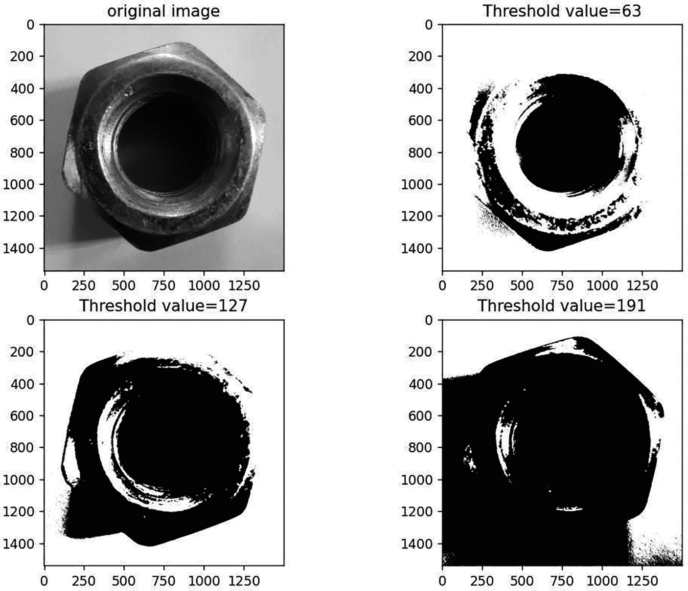

四幅插图。左侧的原始照片描绘了一个表面有光泽的金属螺栓。其余图像分别是阈值 = 63、127 和 191 的结果。每幅图都以不同的对比度描绘了螺母的轮廓。在阈值 = 191 时，螺母的表面比阈值等于 63 和 127 时更暗。

## 二进制阈值处理示例

```python
import cv2
import numpy as np
import matplotlib.pyplot as plt
# read image
img = cv2.imread('C:/Users/user/Pictures/Nut.jpg', 0)
# apply binary thresholding
(thresh1, bwImage1) = cv2.threshold(img, 63, 255, cv2.THRESH_BINARY)
(thresh2, bwImage2) = cv2.threshold(img, 127, 255, cv2.THRESH_BINARY)
(thresh3, bwImage3) = cv2.threshold(img, 191, 255, cv2.THRESH_BINARY)
# display the images
plt.subplot(221)
plt.imshow(img,cmap='gray')
plt.title('original image')
plt.subplot(222)
plt.imshow(bwImage1,cmap='gray')
plt.title('Threshold value=63')
plt.subplot(223)
plt.imshow(bwImage2,cmap='gray')
plt.title('Threshold value=127')
plt.subplot(224)
plt.imshow(bwImage3,cmap='gray')
plt.title('Threshold value=255')
plt.show()
```

## 二进制反阈值处理

这种阈值处理方式是二进制阈值处理的完全相反。在此方法中，像素值大于阈值 `T` 的像素被转换为值为“0”的黑色像素，而像素值小于阈值 `T` 的像素被转换为值为“1”的白色像素。下图展示了使用与前文相同的三个阈值进行该技术处理的效果，生成的图像如图 5-22 所示。

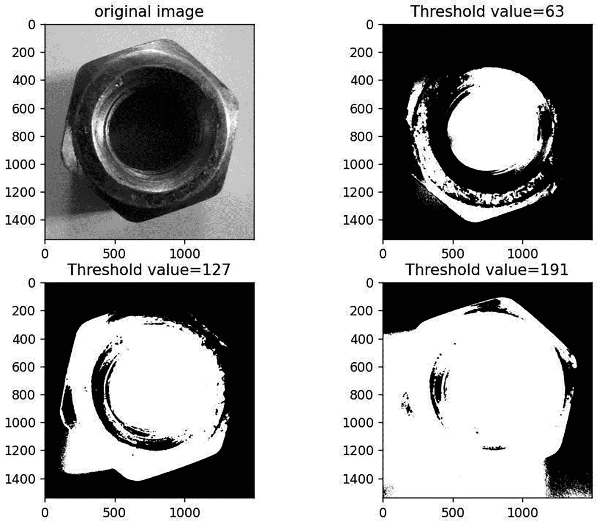

四张示意图。左侧原始照片描绘了一个表面光亮的金属螺栓。其余三张分别为阈值 = `63`、`127` 和 `191` 的处理结果。每张图都以不同对比度勾勒出螺母的轮廓。在阈值 = `63` 时，螺母的照片比阈值等于 `127` 和 `191` 时更暗。

图 5-22 二进制反阈值处理示意图

```python
import cv2
import numpy as np
import matplotlib.pyplot as plt
# read image
img = cv2.imread('C:/Users/user/Pictures/Nut.jpg', 0)
# apply binary inverse thresholding
(thresh1, bwImage1) = cv2.threshold(img, 63, 255, cv2.THRESH_BINARY_INV)
(thresh2, bwImage2) = cv2.threshold(img, 127, 255, cv2.THRESH_BINARY_INV)
(thresh3, bwImage3) = cv2.threshold(img, 191, 255, cv2.THRESH_BINARY_INV)
# display the images
plt.subplot(221)
plt.imshow(img,cmap='gray')
plt.title('original image')
plt.subplot(222)
plt.imshow(bwImage1,cmap='gray')
plt.title('Threshold value=63')
plt.subplot(223)
plt.imshow(bwImage2,cmap='gray')
plt.title('Threshold value=127')
plt.subplot(224)
plt.imshow(bwImage3,cmap='gray')
plt.title('Threshold value=255')
plt.show()
```

## 大津阈值处理

在我们讨论的两种阈值处理方法中，分割阈值都是手动选择的。还有其他方法可以通过执行固定程序来自动选择最佳阈值。一种常见的自动阈值处理方法是**大津法**，以其算法开发者大津展之的名字命名。`大津阈值处理`是一种简单方法，通过最小化类内方差来生成一个阈值，将图像分割为前景和背景两类。该方法非常适合直方图显示两个清晰峰值的双峰图像，每个峰值代表不同的强度范围。因此，如果前景和背景的强度范围彼此清晰分离，那么`大津阈值`将生成一幅前景与背景分割清晰的二值图像。

为了进行说明，我们继续使用相同的螺母图像。我们将绘制直方图以检查是否存在两个清晰的峰值。图 5-23 展示了使用中间值 `127` 进行二进制阈值处理的结果以及`大津阈值处理`的结果，这有助于我们比较这两种技术。

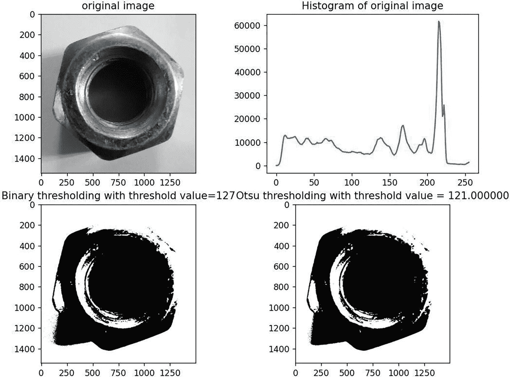

三张示意图描绘了金属螺栓的原始照片、阈值 = `127` 的二进制阈值处理结果以及阈值 = `121.000000` 的`大津阈值处理`结果。二进制和大津处理结果均为螺栓的轮廓图。原始照片的直方图呈现出一条带有多个尖峰和低谷的波动趋势线。

图 5-23 大津阈值处理示意图

```python
import cv2
import numpy as np
import matplotlib.pyplot as plt
# read image
img = cv2.imread('C:/Users/user/Pictures/Nut.jpg', 0)
# calculate histograk
hist = cv2.calcHist([img],[0],None,[256],[0,256])
# binary thresholding
(thresh1, bwImage1) = cv2.threshold(img, 127, 255, cv2.THRESH_BINARY)
# Otsu thresholding
(otsu_thresh, bwImage2) = cv2.threshold(
    img, 0, 255, cv2.THRESH_BINARY + cv2.THRESH_OTSU,
)
# display the images
plt.subplot(221)
plt.imshow(img,cmap='gray')
plt.title('original image')
plt.subplot(222)
plt.plot(hist)
plt.title('Histogram of original image')
plt.subplot(223)
plt.imshow(bwImage1,cmap='gray')
plt.title('Binary thresholding with threshold value=127')
plt.subplot(224)
plt.imshow(bwImage2,cmap='gray')
plt.title(f'Otsu thresholding with threshold value = %f'%otsu_thresh)
plt.show()
```

我们可以看到，螺母图像的直方图没有两个明显的峰值，因为前景和背景的强度之间没有清晰的界限。在右上角附近，螺母图像明亮部分的强度与该区域的背景强度相似。同样，我们可以观察到图像左侧暗像素的强度与背景中产生的阴影相似。从`大津阈值处理`的代码片段中还可以看出，阈值的初始值设置为 `0`，`大津法`计算出的最佳阈值为 `121`，这在图中第四张图像的标题中有所显示。从直方图可以明显看出，一个像素簇的分布具有清晰的峰值，而其余像素则分布广泛，没有清晰的峰值。`大津法`试图在两个簇之间找到最佳值，最终得到的值为 `124`。读者可以尝试将此方法应用于前景和背景对比度更高的图像，以获得更好的结果。

## 自适应阈值处理

在迄今为止讨论的所有阈值处理技术中，所有像素值都使用单一的阈值。这种阈值通常被称为`全局阈值`。或者，我们可以根据每个邻域内像素的局部值，对图像的不同部分应用不同的阈值。这些阈值称为`局部阈值`，而应用局部阈值的技术称为`自适应阈值处理`技术。这类技术适用于光照条件不均匀的图像。

在`自适应阈值处理`中，阈值是根据每个区域内像素强度的`算术平均值`或`高斯平均值`计算得出的。在计算`算术平均值`时，所有像素值的贡献相等；而在计算`高斯平均值`时，中心像素的权重最大，随着距离中心像素越远，权重逐渐减小。这里使用螺母图像来说明使用`算术平均值`和`高斯平均值`的`自适应阈值处理`过程，生成的图像如图 5-24 所示。

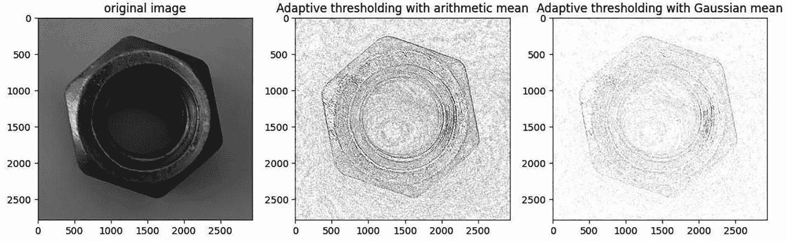

三张示意图。左侧原始照片描绘了一个金属螺栓。中间是使用`算术平均值`的`自适应阈值处理`结果，勾勒出螺母的轮廓。右侧是使用`高斯平均值`的`自适应阈值处理`结果，勾勒出的螺母轮廓比`算术平均值`的结果更亮。

图 5-24 自适应阈值处理示意图

# 图像处理技术

## 自适应阈值处理

在上述代码中，数字 `255` 表示应用于超过阈值的像素值的最大值。数字 `11` 表示用于计算每个像素阈值的邻域大小。末尾的数字 `4` 是一个常数，将从平均值或高斯平均值中减去。

```python
import cv2
import numpy as np
import matplotlib.pyplot as plt

# read image
img = cv2.imread('C:/Users/user/Pictures/Nut.jpg', 0)
# adaptive thresholding using arithmetic mean
bwImage1 = cv2.adaptiveThreshold(
    img, 255, cv2.ADAPTIVE_THRESH_MEAN_C, cv2.THRESH_BINARY, 11, 4
)
# adaptive thresholding using Gaussian mean
bwImage2 = cv2.adaptiveThreshold(
    img, 255, cv2.ADAPTIVE_THRESH_GAUSSIAN_C, cv2.THRESH_BINARY, 11, 4
)
# display the images
plt.subplot(131)
plt.imshow(img, cmap='gray')
plt.title('original image')
plt.subplot(132)
plt.imshow(bwImage1, cmap='gray')
plt.title('Adaptive thresholding with arithmetic mean')
plt.subplot(133)
plt.imshow(bwImage2, cmap='gray')
plt.title('Adaptive thresholding with Gaussian mean')
plt.show()
```

## 使用 OpenCV 进行二值大对象（Blob）检测

图像中的 Blob 可被视为图像中具有连通像素的区域，这些像素共享某些共同属性，例如亮度或颜色，这些属性相对于周围区域是恒定或近似恒定的。这些区域可能指示物体或物体部分的存在，进而可用于物体检测或物体跟踪。在 OpenCV 中，可以使用一个简单的函数 `SimpleBlobDetector()` 来检测这些 Blob。该函数背后的算法由四个步骤组成：

*   **阈值处理**：第一步是将给定图像转换为多个二值图像，通过使用不同的阈值进行阈值处理，从指定的最小阈值开始，然后以指定的恒定步长逐渐增加，直到达到指定的最大阈值。
*   **分组**：在生成的每个图像中，将连通的白色像素进行分组。这些组可被视为 Blob。
*   **合并**：计算每个检测到的二值 Blob 的中心，并将距离小于指定最小距离的 Blob 合并。
*   **中心与半径计算**：然后计算并返回最终合并后的 Blob 的中心和半径。

以下代码演示了在标准“硬币”图像上的 Blob 检测，该图像包含深色背景中的若干亮色硬币。我们使用预定义的函数 `SimpleBlobDetector_create()` 和 `detector.detect()` 来检测图像中的 Blob。由于这些函数适用于检测亮色背景中的深色 Blob，因此在使用这些函数之前，我们必须反转灰度图像，使其变为亮色背景中的深色硬币。最后，使用 OpenCV 工具在检测到的 Blob 周围显示红色圆圈，如图 5-25 所示。

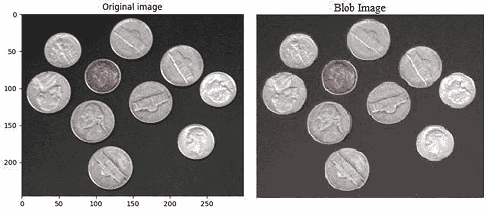

两张示意图。左图：一张原始照片的轨迹图，上面有几枚刻有浮雕的钢制硬币。右图：几枚钢制硬币的 Blob 照片。每枚硬币都有一个明亮的边界。

图 5-25 Blob 检测示意图

```python
import cv2
import numpy as np;
import matplotlib.pyplot as plt

# 读取图像
im = cv2.imread("C:/Users/user/Pictures/Coins.png", cv2.IMREAD_GRAYSCALE)
plt.imshow(im, cmap='gray')
plt.title('原始图像')
plt.show()
inverted_img = cv2.bitwise_not(im)
# 使用默认参数设置检测器。
detector = cv2.SimpleBlobDetector_create()
# 检测 Blob。
keypoints = detector.detect(inverted_img)
print(len(keypoints))
# 将检测到的 Blob 绘制为红色圆圈。
blobs = cv2.drawKeypoints(
    im, keypoints, np.array([]), (0,0,255), cv2.DRAW_MATCHES_FLAGS_DRAW_RICH_KEYPOINTS
)
# 显示关键点
cv2.imshow("检测到的 Blob", blobs)
cv2.waitKey(0)
```

## 使用 OpenCV 进行轮廓检测

图像中的轮廓是一条闭合曲线，连接边界上所有具有相同强度或颜色的连续点，这些点代表了图像中物体的形状。轮廓广泛应用于形状分析、物体检测、物体识别、前景/背景分割等应用中。OpenCV 提供了两个简单的函数 `findContours()` 和 `drawContours()` 来完成此任务。

我们将考虑最常见的“大米”图像来说明此任务。由于 `findContours()` 函数必须应用于二值图像，因此我们需要应用阈值处理将输入图像转换为二值图像。在示例中，使用了手动阈值 `130`，但采用自动阈值处理方法（如 OTSU 或自适应阈值处理）始终是一个好习惯。除了黑白图像外，`findContours()` 函数还接受另外两个参数。第一个参数 `cv2.RETR_TREE` 表示轮廓检索模式，它检索图像中的所有轮廓并创建一个层次结构列表。层次结构是图像中轮廓之间关系的表示。例如，如果一个轮廓位于另一个轮廓内部，则外部轮廓称为父轮廓，内部轮廓称为子轮廓，从而在两者之间建立层次结构。第二个参数 `cv2.CHAIN_APPROX_SIMPLE` 表示用于保存形状边界 (x,y) 坐标的方法。SIMPLE 方法会移除冗余点，从而压缩轮廓并节省内存。一旦确定了轮廓，就使用 `drawContours()` 函数在与输入图像大小相同的黑色画布上绘制轮廓。这个黑色画布只需通过定义一个与输入大小相同的零矩阵来创建。轮廓检测过程的代码如下所示，相应的输出如图 5-26 所示。

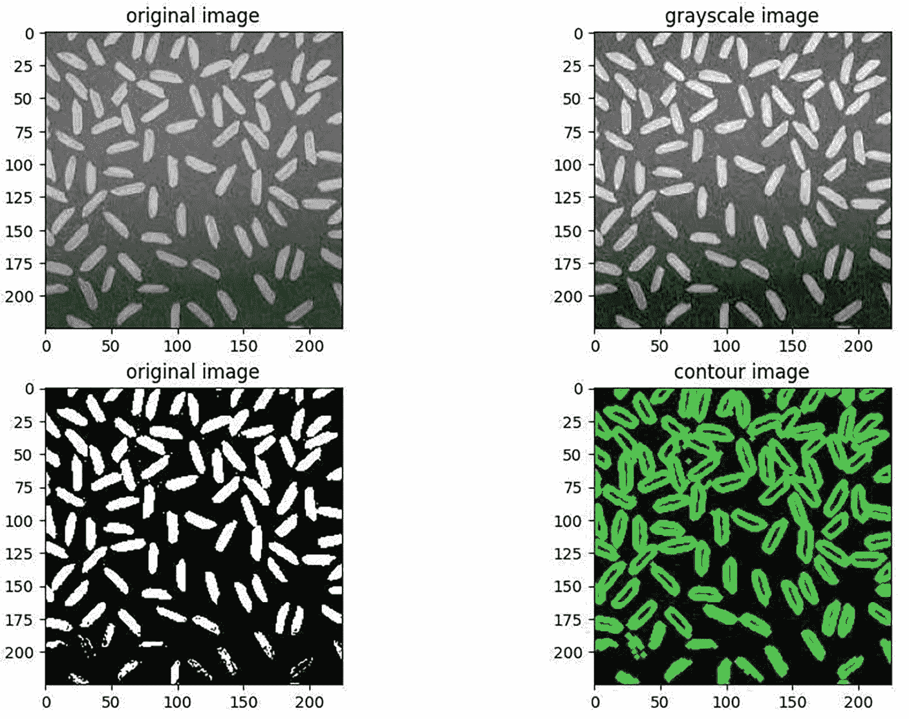

四张示意图：原始图像、灰度图像和轮廓图像。每张图都描绘了一簇散布在画面中的棒状颗粒。左下角的原始图像对比度高于左上角的图像。轮廓图像中有明亮的阴影颗粒。

图 5-26 轮廓检测示意图

```python
import cv2
import numpy as np
import matplotlib.pyplot as plt

img = cv2.imread('C:/Users/user/Pictures/rice.jpeg')
img_grey = cv2.cvtColor(img, cv2.COLOR_BGR2GRAY)
# 将灰度图像转换为二值图像
thresh = 130
ret, thresh_img = cv2.threshold(img_grey, thresh, 255, cv2.THRESH_BINARY)
# 查找轮廓
contours, hierarchy = cv2.findContours(thresh_img, cv2.RETR_TREE, cv2.CHAIN_APPROX_SIMPLE)
# 为轮廓创建一个黑色画布
img_contours = np.zeros(img.shape)
# 在黑色画布上绘制轮廓
cv2.drawContours(img_contours, contours, -1, (0,255,0), 3)
# 显示所有图像
plt.subplot(221)
plt.imshow(img)
plt.title('原始图像')
plt.subplot(222)
plt.imshow(img_grey, cmap='gray')
plt.title('灰度图像')
plt.subplot(223)
plt.imshow(thresh_img, cmap='gray')
plt.title('原始图像')
plt.subplot(224)
plt.imshow(img_contours)
plt.title('轮廓图像')
plt.show()
```

## 总结

至此，本章内容结束。我们详细讨论了与工业视觉应用更相关的多种图像处理技术。让我们回顾一下本章讨论的所有技术：

*   简要介绍图像采集，涉及传感器类型、照明的重要性以及图像分辨率。
*   各种图像属性，如分辨率、宽高比、颜色深度、图像大小和图像文件格式。
*   常见的噪声源，如高斯噪声、椒盐噪声和散斑噪声。
*   常见的图像类型，如二值图像、灰度图像和彩色图像。
*   使用 `Pillow` 和 `OpenCV` 库提供的各种插值技术调整图像大小。

## 图像处理技术

*   图像变换技术，如图像取反、对数变换、幂律变换和对比度拉伸
*   常用的滤波和边缘检测技术，如均值滤波、中值滤波、`Sobel` 滤波和 `Canny` 滤波
*   形态学操作，如腐蚀、膨胀、开运算和闭运算
*   阈值处理技术，如二值阈值处理、反向二值阈值处理、`Otsu` 阈值处理和自适应阈值处理
*   `Blob` 检测和轮廓检测

在学习了如此全面的图像处理技术列表之后，我们将在下一章讨论如何为这些图像处理技术开发简单易用的用户界面，这将允许用户（例如装配线质量控制团队的用户）无需理解技术背后的代码即可执行其任务。