# 6. 使用 OpenCV 和 tkinter 构建图形用户界面

在本章中，我们将讨论如何利用多种图形组件为工业视觉系统设计一个基本的图形用户界面（GUI）。Python 中有多个可用于设计 GUI 的库，本章我们将使用 *tkinter* 库。我们将从讨论 tkinter 提供的各个 GUI 组件开始，并对每个组件进行简单演示，最终为一个简单的视觉系统构建一个完整的用户界面。

## GUI 概览

GUI 是用户与应用程序底层计算机程序之间的数字界面，它使用户能够借助图标、按钮、窗口、滑块、菜单等图形元素与程序进行交互。GUI 通过提供一种用户友好的方式来与复杂系统或软件应用程序交互，从而简化了不熟悉技术细节的普通用户的生活。在 GUI 出现之前，用户通过一种称为字符用户界面（CUI）的界面，使用文本命令与计算机程序交互。与 CUI 不同，GUI 提供了可视化元素来表示与程序相关的各种功能和操作。从操作系统到浏览器和多媒体应用程序，GUI 已成为交互的标准界面。

以下是 GUI 的主要组件：

*   **窗口**：GUI 应用程序的主要组件是窗口，它包含按钮、菜单、滚动条等各种元素。

*   **对话框**：这些是用于向用户传达信息并提示用户做出响应的小窗口。

*   **按钮和图标**：这些是用户点击或轻触以触发某些操作的图形元素。

*   **工具栏**：通常位于窗口顶部，通过按钮和图标提供对应用程序中常用功能的快速访问。

*   **滚动条**：通常位于窗口的侧面或底部，当窗口内容无法在可见区域内完全显示时，用于在整个窗口区域内导航。

*   **文本字段**：允许用户输入和编辑文本。

*   **复选框和单选按钮**：这些元素允许用户从列表中选择选项。复选框用于多选，而单选按钮仅允许单选。

当我们谈论制造业中的工业视觉系统时，系统的最终用户包括装配线操作员或质量控制部门的技术人员。工业视觉系统由相机、传感器和算法组成，这些算法处理图像和传感器数据，执行目标检测、测量、缺陷识别等任务。视觉系统的设计应使这些人员能够通过最少的培训即可使用，从而简化他们的工作。这可以通过提供一个简单易用的 GUI 进行交互来实现，从而提高所涉及流程的效率和有效性。

## Tkinter

Tkinter 是用于开发 GUI 的最常用的 Python 库之一。它是 Tk GUI 工具包的标准化 Python 接口，其中 Tk 是一个跨平台的小部件工具包，提供了一系列 GUI 小部件库。tkinter 这个名字来源于“Tk 接口”这个短语，它是一个根据 Python 许可证发布的开源库。tkinter 与 Python 包捆绑在一起，使开发人员可以轻松使用。使用 tkinter 开发的 GUI 代码可以在 Windows、MacOS 和 Linux 等多个平台上运行。

Tkinter 提供了许多小部件，为用户提供了与应用程序交互的不同方式。讨论所有小部件超出了本书的范围。我们只讨论视觉系统中常用的一些常见小部件，如表 6-1 所示。我们将首先学习使用这些小部件逐一构建简单的 GUI。在本章后面，我们将为工业视觉系统构建一个包含多个小部件的综合性 GUI。

表 6-1

Tkinter 小部件

| 小部件 | 描述 |
| --- | --- |
| Label | 显示静态文本或图像，用户只能查看但不能与之交互 |
| Button | 使用户能够通过点击来启动一个操作 |
| Entry | 单行文本字段，用户可以在其中输入包含文本和数字的字符串 |
| Radiobutton | 让用户从多个选项中选择一个 |
| Checkbutton | 允许用户打开或关闭某个操作 |
| messagebox | 向用户显示一条消息，该消息是不可编辑的多行文本 |
| Toplevel | 为用户提供一个单独的窗口 |
| filedialog | 用于从用户那里获取信息，例如输入文本或选择要打开的文件、通知他们某些事件、确认操作等 |
| Canvas | 一个用于绘制图形以及放置图形、文本和其他小部件的小部件 |
| Scale | 一个图形滑块，允许用户从刻度中选择值 |

### Label

让我们从一个创建简单窗口的小程序开始，该窗口包含一个显示欢迎消息的标签小部件。

```
from tkinter import *
# 创建一个窗口
root = Tk()
root.title("示例窗口")
# 创建一个标签
mylabel = Label(root, text="Hello World!")
# 将标签放置在窗口中
mylabel.pack()
root.mainloop()
```

在上述代码中，函数 `Tk()` 创建了主窗口，所需的图形小部件将被添加到其中。`title()` 函数用于为窗口提供标题。应用程序窗口的所有小部件都将使用为窗口创建的变量名（在本例中为 `root`）进行管理。这从下一行代码中可以明显看出，我们使用 `root` 变量创建了一个标签小部件。我们只提供了常用的“Hello World!”字符串显示在 Label 小部件中，这样我们就不会得到一个空白窗口。现在 Label 小部件已创建，tkinter 中的 `pack()` 函数用于将其推入主窗口。`mainloop()` 窗口使主窗口循环运行，以便只要用户选择关闭应用程序，它就会保持打开状态。此 GUI 代码可以在我们选择的任何 Python IDE 中执行。例如，可以在 IDLE IDE 的新编辑器窗口中输入代码，如图 6-1 所示，然后通过单击顶部调色板“RUN”菜单中的“Run Module”或按键盘上的“f5”键来执行它。这将创建如图所示的示例窗口。

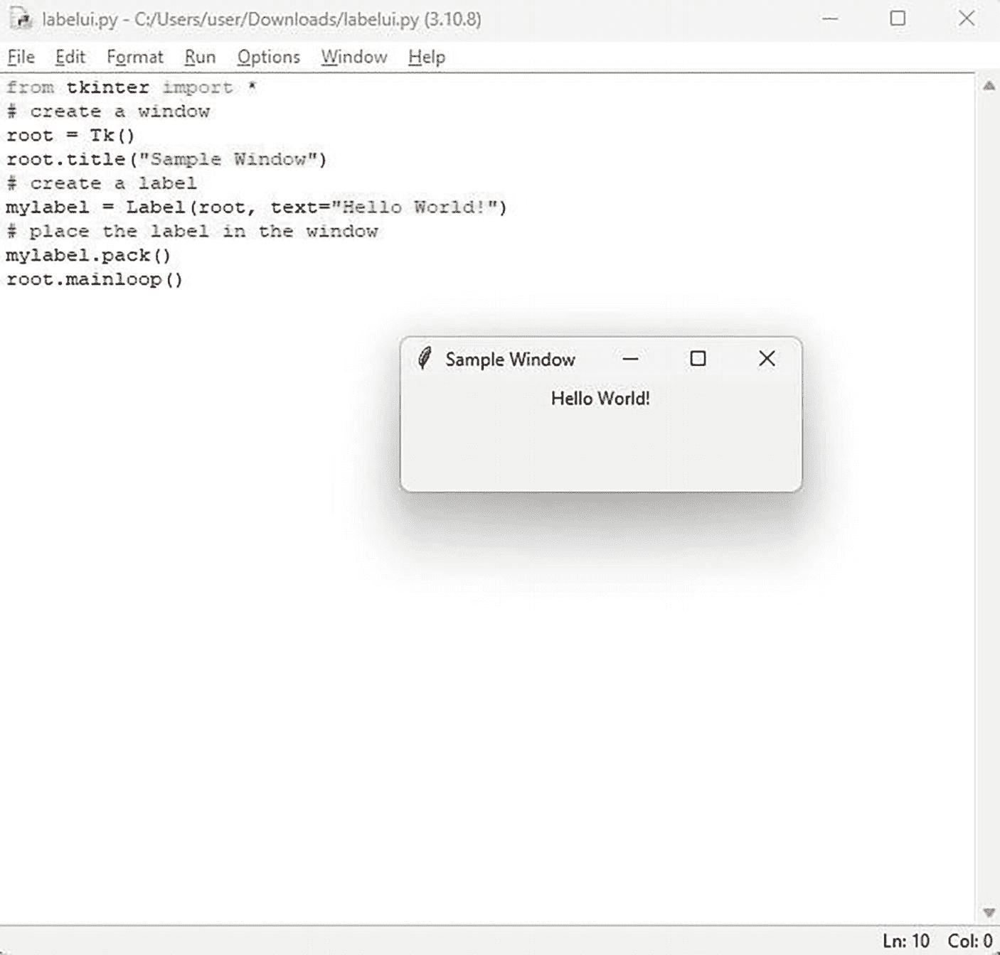

一个标签 u i dot p y 窗口的截图，包含九行代码。它显示一个示例窗口，其中显示 Hello World。

图 6-1

在 IDLE IDE 中带有标签小部件的 GUI

我们可以使用网格系统，通过基于行和列的坐标系将多个小部件放置在所需位置。在以下代码中，我们创建了两个标签小部件，它们将显示在连续的行中。为了定位这些小部件，我们使用 `grid()` 函数而不是 `pack()` 函数，并为第一个标签提供行索引 0，为第二个标签提供行索引 1。为了理解列位置，我们还为第一个标签提供列索引 0，为第二个标签提供列索引 1。与代码对应的标签小部件的位置可以从图 6-2 中看到。

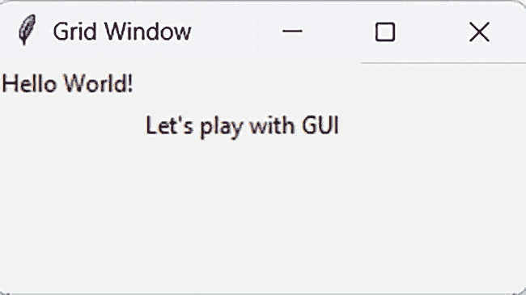

一个带有网格的 G U I 的截图，包含十一行代码。它显示一个网格窗口，其中显示 hello world, let's play with G U I。

图 6-2

启用网格显示标签的 GUI

```
from tkinter import *
# 创建一个窗口
root = Tk()
root.title("网格窗口")
# 创建标签
mylabel1 = Label(root, text="Hello World!")
mylabel2 = Label(root, text="Let's play with GUI")
# 将标签放置在网格的相邻行中
mylabel1.grid(row=0,column=0)
mylabel2.grid(row=1,column=1)
root.mainloop()
```


### 按钮

现在我们已经知道如何显示标签，接下来尝试使用按钮控件来生成标签。一个按钮控件需要两个要素：按钮上方的文本提示（说明其功能），以及按下按钮时需要执行的操作。在我们的例子中，生成标签的操作可以先用一个用户自定义函数来创建，如下方代码所示。操作定义好后，我们可以使用 *Button()* 函数来创建按钮。在按钮函数中，*text* 选项用于提供文本提示，*command* 选项用于设置对我们创建的标签生成函数的调用。回想一下，我们需要使用 *pack()* 函数将按钮推入主窗口。此外，我们还可以通过 *padx* 和 *pady* 选项来设置按钮的高度和宽度，从而自定义按钮。我们也可以使用 *fg* 和 *bg* 选项分别设置前景色（按钮上文本的颜色）和背景色（按钮的颜色）。读者可以从官方文档中探索 *Button* 函数提供的其他配置选项。代码生成的窗口如图 6-3 所示。

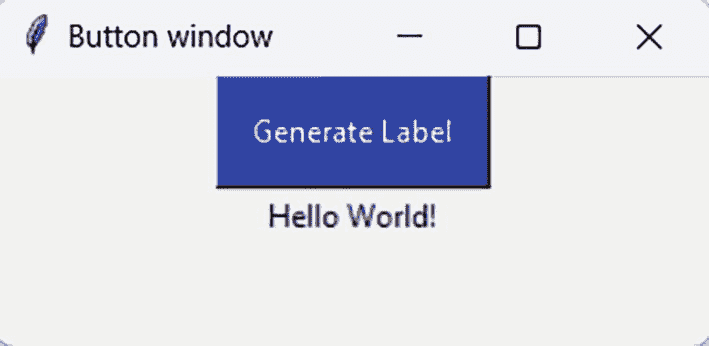

GUI 按钮窗口的截图，显示文本“生成的标签”。其下方是“Hello World”字样。

图 6-3

带有生成标签文本按钮的 GUI

```
from tkinter import *
root = Tk() # 创建一个窗口
root.title("按钮窗口")
# 定义按钮操作
def click():
mylabel = Label(root, text='Hello World!')
mylabel.pack()
# 创建并打包一个按钮
mybutton = Button(root, text='生成标签', command=click, padx=10, pady=10, fg="white", bg="blue")
mybutton.pack()
root.mainloop()
```

### 输入框

在前两个例子中，我们都是在程序中预设了要显示的文本。在本节中，我们将使用输入框控件来获取用户输入的文本，并使用按钮控件将文本推送到标签控件中。如下方代码所示，我们首先使用 *Entry()* 函数创建输入框控件。可以看到，该函数允许我们通过提供 *width*、*borderwidth* 等选项来自定义控件。该函数提供了一个插入方法，语法为 *insert(index, value)*，其中 *index* 是插入值的位置，*value* 是要插入到输入框中的文本。请注意，我们提供了一个默认字符串 *“输入文本”* 作为默认显示。索引 0 使我们能够用我们输入的字符串替换这个默认字符串，因为我们是在默认字符串的同一位置进行插入。接下来，我们为按钮创建操作函数，在其中创建一个标签控件。与之前的例子不同，这里我们使用 *get()* 函数从输入框控件中获取文本，而不是提供我们自己的文本。最后，我们使用按钮函数来启动操作。生成的窗口如图 6-4 所示。

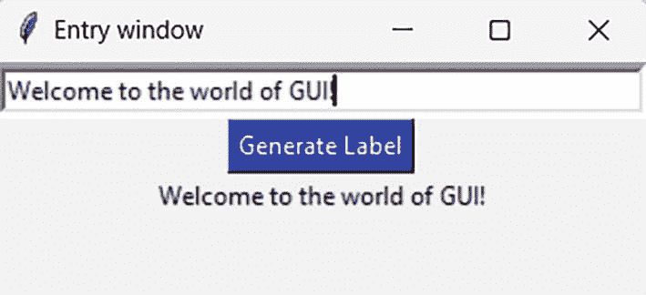

GUI 输入窗口的截图。文本字段显示“欢迎来到 GUI 的世界”。下方有一个按钮，文本为“生成标签”，以及“欢迎来到 GUI 的世界”。

图 6-4

带有输入框控件生成标签文本的 GUI

```
from tkinter import *
# 创建一个窗口
root = Tk()
root.title("输入窗口")
# 创建一个输入框控件
entry = Entry(root, width=50, borderwidth=5)
entry.pack()
entry.insert(0,"输入文本")
# 定义按钮操作
def click():
mylabel = Label(root, text=entry.get())
mylabel.pack()
# 创建并打包一个按钮
mybutton = Button(root, text='生成标签', command=click, fg="white", bg="blue")
mybutton.pack()
root.mainloop()
```

### 单选按钮

在本节中，我们将使用单选按钮将整数值推送到标签控件中。如下方代码所示，我们首先使用 *IntVar()* 函数定义一个变量 *r* 来保存整数数据，然后在定义单选按钮控件的操作时，使用 *get()* 函数来检索该数据。接下来，我们用一个用户自定义函数来定义单选按钮控件的操作，在该函数中使用 *config()* 函数来更新标签控件。随后，我们使用 *Radiobutton()* 函数创建单选按钮。该函数接收以下输入：单选按钮上要显示的文本、用于跟踪用户选择的控制变量、要分配给控制变量的值，以及点击单选按钮时要启动的操作。请注意，我们使用了 Lambda 函数，它获取分配给控制变量 *r* 的值，并将其提供给我们之前定义的单选按钮操作函数。最后，我们创建一个文本为空的标签控件，并将其推送到窗口中。当我们点击一个单选按钮时，分配给该按钮对应控制变量的值就会显示在标签控件中，如图 6-5 所示。

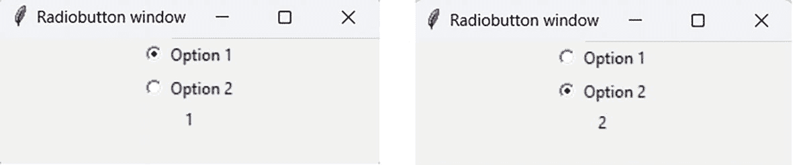

两个单选按钮窗口的截图。显示内容为“选项 1”和“选项 2”。左侧窗口选中了选项 1，右侧窗口选中了选项 2。

图 6-5

带有单选按钮控件生成标签文本的 GUI

```
from tkinter import *
# 创建一个窗口
root = Tk()
root.title("单选按钮窗口")
r=IntVar() # 定义整数变量
# 定义单选按钮的操作
def clicked(value):
mylabel.config(text=value)
# 定义单选按钮
Radiobutton(root, text="选项 1", variable=r,
value=1,command=lambda: clicked(r.get())).pack()
Radiobutton(root, text="选项 2", variable=r,
value=2,command=lambda: clicked(r.get())).pack()
# 定义标签
mylabel = Label(root, text="")
mylabel.pack()
root.mainloop()
```


### 复选框

与允许我们在多个选项中仅选一项的单选按钮不同，复选框允许我们同时选择多个选项。在如下所示的代码中，我们使用 *BooleanVar()* 函数与复选框关联，当选中对应按钮时，变量值会自动更新为 *True*，取消选中时则更新为 *False*。在与按钮组件对应的动作函数中，我们生成与所选复选框对应的文本字符串，并将其追加到一个列表中。之所以追加到列表，是因为我们可以同时选择多个复选框，需要显示所有这些按钮对应的文本字符串。生成的文本字符串随后被配置到标签组件。我们还添加了一个默认文本，用于在未选中任何复选框时显示。与复选框选择对应的不同场景如图 6-6 所示。

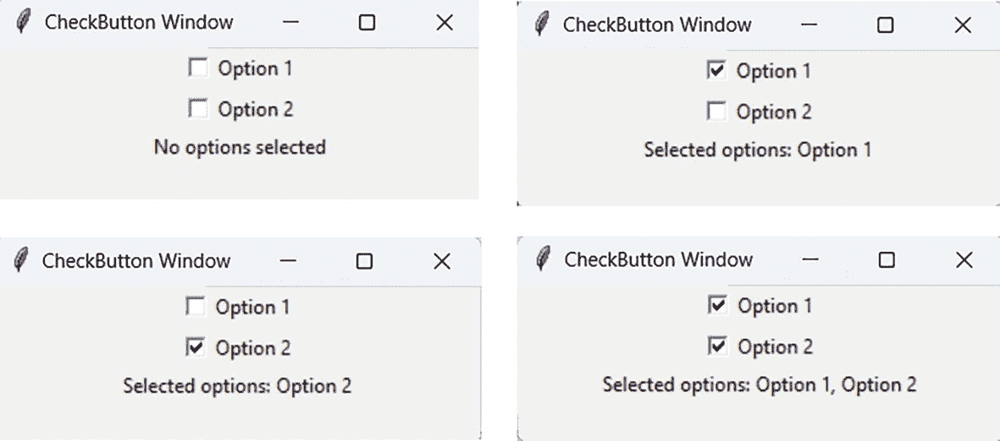

四个复选框窗口的截图。第一个窗口中，未选择任何选项。第二个复选框窗口中，选择了选项 1。第三个复选框窗口中，选择了选项 2。第四个复选框窗口中，选项 1 和选项 2 都被选中。

图 6-6

使用复选框组件生成标签文本的图形用户界面

```
from tkinter import *
# 创建一个窗口
root = Tk()
root.title("复选框窗口")
# 复选框的动作语句
def generate_label():
options = []
if option1_var.get():
options.append("选项 1")
if option2_var.get():
options.append("选项 2")
if options:
mylabel.config(text="已选选项: " + ', '.join(options))
else:
mylabel.config(text="未选择任何选项")
# 创建变量来存储复选框的状态
option1_var = BooleanVar()
option2_var = BooleanVar()
# 创建复选框
checkbutton1 = Checkbutton(root, text="选项 1", variable=option1_var, command=generate_label).pack()
checkbutton2 = Checkbutton(root, text="选项 2", variable=option2_var, command=generate_label).pack()
# 创建标签以显示已选选项
mylabel = Label(root, text="未选择任何选项")
mylabel.pack()
root.mainloop()
```

### 消息框

我们经常需要向用户提供一些警告或传达与应用相关的信息。消息框提供了一种简单的方法来实现这一点，即通过一个弹出框，该弹出框由用户发起的某个动作触发。在以下简单代码中，我们使用按钮动作来触发消息框组件。图 6-7 展示了该动作的结果。

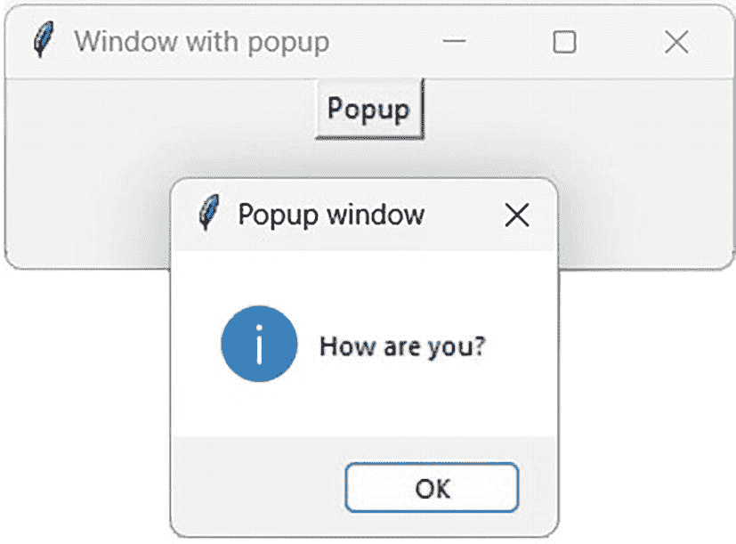

图形用户界面的截图，显示了一个弹出窗口。文本显示“你好吗？”，底部有一个“确定”按钮。

图 6-7

通过按钮动作触发消息框的图形用户界面

```
from tkinter import *
from tkinter import messagebox
# 创建一个窗口
root = Tk()
root.title('带弹出窗口的窗口')
# 定义按钮的动作
def popup():
messagebox.showinfo("弹出窗口","你好吗？")
# 创建一个按钮
Button(root, text="弹出", command=popup).pack()
mainloop()
```

### 顶层窗口

当应用需要一个额外的窗口来向用户展示一些额外信息，或者为应用的某个子集提供独立界面时，可以使用顶层窗口组件。这些附加窗口可以通过它们自己的变量名直接管理，无需与父窗口关联。这里给出的简单代码演示了如何创建一个带有自己标签的附加窗口。生成的窗口如图 6-8 所示。

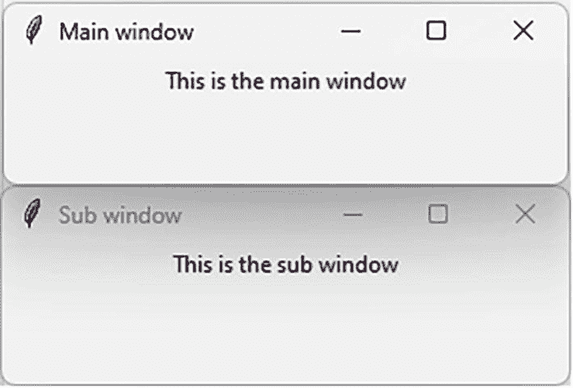

图形用户界面的截图，显示两个窗口。上方窗口文本显示“这是主窗口”。下方窗口文本显示“这是子窗口”。

图 6-8

包含两个窗口的图形用户界面

```
from tkinter import *
# 创建主窗口
root=Tk()
root.title('主窗口')
# 创建附加窗口
top = Toplevel()
top.title('子窗口')
# 为两个窗口创建标签
mylabel1 = Label(root, text = '这是主窗口').pack()
mylabel2 = Label(top, text='这是子窗口').pack()
mainloop()
```


### 字段对话框与画布

为便于理解，我们之前仅使用简单的标签来演示所讨论的控件。在本节中，我们将学习如何浏览文件、选择图像并将其显示在窗口中，这对于我们的视觉系统至关重要。我们将使用*字段对话框*控件来浏览图像，并使用*画布*控件来显示图像。图像也可以显示在*标签*控件中，但由于它是一个静态控件，无法与显示的图像进行进一步交互。因此，我们选择*画布*控件，这样我们可以在图像上绘制，或对图像进行缩放、旋转等变换操作。

在以下代码中，我们使用一个按钮控件来打开用于选择图像的对话框控件，并使用一个*画布*控件来绘制图像。我们将根据要显示的图像尺寸来指定画布的宽度和高度。在本例中，我们使用与图像相同的尺寸，即 512 x 512。在按钮动作对应的函数中，我们使用字段对话框控件的 *askopenfilename* 函数来浏览图像。在我们的代码中，*askopenfilename* 函数接收三个参数作为输入。第一个参数是初始目录，字段对话框控件将在此目录中打开；第二个参数是对话框窗口上显示的文本；第三个参数是对话框中显示的文件类型。请注意，我们在函数中提供了两种文件类型：“.png”表示 PNG 图像，“*.*”表示所有其他文件类型。因此，这两种类型将出现在对话框窗口的*文件类型*下拉菜单中，如图 6-9 (a) 所示。我们可以选择初始目录中的图像，也可以导航到其他目录选择图像。*askopenfilename* 的返回结果将是图像的文件名及其路径。

为了将文件显示在画布上，我们需要使用 tkinter 库中的 *PhotoImage* 函数来读取文件。但问题是，这个 *PhotoImage* 函数只支持 GIF 和 PGM/PPM 格式，而我们常用的图像格式是 JPEG 和 PNG。解决这个问题的方法是使用 PIL 库中 *ImageTk* 类提供的替代 *PhotoImage* 函数。我们首先使用 OpenCV 库的 *imread()* 函数读取图像。这样做的原因是，使用 OpenCV 读取图像时，图像会被读取为 numpy 数组，这允许我们对图像执行大量数值运算，正如我们在第 5 章中讨论的那样。然后，我们使用 PIL 库中的 *fromarray()* 函数将图像转换为 PIL 图像文件格式，再使用同一库中的 *PhotoImage* 函数将图像转换为可在画布控件中显示的图像对象。

接下来，我们可以使用 *create_image* 函数在画布上绘制图像。函数中的前两个数字表示用于定位图像的 (x, y) 坐标。我们可以改变坐标来水平或垂直移动图像的位置。*anchor* 值决定了图像中与坐标对齐的位置。例如，我们将锚点指定为“nw”，这意味着图像的西北锚点（左上角）将位于画布上的坐标 (0, 0) 处。配置画布后，使用 *PhotoImage* 函数打开的图像被赋值给画布控件的 *image* 属性。最终在画布控件上显示的图像如图 6-9 (b) 所示。从本章此后的所有 GUI 插图开始，我们将使用一个倾斜锯片的图像。

```
from tkinter import *
from tkinter import filedialog
from PIL import Image, ImageTk
import cv2
# 创建根窗口
root = Tk()
root.title('带对话框的窗口')
# 定义按钮控件的动作
def click():
filename = filedialog.askopenfilename(initialdir="C:/Users/user/Pictures", title="浏览", filetypes=(("png 文件",
"*.png"),("所有文件","*.*")))
o_img = cv2.cvtColor(cv2.imread(filename), cv2.COLOR_BGR2RGB)
c_img = ImageTk.PhotoImage(Image.fromarray(o_img))
canvas.create_image(20,20,anchor="nw",image=c_img)
canvas.image=c_img
# 创建画布控件
canvas = Canvas(root,width=500, height=500)
canvas.pack()
# 创建按钮控件
mybutton = Button(root, text='浏览', command = click)
mybutton.pack()
root.mainloop()
```

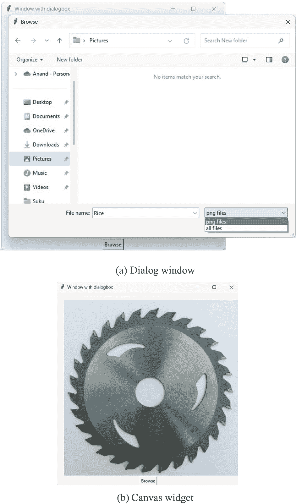

一张截图和一张照片。a，对话框窗口显示文件选择的截图。浏览窗口已打开，文件名为 rice，并选择了 p n g 文件。b，画布控件显示一张圆锯片的照片。

图 6-9

用于选择和显示图像文件的 GUI


### 缩放

在基于视觉的图形用户界面中，滑块常被用于实时调整图像的某些参数。缩放小部件允许我们在图形用户界面中创建一个覆盖一定数值范围的滑块。在以下代码中，我们通过点击按钮来浏览并选择一张图像，然后使用滑块对图像进行放大或缩小。与之前的示例不同，这里的画布小部件需要同时响应按钮操作和滑块操作。因此，我们将加载和显示图像的功能分别封装成独立的函数（之前它们是在同一个函数中实现的），这样显示函数就可以同时被按钮操作和滑块操作调用了。

让我们逐一分析这些函数。`load()` 函数用于触发按钮小部件的操作，与之前示例中的 `click()` 函数类似，它通过对话框窗口浏览并选择图像。不同之处在于，一旦我们从选中的图像获取文件名，并使用 `imread()` 函数读取文件后，我们会调用 `display()` 函数将图像推送到画布小部件上。我们对这个 `display()` 函数也做了一点小调整。由于每次移动滑块时，显示内容都需要更新为对应的缩放图像，因此我们首先检查画布上是否已经显示了一张图像，并确保在更新新图像之前将其移除。

在显示图像之前，我们调用 `update()` 函数，将从滑块获取的缩放设置应用到原始图像上。在这个函数中，我们首先使用 `get()` 函数从缩放小部件获取缩放比例，并将其归一化。接着，我们将这个归一化后的值乘以原始图像的宽度和高度，从而确定新的宽度和高度。有了新的尺寸后，我们就可以使用 `resize()` 函数相应地缩放原始图像。我们需要指定用于缩放图像的插值类型，在本例中我们使用了线性插值。最后，我们使用 `PhotoImage()` 函数将调整大小后的图像转换为适合显示的格式，然后在 `display()` 函数内部通过 `create_image()` 函数将其推送到画布小部件上。

最后一个函数是 `zoom_image()` 函数，它用于触发缩放小部件的操作。在这个函数内部，我们只需调用 `update()` 和 `display()` 这两个函数来执行缩放操作，并将结果显示在画布小部件上。请注意，我们将包含原始图像、已显示图像和缩放后图像的变量声明为全局变量，以便在不同函数之间实现顺畅的通信。在函数定义之后，我们创建了应用程序窗口中将要使用的所有小部件。请注意，`Scale()` 函数用于创建缩放小部件，该函数接收缩放功能的起始和结束范围、小部件的方向、指示小部件功能的标签以及触发缩放操作的函数作为输入。`set()` 函数用于将缩放小部件的初始位置设置为 100。请注意，在 `update()` 函数中，这个值会被归一化为 1，这表示原始图像大小，因为将原始图像的宽度和高度乘以 1 会得到相同的图像。

这里另一个需要注意的重要事项是，我们将之前描述的所有全局参数都初始化为 `None` 类型。这会导致在运行代码时，`update()` 函数中出现 `AttributeError`，因为缩放小部件会自动触发操作，而由于原始图像被初始化为 `None` 类型，我们将无法在 `update()` 函数内部获取其高度或宽度。为了避免出现此错误，我们创建了一个异常处理，用空响应来替换错误提示。图 6-10 展示了显示倾斜锯片图像在三种不同缩放比例下的图形用户界面窗口。

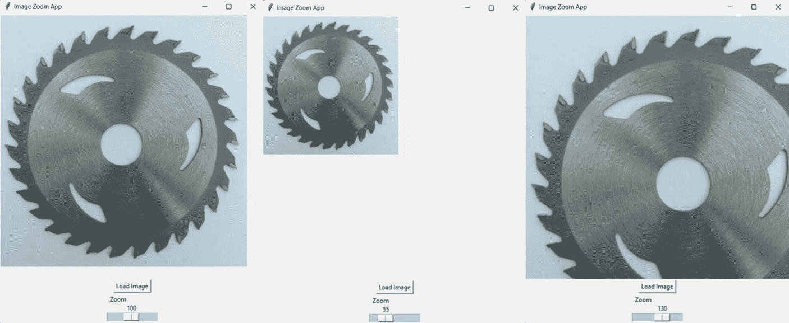

图像缩放应用程序窗口的 3 张截图。左图，缩放设置为 100。中图，缩放设置为 55。右图，缩放设置为 130。

图 6-10

带有缩放小部件用于缩放图像的图形用户界面

```
from tkinter import *
from tkinter  import filedialog
from PIL import Image, ImageTk
import cv2
# action for Button widget
def load():
filename = filedialog.askopenfilename(filetypes=[("Image files", "*.png *.jpg *")])
if filename:
global displayed_img, img_cv, img
img_cv=cv2.cvtColor(cv2.imread(filename), cv2.COLOR_BGR2RGB)
display()
# function to update the canvas widget
def display():
global displayed_img, img_cv, img
if displayed_img:
canvas.delete(displayed_img)
displayed_img = None
if img_cv is not None:
update()
displayed_img = canvas.create_image(0, 0, image=img, anchor=NW)
canvas.image = img
# resize the image to the new dimensions
def update():
try:
global displayed_img, img_cv, img
zoom_level= zoom_scale.get() / 100.0
h,w,c=img_cv.shape
width = int(w * zoom_level)
height = int(h * zoom_level)
resized_img=cv2.resize(img_cv,(width,height),interpolation= cv2.INTER_LINEAR)
img = ImageTk.PhotoImage(Image.fromarray(resized_img))
except AttributeError:
print("")
# action for Scale widget
def zoom_image(value):
update()
display()
# create the root window
root = Tk()
root.title("Image Zoom App")
# create a canvas to display the image
canvas = Canvas(root, width=512, height=512)
canvas.pack()
# create a button to load the image
load_button = Button(root, text="Load Image", command=load)
load_button.pack()
# create a scale widget to zoom the image
zoom_scale = Scale(root, from_=10, to=200, orient="horizontal", label="Zoom", command=zoom_image)
zoom_scale.set(100)  # Initial zoom level (100%)
zoom_scale.pack()
# intialize the global variables
img_cv = None
displayed_img = None
img = None
root.mainloop()
```


## 工业视觉系统图形用户界面

现在我们已经逐一介绍了图形用户界面应用程序中常用的组件，接下来我们将把多个图形组件整合在一起，构建一个可用于识别装配线中缺陷产品的综合视觉系统。我们使用网格布局来放置图 6-11 所示的 GUI 组件。GUI 窗口被划分为五行两列的网格。

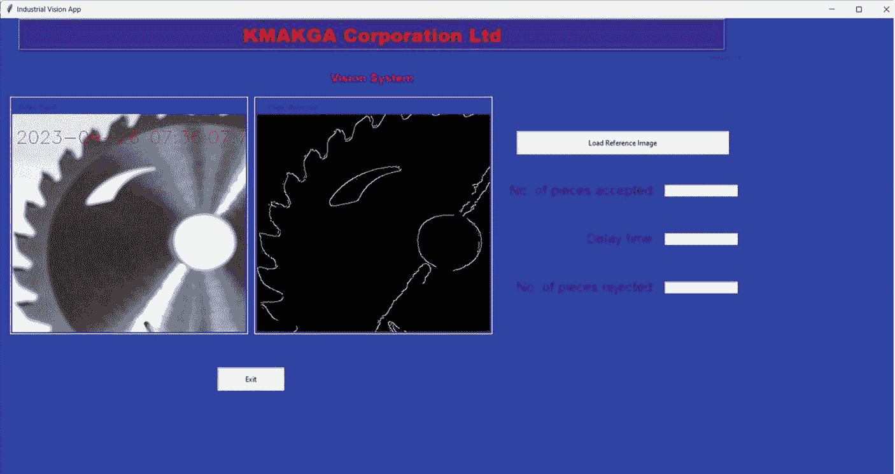

图形用户界面截图。显示内容为：加载参考图像、合格产品数量、不合格产品数量以及退出选项。

图 6-11

用于识别装配线缺陷产品的图形用户界面

第一行包含一个显示该 GUI 所开发组织名称的*标签*控件。此处为便于说明，使用了一个由作者姓名首字母组成的虚构公司名称。通过在`grid()`函数中指定`columnspan`和`sticky`选项的值，该控件被扩展为跨越两列。`sticky`选项的`"ew"`值表示标签必须从其使用`columnspan`选项定义的区域左侧（西侧）拉伸至右侧（东侧）。此外，在`Label()`函数中使用了`borderwidth`和`relief`选项，为*标签*控件创建视觉边界效果。

在第二行中，GUI 的版本号显示在该行末尾的第二列。通过将`grid()`函数中的`sticky`选项设置为`"e"`，实现了控件位于第二列最右侧的定位。为便于说明，我们仅提供了一个虚构的版本号 1.0。应用程序的标题位于第三行中央，其实现方式与第一个标签类似，使用了`columnspan`和`sticky`选项。同样，为便于说明，我们仅提供了标题“视觉系统”。

在第四行中，我们使用了两个*框架*控件，本章此前尚未讨论过该控件。*框架*控件仅用于将多个控件组合在一起。在第一个框架中，两个*画布*控件被组合在一起。第一个画布用于显示来自 USB 摄像头的实时视频流。我们已在第 2 章中讨论了如何捕获视频和读取帧。此处我们仅做了一件事：使用`datetime`库中的`datetime.now()`获取当前时间，并使用 OpenCV 库中的`putText()`函数将时间戳叠加到视频帧上。时间戳对装配线的管理人员来说可能非常方便，因为保存每个产品的检测时间戳有助于他们后续进行一些分析。第二个画布用于对视频帧执行边缘检测，并显示边缘检测后的视频。此处使用了第 5 章讨论的 Canny 边缘检测器。

第二个框架包含一个按钮控件以及一组标签和输入控件。按钮控件用于浏览并选择一张参考图像，随后可借助图像处理算法将该图像与装配线上捕获的产品图像进行比较，以识别缺陷产品。第一个和第三个输入控件用于显示装配线上合格与不合格产品的数量。每当我们的视觉系统检测到一个产品时，这些控件就会更新。第二个输入控件用于提供延迟时间，该时间根据装配线上两个连续产品到达的时间间隔进行设置。最后，在第五行提供了一个退出按钮，用于关闭根窗口。按钮的动作通过`close_window()`函数定义，如代码所示。代码中提供了充分的注释来解释每一部分。由于本章主要关注 GUI 设计，因此说明重点在于构建 GUI，而不涉及通过将捕获的产品图像与参考图像进行比较来识别缺陷产品的后台过程。这将在后续章节中讨论。


```
from tkinter import *
from tkinter import filedialog
import cv2
from PIL import Image, ImageTk
import datetime
# 创建主应用程序窗口
root = Tk()
root.title("工业视觉应用")
root.geometry("1600x1000")
root.configure(bg="blue")
# 关闭窗口的函数
def close_window():
root.destroy()
# 创建标签
company_label = Label(root, text="KMAKGA 股份有限公司",
borderwidth=5, relief="ridge",
font=("Arial Black", 24),fg="red", bg="dark blue")
company_label.grid(row=0,column=0,columnspan=4,padx=30,pady=0,sticky="ew")
version_label = Label(root, text="版本 1.0",bg="blue")
version_label.grid(row=1,column=2,padx=0,pady=0,sticky="e")
vision_label = Label(root, text="视觉系统", font=("Helvetica", 16,"bold"), fg="red", bg="blue")
vision_label.grid(row=2,column=0,columnspan=3,padx=0,pady=10,sticky="ew")
# 创建用于容纳画布的框架
frame = Frame(root,width=800,height=800,relief="ridge",borderwidth=1,bg="blue")
frame.grid(row=3,column=0,padx=10,pady=0)
# 创建画布
video_canvas1 = Canvas(frame, borderwidth=2, width=400, height=400, bg="blue")
video_canvas1.grid(row=3,column=0,padx=5,pady=5)
video_canvas2 = Canvas(frame, borderwidth=2, width=400, height=400, bg="blue")
video_canvas2.grid(row=3,column=1,padx=5,pady=5)
video_canvas1.create_text(80, 10, text="视频源", font=("Helvetica", 10), anchor="ne")
video_canvas2.create_text(110, 10, text="边缘检测", font=("Helvetica", 10), anchor="ne")
# 加载图像到参考图像画布
def click():
global img
filename = filedialog.askopenfilename(
initialdir="C:/Users/user/Pictures/",
title = "选择文件", filetypes = (("png 文件", "*.png"), ("所有文件","*.*")))
img = ImageTk.PhotoImage(Image.open(filename))
# 创建用于容纳配置选项的框架
entry_frame = Frame(root, width = 200, height = 600, bg="blue")
mybutton=Button(entry_frame,width=20,height=2,borderwidth=2,relief="ridge",text='加载参考图像',command = click)
mybutton.grid(row=0,column=0,columnspan=2, padx=20,pady=20,sticky="nsew")
labels = ["已接受件数：", "延迟时间：", "已拒绝件数："]
entries = [Entry(entry_frame, borderwidth=2, relief="ridge") for _ in range(3)]
for i, label_text in enumerate(labels):
label = Label(entry_frame, text=label_text, font=("Helvetica", 18), fg="black", bg="blue")
label.grid(row=i+1, column=0, padx=5, pady=25, sticky="e")
entry = entries[i]
entry.grid(row=i+1, column=1, padx=5, pady=25, sticky="w")
entry_frame.grid(row=3, column=2, padx=5, pady=5)
# 创建关闭按钮
close_button = Button(root,width=15,height=2,borderwidth=2,relief="ridge",text="退出", command=close_window)
close_button.grid(row=4,column=0,columnspan=2,padx=0,pady=50,sticky="n")
# 更新视频画布以显示摄像头画面的函数
def update_video_canvas():
ret, frame = cap.read()
if ret:
# 将帧转换为灰度图
gray_frame = cv2.cvtColor(frame, cv2.COLOR_BGR2GRAY)
# 使用 Canny 算法进行边缘检测
edges = cv2.Canny(gray_frame, 100, 200)
# 转换为适合 Tkinter 的格式
edges_rgb = cv2.cvtColor(edges, cv2.COLOR_GRAY2RGB)
edge_photo = ImageTk.PhotoImage(image=Image.fromarray(edges_rgb))
# 在第二个画布中显示边缘检测结果
video_canvas2.create_image(0, 30, image=edge_photo, anchor=NW)
video_canvas2.photo = edge_photo
# 在帧上添加时间戳
font = cv2.FONT_HERSHEY_SIMPLEX
dt = str(datetime.datetime.now())
frame_rgb = cv2.cvtColor(frame, cv2.COLOR_BGR2RGB)
frame_rgb = cv2.putText(frame_rgb, dt, (10,50),font,1,(255,0,0))
# 在第一个画布中显示原始视频
orig_photo = ImageTk.PhotoImage(image=Image.fromarray(frame_rgb))
video_canvas1.create_image(0, 30, image=orig_photo, anchor=NW)
video_canvas1.photo = orig_photo
video_canvas1.after(10, update_video_canvas)
# 打开摄像头
cap = cv2.VideoCapture(0)
# 调用 update_video_canvas 函数开始显示视频流
update_video_canvas()
# 启动 tkinter 主循环
root.mainloop()
# 窗口关闭时释放摄像头并关闭 OpenCV
cap.release()
cv2.destroyAllWindows()
```

## 总结

通过在本章中讨论以下主题，并为每个主题提供示例演示，我们为视觉系统的 GUI 设计奠定了坚实的基础：

*   对 *tkinter* 库及其提供的各种小部件的基本理解

*   演示一个示例 GUI，以了解 *tkinter* 库中不同小部件的工作方式

*   通过将我们之前学到的多个小部件组合在一起，设计一个用于创建简单视觉系统的综合性 GUI

既然我们已经对 GUI 设计有了扎实的理解，下一章我们将把重点转移到借助各种特征来提取有意义的信息上。

