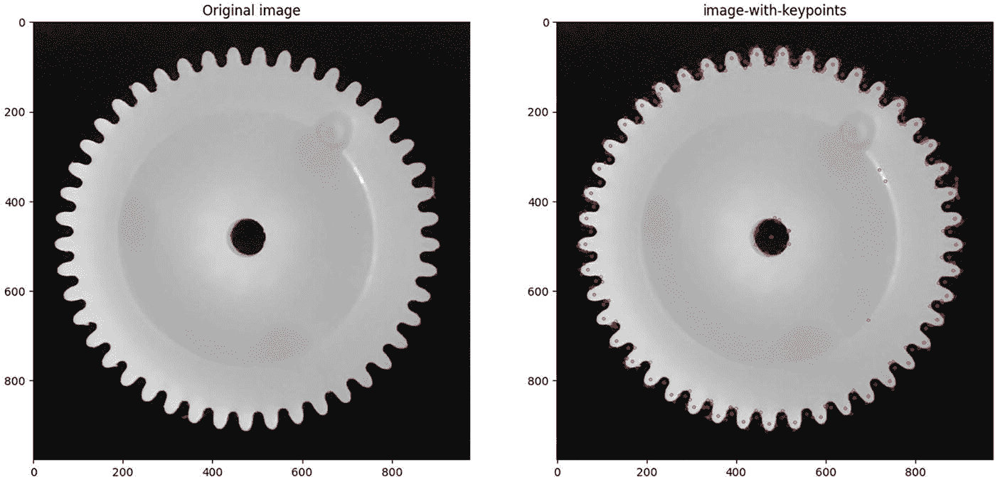
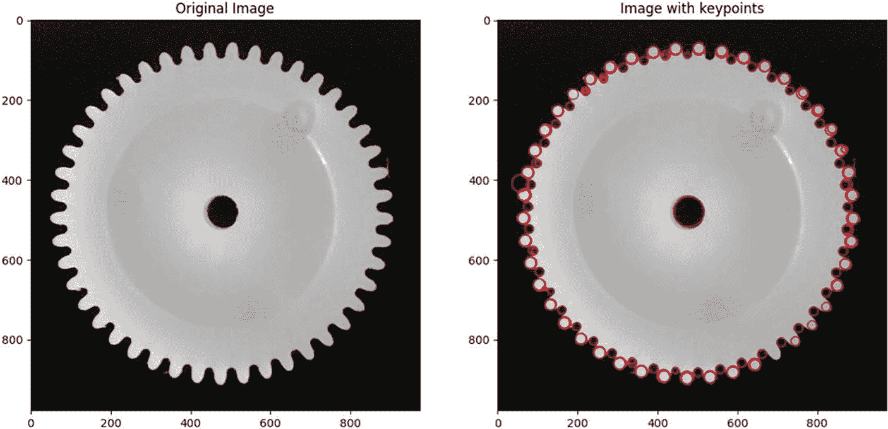
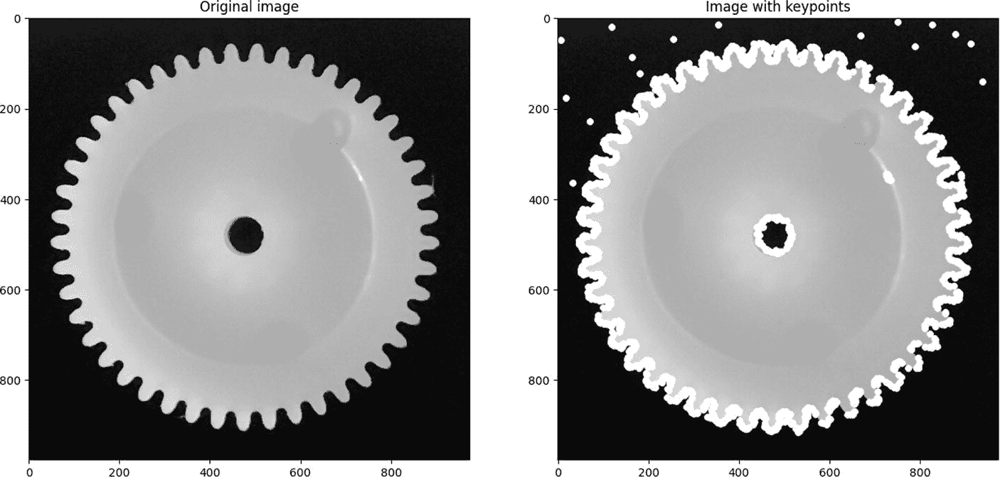
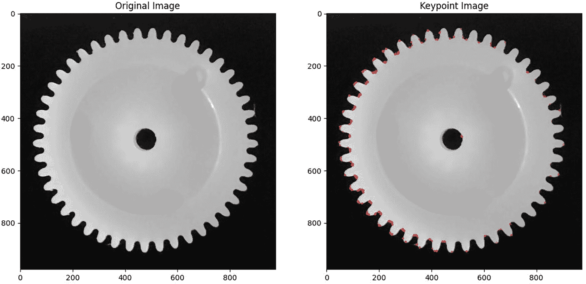
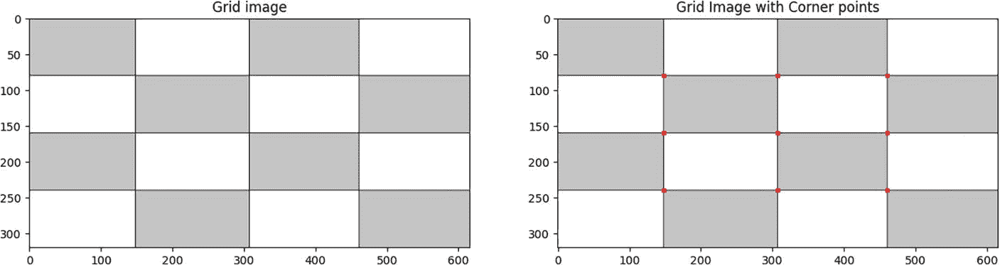
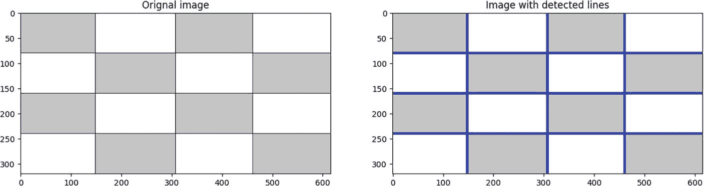
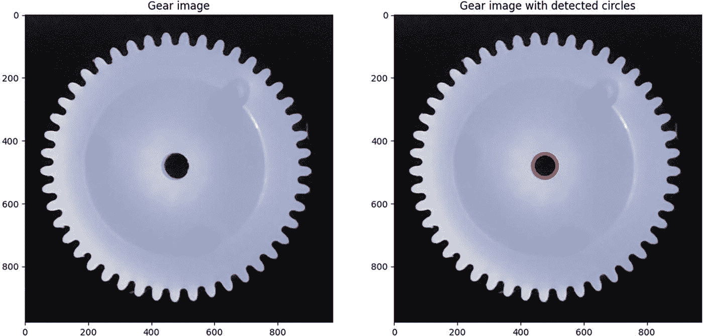
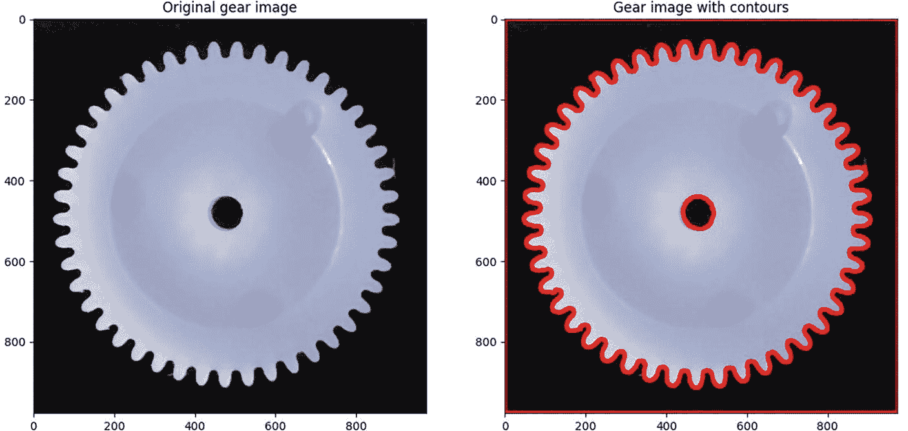

# 7. 特征检测与匹配

在上一章中，我们探讨了如何结合 OpenCV 和 Tkinter 来为图像处理应用创建图形用户界面（GUI）。现在，让我们探讨如何从给定的图像中提取有用的特征。特征检测使我们能够识别图像中具有区分性的点或模式，这些点或模式是物体识别、图像分割、模式匹配等应用的基础。在本章中，我们将首先对图像特征是什么有一个基本的理解。然后，我们将继续讨论检测图像中所谓关键点的不同方法。接着，我们将讨论一种特殊的算法，该算法允许我们检测图像中的角点。最后，我们将了解如何检测图像中物体的形状。

## 图像特征

图像特征是图像中提供图像视觉特征信息的独特组成部分或模式。这些特征有助于分解图像的视觉信息，并且是计算机视觉系统的关键方面，因为从图像中学习到的特征有助于执行物体识别、图像分割和分类等任务。特征可以分为两类：全局特征和局部特征。全局特征代表整个图像的整体特征，而局部特征则代表图像中特定区域或物体的信息。

例如，数字图像的颜色直方图给出了图像中颜色分布的表示，而诸如偏度和峰度之类的全局统计量有助于描述图像的像素强度分布。这些特征由一个单一的向量表示，该向量提供了对给定图像的整体理解。另一方面，像点、边缘、角点等特征对于图像中的特定区域是唯一的，并且与其直接邻域不同。

这些局部特征的提取需要两个步骤：检测对尺度、光照和旋转具有不变性的感兴趣点或区域，并将检测到的特征转换为数值表示。这些感兴趣的点也称为关键点，而提供这些关键点描述的数值特征称为描述符。

在本章中，我们将讨论一些广泛用于从图像中提取这些特征的常用技术。

## SIFT 特征

在计算机视觉中，尺度不变特征变换（SIFT）是一种用于关键点检测和描述的算法，可用于从图像中提取独特的局部特征。正如算法名称所示，提取的特征对由图像尺度或光照水平变化以及图像旋转引起的变化具有鲁棒性。众多应用，如目标检测、图像匹配和图像拼接，都广泛使用了 SIFT 特征。例如，在目标检测任务中，可以提取图像中物体的关键点来提供对该物体的描述，然后用于在其他图像中检测该物体。

SIFT 特征的提取主要包括四个步骤：

1.  **尺度空间极值检测**：首先，我们创建图像的尺度空间表示，它由一系列不同尺度下的模糊图像组成。接下来，我们使用高斯差分（DoG）方法找到尺度空间中的局部最大值，这些点被视为潜在的关键点。
2.  **关键点定位**：SIFT 使用泰勒级数展开将关键点位置精化到亚像素精度。如果关键点的对比度或边缘响应低于预定水平，则将其剔除。
3.  **方向分配**：然后，根据每个精化后的关键点的局部图像梯度为其分配一个方向。这是通过为每个关键点创建梯度直方图，并将直方图中峰值的方向指定为该关键点的方向来完成的。
4.  **关键点描述符**：最后阶段是为每个关键点创建一个描述符，该描述符是一个向量，表示该点周围图像的局部外观。对于每个关键点，将周围邻域划分为 16 个子块，并为每个子块计算梯度方向直方图，然后将这些直方图连接起来形成关键点描述符。

以下代码演示了如何使用 SIFT 特征从齿轮图像中提取关键点。OpenCV 库中的 `cv2.SIFT_create()` 函数用于创建 SIFT 对象，该对象的 `detectAndCompute` 方法可用于检测图像中的关键点及其描述符。最后，OpenCV 库中的 `cv2.drawKeypoints()` 函数可用于在原始图像上标记关键点。图 7-1 显示了在齿轮图像上用红色标记的描述符，可以看出它们主要分布在构成齿轮重要特征的轮齿边缘上。在生产线上，齿轮齿在集成到实际产品之前需要验证其对齐情况，这些描述符可以满足此目的，因为它们具有尺度和旋转不变性。



两张插图。左侧的原始图像描绘了一个齿轮。右侧的插图标题为“带有关键点的图像”。它描绘了齿轮，在齿和齿轮的中心孔处有亮点。

图 7-1

使用 SIFT 特征提取关键点的示意图

```python
# 加载图像
img = cv2.imread('C:/Users/user/Pictures/gear.jpg',0)
# 创建 SIFT 检测器
sift = cv2.SIFT_create()
# 检测关键点和描述符
keypoints, descriptors = sift.detectAndCompute(img, None)
# 使用圆圈在图像上标记关键点
img_k=cv2.drawKeypoints(img ,
keypoints ,
img ,
(255, 0, 0) ,
flags=cv2.DRAW_MATCHES_FLAGS_DEFAULT)
# 显示原始图像和带有关键点的图像
plt.subplot(121)
plt.imshow(img, cmap='gray')
plt.title('原始图像')
plt.subplot(122)
plt.imshow(img_k)
plt.title('带有关键点的图像')
plt.show()
```

## SURF 特征

SURF，代表加速稳健特征（Speeded-Up Robust Features），是 SIFT 特征的一种加速版本，可以检测对尺度、光照和旋转具有不变性的关键点。使用 SURF 特征进行关键点检测和描述的步骤包括四个步骤：

1.  **尺度空间极值检测**：为了识别不同大小的特征，SURF 在多个尺度上对图像进行操作。它使用类似于 SIFT 中使用的高斯差分（DoG）的方法来定位尺度空间中的局部极值。为了找到感兴趣的区域，使用不同尺度的高斯滤波器对图像进行卷积，然后减去连续的模糊图像。
2.  **关键点定位**：在识别出潜在关键点后，SURF 通过在每个候选关键点位置拟合一个 3x3 的 Hessian 矩阵来执行关键点定位，以确定尺度并剔除对比度低或边缘定义不佳的点。
3.  **方向分配**：接下来，SURF 为每个关键点分配一个方向，使其具有旋转不变性。为了创建一个表示主方向的二维向量，计算关键点周围 x 和 y 方向的 Haar 小波响应。然后根据该向量的角度确定方向。
4.  **描述符计算**：在检测到尺度和关键点方向之后，SURF 为关键点的邻域计算一个描述符，该描述符是一个向量，其值表征了关键点周围的强度分布。

由于 SURF 已获得专利，而 OpenCV 默认排除受专利保护的算法。为了访问 SURF，我们可以在 OpenCV 编译或安装期间显式启用非自由模块。这将激活包含 SURF 和其他专利算法的 `xfeatures2d` 库，但我们需要确保已获得必要的许可或法律授权才能使用它们，尤其是在商业用途中。以下代码从齿轮图像中提取对应于 SURF 特征的关键点。读取齿轮图像后，使用 `cv2.xfeatures2d.SURF_create` 方法创建一个 Hessian 阈值为 10000 的 SURF 对象。特征检测器的灵敏度由 Hessian 阈值控制，较高的值会检测到更少但更强的关键点。然后，可以使用 SURF 对象的 `detectAndCompute` 方法在灰度图像 `img` 中检测关键点并计算描述符。

为了在图像上绘制彩色关键点，我们将灰度图像 `img` 转换为 BGR 图像 `img1_color`。接下来，我们遍历关键点，并使用 `circle()` 方法绘制圆圈，以关键点的坐标为中心，半径为关键点大小的四分之一。最后，我们显示带有关键点的齿轮图像以及原始图像，如图 7-2 所示。可以看出，指示关键点的圆圈捕获了齿轮的所有显著特征，包括边缘和齿轮中心。

```python
import cv2
import numpy as np
import matplotlib.pyplot as plt
# 加载齿轮图像
img = cv2.imread('Gear.jpg', cv2.IMREAD_GRAYSCALE)
# 创建 SURF 对象
surf = cv2.xfeatures2d.SURF_create(10000)
# 检测关键点并计算描述符
keypoints, descriptors = surf.detectAndCompute(img, None)
# 将灰度图像转换为 BGR 以显示彩色关键点
img1_color = cv2.cvtColor(img, cv2.COLOR_GRAY2BGR)
# 绘制关键点，增加线条粗细
for kp in keypoints:
x, y = int(kp.pt[0]), int(kp.pt[1])
radius = int(kp.size / 4)
# 设置圆圈线条粗细为 2
img1=cv2.circle(img1_color, (x, y), radius, (255, 0, 0), thickness=2)
# 显示图像
plt.subplot(121)
plt.imshow(img, cmap='gray')
plt.title('原始图像')
plt.subplot(122)
plt.imshow(img1)
plt.title('带有关键点的图像')
plt.show()
```



两幅插图。左侧原始图像描绘了一个齿轮。右侧插图则用关键点描绘了该图像。它用一组点簇描绘了齿轮，这些点分布在齿的边界、中心孔以及顶部的背景上。

图 7-2

# 使用 SURF 特征进行关键点提取的示意图

## FAST 特征

FAST 是“加速段测试特征”（Features from Accelerated Segment Test）的缩写。这种角点检测算法于 2006 年发表，计算效率高，因此比其他算法更快，名副其实。因此，该检测器非常适合需要高速计算且资源有限的实时视频处理应用。

使用 FAST 特征确定兴趣点的步骤如下：

1. 选择一个像素，例如 `p`，判断其是否为兴趣点，并设 `I[p]` 为该像素的强度。

2. 为强度选择一个阈值，例如 `T`。

3. 考虑一个由 16 个像素组成的圆，以所选像素 `p` 为圆心。

4. 如果圆中存在 `n` 个连续像素，其强度值比所选像素的强度值大（> `I[P]` + `T`）或小（< `I[P]` – `T`）约 `T` 个数量级，则所选像素（强度为 `I[p]`）被视为一个兴趣点。最初提出且常用的 `n` 值为 12。

5. 然后，可以利用步骤 4 进行高速测试，以更快地检测兴趣点。该测试可分为两部分：

    1. 首先，测试圆上像素 1、5、9 和 13 的强度是否满足步骤 5 中的阈值条件。如果所选像素 `p` 是兴趣点，那么这些像素中至少有三个的强度要么都大于 `I[p]+T`，要么都小于 `I[p]-T`。

    2. 然后，对通过初始四像素测试的候选点，对所有 `n` 个像素执行阈值条件。

以下代码说明了如何使用 FAST 特征从齿轮图像中提取关键点。OpenCV 库中的 `FastFeatureDetector_create()` 函数可用于创建 FAST 对象，而 `detect()` 方法可用于获取关键点。这里，我们使用 `circle()` 函数绘制关键点以及关键点周围圆上的 16 个像素。由于所有这些小圆紧密排列在一起，它们在图像上看起来像圆形斑块，从图 7-3 中我们可以看到，这些斑块大部分分布在齿轮的边缘。



两幅插图。左侧原始图像描绘了一个齿轮。右侧插图则用关键点描绘了该图像。

图 7-3

使用 FAST 特征进行关键点提取的示意图

```
import cv2
import matplotlib.pyplot as plt
# 读取图像
image = cv2.imread('C:/Users/user/Pictures/gear.jpg', 0)
# 显示原始图像
plt.subplot(121)
plt.imshow(image,cmap='gray')
plt.title('原始图像')
# 定义 FAST 检测器
fast = cv2.FastFeatureDetector_create()
# 查找兴趣点
keypoints = fast.detect(image, None)
# 绘制兴趣点以及圆上的 16 个像素
for keypoint in keypoints:
circle = cv2.circle(image, (int(keypoint.pt[0]),int( keypoint.pt[1])), 3, (255,0 , 0), 2)
for i in range(-7, 8):
for j in range(-7, 8):
if (i**2 + j**2) <= 49:
cv2.circle(image, (int(keypoint.pt[0]) + i, int(keypoint.pt[1]) + j), 1,
(255, 0, 0), 1)
# 显示带有关键点的图像
plt.subplot(122)
plt.imshow(image,cmap='gray')
plt.title('带有关键点的图像')
plt.show()
```

## BRIEF 特征

在将特征描述符用于对象识别等应用时，需要更快且内存效率更高的匹配，这反过来又需要较短的描述符。实现这一点的一种方法是通过对原始描述符应用降维算法（如 LDA 或 PCA），然后将描述符向量转换为位数更少的二进制字符串。但这仍然需要我们先计算完整的描述符，然后再应用降维。BRIEF 描述符通过直接从关键点周围的图像块计算二进制字符串来克服这一点，而不是先计算描述符。

BRIEF 是“二进制鲁棒独立基本特征”（Binary Robust Independent Elementary Features）的缩写，它是一种与 SURF、FAST 或 HARIS 等关键点检测算法协同工作的特征描述符。如上所述，BRIEF 使用二进制字符串作为高效的关键点描述符，使其成为实时应用的理想选择。以下是确定 BRIEF 特征的步骤。

1. 使用 SURF、SIFT 或 Harris 角点等关键点检测算法来检测给定图像中独特的兴趣点位置。

2. 对于每个检测到的关键点，提取该像素邻域内的一个局部正方形像素块。该块的高度和宽度将决定 BRIEF 描述符的尺度。

3. 由于 BRIEF 特征处理的是像素级别的强度，因此它对噪声非常敏感。因此，在进一步处理之前，需要使用高斯核对选定的块进行平滑处理。

4. 对于每个块，选择一组 `n` 个随机像素位置对 `(x, y)`，其中 `n` 是二进制特征向量的长度。对每对像素的强度进行比较，以获得相应的二进制值。例如，如果像素 `x` 的强度小于像素 `y` 的强度，则对应的二进制值为 1；如果 `x` 的强度大于 `y` 的强度，则该值为 0。这里的位置对是从高斯分布中随机选择的。

按照这些步骤，将为图像中的每个关键点生成一个二进制描述符。以下代码说明了从齿轮图像中提取描述符的过程。可以看出，图像中的关键点是使用前面讨论的 FAST 特征检测到的。然后，可以使用 `BriefDescriptorExtractor` 对象的 `create()` 方法从检测到的关键点中提取二进制描述符。从代码后面显示的输出中，我们可以看到提取的描述符变量是一个 numpy 数组。打印了单个关键点的描述符，可以看出该描述符是一个整数向量。为了获得二进制描述符，我们使用 numpy 库中的 `binary_repr()` 函数将向量中的每个整数转换为 8 位二进制表示。

```
import cv2
import numpy as np
# 加载输入的齿轮图像
img = cv2.imread('C:/Users/user/Pictures/gear.jpg', 0)
# 初始化 FAST 检测器并检测关键点
f = cv2.FastFeatureDetector.create()
kp= f.detect(img)
# 初始化提取器并为关键点提取 BRIEF 描述符
b = cv2.xfeatures2d.BriefDescriptorExtractor.create()
keypoints,descriptors = b.compute(img, kp)
# 打印描述符的特征
print("描述符变量的数据类型是:",type(descriptors))
print("\n 描述符大小:", len(descriptors))
# 打印第一个描述符
print("\n 第一个描述符是:")
print(descriptors[0])
# 以二进制形式打印描述符
print("\n 第一个描述符的二进制形式:")
print(' '.join([np.binary_repr(num,8) for num in descriptors[0]]))
输出:
描述符变量的数据类型是: 
描述符大小: 8802
第一个描述符是:
[8   7  12 124  43  50 228  72  16 131  26 152 184 236   0  10  70 248
82 150 44   8 200 44 205 216 164 123 184  76   4 245]
第一个描述符的二进制形式:
00001000 00000111 00001100 01111100 00101011 00110010 11100100 01001000 00010000 10000011 00011010 10011000 10111000 11101100 00000000 00001010 01000110 11111000 01010010 10010110 00101100 00001000 11001000 00101100 11001101 11011000 10100100 01111011 10111000 01001100 00000100 11110101
```

## ORB 特征

ORB 是在计算效率和匹配性能方面，作为 SIFT 和 SURF 特征的高效替代方案而开发的。另一个关键方面是，在 ORB 特征开发时，SIFT 和 SURF 特征均已获得专利，因此 ORB 成为了这些特征的免费替代方案。目前，SIFT 特征的专利已过期，可免费使用，而 SURF 特征仍受专利保护，若用于商业目的，则需购买许可证。

ORB 代表定向 FAST 和旋转 BRIEF。顾名思义，它是 FAST 关键点和 BRIEF 描述符的结合，并进行了某些修改以克服其缺点。以下是计算 ORB 特征所涉及的步骤：

1. **检测 FAST 关键点**：ORB 首先使用 FAST 算法检测给定图像中的关键点。在此，ORB 还使用多尺度金字塔方法在不同尺度上应用 FAST，使算法能够捕获不同大小的特征。

## ORB特征提取

2.  **分配方向**：下一步是为每个关键点分配一个方向，以使特征具有旋转不变性。ORB 通过计算以关键点为中心的图像块的强度加权质心，然后确定从关键点到质心的向量方向，来为关键点分配方向。

3.  **计算 BRIEF 描述符**：最后，ORB 为每个检测到的关键点计算 BRIEF 描述符，并根据分配给每个关键点的方向旋转描述符，以确保旋转不变性。

以下代码展示了从齿轮图像中提取 ORB 特征的过程。我们使用 OpenCV 库中的 `ORB_create()` 函数创建一个 ORB 对象，然后使用 `detectAndCompute()` 方法检测关键点和描述符。接着，我们使用 OpenCV 库中的 `drawKeypoints()` 函数绘制图像及其检测到的关键点，如图 7-4 所示。尽管 ORB 在计算上比 SIFT 和 SURF 更高效，但从图中可以看出，其精度不如这些特征，因为它未能捕获齿轮图像中的部分齿牙。



两张插图。左侧原始图像描绘了一个齿轮。右侧插图描绘了关键点图像。它在齿轮的齿牙和中心孔处用亮点进行了标记。

图 7-4

使用 FAST 特征提取关键点的示意图

```
import cv2
import numpy as np
import matplotlib.pyplot as plt
# 读取输入图像
img = cv2.imread('C:/Users/user/Pictures/gear.jpg',0)
# 显示原始图像
plt.subplot(121)
plt.imshow(img,cmap='gray')
plt.title('原始图像')
# 检测并计算关键点和描述符
orb = cv2.ORB_create()  # 创建一个 ORB 对象
kp, des = orb.detectAndCompute(img, None)
# 在图像上绘制关键点
img2 = cv2.drawKeypoints(img, kp, img, color=(255, 0, 0), flags=cv2.DRAW_MATCHES_FLAGS_DEFAULT)
# 显示关键点图像
plt.subplot(122)
plt.imshow(img2,cmap='gray')
plt.title('关键点图像')
plt.show()
```

## 角点检测

在文献中，关键点、角点和特征这些术语经常互换使用，但角点和关键点之间存在细微差别。角点可以被视为两条边缘或边界的交点，因此它成为物体识别和跟踪等视觉任务的重要特征。在图像处理的背景下，角点可以被视为图像中那些在多个方向上会发生显著强度变化的点。另一方面，关键点可以表示图像中的各种特征，包括角点、孤立的强度极大值或极小值点以及线段端点。

假设我们在图像上移动一个小矩形窗口。当窗口位于非常平坦的区域时，强度不会发生大的变化。如果窗口放置在边缘上，则强度变化仅发生在窗口移动的单一方向上。如果同一个窗口放置在角点上，则所有方向都会发生大的强度变化。最常用的角点检测方法之一是 Harris 角点检测器，它测量窗口在图像中沿不同方向移动时窗口内的强度变化，并在多个方向上检测到显著强度变化时判断存在角点。以下是 Harris 角点检测所涉及的步骤：

1.  **梯度计算**：第一步是通过在水平和垂直方向上计算偏导数来获得图像梯度。

2.  **结构张量**：然后创建一个结构张量，这是一个由图像导数计算得出的 2 x 2 矩阵。

3.  **角点响应函数**：接着使用结构张量计算角点响应函数，该函数对图像块内是否存在角点进行评分。该函数值高表示存在角点。

4.  **非极大值抑制**：应用非极大值抑制（一种用于去除重复点的后处理技术）来仅保留最显著的角点。

以下代码展示了从为此目的专门创建的网格图像中提取角点的过程。使用 OpenCV 库中的 `cornerHarris()` 函数来检测图像中的角点。该函数将灰度图像以及其他参数作为输入。数字 2 是用于角点检测的邻域块大小，表示一个 2x2 的邻域。块大小的选择通常需要权衡，因为较大的尺寸虽然能提供平滑的结果，但可能会遗漏小角点，而较小的尺寸虽然能检测到小角点，但对噪声可能更敏感。由于我们使用的是手动创建的无噪声图像，因此较小的尺寸 2 就足够了。

数字 3 是 Sobel 核的大小，用于计算前面第一步中提到的图像导数。因此，我们使用 3 x 3 的核来计算水平和垂直梯度。最后一个数字 0.04 是 Harris 角点检测器的一个自由参数，用于调整检测器的灵敏度。在检测器函数之后，对检测结果应用 `dilate()` 函数，然后应用阈值来抑制由图像噪声产生的虚假角点。从图 7-5 中可以看出，网格图像中的所有 9 个角点都被准确检测到了。



两张插图。左侧。网格图像描绘了一个 4 乘 4 的网格，颜色交替，类似于棋盘。右侧插图标题为“带角点的网格图像”，描绘了一个类似于棋盘的 4 乘 4 网格。网格的角点处有亮色点。

图 7-5

使用 Harris 检测器进行角点检测的示意图

```
import numpy as np
import cv2 as cv
import matplotlib.pyplot as plt
# 读取网格图像
img = cv.imread('C:/Users/user/Pictures/grid.jpg')
# 显示原始图像
plt.subplot(121)
plt.imshow(img)
plt.title('网格图像')
gray = cv.cvtColor(img,cv.COLOR_BGR2GRAY) # 将图像转换为灰度图
# 应用 Harris 角点检测器
dst = cv.cornerHarris(gray,2,3,0.04)
dst = cv.dilate(dst,None)
# 应用阈值获取最佳角点
img[dst>0.01*dst.max()]=[255,0,0]
# 显示带角点的网格图像
plt.subplot(122)
plt.imshow(img)
plt.title('带角点的网格图像')
plt.show()
```

## 图像中的直线与形状检测

在各种计算机视觉应用中，检测直线和其他形状是图像中物体检测的关键环节。霍夫变换是实现此目的的常用技术之一。该算法由保罗·霍夫于 1962 年提出，最初用于检测直线，后来经过改进也可用于检测圆形和椭圆等其他形状。此后，该算法在模式识别和计算机视觉领域得到了广泛应用。

传统的边缘检测和阈值分割等技术在检测形状时往往效果不佳，尤其是在形状不完整或发生畸变的情况下。霍夫变换通过将图像空间转换到不同的参数空间来克服这一难题。首先，我们考虑在图像中检测直线的情况，其参数空间由两个参数组成：直线的斜率及其 y 轴截距。以下是使用霍夫变换检测直线的步骤：

1.  **检测边缘**：第一步通常使用标准技术（如 Canny 边缘检测器）来检测图像中的边缘。

2.  **累加器数组**：对于每个边缘点，可能有多个直线穿过它，从而产生多个斜率 (`m`) 和截距 (`b`)。累加器数组就是这些参数的集合。换句话说，累加器数组中的每个单元格可能代表一个特定的 `m` 和 `b` 组合。由于垂直线具有无限大的斜率，这些参数将使用表达式 `r = xcosθ + ysinθ` 转换为极坐标形式，其中 `(x, y)` 表示我们正在计算参数的点，`r` 是从原点到直线的垂直距离，`θ` 是 x 轴与直线之间的夹角。

3.  **投票**：对于图像中的每个边缘点，累加器数组中对应的单元格值会递增，这个过程称为投票。此过程背后的思想是，如果多个边缘点位于同一条直线上，那么它们的投票将累积在累加器数组的相应条目中。

4.  **阈值处理**：投票过程结束后，累加器数组中的峰值代表图像中潜在的直线。应用额外的阈值处理步骤来选择显著的峰值，从而避免噪声干扰。

5.  **反投影**：然后将累加器数组中选定的峰值转换回原始空间，以获得检测到的直线的参数。

以下代码展示了如何借助霍夫变换，从我们上一节使用的同一网格图像中检测直线。可以看到，我们使用带有两个阈值的 Canny 边缘检测器来检测图像中的边缘点。然后，我们将这些点传递给 OpenCV 库中的 `HoughLines()` 函数，以检测图像中与某些边缘点相关联的直线。传递给该函数的数字 1 是参数 `r` 的分辨率（以像素为单位），这意味着我们使用的分辨率为 1 像素。类似地，传递给该函数的值 `π/180` 是参数 `θ` 的分辨率（以弧度为单位），这意味着我们使用的分辨率为 1 度（因为 1 度等于 `π/180` 弧度）。然后，我们提供了一个阈值为 100，这是被视为一条直线所需的最小投票数。参数 `minLineLength` 为 100，意味着短于此长度的线段将被忽略。同样，参数 `maxLineGap` 为 10，是连接同一直线上点之间允许的最大间隙。结果图像如图 7-6 所示，该图显示使用霍夫变换准确地检测到了图像中的每一条直线。



两幅插图。左图：原始图像描绘了一个 4x4 网格，颜色交替，类似棋盘。右图标题为“检测到直线的图像”，描绘了一个类似棋盘的 4x4 网格。深色线条构成了每个网格的边界。

# 霍夫变换与其他形状检测

图 7-6 使用霍夫变换进行直线检测的示意图

```python
import cv2
import numpy as np
import matplotlib.pyplot as plt
# 加载螺母图像
image = cv2.imread('C:/Users/user/Pictures/grid.jpg')
# 显示原始图像
image = cv2.cvtColor(image, cv2.COLOR_BGR2RGB)
plt.subplot(121)
plt.imshow(image)
plt.title('原始图像')
# 将图像转换为灰度图
gray = cv2.cvtColor(image, cv2.COLOR_BGR2GRAY)
# 应用 Canny 边缘检测
edges = cv2.Canny(gray, 50, 150)
# 应用霍夫变换
lines = cv2.HoughLinesP(edges, 1, np.pi / 180, 100,
minLineLength=100, maxLineGap=10)
# 在图像上绘制检测到的直线
for line in lines:
x1, y1, x2, y2 = line[0]
cv2.line(image, (x1, y1), (x2, y2), (0, 0, 255), 2)
# 显示图像
plt.subplot(122)
plt.imshow(image)
plt.title('检测到直线的图像')
plt.show()
```

## 霍夫圆变换

霍夫变换的另一个变体称为霍夫圆变换，其工作原理类似，只是它检测的是圆形而非直线。该变换通过将图像空间转换为具有三个参数 `x`、`y`、`r` 的参数空间（而不是直线情况下的两个参数：斜率和截距）来实现，其中 `x`、`y` 表示圆心的坐标，`r` 表示圆的半径。以下代码说明了如何使用霍夫圆变换在齿轮图像中检测圆形。我们提供给 OpenCV 库中 `HoughCircles()` 函数的参数如下：

*   `gray`：输入图像的灰度版本。
*   `method`：检测方法；有两种方法可用：`HOUGH_GRADIENT` 和 `HOUGH_GRADIENT_ALT`。
*   `dp`：累加器分辨率与图像分辨率的反比；`dp = 1` 意味着累加器与输入图像具有相同的分辨率。
*   `minDist`：检测到的圆心之间的最小距离；我们选择大小为 20。
*   `param1`：表示传递给 Canny 边缘检测器的两个阈值中的较高阈值，该检测器由霍夫圆变换内部使用；我们选择值为 120。
*   `param2`：圆心累加器阈值；该值越小，检测到的假圆越多；我们选择值为 50。
*   `minRadius`：最小圆半径；我们选择值为 5。
*   `maxRadius`：最大圆半径；我们选择值为 100。

最后，借助 OpenCV 库中的 `circle()` 函数将圆绘制在图像上，我们向该函数提供原始图像、圆的坐标 (x, y, r)、通过指定 (R, G, B) 值所需的颜色，以及所需的线宽。`HoughCircles()` 函数以浮点值形式提供坐标 (x, y, r)。因此，在将它们提供给 `circle()` 函数时，我们将其转换为整数。图 7-7 显示，齿轮图像中心的圆被完美地检测出来。这可以应用于制造装配线，以无需人工干预的方式验证齿轮的孔径。



两幅插图。左图原始图像描绘了一个浅色齿轮。右图标题为“检测到圆的齿轮图像”，描绘了一个浅色齿轮，中心孔处有一个明亮的边界。

图 7-7 使用霍夫变换进行圆检测的示意图

```python
import cv2
import matplotlib.pyplot as plt
# 读取齿轮图像
image = cv2.imread('C:/Users/user/Pictures/Gear.jpg')
# 绘制原始图像
plt.subplot(121)
plt.imshow(image)
plt.title('齿轮图像')
# 将图像转换为灰度图
gray = cv2.cvtColor(image, cv2.COLOR_BGR2GRAY)
# 检测圆形
circles = cv2.HoughCircles(gray, cv2.HOUGH_GRADIENT, dp=1, minDist=20,
param1=120, param2=50, minRadius=5, maxRadius=100)
# 绘制检测到的圆形
for (x, y, r) in circles[0]:
cv2.circle(image, (int(x), int(y)), int(r), (255, 0, 0), 10)
# 显示带有检测圆形的图像
plt.subplot(122)
plt.imshow(image)
plt.title('检测到圆形的齿轮图像')
plt.show()
```

## 轮廓检测

在图像中检测其他形状时，轮廓在计算机视觉和图像处理中应用广泛。简单来说，轮廓是沿着图像中物体边界连接所有具有相同颜色或强度的连续点所形成的曲线。因此，轮廓是识别和分析图像中形状的理想选择。以下代码演示了齿轮图像中形状的检测过程。我们首先将图像转换为灰度图，然后应用阈值处理得到二值图像。这里我们使用 OTSU 阈值法来获取二值图像。接着，我们将二值图像作为输入传递给 OpenCV 库中的 `findContours()` 函数。该函数还接受另外两个参数：轮廓检索算法的模式和轮廓近似算法。对于检索算法，我们使用 `RETR_TREE`，它会检索图像中的所有轮廓，并重建嵌套轮廓的完整层级结构。对于近似算法，我们使用 `CHAIN_APPROX_SIMPLE`，它会压缩水平、垂直和对角线段，仅保留其端点。然后，我们使用 `drawContours()` 函数在图像上绘制边界。该函数将图像和检测到的轮廓作为输入，同时接受其他参数，如轮廓索引（应设为 -1 以绘制所有轮廓）、所需的 (R, G, B) 颜色以及边界的厚度。从图 7-8 中，我们可以看到检测到了三个层次的轮廓：框架的整体边界、外齿轮齿的边界以及齿轮内圆的边界。



两幅插图。左侧的原始图像描绘了一个浅色齿轮。右侧的插图标题为“带有轮廓的齿轮图像”。它描绘了一个浅色齿轮，其齿和中心孔带有明亮的边界。

图 7-8 使用轮廓进行形状检测的示意图

```python
import cv2
import matplotlib.pyplot as plt
# 加载齿轮图像
img = cv2.imread('C:/Users/user/Pictures/gear.jpg')
# 显示原始图像
plt.subplot(121)
plt.imshow(img)
plt.title('原始齿轮图像')
# 将图像转换为灰度图
gray = cv2.cvtColor(img, cv2.COLOR_BGR2GRAY)
# 应用阈值处理将图像二值化
thresh = cv2.threshold(gray, 0, 255, cv2.THRESH_BINARY_INV | cv2.THRESH_OTSU)[1]
# 在图像中查找轮廓
contours = cv2.findContours(thresh, cv2.RETR_TREE, cv2.CHAIN_APPROX_SIMPLE)[0]
# 在图像上绘制轮廓
for contour in contours:
cv2.drawContours(img, [contour], -1, (255, 0, 0), 10)
# 显示带有轮廓的图像
plt.subplot(122)
plt.imshow(img)
plt.title('带有轮廓的齿轮图像')
plt.show()
```

## 总结

在本章中，我们探讨了用于从给定图像中提取感兴趣特征的各种技术，这对于计算机视觉中的图像解释至关重要。以下是我们在本章中讨论的关键概念：

*   关键点检测器，如 `SIFT`、`SURF`、`FAST`、`BRIEF` 和 `ORB`，用于识别图像中的显著点。
*   Harris 检测器，用于有效检测图像中的角点，这些角点通常位于两条边缘或边界的交汇处。
*   霍夫变换，用于精确检测给定图像中的直线和圆形。
*   轮廓，用于检测图像中物体的其他随机形状或边界。

在下一章中，我们将讨论另一组用于检测和提取图像中物体的关键技术，称为分割技术。