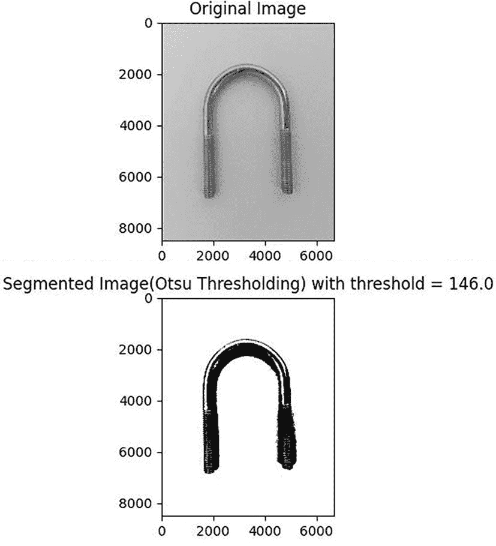
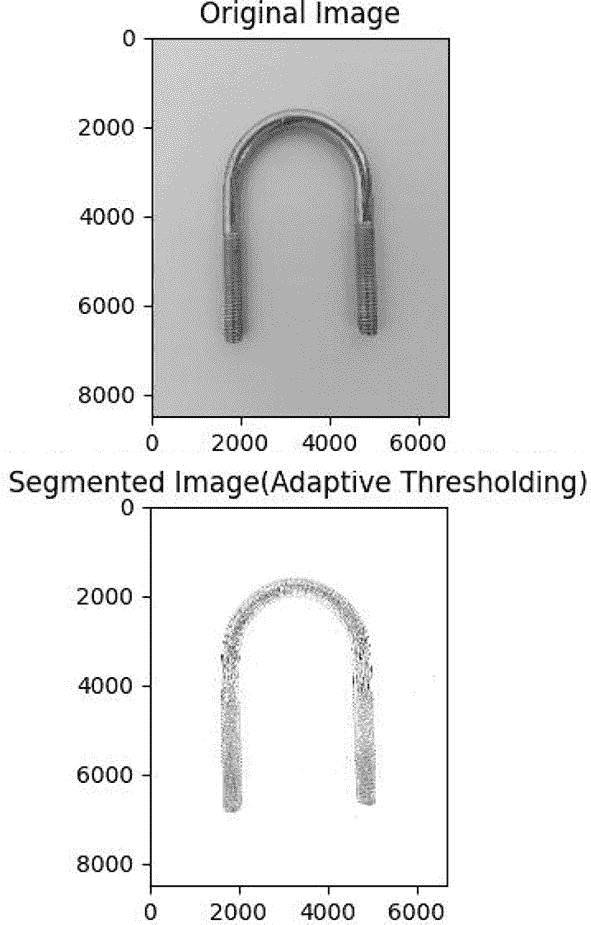
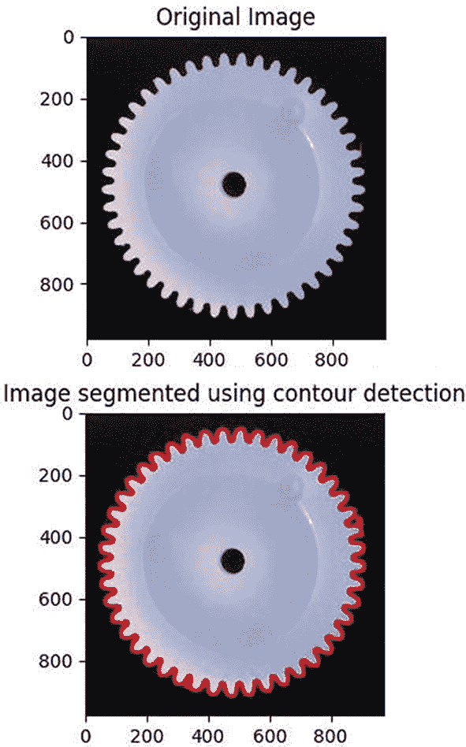
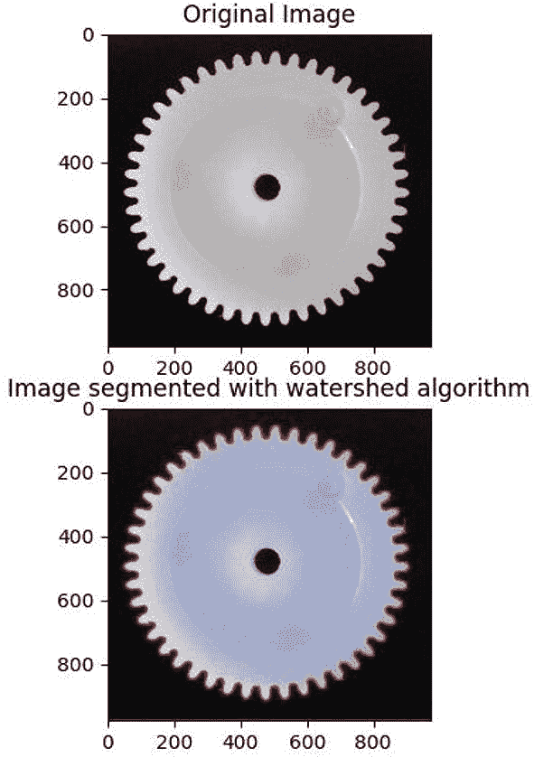
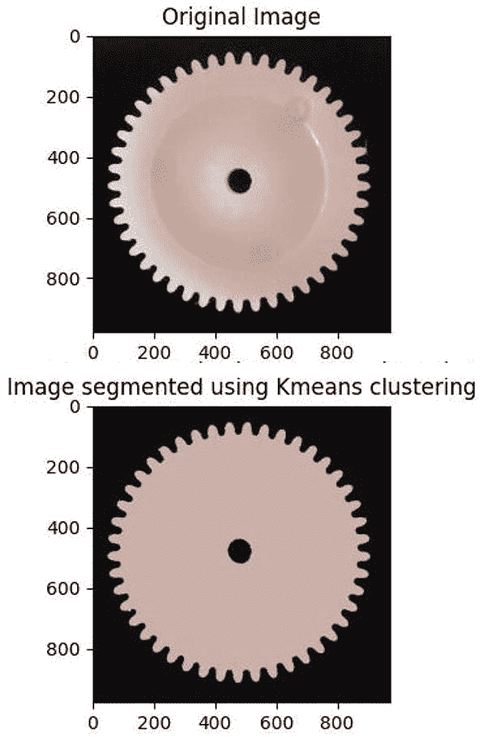

# 8. 图像分割

视觉系统的一个重要方面是区分场景中的物体。实现这一目标的第一步是将给定图像中的各种物体分离出来。这通过一个称为分割的过程来完成，其中对应于不同区域（物体）的所有像素被分组在一起，从而将给定图像分割成其组成物体。在计算机视觉领域，图像分割是一个基础且至关重要的过程，它为许多应用奠定了基础，包括自动驾驶汽车、医学成像、物体识别等。基于前几章获得的知识，本章将深入探讨分割这一复杂领域，重点关注先进的方法和流程。

我们在第 5 章中研究了作为图像分割基础的阈值处理方法，该方法利用强度阈值来帮助区分给定图像中的不同区域。虽然阈值处理在某些情况下效果良好，但对于包含大量噪声、光照变化或复杂结构的图像，它可能不够用。本章将拓宽我们对分割技术的理解，并在阈值处理的基础上探索更先进的方法。


## 使用阈值法进行图像分割

阈值法是一种简单而强大的图像分割技术，其原理是根据像素值是否大于或小于预定义的阈值，将其设置为两个级别之一。属性值高于或低于阈值的像素会被阈值分为两组，这两组通常代表不同的物体或背景。阈值法技术大致可分为全局法和局部法。我们在第 5 章中已经讨论过其中一些技术。在本节中，我们将回顾如何使用全局阈值技术和局部阈值技术对给定图像进行分割。

对于全局阈值技术，我们将采用之前在第 5 章中讨论过的大津阈值法。以下代码演示了如何使用大津阈值法对给定图像进行分割。本次演示我们使用一张 U 型螺栓的图像。第一步是读取图像并将其转换为灰度图像。然后，我们将使用*GaussianBlur()*函数，并设置滤波器大小为 7 x 7，对图像应用高斯滤波器，这有助于去除图像中存在的任何高频噪声。接着，使用*threshold()*函数对滤波后的图像应用阈值处理。属性*THRESH_OTSU*用于确定图像的最佳阈值，其初始值由函数中提供的 0 开始，然后使用属性*THRESH_BINARY*根据确定好的阈值对图像应用二值阈值处理。可以看出，U 型螺栓物体已从背景中清晰地分割出来，如图 8-1 所示。同时也可以观察到，由光照产生的阴影也被分割为物体的一部分，这再次强调了均匀光照条件的重要性。确定的最佳阈值显示在图中分割图像的标题中，其值为 146。



两张插图，分别展示了原始图像和阈值为 146 的分割图像。照片中的 U 型螺栓物体在分割过程中已去除背景。

图 8-1
使用大津阈值法进行分割

```
import cv2
import numpy as np
import matplotlib.pyplot as plt
# 以灰度模式加载图像
image = cv2.imread('C:/Users/User/Pictures/New folder/U-Bolt.jpg', cv2.IMREAD_GRAYSCALE)
blurred = cv2.GaussianBlur(image, (7, 7), 0)
# 应用大津阈值法
(T, thresh) = cv2.threshold(blurred, 0, 255,
cv2.THRESH_BINARY | cv2.THRESH_OTSU)
# 显示原始图像和二值图像
plt.subplot(121)
plt.imshow(image, cmap='gray')
plt.title('原始图像')
plt.subplot(122)
plt.imshow(thresh, cmap='gray')
plt.title('分割图像（大津阈值法），阈值 = '+str(T))
plt.show()
```

大津法是一种全局阈值方法，它会在整个图像上应用单一的阈值（在我们的例子中是 146）。由于图像的不同区域可能适用不同的阈值，接下来我们对同一张图像应用自适应阈值法。该方法会考虑给定图像中的多个小区域，并利用这些区域中的像素集计算出一个阈值。以下代码演示了如何对同一张 U 型螺栓图像应用自适应阈值法。OpenCV 库中的*adaptiveThreshold()*函数用于完成此任务。属性*ADAPTIVE_THRESHOLD_GAUSSIAN_C*表示阈值将是所选区域内邻域值的高斯加权和减去一个常数“c”，该常数值在函数中指定为 3。函数中的数字 17 表示阈值处理应用于给定图像中 17 x 17 的区域。图 8-2 所示的分割图像表明，其分割效果远优于受图像中阴影影响严重的大津阈值法。



两张插图，分别展示了原始图像和采用自适应阈值的分割图像。照片中的 U 型螺栓物体在分割过程中已去除背景。

图 8-2
使用自适应阈值法进行分割

```
import cv2
import numpy as np
import matplotlib.pyplot as plt
# 以灰度模式加载图像
image = cv2.imread('C:/Users/User/Pictures/New folder/U-Bolt.jpg', cv2.IMREAD_GRAYSCALE)
blurred = cv2.GaussianBlur(image, (7,7), 0)
# 应用大津阈值法
thresh = cv2.adaptiveThreshold(blurred, 255,
cv2.ADAPTIVE_THRESH_GAUSSIAN_C,cv2.THRESH_BINARY, 17, 3)
# 显示原始图像和二值图像
plt.subplot(121)
plt.imshow(image, cmap='gray')
plt.title('原始图像')
plt.subplot(122)
plt.imshow(thresh, cmap='gray')
plt.title('分割图像（自适应阈值法）')
plt.show()
```


## 使用轮廓检测进行图像分割

另一种从给定图像中分割对象的常用方法是使用轮廓检测，该方法依赖于识别和创建图像中对象的边界。连接具有相同颜色或强度点的连续边界或曲线称为轮廓。在尝试从图像中提取相关信息（如对象边界、形状和结构）时，此方法非常有用。通过识别轮廓，可以隔离和描述图像中的特定区域，从而实现对视觉数据进行更复杂的分析和理解。

以下代码演示了使用轮廓检测对齿轮图像进行分割。我们从与阈值处理案例中相同的步骤开始。我们将图像转换为灰度图，应用高斯滤波器去除高频噪声，然后使用大津法提取阈值。接着，我们将大津阈值的 0.5 倍作为较低阈值，将实际的大津阈值作为较高阈值，提供给 Canny 边缘检测器，该检测器从滤波后的图像中检测边缘。然后，我们对边缘图像执行膨胀操作，以增强并连接图像中的边缘。这分两步完成。OpenCV 库中的`getStructuringElement()`函数用于定义一个 3x3 大小的矩形结构元素，以执行形态学操作。随后，使用`dilate()`函数将该结构元素应用于边缘图像。然后，我们将膨胀后的图像作为输入提供给`findContours()`函数以确定轮廓。该函数除了膨胀后的图像外，还接收另外两个属性作为输入：属性`RETR_EXTERNAL`表示轮廓检索模式，仅检索外部轮廓；参数`CHAIN_APPROX_SIMPLE`表示轮廓近似模式，它压缩水平、垂直和对角线段，仅保留其端点。最后，使用`drawContours()`函数在原始图像的副本上绘制检测到的轮廓，该副本是使用`image.copy()`函数创建的。图 8-3 中的分割图像清晰地显示了包围图像中对象的轮廓。



两张插图分别展示了原始图像和通过应用轮廓检测技术创建的分割版本。在图像中，齿轮的锯齿状边界被突出显示。

图 8-3
使用轮廓检测进行分割

```
import cv2
import numpy as np
import matplotlib.pyplot as plt
# 加载图像
image = cv2.imread('C:/Users/User/Pictures/New folder/20230917_113209.jpg')
gray = cv2.cvtColor(image, cv2.COLOR_BGR2GRAY)
blurred = cv2.GaussianBlur(gray, (3, 3), 0)
# 应用 OTSU 阈值处理
T, thresh = cv2.threshold(blurred, 0, 255, cv2.THRESH_BINARY + cv2.THRESH_OTSU)
edges = cv2.Canny(blurred, 0.5*T, T)
# 定义一个 (3, 3) 的结构元素
kernel = cv2.getStructuringElement(cv2.MORPH_RECT, (3, 3))
# 对边缘图像应用膨胀操作
dilate = cv2.dilate(edges, kernel, iterations=2)
# 在边缘图像中查找轮廓
contours, _ = cv2.findContours(dilate, cv2.RETR_EXTERNAL, cv2.CHAIN_APPROX_SIMPLE)
image_copy = image.copy()
# 在原始图像的副本上绘制轮廓
cv2.drawContours(image_copy, contours, -1, (255, 0, 0), 10)
plt.subplot(121)
plt.imshow(image)
plt.title('原始图像')
plt.subplot(122)
plt.imshow(image_copy)
plt.title('使用轮廓检测分割的图像')
plt.show()
```

## 使用分水岭算法进行图像分割

分水岭算法是分割给定图像中对象的著名方法之一。该技术的灵感来源于水在地形区域上的流动方式。该算法的目标是将图像划分为有意义的区域，就像地形图中的山谷可能收集雨水一样。为了更形象地理解，可以将图像视为一个景观，其中像素强度代表海拔高度。图像中较暗的区域类似于山谷和洼地，而较亮的区域则类似于山峰和丘陵。分水岭算法旨在定位该地形中的“集水盆地”，即水自然聚集并被山脊分隔开的地方。以下是分水岭算法涉及的步骤：

1.  预处理：为了提高分割精度，通常将图像转换为灰度图并进行预处理（例如降噪）。

2.  标记识别：将确定的背景和确定的前景区域指定为关键区域。这些区域作为水流模拟的起始点。

3.  距离变换：通过应用距离变换，确定从每个像素到最近的确定前景点的“海拔高度”。

4.  模拟注水：想象水开始在指定的前景位置注入。根据地形信息（基于像素强度的变化），水逐渐“淹没”图像。

5.  分水岭线：绘制“分水岭线”以划分来自不同盆地的水开始混合的区域。这些线代表了图像中不同对象之间的边界。

6.  分割图：输出是一幅分割后的图像，其中每个像素根据其所在的集水盆地被标记。

以下代码演示了使用分水岭算法对齿轮图像进行分割。与我们之前所做的类似，我们读取图像，将其转换为灰度图，然后使用大津阈值处理技术创建二值图像。接下来，通过使用 OpenCV 库中的`cv2.morphologyEx()`函数对二值图像进行膨胀来识别背景区域。我们向该函数提供属性`MORPH_DILATE`以及一个 3x3 的全 1 核。膨胀通常会在图像中对象的边界上添加像素，从而能够清晰地识别背景。然后，我们通过使用`distanceTransform()`函数计算每个像素到最近背景像素的距离来寻找前景图像。该函数将膨胀后的图像作为输入，并附带另外两个属性：距离类型属性`DIST_L2`表示简单的欧几里得距离，数字 5 表示距离变换掩码的大小，表明我们应用了一个 5x5 的掩码。

对距离变换的输出图像应用阈值，以分离背景和前景像素。然后，使用`connectedComponents()`函数标记阈值化图像的连通分量，接着使用`watershed()`函数对这些标记应用分水岭算法。这些标记随后作为标记点传递给分水岭算法，该算法利用这些标记点，通过如前所述的分水岭线来检测前景和背景之间的精确边界。最后，在对边界线着色之前，我们通过使用 5x5 的核进行膨胀来增加线条的厚度。我们使用膨胀后的掩码标记，通过提供颜色属性[255,0,0]（分别对应红色、绿色和蓝色分量的值），以红色在原始图像中标记边界。分割后的图像如图 8-4 所示。




应用分水岭算法处理后的原始图像与分割版本的两幅示意图。图像中，齿轮的跷跷板状边界清晰可见。

图 8-4

使用分水岭算法进行分割

```
import cv2
import numpy as np
import matplotlib.pyplot as plt
# 加载图像
img = cv2.imread('C:/Users/User/Pictures/New folder/20230917_113209.jpg')
imgRGB = cv2.cvtColor(img, cv2.COLOR_BGR2RGB)
# 将图像转换为灰度图
gray = cv2.cvtColor(img, cv2.COLOR_BGR2GRAY)
# 应用阈值处理创建二值图像
ret, thresh = cv2.threshold(gray, 0, 255, cv2.THRESH_BINARY_INV + cv2.THRESH_OTSU)
# 寻找背景区域
kernel = np.ones((3, 3), np.uint8)
imgD = cv2.morphologyEx(thresh, cv2.MORPH_DILATE, kernel)
# 寻找前景区域
disT = cv2.distanceTransform(imgD, cv2.DIST_L2, 5)
_,disThres = cv2.threshold(disT, 5, 255, cv2.THRESH_BINARY)
# 标记连通分量
disThres = np.uint8(disThres)
_,labels = cv2.connectedComponents(disThres)
# 应用分水岭算法
labels = np.int32(labels)
labels = cv2.watershed(img, labels)
# 通过膨胀分割掩码来增加线条厚度
dilate_kernel = np.ones((5, 5), np.uint8)
segmented_mask = np.zeros_like(gray)
segmented_mask[labels == -1] = 255
dilated_mask = cv2.dilate(segmented_mask, dilate_kernel)
# 将膨胀后的掩码应用于原始图像
img[dilated_mask == 255] = [255, 0, 0]
plt.subplot(121)
plt.imshow(gray,cmap='gray')
plt.title('原始图像')
plt.subplot(122)
plt.imshow(img)
plt.title('使用分水岭算法分割后的图像')
plt.show()
```

## 使用聚类进行图像分割

K-means 聚类因其有效性和简单性，是一种广泛使用的图像分割算法。K-means 聚类是一种无监督机器学习技术，用于将数据集划分为 K 个唯一且不重叠的组或簇。其最终目标是将每个数据点分配到 K 个簇之一，使得一个簇中的点与该簇质心的距离，比它们到其他簇质心的距离更近。在进入分割过程之前，让我们先尝试理解 K-means 算法背后的逻辑。以下是 K-means 聚类算法涉及的步骤：

1.  初始化：此步骤涉及两个参数的初始化：
    1.  希望数据被划分成的簇数 (K)

2.  K 个簇的随机质心，代表簇的中心

2.  分配：在此步骤中，所有数据点根据其与簇质心的距离（使用欧几里得距离、曼哈顿距离、余弦相似度等距离度量）被分配到其中一个簇。每个数据点被分配给其质心最近的簇。

3.  更新：一旦所有数据点被分配到特定簇，通过计算分配给每个簇的所有数据点的平均值来重新计算簇质心。得到的新质心随后被视为更新后的簇中心。

4.  迭代：重复分配和更新步骤，直到收敛，即数据点到簇的分配不再发生显著变化。

与 K-means 算法相关的技术细节还有很多，超出了本书的范围。因此，我们将继续讨论该算法如何帮助我们分割图像中的对象。在我们的图像分割上下文中，数据点对应于图像中的像素，K-means 算法用于将相似的像素分组在一起。以下代码说明了使用 K-means 聚类算法对齿轮图像进行分割的过程。在应用算法之前，我们需要将图像重塑为适合聚类的格式。我们的齿轮图像是一个 RGB 图像，对于 R、G 和 B 三个平面各有一个二维像素矩阵。因此，我们首先使用 *reshape()* 函数将每个平面的二维矩阵重塑为一维矩阵。然后，我们向算法提供簇数 (K)。由于我们的图像只有一个齿轮对象，并且我们需要将对象从背景中分割出来，因此我们设置 K 值为 2，一个用于对象，一个用于背景。

接下来，我们通过使用 *n_cluster* 属性提供先前定义的簇数来创建一个 *KMeans* 实例。然后，我们可以使用 *fit()* 函数将模型拟合到重塑后的图像。此函数将产生两个变量 *labels* 和 *cluster_centers*，其中 *labels* 表示每个像素的标签，由于我们只有两个簇，因此标签可以是 0 或 1；*cluster-centers* 表示最终簇的质心。最后，我们可以将每个像素分配给它所属的质心并显示图像。从图 8-5 中的图像可以看出，整个对象被转换为单一颜色，而背景则是另一种颜色（此处为黑色），表明对象已被清晰分割。



应用聚类协议处理后的原始图像与分割版本的两幅示意图。在底部的分割图像中，齿轮表面显得平坦光滑。

图 8-5

使用 K-means 聚类进行分割

```
from sklearn.cluster import KMeans
import numpy as np
import matplotlib.pyplot as plt
import cv2
# 加载图像
img = cv2.imread('C:/Users/User/Pictures/New folder/20230917_113209.jpg')
img = cv2.cvtColor(img, cv2.COLOR_BGR2RGB)
# 将图像重塑为像素的二维数组
pix = img.reshape((-1, 3))
k = 2 # 簇数 (K)
# 应用 K-means 聚类
kmeans = KMeans(n_clusters=k)
kmeans.fit(pix)
# 获取标签和质心
labels = kmeans.labels_
centroids = kmeans.cluster_centers_
# 将每个像素分配给它对应的簇质心
seg_image = centroids[labels].reshape(img.shape)
# 显示原始图像和分割后的图像
plt.subplot(121)
plt.imshow(img)
plt.title('原始图像')
plt.subplot(122)
plt.imshow(seg_image.astype(np.uint8))
plt.title('使用 Kmeans 聚类分割后的图像')
plt.show()
```

## 总结

从图像中分割对象有助于我们进一步应用于目标检测与跟踪、医学成像、人脸识别等场景。在本章中，我们探讨了在给定图像中分割对象的不同技术，如下所列：

*   使用全局和局部阈值处理技术分割图像中的 U 型螺栓

*   使用轮廓检测、分水岭算法和 K-means 算法等技术分割图像中的齿轮

在下一章中，我们将讨论计算机视觉的另一个关键组成部分，即使用光学字符识别从图像中提取文本。


