# 9. `OCR`

光学字符识别，简称 `OCR`，是一种用于从扫描的文本文件或相机拍摄的数字图像中检测文本字符，并将其转换为可编辑数据的技术。换句话说，`OCR` 技术能从扫描文档或图像中识别出的文本字符里提取机器编码文本。`OCR` 技术始于二十世纪初期。早期 `OCR` 系统的主要目的是识别打字或排版文档中的印刷文本。后来，模式匹配和模板匹配等技术被用于创建商业字符识别系统。随着机器学习方法的普及以及先进计算能力的发展，这些技术在实现高精度 `OCR` 系统中变得日益重要。近年来，深度学习方法极大地提升了 `OCR` 的性能，使其能够识别复杂的手写文本。

`OCR` 已广泛应用于多种视觉系统应用中，例如验证包装标签上的印刷信息、读取和记录车辆牌照、利用产品上的序列号进行自动库存管理、从发票、账单或检验报告中提取数据以进行进一步分析等。通过集成 `OCR` 技术执行这些操作，可以消除人为错误的可能性，从而大幅提高准确性；同时，由于减少了在这些任务上花费的时间，生产力也得以显著提升。与所有技术一样，`OCR` 系统也存在一些局限性。例如，`OCR` 输出的质量高度依赖于输入图像的质量。因此，低质量的输入会降低系统的性能。此外，由于手写风格的多样性，`OCR` 系统在手写文本识别方面仍面临诸多挑战。

尽管存在挑战，`OCR` 已成为全球工业自动化不可或缺的一部分，尤其是在处理各种文档格式方面。在本章中，我们将从 `OCR` 应用的基础知识开始，探索 `OCR` 流程的各个阶段。然后，我们将探讨一些可用于实时应用的主流 `OCR` 库和 `API`。

## `OCR` 流程的阶段

尽管现代 `OCR` 系统建立在深度学习框架之上，但我们将从讨论传统 `OCR` 系统开始，这将使我们更深入地了解 `OCR` 流程的各个阶段，以及它们如何转换给定图像以识别其中的字符。开发传统 `OCR` 系统涉及多个阶段，每个阶段都有特定目的，以实现高效的字符识别系统。在这些阶段中，图像将经历各种变换，最终识别出图像中的字符。在本节中，我们将逐一讨论这些阶段，并尝试深入理解每个 `OCR` 系统背后的过程。

### 图像预处理

此阶段涉及通过提高输入图像的质量并将其转换为适合进一步处理的形式，为字符识别做准备。此阶段涉及的关键技术讨论如下。

噪声抑制：

正如第 5 章所讨论的，实时捕获的图像通常容易受到噪声的影响，这会降低图像质量，使其难以进行后续处理。因此，需要首先处理这些噪声，通过使用合适的滤波器（如`高斯模糊`或`中值滤波`）进行平滑处理来增强图像质量。回顾我们之前的讨论，在应用这些滤波器时，必须选择合适的核大小以获得更好的结果。

1.  对比度增强

    许多照片、工业图像和扫描文档的对比度较低，导致文本和背景显得模糊或融合在一起。因此，`OCR` 算法难以区分它们，可能导致错误。通过增加对比度，我们可以简化从背景中区分单个字符的过程。通过简化分割过程，`OCR` 软件可以隔离每个字符以确保准确识别。可以使用对比度拉伸、直方图均衡化、自适应直方图均衡化等流行技术来增强图像的对比度。通过使用适当的对比度增强技术，我们可以确保 `OCR` 系统接收到最清晰、最易读的输入。

2.  二值化

    由于我们只对识别给定图像中的字符感兴趣，颜色信息变得无关紧要，因此最好将图像转换为黑白两色。这有两个目的：降低计算复杂度（因为三通道 `RGB` 图像被转换为只有两个值（0 表示黑色，1 表示白色）的单通道二值图像），并清晰地将文本与背景区分开。回顾我们之前的讨论，对彩色图像进行二值化涉及两个步骤：将图像转换为灰度图像，然后应用阈值处理（全局或局部）将其转换为黑白图像。

3.  倾斜校正

    倾斜校正是纠正图像中倾斜或歪斜文本的过程，通过使其水平来确保准确识别。图像中产生倾斜的常见原因包括：对带有文本的物体（或文档）扫描或拍摄不完美、拍摄时的相机角度，或物体的物理变形。倾斜校正至关重要，因为倾斜的文本会显著阻碍 `OCR` 系统的性能，使字符分割变得更加困难。这种未对齐的字符可能导致字符识别错误，降低系统的准确性。可以使用`霍夫变换`等主流技术来确定文本的倾斜角度，然后应用旋转变换来校正倾斜，使文本水平。

### 字符分割

当图像准备好进行进一步处理后，流程的下一步是分割图像中的单个字符。本节将讨论一些主流的字符分割技术。

1.  连通分量分析

    `OCR` 中一种常用的字符分割方法是连通分量分析（`CCA`）。它涉及定位和分离可能代表图像中不同字符的、相互关联的像素簇。该分析包含以下步骤：

    1.  标记：在二值图像中，为每个黑色像素分配一个唯一的标签。此标记过程会产生初始片段，每个片段代表一个潜在的字符。

    2.  邻域分析：算法在图像中移动时，会比较相邻像素的标签。如果两个相邻像素具有相同的标签，则它们被视为属于同一个连通分量。如果它们的标签不同，则表明字符之间可能存在潜在边界。

    3.  标签传播：标签会进行迭代更新以合并连通分量。当识别出两个具有不同标签的相邻像素属于同一个字符时，该分量被合并，并将其中一个标签更改为另一个。

    4.  分量提取：在标签传播之后，图像中的每个连通分量都被分配一个唯一的标签，该标签对应一个不同的字符或符号。然后，这些分量被提取为独立的图像，以便 `OCR` 流程进行后续处理。

    连通分量分析的一个重要方面是它对字体大小和方向的变化具有相当强的鲁棒性。尽管这种技术简单有效，但在处理接触或重叠字符时会遇到困难。该技术是工业应用的理想选择，这些应用通常涉及识别条码、标签或序列号，其中的文本定义明确且可控。

2.  基于投影的方法

    该技术背后的关键思想是将二值图像中的像素强度投影到单个轴（水平或垂直）上，以创建投影轮廓，从而揭示文本排列中的模式。文本行的分割以及行内单词的分割是通过水平轮廓实现的，这涉及对图像每行的像素值求和；而单词内字符的分割则通过垂直轮廓实现，这涉及对图像每列的像素值求和。投影轮廓中的波谷或凹陷可用于识别字符之间的边界。基于投影的方法计算效率高，适用于间距清晰、字体大小一致的文本。与连通分量分析类似，该技术在处理重叠字符时也可能遇到困难。为了提高准确性，该技术通常与连通分量分析等其他技术结合使用。

#### 特征提取

一旦我们完成了字符分割，下一步就是以适合识别算法的方式来表示这些字符。我们将在此讨论一些主流的特征提取技术：

1.  统计特征

    统计特征提取通过将原始像素数据转换为反映字符基本属性的数值表示，在光学字符识别（`OCR`）中发挥着至关重要的作用。统计特征利用了字符图像中像素强度的统计特性。每个字符区域内的像素强度被用来生成统计特征，例如平均强度、方差、偏度、峰度、直方图属性、纹理特征、共生矩阵特征、游程长度特征和基于矩的特征。每个字符的视觉属性，如形状、纹理、强度分布和空间关系，都可以通过提取的统计特征得到紧凑且信息丰富的表示。此外，还可以使用特征选择技术来识别最具区分力的特征。

2.  形状描述符

    形状描述符是一类重要的特征，它捕捉字符的几何特征和轮廓，这对于区分不同字符至关重要。在使用形状描述符之前，需要对包含文本的输入图像进行预处理和分割，以分离出单个字符。上一章讨论的任何分割技术都可以用于此目的。然后，可以从分割后的字符中提取轮廓或边界来表示其形状。轮廓被表示为一系列坐标，用以描述每个字符的边界。为了捕捉字符的几何属性，使用提取的轮廓生成形状描述符。一些常见的形状描述符包括边界框、傅里叶描述符、基于区域的形状描述符（如矩）等。

### 字符识别

借助从图像中提取的特征，可以识别并提取出给定图像中的字符。传统 `OCR` 系统中早期常用的一种技术是模板匹配。一些传统的机器学习技术也常被用于字符识别。我们将简要讨论这两种技术，以理解其基本原理。

1.  模板匹配

    传统的 `OCR` 系统使用一种称为“模板匹配”的基本技术来识别图像中的字符。该技术将预定义的字符模式或模板与输入图像的对应区域进行比较。首先创建模板，以描绘每个字符在不同尺度和方向下的视觉外观。然后对输入到 `OCR` 系统的图像进行预处理，以提高可读性。在匹配过程中，系统会系统地扫描图像，并计算模板与图像区域之间的相似度度量。在字符模板与图像内容高度吻合的区域，会产生高匹配值。显示出高度相似性的区域会被标记为可能的字符匹配。为了识别图像中的每个字符区域，会将匹配值最高的模板与之关联。尽管模板匹配是一种简单直接的技术，但它无法处理尺度、旋转或不同字体样式上的变化。

2.  机器学习

    机器学习技术可以学习从字符中提取的特征之间的模式和关系，并利用这些知识有效地识别图像中的文本。常用的监督学习算法包括 `kNN`、`SVM`、`ANN` 等，这些算法使用包含大量字符图像及其对应标签的数据集进行训练。特征提取技术（如我们在上一节中讨论的那些）可用于从图像中的字符提取有意义的信息。在训练阶段，这些特征可以被输入到机器学习模型中，模型将学习将这些特征与正确的字符标签关联起来。为了达到最佳性能，会迭代地调整模型参数，以最小化训练数据集上的分类误差。然后，训练好的模型可用于对训练数据集中未曾出现过的新字符图像进行分类。尽管基于传统机器学习的 `OCR` 系统不如基于现代深度学习的方法那样灵活和适应性强，但当有大量带标签的训练数据可用，并且需要复杂度最低的简单技术时，它们仍然可以很有效。

在下一节中，我们将讨论一个基于传统机器学习的 OCR 系统，其中我们将使用 `kNN` 从给定图像中提取手写数字。这将让读者亲身体验如何创建一个在大型数据集上训练的机器学习模型。在后续章节中，我们将讨论一些最先进的基于深度学习的 API 和库，这些工具甚至可以从复杂图像中提取文本。

## 使用 kNN 提取手写数字

手写数字识别是光学字符识别（OCR）技术的一个关键组成部分，用于从图像中提取数字。为了学习每个手写数字的特征和模式，可以在包含大量手写数字图像的数据集上训练机器学习算法。然后，训练好的模型可用于识别新图像中的数字。在本节中，我们将使用 `MNIST`（改进的国家标准与技术研究院数据库）数据集，这是一个包含大量手写数字的集合，常用于训练不同的图像处理系统。该数据集包含 70,000 张手写数字（0-9）的灰度图像。每张图像的大小为 28 x 28，并有一个对应的标签表示其所描绘的数字。这些图像被分为 60,000 张训练图像和 10,000 张测试图像。训练图像及其关联标签将提供给模型，以便模型学习如何从图像中确定标签。另一方面，测试图像可用于测试学习到的模型，并通过比较预测标签和实际标签来确定模型的准确性。通过其 `mnist` 模块，`keras` Python 库提供了对该数据集的便捷访问，使其成为新手和经验丰富的从业者的理想选择。

我们将使用 `k` 近邻（`kNN`）算法来训练模型以分类手写数字。`kNN` 是一种简单有效的监督学习算法，常用于分类和回归任务。在 `kNN` 分类过程中，数据集中的每个数据点都与一个类标签相关联，模型将被训练以确定与数据点对应的标签。当需要对一个没有标签的新数据点进行分类时，该算法使用预定义的距离度量来计算它与训练集中每个其他数据点的距离。然后确定该无标签点的 `k` 个最近邻。通过新数据点的 `k` 个最近邻进行多数投票，来决定该点的类别归属。`kNN` 分类算法基于这样一个理念：具有相似特征的数据点很可能属于同一类别。这种方法易于使用和理解，使其适用于各种分类问题。

以下代码展示了使用 `kNN` 实现手写数字识别的过程。让我们逐步讨论这段代码：

1. 我们首先导入实现数字识别系统所需的库。

2. 来自 `keras` `MNIST` 数据集的 `load_data()` 函数加载用于手写数字识别的训练和测试数据。这里，`x_train` 和 `x_test` 分别代表训练和测试图像，`y_train` 和 `y_test` 分别代表训练和测试标签。`x_train` 和 `x_test` 的大小分别为 `(60000,28,28)` 和 `(10000,28,28)`，而 `y_train` 和 `y_test` 的大小分别为 `(60000)` 和 `(10000)`。

3. 我们绘制 `x_train` 数组中的前四张图像，以可视化手写数字的样本。我们使用 `y_train` 数组中表示相应数字的标签作为绘图标题，如图 9-1 所示。

4. 接下来，使用 `reshape()` 函数将大小为 28 x 28 的图像重塑为大小为 784（即 28*28 的乘积）的一维数组。训练和测试数据集的大小现在将分别为 `(60000,784)` 和 `(10000,784)`。

5. 然后，我们使用 `sklearn` 库中的 `StandardScaler()` 函数来缩放图像数据，使其具有零均值和单位方差。相应的缩放后的训练和测试图像数据分别存储在变量 `x_train_scaled` 和 `x_test_scaled` 中。

6. 我们继续定义具有五个邻居的 `kNN` 模型，这意味着对于每张图像数据，将比较其五个最近邻，并通过它们类别值的多数投票来确定标签。使用 `sklearn` 库中的 `KNeighborsClassifier()` 函数来定义该模型。

7. 接着使用 `fit()` 方法训练模型。该方法接收经过缩放的训练图像数据 `x_train_scaled` 和对应的标签数据 `y_train`。

8. 使用 `predict()` 函数预测经过缩放的测试图像数据 `x_test_scaled` 的标签。预测的标签存储在变量 `y_pred` 中。

9. 然后，`sklearn` 库中的 `accuracy_score()` 方法可以接收实际标签 `y_test` 和预测标签 `y_pred`，并提供预测的准确率，即模型正确识别的图像百分比。该模型对手写数字的预测准确率达到 94.43%。

10. 最后，我们从 `x_test_scaled` 变量中取一个样本图像数据，然后使用 `predict()` 函数获取该图像的预测标签。接着，我们使用 `matplotlib` 库显示来自 `x_test` 变量的对应原始图像，并使用 `text()` 函数在同一图形中显示标签，如图 9-1 和图 9-2 所示。

```python
from sklearn.neighbors import KneighborsClassifier
from sklearn.preprocessing import StandardScaler
from sklearn.metrics import accuracy_score
from tensorflow.keras.datasets import mnist
import matplotlib.pyplot as plt
# 加载 mnist 数据
(x_train, y_train), (x_test, y_test) = mnist.load_data()
print(x_train.shape)
print(y_train.shape)
# 显示训练数据集中的前四张图像
for i in range(4):
plt.subplot(2,2,i+1)
plt.imshow(x_train[i],cmap='gray')
plt.title('标签: {}'.format(y_train[i]))
plt.show()
# 将数据重塑为一维数组
x_train = x_train.reshape(len(x_train), 28 * 28)
x_test = x_test.reshape(len(x_test), 28 * 28)
print(x_train.shape)
# 缩放数据
scaler = StandardScaler()
x_train_scaled = scaler.fit_transform(x_train)
x_test_scaled = scaler.transform(x_test)
# 定义 KNN 模型
knn = KneighborsClassifier(n_neighbors=5)
# 训练模型并进行预测
knn.fit(x_train_scaled, y_train)
y_pred = knn.predict(x_test_scaled)
# 评估性能
accuracy = accuracy_score(y_test, y_pred)
print("准确率: {}%".format(accuracy*100))
# 样本预测
new_image = x_test_scaled[0].reshape(1, 28 * 28)
prediction = knn.predict(new_image)
plt.imshow(x_test[0].reshape(28,28),cmap='gray')
plt.title('测试图像')
plt.text(10, 3, '标签: {}'.format(prediction[0]), fontsize=12, bbox=dict(facecolor='white', alpha=0.9))
plt.show()
```

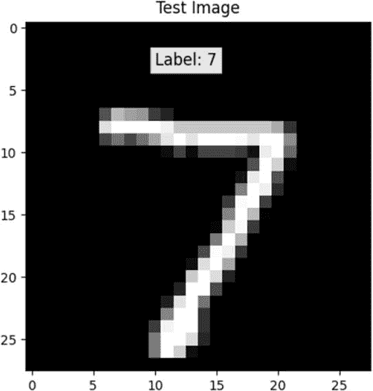

图 9-2

kNN 模型检测到标签的测试图像

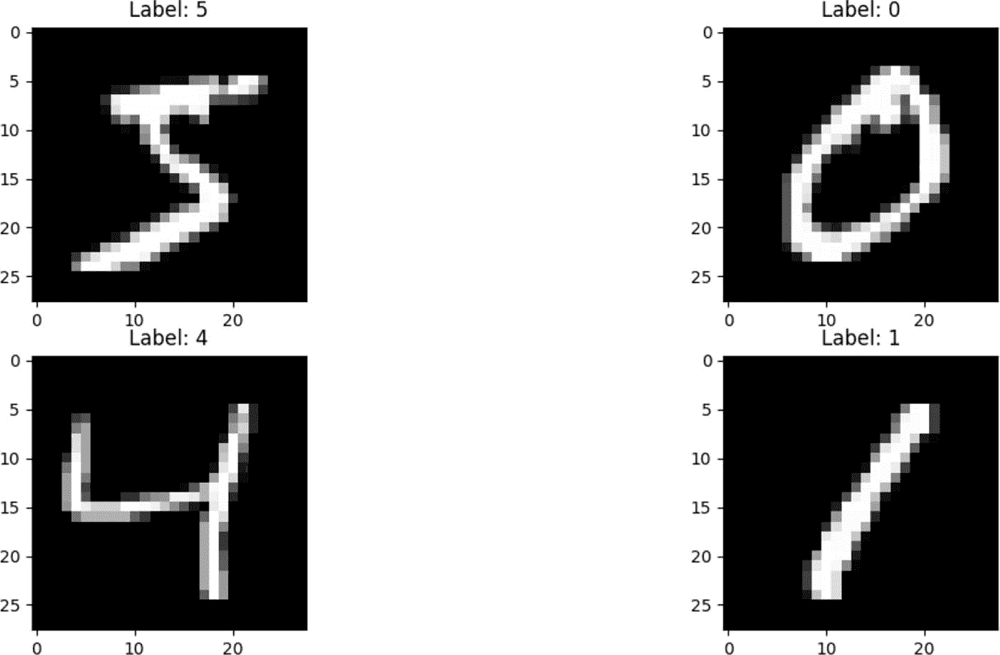

图 9-1

MNIST 数据集中的样本图像

## 用于 OCR 的云 API

API，即应用程序编程接口，是一组促进不同软件程序之间通信的规则和工具。API 可用于多种用途，包括开发利用其他软件组件功能的应用程序、集成第三方功能以及访问网络服务。在云计算背景下，API 至关重要，因为它们使开发者能够以编程方式与云资源和云服务进行交互。

云 API 为开发者提供了可扩展且实用的方式，利用基于云的服务从文档或图像中提取文本。这些 API 通常为开发者提供一个易于使用的标准化接口，通过该接口，他们可以将 OCR 功能集成到自己的应用程序中，而无需从头开始构建和维护 OCR 能力。用户可以将文件提交到云服务，云服务使用先进的 OCR 算法处理内容。提取的文本连同边界框、置信度分数等其他元数据一起返回给用户。云 OCR API 利用深度学习技术和强大的计算资源，在文本提取活动中实现高效率和准确性。在本节中，我们将讨论由全球领先的云服务提供商 Google® 和 Microsoft® 提供的两个最著名的计算机视觉 API。这些 API 能够从更复杂的图像中检测多种语言。

### 使用 Google^® Cloud Vision API 进行 OCR

Google^® 在 Google^® Cloud Platform (GCP) 套件下提供了一系列云计算服务。借助其广泛的平台和基础设施服务，客户可以在 Google^® 云基础设施上构建、部署和扩展应用程序和服务。GCP 提供的关键组件和服务可分为计算服务、存储和数据库、网络、大数据和机器学习、身份与安全、开发者工具、物联网 (IoT) 以及管理工具。开发者可以通过使用 Google^® Cloud Platform 提供的大量 API，将其应用程序与不同的 Google^® Cloud 服务集成。

GCP 提供的关键 API 之一是 Google^® Cloud Vision API，它提供了强大的预训练机器学习模型，允许开发者执行各种图像分析任务，如分类、目标检测、OCR 等。OCR 由两个注释功能支持：`TEXT_DETECTION`（用于检测和提取任何类型图像中的文本）和 `DOCUMENT_TEXT_DETECTION`（针对密集文本和文档进行了优化）。Google^® Cloud 通过提供可经由 API 部署的预训练 ML 模型来提供这些 OCR 解决方案。在我们讨论如何使用此 API 之前，特此告知读者，需要使用已配置了结算账户的 Google^® Cloud 订阅才能使用该 API。此外，还需要在 Google^® Cloud Console 中创建一个新项目以开始配置 API，并且该项目需要链接到结算账户。这些方面超出了本书的范围，在本节中，我们将把讨论限制在 API 的配置和使用上。

使用 Google^® Cloud Vision API 实现 OCR 需要两个独立的步骤。第一步是配置 Vision API 并创建一个访问密钥以使用该 API，第二步是下载用于 Python 的 Google^® Cloud Vision 库以实现文本检测算法。让我们从使用 Google^® Cloud Console 启用和配置 Vision API 所涉及的步骤开始。^(²)

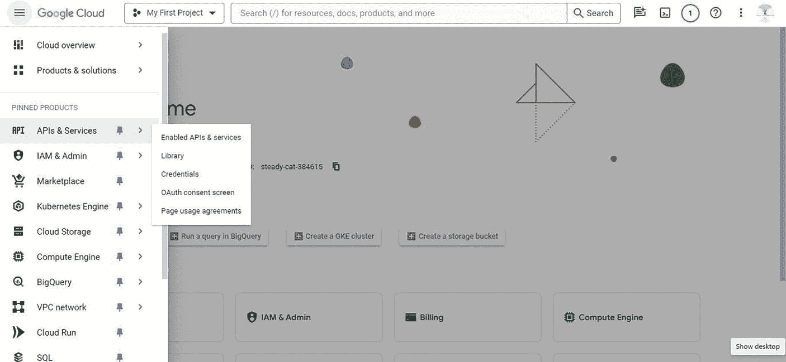
图 9-3 从 Google^® Cloud Console 菜单中选择 API 库

1.  进入 Google^® Cloud Console 窗口的菜单栏，点击 `API 和服务`，然后在出现的子菜单中选择 `库`，如图 9-3 所示。请注意，项目已创建（项目名称显示在页面顶部），所有这些配置都在项目范围内完成。

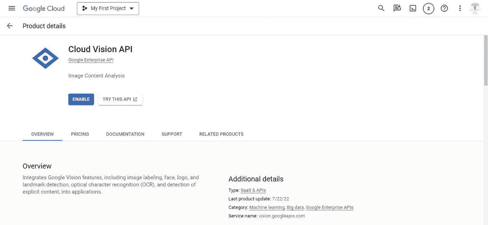
图 9-4 Cloud Vision API 主页

1.  在出现的 `库` 页面中，搜索“vision API”，然后从搜索结果中点击 `Cloud Vision API`。这将打开 `Cloud Vision API` 页面，如图 9-4 所示。点击 `启用` 以启用该云账户的 API。

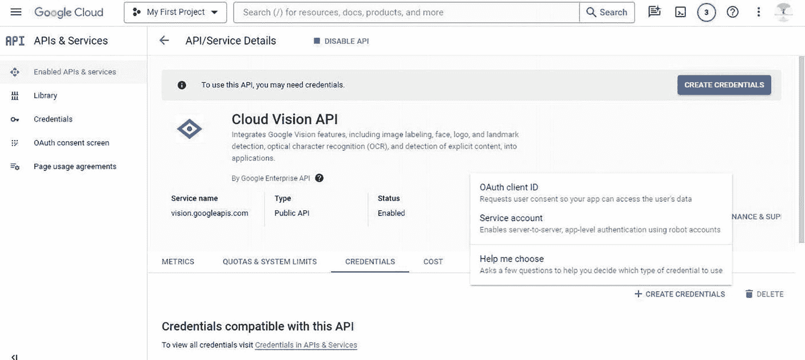
图 9-5 Cloud Vision API 的 API/服务详情页面中的凭据菜单

1.  启用后，我们将被引导至该 API 的 `API/服务详情` 页面。在此页面中，转到 `凭据` 并点击 `创建凭据`。这将生成一个菜单，如图 9-5 所示。在菜单中，点击 `服务账号`。

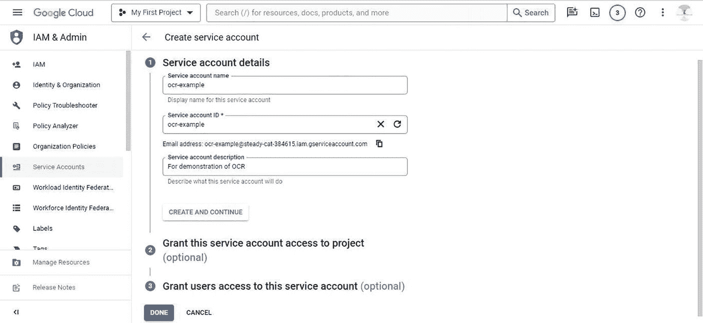
图 9-6 设置服务账号详情

1.  在出现的服务账号设置页面中，提供 `服务账号名称`、`服务账号 ID` 和 `服务账号描述`，如图 9-6 所示。这里我们为账户指定了 `ocr-example`。然后，点击 `创建并继续` 以进入服务账号的访问控制设置。

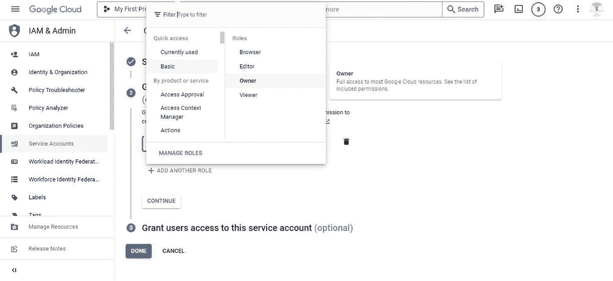
图 9-7 设置服务账号对项目的访问权限

1.  在 `服务账号访问权限` 设置中，点击 `添加其他角色`，导航到 `基本` 子菜单，并选择 `所有者`，如图 9-7 所示。点击 `完成` 以创建服务账号。

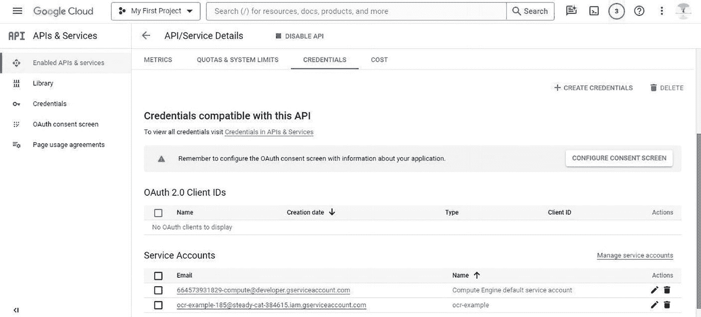
图 9-8 API/服务详情页面中列出的服务账号

1.  创建服务账号后，我们将被引导回 `API/服务详情` 页面，我们创建的 `ocr-example` 账号将列在 `服务账号` 部分下，如图 9-8 所示。点击该账号以进入其配置页面。

1.  在 `ocr-example` 配置页面中，导航到 `密钥` 部分并点击 `添加密钥`。这将弹出一个包含两个选项的窗口，如图 9-9 所示。点击 `JSON` 选项以下载 JSON 格式的密钥。此密钥将用于通过我们的 Python 代码访问 Vision API 服务。

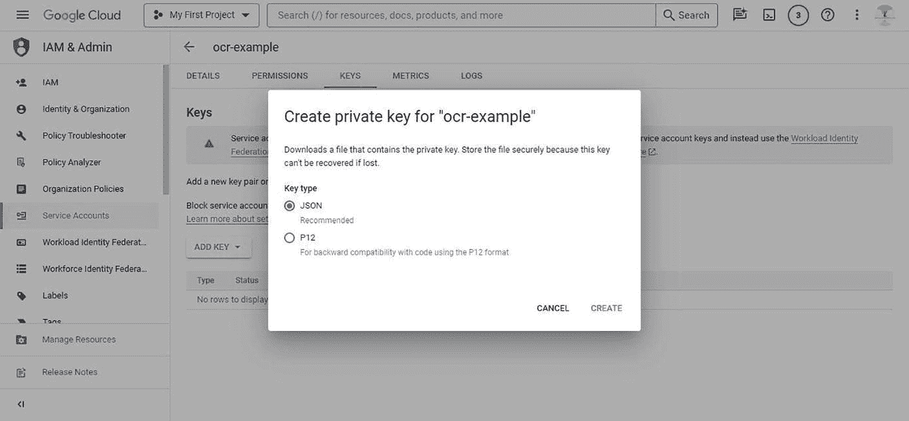
图 9-9 下载使用 Vision API 服务所需的密钥

配置好 Google^® Cloud Console 后，下一步是安装必要的 Python 库以访问 Vision API。以下是通过我们的 Python 代码利用 Vision API 服务所需的基本库：

1.  `google-auth-oauthlib`：此函数旨在通过与 OAuth 2.0（一种标准授权协议）集成来验证我们的用户凭据。

2.  `google-cloud-vision`：此库将允许我们将视觉检测功能（包括 OCR）集成到各种应用程序中。

这些库可以使用我们在前几章讨论过的 pip 函数进行安装。例如，云视觉库可以通过在命令提示符或终端中执行命令 `pip install google-cloud-vision` 来安装。一旦云配置完成并且所需的库安装完毕，我们就可以继续开发用于文本检测的代码。在本示例中，我们将使用图 9-10 中所示的锯片图像。我们的目标是检测锯片标签上的文本。

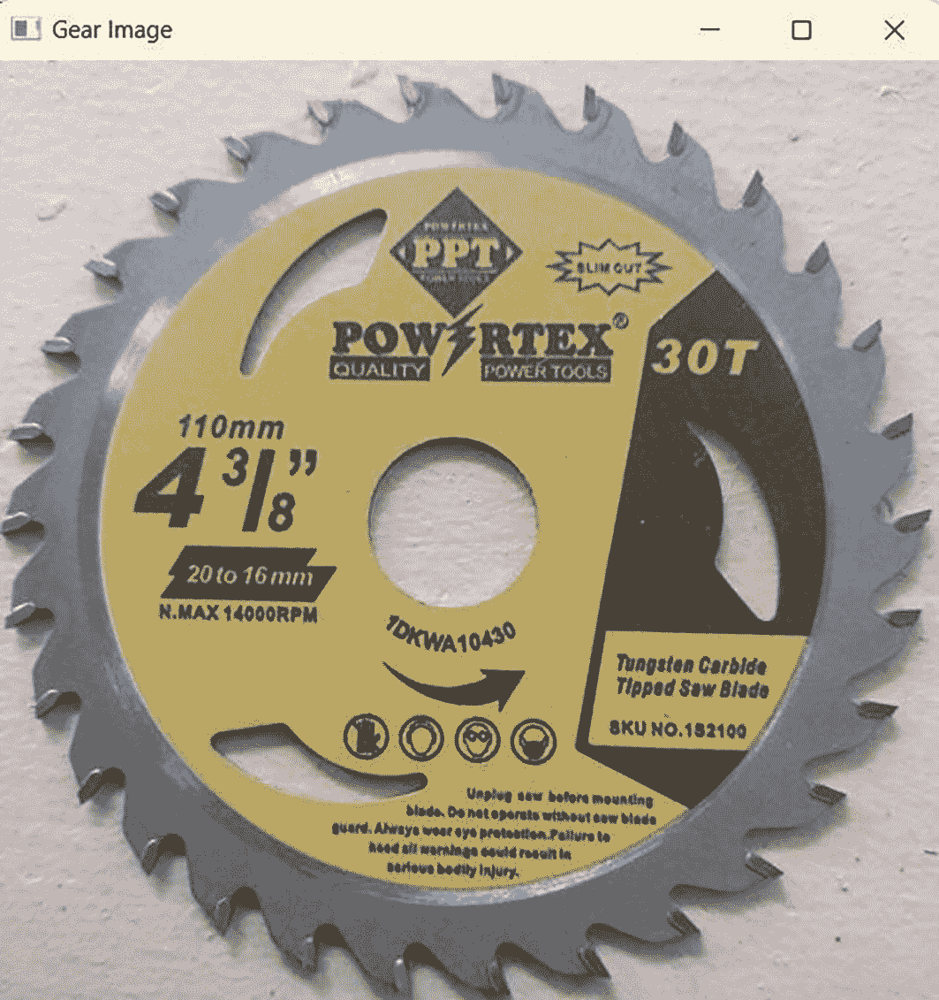
图 9-10 尖头锯片图像

以下代码演示了从锯片图像中提取文本的过程。像往常一样，我们首先导入代码所需的库。函数 `service_account.Credentials.from_service_account_file` 会根据我们之前创建的服务账号 JSON 密钥文件创建一个 `Credentials` 对象。该文件的路径作为输入传递给 `filename` 参数。参数 `scopes` 定义了授予服务账号的权限，而提供给此参数的 Cloud Vision API URL 则允许服务账号访问以使用 API 服务。`ImageAnnotatorClient` 类使用上一步创建的凭据创建一个客户端对象。

### 使用 Google Cloud Vision API 进行 OCR

然后，我们使用 `io.open` 函数将输入的锯片图像作为原始二进制文件加载，以便将其提交给 Google® Cloud Vision API。接下来，我们使用 `vision.Image` 函数从二进制文件创建一个图像对象，然后通过使用 `client.text_detection` 函数向 Cloud Vision API 发出请求，以检测图像中的文本。生成的文本注释将存储在 `response` 对象中，然后可以通过遍历结果并在每次迭代中将文本描述保存到名为 `ocr` 的变量中来提取这些注释。最后，我们可以打印这个 `ocr` 变量，以显示从标签中提取的全部文本，如下面的代码所示。可以看出，Google® Cloud Vision API 产生了相当不错的结果。您可能会注意到文本中存在一些细微错误，这可能是由于图像质量造成的。

```python
from google.oauth2 import service_account
from google.cloud import vision
import cv2
import io
import matplotlib.pyplot as plt
# 创建客户端接口
credentials = service_account.Credentials.from_service_account_file(
    filename="C:/Users/User/Downloads/storied-fuze-356305-48525d5682b6.json",
    scopes=["https://www.googleapis.com/auth/cloud-platform"])
client = vision.ImageAnnotatorClient(credentials=credentials)
# 加载输入图像
filename = "C:/Users/Lenovo/Downloads/Gear_new.png"
with io.open(filename, "rb") as f:
    byteImage = f.read()
# 创建图像对象并向 Vision API 发出请求
image = vision.Image(content=byteImage)
response = client.text_detection(image=image)
# 遍历结果
ocr=''
for text in response.text_annotations[1::]:
    ocr+= text.description+' '
print("检测到的文本: \n", ocr)
```

检测到的文本：
110mm 4³1 , 3 " 20 to 16 mm N.MAX 14000RPM POWFRIEE PPT FOWER HOOLD POWERTEX 30T POWER TOOLS QUALITY BLIM GUT TDKWA10430 Tungsten Carbide Tipped Saw Blade SKU NO.182100 Unplug saw before mounting blade . Do not operate without saw blade querd . Always wear eye protection.Pailure to head all warnings could resultin serious bodily injury .

### 使用 Azure 计算机视觉 API 进行 OCR

与 Google 类似，Microsoft® 提供了一个名为 Azure 的全方位云计算平台，该平台通过 Microsoft® 管理的数据中心提供各种服务，用于开发、实施和管理应用程序及服务。无需投资和维护物理基础设施，Azure 的基础设施即服务 (IaaS)、平台即服务 (PaaS) 和软件即服务 (SaaS) 功能使企业能够利用可扩展的计算资源、存储、网络和其他功能。

在本节中，我们将讨论如何利用 Azure 的计算机视觉 API 服务对同一张锯片图像执行文本提取。与我们之前关于 Google 云的讨论类似，我们需要在 Azure 门户中创建和配置 Vision API 服务²。在此之前，用户必须创建一个 Azure 订阅，然后为该订阅分配一个资源组。由于这些过程超出了本书的范围，我们将从创建计算机视觉 API 开始，如下面的步骤所示。

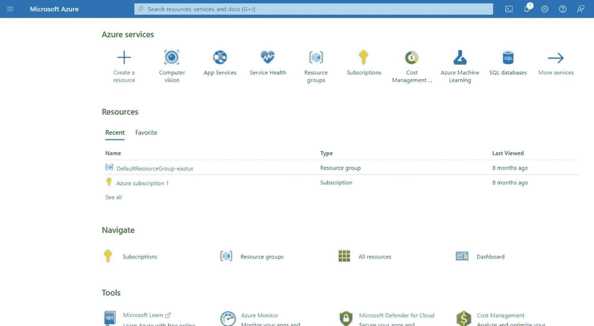
Microsoft Azure 窗口的截图。它显示了 Azure 服务、资源、导航应用程序和工具下的选项。
图 9-11 Azure 门户主页

1.  Azure 门户的主页显示了之前创建的订阅和相关的资源组，如图 9-11 所示。现在，点击页面顶部的 *计算机视觉* 图标。

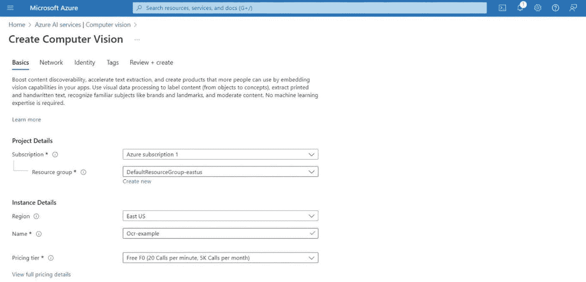
Microsoft Azure 窗口的截图。它显示了创建计算机视觉的页面。页面显示了“基本信息”选项卡下的设置。它包含需要填写的项目详细信息和实例详细信息选项卡。
图 9-12 计算机视觉服务配置页面

2.  在 *计算机视觉* 页面，点击顶部的 *创建* 图标以创建一个新的计算机视觉服务。这将打开一个配置页面，如图 9-12 所示。在此页面中，从各自的下拉菜单中选择 *资源组* 和 *区域*，然后为视觉服务提供一个名称。^(³)

从下拉菜单中选择定价层。我们的演示选择了允许每分钟 20 次调用的免费层。最后，向下滚动以勾选确认复选框，然后点击 *查看+创建*。这将带我们进入一个新页面，显示我们选择的所有详细信息。点击页面底部的 *创建*，Azure 将开始部署视觉服务。

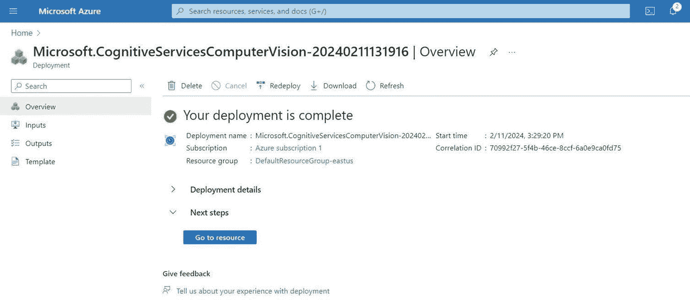
Microsoft Azure 窗口的截图。在左侧窗格中，选择了“概述”选项。右侧窗格显示了 Microsoft 认知服务计算机视觉的概述页面。页面显示了部署完成消息以及部署详细信息和下一步操作。
图 9-13 创建计算机视觉服务后的部署完成消息

3.  部署完成后，我们将看到如图 9-13 所示的消息。点击 *转到资源* 以打开已部署的视觉服务页面。

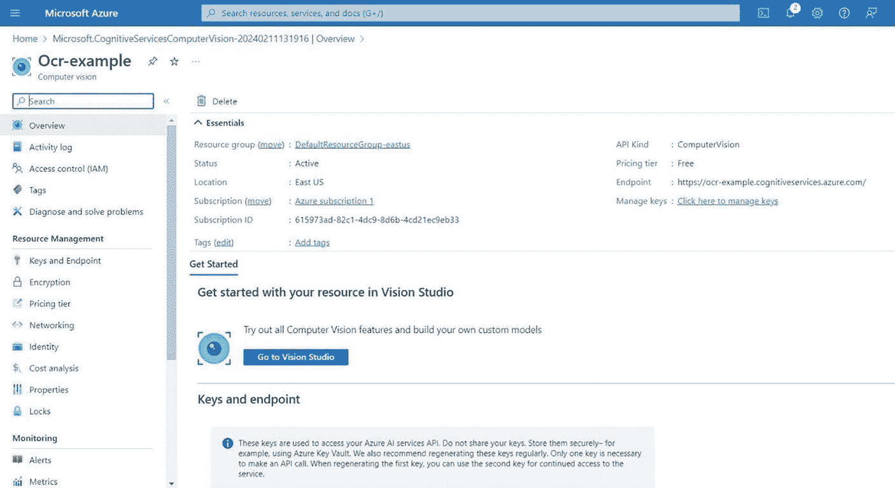
Microsoft Azure 窗口的截图。在左侧窗格中，选择了“概述”选项。右侧窗格显示了“基本信息”选项卡和“入门”选项卡下的详细信息。视觉工作室的徽标位于左下角，并带有一个前往视觉工作室的按钮。
图 9-14 已部署的计算机视觉服务主页

4.  在图 9-14 所示的已部署视觉服务页面中，点击页面左侧菜单中的 *密钥和端点*。

5.  在如图 9-15 所示的页面中，将两个密钥中的任意一个以及终结点复制到记事本中，以便在 Python 代码中使用。

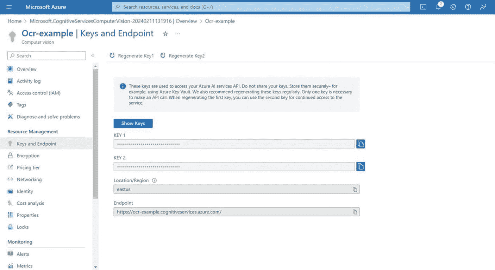
Microsoft Azure 窗口的截图。在左侧窗格中，资源管理下选择了“概述”和“密钥和终结点”。右侧窗格显示了“密钥和终结点”下的详细信息，包括密钥 1、密钥 2、位置/区域和终结点。
图 9-15 计算机视觉服务的密钥和终结点

在 Azure 门户中完成上述配置后，下一步是安装 Python 所需的库。需要通过 Python 代码访问 Azure 视觉服务，需要安装以下两个库：

1.  `msrest`：此包由微软® 提供，作为与不同微软® REST API 通信的通用框架。
2.  `azure-cognitiveservices-vision-computervision`：此库是微软® Azure 提供的软件开发工具包（SDK），用于与 Azure 认知服务中的计算机视觉服务进行交互。

以下代码演示了使用计算机视觉 API 从锯片图像中提取文本的过程。像往常一样，我们首先导入实现 OCR 系统所需的所有库。然后，我们获取之前保存到记事本中的终结点 URL 和 API 密钥，并使用这些凭据创建一个客户端。客户端设置完成后，我们使用 `io.BytesIO` 函数从内存中的类文件对象读取输入图像数据。Azure 计算机视觉客户端对象的 `read_in_stream()` 方法将图像数据作为二进制流，执行异步分析操作，然后返回一个包含 Azure 服务中操作位置的响应对象。然后，从响应头中提取 `Operation-Location` 参数（一个 URL），该参数可用于跟踪操作状态并检索其结果。接着，我们使用 `split()` 函数从 Operation-Location URL 字符串中提取操作 ID。

# 使用 Azure 计算机视觉进行文本提取

Azure 计算机视觉客户端的 `get_read_result()` 方法用于检索异步图像分析的结果。`result.status` 提供了操作的状态。初始状态为“未开始”或“运行中”，我们在一个 `while` 循环中使用这段代码等待，直到状态变为“已成功”。使用 `time` 库中的 `sleep()` 方法暂停 `while` 循环的执行 10 秒，以便每 10 秒检查一次状态。一旦状态变为“已成功”，代码就会跳出循环。然后，我们遍历 `ComputerVisionResult` 对象的 `analyze_result.read_results` 属性。`read_results` 列表中的每个项目都包含与图像中文本行相对应的文本内容。接下来，我们遍历 `result.lines` 属性以读取图像中每一行的文本内容，并将其追加到 `text` 变量中，该变量在 `for` 循环之前被创建为空字符串。提取完所有行后，可以打印 `text` 变量，其结果如代码下方所示。可以看出，与 Google Cloud Vision 的输出类似，由于图像质量较差，在读取文本时存在一些错误。

```python
import io
from msrest.authentication import CognitiveServicesCredentials
from azure.cognitiveservices.vision.computervision import ComputerVisionClient
from azure.cognitiveservices.vision.computervision.models import OperationStatusCodes
from msrest.authentication import CognitiveServicesCredentials
import requests
import time
API_KEY = 'fea22b23dbf848b3b7562f583948c41a'
ENDPOINT = 'https://ocr-example.cognitiveservices.azure.com/'
client = ComputerVisionClient(ENDPOINT,CognitiveServicesCredentials(API_KEY))
# 加载输入图像
filename = "C:/Users/Lenovo/Downloads/20240202_082924.png"
with io.open(filename, "rb") as f:
    image = io.BytesIO(f.read())
# 执行分析操作并获取操作 ID
response = client.read_in_stream(image, raw=True)
operationLocation = response.headers['Operation-Location']
operation_id = operationLocation.split('/')[-1]
# 等待操作状态变为 'succeeded'
while True:
    # 获取结果
    results = client.get_read_result(operation_id)
    # 检查状态是否不是 "not started" 或 "running"，如果是，则停止轮询操作
    if results.status.lower() not in ["notstarted", "running"]:
        break
    # 在向 API 发出另一个请求之前暂停执行 10 秒
    time.sleep(10)
# 遍历结果以逐行读取文本
text = ''
for result in results.analyze_result.read_results:
    for line in result.lines:
        text+=line.text+' '
print("Text description: " + text)
```

输出结果：
Text description:
POWERTEE PPT SLIM GUT FOWER FOOLS POWERTEX 30T QUALITY POWER TOOLS 110mm 4318' 3 " 20 to 16 mm N.MAX 14000RPM TOKWA10430 Tungsten Carbide Tipped Saw Blade SKU NO.182100 Unplug saw before mounting blade. Do not operate without saw blade querd. Always wear eye protection. Pallure to head all warnings could result In serious bodily Injury.

## 使用 Python 库进行 OCR

Python 的光学字符识别（OCR）包为程序员提供了强大的工具，用于从扫描文档、图像和其他视觉媒体等各种来源中提取文本。这些库利用机器学习方法（如深度学习模型）准确识别和解释图像中的字符，从而实现自动文本提取和分析。Python OCR 包在处理不同文本格式、字体和语言方面具有多功能性，因此在文档管理、自然语言处理和计算机视觉等领域，对于文档数字化、数据提取和自动文本识别等活动至关重要。在本节中，我们将介绍几个流行的 OCR 库。

### EasyOCR

EasyOCR 是一个用户友好且功能多变的 Python 编程语言光学字符识别（OCR）包。该库提供了预训练的文本检测与识别模型，支持多种语言，并强调从图像中识别单词的速度与效率。EasyOCR 由三个主要部分组成：特征提取、序列标注和解码。特征提取使用如 ResNet 和 VGG 等深度学习模型，从输入图像中提取有意义的特征。下一阶段是序列标注，它利用长短期记忆（LSTM）网络来解释所提取特征的序列上下文。最后，在解码阶段使用连接主义时间分类（CTC）方法，将标注后的序列解码并转录为实际识别出的文本。由于对这些技术的详细解释超出了本书的范围，建议读者自行探索。

EasyOCR 库可以通过在 Windows 命令提示符中执行命令 `pip install easyocr` 来安装。安装该库后，可以使用如下所示的代码从给定图像中提取文本。在本示例中，我们使用了一张树莓派主板俯视图的部分图像。读取图像后，我们使用 `opencv` 库中的 `imshow()` 方法来显示原始图像。接着，我们创建一个来自 `easyocr` 模块的 `Reader` 类的 `reader` 对象。传递给 `Reader` 类的参数 `en` 指定 OCR 应对英语执行，而参数 `gpu=False` 表示 OCR 应在 CPU 而非 GPU 上执行。系统创建这个 `reader` 对象需要一些时间。如果我们拥有支持 CUDA 的 GPU，可以将 `gpu` 参数设置为 `True`，这将加快处理速度。

然后，可以使用 `reader` 对象中的 `readtext` 方法从给定图像中提取文本。该方法的输出将是一个由多个对组成的列表，每个对包含图像中检测到的每个文本的边界框坐标以及提取出的相应文本。接着，我们使用一个 `for` 循环来遍历检测到的这些对。在每次迭代中，我们借助边界框坐标，使用 `cv2.rectangle()` 函数在检测到的文本周围创建一个矩形，然后使用 `cv2.putText()` 函数在边界框上方显示提取出的文本。原始图像和检测到文本的图像如图 9-16 所示。可以看出，该库在从图像中提取文本方面表现相当不错。

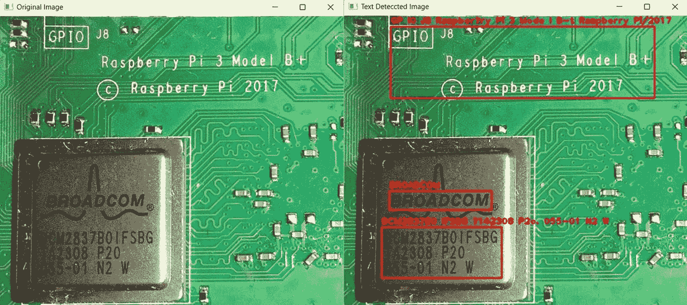
两张截图。左图：原始图像窗口显示树莓派印刷电路板的照片，博通芯片位于左下角。右图：文本检测图像窗口显示同一张照片，并带有边界框，检测出板上的文本。

```
import easyocr
import cv2
img = cv2.imread('C:/Users/Lenovo/Documents/Piboard1.jpg')
cv2.imshow("Original Image",img)
cv2.waitKey(0)
# 创建一个 reader 对象并从图像中提取文本
reader = easyocr.Reader(['en'],gpu=False)
results = reader.readtext(img,paragraph=True)
# 创建边界框并在图像上显示提取的文本
for (bbox, text) in results:
(tl, tr, br, bl) = bbox
tl = (int(tl[0]), int(tl[1]))
tr = (int(tr[0]), int(tr[1]))
br = (int(br[0]), int(br[1]))
bl = (int(bl[0]), int(bl[1]))
cv2.rectangle(img, tl, br, (0, 0, 255), 2)
cv2.putText(img, text, (tl[0], tl[1]-5),
cv2.FONT_HERSHEY_PLAIN, 1, (0, 0, 255), 2)
cv2.imshow("Text Deteccted Image", img)
cv2.waitKey(0)
```

### Keras-OCR

基于 TensorFlow 和 Keras，`keras-ocr` 是一个开源 Python 框架，为从图像中提取文本提供了广泛的工具包。它基于两种主要深度学习技术的结合。CRAFT 模型基于卷积神经网络（CNN），能够有效识别图像中的文本区域，并能处理复杂的布局和重叠字符。字符识别则由卷积循环神经网络（CRNN）完成，它接收预先检测到的文本区域，然后将其转换为字符序列。我们将在第 10 章讨论 CNN，而读者可以自行探索 CRNN。

`keras-ocr` 库允许我们仅用几行代码就能执行文本提取。该库是一个灵活的工具，适用于广泛的 OCR 应用，因为它支持多种语言和文本样式。我们可以直接使用预训练模型进行文本提取，也可以在自定义数据集上训练端到端的 OCR 流程，以满足我们的特定需求。在本示例中，我们将使用预训练模型流程从树莓派主板图像中提取文本。

以下代码说明了从给定图像中提取文本的过程。我们使用 `keras_ocr.pipeline.Pipeline()` 方法初始化一个 `Pipeline` 对象，这是一个带有预训练模型的预配置模型流程。然后，可以以简单有效的方式使用该对象从给定图像中提取文本。`keras_ocr.tools.read()` 读取输入图像并将其转换为可以传递给 `Pipeline` 对象的格式。接下来，可以在 `Pipeline` 对象上调用 `recognize()` 方法，从图像中提取文本。提取的详细信息将包括每个检测到的文本区域的边界框坐标以及相应的文本。然后，我们可以遍历这些预测结果，并使用 `keras_ocr.tools.drawAnnotations()` 方法在给定图像上绘制文本注释。这些注释如图 9-17 所示。可以看出，预测结果不如 `easyocr` 准确，但当我们需要为一组独特的图像训练模型时，`keras-ocr` 仍然可以派上用场。

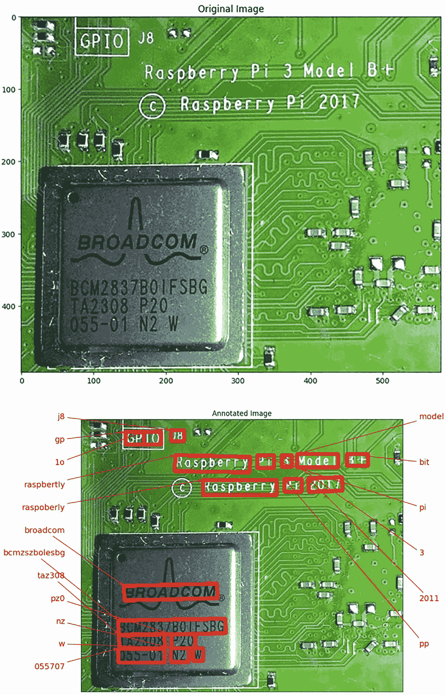

两张照片。上图：原始图像是树莓派印刷电路板的照片，博通芯片位于左下角。下图：注释图像是同一张照片，带有标记板上文本的边界框。

图 9-17

使用 `keras-ocr` 进行文本提取的示例

```
import keras_ocr
import cv2
import matplotlib.pyplot as plt
img = cv2.imread('C://Users/user/Documents/Piboard1.jpg')
pipeline = keras_ocr.pipeline.Pipeline()
predictions = pipeline.recognize([img])
fig, (ax1, ax2) = plt.subplots(2, 1, figsize=(10, 20))
ax1.imshow(img)
ax1.set_title("Original Image")
keras_ocr.tools.drawAnnotations(image=img,
predictions=predictions[0],
ax=ax2)
ax2.set_title("Annotated Image")
```

## 摘要

光学字符识别是工业视觉系统的重要组成部分，可用于自动检查制造设备和组件表面上的雕刻文字、粘贴或印刷的标签。此外，它还能在各种场景下将原本需要手动输入系统的文本实现自动化录入。本章围绕 OCR 系统讨论了以下几个方面：

*   从零开始开发传统 OCR 系统所涉及的步骤和流程

*   使用传统 kNN 方法从图像中识别手写数字的示例说明

*   谷歌云平台（GCP）和 Azure 中计算机视觉 API 功能的讨论，以及使用 API 服务进行文本提取的示例

*   使用 `easyOCR` 和 `keras-ocr` 等主流 Python OCR 库进行文本提取的讨论与示例

尽管我们目前已经涉及了 k-means 聚类和 k-近邻算法等简单的机器学习算法，但下一章我们将深入探讨其他主流的机器学习和深度学习算法。

脚注 1   2