# 10. 面向视觉应用的机器学习技术

在传统编程中，我们会根据定义明确的算法手动编写代码，该算法接收输入数据并提供期望的输出数据。而机器学习（ML）则无需显式编程，就能从数据中学习算法。数据可以是任何格式，但在计算机视觉领域，主要指图像数据。用于视觉系统的 ML 算法会分析图像数据，并学习识别与当前任务相关的模式。随着时间的推移，算法会积累经验，并提高执行任务的能力。这里的“任务”一词可以指代广泛的计算机视觉应用，如图像分类、目标跟踪、图像分割、OCR 等。这最终将催生智能系统，使机器能够基于数据做出预测并自动化复杂决策，从而具备学习和适应能力。

本章将为在基于树莓派的视觉系统中使用图像数据与机器学习奠定基础。与我们目前讨论的所有传统图像处理系统一样，基于 ML 的图像处理系统也需要某些预处理步骤，以使系统能够更快地学习。我们将首先简要讨论这些技术，然后开始探索一些用于图像数据的传统 ML 模型。接着，我们将深入探讨比传统 ML 技术更适合处理图像数据的深度学习技术。

## 图像预处理

就像我们根据要做的菜肴来准备食材一样，在将图像输入用于计算机视觉任务的机器学习模型之前，我们需要对图像进行预处理，将其转换为合适的格式。这在多个方面对提升学习模型的性能起着关键作用：

*   **标准化**：我们无法总是期望从现实世界中获取具有相同属性的图像。图像可能具有不同的尺寸和格式，并且可能在不同光照条件下拍摄。因此，预处理对于将图像转换为一致的格式至关重要，这样模型就能有效地专注于实际内容，而不是这些技术缺陷。

*   **模型性能提升**：向机器学习模型输入一致的图像有助于它们更快地收敛，从而在训练期间获得更高的准确率。图像格式差异较大时，模型将难以学习到可靠的模式。

*   **训练时间缩短**：在树莓派板卡等资源受限的平台上实现基于 ML 模型的系统可能颇具挑战性。通过在预处理过程中在不丢失信息的情况下减小图像尺寸，模型可以用更少的计算能力处理它们，从而缩短训练时间。

尽管我们已经熟悉许多预处理技术，但我们仍将简要讨论一些用于基于 ML 的视觉系统的最常用技术。

1.  **图像缩放**：为确保每张图像都符合模型的输入要求，图像会被缩放到指定的宽度和高度。这样，数据就被格式化为一致的格式，供模型评估。

2.  **归一化**：基于 ML 的视觉系统中的另一个常见做法是将输入图像的像素值归一化到较小的范围。现实世界图像的像素值通常在 0 到 255 之间。归一化有助于将这些值缩小到 0 到 1 或-1 到 1 的较小范围。较小的像素值反过来能使模型在训练期间更快地收敛，从而提高整体性能。

3.  **降噪**：正如我们在第 5 章中讨论的那样，现实世界的图像常常在拍摄或传输过程中受到各种来源的噪声污染。降噪技术在去除这些噪声源产生的不必要伪影方面起着关键作用，从而得到更清晰的图像，进而改善模型的特征提取。

4.  **图像增强**：为了构建一个能够鲁棒应对现实世界图像变化的视觉系统，必须用尽可能多的图像来训练机器学习模型。从零开始开发基于 ML 的视觉系统时，早期挑战之一就是缺乏足够的图像来训练模型。增强是一种强大的技术，它可以通过对现有图像应用随机变化（如缩放、裁剪、旋转、翻转或亮度/对比度变化）来生成新图像，从而扩展我们有限的数据集。在我们的系统中加入增强技术，可以帮助模型很好地泛化到现实世界图像中不可预见的变化。

这些预处理方法有助于我们准备好图像数据，以便从机器学习模型中获得最佳性能。这为我们基于树莓派的视觉系统准确分析图像并有效训练模型奠定了基础。

## 机器学习算法

计算机无需进行特定编程，即可通过机器学习算法从数据中学习并做出预测或决策。作为人工智能的一个分支，机器学习的目标是创建能够持续从数据中学习并随时间推移表现更佳的算法。机器学习算法主要分为四大类：

1.  监督学习

    *   这类算法会同时提供输入数据及其对应的输出标签，因此得名监督学习。

    *   随后，算法会从这些带标签的数据中学习一个映射函数，将输入数据的特征映射到目标结果。

    *   监督学习最常见的两种类型是回归和分类。

    *   监督学习技术的常见示例包括线性回归、逻辑回归、决策树、随机森林、支持向量机和神经网络。

2.  无监督学习

    *   顾名思义，这类学习处理的是无标签数据，即没有与输入数据相对应的输出标签。

    *   在这种情况下，算法会尝试在没有标签指导的情况下，在数据中寻找模式和结构。

    *   无监督学习的一些常见类型包括聚类、降维和关联规则学习。

    *   无监督学习技术的常见示例包括`K 均值聚类`、层次聚类和主成分分析。

3.  半监督学习：

    *   半监督学习是一类结合了监督学习和无监督学习的机器学习方法，它同时使用带标签和无标签的数据进行训练。

    *   当我们只有少量带标签数据和大量无标签数据时，这种方法更受青睐。

4.  强化学习：

    *   这是一类通过试错进行学习的机器学习方法。

    *   它涉及训练一个智能体与环境进行交互以做出决策。

    *   智能体根据其决策以奖励或惩罚的形式接收反馈。

    *   以最大化累积奖励为目标，算法会随着时间的推移学会做出正确的决策。

并非所有传统的机器学习技术都适用于图像处理任务。回想一下，我们已经在第 8 章中介绍了如何使用`K 均值聚类算法`进行图像分割。除了分割之外，像`SVM`和决策树这样的传统机器学习算法在图像分类任务中也发挥了重要作用。但是，随着计算能力和先进硬件技术的快速发展，深度学习算法已成为处理图像处理任务的领跑者。

# 人工神经网络

神经网络是一类模仿人脑的机器学习算法，构成了深度学习算法的核心。这类算法因其能够从数据中学习复杂模式而变得极为流行。它们由多个层组成，每一层都包含许多执行特定计算的节点。这些层中的所有节点都以类似于我们大脑中神经元的复杂方式相互连接。因此，这些节点通常被称为人工神经元，而使用这种结构从给定输入中学习的算法类别则被称为人工神经网络。

## 神经网络结构

这些层可以分为三类：输入层，其后是一个或多个隐藏层，然后是输出层。每一层都有一个垂直堆叠的节点，并且每一层中的节点都与后续层中的节点相连。如果每一层中的每个节点都与后续层中的每个其他节点相连，如图 10-1 所示，我们称之为全连接网络。

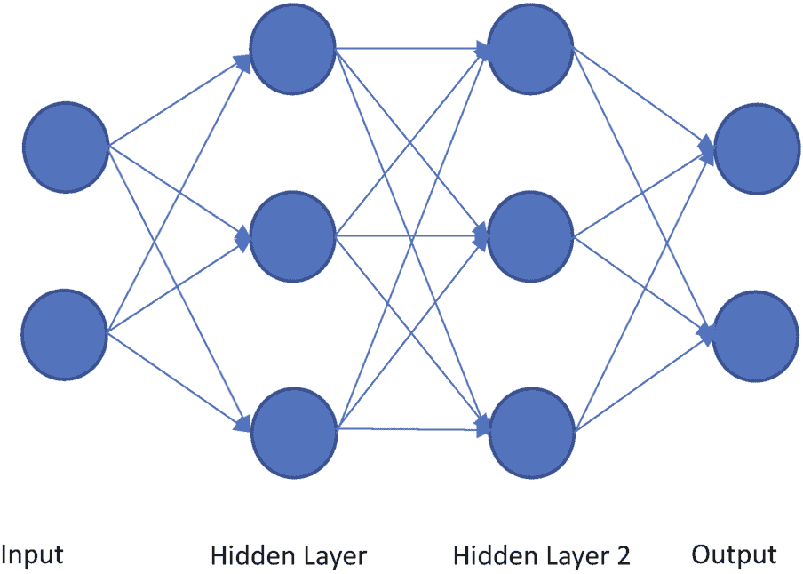

图 10-1: 全连接神经网络。一个网络的示意图，包含输入数据、隐藏层、隐藏层 2，最终数据作为输出接收。输入值与隐藏层相互连接以形成最终输出。

输入层是传递给网络的实际数据。对于图像而言，输入层中的每个节点对应图像中的一个像素值。假设要由神经网络处理的数字图像大小为 30 x 30 像素，则该图像将被重塑为一个包含 30x30 = 900 个像素的单一向量，因此，输入层将由 900 个节点组成，每个节点持有一个像素值。

然后，这些值被传递到隐藏层，隐藏层从输入数据中学习并提取更高层次的特征。这些层被称为隐藏层，是因为它们执行的计算无法直接观察到。

## 单个节点的功能

隐藏层中的神经元计算从前一层或直接来自输入层（对于第一个隐藏层的情况）接收到的输入的加权和，然后将结果通过一个激活函数传递。图 10-2 展示了隐藏层中的一个单一节点。`Z`的值是输入的加权和，由`Z = w[1]x[1] + w[2]x[2] + … + w[n]x[n]`给出，其中`(x[1], x[2], … x[n])`是节点从前一个隐藏层或输入层接收到的输入，`(w[1], w[2], … w[n])`是模型迭代学习的模型权重。除了输入节点外，神经网络还会有一个额外的偏置节点，它是一个加到上述结果上的常数值。这个偏置用于偏移每个节点的结果，并有助于将激活函数向正侧或负侧移动。函数`f(.)`是激活函数，它将非线性引入网络，从而允许网络学习输入和输出之间的复杂映射。一些常见的激活函数包括修正线性单元、`Sigmoid`、`Softmax`和`tanh`。鼓励读者探索这些函数背后的数学原理及其各自的应用。

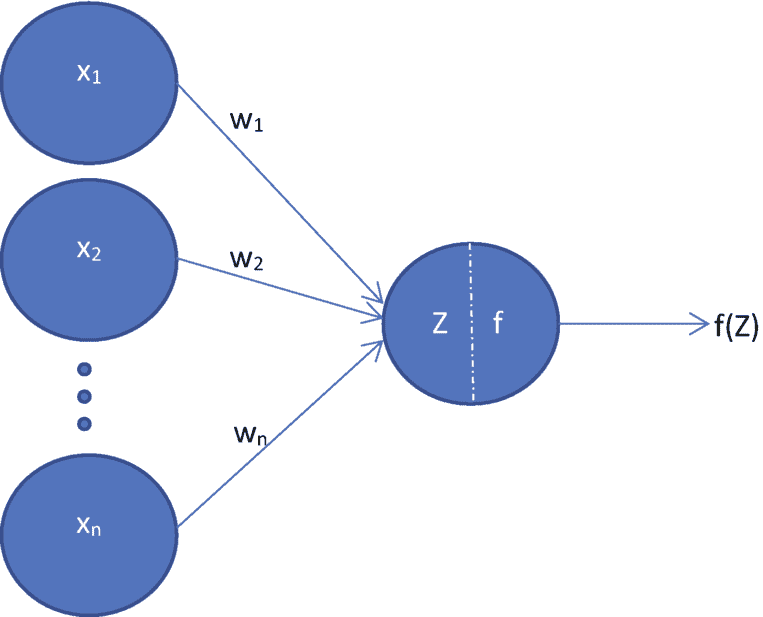

图 10-2: 单个节点（神经元）的功能。输入数据的示意图，形式为`X 1, X 2,`直到`X n`。输入值`W 1, W 2,`直到`W n`被发送到`Z`和`f`节点。最终输出以`f(Z)`的形式接收。

## 隐藏层的作用

通过充当特征提取器，隐藏层通过一个称为前向传播的过程，生成输入数据的更高层表示。每个隐藏层都通过前向传播提取与当前任务相关的特征。深度神经网络中的多个隐藏层使其能够学习图像的层次化表示，其中像边缘和纹理这样的简单特征由较低层捕获，而像形状和物体这样的抽象特征则由较高层捕获。

在训练阶段，网络使用诸如梯度下降和反向传播之类的优化算法来修改隐藏层中神经元的权重和偏置。在反向传播过程中，通过计算损失函数相对于网络参数的梯度，使得整个网络中的有效权重更新成为可能。隐藏层决定了误差如何通过网络进行反向传播。

输出层是神经网络的最后一层，负责生成网络的输出。对于涉及连续值预测的回归任务，输出层将包含一个具有线性激活函数的单一节点。该单一神经元将输出预测值，而损失函数则是预测值与实际值之间差异的度量。对于分类任务，输出层将包含多个神经元，其数量与类别数相对应。在多分类的输出层中，通常使用诸如`softmax`之类的激活函数来生成跨类别的概率分布。

## 卷积神经网络 (CNN)

CNN 是一类深度神经网络，其架构专门为处理图像等网格状数据而设计，因此它在计算机视觉领域更为常见。当我们向传统神经网络输入一张图像时，它会独立地处理每个像素，而无法理解相邻像素之间的空间关系。与传统的人工神经网络相比，CNN 的特别之处在于它能够通过一组前置的计算层（称为卷积层和池化层）来利用图像数据中的这种空间结构，如图 10-3 所示，我们将在本节中讨论这些内容。

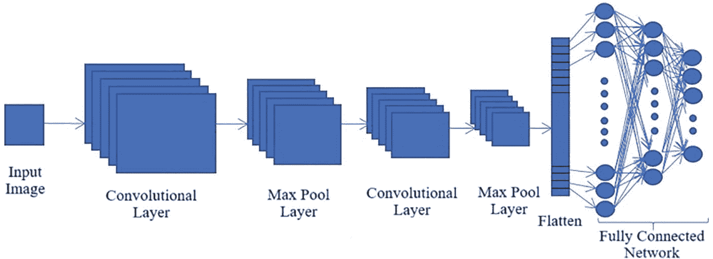

一个网络示意图，包括输入图像、卷积层、最大池化层、卷积层、最大池化层、展平层，以及最后的全连接网络。

图 10-3

卷积神经网络

### 卷积层

卷积层是 CNN 的基本单元。这些层将一组可学习的滤波器（通常称为卷积核）应用于输入图像数据。这种滤波是通过一个称为卷积的过程来完成的，该过程涉及将卷积核在图像上滑动，计算滤波器系数与卷积核覆盖的图像像素的乘积之和，并将卷积核覆盖区域中的中心像素替换为该结果。此操作与我们之前在第 5 章中讨论的滤波操作相同。图 10-4 展示了随机网格数据与随机卷积核的卷积过程。

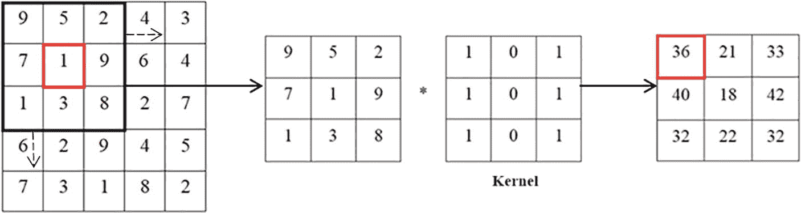

一个 5x5 的矩阵，输入值从 1 到 9。一个 3x3 的矩阵与一个包含二进制数字 0 和 1 的 3x3 卷积核相乘。输出是一个 3x3 的矩阵，其中包含 36 个数值标记。

图 10-4

卷积过程

在此图示中，一个大小为 3x3 的卷积核在网格数据上移动，以计算不同邻域的卷积，然后将邻域中的中心像素替换为相应的结果。让我们考虑图中所示的第一个 3x3 数据网格。对该网格数据和卷积核进行逐元素乘法，然后将结果之和（`9x1 + 5x0 + 2x1 + 7x1 + 1x0 + 9x1 + 1x1 + 3x0 + 8x1 = 36`）替换到以红色显示的中心像素处。这个过程也称为点积，通过按列移动卷积核来重复进行。在我们的示例中，卷积核将向右再移动两步，产生值 21 和 33。一旦到达列的末尾，卷积核将向下移动到下一行的开头，然后按列移动以产生值 40、18 和 42。同样的过程将再次重复，将卷积核再移动一行。总的来说，卷积过程将产生 9 个值，将原始的 5x5 矩阵转换为一个 3x3 矩阵。

这种将卷积核滑过整个图像并执行卷积的迭代过程，将输入图像转换为卷积特征或特征图，这些特征图代表了图像中的某些特征。一个卷积层由多个滤波器组成，因此每个滤波器负责从输入图像中识别特定的模式或特征。与全连接层类似，激活函数也可以逐元素地应用于卷积层的输出。这些函数为特征图的每个元素引入非线性，从而使神经网络能够学习更复杂的模式。CNN 通过在训练过程中学习适当的滤波器权重，可以自动从数据中提取相关特征，然后将这些解释后的特征信息传递给后续的深层网络。

### 池化层

CNN 中的卷积层之后通常跟着另一个关键组件，称为池化层，它有助于降低卷积层生成的特征图数据的空间维度，从而提高网络的计算效率。有两种常用的池化技术，称为最大池化和平均池化，如图 10-5 所示。此图示中的最大池化使用大小为 2x2 的网格进行，其中每个数据网格被转换为一个单一数值，即该网格中 4 个数值的最大值，如深色框所示。类似地，在平均池化的情况下，每个大小为 2x2 的网格被替换为该网格中 4 个数值的平均值。由于 4x4 矩阵由 4 个网格组成，因此在池化操作后，它被转换为一个大小为 2x2 的矩阵。

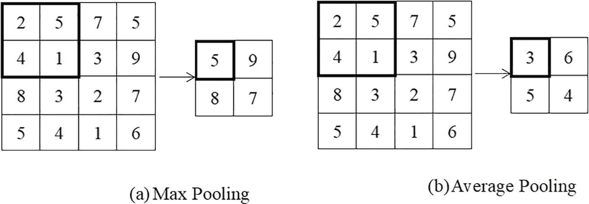

一个包含从 1 到 9 数值的 4x4 矩阵被转换为一个包含数值 5、9、8 和 7 的 2x2 矩阵。平均池化过程将一个包含从 1 到 9 数值的 4x4 矩阵转换为一个包含数值 3、6、5 和 4 的 2x2 矩阵。

图 10-5

最大池化过程

### 全连接层

卷积层的数量、每层中要使用的卷积核数量以及最大池化层的数量，取决于多种因素，例如所涉及任务的复杂性、输入数据的性质和大小，以及可用的计算资源量。从头构建 CNN 通常涉及一个由领域知识指导的试错过程，因为对于卷积层和最大池化层的数量，没有一种通用的解决方案。

此序列中最后一层的输出被展平以创建一个单一向量，然后作为输入馈送到一个全连接网络。全连接网络对卷积层提取的特征进行高级推理。全连接层可以通过发现特征之间复杂的模式和关系来识别数据中的全局依赖性。这使得网络能够做出与当前任务相关的预测或决策。全连接层本质上将学习到的特征映射到适合给定任务的输出空间，从而起到分类器或回归器的作用。

## 使用 CNN 进行手写数字识别

在上一章中，我们使用一种名为 `k-means` 聚类的无监督学习算法开发了一个手写数字识别系统。在本节中，我们将开发一个基于 CNN 的系统，以更高的准确率识别手写数字。首先，我们将导入所有必要的库和方法。这里，我们使用 `TensorFlow` Keras 库来导入构建模型所需的所有组件，如下所示。模型的每一层，如二维卷积层、二维最大池化层和全连接层，都与来自 `keras.layers` 的 `Flatten` 函数一同导入。MNIST 手写数字数据集也从 `keras.datasets` 导入。`Sequential` 函数从 `keras.models` 导入，用于将所有层打包成一个顺序模型。来自 `keras.utils` 的 `to_categorical` 函数可用于对输出标签进行独热编码。

```python
import cv2
import numpy as np
from keras.datasets import mnist
from keras.layers import Dense, Flatten
from keras.layers import Conv2D, MaxPooling2D
from keras.models import Sequential
from keras.utils import to_categorical
from matplotlib import pyplot as plt
```

使用 `load_data()` 函数初始化数据集，并将其分为包含 60,000 张图像的训练集和包含 10,000 张图像的测试集。由于我们在上一章中已经可视化了一些样本图像，我们将跳过这一部分，继续将数据集重塑为适合模型的格式。回想一下，MNIST 数据集中的图像是大小为 28 x 28 的黑白图像，像素值为 0 或 255。我们使用 `reshape()` 函数添加另一个维度，形状为 1，表示图像是灰度图，从而将图像大小更改为 28 x 28 x 1。然后，我们通过将像素值除以 255.0 来归一化图像，使其重新缩放到[0, 1]范围。接着，我们使用 `to_categorical()` 函数对训练集和测试集的标签进行独热编码。这些操作如下所示：

```python
# 加载数据集
(trainX, trainy), (testX, testy) = mnist.load_data()
# 重塑数据集以使其具有单通道
trainX = trainX.reshape((trainX.shape[0], 28, 28, 1))
testX = testX.reshape((testX.shape[0], 28, 28, 1))
# 归一化到 0-1 范围
trainX = trainX / 255.0
testX = testX / 255.0
# 独热编码
trainY = to_categorical(trainy)
testY = to_categorical(testy)
```

数据准备现已完成，我们接下来进行模型开发。如下所示的代码使用 `Keras` Sequential API 定义了一个卷积神经网络（CNN）模型。使用 `Conv2D` 函数创建了一个具有 32 个滤波器和(3, 3)内核大小的二维卷积层。该层提供了 `ReLu` 激活函数以引入非线性。由于这是网络中接收输入的第一层，因此输入形状(28, 28, 1)也作为参数提供。使用 `MaxPooling2D` 创建了一个内核大小为 2 x 2 的最大池化层作为第二层。然后使用 `Flatten()` 函数将最大池化层的输出展平。接着，我们使用 `Dense()` 函数定义一个全连接网络，其中包含一个由 100 个节点组成的隐藏层和一个由 10 个节点组成的输出层，对应 10 个数字。`compile()` 函数用于通过指定优化器、损失函数和评估指标等参数来配置学习过程。这里我们使用最常见的 “Adam” 优化器。对于损失函数，我们使用 “categorical_crossentropy”，它主要用于多类分类问题，例如我们的手写数字识别问题。我们提供 “accuracy” 作为评估模型性能的指标。使用 `fit()` 函数在训练数据集上训练模型。我们提供批次大小为 32，这意味着每个训练批次将使用 32 个样本，并且每个批次后更新模型权重。轮数表示模型在训练期间遍历整个训练数据集的次数。在我们的案例中，我们选择轮数为 10。此外，我们提供测试数据和标签作为模型的验证数据。`summary()` 函数用于打印模型摘要，其中显示了每一层的详细信息，如图 10-6 所示。

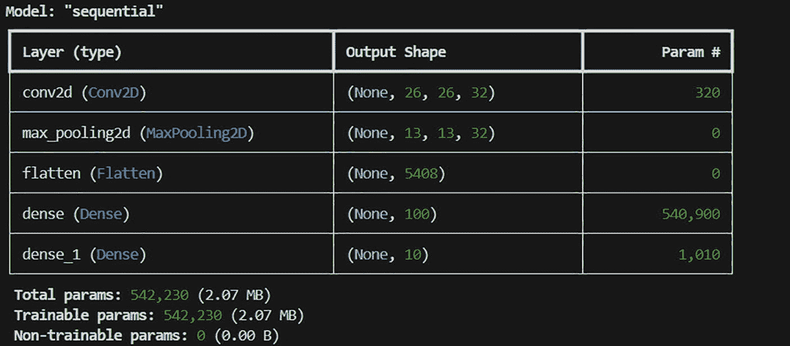

一个顺序模型的层类型、输出形状和参数表格截图。总参数为 542,230，可训练参数为 542,230，不可训练参数为 0。

图 10-6

# CNN 模型摘要

```python
# 定义 CNN 模型
model = Sequential()
model.add(Conv2D(32, (3, 3), activation='relu', input_shape=(28, 28, 1)))
model.add(MaxPooling2D((2, 2)))
model.add(Flatten())
model.add(Dense(100, activation='relu'))
model.add(Dense(10, activation='softmax'))
# 编译模型
model.compile(optimizer='adam', loss='categorical_crossentropy', metrics=['accuracy'])
print(model.summary())
history = model.fit(trainX, trainY, batch_size=32, epochs=10, validation_split=0.2)
```

学习到的指标存储在变量`history`中。为了可视化模型学习如何随每个轮次而改善，我们使用以下代码绘制训练准确率和损失相对于轮次的图表，如图 10-7 所示。可以看出，准确率随着每个轮次而增加，而损失随着每个轮次而减少，表明模型正在逐步学习。与我们在第 9 章中讨论的基于 kNN 的识别系统获得的 94.43%的准确率相比，CNN 模型实现了超过 99%的准确率。

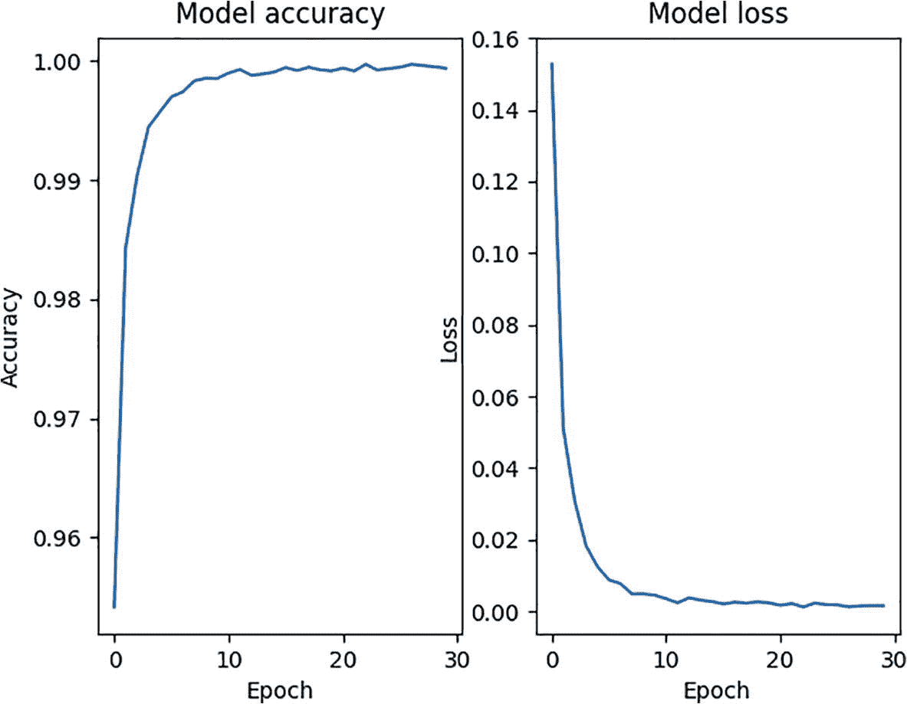

关于模型准确率和模型损失的两条折线图。模型准确率图是准确率与轮次的关系，呈上升趋势。模型损失图是损失与轮次的关系，呈下降趋势。

图 10-7

模型训练准确率和损失与轮次的关系

```python
plt.subplot(121)
plt.plot(history.history['accuracy'])
plt.title('模型准确率')
plt.xlabel('轮次')
plt.ylabel('准确率')
plt.subplot(122)
plt.plot(history.history['loss'])
plt.title('模型损失')
plt.xlabel('轮次')
plt.ylabel('损失')
plt.show()
```

现在我们已经训练好了模型，并可视化了它在训练数据集上的学习表现，下一步是在测试数据集上评估模型的性能。我们使用`evaluate()`方法来完成此操作，该方法将测试数据及其对应的标签作为输入，并输出测试准确率和损失。我们可以使用打印语句来查看这个准确率，得到的值为 0.9853，相当于 98.53%。因此，模型在训练阶段未曾见过的测试数据上的表现也接近训练表现，这表明模型能够很好地适应新数据。为了测试模型的预测能力，我们使用索引`testX[0]`获取测试数据集中的第一张图像，将其重塑为适合模型的尺寸 (1,28,28,1)，然后使用`predict()`函数生成对该图像的预测。该函数会生成一个概率数组，其中每个元素代表图像对应某个特定数字类别（0-9）的概率。然后可以在预测输出上使用`argmax()`函数来确定数组中最大概率的索引，该索引对应数字的输出类别。例如，在我们的案例中，测试数据集中的第一张图像对应数字 7，预测数组中索引 7 处的值将是最大的（等于 1），表明检测到的数字是 7。读者可以通过打印预测数组来验证这一点。最后，我们可以显示测试图像，并将预测的数字作为其标题，如图 10-8 所示。可以使用`tensorflow`库中的`save()`方法将模型保存为`'.h5'`模型。这会将模型架构、学习到的权重和优化器配置保存到一个文件中。

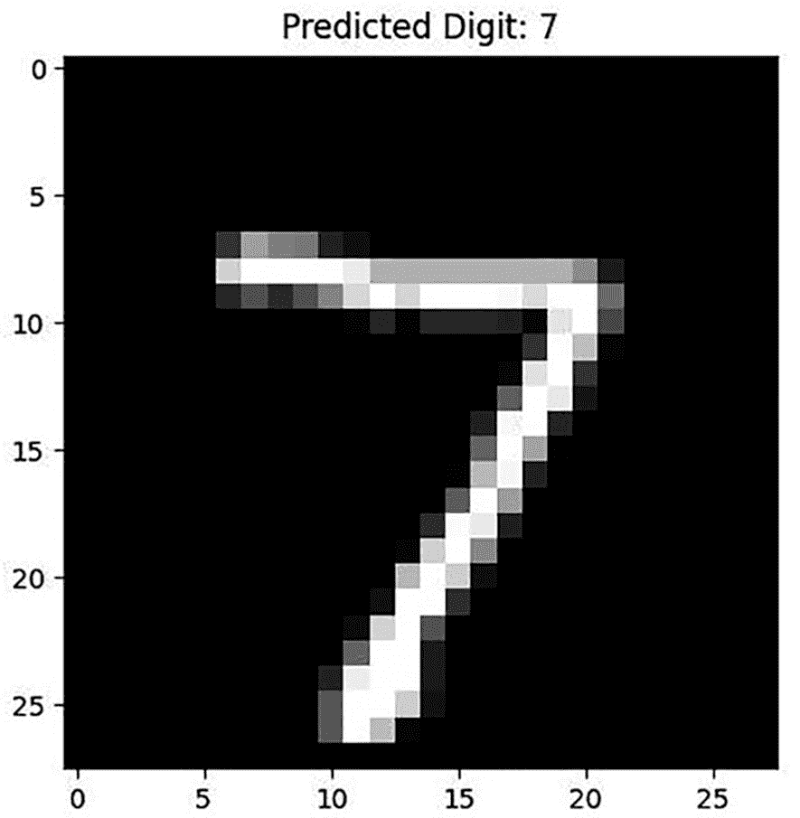

一张预测数字为 7 的图像。

图 10-8

对测试数据集中样本图像的预测

```python
# 评估模型
test_loss, test_acc = model.evaluate(testX, testY)
print('Test accuracy:', test_acc)
# 预测测试集中的第一个数字
first_image = testX[0]  # 从测试集中获取第一张图像
prediction=model.predict(first_image.reshape(1,28,28, 1))
predicted_class = np.argmax(prediction[0])
plt.imshow(first_image.reshape(28, 28), cmap='gray')
plt.title('Predicted Digit: ' + str(predicted_class))
plt.show()
model.save('my_model.h5')
```

## 使用 CNN 从考试卷中识别数字

在本节中，我们将应用上一节中保存的训练好的模型，从学生考试卷的首页识别手写数字，该页面上的各题分数由教师填写。这个用例将让我们了解在标准数据集上训练的模型如何很好地应用于其他真实世界的文档。MNIST 数据集中的手写数字实际上来自美国人口普查局的雇员和美国高中生。此外，这些图像被预处理为 28 x 28 的灰度图像，以确保统一性和一致性。真实世界的图像则无法做到这一点。

在为此用例编写代码之前，让我们先了解处理带有手写数字的真实文档图像所涉及的挑战。真实文档的首要问题在于多种因素的变异性，例如书写风格、笔画粗细、倾斜度等。包含干净、标准化数字图像的 MNIST 数据集肯定无法捕捉这种变异性。MNIST 可能无法很好地泛化到因书写条件不完美、扫描错误等各种因素而带有噪声或失真的图像。解决这些问题需要基于能够代表这些变化和复杂性的、大型且多样化的数据集来训练复杂的模型。

暂且抛开所有挑战，让我们看看我们训练好的模型在答题纸首页不同位置检测手写数字的效果如何。我们首先导入必要的库，并使用`load_model()`方法加载训练好的模型。接下来，我们加载图像，然后加载每个框的坐标，格式为`[x,y,w,h]`，其中`x`, `y`表示框左上角的坐标，`w`, `h`表示框的宽度和高度。为了可视化这些坐标如何对应到感兴趣的框，我们创建一个与原始图像大小相同的掩码图像，其中框对应的像素值为 255，所有其他像素值为 0。原始图像和掩码图像如图 10-9 所示。

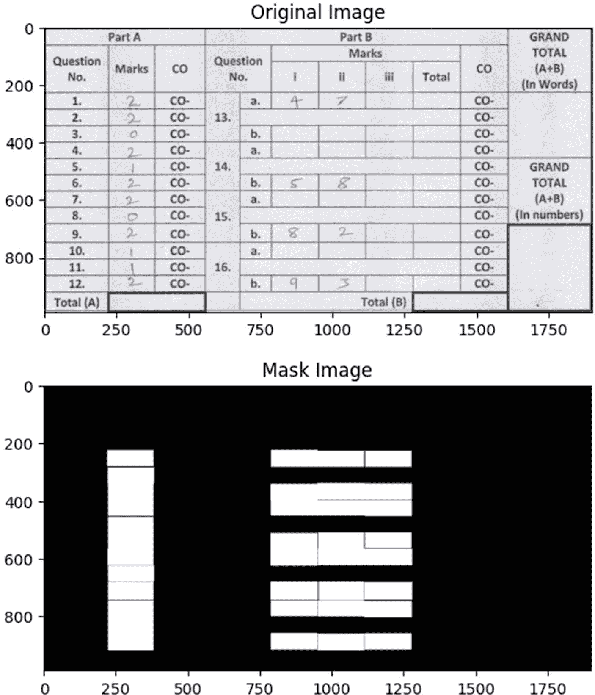

一张表格，包含题号、分数，以及分别对应 A 部分和 B 部分的 C O 列。此外，最后一列是 A 加 B 总分的文字表示。其下方是一个掩码图像，对应一个位于 250 的矩形和五个分别位于 200、400、600 和 800 的水平矩形。

图 10-9

答题纸图像和掩码图像

```
import cv2
import numpy as np
import matplotlib.pyplot as plt
from keras.models import load_model
# 加载模型
model = load_model('my_model.h5')
# 加载图像和掩码坐标
img = cv2.imread('Scripts\script_new.jpeg')
mask_coordinates = [[221,227,382,283], [223,287,384,343], [224,343,382,400], [224,398,382,455],
[224,458,382,515], [224,515,382,570], [222,570,382,626], [224,627,384,683],
[224,684,382,746], [224,748,382,807], [224,803,382,862], [224,862,382,921],
[790,226,952,285], [952,229,1113,285], [1117,229,1278,285], [788,343,952,401],
[951,341,1114,399], [1113,342,1279,399], [789,400,952,454], [952,400,1115,454],
[1115,400,1279,456], [788,514,952,570], [954,512,1113,568], [1116,512,1278,567],
[788,570,952,628], [953,568,1117,626], [1113,569,1281,626], [788,683,952,746],
[955,683,1113,748], [1114,685,1281,746], [789,748,952,803], [953,749,1116,804],
[1114,750,1279,807], [789,861,951,919], [952,863,1114,921], [1115,862,1278,919]]
# 创建掩码图像
new_array = np.zeros_like(img)
for i in mask_coordinates:
new_array[i[1]:i[3],i[0]:i[2]] = 1
image_rgb = cv2.cvtColor(img, cv2.COLOR_BGR2RGB) # 将 BGR 转换为 RGB
plt.figure()
plt.subplot(211)
plt.imshow(image_rgb)
plt.title('Original Image')
plt.subplot(212)
plt.imshow(255*new_array)
plt.title('Mask Image')
plt.show()
```

从图中可以看出，答题卡中有两个部分。A 部分由 12 道题组成，B 部分由 4 道题（含子题）组成，两个部分均已填入相应分数。现在，我们需要根据掩码坐标从原始图像中提取指定区域，对其进行预处理以适配模型，然后使用训练好的模型预测图像区域中的数字。

以下代码演示了这些操作。首先，我们使用`matplotlib`库初始化两个包含子图的图形`fig1`和`fig2`，用于显示数字的原始图像和预处理图像。为了获取这些图像，我们遍历掩码坐标列表，提取答题卡图像的特定区域。从图 10-9 中还可以注意到，B 部分中有多个方框是空的。为了在后续处理中排除这些空方框，我们使用条件语句，仅允许那些像素值方差（通过`numpy`库中的`var()`方法计算）大于 200 的方框。如果区域中包含数字，则将该图像显示在第二个图形`fig1`的对应子图中，然后通过转换为灰度图、应用二值化阈值、并调整大小为 28x28 像素进行预处理，以匹配训练好的机器学习模型的输入尺寸。预处理后的图像显示在第二个图形`fig2`的对应子图中，然后归一化到 0-1 范围，重塑为 4D 张量（批次大小、高度、宽度、通道数），并传递给`model.predict()`方法以获取数字预测结果。预测的数字被追加到 `out` 列表中，循环继续处理下一个数字。最后，使用 `plt.show()` 方法显示提取并预处理后的数字图像，分别如图 10-10 和图 10-11 所示。

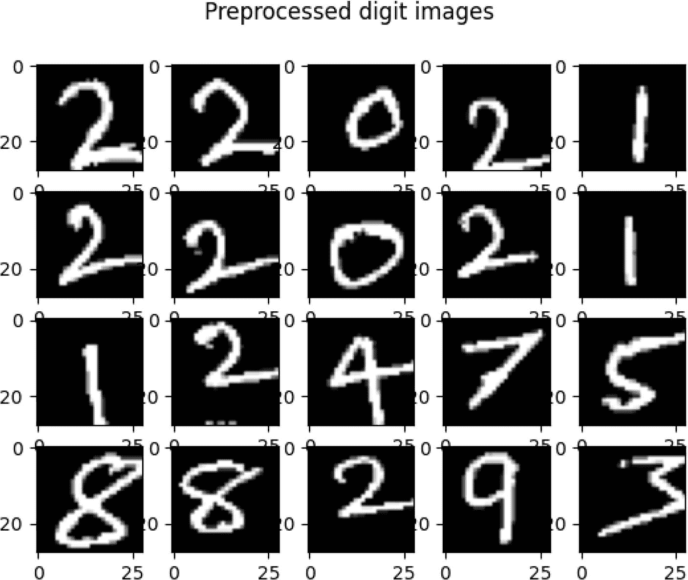

从方框中提取的预处理数字图像截图。共 20 个带数字的方框。第 1 行数值为 2、2、0、2、1，第 2 行为 2、2、0、2、1，第 3 行为 1、2、4、7、5，第 4 行为 8、8、2、9、3。

图 10-11

预处理后的数字图像

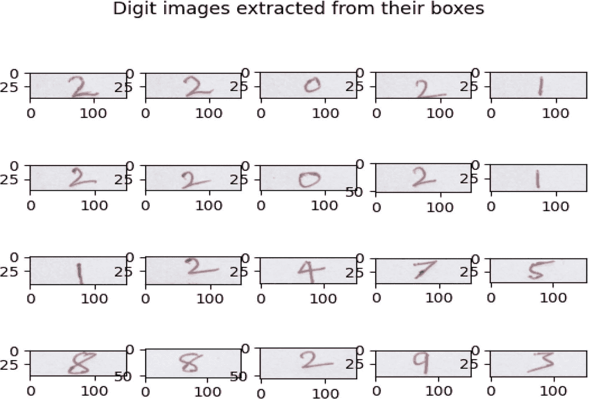

从方框中提取的数字图像截图。共 20 个带数字的方框。第 1 行分数为 2、2、0、2、1，第 2 行为 2、2、0、2、1，第 3 行为 1、2、4、7、5，第 4 行为 8、8、2、9、3。

图 10-10

使用掩码坐标提取的数字图像

```
out=[]
fig1, ax1 = plt.subplots(4, 5)
fig2, ax2 = plt.subplots(4, 5)
ax1_flat = ax1.flatten()
ax2_flat = ax2.flatten()
m=0
for i in mask_coordinates:
img_i = image_rgb[i[1]+5:i[3]-5,i[0]+5:i[2]-5]
if np.var(img_i)>200:
ax1_flat[m].plt(img_i)
# preprocess the image
gray = cv2.cvtColor(img_1[:,50:100], cv2.COLOR_RGB2GRAY)
ret, thresh = cv2.threshold(gray, 190, 255, cv2.THRESH_BINARY_INV)
resized = cv2.resize(thresh, (28, 28))
ax2_flat[m].plt(resized, cmap='gray')
# Normalize the image
normalized_image = resized / 255.0
# Reshape the image to be compatible with the model
reshaped_image = normalized_image.reshape(1, 28, 28, 1)
# Predict the digit using the model
prediction = model.predict(reshaped_image)
# Get the index of the highest confidence digit
predicted_digit_index = np.argmax(prediction)
out.append(predicted_digit_index)
m+=1
fig1.suptitle('Digit images extracted from their boxes')
fig2.suptitle('Preprocessed digit images')
plt.show()
```

所有预测的数字现在都存储在列表 `out` 中。我们不直接打印该列表，而是使用以下代码将数字与对应的题号关联起来迭代打印，如下所示。这将有助于我们轻松地将结果与原始图像进行验证。可以看出，第 4、5、11 题以及第 13、16 题的第二部分分数被模型错误检测。因此，基于 MNIST 数据集训练的模型仍然能够成功预测从外部文档（模型之前未训练过）中提取的 20 个数字中的 15 个。如本节开头所述，通过使用比这个简单 CNN 模型更复杂的模型，在更大更多样化的数据集上进行训练，可以进一步提高此性能。

```
# Print the predictions along with question numbers
print('The predicted digits are:')
print('Part A:')
for i in range(12):
print('{}. {}'.format(i+1,out[i]))
n = 13
print('Part B:')
for i in range(12,19,2):
print('{}. ({}, {})'.format(n,out[i],out[i+1]))
n+=1
```

代码输出为：

```
The predicted digits are:
Part A:
1\. 2
2\. 2
3\. 0
4\. 7
5\. 7
6\. 2
7\. 2
8\. 0
9\. 2
10\. 1
11\. 9
12\. 2
Part B:
13\. (4, 2)
14\. (5, 8)
15\. (8, 2)
16\. (9, 5)
```

我们可以通过包含字母来增强此应用。例如，读者可以尝试使用扩展 MNIST（EMNIST）数据集（包含大小写字母和数字）来开发文本提取系统。此外，此应用可以扩展到工业应用，例如在仍需要手动数据录入的场景中实现数据数字化。除了文本提取，图像分类、目标检测、目标跟踪等其他技术在工业中也有广泛应用。

例如，多年来已经开发了许多高度先进的开源基于 CNN 的模型，如 YOLO（You Only Look Once）、SSD（Single-Shot MultiBox Detector）、Faster R-CNN、Mask R-CNN 等，它们在实时目标检测中非常有效。这些模型有不同的预训练版本可用，这些版本在包含多个类别图像的大型数据集上训练，如 COCO（80 类）、CIFAR-100（100 类）、ImageNet（1000 类）等。这些预训练模型可以直接应用于真实世界的图像和视频，并具有相当好的准确性。另一方面，这些模型也可以使用与我们自己的应用相对应的图像进行自定义训练，使其更加灵活和适应性强。鼓励读者探索这些模型，以真正欣赏该领域正在进行的令人瞩目的研究和发展。

此外，我们可以使用领先云服务提供商提供的先进预训练模型 API。例如，我们已经讨论了使用谷歌云平台（GCP）和微软 Azure 提供的 Vision API 服务的 OCR 应用。除此之外，它们的 Vision API 服务还提供其他应用，如图像分类、人脸检测、目标检测等，可用于我们的应用。但读者需要注意，这些服务在免费层级中受到限制，而其他定价模式则根据使用量收费。

## 总结

在本章中，我们探讨了广泛应用于图像处理技术中的基础机器学习技术。本章内容组织如下：

* 开发机器学习应用所涉及的基本预处理步骤

* 传统机器学习技术的基本类别

* 模拟人脑行为的人工神经网络（ANN）技术背后的详细过程

* 卷积神经网络（CNN）技术背后的详细过程，以及使其能够从图像中学习模式的额外能力

* 使用 CNN 从 MNIST 数据集图像中提取手写数字

* 将手写数字学习模型应用于实时学生答题卡，以提取按章节划分的题目分数

基于对机器学习基础的扎实理解，我们将利用本书迄今为止所获得的所有知识，在下一章中继续开发工业视觉应用。