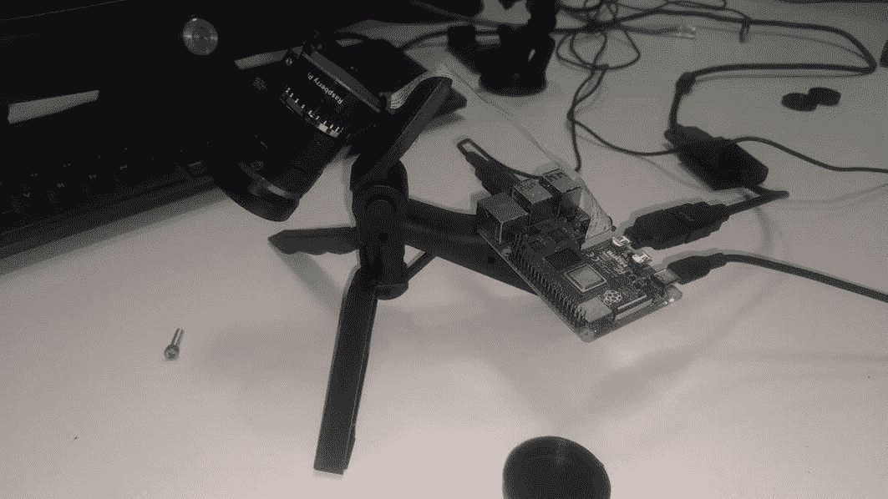
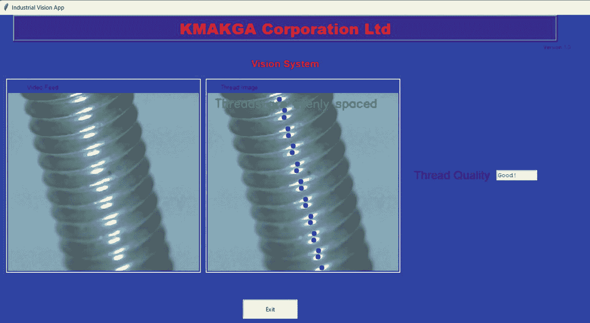
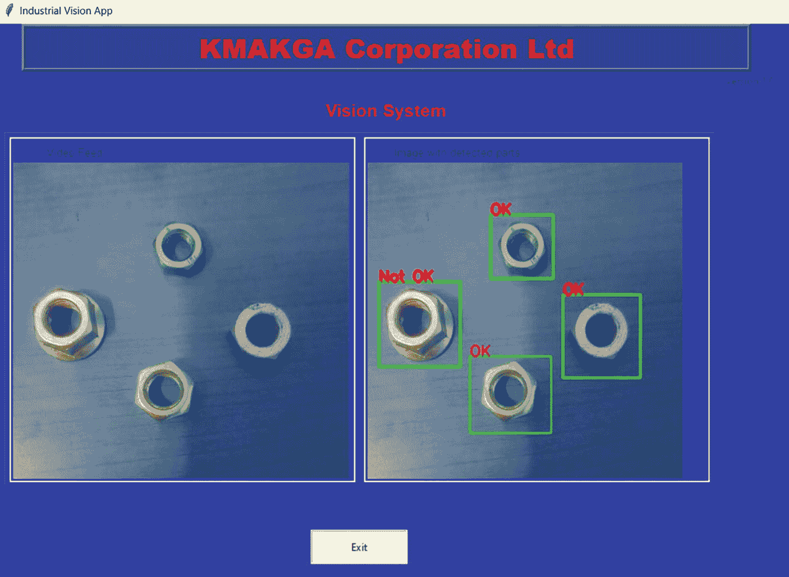
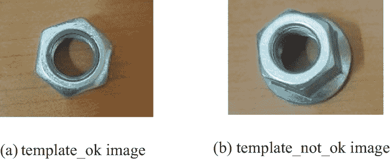
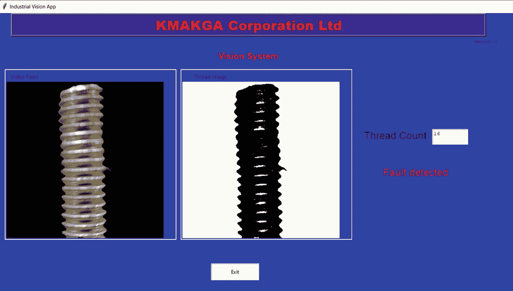
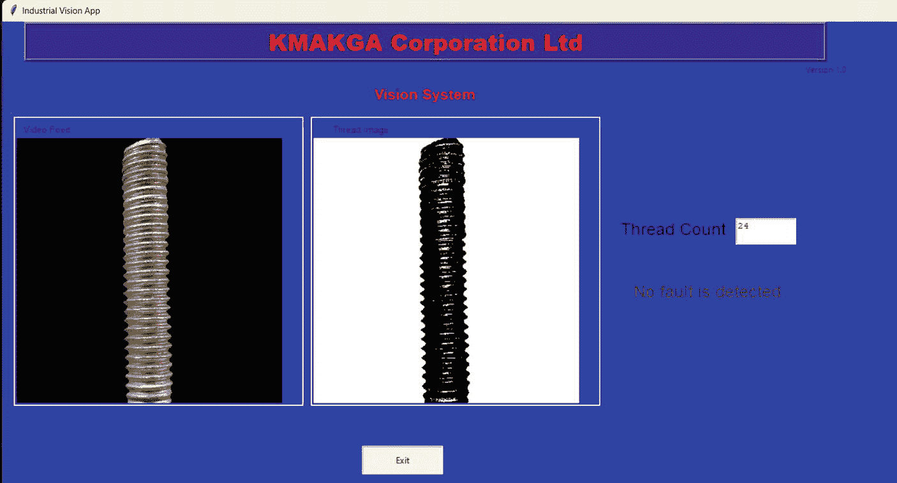
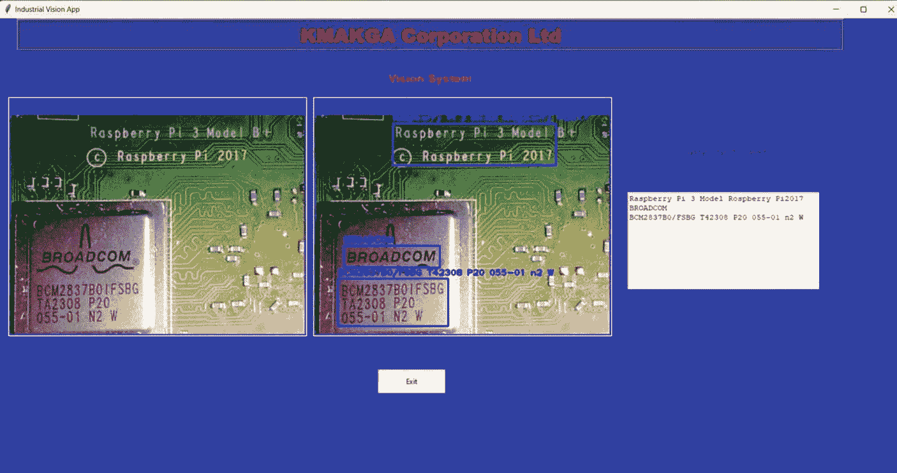

# 11. 工业视觉系统应用

我们在视觉系统方面已经涵盖了广泛的内容，从基本的图像处理技术到可用于开发能够执行关键任务的先进系统的更复杂算法。通过将此类复杂的视觉系统应用于工业领域，可以实时执行从质量控制到安全监控的众多任务，从而有助于避免人为错误。在本章中，我们将运用从各章学到的知识，为四个不同的工业应用开发视觉系统（案例研究 11.1 至 11.4）。我们还将通过将这些系统集成到易于理解的用户界面中，使其更加用户友好。

## 将摄像头与树莓派连接

将摄像头与树莓派连接是计算机视觉、监控或图像处理等多种应用中常见且有用的任务。以下是一份入门指南：

1.  选择摄像头模块：树莓派支持多种摄像头模块。官方的是树莓派摄像头模块，有不同版本（V1、V2、HQ）。选择符合您需求的版本。

2.  连接摄像头模块：将摄像头模块连接到树莓派的摄像头端口。在连接或断开摄像头模块之前，请确保关闭树莓派电源。

3.  启用摄像头接口：使用`raspi-config`启用摄像头接口。

    ```
    sudo raspi-config
    ```

    导航至“接口选项” ➤ “摄像头”并启用它。如果提示，请重新启动。

4.  检查摄像头连接：通过运行以下命令验证摄像头是否被检测到：

    ```
    vcgencmd get_camera
    ```

5.  更新和升级：保持您的树莓派软件包为最新。

    ```
    sudo apt-get update
    sudo apt-get upgrade
    ```

6.  安装摄像头软件：安装使用摄像头模块所需的软件。例如，使用 Python 的`picamera`库。

    ```
    sudo apt-get install python3-picamera
    ```

7.  捕获图像：编写一个简单的 Python 脚本来使用摄像头捕获图像。使用`picamera`库的示例：

    ```
    from picamera import PiCamera
    from time import sleep
    camera = PiCamera()
    camera.start_preview()
    sleep(5)  # 根据需要调整
    camera.capture('image.jpg')
    camera.stop_preview()
    ```

## 在树莓派中处理视频

在树莓派上处理视频时，特别是使用树莓派摄像头模块或 USB 摄像头时，您将遵循与处理图像类似的方法，但需要对视频录制和处理进行一些修改。以下是入门步骤。

1.  使用 Python 脚本捕获视频：

    ```
    from picamera import PiCamera
    from time import sleep
    camera = PiCamera()
    camera.start_recording('video.h264')
    sleep(10)  # 录制 10 秒（根据需要调整）
    camera.stop_recording()
    ```

2.  将 H.264 转换为 MP4。捕获的视频是 H.264 格式。您可能需要将其转换为 MP4 以获得更广泛的兼容性：

    ```
    MP4Box -add video.h264 video.mp4
    ```

3.  视频流。您还可以使用`raspivid`等工具或修改 Python 脚本来流式传输实时视频：

    ```
    from picamera import PiCamera
    from time import sleep
    camera = PiCamera()
    camera.start_preview()
    camera.start_recording('video.h264')
    sleep(10)
    camera.stop_recording()
    camera.stop_preview()
    ```

4.  高级视频处理。如果您正在进行视频处理，请考虑使用 OpenCV 等库。在您的树莓派上安装 OpenCV：

    ```
    sudo apt-get install libopencv-dev python3-opencv
    ```

5.  OpenCV 视频处理示例。使用 OpenCV 读取视频文件并处理帧：

    ```
    import cv2
    video_capture = cv2.VideoCapture('video.mp4')
    while True:
    ret, frame = video_capture.read()
    # 在此处编写您的图像处理代码
    cv2.imshow('Video', frame)
    if cv2.waitKey(1) & 0xFF == ord('q'):
    break
    video_capture.release()
    cv2.destroyAllWindows()
    ```


## 案例研究 11.1：检测螺母和螺栓的螺纹质量

视觉系统能够显著提升螺母和螺栓的质量控制流程，通过提供关于螺纹质量和特性的详细洞察。利用高分辨率摄像头和复杂的图像处理算法，视觉系统可以捕捉并分析螺纹的各个方面，包括螺距、深度、形状和表面光洁度。视觉系统的一个关键优势是能够检测肉眼可能无法发现的缺陷。例如，它可以识别不完整的螺纹，这可能导致装配不当并降低连接强度。它还可以检测螺纹损伤，如刻痕或毛刺，这些都可能损害紧固件的完整性。此外，视觉系统可以评估螺纹的整体质量，包括其均匀性和一致性。通过分析一批螺母和螺栓样本中的多个螺纹，系统可以检测出可能表明制造问题的螺距或深度变化。而且，视觉系统可以提供关于螺纹尺寸和特性的定量数据。这些数据可用于确保螺母和螺栓符合指定的标准和公差，也可用于工艺优化，使制造商能够识别并纠正生产过程中的问题。总体而言，视觉系统为评估螺母和螺栓的螺纹质量提供了一种全面且可靠的方法。其检测缺陷、评估螺纹质量以及提供定量数据的能力，使其成为确保紧固件在各种应用中可靠性和性能的宝贵工具。

在本案例研究中，我们将开发一个视觉系统来检查螺栓是否具有均匀间隔的螺纹，这对于确保螺栓的可靠性和安装便利性至关重要。我们首先设置一个连接到树莓派板的 Pi 摄像头，用于捕捉实时视频流。此设置如图 11-1 所示。一旦摄像头设置好以捕捉其视线内的螺栓图像，我们需要按照第 2 章的讨论，在树莓派操作系统中进行初始配置。然后，我们需要使用 pip 安装 *picamera* 库。完成这些初始步骤后，我们就可以继续开发用于捕捉视频帧并确定螺纹质量的代码了。



一张照片展示了连接到树莓派板的 Pi 摄像头的设置。

图 11-1

将摄像头连接到树莓派板以捕捉螺栓图像

我们将首先创建一个用于检测螺纹质量的函数，如下所示，开始代码开发。该函数为确定螺栓图像中螺纹间距所执行的操作如下：

1.  将输入帧转换为灰度图。
2.  使用 *GaussianBlur*() 函数应用高斯模糊以减少噪声。
3.  使用 *threshold()* 函数应用阈值处理以获得二值图像。
4.  轮廓检测：应用 *findContours()* 函数在二值图像中查找代表螺母螺纹的轮廓。
5.  轮廓过滤：过滤掉过大或过小、可能是噪声的轮廓。这是通过对检测到的轮廓应用 *contourArea()* 函数确定的轮廓面积设置下限和上限阈值来实现的。
6.  中心计算：对于每个有效轮廓，我们通过寻找其质心来计算轮廓的中心。这是通过以下步骤将轮廓近似为多边形来完成的：
    1.  我们首先确定轮廓近似的容差参数 *epsilon*。这是通过将该参数设置为轮廓周长的一个小百分比（0.02）来实现的，周长使用 *arcLength()* 函数确定。
    2.  然后使用 *approxPolyDP()* 函数，利用上一步计算出的容差参数将轮廓近似为多边形。
    3.  接下来，使用 *moments()* 函数计算近似多边形的矩。
    4.  如果表示总像素数的零阶矩不为零，则我们使用一阶矩 *M["m10"]* 和 *M["m01"]* 除以零阶矩 *M["m00"]* 来计算近似多边形质心的 x 和 y 坐标。
7.  最后，我们计算相邻螺纹中心之间的距离，然后计算螺纹之间的平均距离。如果螺纹之间的距离与平均距离的偏差在 5 个像素的容差范围内，则认为螺纹是均匀间隔的。
8.  为了在图像上显示螺纹是否均匀间隔的结果，我们使用 *putText()* 函数。

该函数返回最终的图像，其中包含间距细节以及螺纹质量状态（“良好！”或“不良！”），如下代码所示。

```
import cv2
import numpy as np
from picamera import PiCamera
from picamera.array import PiRGBArray
def detect_thread_quality(image):
gray = cv2.cvtColor(image, cv2.COLOR_BGR2GRAY)
# 应用高斯模糊以减少噪声
blur = cv2.GaussianBlur(gray, (5, 5), 0)
# 应用阈值处理以获得二值图像
_, thresh = cv2.threshold(blur, 200, 255, cv2.THRESH_BINARY)
# 查找轮廓
contours, _ = cv2.findContours(thresh, cv2.RETR_TREE, cv2.CHAIN_APPROX_SIMPLE)
# 过滤掉过大或过小的轮廓
valid_contours = []
for contour in contours:
area = cv2.contourArea(contour)
if 100 < area < 500:
valid_contours.append(contour)
# 计算每个有效轮廓的中心
centers = []
for contour in valid_contours:
epsilon = 0.02 * cv2.arcLength(contour, True)
approx = cv2.approxPolyDP(contour, epsilon, True)
M = cv2.moments(approx)
if M["m00"] != 0:
cX = int(M["m10"] / M["m00"])
cY = int(M["m01"] / M["m00"])
centers.append((cX, cY))
# 计算相邻中心之间的距离
if len(centers) > 1:
distances = [centers[i+1][0] - centers[i][0] for i in range(len(centers)-1)]
avg_distance = sum(distances) / len(distances)
is_evenly_spaced = all(abs(d - avg_distance) < 12 for d in distances)
# 根据平均距离显示螺纹是否均匀间隔
if is_evenly_spaced:
cv2.putText(image, "Threads are evenly spaced", (20, 30), cv2.FONT_HERSHEY_SIMPLEX, 0.8, (0, 255, 0), 2)
status = 'Good!'
else:
cv2.putText(image, "Threads are not evenly spaced", (20, 30), cv2.FONT_HERSHEY_SIMPLEX, 0.8, (0, 0, 255), 2)
status = 'Bad!'
# 在螺纹周围画圆
for center in centers:
cv2.circle(image, center, 5, (0, 0, 255), -1)
return status, image
```

在下一阶段，我们将使用该函数从视频流中的螺栓图像检测螺纹质量，并将结果显示在图形用户界面中。为此，我们将重用我们在第 6 章中开发的图形用户界面，并根据我们的用例进行一些改进，如下所示。首先，我们从 picamera 库中导入 *picamera* 方法，该方法允许我们使用 Pi 摄像头捕捉图像，并导入 *PiRGBArray* 方法，该方法允许我们将捕捉到的帧作为原始 numpy 数组读取。图形用户界面由两个框架组成。第一个框架包含两个视频画布，第一个画布用于显示 Pi 摄像头捕捉到的帧，第二个画布用于显示由我们的函数返回的处理后的帧，并标记有螺纹中心以及包含螺纹间距细节的文本。第二个框架与包含画布的第一个框架平行放置，包含一个带有文本 *Thread Quality* 的标签小部件和一个用于显示从我们的函数接收到的螺纹质量状态的输入小部件。图形用户界面中显示的最终输出如图 11-2 所示。



一张截图展示了螺纹质量检测系统的两张照片。螺纹均匀间隔。

图 11-2

螺纹质量检测系统示意图


```python
from tkinter import *
from tkinter import filedialog
import cv2
from PIL import Image, ImageTk
import datetime
from picamera import PiCamera
from picamera.array import PiRGBArray
from ocr_det import ocr_det
# 创建主应用程序窗口
root = Tk()
root.title("工业视觉应用")
root.geometry("1600x1000")
root.configure(bg="blue")
# 关闭窗口的函数
def close_window():
    root.destroy()
# 创建标签
company_label = Label(root, text="KMAKGA 股份有限公司",
                      borderwidth=5, relief="ridge",
                      font=("Arial Black", 24), fg="red", bg="dark blue")
company_label.grid(row=0, column=0, columnspan=4, padx=30, pady=0, sticky="ew")
version_label = Label(root, text="版本 1.0", bg="blue")
version_label.grid(row=1, column=2, padx=0, pady=0, sticky="e")
vision_label = Label(root, text="视觉系统", font=("Helvetica", 16, "bold"), fg="red", bg="blue")
vision_label.grid(row=2, column=0, columnspan=3, padx=0, pady=10, sticky="ew")
# 创建用于容纳画布的框架
frame = Frame(root, width=800, height=800, relief="ridge", borderwidth=1, bg="blue")
frame.grid(row=3, column=0, padx=10, pady=0)
# 创建画布
video_canvas1 = Canvas(frame, borderwidth=2, width=500, height=400, bg="blue")
video_canvas1.grid(row=3, column=0, padx=5, pady=5)
video_canvas2 = Canvas(frame, borderwidth=2, width=500, height=400, bg="blue")
video_canvas2.grid(row=3, column=1, padx=5, pady=5)
video_canvas1.create_text(80, 10, text="视频源", font=("Helvetica", 10), anchor="ne")
video_canvas2.create_text(110, 10, text="螺纹图像", font=("Helvetica", 10), anchor="ne")
# 创建用于显示螺纹质量的框架
entry_frame = Frame(root, width=200, height=400, bg="blue")
entry = Text(entry_frame, borderwidth=2, relief="ridge", height=1, width=10)
label = Label(entry_frame, text='螺纹质量', font=("Helvetica", 18), fg="black", bg="blue")
label.grid(row=1, column=0, padx=5, pady=25, sticky="n")
entry.grid(row=1, column=1, padx=5, pady=25, sticky="w")
entry_frame.grid(row=3, column=1, padx=5, pady=5)
# 创建关闭按钮
close_button = Button(root, width=15, height=2, borderwidth=2, relief="ridge", text="退出", command=close_window)
close_button.grid(row=4, column=0, columnspan=2, padx=0, pady=50, sticky="n")
# 使用网络摄像头源更新视频画布的函数
def update_video_canvas():
    for frame in camera.capture_continuous(cap, format='bgr', use_video_port=True):
        # 在第一个画布中显示原始视频
        orig_photo = ImageTk.PhotoImage(image=Image.fromarray(frame.array))  # 获取帧数据
        video_canvas1.create_image(0, 30, image=orig_photo, anchor=NW)
        video_canvas1.photo = orig_photo
        # 螺纹质量检测
        status, thread_dist_img = detect_thread_quality(frame.array)  # 获取帧数据
        thread_photo = ImageTk.PhotoImage(image=Image.fromarray(thread_dist_img))
        video_canvas2.create_image(0, 30, image=thread_photo, anchor=NW)
        video_canvas2.photo = thread_photo
        # 将状态更新到文本输入组件
        entry.delete(0.0, END)
        entry.insert(END, status)
        video_canvas1.after(10, update_video_canvas)  # 安排下一次更新
        cap.truncate(0)
# 打开树莓派摄像头
camera = PiCamera()
cap = PiRGBArray(camera)
# 调用 update_video_canvas 函数开始显示视频源
update_video_canvas()
# 启动 tkinter 主循环
root.mainloop()
```

## 案例研究 11.2：识别一组组件中的不匹配组件

识别工业组件涉及识别其特性、功能和规格。这项技能对于制造、汽车和电子等行业的维护、维修和更换活动至关重要。以下是在工业环境中识别合格与不合格零件的方法：

*   **物理检查**：首先目视检查组件。寻找任何损坏、磨损或腐蚀的迹象。检查是否有任何可见的标记或标签，指示零件编号、制造商或规格。

*   **测量**：使用精密测量工具，如卡尺、千分尺或量规，测量组件的尺寸。将测量值与制造商提供的规格进行比较，以确保其在公差范围内。

*   **功能测试**：如果可能，测试组件以确保其功能正常。这可能涉及将其连接到测试台或系统以验证其性能。

*   **文档查阅**：参考技术文档，如手册、数据表或原理图，以识别组件并验证其规格。将信息与组件的物理特性进行交叉引用。

*   **制造商信息**：查找任何指示组件制造商的标记或标签。这有助于验证其真实性和质量。

*   **在线资源**：使用在线资源，如制造商网站、论坛或数据库，来研究组件并查找相关信息。

*   **咨询**：如果对组件的识别不明确，请咨询可能具有类似组件经验的同事、行业专家或供应商。

在工业环境中识别合格与不合格零件对于保持运营效率、确保安全和避免代价高昂的停机时间至关重要。通过遵循这些指南并使用正确的工具和资源，可以准确识别工业组件，从而对其维护和更换做出明智的决策。

实施用于识别合格与不合格零件的工业视觉系统具有众多优势。首先，此类系统提供高精度，超越人工检测方法并减少错误。其次，它们高速运行，提高生产效率并最大限度地减少停机时间。第三，工业视觉系统确保结果一致，对所有零件应用相同的检测标准。此外，虽然可能存在初始设置成本，但由于减少了劳动力支出并提高了运营效率，这些系统从长远来看可能具有成本效益。而且，这些系统非常灵活，可以轻松适应检测不同零件或适应生产过程的变化。它们还能实现数据收集，用于分析和流程改进。此外，将视觉系统与其他工业系统集成，可以实现完全自动化的生产线。通过及早发现缺陷，这些系统提高了产品质量并减少了浪费。最后，通过自动化检测过程，工业视觉系统最大限度地减少了在危险环境中进行人工检测的需求，从而提高了工作场所的安全性。

在本案例研究中，我们将开发一个系统，使用一种称为模板匹配的技术来识别不匹配的组件。我们将首先定义一个用于识别不匹配组件的函数，然后像之前的用例一样，在 GUI 代码内部调用此函数，以将函数应用于实时视频帧。以下代码说明了此函数，该函数将捕获的视频帧以及合格和不合格图像的模板图像作为输入，并生成一张图像，其中每个组件的状态都标记在其上，并带有一个边界框。以下是代码中涉及的步骤：


*   **模板匹配**：使用 *OpenCV 的 matchTemplate()* 函数在视频的每一帧中查找模板。该函数的参数包括输入帧、模板图像以及模板匹配模式。在我们的示例中，我们使用了 *TM_CCOEFF_NORMED* 模式，该模式利用归一化互相关系数来衡量捕获帧与模板图像之间的相似度。

*   **寻找最佳匹配**：接着，使用 *numpy* 库中的 *where()* 函数，通过与一个阈值进行比较，来定位每一帧中每个模板的最佳匹配位置。这个阈值有助于过滤掉置信度较低的匹配，从而减少误报。上述两个步骤分别针对 OK 图像和 Not OK 图像各执行一次。

*   **绘制矩形**：然后，使用 *rectangle()* 函数在检测到的区域周围为 OK 和 Not OK 图像分别创建边界框，并使用 *putText()* 函数将这些区域分别标记为“OK”或“Not OK”。

```
import cv2
import numpy as np
import cv2
import numpy as np
def component_id(frame, template_ok, template_not_ok):
w_ok, h_ok = template_ok.shape[::-1]
w_not_ok, h_not_ok = template_not_ok.shape[::-1]
# Convert frame to grayscale
gray_frame = cv2.cvtColor(frame, cv2.COLOR_BGR2GRAY)
# Perform template matching for "OK" part
res_ok = cv2.matchTemplate(gray_frame, template_ok, cv2.TM_CCOEFF_NORMED)
threshold_ok = 0.8
loc_ok = np.where(res_ok >= threshold_ok)
# Perform template matching for "Not OK" part
res_not_ok = cv2.matchTemplate(gray_frame, template_not_ok, cv2.TM_CCOEFF_NORMED)
threshold_not_ok = 0.8
loc_not_ok = np.where(res_not_ok >= threshold_not_ok)
# Draw rectangles for "OK" part
for pt in zip(*loc_ok[::-1]):
cv2.rectangle(frame, pt, (pt[0] + w_ok, pt[1] + h_ok), (0, 255, 0), 2)
cv2.putText(frame, 'OK', pt, cv2.FONT_HERSHEY_SIMPLEX, 0.5, (255, 255, 255), 2)
# Draw rectangles for "Not OK" part
for pt in zip(*loc_not_ok[::-1]):
cv2.rectangle(frame, pt, (pt[0] + w_not_ok, pt[1] + h_not_ok), (0, 0, 255), 2)
cv2.putText(frame, 'Not OK', pt, cv2.FONT_HERSHEY_SIMPLEX, 0.5, (255, 255, 255), 2)
return  frame
```

该函数将返回处理后的帧，其中每个对象都被边界框包围并带有相应的标签。下一步是在 GUI 代码中调用此函数，将其应用于网络摄像头捕获的帧上，如下所示。GUI 由一个包含两个画布的单帧组成，用于显示原始视频的帧以及上述函数生成的输出帧。模板函数（如图 11-3 所示）通过代码中的 *imread()* 函数读取。鼓励读者像我们在第 6 章中所做的那样，创建按钮小部件来浏览和选择模板图像。该系统的 GUI 示意图如图 11-4 所示。



一张显示视觉系统两张照片的截图。1. 四个组件图像。b. 三个组件被框出并标记为“OK”，而一个组件被框出并标记为“Not OK”。

图 11-4

匹配组件检测示意图



两张模板图像的照片。a. 模板-OK 图像。b. 模板-Not OK 图像。

图 11-3

模板图像

```
from tkinter import *
from tkinter import filedialog
import cv2
from PIL import Image, ImageTk
import datetime
from picamera import PiCamera
from picamera.array import PiRGBArray
from unmatched_part_detection import unmatched_part_detection
# Create the main application window
root = Tk()
root.title("Industrial Vision App")
root.geometry("1600x1000")
root.configure(bg="blue")
# Function to close the window
def close_window():
root.destroy()
# Create labels
company_label = Label(root, text="KMAKGA Corporation Ltd",
borderwidth=5, relief="ridge",
font=("Arial Black", 24),fg="red", bg="dark blue")
company_label.grid(row=0,column=0,columnspan=4,padx=30,pady=0,sticky="ew")
version_label = Label(root, text="Version 1.0",bg="blue")
version_label.grid(row=1,column=2,padx=0,pady=0,sticky="e")
vision_label = Label(root, text="Vision System", font=("Helvetica", 16,"bold"), fg="red", bg="blue")
vision_label.grid(row=2, column=0, columnspan=3, padx=0, pady=10, sticky="ew")
# Create a frame to hold the canvases
frame = Frame(root, width=800, height=800, relief="ridge", borderwidth=1,bg="blue")
frame.grid(row=3,column=0,padx=10,pady=0)
# Create canvases
video_canvas1 = Canvas(frame, borderwidth=2, width=500, height=400, bg="blue")
video_canvas1.grid(row=3,column=0,padx=5,pady=5)
video_canvas2 = Canvas(frame, borderwidth=2, width=500, height=400, bg="blue")
video_canvas2.grid(row=3,column=1,padx=5,pady=5)
video_canvas1.create_text(80, 10, text="Video Feed", font=("Helvetica", 10), anchor="ne")
video_canvas2.create_text(110, 10, text="Image with detected parts", font=("Helvetica", 10), anchor="ne")
# create a close button
close_button = Button(root, width=15, height=2, borderwidth=2, relief="ridge", text="Exit", command=close_window)
close_button.grid(row=4, column=0, columnspan=2, padx=0, pady=50, sticky="n")
# Load the template images
template_ok = cv2.imread("template_ok.jpg")
template_not_ok = cv2.imread("template_not_ok.jpg")
# Function to update the video canvas with webcam feed
def update_video_canvas():
for frame in camera.capture_continuous(cap, format='bgr', use_video_port=True):
# Display original video in the first canvas
orig_photo = ImageTk.PhotoImage(image= Image.fromarray(frame))
video_canvas1.create_image(0, 30, image=orig_photo, anchor=NW)
video_canvas1.photo = orig_photo
# Matched parts detection
parts_match_img = unmatched_part_detection(frame, template_ok, template_not_ok)
parts_img = ImageTk.PhotoImage(image=  Image.fromarray(parts_match_img))
video_canvas2.create_image(0, 30, image=parts_img, anchor=NW)
video_canvas2.photo = parts_img
video_canvas1.after(10, update_video_canvas)
cap.truncate(0)
# Open the Pi cam
camera = PiCamera()
cap = PiRGBArray(camera)
# Call the update_video_canvas function to start displaying the video feed
update_video_canvas()
# Start the tkinter main loop
root.mainloop()
```


## 案例研究 11.3：螺纹数量检测系统

在制造业中，质量控制至关重要，每个部件的完整性都关系到产品的整体功能和安全性。螺母和螺栓等螺纹紧固件是这些行业中的关键部件，它们在连接不同零件方面起着重要作用。为了确保装配过程中的兼容性和可靠性，螺母和螺栓必须具有精确的螺纹数量。为了无需人工即可验证螺纹数量，计算机视觉技术可以提供一种更可靠、更有效的替代方案。通过集成摄像头和图像处理算法，该系统可以快速、精确地计算螺母和螺栓上的螺纹数量。

在本节中，我们将讨论如何实现一个视觉系统，以确保螺栓的螺纹数量符合预定义的标准。我们首先定义一个函数 *thread_count()*，用于计算给定螺栓图像中的螺纹数量。该函数将图像和用于二值化阈值操作的阈值作为输入，如下代码所示。由于我们不关心颜色信息，因此首先将输入图像转换为灰度图像，然后使用 opencv 库中的 *bitwise_not()* 函数对其进行反转，并将其输入到我们在第 5 章中讨论过的 *threshold()* 函数中。我们作为 *thread_count()* 函数输入获得的阈值将提供给这个 *threshold()* 方法。然后，通过从最大像素值 255 中减去阈值图像中的像素值来反转这些像素，从而在白色背景上得到螺栓的黑色图像。接下来，我们使用 *findContours()* 方法从图像中提取轮廓，这有助于识别图像中由螺纹形成的不同形状。然后使用 *contourArea()* 方法确定每个轮廓的面积，该面积可用于过滤掉由图像中的噪声分量形成的虚假轮廓。这里我们使用面积阈值 4，这意味着一个轮廓的面积必须大于 4 才能被视为一个螺纹。因此，可以通过计算面积大于 4 的轮廓数量来确定螺纹数量。

```
import cv2
def thread_count(img, thres):
img_gray=cv2.cvtColor(img,cv2.COLOR_BGR2GRAY)
inv_img=cv2.bitwise_not(img_gray)   #invert b&w colors
res,thresh_img=cv2.threshold(inv_img, thres, 255, cv2.THRESH_BINARY_INV)
thresh_img=255- thresh_img
contours,hierarchy=cv2.findContours(thresh_img, cv2.RETR_TREE,cv2.CHAIN_APPROX_SIMPLE)
area = []
for i in range(len(contours)):
area.append(cv2.contourArea(contours[i]))
count=len([num for num in area if num > 4])
return count, thresh_img
```

现在，我们可以从 GUI 代码内部调用此函数，如下所示，将其应用于从视频中捕获的实时帧。与我们之前的螺纹质量检测系统一样，我们在一个框架内放置了两个视频画布，一个用于显示捕获的视频帧，另一个用于显示使用 *thread_count()* 函数进行阈值处理后的反转帧。另一个框架包含两个标签：一个标签带有文本 *Thread count*，旁边是一个用于显示计数的文本小部件；另一个标签用于显示是否在螺栓图像中检测到故障。我们将捕获的帧传递给 *thread_count()* 函数，该函数将产生两个输出：存储在变量 *sumt* 中的螺纹计数，以及存储在变量 *thresh_img* 中的阈值图像的反转版本。在我们的示例中，为该函数提供了阈值 202，但该值将根据图像的性质而变化。原始视频帧显示在第一个画布中，反转帧显示在第二个画布中。

然后，对 *sumt* 变量使用条件语句来确定螺栓是否存在任何故障。我们使用阈值 20，这意味着输入的螺栓图像应至少有 20 个螺纹，如果少于这个数量，则判定为故障部件。因此，在条件为“*True*”的情况下，我们将字符串“*No fault is detected*”传递给文本小部件；在条件为“*False*”的情况下，传递字符串“*Fault detected*”。为了使消息具有区分性，我们将“*True*”条件的结果显示为绿色，“*False*”条件的结果显示为红色。此外，在检测到故障部件时，我们使用 *winsound* 库中的 *beep()* 方法产生三声蜂鸣。我们可以通过调整 *beep()* 函数的两个输入参数来配置声音的频率和持续时间。两种用例分别如图 11-5 和 11-6 所示。



一张屏幕截图显示了两张使用螺纹数量检测故障部件的照片。1. 视频源。2. 螺纹图像。其中包含文字“检测到故障”。螺纹总数为 16。

图 11-6

使用螺纹数量检测故障部件



一张屏幕截图显示了两张使用螺纹数量检测合格部件的照片。1. 视频源。2. 螺纹图像。其中包含文字“未检测到故障”。螺纹总数为 24。

图 11-5

使用螺纹数量检测合格部件


```
from tkinter import *
from tkinter import filedialog
import cv2
from PIL import Image, ImageTk
import time
from picamera import PiCamera
from picamera.array import PiRGBArray
from thread_count import thread_count
import winsound
# 创建主应用程序窗口
root = Tk()
root.title("工业视觉应用")
root.geometry("1600x1000")
root.configure(bg="blue")
# 关闭窗口的函数
def close_window():
root.destroy()
# 创建标签
company_label = Label(root, text="KMAKGA 股份有限公司",
borderwidth=5, relief="ridge",
font=("Arial Black", 24),fg="red", bg="dark blue")
company_label.grid(row=0, column=0, columnspan=4, padx=30, pady=0, sticky="ew")
version_label = Label(root, text="版本 1.0",bg="blue")
version_label.grid(row=1,column=2,padx=0,pady=0,sticky="e")
vision_label = Label(root, text="视觉系统", font=("Helvetica", 16,"bold"), fg="red", bg="blue")
vision_label.grid(row=2, column=0, columnspan=3, padx=0, pady=10, sticky="ew")
# 创建用于容纳画布的框架
frame = Frame(root, width=800, height=800, relief="ridge", borderwidth=1, bg="blue")
frame.grid(row=3,column=0,padx=10,pady=0)
# 创建画布
video_canvas1 = Canvas(frame, borderwidth=2, width=500, height=400, bg="blue")
video_canvas1.grid(row=3,column=0,padx=5,pady=5)
video_canvas2 = Canvas(frame, borderwidth=2, width=500, height=400, bg="blue")
video_canvas2.grid(row=3,column=1,padx=5,pady=5)
video_canvas1.create_text(80, 10, text="视频源", font=("Helvetica", 10), anchor="ne")
video_canvas2.create_text(110, 10, text="螺纹图像", font=("Helvetica", 10), anchor="ne")
# 创建用于容纳配置选项的框架
entry_frame = Frame(root, width = 200, height = 400, bg="blue")
label1 = Label(entry_frame, text='螺纹计数', font=("Helvetica", 18), fg="black", bg="blue")
entry = Text(entry_frame, borderwidth=2, relief="ridge", height=10, width=40)
label2 = Label(entry_frame, text=' ', font=("Helvetica", 18), fg="black", bg="blue")
label1.grid(row=0, column=0, padx=5, pady=25, sticky="n")
entry.grid(row=0, column=1, padx=5, pady=25, sticky="w")
label2.grid(row=3, column=0, columnspan=2, padx=5, pady=25, sticky="n")
entry_frame.grid(row=3, column=1, padx=5, pady=5)
# 创建关闭按钮
close_button = Button(root, width=15, height=2, borderwidth=2, relief="ridge", text="退出", command=close_window)
close_button.grid(row=4,column=0,columnspan=2,padx=0,pady=50,sticky="n")
# 更新视频画布以显示摄像头源的函数
def update_video_canvas():
for frame in camera.capture_continuous(cap, format='bgr', use_video_port=True):
# 在第一个画布中显示原始视频
orig_photo = ImageTk.PhotoImage(image = Image.fromarray(frame))
video_canvas1.create_image(0, 30, image=orig_photo, anchor=NW)
video_canvas1.photo = orig_photo
# 螺纹检测
sumt, thresh_img = thread_count(frame,202)
thread_photo = ImageTk.PhotoImage(image = Image.fromarray(thresh_img))
video_canvas2.create_image(0, 30, image = thread_photo, anchor=NW)
video_canvas2.photo = thread_photo
# 将螺纹故障状态更新到文本输入组件
if sumt>=20:
entry.delete(0.0, END)
entry.insert(END, sumt)
label2.config(text = "未检测到故障", fg = "green")
label2.update()
else:
entry.delete(0.0, END)
entry.insert(END, sumt)
label2.config(text="检测到故障", fg="red")
winsound.Beep(440, 500)
winsound.Beep(440, 500)
winsound.Beep(440, 500)
video_canvas1.after(10, update_video_canvas)
cap.truncate(0)
# 打开树莓派摄像头
camera = PiCamera()
cap = PiRGBArray(camera)
# 调用 update_video_canvas 函数开始显示视频源
update_video_canvas()
# 启动 tkinter 主循环
root.mainloop()
```

## 案例研究 11.4：用于文本提取的 OCR 系统

我们已经在第 9 章详细讨论过 OCR 系统，并了解了实现它的不同方法。在本节中，让我们采用其中一种方法，实现一个完整的 OCR 系统，该系统能够从视频源中检测图像、提取图像中的文本并显示结果。我们将使用基于 EasyOCR Python 库的文本提取功能，同时显示来自摄像头的视频源，以及带有提取文本标注的图像和打印出的文本，所有这些都集成在我们于第 6 章构建的 GUI 中。

首先，我们将基于 easyocr 的 OCR 代码转换为一个用户自定义函数，该函数以图像作为输入，并返回标注后的图像以及检测到的文本作为输出。该函数如下列代码所示。我们将其命名为 *ocr_det*，它接收由变量 *img* 表示的图像作为输入，并返回标注后的图像（即同一变量中的图像，上面标记了边界框和文本标签）以及由变量 *t* 表示的检测到的文本字符串。在函数内部，使用 *easyocr* 库中的 *Reader()* 方法创建读取器对象，然后使用该读取器对象的 *readtext*() 方法从图像中检测文本。该方法输出的结果由变量 *results* 表示，其中包含与图像中不同文本对象对应的多个边界框以及相应的文本字符串。我们遍历此输出，读取文本字符串并在同一输入图像上标记边界框和文本。我们在此添加的额外组件是变量 *t*，它在循环之前被初始化为空字符串。每次迭代时，*results* 变量中对应的文本都会被拼接到该变量中。

```
import easyocr
import cv2
def ocr_det(img):
# 创建读取器对象并从图像中提取文本
reader = easyocr.Reader(['en'],gpu=False)
results = reader.readtext(img,paragraph=True)
# 创建边界框并在图像上显示提取的文本
t = ''
for (bbox, text) in results:
(tl, tr, br, bl) = bbox
t += text  + '\n'
tl = (int(tl[0]), int(tl[1]))
tr = (int(tr[0]), int(tr[1]))
br = (int(br[0]), int(br[1]))
bl = (int(bl[0]), int(bl[1]))
cv2.rectangle(img, tl, br, (0, 0, 255), 2)
cv2.putText(img, text, (tl[0], tl[1]-5),
cv2.FONT_HERSHEY_PLAIN, 1,(0,0,255),2)
return img, t
```


现在我们已经使用 *easyocr* 库编写了作为用户自定义函数的 OCR 系统代码，下一步是重新设计 GUI 以适应这一用例。以下代码展示了我们为 OCR 系统设计的新 GUI。该 GUI 包含两个框架。第一个框架由两个视频画布组成，一个用于显示捕获图像的原始视频，另一个用于显示文本提取后的图像，并在文本区域周围标记边界框及相应的文本标签。第二个框架包含一个用于显示文本输出标题的标签控件和一个用于显示从图像中提取的实际文本的文本控件。要调用我们之前创建的 *ocr_det* 函数，我们需要通过用于保存代码的文件名从代码中导入该函数。由于在我们的案例中，代码保存的文件名与函数名相同，因此我们按如下方式导入函数：*from ocr_det import ocr_det*。导入所有必需的库并创建所有控件后，我们定义一个程序，从视频捕获对象中读取帧，然后应用 *ocr_det* 函数从图像中提取文本。如前所述，该函数将返回一个带有边界框和相应标签的标记图像，以及包含所有提取文本的文本字符串。原始视频帧显示在 *video_canvas1* 中，由函数创建的带有边界框和标签的帧显示在 *video_canvas2* 中，文本字符串则显示在文本控件中，如图 11-7 所示。



一张截图展示了检测光学字符识别的两张照片。a. 树莓派 3 型号。b. 带有检测文本的树莓派 3 型号。其中包含一个消息框，显示文本“raspberry P I 3 model raspberry P I 2017 broad C C M”。

图 11-7

OCR 检测系统示意图

```
from tkinter import *
from tkinter import filedialog
import cv2
from PIL import Image, ImageTk
import datetime
from picamera import PiCamera
from picamera.array import PiRGBArray
from ocr_det import ocr_det
# 创建主应用程序窗口
root = Tk()
root.title("工业视觉应用")
root.geometry("1600x1000")
root.configure(bg="blue")
# 关闭窗口的函数
def close_window():
root.destroy()
# 创建标签
company_label = Label(root, text="KMAKGA Corporation Ltd",
borderwidth=5, relief="ridge",
font=("Arial Black", 24),fg="red", bg="dark blue")
company_label.grid(row=0, column=0, columnspan=4, padx=30, pady=0, sticky="ew")
version_label = Label(root, text="版本 1.0",bg="blue")
version_label.grid(row=1,column=2,padx=0,pady=0,sticky="e")
vision_label = Label(root, text="视觉系统", font=("Helvetica", 16,"bold"), fg="red", bg="blue")
vision_label.grid(row=2, column=0, columnspan=3, padx=0, pady=10, sticky="ew")
# 创建一个框架来容纳画布
frame = Frame(root, width=800, height=800, relief="ridge", borderwidth=1, bg="blue")
frame.grid(row=3,column=0,padx=10,pady=0)
# 创建画布
video_canvas1 = Canvas(frame, borderwidth=2, width=500, height=400, bg="blue")
video_canvas1.grid(row=3,column=0,padx=5,pady=5)
video_canvas2 = Canvas(frame, borderwidth=2, width=500, height=400, bg="blue")
video_canvas2.grid(row=3,column=1,padx=5,pady=5)
video_canvas1.create_text(80, 10, text="视频源", font=("Helvetica", 10), anchor="ne")
video_canvas2.create_text(110, 10, text="文本检测", font=("Helvetica", 10), anchor="ne")
# 创建一个框架来显示提取的文本
entry_frame = Frame(root, width = 200, height = 400, bg="blue")
entry = Text(entry_frame, borderwidth=2, relief="ridge", height=10, width=40)
label = Label(entry_frame, text='检测到的文本', font=("Helvetica", 18), fg="black", bg="blue")
label.grid(row=0, column=0, padx=5, pady=25, sticky="n")
entry.grid(row=1, column=0, padx=5, pady=25, sticky="w")
entry_frame.grid(row=3, column=1, padx=5, pady=5)
# 创建一个关闭按钮
close_button = Button(root, width=15, height=2, borderwidth=2, relief="ridge", text="退出", command = close_window)
close_button.grid(row=4, column=0, columnspan=2, padx=0, pady=50, sticky="n")
# 使用网络摄像头源更新视频画布的函数
def update_video_canvas():
for frame in camera.capture_continuous(cap, format='bgr', use_video_port=True):
# 在第一个画布中显示原始视频
orig_photo = ImageTk.PhotoImage(image = Image.fromarray(frame))
video_canvas1.create_image(0, 30, image=orig_photo, anchor=NW)
video_canvas1.photo = orig_photo
# 使用 easyocr 进行文本检测
img, t = ocr_det(frame)
text_photo = ImageTk.PhotoImage(image = Image.fromarray(img))
video_canvas2.create_image(0, 30, image=text_photo, anchor=NW)
video_canvas2.photo = text_photo
# 将检测到的文本更新到文本输入控件
entry.delete(0.0, END)
entry.insert(END, t)
video_canvas1.after(10, update_video_canvas)
cap.truncate(0)
# 打开树莓派摄像头
camera = PiCamera()
cap = PiRGBArray(camera)
# 调用 update_video_canvas 函数开始显示视频源
update_video_canvas()
# 启动 tkinter 主循环
root.mainloop()
```

## 总结

恭喜你，你已经读到了本书的结尾！在本章中，我们为四个不同的工业应用开发了视觉系统：

*   从螺母/螺栓图像中检测螺纹质量

*   从包含多个组件的图像中识别不匹配的组件

*   检测给定螺母图像中的螺纹数量

*   使用 OCR 技术从电子板中提取文本

需要注意的是，本章开发的所有系统均在简单的室内环境中进行了测试。在真实的工业环境中实施相同的系统将面临其自身的一系列挑战。尽管如此，我们鼓励你利用本书所学知识，开发更多此类实时视觉系统。


索引 A 应用程序编程接口（API） Azure 计算机视觉 基于云的服务 定义 Google® 人工智能（AI） 人工神经网络（ANN） Azure 计算机视觉 部署完成消息 get_read_result() 方法 主页 密钥和终结点 Operation-Location URL 字符串 物理基础设施 门户主页 Python 代码 服务配置页面 源代码 步骤 B 二进制大型对象（Blob）检测 二进制鲁棒独立基本特征（BRIEF） C 摄像头串行接口（CSI） 优势 命令行界面 模块 OpenCV 库 PiCamera 模块 Python 库 源代码 流 结果终端窗口 USB 端口 字符用户界面（CUI） 电荷耦合器件（CCD） 云计算平台 互补金属氧化物半导体（CMOS）传感器 计算机视觉系统 连通分量分析（CCA） 连接主义时序分类（CTC） 轮廓检测 对比度拉伸过程 卷积神经网络（CNN） 卷积/池化层 卷积过程 基本单元 手写数字识别 数据准备 evaluate() 方法 k-means 聚类 模型准确率与损失 模型摘要 prediction reshape() 函数 序贯模型 summary() 函数 迭代过程 最大池化层 测试脚本/数字识别 复杂模型 扩展 MNIST（EMNIST） 掩膜图像 matplotlib 库 MNIST 数据集 开源 plt.show() 方法 预处理 预训练模型 脚本图像/掩膜图像 卷积循环神经网络（CRNN） 角点检测 前沿技术 D 检测/匹配特征 BRIEF 角点检测 FAST Harris 检测器 图像特征 线条/形状 ORB 特征 SIFT 特征 SURF 特征 E 边缘检测/滤波过程 Canny 边缘检测 基本技术 均值滤波 中值滤波 像素 Sobel 滤波 空间滤波 F 加速分段测试特征（FAST） G Geany 通用输入输出（GPIO） 引脚图 各种型号/功能 Google® 云平台（GCP） 标注功能 凭据 菜单详情页面 启用/配置 主页 JSON 选项 关键组件 库选择 Python 代码 原始二进制文件 锯片图像 服务账号访问 服务账号详情 源代码 图形用户界面（GUI） 图形元素 工业视觉系统 装配线 按钮控件 close_window() 函数 组件 框架控件 标签控件 源代码 sticky 选项 关键组件 Tkinter 参见 Tkinter 图形用户界面（GUI） 图形处理单元（GPU） H 人类视觉系统 I, J 图像处理系统 图像处理技术 采集 宽高比 二值图像 黑白图像 斑点检测 色彩深度 彩色图像 轮廓检测 数字图像传感器 尺寸/像素尺寸 边缘检测/滤波 增强操作 对比度拉伸过程 Gamma 校正 输入输出像素映射 对数变换 负片操作 目标 幂律变换 空间域 文件格式 高斯噪声 灰度图像 高分辨率图像 插值技术 单色图像 形态学操作 噪声 像素 属性 调整图像大小 分辨率 椒盐噪声 散斑噪声 阈值处理 工业视觉系统 应用 摄像头/成像传感器 复杂任务 组件 计算机视觉 计算硬件 基础知识 图形组件 图形用户界面 机器学习 参见机器学习（ML） OpenCV 质量控制 树莓派 参见树莓派 要求 tkinter 不匹配组件 draw rectangle imread() 函数 工业环境 匹配组件检测 众多优势 模板图像 模板匹配 工业 4.0 基础设施即服务（IaaS） 集成开发与学习环境（IDLE） 集成开发环境（IDE） Geany IDLE Thonny 物联网（IoT） K Keras-ocr 库 K-means 聚类算法 定义 reshape() 函数 分割 源代码 k-近邻（kNN） accuracy_score() 方法 分类/回归任务 手写数字识别 KNeighborsClassifier() 函数 load_data() 函数 MNIST 数据集 predict() 函数 StandardScaler() 函数 测试图像 L 线条/形状检测 累加器数组 反向投影 Canny 边缘检测器 圆形检测 计算机视觉 drawContours() 函数 findContours() 函数 HoughCircles() 函数 Hough 变换 OpenCV 库 形状检测 阈值处理 传统技术 投票 局域网（LAN） 长短期记忆网络（LSTM） M 机器学习（ML） 算法 人工神经网络（ANN） 数据增强 CNN 参见卷积神经网络（CNN） 计算机视觉系统 图像处理系统 学习模型 降噪技术 归一化 强化学习 半监督学习 监督学习 无监督学习 机器视觉系统 准确性与可靠性 动态/不可预测环境 人为因素 集成 光照条件 性能问题 技术挑战 面阵相机 条形码图像 相机型号 相机分辨率 硬件/软件平台 线阵相机 选择/优**化** 3D 相机 紫外线（UV） Matplotlib 优势 网格格式 图像处理函数 imshow() 函数 子图 改进版国家标准与技术研究所（MNIST） 形态学技术 膨胀 腐蚀 GaussianBlur() 函数 齿轮图像 图像处理 结构元素 匹配 N NumPy 库 数组函数 索引值 多维数组/矩阵 n 维数组 numpy 数组 操作 O OpenCV 库 GUI 参见图形用户界面（GUI） 图像数据类型 模糊操作 转换 flip() 函数 操作 resize() 函数 rotate() 函数 图像处理 参见图像处理技术 图像属性 imshow() 命令 Lenna 图像 NumPy 库 读取与显示图像 视频捕获 模糊操作 imshow() 函数 read()/write() 方法 变换 VideoWriter() 类 操作系统（OS） 光学字符识别（OCR） 二值化 云 API 参见应用程序编程接口（API） 对比度增强 深度学习方法 手写数字提取 图像预处理 工业自动化 机器学习 Python 库 EasyOCR Keras 文本提取 识别 分割 连通分量分析 特征提取技术 基于投影的方法 形状描述符 统计特征 倾斜校正 阶段 模板匹配 文本文档/数字图像 文本提取 检测系统 easyocr 库 实现 用户自定义函数 视觉系统应用 定向 FAST 和旋转 BRIEF（ORB） P, Q 平台即服务（PaaS） 印刷电路板（PCB） Python 图像库（PIL） 颜色变换与滤波 convert() 方法 crop() 函数 open()/show() 函数 Pillow 读取/显示 resize() 函数 rotate() 函数 transpose() 函数 Python 编程 布尔/集合/字典数据类型 概念 数据类型 for 循环 函数 IDE 参见集成开发环境（IDE） if…else 语句 图像数据类型 Matplotlib 数值数据类型 NumPy OpenCV 库 光学字符识别 PIL 参见 Python 图像库（PIL） 序列数据类型 视频捕获 while 循环 R 树莓派 板卡/引脚详情 摄像头接口 硬件接口 摄像头 匹配组件检测 OpenCV 包 操作系统（OS） 概述 Python 参见 Python 编程 远程访问 IP 地址 本地网络 多播 DNS nmap（网络映射器）命令 SSH 协议 虚拟网络计算 VNC 服务器 文本提取/OCR 系统 螺纹质量检测系统 螺纹质量过程 beep() 方法 螺栓图像 全面可靠的方法 条件语句 计数 检测系统 检测系统 故障组件 摄像头接口 关键优势 螺母/螺栓 结果输出 源代码 视频录制与处理 S 尺度不变特征变换（SIFT） 安全外壳（SSH） 分割 轮廓检测 定义 K-means 聚类 阈值处理方法 分水岭算法 软件即服务（SaaS） 软件开发工具包（SDK） 加速鲁棒特征（SURF） 合成孔径雷达（SAR） T, U Thonny Python IDE 阈值处理方法 自适应阈值 定义 GaussianBlur() 函数 Otsu 方法 U 形螺栓图像 阈值处理技术 自适应 二值图像 二值反转 Otsu 方法 Tkinter 按钮 复选框 输入框 对话框/画布 图像文件选择 标签控件 消息框 单选按钮 滑块控件 顶层控件 控件 V 虚拟网络计算（VNC） 云连接 直接连接 图形系统 W, X, Y, Z 分水岭算法
