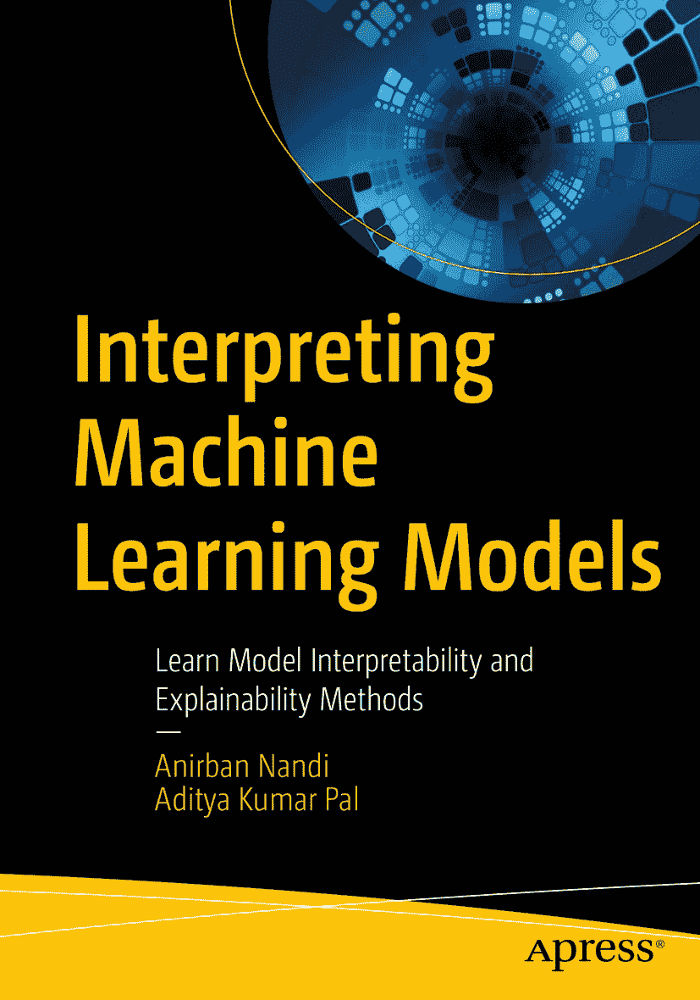

ISBN 978-1-4842-7801-7 e-ISBN 978-1-4842-7802-4 [`doi.org/10.1007/978-1-4842-7802-4`](https://doi.org/10.1007/978-1-4842-7802-4) © Anirban Nandi and Aditya Kumar Pal 2022 Apress 标准版 本出版物中使用通用描述性名称、注册商标、商标、服务标记等，即使未作特别声明，也不意味着这些名称不受相关保护性法律和法规的约束，因此可自由用于一般用途。出版商、作者和编辑可以假定，本书中的建议和信息在出版之日是真实准确的。出版商、作者或编辑均不对本书所含材料或可能存在的任何错误或遗漏提供明示或暗示的担保。出版商对已出版地图中的管辖权主张和机构隶属关系保持中立。

本 Apress 印记由注册公司 APress Media, LLC（Springer Nature 的一部分）出版。

注册公司地址为：1 New York Plaza, New York, NY 10004, U.S.A.

谨以此书献给我的妻子 Madhuparna，她激励我“志存高远”，并不断超越自我；也献给我的家人和朋友，他们在我顺境和逆境时始终给予我指引和支持。

——Anirban

谨以此书献给我的妹妹 Rati，她不断激励我努力工作，永不放弃。

——Aditya

## 引言

`可解释性`和`可说明性`已成为机器学习领域最热门的两个搜索词。本书通过使用不同的可解释性算法，阐释机器学习的可解释性。本书首先探讨机器学习可解释性的理论方面。前几章解释了可解释性、可解释性方法的共同属性、将方法分类到不同部分的通用分类法，以及如何从人为因素和技术要求方面评估这些方法。

在前几章中，读者将全面了解如何选择可解释性方法。这些章节旨在以学术风格提供关于可解释性的信息，每个部分都通过恰当的示例详细阐述其重要性。我们引用了实际业务领导者和技术专家的原话，以展示真实用户如何看待可解释性及其相关方法、目标、阶段和属性。

在本书接下来的几个部分中，我们将深入探讨可解释性领域的技术细节。从不同方法的通用框架开始，然后使用一个数据集，通过实际代码和实现来展示每种方法如何生成输出。这些方法根据其解释框架分为不同类型。常见的类别包括基于特征重要性的方法、基于规则的方法、显著性图方法、反事实解释和概念归因。本书最后讨论了数据如何影响可解释性，以及可解释性方法的常见陷阱。

完成本书后，你将理解模型可解释性和可说明性方法的工作原理，并能为机器学习项目选择和应用最合适的解释方法。阅读本书后，读者将能够轻松地将黑盒模型转换为白盒模型。

## 致谢

本书是一项由动力驱动的事业。在过去几年中，我们因日常工作中需要与不同业务领域的利益相关者互动，而逐渐着迷于构建可解释模型的重要性。当我们开始应用数据科学解决业务问题时，我们发现了一个共同的问题——客户难以理解我们提出的建议。我们感到迫切需要找到可解释的模型。我们开始阅读关于模型可解释性的资料，发现这个领域非常新颖且潜力巨大。对于某些用例，我们为其能为分析带来的改变而着迷。

我们要感谢乐天公司的 Takuya Kitagawa、Kazuhito Nomura 和 Yusuke Kaji。他们向我们介绍了这个领域，并帮助我们在各种方法和用例中进行实验，以理解模型可解释性的真正潜力。

最后，我们要感谢 Apress 出版团队给予我们展示工作的宝贵机会，以及他们提供的宝贵帮助和指导。特别感谢所有审阅者耐心审阅我们的工作，并与我们合作进行多次迭代，为读者呈现最佳版本。

### 关于作者

### 关于技术审阅者