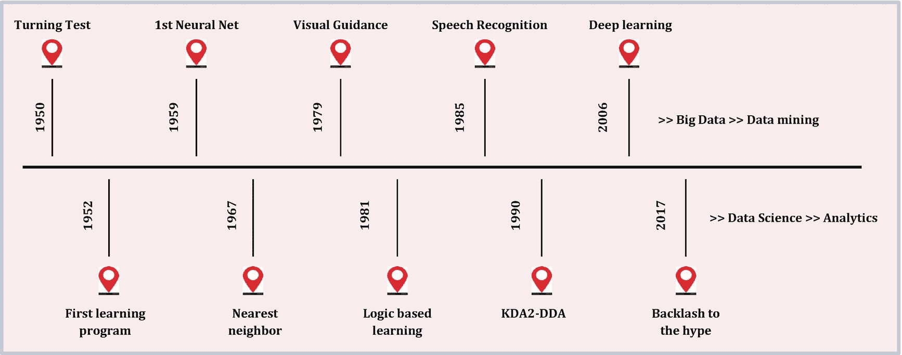
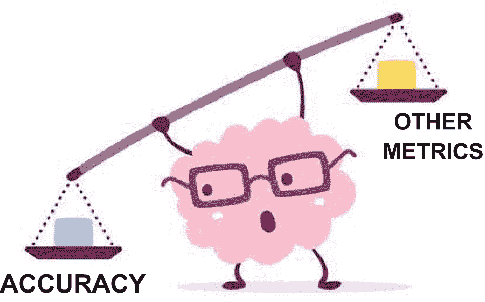

# 1. 机器学习的演进

本章讨论机器学习的演进。它简要介绍了机器学习作为一个领域如何随着时间的推移，通过关键事件和研究年份而发展壮大。本章还涵盖了如何学习机器学习算法。我们相信，所描述的方法可以进一步应用于可解释算法。你可以利用这些学习成果，来了解本书后面详细讨论的各种方法。最后，我们讨论了为什么仅凭准确率指标不足以评估机器学习算法，并提出了学习可解释性的理由。

## 定义机器学习

我们正在见证本世纪一场全球性的技术革命。在计算能力和机器学习应用领域，已经取得了惊人的进步。二十一世纪见证了人工智能研究的重大进展。机器学习是技术领域最成功、应用最广泛的应用之一，它影响着广泛的行业，每天影响着数十亿用户。机器学习是人工智能的一个子集，它使用算法和统计模型，让计算机无需人类交互即可执行特定任务。机器学习的应用为人们日常生活中使用的未来科技打开了大门，例如使用 Alexa 进行语音命令，或通过手势控制电视遥控器等。

接下来，让我们回顾一下人工智能及相关机器学习技术的演进历程。

## 机器学习的演变

本节将讨论机器学习的演变历程。许多人认为机器学习是一个非常新的概念；然而，机器学习的根源可以追溯到 20 世纪 50 年代。图 1-1 展示了一些重要机器学习发现的时间线。

图 1-1 机器学习随时间演变的时间线

*   **1950 年：** 艾伦·图灵提出了图灵测试，用以判断计算机是否能展现出与人类同等的智能。这是人工智能或机器学习的第一个实例。

*   **1956 年：** 约翰·麦卡锡在达特茅斯学院的一次会议上创造了人工智能这一术语。同年晚些时候，艾伦·纽厄尔、J. C. 肖和赫伯特·西蒙创建了逻辑理论家，这是有史以来第一个运行的人工智能软件程序。

*   **1967 年：** 弗兰克·罗森布拉特构建了 Mark 1 感知器，这是第一个基于计算机的神经网络，它通过试错进行“学习”。一年后，马文·明斯基和西摩·帕珀特出版了一本名为《感知器》的书，该书成为神经网络领域的里程碑式著作，也成为反对未来神经网络研究项目的论据。

*   **1980 年代：** 人工智能应用广泛采用了使用反向传播算法进行自我训练的神经网络。

*   **1997 年：** 国际象棋世界冠军加里·卡斯帕罗夫在一场国际象棋比赛中被 IBM 的深蓝击败。

*   **2011 年：** 冠军肯·詹宁斯和布拉德·鲁特在《危险边缘！》节目中被 IBM 沃森击败。

*   **2015 年：** 百度的 Minwa 超级计算机使用一种称为卷积神经网络（CNN）的深度神经网络，以高于普通人的准确率识别和分类图像。AlexNet 的诞生源于改进 ImageNet 挑战赛结果的需求。这是最早在 ImageNet LSVRC-2012 上达到相当高准确率的深度卷积网络之一。

*   **2016 年：** DeepMind 的 AlphaGo，由深度神经网络驱动，在一场五局比赛中击败了围棋世界冠军。

将机器学习与认知技术相结合，可以使其在自动化人类执行的任务方面更加有效。

学习过程始于观察，例如通过示例、直接经验或指令，来寻找数据中的模式，并根据我们提供的输入在未来做出更好的决策。其目标是让计算机无需人工帮助即可自动学习，并相应地调整行动。

监督学习、无监督学习、半监督学习和强化学习是机器学习算法的不同类别。

*   **监督学习** 是机器学习的一个子集，其中机器或算法在标记良好的数据上进行训练，然后根据获取的信息预测输出。监督学习是一个向模型提供输入数据以及正确输出数据的过程。

*   **无监督学习** 分析未标记的数据集，无需人工干预或协助。它被广泛用于提取生成特征、识别有意义的趋势和结构、创建分组以及进行探索性分析。最常见的无监督任务是聚类、密度估计、特征学习、降维、寻找关联规则和异常检测。

*   **半监督学习** 可以被定义为监督方法和无监督方法的混合体，因为它同时处理标记和未标记的数据。半监督学习的一些应用领域包括机器翻译、欺诈检测、数据标记和文本分类。

*   **强化学习** 是一种机器学习算法，它使软件代理和机器能够自动评估特定情境或环境中的最优行为，以提高其效率；也就是说，这是一种环境驱动的方法。这种学习类型基于奖励或惩罚，其目标是利用从环境活动中获得的见解来增加奖励或最小化风险。

## 学习机器学习算法

学习机器学习算法可能是一项非常艰巨的任务。有大量的网站、书籍和论文从数学和文本角度描述算法的工作原理。如果你进行适当的研究，你可能会找到该算法的伪代码描述。

当你想要实现研究论文中的方法时，你可以快速学习；然而，算法的描述通常不足以轻松复现。原因多种多样，从论文中省略的微观决策，到用文本总结的整个流程，再到符号使用不一致等。

因此，要正确学习算法，你应该遵循下面列出并在后续章节中描述的步骤。

### 拼凑整合

要理解算法，将其分解为几个组成部分非常重要。然后，应对每个组成部分进行二次研究。有时，一个算法包含从其他论文或算法中引用的组成部分。详细理解每个组成部分有助于将学习内容与算法的整体运作联系起来。本书后续章节将讨论各种算法，并涵盖直接从任何其他算法中引用的子组成部分。这确保了在算法理解上没有盲点，并且涵盖了所有过程和步骤。

### 专注于特定的算法描述

有时只关注算法定义可能非常有害。你必须从各种来源获取算法描述，并且只寻找经过验证的来源。例如，当我们研究随机森林时，有时我们只专注于理解装袋（bagging）这个概念，以及随机森林的描述如何谈论各种树协同工作以进行预测。我们还应关注其他算法描述，这些描述说明了随机森林与其他算法的不同之处，以及特征重要性是如何计算的。在算法内部，有很多信息可能对各种用例有用。例如，算法的使用统计数据嵌入在论文中。示例包括用于测试算法的标准实验数据集，以及该算法适用的一般问题类别。

详细的算法描述确保我们深入探究该方法的所有细节，并且不会因少数提供不完整信息的来源而产生偏见。

### 设计算法描述模板

使用描述模板来学习算法会变得轻而易举。从一个空白文档开始，列出你可能想学习的各个部分的概览。参考以下示例，了解模板中应包含哪些内容，或列出你想了解的关于该算法的问题。

*   **介绍**算法。简要介绍算法的概况。

*   为什么需要这个算法？不要在没有用例的情况下开始学习算法。首先，确定一个要解决的用例，然后关联各种算法并选择一个。因此，在模板中，明确指出所选算法解决了哪个用例非常重要。

*   算法背后的**数学原理**是什么？从算法所需的数学模型和公式开始。这为学习算法奠定了坚实的基础。

*   你**如何**实现数学部分并生成**伪代码**？一旦你对模型中涉及的数学部分充满信心，就应该为各个步骤生成简单的伪代码。大多数算法都是通过系统地对不同的数学计算进行编码来工作的。

*   **是否存在**类似的算法**？为什么使用**这个特定的算法**？** 大多数情况下，一个好的用例能证明你选择特定算法的必要性。

*   这个算法可以解决哪些问题**？** 思考其他可以使用相同算法解决的用例。这可以拓展算法的应用范围。

*   **处理策略是什么？** 提及你处理此算法所采用的策略。思考任何中间输出。确定最终输出的形式。

*   **使用了哪些缩写？** 提及任何可能需要你进行额外研究的缩写。大多数算法会提及从其他算法借用的模块，并以缩写形式呈现。

*   **有哪些次要资源？** 列出所有包含该算法相关信息的次要资源。

### 从小处着手，逐步构建

这种方法的好处在于，你无需成为算法或研究方面的专家。找到关于该算法的资源，并在模板中记录笔记。然后，你可以挑选简单的独立模块，用样本数据运行它们。当你对简单的模块感到得心应手后，再扩大范围，纳入需要更多编码的、更具挑战性的模块。完成这一步后，再引入更多数据，进行水平或垂直扩展。通过这种方法，你可以循序渐进地学习，并且不会遗漏任何细节。

## 研究机器学习算法的行为

为了理解机器学习算法的行为，我们常常倾向于阅读关于该算法的各种描述和文献。然而，学习或研究机器学习模型行为的一个非常好的方法是，使用各种数据集运行一些简单的测试和实验，并观察指标或预测的模式。通常，所有机器学习模型都很复杂，因此仅凭理论知识很难理解它们的行为。最好能亲眼看到算法运行。实验有助于你理解算法参数的因果关系以及如何调整模型。

让我们来看一个研究机器学习算法的简单五步流程。

### 第一步：选择一个算法

选择一个你对其有疑问的算法。算法的选择可以基于正在进行的项目，也可以仅仅基于其流行度。选择很重要，因为针对每个问题都有多种算法和不同的方法。有些方法很基础，而有些则复杂得多。因此，选择一个能解释问题基本层面、而不直接跳入创新复杂技术的方法非常重要。使用该算法的现成实现。实现该算法，并在实验中引入额外的变量，例如错误以及每个算法实现中必须做出的其他微观决策。

### 第二步：确定一个问题

确定一个你想深入了解该算法的研究问题。问题越具体，就越有助于获得答案。以下是一些示例问题。

*   随机森林模型中树的深度有什么影响？

*   在支持向量机（SVM）中选择核对二元分类问题有什么影响？

## 不同属性缩放对逻辑回归分类效果的影响

*   不同的属性缩放对逻辑回归在分类问题上的效果有什么影响？

*   在随机森林模型中，向训练数据集添加属性对分类准确率有什么影响？

设计一个你需要了解算法答案的问题。考虑列出该问题的几个变体，并专注于最具体的一个。

### 第三步：设计实验

从问题中挑选出构成你关于模型算法实验的元素。例如，让我们看看以下问题：属性缩放对分类问题的逻辑回归有什么影响？

你可以选择以下元素。

*   **属性缩放方法**：如归一化、标准化、对属性进行幂运算以及取对数等方法。
*   **逻辑回归**：逻辑回归的不同实现。
*   **二元分类问题**：需要多个问题，有些问题的属性尺度相同，另一些问题的属性尺度多样。
*   **性能**：模型性能得分，例如分类准确率。

花足够的时间仔细选择最能回答你问题的元素。

### 第四步：执行实验并报告结果

完成你的实验。如果你在寻找不同实验运行之间的结果差异，你可能需要使用统计工具来表明这些差异是否显著。总结你的实验结果。你可能需要使用表格和图表。

从研究问题中我们得到了什么结果？

戴上你的怀疑之帽。你能对结果施加哪些限制？了解限制与了解实验结果同样重要。

### 第五步：重复

重复这个过程。继续研究你选择的算法。你甚至可能想用不同的参数或不同的测试数据集重复相同的实验。不要只做一个实验就停止。开始为这个算法建立知识库和直觉。借助一些简单的工具和一些好的问题，你可以很快开始对该算法的行为产生世界级的理解。

## 机器学习模型准确率意味着什么？

在机器学习算法中，准确率衡量的是模型在训练数据中捕捉模式，并利用所学知识预测未见数据的成功程度。这体现了模型对未见数据的泛化能力。普遍认为，模型的预测能力越强，基于模型洞察所采取的行动就能产生越高的商业价值。因此，准确率是基于多种指标对模型成功程度的一种度量。例如，对于分类模型，准确率的一个衡量标准可能是模型正确预测数据中所有正类和负类的能力。

评估模型准确率有众多可用指标。这些指标大多与模型无关，能很好地适用于不同模型，而有些则特定于某一模型。由于准确率并不总能全面反映模型性能（例如在数据不平衡的数据集中），你应该使用不同的指标来评估模型。然而，为了便于讨论，在需要向非技术人员解释模型时，我们通常将这些指标统称为模型准确率。以下是检查模型性能优劣的一些关于模型准确率的有用指标。

*   混淆矩阵
*   `F1` 分数
*   增益和提升图
*   科尔莫戈罗夫-斯米尔诺夫图
*   `AUC-ROC` 曲线
*   对数损失
*   基尼系数
*   一致/不一致比率
*   均方根误差

深入探讨每个指标超出了本书的范围。我们留待您自行研究这些指标及其潜在用途。

## 为什么模型准确率还不够

公司使用机器学习模型来制定业务决策，更准确的模型结果会带来更好的决策。错误的代价通常很高，但优化模型准确率可以降低这些成本。当开发更准确模型的价值无法带来相应的利润增长时，就会出现收益递减点。然而，通常全面优化是有益的。例如，癌症的假阳性诊断对医院和患者都造成损失。提高模型准确率的好处包括节省时间和金钱，并避免压力。

构建机器学习模型的想法基于反馈原则。你构建一个模型，从指标中获得反馈，进行改进，并持续进行直到达到所需的准确率。评估指标解释了模型的性能并区分了模型结果。

许多分析师和有抱负的数据科学家并不关心他们的模型有多稳健。一旦他们完成模型构建，就匆忙地将预测值映射到未见数据上。这是一种错误的方法。

简单地构建一个预测模型并非你的目的。关键在于创建并选择一个能在样本数据中提供高准确率的模型。因此，在计算预测值之前，审视模型的准确率至关重要。

在我们的行业中，我们考虑各种不同的指标来衡量我们的模型。指标的选择最终取决于模型本身，进而取决于模型的实施计划。

准确率固然重要，但为了模型的业务应用，我们还需要额外的信息。

模型可能通过记忆数据集中不重要的特征或模式来达到高准确率。如果输入数据集存在偏差，这也会影响模型。此外，训练环境中的信息可能无法真实反映模型部署的生产环境中的信息。即使最初具有足够的代表性，但考虑到生产环境中的信息并非一成不变，它也可能很快变得过时。

因此，我们不能仅仅依赖于在特定数据集上达到的预测准确率。我们需要了解更多。我们需要揭开机器学习模型的神秘面纱，提高透明度和可解释性，使其更加可信和可靠。

图 1-2 准确率如何比其它模型评估指标获得更高重要性的图示说明

随着机器学习模型变得越来越先进，它们在不同数据集上能达到的准确率也随之提高；然而，随着准确率的提升，模型也变得越来越复杂，模型结果的可解释性却大打折扣。

然而，在实际应用中，仅凭准确率不足以证明模型所做决策的合理性。因此，在现实场景中，即使底层模型非常复杂且具有高准确率指标，业务团队有时也会发现很难采用这些模型，因为准确率无法解释模型为何做出特定决策。

让我们看几个例子，了解一些高准确率模型如何在现实场景中失败，并因此被弃用。

*   2019 年，波兰政府增加了一项银行法修正案，赋予客户在不利信贷决策中要求解释的权利。欧盟实施《通用数据保护条例》的后果之一是，在决策过程自动化的场景下，银行必须解释为何拒绝贷款。
*   2018 年 10 月，全球头条新闻报道了一款偏向男性的 `AI` 招聘工具。这家《财富》500 强公司的模型基于偏向男性候选人的有偏见数据进行了训练。它制定了规则，对包含“女性”一词的特定简历进行扣分。

在这些例子中，两个模型都是被称为*黑盒分类器*的非常复杂的工具，它们提供了极高的准确率；然而，这些模型无法提供直接、人类可理解的解释。

可解释的预测算法，其准确率往往低于那些不易解释的更高级方法。这归根结底在于模型向人类解释的难易程度。而模型准确率，则是衡量模型预测目标结果好坏程度的任何量化指标。例如，在所有已知观测中，模型正确预测了多少个。

尽管这是一个量化领域，但预测中可解释性的重要性对数据科学家来说仍是一个有争议的话题。随着越来越多的公司探索高级分析以推动增长，这种张力变得与分析成功息息相关。作为数据科学从业者，如果我们的客户不熟悉我们的方法，我们如何能让他们对我们的方法建立信心？此外，如果我们限制模型使其变得不可解释，我们又该如何证明分析的价值？

很容易构建一个支持优先考虑模型准确率而非可解释性的论点。准确率很容易评分，使得不同方法可以相互直接比较。如果一个预测模型在选定的评分上表现更好，这应该成为其有力的优势。当错误成本很高时，追求更高性能的动力就会大得多。像决策树或线性/逻辑回归这样的*可解释*模型也可能迅速变得不可解释。例如，在决策树的前几层之后，人类就很难理解选择某个变量而非另一个变量的原因。

如果人类能理解模型为何出错，这就是可解释性的一个绝佳例子。我们渴望解释，并且很容易根据数据呈现的结果，甚至在没有数据的情况下，做出虚假的论证。

随着错误成本的增加，准确率的相对重要性会进一步提升。例如，IBM 的沃森技术支持医疗诊断。最近，沃森成功诊断出了一种肿瘤学家无法诊断的罕见白血病。这是一个极好的例子，展示了准确的机器学习算法如何支持现有工作流程。

但想象一下，如果沃森错了，患者将接受昂贵且耗时的治疗方案，该方案几乎没有任何益处，并且几乎肯定会对患者造成伤害。像所有其他机器学习算法一样，沃森只能学习它所训练的数据；它无法学习与训练数据无关的替代假设。在医疗保健环境中，准确率至关重要，但准确率的好坏取决于用于训练模型的数据。当沃森做出诊断时，诊断背后的逻辑也必须清晰可见。错误的成本太高，不能交给黑盒模型处理。在金融服务领域，不能基于种族拒绝抵押贷款或保险索赔。如果种族被包含在模型中，就违反了禁止歧视性做法的法规。

这又将天平从准确率摆向了可解释性。

## 总结

本章讨论了机器学习的演进以及机器学习模型的不同类别。还描述了学习机器学习模型和探索其行为的最佳实践。你了解了模型准确率的含义，以及我们关于为什么准确率可能不足以评估模型的观点。本章论证了在评估模型时，应将可解释性或可说明性作为准确率的支持。因此，下一章将深入探讨可解释性及其与模型评估的关系。
