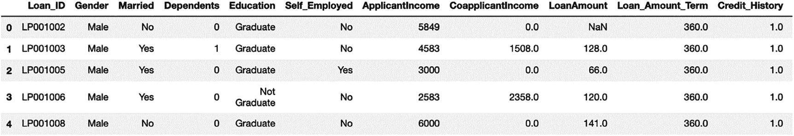
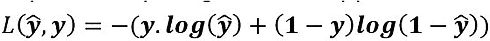
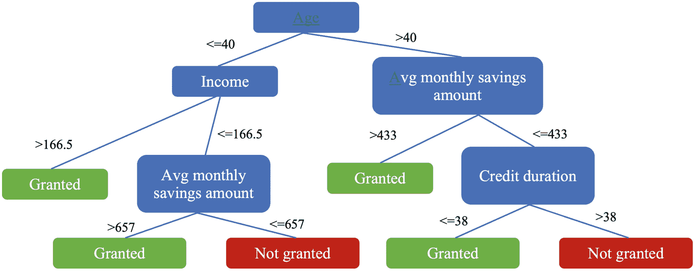
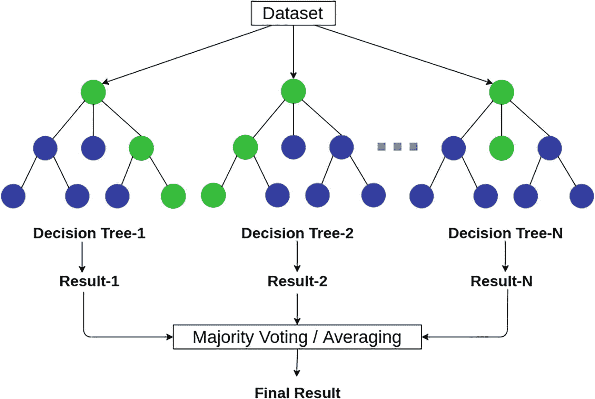
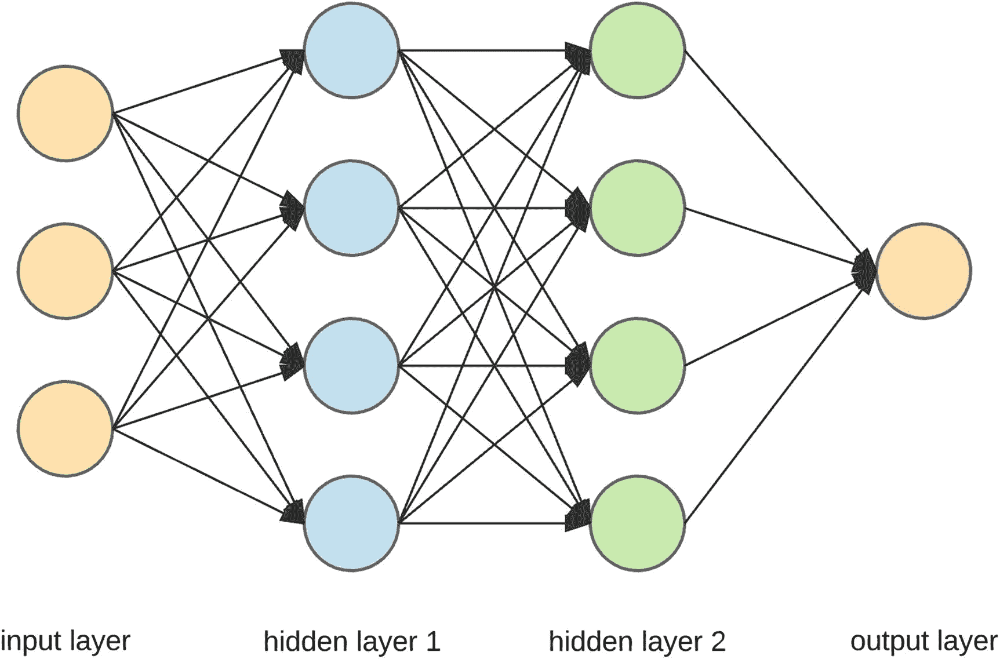
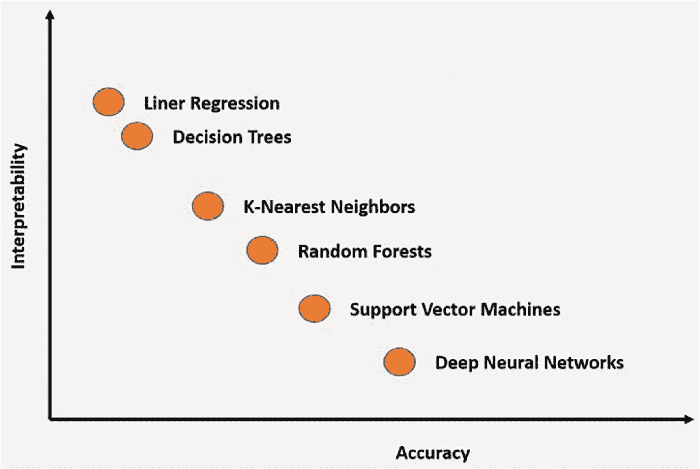
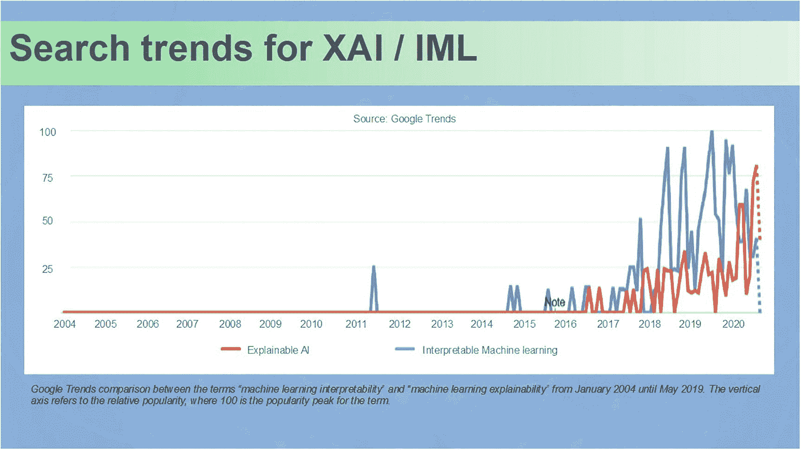
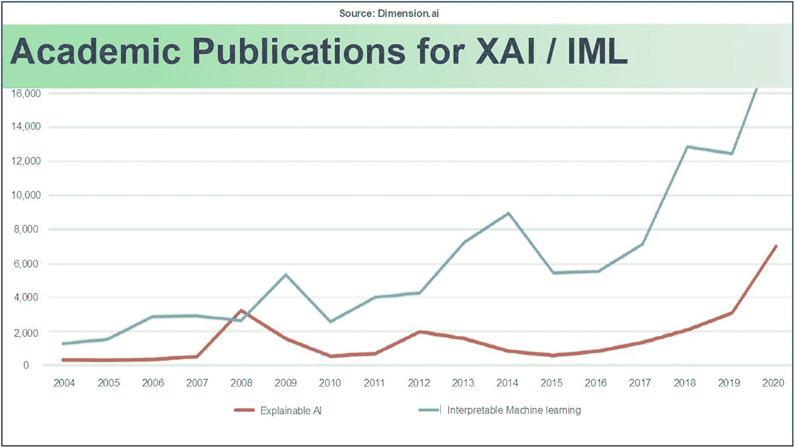

# 2. 模型可解释性简介

本章讨论可解释性的重要性。我们从一个例子开始，解释说明在现实场景中的重要性。然后，我们尝试将这个例子与我们的模型联系起来，并说明解释如何成为你模型学习之旅中不可或缺的一部分。我们解释了采用可解释性背后的不同动机，并以当前可解释性领域研究的详细信息结束本章。

## 人类天生渴望解释

人类是天生渴望解释的动物。自文明诞生以来，我们始终试图探寻事物的`原因`和`方式`。借助数个世纪积累的关于原因与方式的知识，我们为特定任务制定了规则或最佳实践。随着技术的发展，我们扩展了这些规则，并能够创建计算机软件来处理它们。下面的故事阐明了简单的解释，或者说流程背后的`原因`与`方式`为何如此重要。

两位医生在同一间诊室里接诊病人。大多数患者都患有糖尿病。阿琼坐在他的医生面前，眼中充满好奇。他偶尔会瞥向房间另一侧。一个年龄、体重和身高与他相仿的人正坐在另一位医生面前。阿琼的医生告诉他，他的糖尿病没有得到控制，并给他开了几个星期的药。阿琼感到沮丧。这种疾病对他来说就像一个黑箱。他试图讨论为什么药物不起作用，但医生太忙了，无暇回答额外的问题。医生让助手叫下一位病人进来，并礼貌地示意阿琼离开，两周后再来。

阿琼慢慢走出房间，注意到那个同病相怜的人正坐在另一位医生面前。他心想对方可能也遇到同样的问题，便走上前去自我介绍。那位同伴非常开心。他叫维卡斯，和阿琼同龄。他也患有糖尿病，但目前病情控制得很好，他是来向医生表达感谢的。阿琼听完他的治疗经历后兴奋不已。他困惑地问维卡斯是如何控制住病情的，医生开了什么药。维卡斯把处方拿给阿琼看，阿琼完全惊呆了。每一种药都和他的一模一样。阿琼很好奇，为什么同样的药对维卡斯有效，却没能改变他自己的症状。他们同意去附近喝杯咖啡，并开始交谈。

维卡斯随后解释了他如何在治疗初期也挣扎过，以及他如何觉得糖尿病就像一个黑箱，直到他读了一本用通俗易懂的语言向普通人解释糖尿病的书。从那以后，他的生活改变了。维卡斯告诉阿琼，糖尿病不仅仅是一种可以用药物治疗的疾病，它还需要改变生活方式、养成良好的饮食习惯和健康的锻炼计划。那本书对一切都做了简单的解释：某种特定食物如何影响体内的血糖水平，睡眠周期如何影响血糖水平，导致血糖升高的最重要因素，以及哪些重要运动可以减轻压力并控制血糖。这些问题的答案帮助维卡斯将他那黑箱般的疾病变成了可解释的。他知道了自己血糖水平波动的原因，并开始采取相应的行动。他突然明白了哪些食物会升高他的血糖，以及饭后该采取什么措施来降低血糖。凭借新获得的知识和药物，维卡斯很快就控制住了糖尿病。他现在可以享用自己最喜欢的食物，并且感觉比以前更健康了。

阿琼听完维卡斯的话后目瞪口呆。他仿佛突然看到了一线希望。简单的解释或许能改变他的生活。以前，他只知道自己的血糖是高了还是低了。有了这些解释，他现在可以把血糖水平与他吃的食物、睡眠时间以及白天是否活跃联系起来。他突然明白了所有原因，药物对他来说不过是锦上添花。阿琼感谢了维卡斯，两人互相道别。几周后，阿琼控制住了他的糖尿病，并且不再需要服药了。

人类现在对万事万物的了解，远远超过我们在任何特定时刻所能理解的范围。因此，有时我们会盲目遵循规则，而不去深入理解这些规则是如何产生的。阿琼足够好奇，会去询问他的糖尿病问题，但大多数人不会，因为他们`信任`药物和医生。这些规则是经过数个世纪的研究制定并不断演进的，旨在确保它们不偏向于特定的群体、肤色、年龄或体型。这些规则是`不偏不倚`的，并期望为全人类提供相同的解决方案。由于这些规则已经演进，它们已成为完成某些任务的最佳实践；因此，我们可以让它们`承担责任`。你希望相信医生为你的疾病开的药，并且无论它是否有效，我们都会让医生负责。

## 机器学习中的解释

让我们来看一个银行贷款处理应用的例子。银行贷款的规则是经过多年研究后制定的。过去，银行经理根据申请人的收入和信用记录来决定谁应该获得贷款。对于被拒绝的申请，银行经理能直截了当地回答贷款为何未获批准。如今，银行公司拥有基于数百万份贷款申请和数百个变量训练出的机器学习模型。这些模型可以帮助银行经理高精度地判断是否应该批准贷款。但由于现在这是一个涉及非常复杂过程的算法决策，就产生了一些问题：为什么贷款被拒绝？或者为什么贷款被批准？算法做出的决定正确吗？

在本书中，我们试图回答这些问题，并解释能够帮助公司或个人回答此类问题的方法。

第 1 章解释了机器学习及其日益增长的重要性。现在，让我们通过一个简单的贷款批准或拒绝案例，将这种理解`为什么`和`如何`的概念应用到机器学习模型中。

图 2-1 展示了简单的银行贷款模型数据。



图 2-1 银行贷款分类模型的样本数据

数据包含贷款状态、贷款金额期限、收入、教育程度、信用记录和年龄等变量。在构建模型时，我们会拟合一个逻辑回归模型来预测贷款申请是被批准还是被拒绝。我们有一些自变量和一个目标变量（即数据集中的 `Loan_Status`）。在逻辑回归中，目标`y`是二元的（`批准` p = 1 /`拒绝` p = 0），而批准/拒绝贷款的概率 (`p`) 是基于临界值确定的。目标是估计系数`αi`。

```
Logit (p) = log(p/[p-1]) = α0 + α1 . age + α2 . income + α3 . age + α4 . credit history
```

为了找到系数`αi`，我们使用带标签的历史数据来训练分类模型。已知批准/拒绝的决定，使用交叉熵作为损失函数来比较预测值`^*****y`与标签`***y`（见图 2-2）。



图 2-2 逻辑回归方程表示

图 2-2 中所示的函数代表二元交叉熵损失。对于二元分类，我们使用二元交叉熵。交叉熵损失也称为`对数损失`、`log 损失`或`逻辑损失`。每个预测的类别概率都与实际期望的输出类别 0 或 1 进行比较。计算出一个分数/损失，该损失根据概率与真实期望值的差距对其进行惩罚。这种惩罚是对数形式的，对于接近 1 的大差异会产生大分数，对于趋向于 0 的小差异则产生小分数。该函数是负的，因为在训练时，我们需要通过最小化损失函数来最大化概率——假设样本来自独立同分布，减少损失会增加最大似然。`αi`的值是那些通过使用其一阶导数和诸如梯度下降之类的优化算法来最小化`α0, ..., α4`的值。

在解释估计的系数时，我们应该非常谨慎。斜率系数现在被解释为，当 X 变化时，“对数几率”的变化率，与在 LP 模型或 OLS 回归中当 X 变化时 Y（因变量）的变化率相比。Logit 系数是“优势比”，即自变量对事件发生概率除以事件不发生概率的影响。例如，如果 exp`a[3]` = 2，那么`X[3]`变化一个单位将使事件发生的可能性增加一倍（67%/33%）。优势比等于 1 意味着自变量微小变化时事件发生的概率为 50%。负系数导致优势比小于 1：如果 exp`a[2]`=.67，那么`X[2]`变化一个单位会导致事件发生的可能性降低（40%/60%）。与大于正系数的优势比相比，负系数往往更难解释。系数构成了广义线性模型可解释性的最基本形式。该示例展示了如何使用系数来确定自变量对因变量贷款状态变量的影响。系数告诉我们哪些变量影响最大以及影响的方向（正/负）。

线性模型和逻辑模型是自解释模型。通过理解模型背后的数学原理，你可以推断出模型为何根据输入数据做出特定决策。

然而，随着时间的推移，数据量一直在迅速增长。随着数据量的增加，每天都有更新、更先进的算法被研究出来以执行特定任务。随着时间的推移，决策树的受欢迎程度显著增加。

决策树是一种监督式机器学习算法，能够执行分类和回归任务。决策树是一系列为了达到指定输出而做出的顺序决策。图 2-3 展示了决策树的工作原理。



图 2-3 决策树表示

该树将客户分为两组。一组是信用记录良好的客户，另一组是信用记录不良的客户。接着，它检查客户的收入，并再次将客户分为两组。最后，它检查客户申请的贷款金额。基于检查这三个特征的结果，树决定客户的贷款是否应该被批准。决策树算法相对容易理解和解释，因为它将数据分成两部分。然而，通常单棵树不足以产生有效的结果。这时就可以使用随机森林算法。

`随机森林`是一种基于树的机器学习算法，它利用多个决策树来生成决策。顾名思义，它是一个由树组成的“森林”（见图 2-4）！



图 2-4 随机森林表示

# 随机森林与神经网络

但为什么它被称为*随机森林*？因为它是由随机创建的决策树组成的森林。决策树中的每个节点都基于特征的随机子集来计算输出。然后，随机森林结合各个决策树的输出来得到最终输出。图 2-4 展示了随机森林的简单表示。

近年来，神经网络已取代决策树，成为建模海量数据集的首选方法，这得益于其处理各种问题的能力，例如图像分类和文本分类，以及在表格数据上的出色表现。神经网络也非常适合帮助人们解决现实生活中的复杂问题。它们可以执行多种任务，例如建模、学习输入与输出之间的非线性关系；进行泛化和推理；揭示隐藏的关系、模式和预测。图 2-5 是神经网络的一个简单表示。


图 2-5：神经网络表示

与基于简单方程的逻辑回归不同，决策树和神经网络等其他高级算法则较为复杂，包含多个步骤。即使是数据科学家也很难理解这些模型的内部运作，更不用说业务人员了。这些在线性模型之后开发的新技术被称为*黑盒模型*。

# 黑盒模型

*黑盒模型*是一个术语，用于描述那些计算输出过程复杂、通常跨越多个步骤的模型。在黑盒模型中，用户只知道输入和输出，而所有中间步骤和计算都难以理解（见图 2-6）。随着时间的推移，黑盒模型因其能够在各种数据源上生成高精度结果而成为首选的建模技术，并越来越受欢迎。


图 2-6：黑盒模型表示

但是，采用这些先进技术也引发了一些问题。

*   我们能解释深度神经网络吗？
*   那包含 500 棵树的随机森林呢？
*   构建一个复杂且密集的机器学习模型有可能达到我们期望的精度，但这有意义吗？
*   你能打开黑盒模型并解释它是如何得出结果的吗？

近年来，在 Kaggle 等竞争性编码平台上，黑盒模型的火花被进一步点燃，这些模型开始在多个问题陈述中占据排行榜榜首。到 2015 年，*梯度提升*和*神经网络*成为数据科学家中最流行的术语，很快，这些黑盒模型进入了跨行业的实际实施世界。在理想情况下，每个模型都应是可解释和透明的，这在以下方面很有用：

*   关键决策（例如，医疗保健）
*   很少做出或非常规的决策（例如，并购工作）
*   需要向利益相关者证明其合理性的决策（例如，战略业务选择）
*   交互比结果更重要的情境（例如，根本原因分析）

然而，在现实世界中，这两种模型各有其适用的时间和场合。并非所有决策都是等同的，开发可解释的模型极具挑战性（在某些情况下甚至是不可能的；例如，对复杂场景或高维空间进行建模，如图像分类）。即使在较简单的问题中，由于黑盒模型能够捕捉特征之间的高度非线性和交互作用，其表现通常也优于白盒模型。尽管在精度方面具有高性能优势，但黑盒模型也存在一个非常普遍的缺点：缺乏向内部团队、审计公司或监管机构解释预测结果的能力。

图 2-7 展示了不同方法在可解释性和精度这两个维度上的位置。从图中我们可以看到，深度神经网络和支持向量机等更复杂的方法精度很高，但在可解释性轴上却处于较低值。


图 2-7：一个以不同方法为数据点的精度与可解释性的二维图表。该图表显示，随着模型变得越来越精确，其可解释性或对这类模型的理解程度却下降了

黑盒模型的第二个缺点是，可能存在许多影响输出的不可见问题，例如过拟合、相关性或“垃圾进，垃圾出”。由于缺乏对黑盒模型运作方式的理解，这些问题无法被发现。

为了防止业务用户和模型构建者受到黑盒模型诅咒的影响，可解释性发挥着重要作用。

# 可解释性

可解释性是指我们能够理解某个选择背后解释的程度。另一种定义是：可解释性是指一个人能够持续预测模型结果的程度。机器学习模型的可解释性越高，就越容易让人理解为何做出某些决策或预测。如果一个模型的决策更容易理解，那么它就比另一个模型更具可解释性。

大多数机器学习系统都需要具备向利益相关者解释为何做出某些预测的能力。在选择合适的机器学习模型时，我们经常会考虑准确性与可解释性之间的权衡。

准确性与可解释性之间的权衡基于一个重要假设：可解释性是模型固有的属性。然而，我们相信，通过合适的技术，任何机器学习模型都可以变得更具可解释性，尽管这会带来复杂性和成本，且不同模型的成本高低不一。

当模型进行预测或发现洞察时，它会做出某些决策和选择。模型解释试图理解和说明模型所做出的这些决策（即是什么、为什么以及如何做）。模型解释的关键在于透明度、质疑的能力以及人类理解模型决策的难易程度。模型解释的三个最重要的方面如下所述。

*   **是什么导致模型做出某些预测？** 我们应该能够查询模型并找出特征交互，以了解哪些特征在模型的决策规则中可能很重要。这确保了模型的*公平性*。
*   **为什么模型会做出特定的决策？** 我们还应该验证并证明，为什么某些关键特征在模型预测过程中负责驱动决策。这确保了模型的*问责性*和可靠性。
*   **我们能信任模型的预测吗？** 我们应该评估和验证任何数据点以及模型如何对其做出决策。这应该是可演示且易于关键利益相关者理解的，以证明模型按预期工作。这确保了模型的*透明度*。

为了根据预测采取行动或部署新模型，你应该信任模型的预测，而获得对模型的信任非常重要。

一个关键问题仍然存在：人类是直接使用机器学习模型，还是将模型部署在其他产品中。如果用户不信任某个模型或预测，他们就不会使用它。

在银行贷款模型中，可解释性有助于回答诸如“描述已批准贷款与未批准贷款的最重要特征是什么”之类的问题。

例如，假设收入是最重要的变量。可解释性的输出应该是这样的：“收入越高，贷款获批的概率就越高。” 类似地，如果第二重要的变量是信用记录，那么可解释性会以“信用评分在 750 到 800 之间，获得贷款批准的概率更高”的形式提供输出。

在后续章节中，我们将解释如何通过不同的可解释性方法，来实现仅仅知道信用记录很重要与了解信用记录的哪些值很重要之间的区别。除此之外，你还可以针对单个申请获得基于收入、信用记录和其他变量（如年龄）的解释。

在模型之上引入此类解释有助于银行经理信任模型，并简化贷款审批流程。这些解释也有助于银行的战略和营销团队设计更好的贷款结构，更好地服务客户。在重要模型之上拥有这一层解释，远比仅仅拥有模型运行的准确性指标要好得多。

这就是可解释性在现实生活中的力量。

# 可解释性背后的动机

模型可解释性的主要动机是建立对模型的信任。然而，这一动机也可以扩展到各种其他需求。以下部分将探讨使用可解释性方法和技术的各种动机。

## 做出更好的决策

我们应该始终确保在模型构建过程之后有人员在场，以评估错误预测的影响。在使用机器学习系统进行自动化的场景中，很容易忘记错误预测的影响。数据科学家和业务分析师团队应该理解错误预测的后果，尤其是在项目对人类生活有重大影响的情况下（例如，司法、健康、交通等）。在业务收入受到影响的情况下，也应采取类似的谨慎态度。可解释性提供了我们评估模型预测所需的关键信息，帮助我们理解模型为何做出特定决策，以及模型的不同特征如何影响其预测。

## 消除偏见

我们可以利用可解释性来驱动动机，以检测、记录和监控我们开发和生产系统中的偏见。在构建必须做出决策的系统时，我们总是会面临数据中固有的计算或社会偏见，这可能无法避免。尽管如此，记录或减轻偏见总是可能的。然而，我们不应仅仅试图将伦理直接嵌入算法本身。相反，技术人员应专注于构建流程和方法，以识别和记录数据、特征、推理结果中固有的偏见，以及随后这种偏见的影响。鉴于所识别偏见的影响因领域和技术而异，作为数据科学家，我们应该能够创建、识别和解释数据和特征中的偏见，以便建立正确的流程来减轻潜在风险。可解释性在建立这些流程中发挥着作用。

## 证明流程的合理性

你可以利用可解释性来开发工具和流程，以提高机器学习模型的透明度和可解释性。随着近年来深度学习获得显著关注，作为数据科学家，我们经常将大量数据投入复杂的机器学习管道中，希望它们能起作用，却不了解这些管道内部是如何工作的。然而，我们应该投入合理的努力，持续改进工具和流程，以基于所选的特征和模型来解释结果。可以使用不同的工具和方法使机器学习系统更具可解释性，例如，通过特征添加领域知识，而不仅仅是允许深度/复杂模型自行推断。尽管在某些情况下准确性可能会下降，但透明度和可解释性的提升可能非常显著。

## 复现操作

我们可以利用可解释性来开发必要的基础设施，以便在机器学习系统的操作中实现合理水平的可复现性。生产环境中的机器学习系统通常不具备在模型出现严重问题时进行诊断或有效响应的能力，更不用说复现相同的结果了。在生产系统中，执行标准程序非常重要，例如将模型回滚到以前的版本或复现输入以调试特定功能，这会给基础设施带来复杂性。应采用相应的工具和最佳实践，以提供合理水平的操作可复现性。

## 替代策略

可解释性能够识别并记录相关信息，以便制定业务变革流程，从而减轻自动化对工作岗位的影响。在部署自动化中大规模流程的系统时，会对组织或行业层面产生影响，波及多个个体。作为技术人员，我们应超越技术本身，建立支持相关利益相关者的体系。这有助于利益相关者在部署技术时制定变革管理策略。尽管数据科学家或分析师可能不总是主导转型，但确保在相关时建立相应流程仍然很重要，无论被自动化的工作是什么。

### 确定实际准确性

可解释性能够建立流程，确保准确性和成本度量函数与特定领域的应用相匹配。在构建从数据中学习的系统时，理解评估准确性的底层方法至关重要。通常，仅使用简单的准确率或默认/基础成本指标是不够的，因为对计算机而言“正确”的结果对人类来说可能是“错误”的（反之亦然）。通过从特定领域角度分解`F1`分数指标的含义，并基于领域知识探索替代成本函数，可以确保以正确的方式解决正确的问题。

### 维护隐私

可解释性能够构建并传达相关流程，以保护和处理与系统直接和/或间接交互的利益相关者的数据。

在开发从数据中学习的大规模系统时，许多利益相关者往往会直接或间接受到影响。建立与相关利益相关者的信任，不仅需要告知他们哪些数据被持有，还需要围绕数据建立流程，并理解保护数据的重要性。技术人员应在整个系统和持续流程中贯彻“设计即隐私”的理念，以建立与用户及相关利益相关者（如采购框架、运营用户等）的信任。可解释性隐私框架的主要目标是自动生成对个人数据推理任务的解释，以便最终用户更好地理解这些任务的隐私风险和影响。这些解释应对最终用户有所帮助，使他们了解底层机器学习模型如何根据输入（即最终用户提供的数据）工作及表现。

### 理解安全风险

可解释性可以帮助你制定和改进合理的流程与基础设施，确保在机器学习系统开发过程中考虑数据和模型的安全性。自主决策系统可能会带来新的潜在安全漏洞。同样重要的是要意识到，许多安全漏洞是由人为错误而非实际黑客攻击造成的（例如，有人意外通过电子邮件发送数据集附件，或丢失笔记本电脑/手机）。技术人员应致力于通过明确努力来应对这两种安全风险，例如教育相关人员、建立数据处理流程以及评估机器学习后门的影响。

## 可解释性背后的研究

多个行业正呈现出利用机器学习进行高风险预测应用的增长趋势，这深刻影响着人类生活。

当自动化算法做出高风险决策时，错误预测的问题会变得更加严重。为了解决这个问题，“可解释机器学习”作为一个研究领域应运而生，专注于机器学习的可解释性，并转向更透明的人工智能。其主要目标是创建一套可解释的模型和方法，既能生成人类友好的解释，又能保持高水平的预测性能。

该领域的实体之一是美国国防部高级研究计划局（DARPA），由美国国防部资助。它创建了“可解释性与可说明性”项目，资助美国11个研究实验室的学术和军事研究。项目信息指出，该项目旨在产生更具可解释性的模型，同时保持高水平的预测性能，使人类能够建立适当的信任和理解，从而更好地管理新兴一代人工智能合作伙伴。

这并不是公众关注人工智能和机器学习可解释性的唯一例子。2016年，白宫科技政策办公室（OSTP）发布了一份题为《为人工智能的未来做好准备》的报告，其中指出人工智能系统应是开放、透明且可理解的，以便人们能够探究模型决策背后的假设和依据。

此外，美国计算机协会公共政策委员会（USACM）于2017年发布了《关于算法透明度和问责制的声明》。声明指出，可解释性是算法透明度和问责制的七项原则之一，在公共政策背景下尤为重要。

其他国家也公开表达了对人工智能和机器学习可解释性的需求。其中一个例子是荷兰人工智能草案，该草案完全聚焦于可解释人工智能，强调人工智能系统准确且能够解释其决策过程至关重要。

在2018年7月关于负责任人工智能和国家人工智能战略的报告中，欧盟委员会将不透明性（或黑箱风险）和可解释性确定为人工智能的两项性能风险。

在人工智能和机器学习驱动的行业中，谷歌和微软发布了他们在不同人工智能相关领域的推荐和负责任实践，其中一项完全专注于可解释性。倡导的可解释性实践包括：为可解释性做规划、将可解释性视为用户体验的核心部分、设计可解释的模型、理解训练好的模型，以及向模型用户传达解释。

除了关注商业化人工智能产品的可解释性外，一些公司也在研究机器学习的可解释性。其中一个例子是FICO，一家以使用人工智能进行信用评分而闻名的分析软件公司。它发布了一份题为“xAI工具包：实用、可解释的机器学习”的白皮书，其中在其分析工作台产品中包含了`xAI`工具包。还有其他大型公司积极投资于这一研究领域的例子。

这意味着机器学习可解释性可以受益于不同领域的贡献。其中一个领域的进展可以推动其他领域的研究。因此，研究社群应相互协调，以进一步推动机器学习可解释性。此外，只有通过跨学科研究，将数据科学与人文科学（包括哲学）相结合，才能为机器学习可解释性问题提供有影响力且被广泛采用的解决方案。除了可解释性研究数量的快速增长，对机器学习可解释性日益增长的兴趣也体现在众多科学活动中。由此可见，可解释性正越来越受到研究社群的关注。科学活动在促进和鼓励可解释性研究方面发挥着重要作用。

此外，可解释性竞赛也开始出现。例如，在谷歌、FICO以及牛津大学、麻省理工学院等知名学府的合作下，首届可解释机器学习挑战赛在2018年神经信息处理系统大会（NIPS）上亮相，参赛团队需要创建兼具高准确度和可解释性的机器学习模型。其目标是在算法可解释性领域催生新的研究。此类活动和竞赛被证明是推动机器学习可解释性领域发展的关键因素。图2-8展示了近期关于可解释机器学习相关主题的学术出版物激增情况。图2-9则显示了谷歌趋势中不断上升的热度。



图 2-9

可解释机器学习与可解释人工智能的谷歌趋势



图 2-8

与可解释机器学习和可解释人工智能相关的学术出版物

近期可解释性研究的激增也带来了一些困惑。目前尚不清楚“可解释”的具体含义，以及如何选择、评估或讨论为机器学习模型生成解释的方法。欧洲议会近期通过了《通用数据保护条例》（GDPR），该条例于2018年5月成为法律。GDPR的一个创新之处在于关于自动化（算法）个人决策（包括画像）的条款，这些条款在一定程度上引入了对所有个体的解释权，使其在自动化决策发生时获得“对所涉及逻辑的有意义解释”。尽管法律学者对这些条款的实际范围存在多种意见，但所有人都认同实施这一原则的需求十分迫切，并且这代表了当今一个巨大的开放性科学挑战。

据预测，未来一半的商业道德违规行为将源于大数据分析的不当使用。解释技术对于那些旨在创建更安全、更值得信赖产品的公司来说，是巨大的助力。它还能帮助公司更好地管理其责任。同样，在科学研究（例如医学、生物学和社会经济科学）中使用机器学习模型，不仅需要解释来获得对结果的信任和接受，还需要解释来保证科学发现的开放性，从而推动研究的进展。因此，解释是跨多个行业部门和科学学科的负责任、开放数据科学的核心。不同的科学社群研究了解释机器学习决策模型的问题。然而，每个社群都从特定的视角出发，并提供对解释的特定看法。文献中的大部分工作来自机器学习和数据挖掘社群。前者通常侧重于描述黑盒模型的工作原理。与此同时，后者则更倾向于解释这些选择，即使不完全理解不透明决策系统在一般情况下如何运作的细节。

尽管可解释机器学习已经存在了一段时间，并且最近受到了广泛关注，但如今仍有许多零散的、针对特定问题的研究成果，缺乏对这些方法的科学组织和分类。通过本书，我们旨在通过实用且易于理解的示例来统一这些信息。

## 总结

本章讨论了可解释性。首先定义了可解释性，并描述了使用可解释性方法背后的动机。讨论了黑盒模型以及可解释性为何可能是理解黑盒模型的绝佳工具。随后审视了可解释机器学习和可解释性的研究趋势。目前，在可解释性和可解释性方面正在进行大量研究。谷歌搜索趋势表明，可解释机器学习的受欢迎程度正在上升。你还了解了正在进行的可解释性研究。总体而言，本章为可解释性奠定了基础，强调了其必要性，并为可解释模型建立了论据。此外，本章还简要展示了人们对可解释性兴趣的激增，并提及了各种政府法规以及大型科技公司采取的举措。

下一章将探讨可解释性的分类、可解释性方法及其用途。