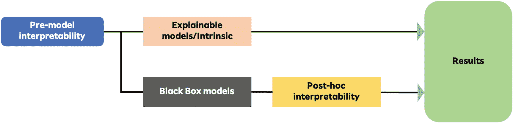
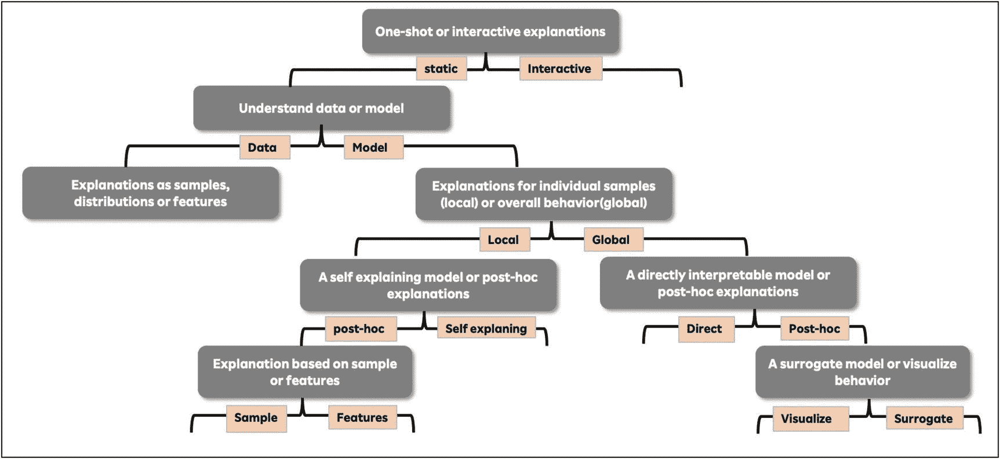

# 3. 机器学习可解释性分类

前一章解释了可解释性的重要性以及构建可解释模型背后的动机。本章讨论不同可解释模型适用的不同主题，以及我们应在何处使用特定方法。图 3-1 展示了不同的类型。



图 3-1 基于算法在模型流程中应用位置的不同可解释性分类

可解释的机器学习技术通常可分为三类。

*   **模型前可解释性** 使用在模型构建之前应用的可解释技术。
*   **内在可解释性** 利用模型结构推导出的解释。
*   **事后可解释性** 利用模型结构之外的方法推导出的解释，这些方法通常在模型构建完成并使用模型进行预测后运行。

模型前可解释性是对数据集进行的探索性数据分析，旨在理解各个特征的分布。它有助于确定不同特征值之间以及每个特征与因变量之间的任何关系。

内在可解释性或解释是通过使用自解释模型计算得出的，这些模型将可解释性直接融入其结构中。此类别的算法包括决策树、基于规则的模型、线性模型和注意力模型。使用内在可解释模型时，你可能无法达到与黑盒模型相同的精度；然而，由于其固有的结构，理解模型的工作方式变得容易。内在可解释模型可进一步分为全局方法和局部方法。

全局可解释性意味着用户可以通过检查复杂模型的结构和参数来全局理解模型的工作方式。相比之下，局部可解释性则局部地检查模型的单个预测，找出模型做出决策的原因。

在数据上拟合模型后，数据科学家会对其进行分析以理解模型结果。使用可解释性方法分析模型以提取各种类型信息的过程称为*事后可解释性*。有几种事后可解释性方法可以以不同形式应用于各种模型之上，以理解模型的内部工作机制。事后可解释性方法在模型做出预测后实施。输入这些模型中的常见类型包括训练数据、黑盒模型本身或预测函数。

图 3-2 中的图表展示了所有可解释性模型如何被划分为不同部分。一些部分侧重于不同技术的分离，而另一些部分则侧重于与模型相关的部分。



图 3-2 可解释性技术的分类

## 与范围相关的事后模型可解释性类型

根据其使用范围，模型可解释性技术可分为全局方法或局部方法。

### 整体层面的全局模型可解释性

如果你能一次性理解整个模型，则该模型可称为*全局可解释模型*。为了解释整体模型输出，此范畴下的可解释性方法需要了解算法和数据。全局可解释性意味着模型如何做出决策，以及对其每个组成部分（包括特征、权重和参数）的概述。举个例子，假设我们提出一个指标来解释模型在所有观测值上平均的整体错误率。这个指标被称为模型错误率的*全局*解释。在本章开头的例子中，Ajay 的老板希望从整体层面为策略团队了解哪些特征影响或驱动客户流失。

全局可解释性在实践中很难实现。任何具有多个参数或权重的模型都难以理解或纳入人类记忆。此外，我们人类只能可视化三维空间，因此为复杂模型提出全局解释解决方案成为一项具有挑战性的任务。对于线性模型和逻辑回归模型，可解释的部分是系数；而对于决策树模型，则是分裂点和叶节点预测。然而，有时模型会使用高度修改、匿名或掩码的特征。因此，从模型输出中解释它们变得困难。请记住，解释线性模型中的单个权重会与所有其他权重相互关联，这意味着可解释性并未考虑特征交互。

### 局部模型可解释性

局部可解释性背后的核心概念是聚焦于单个实例，并了解模型在该实例中是如何做出决策的。

在示例中，Ajay 的老板希望利用局部可解释性的力量来理解模型对每个客户的行为。然后，他会从中获取洞察并告知运营团队。我们最近为一家保险公司进行了一次模型可解释性练习，并基于他们的数据构建了一个流失预测模型。该流失模型预测了哪些客户会在下个月支付保单保费，以及哪些客户会违约。我们希望向读者讲述我们如何在真实场景中利用模型及其局部解释。

运营团队使用了这个流失模型。其思路是预测客户是否会支付保费的概率。然后，运营团队会将这些概率分组到不同的区间。由于概率值在 0 到 1 之间，因此划分了以下区间：{0–0.3} 为高响应者，{0.3–0.5} 为中高响应者，{0.6–0.8} 为中低响应者，{0.8–1} 为低响应者。因为我们预测的是流失，所以高概率意味着客户不会支付保费。

运营团队在每个区间中挑选出客户，并将名单传递给客服专员。团队中的明星客服专员被分配了低响应者区间，因为这些专员历来在转化客户购买保单方面表现出更大的潜力。在这个名单中，我们进一步提供了该客户为何是低响应者的原因。当客服专员拨通电话时，屏幕上会立即显示各个特征的局部可解释性结果。专员能够看到模型为何预测该客户不会支付保费，并据此调整其谈话中涉及这些变量的内容。项目上线后，我们与运营团队进行了讨论，他们对结果非常满意。模型实施后，流失率降低了 13%。

我们很高兴，同时也很好奇专员们是如何从模型输出中受益的，于是我们与其中一位专员进行了实时交流。他告诉我们，有时当他们给客户打电话时，模型显示该客户不太可能支付保费，原因是他们对代理人的经验水平不满意。专员随后会为客户指派一位新的代理人，客户便会立即支付保费。针对不同的客户，采取了不同的类似措施。专员获得了更多佣金，对模型实施感到满意。因此，你可以看到局部可解释性如何精准定位特定决策的原因，并影响后续行动。

局部解释可以通过构建一个替代模型来实现，该模型是一个简单的可解释模型，能够近似复杂黑盒模型中的一个小区域。虽然不能提供最优解，但这个替代模型在保持可解释性的同时，是一个相当不错的近似。其背后的原因是，在局部范围内，预测可能仅线性或单调地依赖于某些特征，而不是与它们存在复杂的依赖关系。这意味着局部解释可能比全局解释更准确。

## 一组预测

要解释一组预测，基本上有两种可能性：应用全局方法，将感兴趣的那组预测视为整个数据集；或者对每个预测单独应用局部方法，然后将这些解释进行聚合和拼接。

## 与模型相关的后验模型可解释性类型

模型可解释性方法也可以根据其为模型提供的支持类型分为两类：模型特定方法和模型无关方法。

模型特定方法仅限于特定的模型方法，因为这些方法利用函数的内部模型参数来进一步理解模型的工作特性。例如，对线性模型中权重的解释就是一种模型特定的解释，因为根据定义，对内在可解释模型的解释总是模型特定的。另一方面，模型无关方法可以应用于任何机器学习模型（无论是否为黑盒），并且在模型训练完成后应用（后验；模型后）。这些方法依赖于分析特征输入和输出的配对。这些方法无法访问模型的内部运作，例如权重或结构信息；否则它们就无法与黑盒模型解耦。这些方法的另一个特性是，在解释模型时不会牺牲其预测能力，并且在训练后应用。

### 与结果相关的后验模型可解释性类型

另一个区分解释方法的标准是每种方法产生的结果，或者换句话说，每种方法提供的解释类型。

*   **特征摘要**：一些解释方法为每个特征提供摘要统计信息；例如，每个特征一个数字，如特征重要性。大多数特征摘要统计信息也可以可视化。一些特征摘要只有在可视化时才有意义，以其他方式呈现则毫无意义（例如，部分依赖图如果以表格形式呈现就不直观）。
*   **模型内部结构**：这是所有内在可解释模型的解释输出。一些方法的输出既是模型内部结构也是摘要统计信息，例如线性模型中的权重。输出模型内部结构的可解释性方法，根据定义，是模型特定的。
*   **数据点**：一些方法返回数据点（存在的或不存在的）以使模型可解释。这些是基于示例的方法。为了有用，输出数据点的解释方法要求数据点本身有意义且可以被解释。这对于图像和文本效果很好，但对于其他情况（例如，具有数百个特征的表格数据）则不太有用。
*   **替代性内在可解释模型**：解释黑盒模型的另一种方法是使用一个内在可解释模型来近似它们（全局或局部）。因此，对替代模型的解释提供了对原始模型的洞察。

你可能会争辩说，还有其他提供可解释性的方式，例如规则集、问答，甚至自然语言解释。尽管如此，上述结果类型涵盖了大多数现有的可解释性方法。

### 可解释性方法的常见分类

让我们来梳理一下，通过组合所有方法作为可解释性分类体系的一部分，所创建的一些类别。

```
[静态 → 模型 → 局部 → 事后 → 特征]
[静态 → 模型 → 全局 → 事后 → 可视化]
[静态 → 模型 → 全局 → 事后 → 可视化]
[静态 → 模型 → 局部 → 事后 → 样本]
[静态 → 模型 → 全局 → 事后 → 替代模型]
[静态 → 数据 → 特征]
[静态 → 模型 → 局部 → 自解释]
[静态 → 模型 → 全局 → 直接]
```

本书中提到的所有方法都属于这些分类之一。当我们深入探讨每种方法的细节时，我们会指出该方法属于哪条路径。本节可作为后续参考点，用于对您所学的每种方法进行自我分类。

现在，我们将在后续章节中深入探讨更高级的可解释性主题。既然您已经了解了可解释性的重要性以及各种方法可以归类的不同主题，我们相信您已经准备好学习其内部工作原理了。接下来的几章将讨论不同的方法，以及可解释性如何在预测模型生态系统中发挥作用。我们将重点关注所有三种数据类型——表格数据、文本数据和图像数据——并涵盖所有主题下的方法。

# 总结

机器学习是人工智能的一个子集，它使用算法和统计模型让计算机无需人工交互即可执行特定任务。

近年来，机器学习取得了长足的进步。

监督学习、无监督学习、半监督学习和强化学习是机器学习算法的不同类别。

要学习机器学习算法，请遵循以下简单指南：

* 将算法分解为多个组成部分来理解它是至关重要的。
* 您需要从各种来源获取算法描述，并且只寻找经过验证的来源。
* 使用描述模板来学习算法会变得非常容易。创建适合您学习风格的模板。
* 一旦您熟悉了简单的模块，就可以扩展范围，纳入需要更多编码的复杂模块。

通过实验来学习算法对于理解不同模块的内部工作原理非常有用。

选择一个算法，然后确定一个关于该算法工作原理的疑问。围绕这个疑问设计一个实验。构建一些实验，并理解不同参数如何影响算法输出的结果。

机器学习算法的准确度衡量的是模型成功捕捉训练数据中的模式，然后利用这些学习成果预测未见数据的程度。

然而，仅靠准确度对于模型来说是不够的。在现实场景中，即使底层模型非常复杂且具有高准确度指标，业务团队有时也会发现难以采用这些模型，因为准确度并不能解释模型为何做出某个特定决策。

黑盒模型是一个术语，用于描述那些计算输出过程复杂、通常跨越多个步骤的模型。然而，采用这些先进技术会引发一些问题：

* 我们能解释深度神经网络吗？
* 那一个包含 500 棵树的随机森林呢？
* 构建一个复杂且密集的机器学习模型有可能达到期望的准确度，但这有意义吗？
* 你能打开黑盒模型并解释它是如何得出结果的吗？

可解释性在防止业务用户和模型构建者陷入黑盒模型的诅咒方面发挥着重要作用。

可解释性是指我们能够理解某个选择之解释的程度。可解释性是指一个人能够持续预测模型结果的程度。

可解释性的动机源于做出更好决策、消除偏见、证明流程合理性以及创建可重复操作的愿望。

一些行业正见证着利用机器学习进行高风险预测应用的增长趋势，这深刻影响着人类生活。

最近，在工业界和学术界，可解释性研究都出现了激增。

可解释的机器学习技术通常可以分为三类：

* **模型前可解释性**：在模型构建之前使用的可解释技术。
* **内在可解释性**：利用模型结构得出的解释。
* **事后可解释性**：通常在模型构建完成并使用模型进行预测之后，从模型结构之外的方法得出的解释。

可解释性算法可以分为全局可解释性解释和局部可解释性解释。

另一种分类方式是看这些方法是模型特定的还是模型无关的。模型无关的方法不依赖于模型，并且无论模型的内部工作原理如何都能产生解释；因此，这些方法不会为了生成解释而损害准确度或预测能力。

另一个区分解释方法的标准是每种方法产生的结果，或者换句话说，每种方法提供的解释类型——特征、摘要、数据点、模型内部结构等等。

下一章将重点介绍可解释性方法的各种属性。一些评估属性与模型的分类体系有着密切的关系。因此，在进入下一章之前，记住本章的要点非常重要。这些属性对于理解如何从头创建各种方法以及证明各种方法底层算法的合理性至关重要。这些属性为每种可解释性方法奠定了基础。