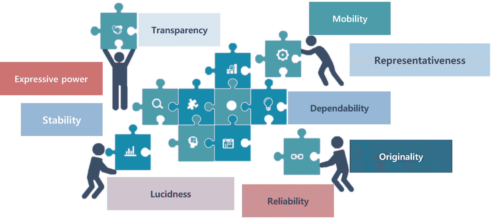

# 4. 可解释性方法生成的解释的常见属性

前三章涵盖了可解释性以及可解释方法的通用分类体系，旨在介绍可解释性的定义并提供不同方法的概述。现在，从本章开始，我们将逐步过渡到更多关于可解释性的技术性内容。在接下来的章节中，您会看到更多的公式和数学概念。

本章讨论可解释性方法生成的解释的属性。正如黑盒模型有一些评估指标（如准确度、精确度和召回率）一样，由于可解释性的输出被用于许多可操作的决策，因此也需要评估可解释性方法。本章列出了几种可解释方法的不同属性。后续章节将解释如何使用这些属性来提出一些评估指标，以衡量和理解我们为模型生成的解释是否具有某种意义。

在直接深入探讨这些属性之前，您一定已经注意到我们多次使用了*解释*这个词。而且，如果您看一下本章的标题，它也是“解释的常见属性”。让我们讨论一下什么是解释。

## 解释的定义

“解释是对‘为什么’问题的回答。”

解释的目标是让某事物变得清晰、可理解、透明且可解释。可解释性是我们希望达成的最终目标，而解释则是实现可解释性的工具。解释将特征值或变量与其各自的预测关联起来，以便我们人类能够轻松理解。这增强了模型的可解释性。

需要研究一些解释理论。有些理论认为只存在一种正确的解释，这意味着答案的正确性与受众是否能理解无关。另一类理论则认为，解释应当考虑听众或用户。由于不同用户拥有不同的知识基础，这类理论自然与“同一事物可以有多种解释”这一假设相吻合——这种现象被称为*罗生门效应*。

有观点认为，第二类理论比第一类更合适。可解释机器学习的原则基于这样一种理论：我们更关心的是让受众理解机器学习模型预测背后的原因。这些解释与知识获取相关，并涉及通过推理过程推导出解释，即首先识别事件的原因，然后选择原因的子集作为解释。

解释的另一个目标是，听众从解释者那里获得足够的信息，以理解某个事件或决策的原因。解释者可以是人类，也可以是机器。

最后，我们想说，解释是高度主观的。因此，我们为生成解释而提出的任何方法都应足够灵活，以适应将使用这些解释的人类用户的需求。换句话说，不存在一种能解决所有可解释性问题的单一解释。我们应该考虑我们试图为其构建解释的领域、用例和受众。

每种情况都需要考虑问题领域、用例以及解释所针对的受众。既然我们已经理解了在可解释机器学习语境下“解释”的含义，那么让我们深入探讨这些解释的属性。

## 解释方法的属性

图 4-1 突出了构成解释方法基础的不同属性。每种解释方法应满足图中所示的一个或多个属性。此外，在为某个用例选择解释方法时，你应该分析该方法采用了哪些属性，然后再决定是否使用该方法。

### 表达模板

可解释性方法的主要属性之一是其表达方式，即它们如何表达结果。结果可以以规则、决策集、自然语言或图表的形式表达。

### 透明性

模型特定的解释方法具有高度透明性，而模型无关的方法则完全没有透明性。透明性指的是解释方法在多大程度上依赖于机器学习模型的内部运作，例如模型的参数。

### 可迁移性

可迁移性与特定可解释方法可应用的机器学习模型的多样性有关。模型无关的方法具有高度的可移植性或可迁移性。它们可以应用于许多模型框架，因为它们利用模型的通用参数，然后自行构建解释。

### 算法可行性

算法可行性与方法的计算复杂度有关。尽管某些方法承诺能给出有意义的结果，但它们过于复杂，需要花费大量时间和资源来运行并获取解释。计算时间是某些非常知名方法的主要缺点之一。除了时间因素，还需要考虑一些算法属性来定义方法的可行性。某些方法包含数据采样过程，这意味着解释可能不稳定。也就是说，对相同的实例和模型使用相同的参数重复运行，可能会产生不同的解释。

现在我们已经讨论了解释方法的属性，接下来让我们看看这些方法生成的解释。

## 单个解释的属性

某些属性适用于解释本身，而非整个方法。接下来，让我们讨论对于评估方法生成的解释至关重要的属性。解释通常以人类可理解的方式，将实例的特征值与其模型预测关联起来。

### 正确性

正确性属性与解释在测试数据或未见数据上的准确性有关。在评估可解释性方法时，我们做出的一种让步是：如果黑盒模型本身的准确性足够高，那么你可以接受解释的准确性稍低。

### 忠实性

忠实性是解释的基本属性之一，因为低忠实性基本上毫无用处。所谓忠实性，是指解释在多大程度上近似于模型的预测。高准确性和高忠实性是相辅相成的。然而，某些方法仅提供局部忠实性，这意味着它们仅能很好地近似于单个实例或一组实例。

### 依赖性

依赖性是在针对相同任务训练且输出预测相似的两个不同模型的背景下衡量的。该属性与这两个模型之间的解释差异程度有关。

如果解释非常相似，则说明解释具有高度依赖性。然而，这个属性有些棘手，因为两个模型可能使用不同的特征却得到相似的预测。在这种特定情况下，高依赖性并不可取，因为模型使用不同的关系进行预测，所以解释应该大相径庭。当模型依赖于相似的关系时，这个属性是可取的；否则，解释会反映模型所依赖的数据的不同方面。

### 稳定性

稳定性表示相似实例的解释之间的相似程度。稳定性比较的是固定模型下相似实例之间的解释，而依赖性比较的是不同模型之间的解释。

高稳定性意味着，除非预测本身发生巨大变化，否则模型特征值的微小变化不会导致解释发生实质性改变。解释方法的特定组成部分（如采样方法）也可能导致缺乏稳定性。然而，稳定性始终是可取的。

### 清晰性

当我们必须判断人类对解释的理解程度时，我们会考察方法的清晰性属性。清晰性是最难定义和衡量的。

可解释性是一个主观概念，其属性取决于受众以及方法使用的上下文。它是衡量特征可理解程度的一个指标。方法中的多个模块可能会降低解释的可理解性；例如，特征的转换。

### 可靠性

可靠性与机器学习模型的确定性有关。许多机器学习模型仅提供预测值，而不包含任何关于模型对预测正确性的置信度的说明。可解释性解释的可靠性属性有助于增强模型用户对模型正确性的信心。

### 重要性

重要性衡量的是解释在多大程度上反映了其自身部分特征的重要性。例如，如果解释方法生成一个决策规则列表作为模型重要性的解释，那么规则中的哪个条件是最重要的？

### 原创性

原创性属性测试预测结果是来自输入特征空间内的区域，还是超出了输入特征的边界。如果超出边界，那么解释可能不准确或毫无用处。一种检查方法是，在训练数据的分布中找到需要被解释的数据实例。

### 代表性

代表性描述了解释的覆盖范围（即解释所覆盖的实例数量）。解释可以覆盖模型的全部数据；例如，线性回归模型中权重的解释。另一方面，某些方法可能只覆盖单个实例。

我们从技术角度讨论了解释的属性。然而，我们想提醒您，可解释性的一切都是为了让人工智能模型更友好。因此，下一节将讨论从人类友好角度来看，哪些解释属性是可取的。

## 人类友好的解释

解释并不总是以易于理解的方式呈现。已有针对解释出版物进行的研究。可解释性领域现有的大部分工作都依赖于方法开发者或研究者直觉上认为对人类友好的方式。然而，应该有一个标准化的格式来使解释对人类友好。让我们看看人类友好解释的一些理想属性。

### 对比性

人类是一种充满好奇的物种。我们通常会问“为什么”。然而，我们并不止步于“为什么”。我们倾向于深入探究“为什么”，然后下一个问题就是“为什么不”。因此，人类通常会问为什么没有做出某个预测，而不是问为什么做出了某个预测。这是一种思考反事实（即从与陈述事实相反的角度思考）的倾向。有时，利益相关者对导致特定解释的因素并不感兴趣。相反，他们更看重确定输入中需要改变哪些因素，以便模型也能改变其预测。

### 选择性

解释方法应该具有选择性。它们应该只提供关于模型及其特征的相关信息。这些方法应该只解释模型所围绕事件的主要原因。由于目标是简化复杂的黑盒模型，产生复杂的解释会导致混淆并浪费时间和资源。较少的解释数量能确保它们易于理解。拉什莫尔效应描述了不同原因可以解释同一事件的情况。由于人类倾向于选择某些原因，所选原因可能因人而异。

### 社会性

解释对人类友好的另一个重要属性是，它们是解释者与听众之间社会互动的一部分。在选择合适的解释时，您应该牢记这一因素，并只为模型生态系统和目标受众选择相关的解释。最佳解释应始终根据领域和用例而变化。

### 关注异常

解释的一个重要方面或属性是包含异常情况。这对于向用户提供完整信息至关重要。这使用户能够理解模型以及为什么做出某些决策。排除这些异常情况可能会导致解释的泛化。我们应该确保即使异常情况与更常见的解释对模型产生相同的影响，也应将其包含在解释中。

### 真实性

好的解释被证明在现实世界中是真实的。这并不意味着解释必须包含全部真相，因为这会干扰解释是否被选择，而选择性是比真实性更重要的特征。就机器学习可解释性而言，这意味着解释必须有意义（合理），并且适用于对其他实例的预测。

### 与先前信念一致

人们倾向于忽略与其先前信念不一致的信息。这种效应被称为`确认偏误`。信念集因人而异，具有主观性，但也存在基于群体的先前信念，这些信念主要是文化性的，例如政治世界观。尽管如此，这与真实性之间存在权衡，因为先验知识通常并不普遍适用，仅在特定知识领域有效。`Honegger`认为，一个解释同时做到真实且与先前信念一致可能会适得其反。

## 普遍性与可能性
一个能够解释大量事件的原因非常普遍，因此可以被视为一个好的解释。这似乎与“异常原因构成好解释”的说法相矛盾。然而，根据定义，异常原因在给定场景中很少见，这意味着在缺乏异常原因的情况下，一个普遍的解释可以被视为一个好的解释。关于机器学习可解释性，普遍性可以通过`特征的支持度`轻松衡量，即解释适用的实例数量与总实例数量之比。这些属性是机器学习可解释性的基础，尽管根据具体情境，某些属性可能比其他属性更相关。无论一个解释多么正确，如果它对人类来说不合理或不具吸引力（不友好），那么机器学习可解释性的价值就会消失。

## 总结
本章简要讨论了三个重要的可解释性概念：解释、`可解释方法与解释的属性`，以及`人类友好的解释`及其属性。这些主题对于可解释性背后的理论以及它在现实场景中应如何被理解至关重要。接下来的几章将详细解释这些属性。这些属性主要用于评估可解释性方法。它们帮助我们理解可解释性中的人为因素，以及人类如何看待可解释性技术的使用。