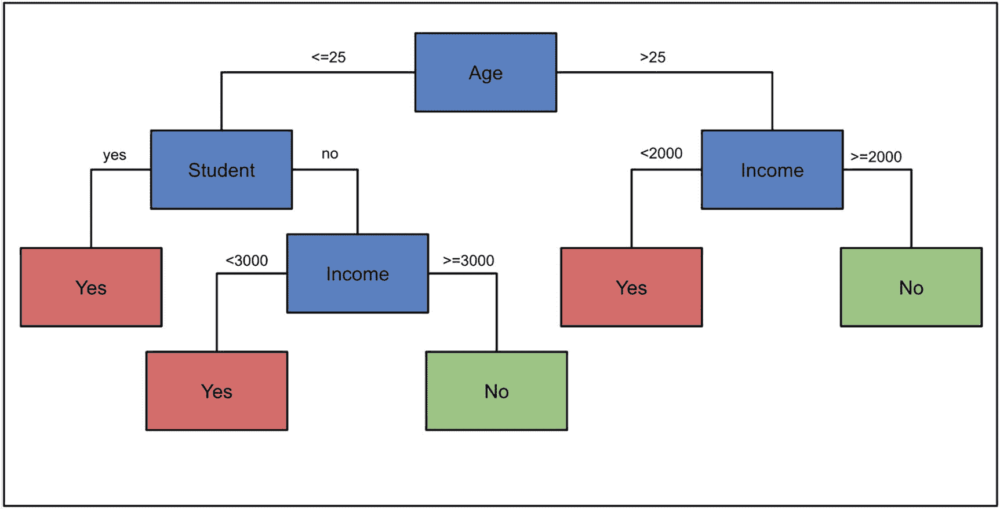
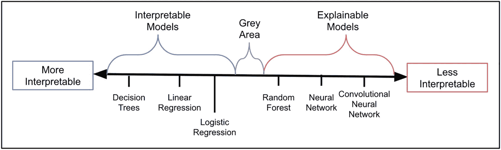
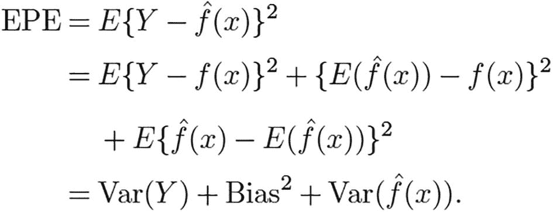

# 7. 可解释机器学习与可解释性机器学习的区别

到目前为止，我们已经学习了可解释性及其属性。在进入模型可解释性的技术部分之前，正确理解基础知识是有益的。许多术语在不同文章中用法随意。一些常见的可解释性方法包括 `SHAP` 和 `LIME`。然而，有些人会随意地将它们归入可解释机器学习之下。本章重点阐述可解释机器学习与可解释性机器学习之间的区别。

## 可解释机器学习与可解释性机器学习基础

让我们从基础开始。如果人类能够自行理解某个模型，则该模型被认为是可解释的。模型的汇总统计量和参数足以解释模型为何做出特定预测或决策。

以决策树为例（见图 7-1）。该问题的目标是预测某人是否会偿还汽车贷款。会违约的人被标记为“是”，其余人则标记为“否”。

图 7-1

一个简单的决策树模型，展示了可解释模型的工作原理

现在假设一位 29 岁、月收入 3000 美元的女性申请贷款。根据此模型，她通过自动核保系统获得了贷款。我们现在可以检查树的节点来理解贷款获批的原因。

第一个分裂点发生在变量“年龄”上。由于申请者 29 岁，因此我们进入右侧节点。下一个分裂点发生在“收入”上。由于她的收入为 3000 美元，我们再次进入右侧节点，到达“否”叶节点。

因此，根据该模型，这位学生不会贷款违约。

### 分析决策树

使用一个包含以下方程的简单线性回归模型，让我们根据一个人的年龄和收入来构建模型，预测其最大贷款额度。Y 代表个人的贷款额度。

`Y = 100*年龄 + 10*收入 + 200`

从该方程可以看出，一个人的年龄每增加一岁，其预测的最大贷款额度就会增加 100 美元。同时，贷款额度也会随着收入的增加而增加。

对于这个例子（29 岁，收入 3000 美元），预测的最大贷款额度为 33,100 美元。

我们可以查看模型的参数，并理解为何会得出某个特定的预测结果。之所以能做到这一点，是因为这些模型相当简单。该方程只有三个参数。但当模型变得复杂时，就很难再用类似的方式去理解它们了。

随机森林是一种复杂的模型。它由多个独立的决策树组成，最终的预测结果是综合每棵树的输出得出的。要理解随机森林做出的决策，我们必须同时理解整个模型中每一棵树的决策。即使只有少量决策树，这也是一项复杂的任务。

现在，想象一下当我们谈论神经网络模型时的复杂程度。例如，通常用于图像识别的卷积神经网络 `AlexNet` 拥有 62,378,344 个参数。而一个简单的回归模型只有三个参数。人类根本不可能理解如此规模和复杂度的模型。某些技术，例如用于确定每个特征对预测目标变量能力大小的特征重要性评分，有助于理解模型的行为。评分越高，表示该特征对模型预测的影响越大。

有些技术则是对单个预测结果进行分解。这与主要在全局层面起作用的特征重要性不同。在整个数据集上，这些技术解释了特定特征如何影响单个实例的行为。`LIME` 和 `SHAP` 就是此类方法。此外，还有像 `DeepLift` 这样的方法，可以为神经网络模型生成解释。

在使用这些技术时，你应该非常谨慎，并且始终注重构建领域知识。为了消除任何困惑，你可以单独或组合使用多种技术。

本节讨论了模型要么本身可解释，要么可以通过某些技术变得可解释。然而，方法之间这种清晰的界限可能存在，也可能不存在。

### 深入探讨

模型的可解释性可以放在一个谱系上来考量，有些技术比其他技术更具可解释性。可解释性是指模型能够被人类理解的难易程度。因此，如果一个模型比另一个模型更容易让人理解其预测方式，那么它就比另一个模型更具可解释性。

图 7-2 展示了可解释性谱系。卷积神经网络的可解释性低于随机森林，而随机森林的可解释性又低于决策树。

图 7-2

可解释性谱系展示了可解释机器学习与可解释性机器学习之间的区别

可解释模型位于谱系的左侧，而可解释性模型位于谱系的右侧。然而，也存在一个灰色地带，你会发现人们对分类的看法存在分歧。

这个线性回归模型是可解释的，因为它易于人类理解。我们只有两个简单的特征（即年龄和收入）；但是，如果我们加入更多特征，模型会更倾向于向复杂一侧倾斜，而非可解释性一侧。

在机器学习和模型构建领域，可解释机器学习 (`Interpretable ML`) 和可解释性机器学习 (`Explainable ML`) 通常可以互换使用。尽管这两个术语非常接近，但它们之间仍然存在一个我们应牢记的根本区别。

可解释机器学习 (`Interpretable ML`) 是研究或使用那些可以根据模型自身特征进行解释的系统或模型。在提及模型分类时，这是一个与内在可解释性非常接近或相似的术语。可解释机器学习包含那些本身具有内在可解释性的模型。本章探讨了线性模型和决策树（见图 7-1）。这些是可解释模型，因为我们能够利用模型本身来解释它为何做出某个特定决策。它意味着能够审视一个算法并说：没错，我能看出这里发生了什么。

然而，可解释性机器学习 (`Explainable ML`) 指的是我们能够使用可能依赖于模型本身、也可能不依赖于模型本身的技术，来解释机器或深度学习模型内部机制的程度。简单来说，可以这样理解：可解释性机器学习是一个术语，可用于所有需要某种方法来解释其内部运作的黑盒模型。基本上，可解释性机器学习为理解模型为何做出某个特定决策提供了帮助。

让我们以一个体育运动的例子来解释其中的区别。假设你正在观看一场板球比赛，击球手将球击出边界。你收集所有这些数据并围绕它构建一个模型，以预测一次击球是否会得分。当球接近击球手时，模型就会预测这次击球是否会得分。在这种情况下，可解释机器学习 (`Interpretable ML`) 是指你理解模型为何预测会得分。你可能会看到击球手采取了高站姿，身体前倾呈进攻姿态，并且球投到了合适的区域，因此击球手能够打出好球。可解释性机器学习 (`Explainable ML`) 则试图理解这次击球背后的“化学反应”。它解释了为何击球手能够得分边界的所有因素。它揭示了球的投掷、球拍质量、球员情绪、历史表现或最喜欢的击球区域之间复杂的相互作用。

理解某事如何发生是可解释机器学习 (`Interpretable ML`)，而理解某事为何发生则是可解释性机器学习 (`Explainable ML`)。可解释性机器学习在黑盒模型场景中找到了用武之地。

在了解了可解释性机器学习 (`Explainable ML`) 和可解释机器学习 (`Interpretable ML`) 之间的区别之后，我们认为你最好能理解两者所面临的挑战，以及为何在不同场景下两者都是必要的。让我们深入探讨关键问题，从可解释性机器学习开始。

## 可解释性机器学习的关键问题

近期关于黑盒模型可解释性的工作可能包含一些通常被忽视的关键问题，但这些问题可能对机器学习模型的广泛应用产生持久的负面影响。

### 准确性与可解释性之间的权衡

更复杂的模型通常更准确，这意味着有时为了获得卓越的预测性能，必须使用复杂的黑盒模型。如果拥有结构良好、特征自然有意义的数据，则可以避免这种情况。当我们处理具有有意义特征的结构化数据问题时，经过预处理操作后，像深度神经网络、提升决策树、随机森林等更复杂的分类器，与逻辑回归、决策列表等更简单的分类器之间，性能有时并无显著差异。有些人认为，将可解释的 `CART` 模型与更先进的神经网络模型进行比较，并声称可解释性只能通过牺牲准确性来实现，这是不公平的。然而，在当前情况下，我们看到，要实践可解释性机器学习，就需要在复杂模型之上构建方法以实现准确性。

### 警惕不忠实的解释

有时，可解释的机器学习方法会提供与原始模型计算结果不符的解释。这些解释并不总是真实反映原始模型的预测方式或行为。不准确的解释模型非常危险，因为用户会难以信任这样的模型。“解释”这个术语本身有时就具有误导性，因为解释模型并不总是试图模仿原始模型的计算过程。可能存在这样的情况：在一个复杂模型之上构建的解释模型，可以使用一套完全不同的特征集来生成相同的预测行为。因此，解释模型并非总能实现其目的。

### 细节不足

解释有时无法提供关于黑箱模型内部运作的足够细节。

即使解释模型是正确的，有时解释也可能无法呈现实际复杂模型的全貌。近年来，数据科学家往往只关心正确的标签。因此，许多可解释的机器学习方法主要侧重于对正确标签或正类标签的洞察。需要注意的是，负类标签中也可能隐藏着大量信息，并且在解释方面，负类标签并不总是正类标签的对立面。同一个变量对于正类和负类标签可能讲述截然不同的故事。因此，可解释机器学习的一个缺点就是它纯粹被用来解释正类标签。

## 可解释机器学习的关键问题

在许多情况下，即使涉及高风险决策，人们也更倾向于使用带有解释的黑箱模型，而非可解释模型。可解释模型有时会存在计算问题，或者研究人员培训不足以及代码可用性方面的问题。以下部分将重点介绍可解释机器学习的一些主要问题。

### 利润与损失

公司可以通过其黑箱模型生成的预测商标来获利，但可解释机器学习可能导致损失。对于那些试图通过性能优异的内部自建黑箱算法来赚钱的公司来说，可解释机器学习可能导致损失。可解释机器学习不需要可解释方法，模型背后的机制很容易理解。因此，它破坏了使用复杂高精度黑箱模型的应用场景。

一个用于风险预测的累犯评估工具^(²)在美国司法系统中被广泛使用，用于检查或预测哪些罪犯在获释后可能再次被捕。该模型的输出基于简单的 `if-then-else` 规则，这些规则根据年龄和过往犯罪次数来预测一个人再次犯罪入狱的可能性。一个简单的可解释机器学习模型可能具有同等的准确性。然而，该模型背后的公司将其作为专有软件出售给政府。这个模型在累犯预测方面的准确性，与仅涉及年龄和过往犯罪次数这两个因素的简单三规则可解释机器学习模型相当。但它却作为专有软件出售给了司法系统。

在医学领域，存在一种盲目接受黑箱模型的趋势，这为向医院销售更多模型的公司打开了大门。

这些例子表明，机器学习的商业模式存在问题。那些从高风险决策的黑箱模型中获利的公司，并不完全对单个预测的质量或这些预测的解释负责，因为没有人知道模型内部发生了什么以及结果是如何生成的。我们最多只能应用一种可解释方法并推断其机制。正因如此，可解释机器学习并不受欢迎，也不被鼓励。支持黑箱模型而非可解释机器学习的论点是，黑箱模型可以防止逆向工程。

### 构建成本

构建可解释模型需要付出巨大的努力，无论是在计算方面还是在领域专业知识方面。

要构建能够产生与黑箱模型同样出色结果的可解释模型，你需要具备高度的领域专业知识和充足的计算时间。一旦我们在传统的可解释机器学习模型中增加特征数量，计算时间就会急剧增加。此外，模型构建者需要与模型评审者保持持续沟通，以检查结果是否合理且符合业务目标；否则，可解释模型的输出与黑箱模型无异。这导致构建一个优秀模型需要大量的时间。可解释模型通常有一组特定于应用的约束条件。在实践中，解决约束问题变得很困难。

### 隐藏模式

许多研究人员和科学家发现构建可解释模型颇具挑战性，因为他们发现黑箱模型能够揭示数据中各种隐藏的模式。而透明模型有时可能无法揭示数据中的此类模式。只有当研究人员投入大量时间和专业知识来创建最先进的可解释方法时，可解释模型才能揭示数据中的模式。这从一开始就需要大量的领域专业知识。

现在你已经了解了可解释机器学习与可解释机器学习面临的挑战，深入探讨可解释机器学习的另一个方面将大有裨益。下一节将讨论`解释性建模`与`预测性建模`之间的区别。

## 解释性建模与预测性建模

解释性建模，正如我们现在都应该熟悉的，是为了揭示模型中的隐藏模式。解释性建模的目的是理解模型的一切，从倾向得分到因果关系、特征重要性、反事实推理等等。总之，解释性建模是指将统计模型应用于数据，以检验关于理论构念的因果假设。

预测性建模是使用不同的算法和预处理技术对输入数据创建模型的过程。由此产生的模型能够以高精度预测新的观测值。这种建模的唯一目标是创建一个预测，使其在未见数据上的表现与在训练数据上一样好。

预测性建模所使用的技术没有限制；例如，你可以使用贝叶斯或频率学派方法、参数或非参数方法，或者数据挖掘算法或统计模型。

### 解释还是预测：两种选择的关键区别

在概念层面解释现象的能力，与在可测量层面生成预测的能力截然不同。这种差异源于将理论操作化为统计模型和可测量数据的过程。

为了恰当传达这种差异，考虑一个理论：`X` 导致 `Y`，并用函数 `F` 来描述它，即 `Y = F(X)`。

`F` 可被视为一个具有输入和输出两个维度的模型，其中 `X` 是输入构念，`Y` 是输出。`F` 可以是任何具有优化或预测行为的模型。

由于 `F` 通常不够详细，无法得出唯一的 `f`，因此通常会考虑一组 `f` 模型。

在解释性建模中，目标是尽可能使 `f` 与 `F` 匹配，以进行统计推断并证明理论假设。`X` 和 `Y` 数据是用于估计 `f` 的工具，而 `f` 则用于检验因果假设。解释性建模的目标是理解 `X` 与 `Y` 之间的关系，以及 `X` 的变化如何支配 `Y` 的变化。另一个目标是理解 `f` 机制在接收输入 `X` 并产生输出 `Y` 时是如何运作的。

相比之下，在预测性建模中，`X`、`Y` 和 `f` 实体被结合起来，以生成对新的 `Y` 值的良好预测。即使潜在的因果关系是 `Y = F(X)`，但使用不同于 `f(X)` 的函数和不同于 `X` 的数据可能更有利于预测。

四个主要方面可以解释这些差异。

*   **因果性–关联性**：在解释性建模中，`f` 代表一个潜在的因果函数，并假设 `X` 导致 `Y`。在预测性建模中，`f` 捕捉的是 `X` 与 `Y` 之间的关联。

*   **理论–数据**：在解释性建模中，`f` 是基于 `F` 精心构建的，其方式有助于解释 `X` 与 `Y` 之间的估计关系并检验因果假设。在预测性建模中，`f` 通常是根据数据构建的。不要求 `X` 与 `Y` 之间的关系具有直接可解释性，尽管有时透明性是理想的。

*   **回顾性–前瞻性**：解释性建模是回顾性的（即，模型对数据有一些总体性的见解）。然而，预测性建模是前瞻性的（即，模型函数预测新的观测值或未来的观测值）。

*   **偏差–方差**：对于值为 `x` 的新观测值，使用二次损失函数的期望预测误差如下所示。

偏差是错误指定统计模型 `f` 的结果。在解释性建模中，重点是尽量减少偏差，以获得对基础理论最准确的表示。相比之下，预测性建模旨在最小化偏差与估计方差的组合，有时会为了提升经验精度而牺牲理论准确性。

为了进行恰当的建模，你应该事先决定用例是需要构建一个解释模型还是预测模型。基于这个选择，某些参数存在许多不应被忽视的差异。下面描述了其中两点。

*   **变量的选择**：在解释性建模中，变量的选择基于该构念在理论因果结构中的角色以及操作化本身。不同领域存在与不同角色相关的特定术语；例如，在社会科学中，它们是前因变量、结果变量、中介变量和调节变量。在药理学和医学科学中，它们是处理变量和控制变量，而在流行病学领域，它们是暴露变量和混杂变量。在预测性建模中，无需深入探究每个变量在潜在因果结构中的确切角色。选择预测变量的标准是预测变量与响应变量之间关联的质量。此外，数据质量和数据可用性也起着重要作用。

*   **方法的选择**：解释性建模需要易于解释的流行统计模型。在无法使用可解释模型的情况下，你需要从可解释的机器学习中仔细选择方法来定义模型的内部机制。在预测性建模中，首要任务是生成准确的预测。一些黑箱模型非常擅长生成高质量的预测。在预测性建模场景中，透明性可能不那么重要。在预测性建模中，尝试一定数量的方法，然后选择能提供最佳准确度的方法，是很好的做法。

## 验证、模型评估与模型选择

从一组模型中选择最终模型、对其进行验证并评估其性能，在解释性建模和预测性建模中存在显著差异。尽管该过程是迭代的，但为便于阐述，我们将其分为三个部分。

### 验证

在解释性建模中，通常使用的验证方法是模型设定检验。这类检验构建了验证技术，例如调查问题的信度和效度测量以及因子分析。在预测性建模中，构建良好模型时的主要关注点之一是数据的泛化，这会导致过拟合。因此，验证包括以下步骤：我们比较模型在训练集和保留数据集上的性能，以确保模型不是针对特定数据集进行泛化。

### 模型选择

在解释性建模中，模型根据解释力进行比较，因此易于比较的嵌套模型很受欢迎。使用整体 `F` 统计量来包含和/或排除变量的逐步式方法，似乎适合实现高解释力。然而，以这种方式优化解释力在概念上与验证步骤相矛盾，因为在验证步骤中，变量的包含/排除以及统计模型结构都是经过精心设计以代表理论模型的。与解释力相比，统计显著性在评估预测性能方面作用很小或没有作用。有时，移除系数较小的输入（即使它们在统计上显著）反而能提高预测精度。只要选择标准依赖于预测力而非解释力，逐步式算法在预测性建模中就是有用的。

### 模型使用与解释性建模报告

在科学研究背景下，通过推断得出“统计结论”，进而转化为关于 `F`、`X`、`Y` 及因果假设的科学结论。解释性研究侧重于理论、因果性、偏差和回顾性分析，旨在检验或比较现有的因果理论。因此，解释性科学论文的统计部分以统计推断为主导。在预测建模中，模型函数会为新数据生成预测。我们注意到，根据模型的复杂性和生成的预测类型，从模型生成预测的难度会有所不同。例如，使用贝叶斯方法生成完整的预测分布比使用预测似然方法更容易。

我们必须注意可解释机器学习与可解释性机器学习的区别。在许多印刷品和讨论论坛中，我们可能会发现这些术语被互换使用。由于模型可解释性或模型可解释性这一领域仍在发展中，因此存在严格的区别。可解释机器学习通常指那些透明且易于理解的方法或算法。可解释性机器学习则指应用于黑盒算法之上，以理解黑盒模型做出预测背后原因的方法或算法。解释性建模旨在理解复杂模型背后的机制。它试图探究算法内部发生了什么，以及预测是如何做出的。当我们想要理解复杂的特征与预测变量之间的关系，并从中得出行动和见解时，就会进行解释性建模。然而，预测建模则是在我们希望对未见数据进行预测时进行的。在这种情况下，我们并不关心定义模型特征或组件之间的关系。

至此，我们结束了本书的第二节。本章重点介绍了解释方法的属性，以及人类如何理解这些方法和解释。我们还理解了一些常用术语之间的关键区别。以下是对本章基本概念的快速总结。

## 总结

本章定义了“解释”与“阐释”之间的区别。我们认为理解这一区别对你来说非常重要。我们强调了可解释机器学习、可解释性机器学习以及可解释性在其基本概念上的差异。我们讨论了可解释机器学习和可解释性机器学习的缺点，并推荐了选择方法时的考量因素。一旦明确了“解释”与“阐释”的区别，我们便继续解释了预测建模与解释性建模之间的差异。当你在处理具有不同需求的问题时，你将能够将这一点联系起来。

下一章将解释每种方法所属的各种框架。你将能够将不同的框架与我们之前所有章节中研究的不同属性和分类联系起来。

脚注 1