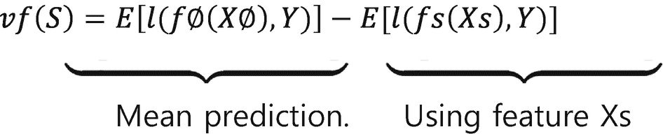
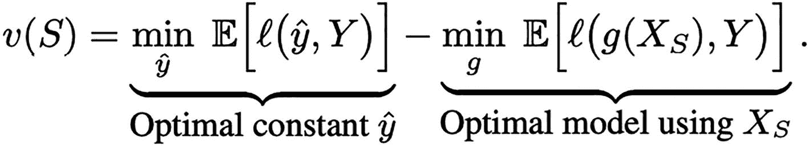
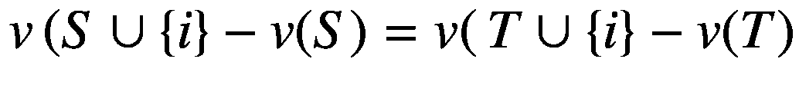
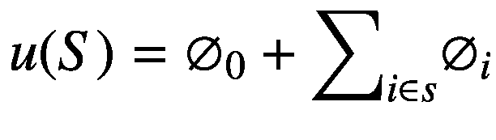
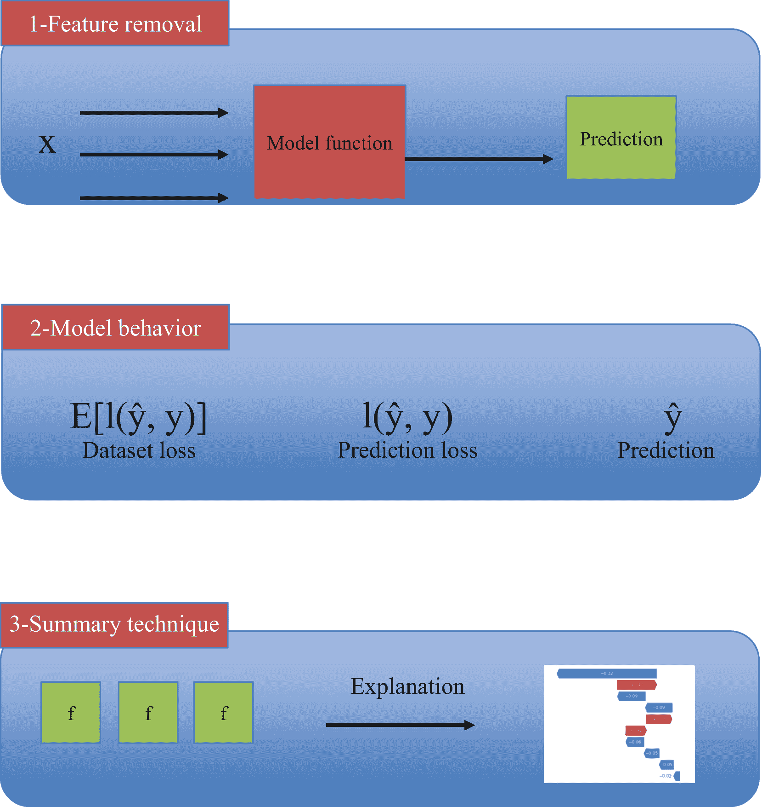
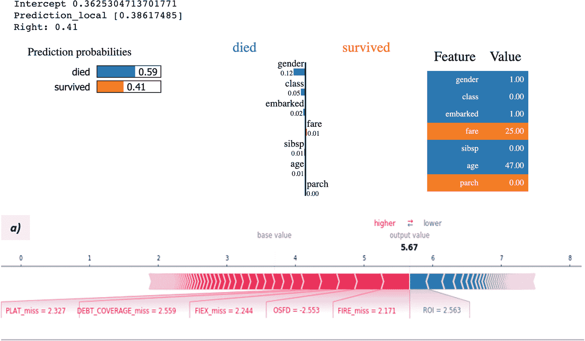
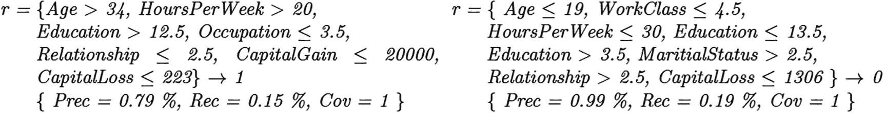
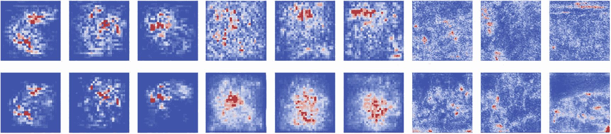
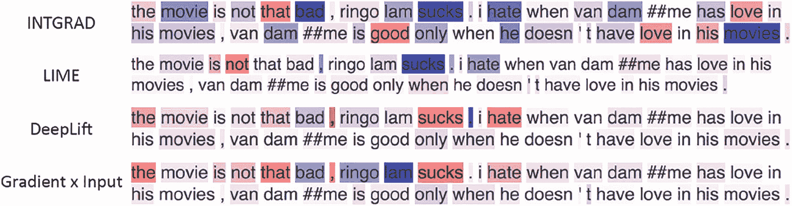
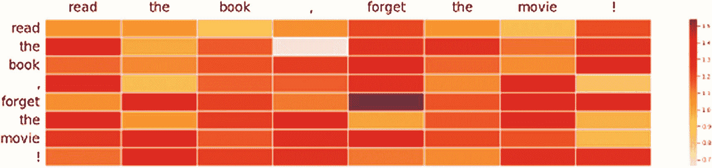

# 8. 模型解释框架

前几章介绍了机器学习领域、可解释性的重要性以及可解释性方法的分类。前面的章节介绍了机器学习可解释性，并侧重于总体概述和定义。本章讨论模型解释的不同框架。由于每个类别下都有多种方法，请参考后续章节以详细了解每种方法的工作原理以及一些可运行的代码版本。

从本章开始，我们将深入探讨关于可解释性方法的更复杂的技术细节。我们会大量讨论不同方法中涉及的数学知识，以及可解释性理论是如何构建的。我们建议你使用纸笔记录下讨论的一些关键数学公式。如第 1 章所述，创建一个学习模板是很有益的。

## 数据集概览

机器学习是一个非常多样化的主题，包含了各种应用场景的数据集。我们有表格数据、文本数据和图像数据。所有这些数据类型都有数百种模型和多种可解释性方法。然而，所有方法的一个共同点是这些方法是如何构建在这些模型之上的。我们的重点主要放在事后可解释性技术的框架上，因为模型内在方法依赖于模型本身的框架。我们首先简要讨论不同数据集下的不同框架，然后解释每个框架。

以下是不同类型数据集的简要介绍。

*   **表格数据**：用于机器学习的表格数据是最常见的数据集形式，在所有业务领域都非常普遍。随着工业界大数据革命的到来，公司已经建立了技术生态系统来存储大量的表格数据。这些数据集范围从交易数据集到个人信息数据集。表格数据可以运行一些流行的监督式机器学习算法，如黑盒分类算法，以及无监督算法，如聚类。公司严重依赖表格数据集进行各种操作，这些操作不仅限于分析和数据。

*   **文本数据**：在电子商务公司激增之后，文本数据也越来越受欢迎。电子商务业务的一个主要需求是评估客户评论，这些评论大多以自由文本形式书写。很快，许多算法被提出用于研究文本数据，范围从情感分析到命名实体识别，再到分类等等。

*   **图像数据**：在机器学习领域的一些前沿研究之后，计算机视觉逐渐流行起来。公司开始使用这些算法来分析视频流、图像和实时视频。零售领域的典型图像数据可能包含需要分类或分解为不同组件的物品图片。

由于存在如此多的算法来分析这些不同类型的数据集，因此需要不同类型的可解释性算法来理解不同模型做出的决策。

本章旨在根据返回的解释类型对解释方法进行分类，并介绍最广泛采用的定量评估指标，以从不同方面验证解释，并使用这些指标对解释器进行基准测试。其目标是提供一个指导，将黑盒模型映射到一组兼容的解释方法。

## 表格数据的框架类型

本节将介绍为表格数据集生成解释的各种框架。

*   **基于规则**：一种在对数据进行建模练习后，将表格数据转换为一组规则的框架。在分类问题中，每个类别都有一组规则来定义该类的行为。

*   **特征重要性**：一个包含每个特征值的向量。每个值表示该特征对于分类的重要性。

*   **原型**：向用户提供一系列能够表征黑盒某个类别的示例。原型是一个能够代表所有数据的数据实例。

*   **反事实**：预测的反事实解释描述了特征值的最小变化，该变化会将预测结果改变为预定义的输出。

### 特征重要性（FI）

在这个互联网唾手可及的时代，数据正以日益增长的速度被轻松创建和捕获。这导致了数据集的产生，其中每个数据点都关联着成千上万个特征。一个例子是跟踪用户在零售网站上的行为，或者从安装在汽车上的人工智能系统获取详细的传感器信息。

由于存在如此庞大的数据集，像深度学习和梯度提升这样强大的机器学习方法可以在大多数任务中实现非常强的预测性能。然而，由于这些模型是黑盒模型，人类很难理解输入特征是如何协同工作来构建预测的。我们在之前的章节中已经讨论过这些挑战。这个问题在高维数据集中会被放大许多倍。有时，通常的情况是，大部分或全部的预测性能可以通过一小部分特征来实现。这会导致不必要的计算复杂性、花费更多时间训练模型，以及样本外性能降低，因为当算法暴露于许多噪声特征时，可能无法正确检测驱动信号的特征。

不幸的是，我们通常无法仅凭直觉直接确定这样的特征子集。因此，研究重点已转向开发数据驱动的方法来识别相关特征，从而允许我们丢弃那些对预测没有额外价值的特征。最常用的特征选择方法之一是基于评估机器学习模型的变量重要性，该方法试图量化每个特征在预测目标变量时的相对重要性。变量重要性是通过衡量由于该特征相对于其他特征所带来的模型性能提升来计算的。一旦你识别出最重要的特征，就可以移除那些重要性很小或没有重要性的特征。变量重要性也是一种模型可解释性的方法，通过评估在模型训练期间哪些特征被声明为重要，你可以尝试理解模型是如何做出预测的。

然而，请记住，任何特征重要性方法只有在准确的情况下才有用。如果某种特征重要性方法高估了不相关特征的重要性，它可能会阻止移除不重要的特征。另一方面，如果低估了相关特征的重要性，我们可能会丢弃重要的变量，并对最终模型的性能产生负面影响。因此，理解变量重要性的行为方式至关重要，特别是当应用于不同的机器学习模型时，变量重要性是否表现出不同的特征。在可解释性的变量重要性领域内有几个框架。以下各节将逐一解释。

### 特征子集的预测能力

考虑一个监督学习任务，其中包含以下元素。

*   用于预测的模型 f
*   响应变量 Y
*   输入 X，其中 X 由独立特征 (X[1], X[2], . . . , X[d]) 组成。

X 表示随机变量，x 表示具体值。

特征重要性可以定义为提供或计算一个特征为模型提供了多少预测能力。

模型 f 使用所有特征进行训练；然而，也可以使用特征子集来分析其性能。例如，

X[S] ≡ {X[i] | i ∈ S} 对于不同的 S ⊆ D，其中 D ≡ {1, . . . , d}。

重要的特征是那些当被移除时，会导致 f 性能下降的特征。

受限模型 f[S] 定义为

![$$ fs(xs)=E\left[f(X)| Xs= xs\right] $$](images/511613_1_En_8_Chapter/511613_1_En_8_Chapter_TeX_Equa.png)

这样，缺失的特征 X[S¯] 通过条件分布^(³) p(X[S¯]|X[S] = xs) 被边缘化。

两个特殊情况是 S = ∅ 和 S = D，它们分别对应于均值预测 f∅(x∅) = E[f(X)] 和完整模型预测 fD = f(x)。

使用这种约定来适应特征子集，该方法现在可以衡量当移除特征时 f 的性能下降了多少。给定一个损失函数，f[S] 的总体风险定义为 El(f[s,Y)]，其中期望是对数据分布 p(X, Y) 取的。为了将预测能力定义为一个随模型准确性增加的量，考虑相对于均值预测的风险降低，并定义函数 vf : P(D) → R 如下。

其定义域是幂集 P(D)，左侧项是使用均值预测 E[f(X)] 达到的损失，右侧项是使用特征 X[S] 达到的损失。函数 v[f] (S) 量化了 f 从特征 X[S] 中获得的预测能力大小，我们通常期望在 S 中包含更多特征会使 v[f] (S) 更大。虽然 v[f] 提供了一种基于模型的预测能力概念，但该方法也引入了一种通用预测能力的概念。为此，定义函数 v : P(D) → R 为在使用最优模型时，从 X[S] 中获得的风险降低。

左侧项是最优常数预测 yˆ 的损失，右侧项是来自所有函数类别（例如，贝叶斯分类器）的最优模型 g 的损失。直观地说，v 代表了理论上可以从 X[S] 中获得的最大预测能力。由于 f 通常使用经验风险最小化进行训练，基于模型的预测能力 v[f] 提供了对 v 的近似，并且在 f 是最优的某些情况下，两者是一致的。

### 加性重要性度量

在某些简单的情况下，特征以加性的方式贡献预测能力。这意味着

对于所有满足 *i* ∉ *S*, *T* 的子集 S, T 成立。在这些情况下，Xi 的重要性可以定义为其贡献的预测能力，即 ∅[*i*] = v({i})−v(∅)。

然而，一个特征的贡献通常不是加性的，因为它取决于哪些 X[S] 特征已经存在。

一类加性重要性度量包括任何其分数 ∅1, . . . , ∅d 可以被理解为与每个特征相关的性能增益的方法。这个框架允许你统一许多明确或隐含地在预测能力中定义特征重要性的方法。这类方法定义如下。

加性重要性度量是那些为特征 *i* = 1, . . . , d 分配重要性分数 ∅[*i*] ∈ R 的方法，并且存在一个常数 ∅[0] ∈ R，使得以下加性函数为特征子集的预测能力提供一个代理；也就是说，*u*(*S*) ≈ *v*(*S*)。

对于此类方法，u(S) 通过将每个包含的特征 *i* ∈ *S* 的 ∅[*i*] 值相加，来近似 v(S) 直至一个常数值 ∅[0]。每个 ∅[*i*] 可以被视为与 X[*i*] 相关的性能增益，这提供了衡量其对于预测任务重要性的一个度量。

尽管这些定义侧重于近似通用预测能力 v 的方法，但它们也包括近似基于模型的预测能力 vf 的方法，因为它们隐含地近似了 *v*。对于大多数预测问题，函数 *v* 表现出非加性行为，因此代理函数 *u* 通常无法完美地表示每个特征对预测能力的贡献。虽然粗略的近似可能为用户提供一些见解，但更精确的近似能更准确地反映每个特征的重要性。

### 基于特征移除的重要性解释

基于移除的方法属于可解释性中的特征重要性领域，其原理是通过移除特征来量化该特征的影响力。这一框架有助于模型专家更好地理解模型解释工具，并为大量可解释性研究提供了坚实的理论基础。该框架整合了以往被视为独立的多类方法，包括局部与全局方法、特征归因与特征选择方法。图 8-1 是一个简单示例，用于描述基于移除的解释（参见 [`https://arxiv.org/pdf/2011.14878.pdf`](https://arxiv.org/pdf/2011.14878.pdf)）。

图 8-1

一个用于基于移除的解释的统一框架。每种方法由三个选择决定：如何移除特征、分析何种模型行为、以及如何总结特征影响力。

考虑一个能够利用输入 X 预测响应变量 Y 的机器学习模型，其中 X 可表示为 X = (X1, X2, . . . , Xd)，每个 X[i] 代表诸如年龄或收入等个体特征。我们使用大写符号（如 X）表示随机变量，小写符号（如 x）表示其具体取值。同时，我们用 X 表示完整特征向量 X 的域，用 X[i] 表示每个特征 X[i] 的域。

最后，xS ≡ {xi : i ∈ S} 表示 S ⊆ D ≡ {1, 2, . . . d} 的特征子集，而 S¯ ≡ D \ S 表示该集合的补集。

我们先暂且不谈那些本身具有可解释性的模型。所有其他方法都是通过考虑输入的扰动，并利用扰动结果来解释每个特征对模型的影响，从而生成解释。基于移除的解释是一个统一框架，它通过连接那些通过移除特征来定义每个特征影响力的方法而发展起来。

以下是一些依赖此类框架或机制的最常见方法。

*   Breiman, 2001; Ribeiro et al., 2016 – 随机森林特征重要性与排列重要性
*   Fong and Vedaldi, 2017
*   Lundberg and Lee, 2017 – SHAP

所有这些方法都基于特征移除的原理；然而，除此之外，它们也采用了多样化的方法。例如，LIME 对输入的可解释表示拟合一个线性模型。Shapley 效应则考察每个特征解释了模型方差的多少。这两种方法之间的差异很容易系统化，因为每种方法移除了不同的特征集。然而，该方法展示了即使这两种方法，也仅需三个步骤就能解释清楚。基于移除的解释是一种模型解释方法，它量化了从模型中移除特征集所产生的影响。三个选择决定了这些方法。

*   **特征移除**：方法如何从模型中移除特征（例如，将其设置为默认值，或通过对值的分布进行边缘化处理）。
*   **模型行为**：方法分析何种模型行为（例如，真实类别的概率或模型损失）。
*   **总结技术**：方法如何总结每个特征对模型的影响（例如，单独移除一个特征，或计算 Shapley 值）。

这些方法通过描述不同方法在这三个维度上的权衡取舍，帮助你理解特征内部概念的重要性。我们将在后续章节中了解这些差异。

### 特征移除

在此，我们定义从机器学习模型中移除特征所需的数学工具，并考察现有解释方法是如何移除特征的。

**关于特征子集的函数**：大多数机器学习模型在给定特定特征集 X = (X1, . . . , Xd) 的情况下进行预测。从数学上讲，这些模型是形式为 f : X → Y 的函数，我们用 F 表示所有此类可能映射的集合。基于移除的解释背后的原理是移除某些特征以理解它们对模型的影响。由于大多数模型需要所有特征才能进行预测，移除一个特征比简单地将该特征从模型中移除要复杂得多。为了从模型中移除特征，或根据特征子集进行预测，我们需要一个不同于 f ∈ F 的数学对象。考虑定义域为 X × P(D) 的函数，其中 P(D) 表示 D ≡ {1, . . . , d} 的幂集，而不是定义域为 X 的函数。为了确保对保留特征的不变性，这些函数必须仅依赖于子集 S ∈ P(D) 所指定的特征，因此我们如下形式化定义子集函数。

*一个* *子集函数* *是一种形式为 F : X × P(D) → Y 的映射，该映射对不在指定子集中的维度保持不变。也就是说，对于所有满足 xS = x′S 的 (x, x′, S)，我们有 F(x, S) = F(x′, S)。为方便起见，我们定义 F(x*[*S*]*) ≡ F(x, S)，因为保留的值 x*[*S*] *不被 F 使用。*

子集函数的不变性属性至关重要，它确保只有指定的特征值决定函数的输出，同时保证其他特征值无关紧要。看待子集函数的另一种方式是，它们模拟了缺失数据的存在。虽然我们用 F 表示标准预测函数，但我们用 F 表示所有可能的子集函数的集合。

子集函数在此方法中被使用，因为它们概念化了不同方法如何从机器学习模型中移除特征。基于移除的解释通常从一个现有模型 f ∈ F 开始，为了量化每个特征的影响力，必须建立一种从模型中移除该特征的约定。一种自然的方法是基于原始模型 f 定义一个子集函数 F∈F。为了形式化这一思想，模型扩展定义如下。模型 f ∈ F 的一个扩展是一个子集函数 F ∈ F，该函数在包含所有特征的情况下与 f 一致。也就是说，模型 f 及其扩展 F 必须满足 F(x) = f(x) ∀x ∈ X。

### 解释不同的模型行为

基于移除的解释展示了模型如何工作，但它们可以通过分析各种模型行为来实现这一点。我们现在考虑当不同特征从模型中被移除时，要观察的目标量的各种选择。

特征移除原则足够灵活，可以解释几乎任何函数。例如，方法可以解释模型的预测或损失函数、神经网络中的隐藏层、或计算图中的任何节点。事实上，基于移除的解释不必局限于机器学习语境：任何能够处理缺失输入的函数，都可以通过特征移除来解释，方法是检查其输出或输出的某个函数，同时移除输入组。

每种方法的目标量可以理解为模型输出的一个函数，该函数由子集函数 F(xS) 表示。许多方法解释模型输出或输出的简单函数，例如对数几率比。其他方法则衡量模型对单个输入或整个数据集的损失。最终，如下所示，每种方法都基于一个形式如下的集合函数生成解释。

u: P(D) –> R

这表示与每个特征子集 S ⊏ D 相关联的一个值。这个集合函数代表了该方法旨在解释的模型行为。

### 总结特征影响

基于移除的解释方法的第三个选择是如何总结每个特征对模型的影响。用于表示模型对不同特征依赖关系的集合函数是复杂的数学对象，由于特征子集数量呈指数级增长以及底层特征交互的存在，这些函数难以被完整传达。基于移除的解释方法通过为用户提供每个特征影响的简洁总结来应对这一挑战。

许多方法都属于特征移除框架，并遵循前述三个要点的原则。

以下是一些最常见的方法：IME、QII、SHAP（如图 8-2 所示）、Kernel SHAP、Tree SHAP、Loss SHAP、SAGE、Shapley、Permutation、Conditional、Univariate、L2X、INVASE、LIME（如图 8-2 所示）、PredDiff、CXPlain、RISE 和 FIDO-CA。其中一些方法将在后续章节中介绍。

图 8-2

LIME 和 SHAP 输出示例

### 基于规则的解释

决策规则是表达模型重要特征的一种更简单的形式。除了提供重要特征外，决策规则集还提供了这些特征的值，这有助于实现更好的预测。决策规则的一个优点是它们对人类友好。它们以非常简单的文本格式解释模型，非技术用户和利益相关者都能轻松理解。

决策规则 *r*，也称为*逻辑规则*，形式为 p → y，其中 p 是一个前提，由关于特征值的布尔条件组成，而 y 是规则的结论。特别地，p 是形如 xi∈[v (l) i, v (u) i ] 的分裂条件的合取，其中 xi 是一个特征，v (l) i, v (u) i 是 xi 域中扩展了 ±∞ 的下界和上界值。如果 p 的每个布尔条件对 x 都为真，则实例 x 满足 r，或者说 r 覆盖 x。如果要解释的实例 x 满足 p，则规则 p → y 代表了决策 g(x) = y 的一个候选解释。此外，如果可解释的预测器在 x 的邻域内模仿了黑盒的行为，我们可以进一步得出结论：该规则是 b(x) = g(x) = y 的一个候选局部解释。

在规则的语境中，你还可以找到反事实规则。反事实规则具有与决策规则相同的结构，唯一的区别在于规则结论 y 相对于 b(x) = y 是不同的。它们对于向最终用户解释需要改变什么才能获得不同的输出非常重要。

一个规则解释的示例是 *r = {age < 40, income < 30k, education ≤ Bachelor}, y = deny。在这种情况下，记录 {age = 18, income = 15k, education = Highschool} 满足该规则*。

最常见的基于规则的方法包括 ANCHOR、LORE、RuleMatrix、TREPAN、SkopeRules 和 GLocalX。

图 8-3

在线可用的成人数据集上 XGB 的全局解释。左侧是类别 > 50K 的规则，右侧是类别 < 50K 的规则

### 原型

在模型意义上，原型是一个代表一组相似记录的对象。

一个原型可以是：

*   训练数据集中与输入数据 x 接近的一条记录
*   输入所属聚类的质心
*   使用某种特定过程生成的合成记录

原型的概念基于这样一个事实：用户通过查看与他们所选记录相似的记录来理解模型的推理。

原型不会在后续章节中详细讨论；因此，我们在此介绍基本的原型方法。

MMD-critic 是一种在模型之前工作的原型方法，因为它分析的是所分析数据集的分布。它使用*最大均值差异*（MMD）来工作。原型解释数据集的总体行为。它通过测量实例分布与整个数据集中实例分布之间的差异来选择原型。那些更接近数据分布的实例集被称为*原型*。该方法仅展示那些与原型不同但属于同一类别的少数数据点。

隐私保护解释是可解释性领域中的第一种方法，它考虑了受隐私保护的解释。它是一种模型无关的局部事后方法。

通过构建微聚合来实现解释的隐私性与可理解性之间的权衡。在该方法中，会创建一组聚类。然后，为每个聚类创建一个浅层决策树，以提供详尽的解释，同时由于树的深度有限，保持了良好的可读性。当新记录 x 到达时，会选择一条代表性记录及其关联的浅层树。

原型选择（PS）是一种可解释模型，它寻找能更好地代表所分析数据的原型。该方法使用一个集合覆盖优化问题，并对原型的属性施加一些约束。输入数据集中的每条记录都被分配到一个代表性的原型。之后，利用这些原型来学习一个最近邻规则分类器。

### 反事实

反事实是一类模型可解释性方法，帮助用户生成对模型的可操作解释。到目前为止，我们研究了不同的特征重要性方法和基于规则的方法，这些方法在全局或局部层面告诉我们哪些特征对模型是重要的。然而，这些信息并不能提供完全的清晰度和理解。在现实场景中，用户感兴趣的是，一旦他们知道哪些变量解释了一个特定类别，那么可以对这些变量或特征采取什么行动，以便在二分类问题中将实例从该类别移动到其他类别或相反类别。

因此，反事实关注的是差异，以获得相对于 b(x) = y 的相反预测。

反事实解释的一般形式应为：b (x) = y 被返回，是因为 x 的变量具有值 x1; x2; ……; xn。相反，如果 x 具有值 x1/1; x1/2; ……; x1/n 并且所有其他变量保持不变，那么 b (x) = –y 将会被返回，其中 x 是应用了建议更改后的记录 x。一个好的反事实总是尽可能少地改变变量，以找到预测变化的最接近组合。

反事实方法可以分为以下几类：

*   **外生方法**：这些方法合成地生成反事实。
*   **内生方法**：在这些方法中，反事实从参考总体中抽取，从而产生更真实的实例。
*   **基于实例的方法**：这些方法使用距离函数来检测黑盒的决策边界。反事实解释所满足的特性包括效率、鲁棒性、多样性、可操作性和合理性。

### 图像数据的解释

本节讨论可用于图像数据的不同解释框架。一些最常见的方法包括显著性图（SM）、概念归因（CA）、原型（PR）和反事实（CF）。您已经在前面章节中了解了反事实和原型。下一节将重点介绍其余两种方法。

### 显著性图

一种图像，其中像素的亮度代表该像素的显著性，被称为*显著性图*。SM 是显著性图的缩写，它被建模为一个矩阵 S，其维度与图像尺寸相同，值代表该像素的显著性。为了可视化显著性图，会使用从红色到蓝色的发散色图。红色值表示像素 ij 对分类结果有正向贡献，而负值则表示该像素有负向贡献。创建显著性图有两种方法：第一种是为每个像素分配一个显著性值；第二种是将图像分割成不同的像素组，然后为每组分配一个显著性值。图 8-4 是显著性图的直观描述。

图 8-4

显著性图的视觉比较

## 概念归因

一些为图像数据构建的模型旨在处理图像中的边缘和线条等特征，这些特征对人类来说不易理解。将基于特征的解释应用于最先进的复杂黑盒模型，可能会产生不合理的解释。

基于概念的图像可解释性，其模型解释是基于人类友好的概念，而不是基于输入特征或模型内部结构。

像“图像中值为 28 的第五个像素”这样的概念对人类来说毫无意义。

相反，概念归因方法会量化，例如，“条纹”概念对*斑马*类别预测的贡献程度。形式上，给定一组属于某个概念 C 的图像 [x(1); x(2); …… ; x(i)]，其中 x(i) ∈ C，概念归因方法可以被视为一个函数 f : (b; [x(i)]) → e，该函数根据黑盒模型 b 在集合 [x(i)] 上的预测和值，为概念 C 分配一个分数 e。

### 文本数据

文本数据没有结构。文本数据作为机器学习的一个不同领域被研究，称为自然语言处理。文本分类的应用示例包括情感分析、主题标注和垃圾邮件检测。文本分类是根据文本内容为其分配标签或类别的过程。使用带标签的示例作为训练数据，机器学习模型可以学习文本片段与特定输出（称为*标签*）之间的不同关联。标签可以被视为区分不同类型文本的标记。对于情感分析，标签可以是正面、负面或中性。可解释性技术通常用于理解哪些词对于特定的标签分配最为相关。对于文本数据，句子高亮和基于注意力的方法是两种广泛使用的理解模型工作原理的方法。

### 句子高亮

类似于图像数据的显著性图，显著性高亮是应用于文本的显著性图，它包括根据每个词在最终预测中的重要性为其分配一个分数。句子高亮被建模为一个向量 s，它解释了一个黑盒模型 b 对输入 x 的分类结果 y = b(x)。s 的维度是我们想要解释的句子 *x* 中包含的词，而 si 的值是词 *i* 的显著性值。si 值越大，该词的重要性就越大。正值表示对 *y* 有正向贡献，而负值则表示该词有负向贡献。图 8-5 展示了一个示例。

图 8-5

句子高亮示例

### 基于注意力的方法

基于注意力的句子高亮是一种生成热力图解释的机制，类似于显著性图所用的方法。通过使用黑盒模型的注意力层，为句子中的每个词计算分数。注意力层的权重 *α*ij 被用作分数。分数越高，高亮越红，因此重要性也越高。

注意力矩阵通过查看词之间的依赖关系来生成解释。

注意力矩阵关联单个序列的不同位置，以计算其内部表示。这是一种自注意力方法，有时被称为*内部注意力*。由 N 个词组成的句子 *x* 的注意力可以理解为一个 N×N 的矩阵，其中每一行和每一列代表输入句子中的一个词。矩阵的值是所有可能的词元组合的注意力值。这个矩阵是一个表示从每个词指向其他每个词的值的表示。图 8-6 展示了这一点。

图 8-6

生成的显著性热力图矩阵

至此，本章内容结束。我们讨论了不同类型的框架，这些框架衍生出适用于多种数据类型的各种方法。在接下来的几章中，我们将进一步讨论本章中涉及的一些方法或框架，并分别针对表格数据、图像数据和文本数据进行阐述。

## 总结

特征重要性是表格数据最常用的框架，尤其适用于模型无关的黑盒解释。基于规则的解释正受到越来越多的关注，因为其逻辑形式化能够更深入地理解 AI 模型的内部决策，并且它们也更易于阅读和理解。最近，解释反事实的方法产生了有趣的结果，因为它们对最终用户更具可操作性。

图像数据最广泛采用的技术基于显著性图的创建，这相当于将表格数据的特征相关性方法迁移到图像领域，突出显示对 AI 模型输出结果有影响的图像区域。然而，其他方法，如概念归因、原型和反事实，近年来也日益受到重视。

文本数据的解释技术仍然有限，但仍可以突出一些趋势。其中一种方法是句子高亮。与表格数据的特征重要性类似，它赋予输入中对结果有正向或负向贡献的部分以权重。在不同的数据类型中，不同的方法倾向于使用相似的策略。如果我们审视这些算法的内部机制，这一点也很明显。

例如，LIME 等几种方法利用在实例周围生成合成邻域来重构该点周围的局部数据分布以进行研究。另一种常见策略是从部分训练数据（有时由邻域生成创建）中学习一个替代模型。这种方法试图在黑盒解释的背景下引入内在方法的优势。

脚注 1

