# 9. 特征重要性方法：细节与使用示例

在深入探讨各种方法及其细节之前，让我们先看一个示例数据集，该数据集将在所有代码中使用。下一节将讨论该数据集的详细信息。

## 数据集名称

在线购物者意图

| 数据集特征 | 多变量 | 实例数量： | 12330 | 领域： | 商业 |
| --- | --- | --- | --- | --- | --- |
| 属性特征 | 整数，实数 | 属性数量： | 18 | 捐赠日期 | 2018-08-31 |
| 关联任务 | 分类，聚类 | 缺失值？ | 无 | 网页点击次数： | 144829 |

## 摘要

该数据集包含 12,330 次会话，其中 84.5%（即 10,422 次）为负类。这意味着这些观察对象/客户最终并未完成购物。然而，有 1,908 次为正类，即这些观察对象/客户最终完成了购物。

## 来源

*   C. Okan Sakar，巴赫切希尔工程与自然科学学院计算机工程系，34349 贝西克塔斯，伊斯坦布尔，土耳其
*   Yomi Kastro，Inveon 信息技术咨询与贸易公司，34335 伊斯坦布尔，土耳其

## 数据集信息

该数据集包含属于 12,330 次会话的观察值和特征。数据集的构建方式确保每个会话在一年后对应不同的用户，以避免对特定活动、特殊日期、用户画像或时间段的任何倾向性。

## 属性信息

该数据集包含十个数值属性和八个分类属性。

响应变量为`Revenue`。以下是各个特征。

*   `Administrative`（管理页面）
*   `Administrative Duration`（管理页面停留时长）
*   `Informational`（信息页面）
*   `Informational Duration`（信息页面停留时长）
*   `Product Related`（产品相关页面）
*   `Product-Related Duration`（产品相关页面停留时长）

这些特征表示用户在会话中访问的页面数量，以及在每个页面类别上花费的总时间。这些特征的值来源于用户访问页面的 URL 信息，并在用户执行操作（例如，从一个页面跳转到另一个页面）时实时更新。

*   `Bounce Rate`（跳出率）
*   `Exit Rate`（退出率）
*   `Page Value`（页面价值）

这些特征表示 Google Analytics 为电子商务网站中每个页面衡量的指标。

某个网页的`Bounce Rate`特征值，指的是从该页面进入网站，然后在会话期间未触发任何其他分析服务器请求就离开（跳出）的访问者所占的百分比。

特定网页的`Exit Rate`特征值，计算方式为：在所有对该页面的浏览量中，该页面是会话中最后一个页面的百分比。

`Page Value`特征表示用户在完成电子商务交易之前访问的某个网页的平均价值。

`Special Day`特征表示网站访问时间与特定特殊节日（例如母亲节、情人节）的接近程度，在这些节日期间，会话更有可能以交易结束。该属性的值由电子商务动态决定，例如下单日期与交货日期之间的时长。例如，对于情人节，该值在 2 月 2 日至 2 月 12 日之间取非零值。在此日期前后，除非接近另一个特殊节日，其值为零。其最大值为 1，出现在 2 月 8 日。

该数据集还包括操作系统、浏览器、地区、流量类型、访客类型（回访或新访客）、一个表示访问日期是否为周末的布尔值，以及月份。

既然您已经了解了数据的属性，让我们对数据进行一些探索性数据分析（`EDA`），以更好地理解其特性。

首先，导入所需的库。

```python
import pandas as pd
import numpy as np
import matplotlib.pyplot as plt
from sklearn.ensemble import RandomForestClassifier
from sklearn.model_selection import train_test_split
from sklearn.metrics import precision_score,recall_score,f1_score,accuracy_score
import seaborn as sns
```

现在加载数据。我们使用 `Jupyter notebook` 来编写 EDA 和方法部分。

```python
df=pd.read_csv(r'~/online_shoppers_intention.csv')
df.head()
```

接下来，检查数据中是否存在缺失值。

```python
df.isnull().sum()
```

输出如下。

```
Administrative             0
Administrative_Duration    0
Informational              0
Informational_Duration     0
ProductRelated             0
ProductRelated_Duration    0
BounceRates                0
ExitRates                  0
PageValues                 0
SpecialDay                 0
Month                      0
OperatingSystems           0
Browser                    0
Region                     0
TrafficType                0
VisitorType                0
Weekend                    0
Revenue                    0
```

看起来数据集中没有缺失值。

让我们检查一下响应变量的分布情况。

```python
df.Revenue.value_counts()
```

输出如下。

```
False    10422
True      1908
Name: Revenue, dtype: int64
```

EDA 报告使用了 `pandas profiling` 模块。`Pandas profiling` 使得无需运行多行代码即可轻松将所有详细信息整合到一处。

图 9-1 是来自 pandas profiling 的数据概览。没有缺失值。数据中存在一些重复行。这些重复行应被移除。

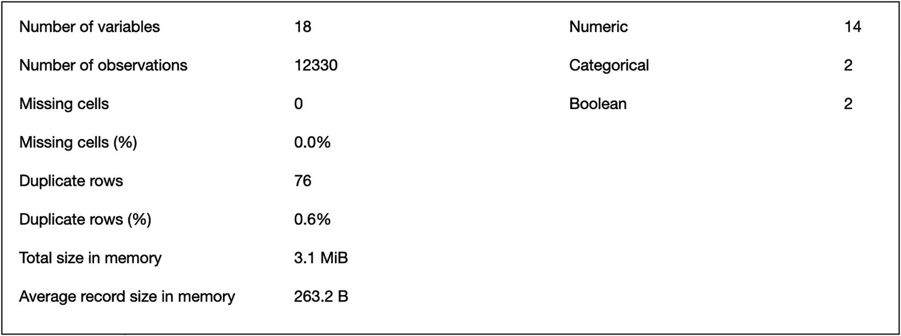

图 9-1

Pandas 数据概况

图 9-2 显示，管理页面的平均访问次数为 2.3，这意味着数据集中的客户平均访问了管理类型页面两次。（请参考本章开头的变量定义，以便更好地理解输出结果。）

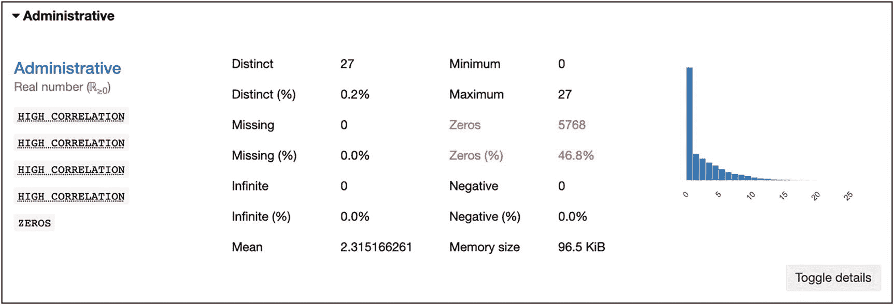

图 9-2

管理页面变量详情

图 9-3 显示，客户在管理页面的平均停留时长为 80 秒。

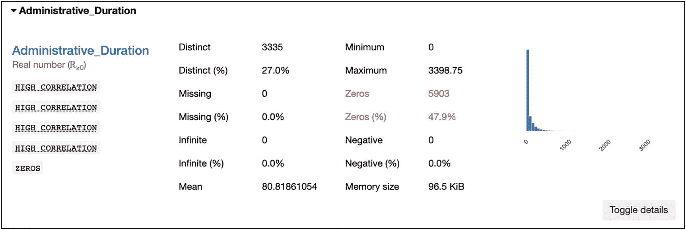

图 9-3

管理页面停留时长变量详情

图 9-4 显示，该变量中存在大量零值。

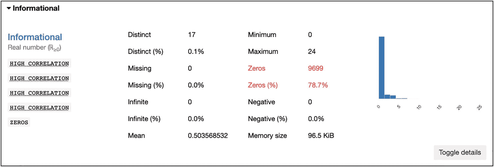

图 9-4

信息页面变量详情

图 9-5 展示了信息页面停留时长的概况。大部分数值为零。

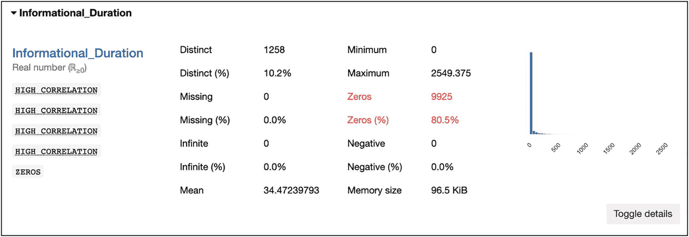

图 9-5

信息页面停留时长变量详情

图 9-6 展示了数据中客户访问的产品相关页面的概况。结果显示，客户平均访问了 38 个产品相关页面。

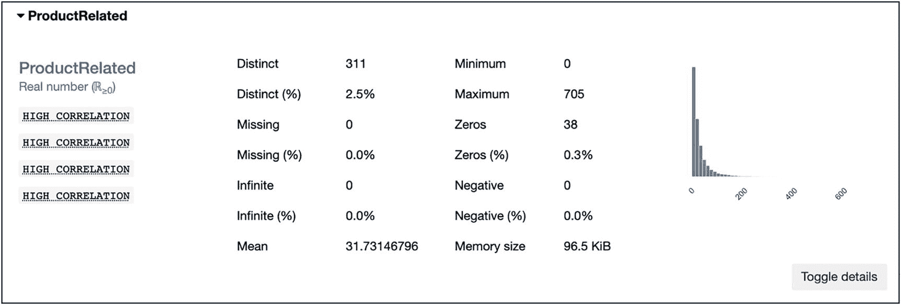

图 9-6

产品相关页面变量详情

产品相关页面停留时长与产品相关页面变量相关。如图 9-7 所示，平均停留时长为 1,195 秒。

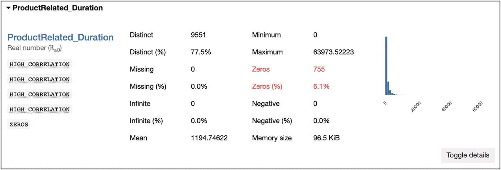

图 9-7

产品相关页面停留时长变量详情

图 9-8 展示了跳出率变量的摘要。数据中所有客户的该变量值大多为零。

# 图表与模型分析

图 9-8 展示了跳出率变量详情。

图 9-9 概述了退出率变量。与其他变量不同，该变量没有大量零值，且包含丰富信息。这应是一个适合在模型中使用的变量。

图 9-10 展示了页面价值变量的概况。该变量的平均值为 5，意味着客户平均访问 5 个页面。该变量包含大量零值。

图 9-11 展示了特殊日期变量的分布和概况。该变量的大部分值同样为零。

图 9-12 展示了月份变量的分布和概况。这是一个分类变量，因此显示了该变量每个类别中客户的分布情况。

图 9-13 至 9-18 展示了其余自变量的分布和概况，包括：操作系统、浏览器、地区、流量类型、访客类型和周末变量。

图 9-19 展示了目标变量“收入”的概况和分布。

图 9-20 展示了输入变量的相关性矩阵。

您可以在图表中看到以下内容。
*   管理页面与管理页面停留时长高度相关
*   信息页面与信息页面停留时长高度相关
*   产品相关页面与产品相关页面停留时长高度相关
*   跳出率与退出率高度相关

为了理解相关变量如何影响不同的可解释性方法，这些变量被保留在模型中。

现在，让我们看看所有特征与响应变量之间的关系。如图 9-21 至 9-26 所示。

从图 9-26 的图表中可以看出，退出率可能是一个适合在模型中使用的变量。

接下来，我们将数据集拆分为训练集和测试集。
```python
x_train,x_test,y_train,y_test=train_test_split(x,y,test_size=0.1)
```
然后，构建模型。
```python
model=RandomForestClassifier(n_estimators=150)
model.fit(x_train,y_train)
```
进行一些参数调优。
```python
from sklearn.model_selection import GridSearchCV
grid_values = {'n_estimators': [200,300],'min_samples_leaf':[2,3],'criterion':['gini', 'entropy']}
grid_clf_acc = GridSearchCV(model, param_grid = grid_values,scoring = 'accuracy')
grid_clf_acc.fit(x_train, y_train)
y_pred_acc = grid_clf_acc.predict(x_test)
```
接下来，我们生成性能指标。
```python
print(accuracy_score(y_test,y_pred_acc))
print(precision_score(y_test,y_pred_acc))
print(recall_score(y_test,y_pred_acc))
print(f1_score(y_test,y_pred_acc))
Accuracy is: 0.8972668288726683
Precision is: 0.7585380116959064
Recall is: 0.5894285714285714
F1 score is: 0.6631012658227848
```
该数据集表现尚可。由于这是一个不平衡分类问题，准确率略高。

模型构建完成后，我们可以在此基础上构建可解释性方法，以生成特征重要性评分。

## 随机森林特征重要性

以下是随机森林方法的特点。
*   事后分析
*   全局性
*   模型特定
*   基于可视化

随机森林特征重要性可通过两种方式计算：一种基于排除某个变量时准确率的下降程度，另一种基于变量分裂节点时基尼不纯度的下降程度。

### 基于准确率的重要性

基于准确率的重要性方法利用观测数据来计算变量的重要性度量。随机森林模型中的每棵树都有其样本数据，并测量预测准确率。然后，在保持所有其他变量不变的情况下，随机打乱样本中该变量的值，并测量打乱后数据预测准确率的下降程度。该下降值在所有树中进行测量，并取平均值。重要性会分解到模型的每个类别中。这种衡量变量重要性的方法，通过移除变量来确定准确率下降多少，反之亦然。当变量对预测能力的贡献较小时，因打乱而产生的准确率变化也较小。

### 基于基尼系数的重要性

树在每个节点分裂变量的决策有时基于基尼不纯度。对于随机森林模型中每棵树的每个变量，每当树选择基于该变量分裂节点时，都会计算基尼下降值的总和。然后我们取所有树的平均值。最终变量的尺度无关紧要，只有顺序重要。此方法的优势在于，这些基尼不纯度的计算已在模型训练阶段完成，因此计算相关分数所需的计算量极小。

以下代码紧接模型构建步骤。我们使用相同的模型函数。

```python
importance = model.feature_importances_
for i,v in enumerate(importance):
print('Feature: %0d, Score: %.5f' % (i,v))
Feature: 0, Score: 0.04181
Feature: 1, Score: 0.05627
Feature: 2, Score: 0.01603
Feature: 3, Score: 0.02709
Feature: 4, Score: 0.07756
Feature: 5, Score: 0.08788
Feature: 6, Score: 0.05604
Feature: 7, Score: 0.09298
Feature: 8, Score: 0.37748
Feature: 9, Score: 0.00359
Feature: 10, Score: 0.04402
Feature: 11, Score: 0.01768
Feature: 12, Score: 0.01873
Feature: 13, Score: 0.02982
Feature: 14, Score: 0.03250
Feature: 15, Score: 0.01127
Feature: 16, Score: 0.00926
```

由于默认结果不显示特征名称，我们绘制结果图。

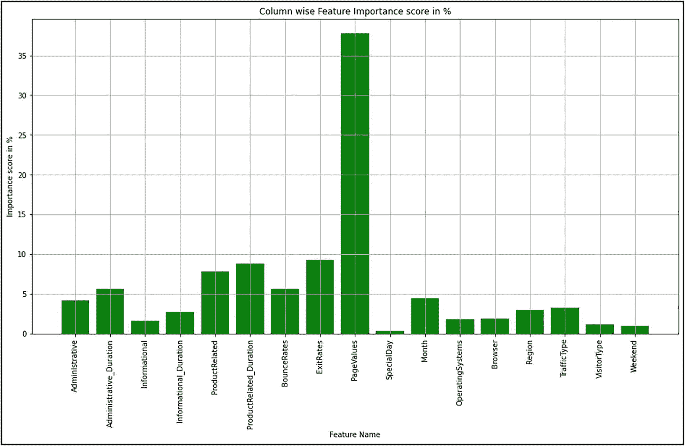

图 9-27 随机森林特征重要性可视化，展示最重要的特征

```python
# 绘制特征重要性图
plt.figure(figsize=(16,8))
plt.bar(df.iloc[:,:-1].columns, [i*100 for i in importance],color='green')
plt.title('各列特征重要性百分比')
plt.xlabel('特征名称')
plt.ylabel('重要性百分比')
plt.xticks(rotation=90)
plt.grid()
plt.show()
```

内置的基本随机森林特征重要性方法显示，`PageValues` 是模型全局层面上最重要的变量。这意味着 `PageValues` 单独包含了描述模型整体决策所需的最大信息量。

技术模型构建者的工作到此结束，模型审查者的工作开始。模型审查者将这些结果传达给利益相关者，并指出他们可能应该关注 `PageValues` 变量，以理解模型两个类别之间的差异。

## 排列特征重要性

以下是排列特征重要性模型的特点。

*   事后分析
*   全局性
*   模型无关
*   基于重要性

排列特征重要性方法通过测量当特定特征的值被排列时模型误差的增加，从而打破该特征与响应变量之间的关系。

排列特征重要性背后的概念可以简单描述如下。

如果改变某个特征的值会增加模型误差，则该输入对模型很重要。如果打乱某个特征的值后模型误差不变，则该特征“不重要”，因为模型在预测时忽略了该特征。

Breiman 于 2001 年为随机森林引入了排列特征重要性度量方法。

排列特征重要的输入是一个训练好的模型 `t`、特征矩阵 `X` 和目标向量 `y`，以及一个误差度量 `E`。

原始模型误差可写为 `E(y, t(x))`。

估计原始模型误差 = `E(y, t(X))`（例如，均方误差）

然后，对于每个特征 `s = 1….p`，我们运行一个循环执行以下操作。

*   通过打乱数据 `X` 中的特征 `s` 来生成特征矩阵 `X^(changed)`。这消除了 `s` 与结果 `y` 之间的任何关系。
*   基于打乱后数据的预测，估计打乱后数据的误差 = `E(Y, t(X^(changed)))`。
*   计算排列特征重要性。

`FI^s = 打乱后数据的误差 / 原始数据的误差`。

或者，也可以使用差值：`FI^s = 打乱后数据的误差 - 原始数据的误差`。

按 `FI` 降序对特征进行排序。

我们也可以将数据分成两半，并交换两半数据的特征值。这样可以避免打乱特征。

如果你想要不同于上述两种方法的方法，可以通过将每个实例与另一个实例（但不包括自身）的特征 `s` 值配对，来估计打乱特征 `s` 的误差。这会得到一个大小为 `n(n–1)` 的数据集，用于估计排列误差。然而，这会消耗大量计算时间。

现在，排列特征重要性应在测试数据上运行，而不是训练数据。如果我们在模型训练所用的相同数据上测量模型误差，那么模型的表现会比实际情况更好。由于排列依赖于模型误差，因此应始终在未见过的数据上进行。由于过拟合，从训练数据中得到的重要性会产生误导性的特征重要性。

### 优点

*   易于理解的解释：排列重要性的结果易于理解和呈现
*   特征重要性度量在不同问题之间具有可比性
*   考虑了与其他特征的所有交互作用
*   排列特征重要性不需要重新训练模型

### 缺点

*   需要访问真实结果。如果某人只提供模型和未标记数据，但不提供真实结果，则无法计算排列特征重要性。
*   当重复进行排列时，结果可能会有很大差异。
*   如果特征之间存在相关性，排列特征重要性可能会因不现实的数据实例而产生偏差。
*   添加一个相关特征可能会通过将重要性分散到两个特征之间，从而降低关联特征的重要性。

### 代码

你在上一节中读取了数据。同样的数据集将用于开发本方法的代码。

首先，将分类变量转换为虚拟变量。

```python
data1 = pd.get_dummies(df, drop_first=True)
data1.columns
```

现在，将字符串类型的响应变量转换为数值型。

```python
from sklearn.preprocessing import LabelEncoder
le = LabelEncoder()
df['Revenue'] = le.fit_transform(df['Revenue'])
df['Revenue'].value_counts()
```

从 `x` 中移除目标变量 `revenue`。

```python
x = data1
x = x.drop(['Revenue'], axis = 1)
y = df['Revenue']
```

现在，将数据划分为训练集和测试集，并构建模型。

```python
train_X, val_X, train_y, val_y = train_test_split(x, y, random_state=1)
my_model = RandomForestClassifier(n_estimators=100,
random_state=0).fit(train_X, train_y)
```

接下来，计算排列特征重要性。

```python
import eli5
from eli5.sklearn import PermutationImportance
perm = PermutationImportance(my_model, random_state=1).fit(val_X, val_y)
eli5.show_weights(perm, feature_names = val_X.columns.tolist())
```

输出结果如图 9-28 所示。该表格给出了每个特征对应的权重（与逻辑回归直接输出的结果相同）。该值表示某个特征对预测结果的平均影响程度，符号则表示影响的方向。

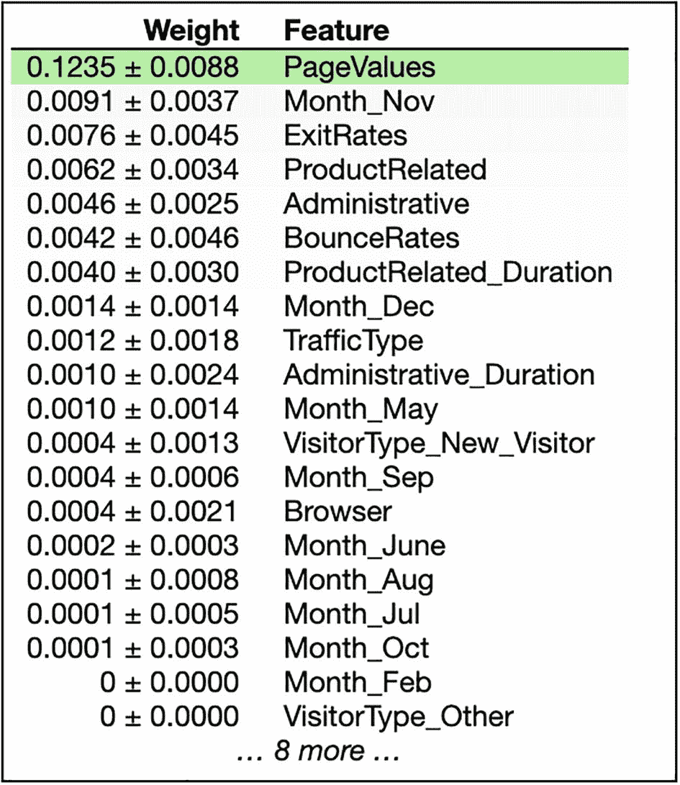

图 9-28 最重要变量的排列特征重要性输出

与之前的示例一样，`PageValues` 确实是该模型中最重要的变量。

让我们深入探讨更多技术，并查看这些结果。

## SHAP

以下是 SHAP 的特点。

*   事后解释
*   全局与局部
*   模型无关
*   基于可视化

SHAP 基于博弈论中计算的沙普利值。但博弈论与机器学习领域并无直接关联。博弈论的组成部分可以与模型组件关联如下。

*   “博弈”重现了模型的输出结果。
*   “玩家”是模型中包含的特征。

# SHAP 量化每个特征对模型或预测的重要性

SHAP 量化每个特征对模型或预测的重要性，其方式与沙普利值量化每个玩家对博弈的贡献相同。建模场景中的博弈可以是模型的一个单一观测值。因此，SHAP 默认是一种局部解释方法，但也可用于全局可解释性。

以机器学习模型为例，假设它是一个线性回归模型。该模型使用年龄、性别和工作等特征来预测一个人的收入。

在沙普利值中，需要考虑特征的所有可能结果，以确定单个特征的重要性。这意味着需要考虑 `f` 个特征的每一种可能组合（`f` 从 0 到 `F`，`F` 是所有可用特征的数量）。

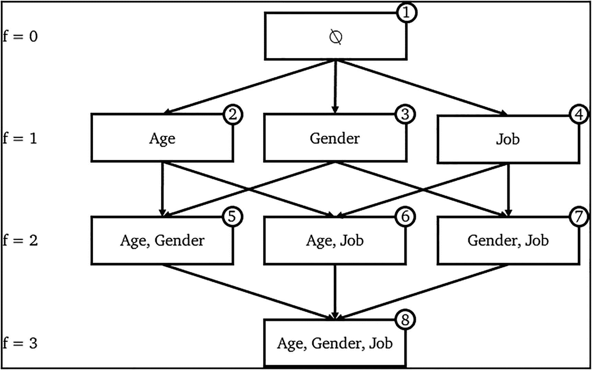

图 9-29 每个节点代表一个特征联盟。每条边代表引入一个先前联盟中不存在的特征

在这种情况下，可能结果的总数为 `2 ^ F = 2 ^ 3 = 8`，因为共有三个特征。

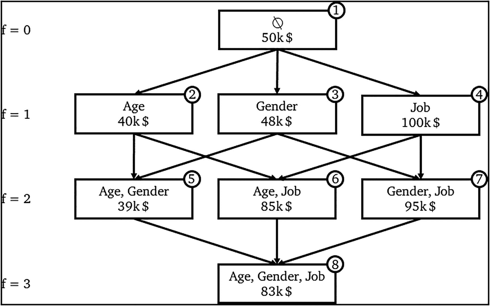

图 9-30 不同模型对 `x[0]` 的预测结果。在每个节点中，第一行报告了模型中包含的特征联盟，第二行报告了该模型对 `x[0]` 预测的收入

SHAP 现在在所有组合上训练模型。这些模型是相似的。唯一的区别在于模型的特征集。

现在，取一个新的观测值 `x[0]`，看看八个不同的模型对同一个观测值 `x[0]` 的预测结果。

图 9-30 显示，每一层都比上一层多一个特征。特征之间的差异可以归因于新增特征的边际贡献。在节点 1 中，这是一个没有特征的模型，模型简单地预测所有训练观测值的平均收入（$50K）。在节点 2 中，这是一个只有一个特征（年龄）的模型，对 `x[0]` 的预测是 $40K。这可以解释为，当你知道年龄时，它会使预测值降低 $10K。

因此，年龄对仅包含年龄作为特征的模型的边际贡献是 $10K。

要计算年龄对最终模型的整体影响，我们需要考虑年龄在所有包含该特征的模型中的边际贡献。图 9-31 用红色高亮显示了这些边。

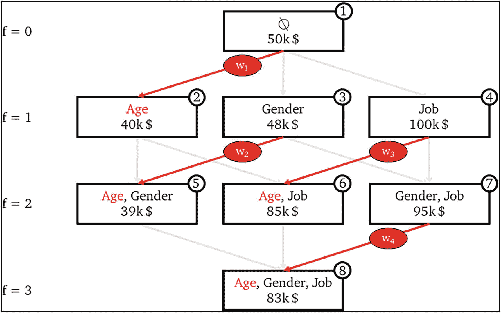

图 9-31 用于计算年龄边际贡献的模型中红色高亮显示的边

以下是计算加权边际贡献的公式。

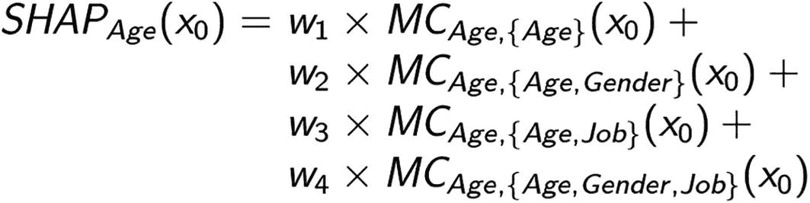

这个公式引出的下一个问题是确定权重。

其思想是，所有对 1 特征模型的边际贡献的权重之和，应等于所有对 2 特征模型的边际贡献的权重之和，以此类推。

换句话说，同一行上所有权重的总和应等于任何其他行上所有权重的总和。

在这个例子中，这意味着 `w[1] = w[2] + w[3] = w[4]`。

*对于每个 `f`，所有对 `f` 特征模型的边际贡献的权重应彼此相等。*

换句话说，同一“行”上的所有边权重应彼此相等。在示例中，这意味着 `w[2] = w[3]`。

因此，如果它们的总和为 1，则权重的值应如下所示。

`w[1] = 1/3`
`w[2] = 1/6`
`w[3] = 1/6`
`w[4] = 1/3`

计算这些值的公式解释如下。每个 `f`-特征模型都有 `f` 个边际贡献（每个特征一个），因此只需计算可能的 `f`-特征模型的数量，再乘以 `f` 即可。因此，问题可以简化为：在给定 `f` 且已知特征总数为 `F` 的情况下，计算可能的 `f`-特征模型的数量。这正是二项式系数的定义。

可以说，一行中边的数量可以按如下方式计算。

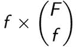

只需取这个数的倒数，并将其作为权重赋予一个 `f`-特征模型的边际贡献即可。

图 9-32 对此进行了说明。

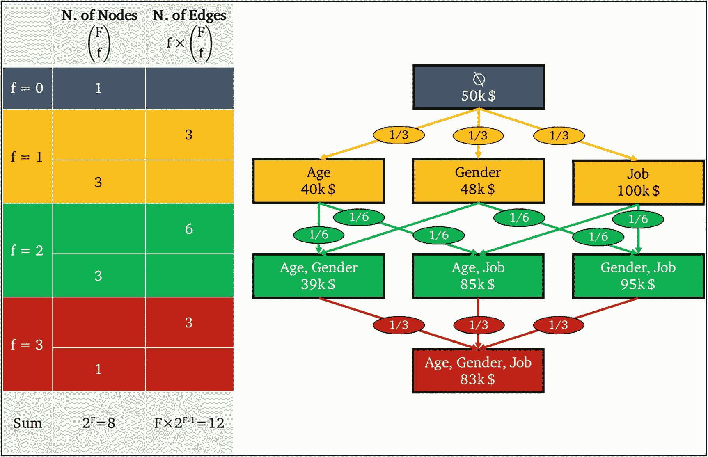

图 9-32 计算 SHAP 边际值所需的权重计算

现在将权重值代入公式。

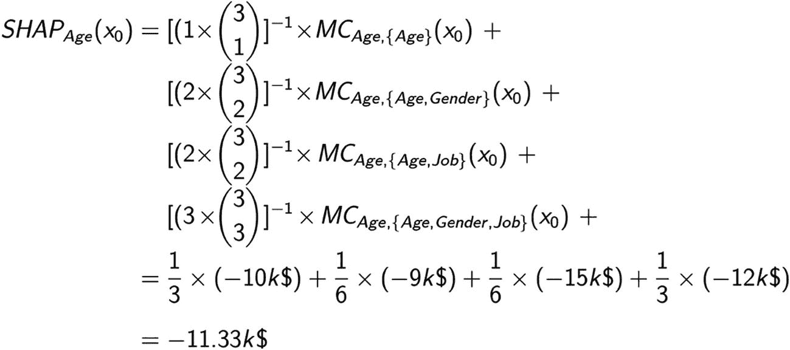

当推广到适应任意模型和 `n` 个特征时，相同的公式如下所示。

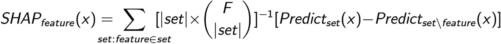

应用于该示例，公式得出以下结果。

`SHAP_Age(x[0]) = -11.33k $`
`SHAP_Gender(x[0]) = -2.33k $`
`SHAP_Job(x[0]) = +46.66k $`

将它们相加得到 +$33K，这正好是全模型输出（$83K）与无特征虚拟模型输出（$50K）之间的差值。

这是 SHAP 值的一个基本特征：对给定观测值的每个特征的 SHAP 值求和，得到的是模型预测值与空模型预测值之间的差值。因此，它们被称为 Shapley 加法解释（Shapely Additive explanations）。

让我们用数学术语来讨论 SHAP 计算的整个过程，正如 SHAP 的作者 Lundberg 和 Lee 在一篇题为“A Unified Approach to Interpreting Model Predictions”的论文中所描述的那样。

在论文中，作者讨论了加法特征归因方法。

加法特征归因方法有一个解释模型，该模型是二元变量的线性函数。

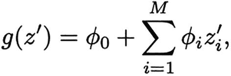

`z′ ∈ {0, 1}M`，`M` 是简化输入特征的数量，`ϕi ∈ R`。

接下来，让我们讨论加法解释的属性，作者在论文中提到了这些属性。

### 属性 1（局部准确性）

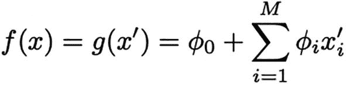

当 `x = hx(x′)` 时，解释模型 `g(x′)` 与原始模型 `f(x)` 匹配。

### 属性 2（缺失性）

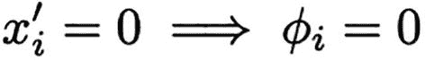

缺失性约束要求 `x′[i] = 0` 的特征没有归因影响。如果简化输入表示特征的存在性，那么缺失性要求原始输入中缺失的特征没有影响。

### 属性 3（一致性）

设 `fx(z′) = f(hx(z′))`，且 `z′ \ i` 表示设置 `z′[i] = 0`。对于任意两个模型 `f` 和 `f ′`，如果

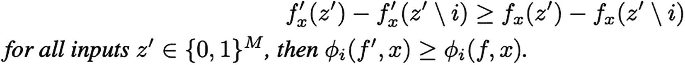

接下来，作者提到了一种遵循加法解释定义并满足所有属性的模型。

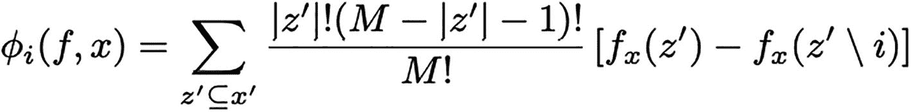

`| z′ |` 是 `z′` 中非零条目的数量，`z′ ⊆ x′` 表示所有 `z′` 向量，其中非零条目是 `x′` 中非零条目的子集。

SHAP 或 Shapley 加法解释值就是前述方程的解。SHAP 值提供了唯一的、遵循所有三个属性的加法特征重要性度量，并使用条件期望来定义简化输入。

Kernel SHAP 通过一个五步过程，为一个实例估计每个特征值对预测的贡献。

1.  将样本联盟定义为 `z′k ∈ {0,1}M , k∈{1,…,K}`（1 = 特征存在于联盟中，0 = 特征不存在）。
2.  首先将 `z′k` 转换回原始特征空间，然后应用模型 `f: f(hx(z′k))`，为每个 `z′k` 获取预测值。
3.  SHAP 核计算每个 `z′k` 的权重。
4.  拟合加权线性模型。
5.  返回 Shapley 值 `ϕk`，即线性模型的系数。

当我们在 SHAP 核中从边际分布进行采样时，我们忽略了存在特征和缺失特征之间的依赖结构。

KernelSHAP 方法存在与所有基于排列的解释方法相同的问题，即估计过程对不太可能的实例赋予了过高的权重。这可能导致不可靠的结果。但必须从边际分布中采样。解决方案是从条件分布中采样，这会改变价值函数，从而改变 Shapley 值所对应的博弈。结果，Shapley 值有了不同的解释；例如，一个模型可能根本没有使用过的特征，在使用条件采样时，其 Shapley 值可能非零。对于边际博弈，该特征值将始终获得 Shapley 值 0，否则将违反该概念。

## 与 LIME 的加权方式比较

与 LIME 的主要区别在于回归模型中实例的加权方式。LIME 根据实例与原始实例的接近程度对其进行加权。联盟向量中的 0 越多，LIME 中的权重就越小。SHAP 根据联盟在 Shapley 值估计中获得的权重来对采样实例进行加权。小型联盟（少量 1）和大型联盟（即大量 1）获得最大的权重。其背后的直觉是，如果你孤立地研究单个特征的影响，你能学到最多关于该特征的信息。如果一个联盟由单个特征组成，你可以了解该特征对预测的孤立主要影响。如果一个联盟由除一个特征外的所有特征组成，你可以了解该特征的总影响（主要影响加上特征交互作用）。如果一个联盟由一半特征组成，你几乎学不到关于单个特征贡献的信息，因为存在许多包含一半特征的可能联盟。为了实现符合 Shapley 的加权，Lundberg 等人提出了 SHAP 核，如下所示。

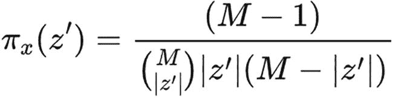

这里，`M` 是最大联盟大小，`|z'|` 是实例 `z'` 中存在的特征数量。Lundberg 和 Lee 表明，使用此核权重的线性回归可以得出 Shapley 值。如果你在联盟数据上将 SHAP 核与 LIME 结合使用，LIME 也将估计出 Shapley 值！

## TreeSHAP 方法

TreeSHAP 是 SHAP 的一种变体，专门用于基于树的机器学习模型，例如决策树、随机森林和梯度提升树。TreeSHAP 被提出作为 KernelSHAP 的一种快速、模型特定的替代方案，但后来发现它可能会产生不直观的特征归因。

TreeSHAP 使用条件期望 `EXS|XC(f(x)|xS)` 而非边际期望来定义价值函数。条件期望的问题在于，那些不影响预测函数 `f` 的特征可能会得到非零的 TreeSHAP 估计值。当该特征与另一个影响预测的特征相关时，就可能出现非零估计。

TreeSHAP 使用条件期望 `EXS|XC(f(x)|xS)` 来估计效应。它直观地展示了如何计算单棵树、实例 `x` 和特征子集 `S` 的期望预测。如果我们对所有特征进行条件化，且 `S` 是所有特征的集合，那么实例 `x` 所落入节点的预测就是期望预测。如果我们不对任何特征进行条件化，且 `S` 为空集，那么我们将使用所有终端节点预测的加权平均值。如果 `S` 包含部分（而非全部）特征，我们会忽略不可达节点的预测。“不可达”意味着通向该节点的决策路径与 `xS` 中的值相矛盾。从剩余的终端节点中，我们根据节点大小（即该节点中的训练样本数量）对预测进行加权平均。以每个节点中的实例数量为权重，对剩余终端节点的预测取平均值，即为给定 `S` 下 `x` 的期望预测。问题在于，我们必须对特征值的每个可能子集 `S` 都应用此过程。TreeSHAP 以多项式时间而非指数时间进行计算。其基本思想是同时将所有可能的子集 `S` 推入树中。对于每个决策节点，我们必须跟踪子集的数量。这取决于父节点中的子集以及分裂特征。

## 数据处理与建模示例

让我们使用与前一个示例中相同的从 CSV 读取的 `df`。

将分类变量转换为虚拟变量。

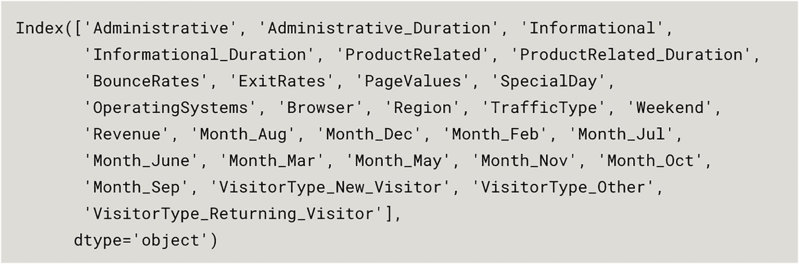

图 9-33

```
data1 = pd.get_dummies(data, drop_first=True)
data1.columns
```

让我们标记 Revenue 列。


图 9-34

类别标签输出

```
from sklearn.preprocessing import LabelEncoder
le = LabelEncoder()
data['Revenue'] = le.fit_transform(data['Revenue'])
data['Revenue'].value_counts()
```

让我们分离因变量和自变量。

```
x = data1
# 从 x 中移除目标列 revenue
x = x.drop(['Revenue'], axis = 1)
y = data['Revenue']
# 检查形状
print("Shape of x:", x.shape)
print("Shape of y:", y.shape)
```

接下来，我们分割数据。

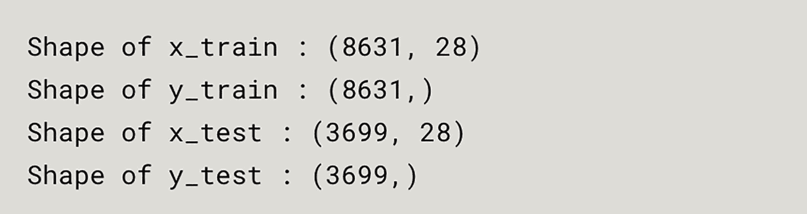

图 9-35

数据框形状的代码输出

```
# 分割数据
from sklearn.model_selection import train_test_split
x_train, x_test, y_train, y_test = train_test_split(x, y, test_size = 0.3, random_state = 0)
# 检查形状
print("Shape of x_train :", x_train.shape)
print("Shape of y_train :", y_train.shape)
print("Shape of x_test :", x_test.shape)
print("Shape of y_test :", y_test.shape)
```

我们现在构建模型。

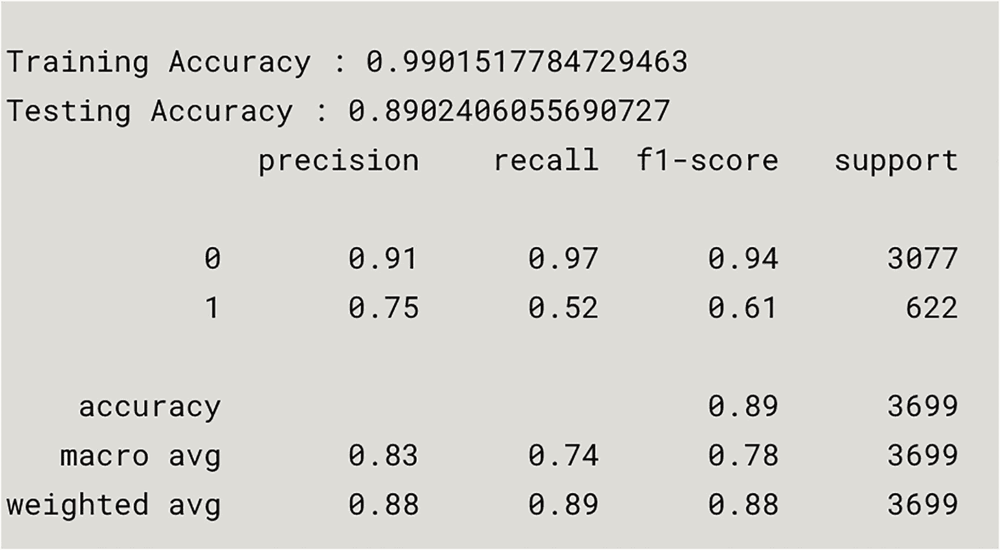

图 9-36

准确率的代码输出

```
from sklearn.ensemble import RandomForestClassifier
from sklearn.metrics import confusion_matrix
from sklearn.metrics import classification_report
model = RandomForestClassifier()
model.fit(x_train, y_train)
y_pred = model.predict(x_test)
# 评估模型
print("Training Accuracy :", model.score(x_train, y_train))
print("Testing Accuracy :", model.score(x_test, y_test))
# 混淆矩阵
cm = confusion_matrix(y_test, y_pred)
plt.rcParams['figure.figsize'] = (6, 6)
sns.heatmap(cm ,annot = True)
# 分类报告
cr = classification_report(y_test, y_pred)
print(cr)
```

现在让我们看看这个数据集的 SHAP 值。

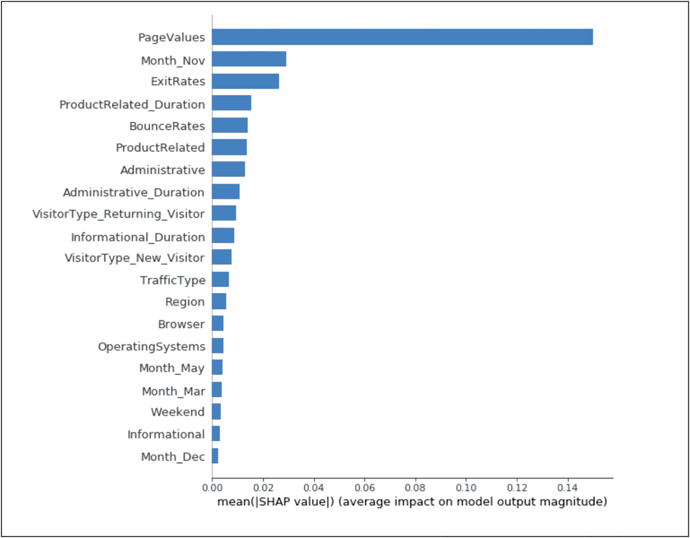

图 9-37

SHAP 特征重要性图背后的思想。具有较大绝对 Shapley 值的特征是重要的

```
# 导入 shap
import shap
explainer = shap.TreeExplainer(model)
shap_values = explainer.shap_values(x_test)
shap.summary_plot(shap_values[1], x_test, plot_type = 'bar')
```

与前一个示例一样，`PageValues` 变量是最重要的。现在让我们看看蝴蝶图，以更深入地理解其行为。

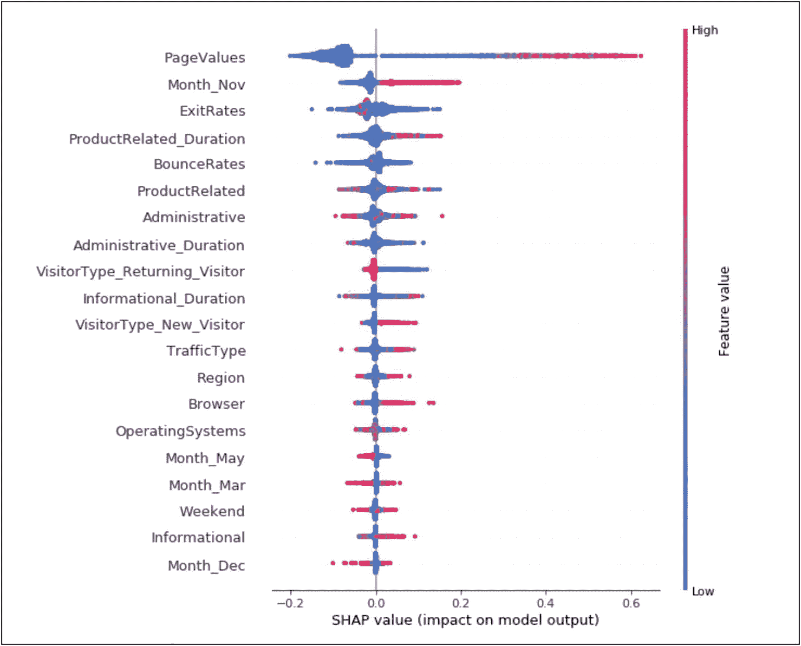

图 9-38

SHAP 汇总图

```
shap.summary_plot(shap_values[1], x_test)
```

## SHAP

汇总图结合了特征重要性与特征效应。汇总图上的每个点代表一个特征和一个实例的 `Shapley` 值。y 轴上的位置由特征决定，x 轴上的位置由 `Shapley` 值决定。颜色代表特征值从低到高的变化。重叠的点在 y 轴方向上抖动，因此您可以了解每个特征 `Shapley` 值的分布。

特征按其重要性排序。图 9-38 显示，`PageValues` 值越高，`SHAP` 值也越高，这意味着 `PageValues` 值越高对应于模型中正类的预测。

现在让我们看看不同的力图。力图允许您查看特征如何影响模型对特定观测值的预测。这对于向某人准确解释您的模型如何得出对特定观测值的预测非常有用。

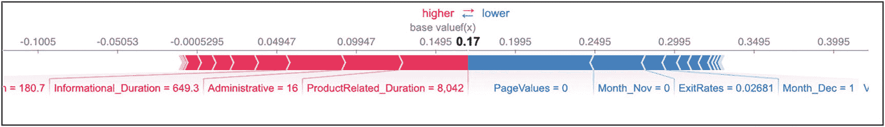

图 9-39 - SHAP 力图

```
customers = x_test.iloc[1,:].astype(float)
customer_analysis(model, customers)
```

该观测值的平均预测值为 0.17。由于 `PageValue = 0` 的贡献，预测值被降低。

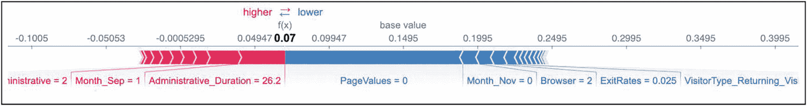

图 9-40 - SHAP 力图

```
customers = x_test.iloc[15,:].astype(float)
customer_analysis(model, customers)
```

这里的平均预测值为 0.07，这同样主要由 `PageValue = 0` 的效应驱动。

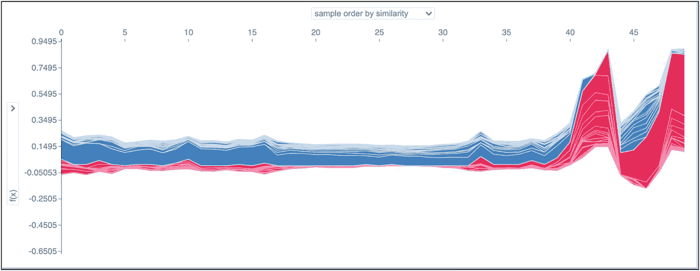

图 9-41 - SHAP 力图

```
shap_values = explainer.shap_values(x_train.iloc[:50])
shap.initjs()
shap.force_plot(explainer.expected_value[1], shap_values[1], x_test.iloc[:50])
```

该图显示了按解释相似性聚类的堆叠 `SHAP` 解释。x 轴上的每个位置都是数据的一个实例。红色的 `SHAP` 值增加预测值。蓝色的值降低预测值。一个聚类很突出：右侧是一组具有高预测概率的在线购物者。

## SAGE

以下是 SAGE 模型的特征。

*   事后分析
*   全局性
*   模型无关
*   基于重要性

SAGE（`Shapley Additive Global ImportancE`，沙普利加性全局重要性）是一种全局方法，对于理解哪些特征对模型性能和表现重要非常有用。SAGE 与我们本章前面学习的全局特征重要性方法类似；然而，由于它使用了沙普利值，因此在统计上更加稳定。你在学习 `SHAP` 时已经了解了沙普利值的重要性。

本节将展示 SAGE 如何应用沙普利值来提供一种不同类型的模型。你将了解模型函数 `f` 在整体上如何依赖每个特征 `X1`, `X2`, …, `Xd`。

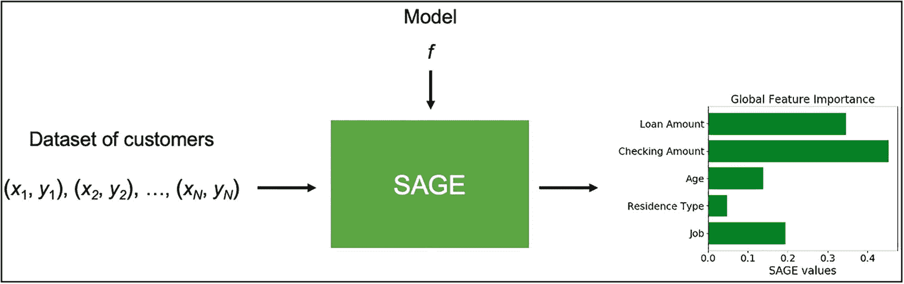

图 9-42 - SAGE 流程图

为了理解技术专家从哪些特征中获取了最多信息，你可以进行一个实验：剥夺他们的某些信息，然后观察他们的预测准确率下降了多少。例如，你可以抽取一大样本客户，让技术专家在只知道除客户年龄之外的所有信息的情况下，预测他们的还款概率。他们的准确率可能会下降一点点。或者，你可以让专家在只知道除年龄、支票账户余额和工作之外的所有信息的情况下预测还款概率。此时，他们的准确率应该会大幅下降，因为他们被剥夺了关键信息。

要将同样的逻辑应用于机器学习模型 `f`，我们必须再次面对 `f` 需要一组固定特征的问题。我们可以使用相同的技巧，通过特征的条件分布 `X_{S}^{}|X_{S}=x_{S}` 来处理缺失特征。现在，我们可以定义一个合作博弈，该博弈表示模型在给定特征子集下的性能。给定一个损失函数 `ℓ`（例如，均方误差或交叉熵损失），博弈 `v_{f}` 定义如下：

`v_{f}(S) = -E[ℓ(E[f(X)| X_{S}], Y)]`

对于任何子集 `S⊆D`，量 `v_{f} (S)` 表示在给定特征 `X_{S}` 下 `f` 的性能。损失前面有一个负号，这样较低的损失（提高的准确率）会增加 `v_{f} (S)` 的值。

现在，我们可以使用沙普利值 `ϕ_{i}(v_{f})` 来量化每个特征对模型性能的贡献。对模型做出良好预测最关键的特征具有较大的正值 `ϕ_{i}(v_{f})>0`，而不重要的特征具有接近零的小值 `ϕ_{i}(v_{f})≈0`，只有那些使模型性能变差的特征才具有负值 `ϕ_{i}(v_{f})<0`。这些就是 SAGE 值，简而言之，这就是 SAGE。

SAGE 提供了对数据分布内在属性的洞察（这或许可以称为解释数据，而非解释模型）。SAGE 统一了几种现有的特征重要性方法。

SAGE 主要是一种模型解释工具，但它也能提供对数据内在关系的洞察。例如，当 SAGE 与贝叶斯分类器 `f (x)=p(y|x)` 和交叉熵损失一起应用时，SAGE 值等于互信息函数 `v_{f} (S)=I(Y;X_{S})` 的沙普利值。这对于那些使用机器学习来了解世界（例如，哪些基因与乳腺癌相关）并且对模型本身不太感兴趣的用户来说是个好消息。*加性重要性度量* 框架连接了许多以前被认为不相关的方法。例如，SAGE 不同于该框架中的方法之一——置换检验。由 Breiman 提出的置换检验，计算当数据集的每一列被置换时模型性能下降了多少。SAGE 可以被视为置换检验的一种修改版本。

SAGE 不是一次只排除一个特征，而是排除更大的特征子集。（通过仅移除单个特征，置换检验可能会错误地将低重要性分配给具有良好代理变量的特征。）

SAGE 从其条件分布 `p(X_{S}^{}|X_{S})` 中抽取被排除的特征，而不是从其边缘分布 `p(X_{S}^{})` 中抽取。（使用条件分布模拟特征的缺失，而使用边缘分布则会破坏特征依赖性并产生不太可能的特征组合。）简而言之，这就是 SAGE，希望这能帮助你理解其在博弈论中的基础以及它对理解模型行为的重要性。

SAGE 的代码实现很复杂。让我们一步步来看。

定义模型的特征列表。

```python
# 特征名称和分类列（用于 CatBoost 模型）
feature_names = df.columns.tolist()[:-1]
categorical_columns = [
    'Month','OperatingSystems','Browser','Region','TrafficType','VisitorType','Weekend'
]
categorical_inds = [feature_names.index(col) for col in categorical_columns]
```

将数据拆分为训练集和测试集。

```python
train, test = train_test_split(
    df.values, test_size=int(0.1 * len(df.values)), random_state=0)
train, val = train_test_split(
    train, test_size=int(0.1 * len(df.values)), random_state=0)
Y_train = train[:, -1].copy().astype(int)
Y_val = val[:, -1].copy().astype(int)
Y_test = test[:, -1].copy().astype(int)
train = train[:, :-1].copy()
val = val[:, :-1].copy()
test = test[:, :-1].copy()
```

构建模型函数并在输入数据上训练模型。

```python
import numpy as np
from sklearn.metrics import log_loss
from catboost import CatBoostClassifier

model = CatBoostClassifier(iterations=50,
                           learning_rate=0.3,
                           depth=3)
model = model.fit(train, Y_train, categorical_inds, eval_set=(val, Y_val),
                  verbose=False)
```

计算模型的性能。

```
设置并计算 SAGE 值。

```python
imputer = sage.MarginalImputer(model, train[:512])
estimator = sage.PermutationEstimator(imputer, 'cross entropy')
sage_values = estimator(test, Y_test)
```

打印 SAGE 图。

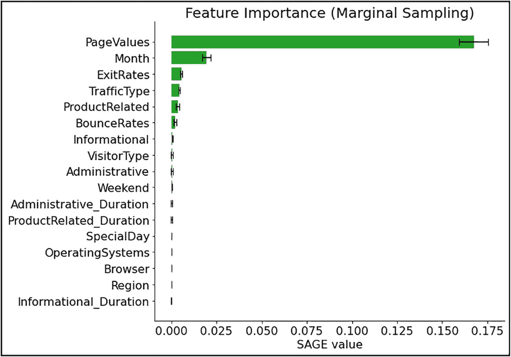

图 9-43

SHAP 图输出

```python
sage_values.plot(feature_names, title='Feature Importance (Marginal Sampling)')
```

在这个数据集中，`PageValues` 是最重要的特征。这些结果与之前方法的输出一致。然而，SAGE 值要可靠得多，并且比普通的随机森林特征重要性更值得信赖。

### SHAP 与 SAGE 的关联

SHAP 和 SAGE 都使用沙普利值，但由于它们回答的是关于模型的不同根本性问题（局部可解释性与全局可解释性），因此两者之间的深层联系并非一目了然。

事实证明，SAGE 值 *ϕ*​*i*​​(*v*​*f*​​) 与 SHAP 值 *ϕ*​*i*​​(*v*​*f*, *x*​​) 之间不存在简单的关系。然而，SAGE 值与一种称为 `LossSHAP` 的 SHAP 变体有关。我们可以不使用合作博弈 *v*​*f*, *x*​​ 来解释单个预测，而是使用一个博弈 *v*​*f*, *x*, *y*​​，该博弈表示在给定特征子集 *x*​*S*​​ 的情况下，单个输入-输出对 (*x*, *y*) 的损失。

```python
v f, x, y (S)=−ℓ(E[f(X)∣X S =x S ], y)
```

该博弈的沙普利值 *ϕ*​*i*​​(*v*​*f*, *x*, *y*​​) 被称为 *`LossSHAP` 值*，它们表示每个特征对预测准确性的贡献程度。使预测更准确的特征具有较大的正值 *ϕ*​*i*​​(*v*​*f*, *x*, *y*​​)>0，而使预测更不准确的特征则具有负值 *ϕ*​*i*​​(*v*​*f*, *x*, *y*​​)<0。

SAGE 值等于 `LossSHAP` 值的期望值。数学表达式如下：

*ϕ*​*i*​​(*v*​*f*​​) = E​*XY*​​[*ϕ*​*i*​​(*v*​*f*, *X*, *Y*​​)]

这一联系非常重要，因为它表明全局解释可以通过多个局部解释来获得：SAGE 值可以通过计算整个数据集的 `LossSHAP` 值，然后取平均值来得到。

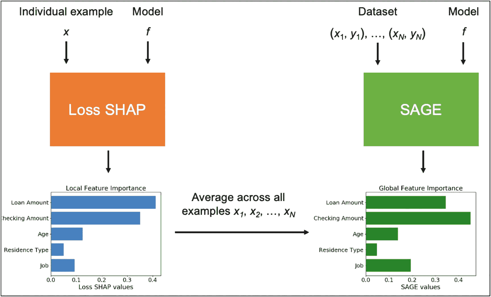

图 9-44

SAGE 值等于 `LossSHAP` 值的平均值

然而，等待 `LossSHAP` 值在数据集中成百上千个样本上收敛需要很长时间。SAGE 方法提出了一种更快的近似算法，该算法直接以全局解释为目标——这种方法被称为 *SAGE 采样*。通过 SAGE 采样，可以在与计算少量单个 `LossSHAP` 值相同的时间内计算出 SAGE 值。

## LIME

LIME 是模型无关的，这意味着它可以应用于任何机器学习模型。该技术试图通过扰动数据样本的输入并理解预测结果如何变化来理解模型。

特定于模型的方法旨在通过分析内部组件和交互来理解黑盒机器学习模型。在深度学习模型中，可以研究激活单元并将内部激活与输入联系起来。这需要对网络有透彻的理解，并且难以扩展到其他模型。

LIME 提供局部模型可解释性。LIME 通过调整特征值并观察输出结果的影响来修改单个数据样本。通常，这也与人类在观察模型输出时感兴趣的内容相关。最常见的问题可能是：为什么会做出这个预测，或者哪些变量导致了该预测？

其他模型可解释性技术仅从整个数据集的角度回答这个问题。特征重要性在数据集层面上解释哪些特征是重要的。它允许你验证假设以及模型是否过拟合噪声，但很难诊断特定的模型预测。

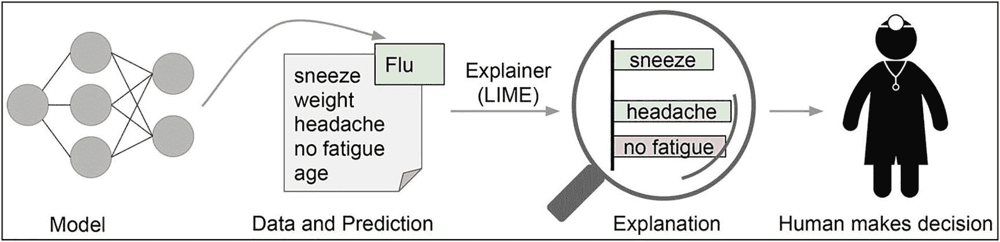

图 9-45

样本模型解释

LIME 的一个关键要求是使用人类可以理解的可解释输入表示。可解释表示的例子包括用于 NLP 的 `BoW` 向量或用于计算机视觉的图像。另一方面，密集嵌入是不可解释的，应用 LIME 可能不会提高可解释性。

图 9-46 中 LIME 的输出是一个解释列表，反映了每个特征对数据样本预测的贡献。这提供了局部可解释性，并且还可以确定哪些特征变化对预测的影响最大。

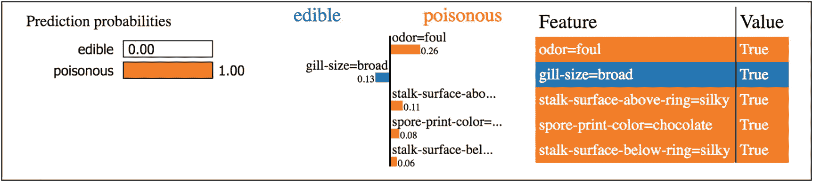

图 9-46

LIME 输出示例

解释是通过在局部用一个可解释的模型来近似底层模型而创建的。可解释模型是带有强正则化的线性模型、决策树等。这些可解释模型在原始实例的小扰动上进行训练，并且只应提供良好的局部近似。数据集是通过向连续特征添加噪声、移除单词或隐藏图像部分来创建的。通过仅在局部（数据样本的邻域内）近似黑盒模型，任务被显著简化。

LIME 的总体目标是识别一个在可解释表示上对分类器具有局部保真度的可解释模型。

在介绍解释系统之前，区分特征和可解释数据表示非常重要。如前所述，可解释的解释需要使用人类可以理解的表示，无论模型实际使用什么特征。例如，文本分类的一个可能的可解释表示是指示单词存在或不存在的二元向量，即使分类器可能使用更复杂（且难以理解）的特征，如词嵌入。同样，对于图像分类，可解释表示可以是一个指示连续相似像素块（超像素）“存在”或“不存在”的二元向量。同时，分类器可能将图像表示为每个像素具有三个颜色通道的张量。`x ∈ Rd` 表示被解释实例的原始表示，而 `x 0 ∈ {0, 1}d’` 表示其可解释表示的二元向量。图 9-47 说明了这一过程。

原始模型的决策函数由蓝/粉色背景表示，且是非线性的。亮红色十字标记的是被解释的实例（我们称之为 `X`）。我们在 `X` 周围采样扰动实例，并根据它们与 `X` 的接近程度进行加权（此处权重由大小表示）。我们获取原始模型对这些扰动实例的预测结果。然后，我们学习一个线性模型（虚线），该模型在 `X` 附近能很好地近似原始模型。请注意，该解释在全局范围内并不忠实，但在 `X` 的局部范围内是忠实的。

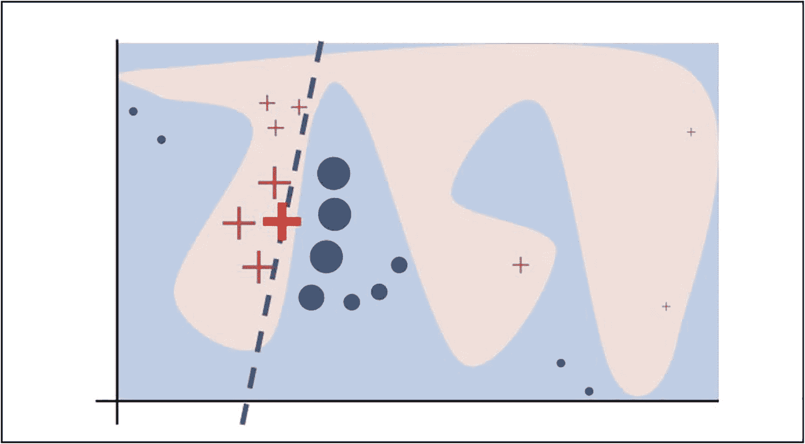

图 9-47

黑盒模型的复杂决策函数 `f`（LIME 未知）由蓝/粉色背景表示，线性模型无法很好地近似它。粗体红色十字标记的是被解释的实例。LIME 使用 `f` 对采样实例进行预测，并根据它们与被解释实例的接近程度进行加权（此处由大小表示）。虚线是学习到的解释，它在局部（而非全局）是忠实的。

用于文本的 LIME 与用于表格数据的 LIME 有所不同。数据变体的生成方式也不同：从原始文本开始，通过随机移除原始文本中的单词来创建新文本。数据集使用每个单词的二元特征来表示。如果包含相应单词，则特征为 1；如果已被移除，则为 0。用于图像的 LIME 与用于表格数据和文本的 LIME 工作方式不同。直观地说，扰动单个像素意义不大，因为多个像素共同贡献于一个类别。随机改变单个像素可能不会显著改变预测结果。因此，图像的变体是通过将图像分割成可以开启或关闭的超像素来创建的。超像素是颜色相近的互联像素，可以通过将每个像素替换为用户定义的颜色（如灰色）来关闭。用户还可以指定在每次排列中关闭某个超像素的概率。

即使你替换了底层的机器学习模型，你仍然可以使用相同的局部可解释模型进行解释。假设查看解释的人最理解决策树。因为你使用了局部替代模型，所以你使用决策树作为解释，而无需使用决策树进行预测。例如，你可以使用 SVM。如果发现 `XGBoost` 模型效果更好，你可以替换 SVM，并仍然使用决策树来解释预测结果。
```

# 局部替代模型与可解释AI

局部替代模型受益于训练和解释可解释模型的文献和经验。当使用`Lasso`或短决策树时，生成的解释是简短的（=选择性的），并且可能具有对比性。因此，它们能生成对用户友好的解释。`LIME`更多地出现在解释的接收者是外行或时间非常有限的人的应用中。它不足以用于完整的归因，因此我们在合规场景中看不到`LIME`，在这些场景中，法律可能要求你完全解释一个预测。此外，在调试机器学习模型时，拥有所有原因（而不仅仅是少数几个）也很有用。

`LIME`是少数几种适用于表格数据、文本和图像的方法之一。保真度度量可以很好地指示可解释模型在解释关于感兴趣数据实例的黑盒预测方面的可靠性。

使用局部替代模型创建的解释可以使用与原始模型训练时不同的（可解释的）特征。当然，这些可解释的特征必须从数据实例中推导出来。文本分类器可以依赖抽象的单词嵌入作为特征，但解释可以基于句子中单词的存在与否。回归模型可以依赖某些属性的不可解释变换，但解释可以使用原始属性创建。例如，回归模型可以在对调查答案进行主成分分析（`PCA`）得到的成分上进行训练。而`LIME`可以在原始调查问题上进行训练。为`LIME`使用可解释特征可能是相对于其他方法的一大优势，尤其是当模型使用不可解释特征进行训练时。

在使用`LIME`处理表格数据时，正确定义邻域是一个非常巨大且尚未解决的问题。在我看来，这是`LIME`最大的问题，也是我建议谨慎使用`LIME`的原因。对于每个应用，你必须尝试不同的核设置，并自行判断解释是否合理。不幸的是，这是我能给出的关于找到合适核宽度的最佳建议。

在当前`LIME`的实现中，采样可以改进。数据点是从高斯分布中采样的，忽略了特征之间的相关性。这可能导致生成不太可能的数据点，然后这些数据点被用于学习局部解释模型。解释模型的复杂度必须预先定义。这是一个小问题，因为最终用户总是必须在保真度和稀疏性之间做出权衡。

另一个大问题是解释的不稳定性。在一篇文章中，作者展示了在模拟设置中，两个非常接近的点的解释差异很大。此外，根据我的经验，如果你重复采样过程，得出的解释可能会不同。不稳定性意味着很难信任这些解释，你应该持非常批判的态度。数据科学家可以操纵`LIME`的解释来隐藏偏见。这种操纵的可能性使得更难信任使用`LIME`生成的解释。

让我们从导入所需的库开始。

```python
import pandas as pd
import numpy as np
import pandas as pd
import os
from sklearn.model_selection import train_test_split
from sklearn.ensemble import RandomForestClassifier
from sklearn import metrics
```

读取数据并对分类变量进行预处理。

```python
data = pd.read_csv('online_shoppers_intention.csv')
train,test=train_test_split(data,test_size=0.3,random_state=0,stratify=data['Revenue'])
# 将分类变量转换为虚拟/指示变量
train_processed = pd.get_dummies(train)
test_processed = pd.get_dummies(test)
```

填充任何空值。

```python
train_processed = train_processed.fillna(train_processed.mean())
test_processed = test_processed.fillna(test_processed.mean())
```

创建训练数据和测试数据。

```python
X_train = train_processed.drop(['Revenue'], axis=1)
Y_train = train_processed['Revenue']
X_test  = test_processed.drop(['Revenue'], axis=1)
Y_test  = test_processed['Revenue']
print("处理后的训练数据框：Survived 是目标变量，其他列是特征。")
display(train_processed.head())
X_test = X_test.reset_index(drop=True)
X_test.head(5)
```

在处理后的数据上构建一个简单的随机森林模型。

```python
random_forest = RandomForestClassifier(n_estimators=100)
random_forest.fit(X_train, Y_train)
random_forest_preds = random_forest.predict(X_test)
print('随机森林模型的准确率为：\t',metrics.accuracy_score(random_forest_preds,Y_test))
```

是时候使用`LIME`评估模型了。

```python
import lime
import lime.lime_tabular
predict_fn_rf = lambda x: random_forest.predict_proba(x).astype(float)
X = X_train.values
explainer = lime.lime_tabular.LimeTabularExplainer(X,feature_names = X_train.columns,class_names=['FALSE','TRUE'],kernel_width=5)
```

现在，让我们选择一个实例，并检查针对该实例预测结果的解释。

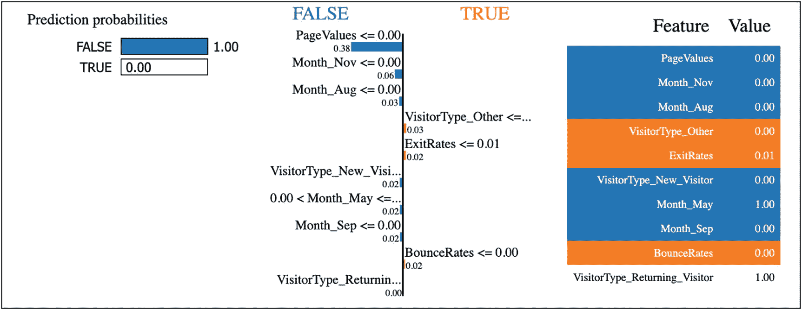

图 9-48 单个实例的 LIME 输出

```python
choosen_instance = X_test.loc[[21]].values[0]
exp = explainer.explain_instance(choosen_instance, predict_fn_rf,num_features=10)
exp.show_in_notebook(show_all=False)
```

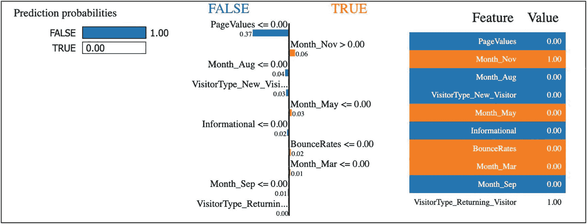

图 9-49 单个实例的 LIME 输出

```python
choosen_instance = X_test.loc[[31]].values[0]
exp = explainer.explain_instance(choosen_instance, predict_fn_rf,num_features=10)
exp.show_in_notebook(show_all=False)
```

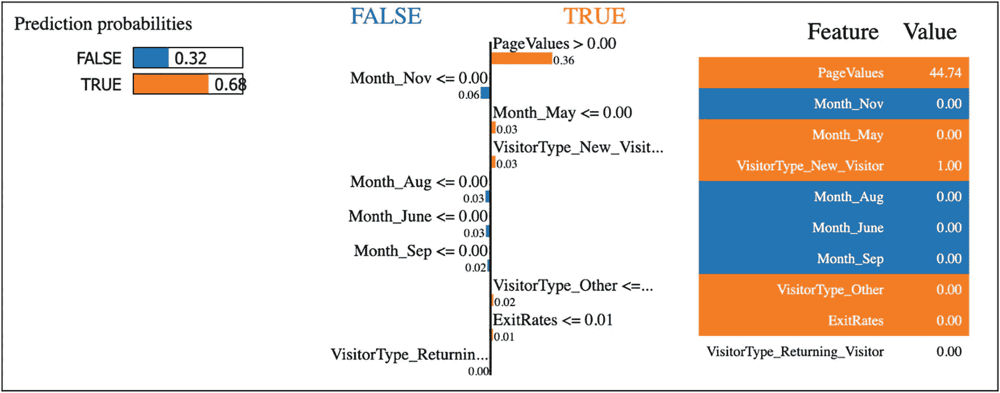

图 9-50 单个实例的 LIME 输出

```python
choosen_instance = X_test.loc[[1]].values[0]
exp = explainer.explain_instance(choosen_instance, predict_fn_rf,num_features=10)
exp.show_in_notebook(show_all=False)
```

图 9-50 显示，对于几乎所有被选中进行分析的实例，`PageValues`都是最重要的变量。`PageValues` > 0 表明预测结果为正向。例如，`PageValues`值高的客户更有可能是在线购物者，这从一般经验法则来看是可以理解的。对于预测结果为`False`的实例，`PageValues`为零。

## FACET

`FACET`是一个用于可解释人工智能的开源库。它结合了复杂的模型检查和基于模型的模拟，能够更好地解释你的监督式机器学习模型。

`FACET`由以下关键组件构成。

### 模型检查

`FACET`引入了一种新算法，用于量化机器学习模型中特征之间的依赖关系和交互作用。这种用于可解释人工智能的新工具，为流行的`SHAP`方法提供的观测层面解释增添了新的全局视角。

### 模型模拟

`FACET`的模型模拟算法利用机器学习模型进行*虚拟实验*，以识别能够优化预测结果的场景。`FACET`利用一系列自举算法来量化模拟中的不确定性，包括平稳自举和分层自举。

### 增强的机器学习工作流

`FACET`提供了一种高效且透明的机器学习工作流，通过新增的模型选择、检查和模拟功能，增强了`scikit-learn`久经考验的流水线范式。`FACET`还引入了`sklearndf`，这是`scikit-learn`的一个增强版本，增强了对`pandas`数据框的支持，确保了特征的端到端可追溯性。

下图是 FACET 工作流的高级概览。工作流中的每一步都包含简要描述。

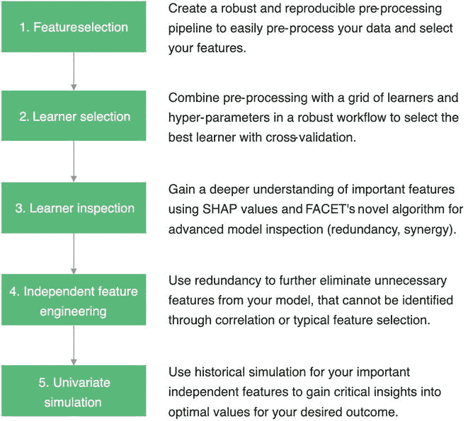

## 代码

```
from sklearn.model_selection import RepeatedKFold
# some helpful imports from sklearndf
from sklearndf.pipeline import ClassifierPipelineDF
from sklearndf.classification import RandomForestClassifierDF
```

让我们从相关的 FACET 导入开始。

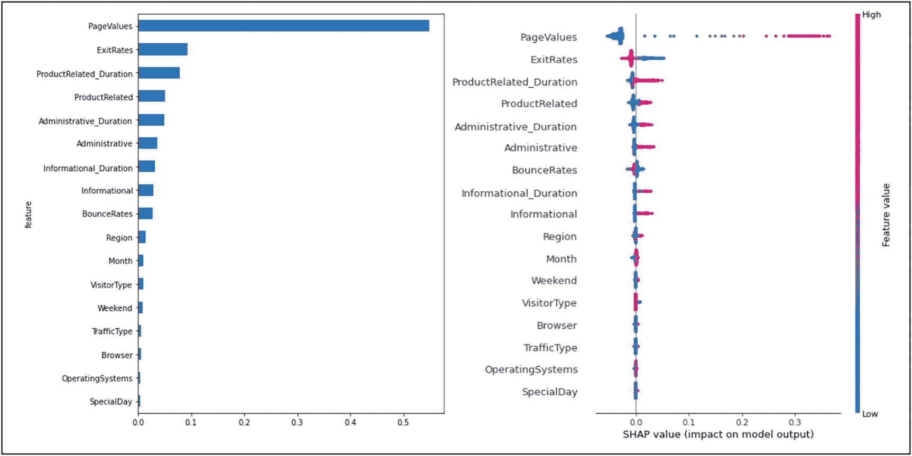

图 9-51

使用 FACET 生成的 SHAP 汇总输出

```
from facet.data import Sample
from facet.selection import LearnerRanker, LearnerGrid
df=pd.read_csv('online_shoppers_intention.csv')
df1=df.copy()
df1=df1.values
df1=df1[:512,:]
df1=oe.fit_transform(df1)
df1=pd.DataFrame(df1)
df1.columns=df.columns
revenue_sample = Sample(observations=df1, target_name="Revenue")
# create a (trivial) pipeline for a random forest classifier
rnd_forest_clf = ClassifierPipelineDF(
classifier=RandomForestClassifierDF(n_estimators=200, random_state=42)
)
# define grid of models which are "competing" against each other
rnd_forest_grid = [
LearnerGrid(
pipeline=rnd_forest_clf,
learner_parameters={
"min_samples_leaf": [8, 11, 15],
"max_depth": [4, 5, 6],
}
),
]
# create repeated k-fold CV iterator
rkf_cv = RepeatedKFold(n_splits=5, n_repeats=10, random_state=42)
# rank your candidate models by performance (default is mean CV score - 2*SD)
ranker = LearnerRanker(
grids=rnd_forest_grid, cv=rkf_cv, n_jobs=-3).fit(sample=revenue_sample)
# Fit the model inspector
from facet.inspection import LearnerInspector
inspector = LearnerInspector(n_jobs=-3, verbose=2)
inspector.fit(crossfit=ranker.best_model_crossfit_)
f_importance = inspector.feature_importance()
plt.subplot(1, 2, 1)
f_importance.sort_values().plot.barh()
# get some info for standard SHAP model inspection
shap_data = inspector.shap_plot_data()
# standard SHAP summary plot using the shap package
plt.subplot(1, 2, 2)
shap.summary_plot(shap_values=shap_data.shap_values, features=shap_data.features, show=False, plot_size=(16.0, 8.0))
plt.tight_layout()
```

```
from pytools.viz.matrix import MatrixDrawer
plt.figure(figsize=(10,8))
synergy_matrix = inspector.feature_synergy_matrix()
MatrixDrawer(style="matplot%").draw(synergy_matrix, title="Synergy Matrix")
```

## 协同作用

模型将来自一个特征的信息与另一个特征的信息结合起来以预测目标的程度。例如，假设我们使用年龄和性别来预测心血管健康状况，并且拟合的模型包含了它们之间复杂的交互作用。这意味着这两个特征在预测心血管健康方面具有协同作用。此外，这两个特征对模型都很重要，移除其中任何一个都会显著影响性能。假设年龄对联合贡献带来的信息比性别更多。这种非对称贡献意味着（年龄，性别）的协同作用小于（性别，年龄）的协同作用。换一种方式思考，想象预测结果是你试图到达的一个坐标点。从你的起点出发，年龄比性别更能让你接近这个点；然而，你需要两者才能到达。协同作用反映了在达到预测结果的过程中，性别从年龄那里获得的帮助（从性别的角度看，协同作用更高）多于年龄从性别那里获得的帮助（从年龄的角度看，协同作用更低）。*这就引出了一个重要观点：协同作用本质上是两个交互特征对模型预测贡献的全局信息的非对称属性。* 协同作用以百分比表示，范围从 0%（完全自主）到 100%（完全协同）。

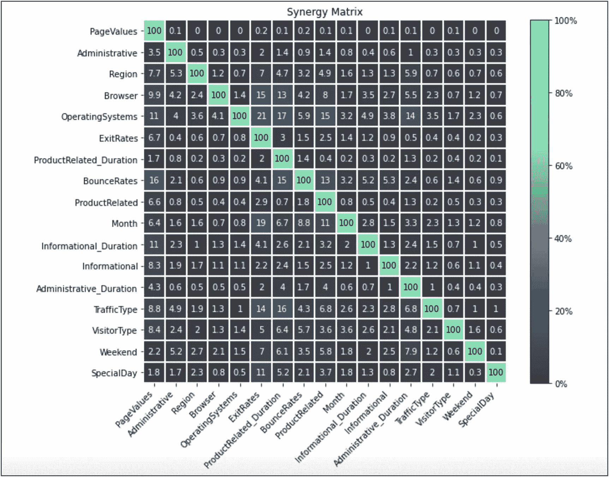

图 9-52

FACET 的协同作用输出

要解释协同作用矩阵，一对特征中的第一个特征是行（视角来源），第二个特征是列。例如，对于（`BounceRates_to_PageValues`），我们发现 16% 的信息被结合起来用于预测糖尿病前期风险。这代表了从 `BounceRates_to_PageValues` 的角度看，该特征对之间协同作用很小的一个例子。

观察 `ExitRates`，从其他特征（如 `Month` 和 `Traffic type`）的角度看，其值最高可达 15%，表明存在少量的协同作用。这与 `ExitRates` 是一个强独立特征（高特征重要性）的观点一致，并且 `ExitRates` 在一定程度上帮助了 `Traffic type` 和 `Month` 来预测购物者。

```
plt.figure(figsize=(10,8))
redundancy_matrix = inspector.feature_redundancy_matrix()
MatrixDrawer(style="matplot%").draw(redundancy_matrix, title="Redundancy Matrix")
```

## 冗余

冗余是指模型中的一个特征在多大程度上重复了第二个特征用于预测目标的信息。例如，假设我们使用房屋面积和卧室数量来预测房价。这两个特征捕捉了相似的信息，因为卧室越多，房屋通常越大，平均价格也可能越高。（卧室数量，房屋面积）的冗余度大于（房屋面积，卧室数量）的冗余度。这是因为房屋面积比卧室数量更能“了解”卧室数量在预测房价方面的作用。因此，从卧室数量的角度来看，冗余度更高。另一种理解方式是，移除房屋面积对模型性能的损害比移除卧室数量更大，因为房屋面积能更好地弥补卧室数量缺失带来的影响。这也意味着在模型中，房屋面积将比卧室数量更重要的特征。*这里的关键点是，与协同作用一样，冗余是全局信息特征对在预测结果时自然具有的非对称属性。* 冗余度以百分比表示，范围从 0%（完全唯一）到 100%（完全冗余）。

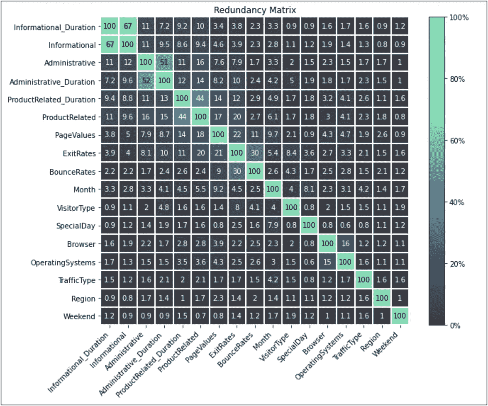

图 9-53

FACET 的冗余输出

图 9-53 显示 `ExitRates` 和 `PageValues` 具有相当程度的冗余。这意味着在采取行动时，我们可以只将精力投入这些变量中的一个。因为我们在模型构建后采取的每一个行动都伴随着相应的成本。例如，如果一个模型表明优惠券价格是一个重要变量，那么相关的行动可以是提高其价值，从而降低成本。因此，冗余缩小了能够捕捉所有模型信息的特征范围，并减少了我们需要根据模型结果采取的行动数量。

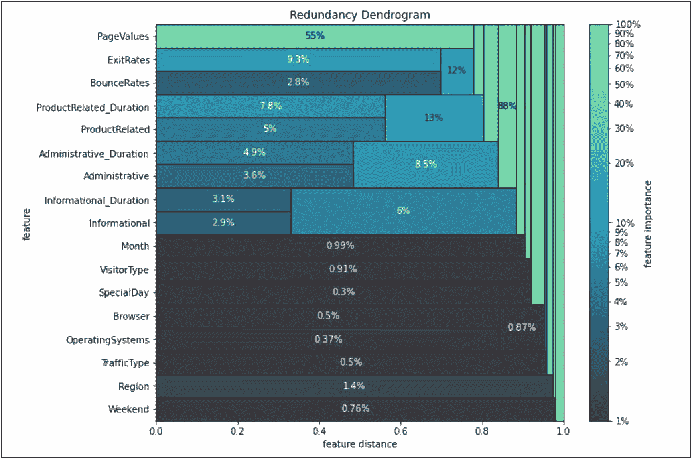
图 9-54：特征聚类，将相似重要性的特征分组在一起。

```python
from pytools.viz.dendrogram import DendrogramDrawer
plt.figure(figsize=(10,8))
redundancy = inspector.feature_redundancy_linkage()
DendrogramDrawer().draw(data=redundancy, title="Redundancy Dendrogram")
```

图 9-54 显示，一个特征对的冗余和协同作用是从该对中某个特征的角度出发的，因此会产生两个不同的值。然而，也可以计算出一个对称版本，它提供了一个简化的视角，并允许使用（1 个度量）作为特征距离。基于这个距离，应用层次化单链接聚类来创建树状图可视化。这可以识别出那些协同激活以预测结果的低距离特征组。然后，这些信息可用于将高度冗余的特征簇缩减为一个子集，或突出显示那些应始终一起考虑的高度协同的特征簇。

对于这个例子，让我们对冗余应用聚类，看看在热图中观察到的明显分组如何在树状图中呈现。理想情况下，我们希望看到特征只在尽可能靠近树状图右侧的位置开始聚类。这意味着模型中的所有特征都对我们的预测做出了独特的贡献。

# 部分依赖图 (PDP)

部分依赖图（简称 PDP 或 PD 图）显示了一个或两个特征对机器学习模型预测结果的边际效应（J. H. Friedman 2001）。部分依赖图可以显示目标与特征之间的关系是线性的、单调的还是更复杂的。例如，当应用于线性回归模型时，部分依赖图总是显示线性关系。

回归的部分依赖函数定义如下。

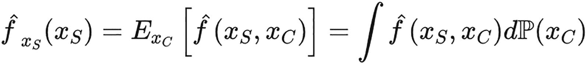

`x[S]` 是我们要绘制其部分依赖函数的特征，而 `x[C]` 是机器学习模型 `f` 中使用的其他特征。通常，集合 S 中只有一个或两个特征。S 中的特征是我们想要了解其对预测影响的特征。特征向量 `x[S]` 和 `x[C]` 组合起来构成了整个特征空间 `x`。部分依赖通过将机器学习模型输出在集合 C 中特征的分布上进行边际化来实现。该函数显示了我们感兴趣的集合 S 中的特征与预测结果之间的关系。通过对其他特征进行边际化，我们得到一个仅依赖于 S 中特征的函数，其中包含了与其他特征的交互作用。

部分函数 `fxS` 通过计算训练数据中的平均值来估计，这也被称为*蒙特卡洛方法*。

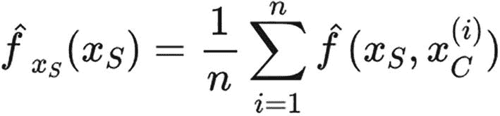

该部分函数描述了对于特征 S 的给定值，其对预测的平均边际效应。在这个公式中，`xC(i)` 是数据集中我们不感兴趣的特征的实际特征值，`n` 是数据集中的实例数量。PDP 假设 C 中的特征与 S 中的特征不相关。如果这个假设被违反，那么为部分依赖图计算的平均值将包含非常不可能甚至不可能出现的数据点。

对于机器学习模型输出概率的分类问题，部分依赖图显示给定 S 中特征的不同值时，某个特定类别的概率。处理多类别问题的一个简单方法是每个类别绘制一条线或一个图。

部分依赖图是一种全局方法：该方法考虑所有实例，并给出关于一个特征与预测结果之间全局关系的陈述。

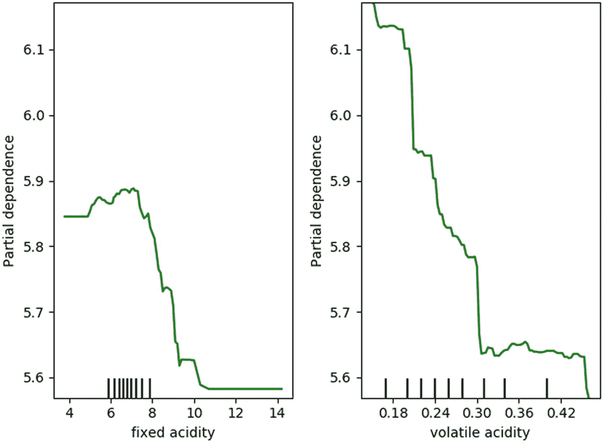
图 9-55：特征依赖的示例图。

图 9-55 中的左图显示了目标变量（销售价格）与距离变量之间的部分依赖关系。在该数据集中，距离衡量的是到墨尔本中央商务区的距离。

*部分依赖图仅在模型拟合之后计算*。模型是基于真实数据拟合的。在真实数据中，城镇不同区域的房屋可能在诸多方面存在差异（不同的房龄、面积等）。但在模型拟合之后，我们可以从获取一栋房屋的所有特征开始——假设它是一栋拥有两间卧室、两个浴室、占地较大的十年房龄房屋。

然后我们使用该模型来预测这栋房屋的价格，但在进行预测之前，我们改变距离变量。我们首先预测当距离设为 4 时这栋房屋的价格。然后预测当距离设为 5 时的价格。接着再预测设为 6 时的价格，以此类推。我们描绘出当距离值从小到大变化时（横轴），预测价格如何变化（纵轴）。

这个描述仅使用了一栋房屋。但由于交互作用，单栋房屋的部分依赖图可能不具有代表性。因此，我们重复这一思维实验，使用多栋房屋，并在纵轴上绘制平均预测价格。你会看到一些负数。这并不意味着房屋会以负价格出售，而是意味着这些价格会低于该距离的实际平均价格。

这些图表有助于提取洞察，并检查你的模型是否在学习你认为合理的内容。

到目前为止，我们只考虑了数值特征。对于分类特征，部分依赖的计算非常简单。每个类别通过强制所有数据实例具有相同类别来获得一个 PDP 估计值。例如，如果你查看自行车租赁数据集，并对季节的部分依赖图感兴趣，会有四个数值，每个季节一个。要计算夏季的值，我们将所有数据实例的季节替换为*夏季*，并取预测值的平均值。

部分依赖图的计算是*直观的*。如果我们强制所有数据点都采用该特征值，那么该特定特征值处的部分依赖函数就代表了平均预测值。根据我的经验，非专业人士通常能很快理解 PDP 的概念。

如果你计算 PDP 的特征与其他特征不相关，那么 PDP 就能完美地表示该特征对平均预测值的影响。在不相关的情况下，*解释是清晰的*。部分依赖图展示了当第 j 个特征改变时，数据集中平均预测值如何变化。当特征相关时，情况就变得复杂了。

部分依赖图*易于实现*。

部分依赖图的计算具有*因果解释*。我们干预一个特征，并测量预测值的变化。通过这样做，我们分析了特征与预测值之间的因果关系。²⁸ 这种关系对于模型来说是因果性的，因为我们明确地将结果建模为特征的函数——但在现实世界中不一定如此！

部分依赖函数中*特征的最大实际数量*是两个。这不是 PDP 的错，而是二维表示（纸张或屏幕）以及我们无法想象超过三个维度的限制。

一些 PD 图没有显示*特征分布*。省略分布可能会产生误导，因为你可能会过度解释几乎没有数据的区域。这个问题可以通过显示地毯图（x 轴上数据点的指示符）或直方图轻松解决。

*独立性假设*是 PD 图最大的问题。它假设计算部分依赖的特征与其他特征不相关。例如，假设你想根据一个人的体重和身高预测其行走速度。对于其中一个特征（如身高）的部分依赖，我们假设其他特征（体重）与身高不相关，但这是错误的。为了计算某个身高（如 200 厘米）处的 PDP，我们对体重的边际分布取平均值，其中可能包括低于 50 公斤的体重，这对于一个两米高的人来说是不现实的。换句话说：当特征相关时，我们在特征分布中实际概率非常低的区域创建了新的数据点（例如，一个人两米高但体重低于 50 公斤的可能性很小）。一种解决方案是*累积局部效应*（ALE）图，它使用条件分布而不是边际分布。

*异质效应* *可能被隐藏*，因为 PD 图只显示平均边际效应。假设对于一个特征，一半的数据点对预测有正向影响：特征值越大，预测值越大。另一半则有负向关联：特征值越小，预测值越大。PD 曲线可能是一条水平线，因为数据集两半部分的效果可能相互抵消。然后你会得出结论，该特征不影响预测。通过绘制个体条件期望曲线而不是聚合线，你可以揭示异质效应。

## 代码

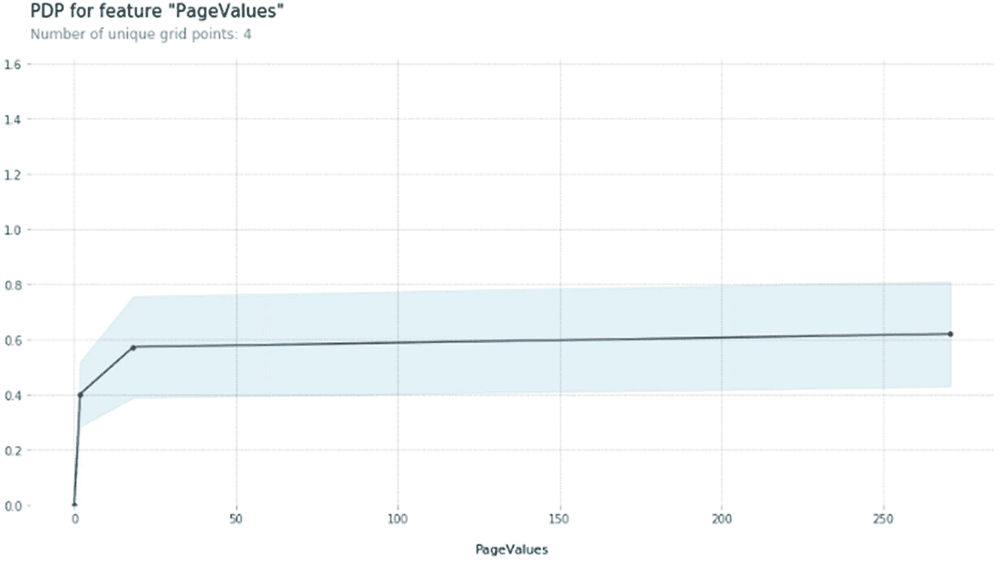
图 9-56：顶部变量的 PDP 图。

# 个体条件期望

个体条件期望（ICE）图为每个实例显示一条线，展示当某个特征改变时，该实例的预测值如何变化。

特征平均效应的部分依赖图是一种全局方法，因为它不关注特定实例，而是关注整体平均值。与个体数据实例的 PDP 等价的是 ICE 图。ICE 图分别针对每个实例可视化预测值对某个特征的依赖关系，结果为每个实例一条线，而部分依赖图则是一条整体线。PDP 是 ICE 图中各条线的平均值。

一条线（对应一个实例）的值可以通过保持所有其他特征不变，用网格中的值替换该特征的值来创建该实例的变体，然后对这些新创建的实例使用黑箱模型进行预测来计算。

结果是一组点，包含网格中的特征值及其对应的预测值。查看个体期望而非部分依赖的意义何在？部分依赖图可能会掩盖由交互作用产生的异质关系。PDP 可以展示特征与预测值之间的平均关系。这仅在计算 PDP 的特征与其他特征之间的交互作用较弱时才有效。当存在交互作用时，ICE 图能提供更多的洞察。

# DALEX

预测模型的可解释性通常与 LIME、SHAP 或 PDP 等方法相关联，这些方法有助于你更好地理解局部或全局模型行为。这些技术满足了理解模型整体或特定实例预测的特定需求。为了避免在众多不同的可解释性技术中迷失方向，人们提出了几种分类方法（局部/全局、模型无关/特定、基于案例/基于规则/基于轮廓等）。在过去两年中，我们尝试了其中几种。DALEX 将最流行的技术整合到图 9-57 所示的 XAI 金字塔中（元素周期表的三角形版本）。

对单个实例的模型探索始于一个单一数字——预测值。这是金字塔的顶层。我们希望将特定变量分配给这个预测值，以了解哪些变量是重要的，以及它们对特定预测的影响程度。可以使用 SHAP、LIME、Break Down、带交互项的 Break Down 等方法。这是金字塔的第二层。向下移动，下一层涉及模型对一个或多个变量值变化的敏感性。Ceteris paribus (CP) 轮廓允许探索模型的条件行为。

更进一步，你可以研究模型的局部拟合优度。模型可能在平均情况下表现良好，但对于选定的观测值，局部拟合度可能非常低，误差/残差大于平均值。金字塔可以通过添加变量对的交互作用进一步扩展。

对整个模型的探索始于对模型质量的评估，可以使用 F1、MSE、AUC 或 LIFT/ROC 曲线。这些信息告诉我们模型在整体上的表现如何。下一层帮助你了解哪些变量是重要的，以及哪些变量使模型有效或无效。一种常见的技术是变量的排列重要性。再向下，下一层的方法帮助你理解模型作为某些变量函数的响应轮廓。在这里，你可以使用诸如部分依赖轮廓或累积局部依赖等技术。

更进一步，还有与误差/残差诊断相关的更详细分析。

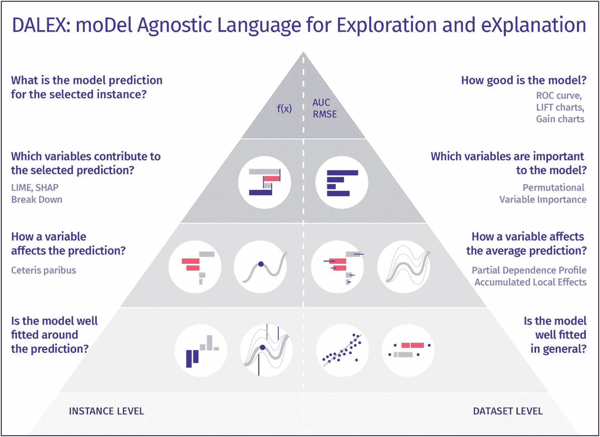

图 9-57

在金字塔中，与探索预测模型相关的需求被收集到一个可扩展的深入分析地图中。左侧是关于单个实例的需求，右侧是关于整个模型的需求。连续的层级深入探讨关于模型行为（局部或全局）的越来越详细的问题。

DALEX 包的第一个版本于 2018 年发布。在此期间，其架构不断改进。最终方法在 1.0 版本中实现。每个函数负责金字塔的一个单独部分。如果某个部分可以通过多种方式计算，则参数 `type` 可以指定所需的方法。


图 9-58

DALEX 包中可解释性金字塔的实现。深紫色名称是实现特定需求方法的函数名称。浅紫色名称代表解决选定需求的已实现方法

DALEX 包中提供的函数是构建许多用于探索机器学习模型的工具的基础。以下是最新的一些工具。

*   DALEXtra，提供与流行 ML 框架的连接器，如 scikit-learn、H2O、MLR、Caret、TensorFlow 和 Keras

*   modelDown，构建一个静态 HTML 网站，汇总数据集级别的模型探索结果

*   modelStudio，构建一个基于 D3js 的交互式无服务器网站，提供互补模型视图的仪表板

*   ingredients、iBreakDown，以及一个包含特定模型探索技术的 auditor。

## 实例级探索简介

实例级探索方法帮助你理解模型如何对特定的单个观测值产生预测。考虑以下示例情况。

*   我们可能希望评估解释变量对模型预测的影响。例如，我们可能对根据一个人的年龄、性别和吸烟习惯预测心脏病发作风险感兴趣。模型可以构建一个分数（例如，代表年龄、性别和吸烟习惯的解释变量的线性组合），用于预测。对于特定患者，我们可能希望了解不同变量对该分数的贡献有多大？

*   我们可能希望了解，如果某些解释变量发生变化，模型的预测将如何改变？例如，如果患者将每天吸烟的数量减半，预测的心脏病发作风险会是多少？

*   我们可能发现模型提供了错误的预测，并希望找出原因。例如，一个风险评分非常低的患者却经历了心脏病发作。是什么导致了错误的预测？

## 加性归因的分解图

分解图展示了归因于各个解释变量的贡献如何改变模型的平均预测值，从而得出对特定单个实例（观测值）的实际预测。

*   面板 A：第一行显示了模型对所有数据预测值的分布和均值（红点）。接下来的行显示了在固定后续解释变量值时的预测值分布和均值。最后一行显示了目标实例的预测值。

*   面板 B：红点表示面板 A 中的平均预测值。

*   面板 C：绿色和红色条形分别表示平均预测值的正向和负向变化（归因于解释变量的贡献），如图 9-59 所示。

    

    图 9-59

    DALEX 分解图

为了评估单个解释变量对此单实例预测的贡献，我们研究了在固定连续变量值时模型预测的变化。例如，图 9-59 面板 A 中标记为“age=8”的行中的小提琴图，总结了当 age 变量取值为“8 岁”（如 Johnny D. 的情况）时所得预测的分布。同样，红点表示预测的均值。这可以解释为在除 age 之外的所有解释变量分布上，对预测期望值的估计。

“class=1st”行中的小提琴图描述了当变量 age 和 class 的值分别设置为“8 岁”和“头等舱”时的预测分布和均值。后续的行包含了随机森林模型中其他解释变量的类似信息。在最后一行中，所有解释变量都固定为描述 Johnny D. 的值。因此，最后一行只包含一个点，即红点，它对应于模型对 Johnny D. 的预测，例如生存概率。

图 9-59 面板 A 中的细灰线显示了当特定解释变量的值被替换为行名中指示的值时，不同个体的预测变化。例如，第一行和第二行之间的线表明，将年龄变量固定为“8 岁”对不同个体有不同的影响。对于某些个体（很可能是八岁的乘客），模型的预测完全没有变化。对于其他人，预测值增加（可能针对年龄大于八岁的乘客）或减少（很可能针对年龄小于八岁的乘客）。

### 交互作用的分解图

交互作用（偏离加性）意味着一个解释变量的效果取决于其他变量的值（见图 9-60）。


图 9-60

带交互作用的分解图

`fare`和`class`变量之间的交互作用在图中以单个条形表示。由于这两个变量的效果无法分离，该图使用单个条形来表示这两个变量的贡献。

*交互作用分解图*（`iBD`）与针对无交互作用模型的`BD`图共享许多优点和缺点。然而，在具有交互作用的模型中，`iBD`图提供了更正确的解释。尽管`iBD`过程的数值复杂度是二次的，但在具有大量解释变量的模型中，它可能非常耗时。对于观测数量较少的数据集，净贡献的计算会受到较大的变异性影响，因此贡献排序的随机性也更大。同样值得注意的是，所提出的交互作用识别过程并非基于任何正式的统计显著性检验。因此，该过程可能导致假阳性发现，并且，特别是对于小样本量，可能导致假阴性错误。

### 其他条件不变剖面图

DALEX 的这一功能评估了所选解释变量在由变量值变化引起的模型预测变化中的效果。该方法基于*其他条件不变*原则。*Ceteris paribus* 是一个拉丁短语，意思是“其他条件保持不变”或“所有其他条件不变”。该方法通过假设所有其他变量的值不变来考察一个解释变量的影响。主要目标是理解变量值的变化如何影响模型的预测。

`CP`剖面图展示了如果单个解释变量的值发生变化，模型的预测将如何变化。本质上，`CP`剖面图显示了因变量（响应）的条件期望对特定解释变量值的依赖性。


图 9-61

面板 A 显示了变量`age`和`class`的模型响应（预测）曲面。`CP`剖面图是条件性的、一维的图，用黑色曲线标记。它们帮助您理解仅由单个解释变量变化引起的曲面曲率变化。面板 B 显示了单个变量`age`（连续型）和`class`（分类型）的`CP`剖面图。

### 局部诊断图

局部保真度图的基本思想是比较邻居的残差（即因变量的观测值与预测值之差）分布与整个训练数据集的残差分布。局部稳定性图的基本思想是检查解释变量的微小变化（由邻居集合内的变化表示）是否对预测有很大影响。

除此之外，在生成实例级解释方面，DALEX 还实现了`SHAP`和`LIME`。

### 在 *泰坦尼克号* 数据集上使用 DALEX 的实现示例

以下是 *泰坦尼克号* 数据集的摘要。

*   `pclass`：乘客等级（1 = 头等舱；2 = 二等舱；3 = 三等舱）
*   `survival`：布尔值，表示乘客是否幸存（0 = 否；1 = 是）；这是目标变量
*   `name`：信息丰富的字段，包含头衔和姓氏
*   `sex`：男性/女性
*   `age`：年龄；有相当一部分值缺失
*   `sibsp`：船上兄弟姐妹/配偶的数量
*   `parch`：船上父母/子女的数量
*   `ticket`：船票号码
*   `fare`：乘客票价（英镑）
*   `cabin`：船舱位置是否影响生存几率？
*   `embarked`：登船港口（C = 瑟堡；Q = 皇后镇；S = 南安普顿）
*   `boat`：救生艇，许多缺失值
*   `body`：尸体识别号
*   `home.dest`：家乡/目的地

共有 1,309 条记录和 14 个属性。


图 9-62

为此 DALEX 练习选取的样本数据集

```
import dalex as dx
import pandas as pd
import numpy as np
from sklearn.neural_network import MLPClassifier
from sklearn.preprocessing import StandardScaler, OneHotEncoder
from sklearn.impute import SimpleImputer
from sklearn.pipeline import Pipeline
from sklearn.compose import ColumnTransformer
import warnings
warnings.filterwarnings('ignore')
data = dx.datasets.load_titanic()
X = data.drop(columns='survived')
y = data.survived
data.head(10)
```

### 创建管道模型

1.  从 `numerical_transformer` 管道开始。以下指令作用于 `numerical_features`。
    1.  选择要转换的数值特征。
    2.  使用中位数策略填补缺失数据。
    3.  使用标准缩放器对数值特征进行缩放。
2.  接下来是 `categorical_transformer` 管道。以下指令作用于 `categorical_features`。
    1.  选择要转换的分类特征。
    2.  使用 'missing' 字符串填补缺失数据。
    3.  使用独热编码对分类特征进行编码。
3.  使用 `ColumnTransformer` 将这两个管道聚合为一个预处理器。
4.  使用 `MLPClassifier` 创建一个基础分类器模型。该模型具有三个隐藏层，大小分别为 150、100 和 50。
5.  构建一个 `CLF` 管道模型，该模型将预处理器与基础分类器模型相结合。


图 9-63

DALEX 函数的示例输出

```
numerical_features = ['age', 'fare', 'sibsp', 'parch']
numerical_transformer = Pipeline(
    steps=[
        ('imputer', SimpleImputer(strategy='median')),
        ('scaler', StandardScaler())
    ]
)
categorical_features = ['gender', 'class', 'embarked']
categorical_transformer = Pipeline(
    steps=[
        ('imputer', SimpleImputer(strategy='constant', fill_value='missing')),
        ('onehot', OneHotEncoder(handle_unknown='ignore'))
    ]
)
preprocessor = ColumnTransformer(
    transformers=[
        ('num', numerical_transformer, numerical_features),
        ('cat', categorical_transformer, categorical_features)
    ]
)
classifier = MLPClassifier(hidden_layer_sizes=(150,100,50), max_iter=500, random_state=0)
clf = Pipeline(steps=[('preprocessor', preprocessor),
                      ('classifier', classifier)])
clf.fit(X, y)
exp = dx.Explainer(clf, X, y)
```

DALEX 提供以下功能。

*   `Explainer`——预测模型的统一抽象
*   用于模型分析的一致语法
*   预测级别的解释
*   模型级别的解释
*   公平性检查
*   `Arena`：交互式比较模型分析

这些功能可通过`Explainer`对象的方法访问。

模型级别和预测级别的方法会返回一个新的唯一对象，该对象包含结果属性（`pandas.DataFrame`）和`plot`方法。

### 预测级别的解释

#### predict

此函数是常规的模型预测；但是，它使用`Explainer`接口。

让我们为本教程创建两个示例人物。

### predict_parts

*   `'break_down'`
*   `'break_down_interactions'`
*   `'shap'`

此函数将变量归因计算为分解、分解交互或 Shapley 值解释。

模型预测被分解为归因于特定变量的部分。

分解图显示了归因于各个解释变量的贡献如何改变模型的平均预测，从而得出特定实例（观测值）的实际预测。

*   面板 A：第一行显示模型对所有数据预测的分布和平均值（红点）。后续行显示在固定后续解释变量的值时预测的分布和平均值。最后一行显示特定感兴趣实例的预测。
*   面板 B：红点表示面板 A 中的平均预测。
*   面板 C：绿色和红色条分别表示平均预测的正向和负向变化（归因于解释变量的贡献）。图 9-63 可以使用该理论进行解释。

```python
bd_john = exp.predict_parts(john, type='break_down', label=john.index[0])
bd_interactions_john = exp.predict_parts(john, type='break_down_interactions', label="John+")
sh_mary = exp.predict_parts(mary, type='shap', B = 10, label=mary.index[0])
bd_john.result
```

图 9-64 显示了模型摘要。它包括模型的截距以及每个特征的贡献或系数。


```
bd_john.plot(bd_interactions_john)
```

图 9-65 显示了不同变量对乘客 John 实例的贡献。看起来 `class` 是这位乘客最重要的变量。这位乘客的生存几率很低。


图 9-66 显示了每个变量对乘客 Mary 的贡献。`gender` 为 `female` 的虚拟变量的贡献最高。


```python
sh_mary.result.loc[sh_mary.result.B == 0, ]
```

```python
sh_mary.plot(bar_width = 16)
```

图 9-67 显示了名为 Mary 的乘客的 SHAP 贡献。此图是图 9-68 中表格的表示。


图 9-68 显示了名为 John 的乘客的相同类型图。


```python
exp.predict_parts(john, type='shap', B = 10, label=john.index[0]).plot(max_vars=5)
```

### predict_profile

*   `'ceteris_paribus'`

该函数用于计算个体轮廓，也称为 CP 轮廓（参见 [`https://ema.drwhy.ai/ceterisParibus.html`](https://ema.drwhy.ai/ceterisParibus.html)）。CP 轮廓展示了当单个解释变量的值发生变化时，模型预测值将如何改变。图 9-69 展示了乘客 Mary 的相同情况。将 `gender` 变量改为 `male` 后，预测值从 0.89 降至 0.12。

```python
cp_mary = exp.predict_profile(mary, label=mary.index[0])
cp_john = exp.predict_profile(john, label=john.index[0])
cp_mary.result.head()
```


```python
cp_mary.plot(cp_john)
```

图 9-70 展示了不同变量的 CP 轮廓。当 `age` 接近 20 岁时，预测值显著下降。这些图表是理解输出如何随特征值变化的非常实用的工具。与反事实解释非常相似的现象将在后续章节中讨论。


### 模型级解释

#### model_performance

*   `'classification'`
*   `'regression'`

该函数用于计算各种模型性能指标。

*   `classification`：F1、准确率、召回率、精确率和 AUC
*   `regression`：均方误差、R 方、中位数绝对偏差

图 9-72 展示了包含召回率、精确率、F1、准确率和 AUC 指标的样本模型输出。


```python
mp = exp.model_performance(model_type = 'classification')
mp.result
```

```python
mp.result.auc[0]
# 输出: 0.877305256586716
mp.plot(geom="roc")
```

我们还可以生成 ROC 曲线，如图 9-73 所示。


#### model_parts

*   `'variable_importance'`
*   `'ratio'`
*   `'difference'`

该函数用于计算变量重要性。

```python
vi = exp.model_parts()
vi.result
```

### 变量重要性

图 9-74 展示了基于模型损失的变量重要性。图 9-75 是变量重要性的图形化描述。


图 9-74 模型的变量重要性度量


图 9-75 模型的变量重要性图

```python
vi.plot(max_vars=5)
```

还可以计算变量组的变量重要性，如图 9-76 所示。


图 9-76 变量组的变量重要性

```python
vi_grouped = exp.model_parts(variable_groups={'personal': ['gender', 'age', 'sibsp', 'parch'], 'wealth': ['class', 'fare']})
vi_grouped.result
```

### `model_profile`

*   `‘partial’`
*   `‘accumulated’`

该函数用于计算将模型响应作为选定变量函数的解释。

这些解释可以计算为`部分依赖轮廓`或`累积局部依赖轮廓`（见图 9-77）。


图 9-77 变量 age 和 fare 的部分依赖图


图 9-78 变量 sibsp 和 parch 的部分依赖图

```python
pdp_num = exp.model_profile(type = 'partial', label="pdp")
ale_num = exp.model_profile(type = 'accumulated', label="ale")
pdp_num.plot(ale_num)
```

```python
pdp_cat = exp.model_profile(type = 'partial', variable_type='categorical',
variables = ["gender","class"], label="pdp")
ale_cat = exp.model_profile(type = 'accumulated', variable_type='categorical',
variables = ["gender","class"], label="ale")
ale_cat.plot(pdp_cat)
```

## 总结

本章讨论了不少方法，并尽可能结合了代码。特征重要性方法是机器学习可解释性中最著名的领域，因为它们有助于理解特征在模型中的作用。该领域已有大量研究，并且各公司的利益相关者也对特征重要性方法感到满意。诸如 SHAP 和 LIME 之类的方法现已广泛使用，越来越多的人理解这些算法如何解释模型及其决策过程。下一章将讨论基于规则的方法，这些方法比特征重要性方法更易于理解，且对人类更友好。