# 10. 详解基于规则的方法

上一章涵盖了不同的特征重要性方法。现在让我们将焦点转向不同的基于规则的方法。基于规则方法的一个优点是，除了提供重要特征外，这些方法还提供这些特征的值，以便于理解模型为何做出特定决策。基于规则的方法既易于技术人员理解，也易于利益相关者理解。让我们探讨一些基于规则的方法。

过去几年，我们使用部分依赖图、特征重要性方法和内在模型来理解模型行为。最近，SHAP 因其事后模型可解释性而备受关注。

这些技术或方法学习单调响应函数。当我们使用复杂的黑盒模型（如神经网络或提升方法）时，响应函数通常是非单调的。在非单调函数中，输入变量朝同一方向的变化可能导致响应变量朝不同方向变化。让我们看看上一章数据模型的示例。在在线购物者意图模型中，年龄变量从 20 岁增加到 25 岁，可能会降低购物意图。然而，年龄从 40 岁到 45 岁可能会产生相反的效果，增加购物意图。许多模型都表现出这种行为，在全局层面解释此类模型并非易事。在某些方法中，您可以使用替代模型，其中提取决策树来表示模型行为。在这种情况下，到达终端节点的每条路径都会经过树进行分裂的第一个变量。因此，所有规则都包含此变量。此外，每棵树可能有多个层级深度，这可能会使推导规则变得更加复杂。

另一种方法是使用 Apriori 算法；然而，它生成的条件在数据集中出现频率很高，并且不一定能区分不同类别。

现在让我们来看一些没有上述缺点的方法。


## MAGIE（模型无关的全局可解释性解释）

MAGIE 算法是一种用于模型解释的全局模型无关方法。它利用 LIME 算法来学习解释特定实例分类的重要条件。规则通过*遗传算法*学习，该算法尝试不同的条件组合以优化适应度函数。因此，该算法可被视为 LIME 的扩展，以独立的 if-then 规则形式全局地解释模型行为。

接下来，让我们看看该算法的结构。首先从算法中使用的数学术语开始。

假设 MAGIE 算法将数据集 D 和基于该数据集训练的模型 M 作为输入。数据集 D = {(xi, yi)} N i=1，其中每一行包含一个实例 xi = {x 1 i, x2 i, .., x p i}，具有固定的 p 列和一个类别标签 yi ∈ Y = {Y1, .., Yk}，即 k 个类别的集合。分类模型 M 具有一个 predict-proba(xi) 函数，该函数为每个 xi ∈ D 分配一个 1 × k 的概率向量。向量中的每个元素代表该实例属于相应类别的概率。该算法为每个类别 Yj 输出一组规则。每条规则是多个条件的合取，而一个条件是对一个特征列值的一组约束。

表 10-1 突出了该算法中的度量指标。

表 10-1

算法中使用的度量指标和术语的符号与定义

| 符号 | 定义 |
| --- | --- |
| X | 训练数据，由实例组成。 |
| Y | 一组预测类别。 |
| X | 训练集中的一个实例。 |
| Y | 预测的类别。 |
| c[i] | 一个条件，是属性及其可取值的范围组合。 |
| R[i] | 一条分类规则，如果由条件合取（AND）组成的谓词成立，则将实例分类到其关联类别。 |
| C[i] | 规则 R[i] 的一组条件。 |
| y[i] | 规则 R[i] 的关联目标类别。 |
| cover(R[i]) | 规则 R[i] 在训练数据中覆盖的实例集。这些实例满足 R[i] 的条件。 |
| correct-cover(R[i]) | 规则预测的类别 yi 与模型预测一致的实例集（正式定义为集合 {x&#124;x ∈ cover(Ri) 且 yi = M(xi)}，其中 M(xi) 是分类器为实例 xi 预测的类别）。 |
| Incorrect-cover(R[i]) | 被 R[i] 错误覆盖的实例集。 |
| R | 规则集。由一组形式为 R[i] 的规则组成。 |
| correct-cover(R) | 规则集 R 的正确覆盖。定义为 R 中每条规则 Ri 的 correct-cover 的并集。 |
| Cover(R) | 规则集 R 的覆盖。定义为 R 中每条规则 Ri 的 cover 的并集。 |

*   **精确度规则**：R[i] 的精确度是 correct-cover(Ri) 中的实例数与 cover(R[i]) 中的实例数之比。

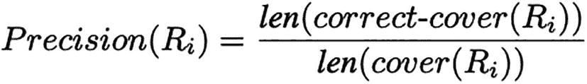

*   **长度规则**：R[i] 的长度是规则 C[i] 的前提条件集的基数。

*   **类别覆盖规则**：Ri 的类别覆盖率是 correct-cover(Ri) 中的实例数与分类器预测为标签 yi 的训练集实例数之比。

*   **互信息规则**：互信息规则 (RMI) 捕获其与预测类别的相互依赖关系。它通过 MI 推导得出，如下所示。

*   **集合精确度规则**：R 的精确度是 correct-cover(R) 中的实例数与 cover(R) 中的实例数之比。

*   **集合类别覆盖规则**：R 的类别覆盖率是 correct-cover(R) 中的实例数与分类器预测为标签 y[i] 的训练集实例数之比，其中 y[i] 是 R 中规则预测的类别。

```
x11 正确分类的数量 = TP
x12 错误分类的数量 = FP
x21 错误未分类的数量 = FN
x22 正确未分类的数量 = TN
row1 = TP + FP;
row2 = FN + TN;
col1 = TP + FN;
col2 = FP + TN;
total = TP + FP + FN + TN;
mi11=TP*log((TP * total) / (row1 * col1));
mi12=FP*log((FP * total) / (row1 * col2));
mi21=FN*log((FN * total) / (row2 * col1));
mi22=TN*log((TN * total) / (row2 * col2));
mutualInformation = mi11 + mi12 + mi21 + mi22;
comparison = TP >= (row1/total)*col1);
if comparison = True then achievedRMI = mutualInformation
else achievedRMI = -mutualInformation;
NormalizedRMI = achievedRMI / bestPossibleRMI
```

现在你已经了解了该算法中的所有度量指标，让我们深入探讨 MAGIE 生成 if-then-else 规则的方法。下一节将解释各个步骤，包括在创建规则之前处理数据以及为最终输出处理规则。

## MAGIE 算法方法

该算法的方法最好通过图 10-1 来描述。过程很简单。首先，生成实例级规则，然后将它们组合起来表示类别级规则。然后处理类别级规则以删除重复和冗余规则。最终规则集被导出并作为输出呈现。接下来，让我们看看每一步。

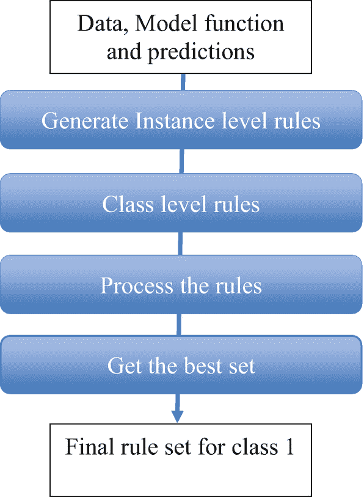

图 10-1

MAGIE 算法的方法

### 预处理输入数据

此步骤对输入数据进行预处理，使每个特征变为类别型。类别型特征保持不变。对于数值型特征，执行基于熵的分箱，将特征值分割成离散的区间。例如，如果属性 age 的取值范围是 10 到 85（含），那么分箱步骤可能会产生区间 '10 ≤ age < 25'、'25 ≤ age < 60' 和 '60 ≤ age ≤ 85'。此步骤之后，输入数据仅包含类别型特征。然后将原始数据集划分为训练集和测试集。

### 生成实例级条件

该算法遍历训练数据中的每个实例。对于每个实例，都有一个该实例被分类到的特定类别。计算模型在得出此分类时使用的每个特征值的边际贡献。该方法扰动所讨论的训练实例，并在所考虑实例的局部训练一个局部保真的线性模型。不同特征的权重随后近似于边际贡献值。此步骤的输出是一个条件列表。每个条件包含一个单一特征和一个值。


### 从条件中学习规则

上一步生成实例级条件的输出，是一个在实例层面重要的条件列表。对于每个类别，都有一组对该类别实例分类重要的条件。我们希望学习该类别对应的规则。每条规则都关联着覆盖率和精确度。

因此，问题如下：如何从这些基础条件中构建出具有高精确度和高覆盖率的规则？这可以通过一种组合爆炸式的方法来实现。例如，首先评估所有长度为 1 的规则，然后是长度为 2 的规则，依此类推。然而，如果上一步的输出给出了 N 个条件，那么该算法的复杂度将是 2 的 N 次方。对于较大的数据集，这在计算上是不可行的。

应该有一种方法可以学习条件的最优组合。该算法应将最优性概念作为输入，随后组合条件以生成最优规则。另一个需要考虑的要点是，如果数据中存在任何分类变量，我们希望规则允许这些分类变量取多个值。例如，如果我们有一个名为*国家*的分类变量，并且‘10 ≤ 年龄 < 25’、‘国家 = 美国’和‘国家 = 印度’是类别 2 的条件，那么一个候选规则可能是‘如果 10 ≤ 年龄 < 25 且 国家 ∈ {美国, 印度}，则预测类别 2’。因此，组合不仅应该是条件的“与”运算，还应该包括涉及分类变量的条件内部的“或”运算，以允许此类变量取多个可能的值。遗传算法在给定条件下学习这些规则。该算法对每个类别独立运行。因此，类别级规则是从类别级条件中学习到的。遗传算法的每个个体代表一条可能的规则。例如，如果上一步（学习实例级条件）生成的条件数量是 100，那么种群中的每个个体都是一个长度为 100 的位串。一个示例字符串可能是 100100000....000。这个示例代表一条形式为‘如果条件 1 且 条件 4，则预测类别 1’的规则。每个涉及分类变量的条件都被允许取多个值。适应度函数应捕获几个需求。

*   **精确度和覆盖率**：互信息规则（RMI）捕获了同时优化精确度和覆盖率的概念。高 RMI 的规则既不是高精确度低覆盖率，也不是过于通用且不精确的高覆盖率。

*   **长度**：适应度函数增加了一个长度因子。这里的直觉是，较短的规则更容易解释。虽然规则长度通常与覆盖率成反比，但明确这个参数会导致生成更短、更易解释的规则。

*   **重叠**：一个实例可能被一条规则覆盖，该规则说它应属于类别 1，而另一条规则说它应属于类别 2。其中只有一个是正确的，并且能最大限度地减少最终规则集中的歧义。由于规则应具有高精确度，意味着它们正确地复制了模型行为，因此随着我们优化精确度，最终规则集中的重叠量被最小化。

选取种群中具有高概率成为“适应”个体的个体。这些个体是那些在位串中只设置了一个比特位的个体（例如 1000、0100、0010 和 0001），其次是那些只设置了两个比特位的个体（1100、0110、0101...），依此类推，直到达到整个种群规模（即 1200 个个体）。该算法运行 600 代。最后一代的所有个体最终被选为一个类别的规则集。因此，这一步的输出是每个类别的一个详尽规则集。许多规则对集合没有增加价值，需要被过滤掉。

### 后处理规则

上一步生成的规则包含若干冗余规则。为了消除它们，将生成的规则按精确度降序排序。然后，对于每条规则 Ri，检查其正确覆盖集（correct-cover(Ri)）是否 ⊆ 规则 R 的正确覆盖集（correct-cover(R)），并且精确度（precision(Ri)）是否 ≤ 精确度（precision(R)），其中 R 是一条尚未被移除的更精确的规则。如果满足条件，则 Ri 不被考虑进入下一步。否则，保留该规则以供考虑。原始数据集被分割为训练子集和测试子集。通过观察模型在训练数据集上的行为来学习规则。然后，对于每条规则，计算其在测试数据集上的精确度。如果该精确度低于测试数据上的基线精确度，则在此步骤丢弃该规则。这移除了那些在训练数据集中具有正 RMI 但在测试数据集中精确度较低的噪声规则。基线精确度是指测试集中模型预测为 yi（与规则 Ri 关联的类别）的实例所占的比例。


### 基于互信息的排序规则

上一节给出了由遗传算法生成的 AND（将子句组合成规则）中的 OR 组合（规则子集）。一旦为某个类别推导出最优规则集，就会对其进行排序，以便将最相关的规则置于列表顶部，而相关性较低的规则则排在后面。具体操作如下：首先，按 RMI（规则互信息）降序排列规则。然后，选择 RMI 最高的规则，并将其添加到列表顶部。接着，选择 RMI 次高的规则，并将其与已添加的规则列表进行比较。如果该规则与任何已添加的规则相似，则将其丢弃；否则，将其添加到规则列表中。相似度通过计算两条规则覆盖的实例列表之间的杰卡德相似系数来衡量。若杰卡德相似系数大于 50%，则判定规则相似。重复此过程，直到获得所需数量的规则。

既然您已经了解了算法的主要步骤，接下来我们来看一下上述步骤执行的框架。图 10-2 展示了 MAGIE 执行的更详细框架（参见[`https://github.com/viadee/magie`](https://github.com/viadee/magie)）。

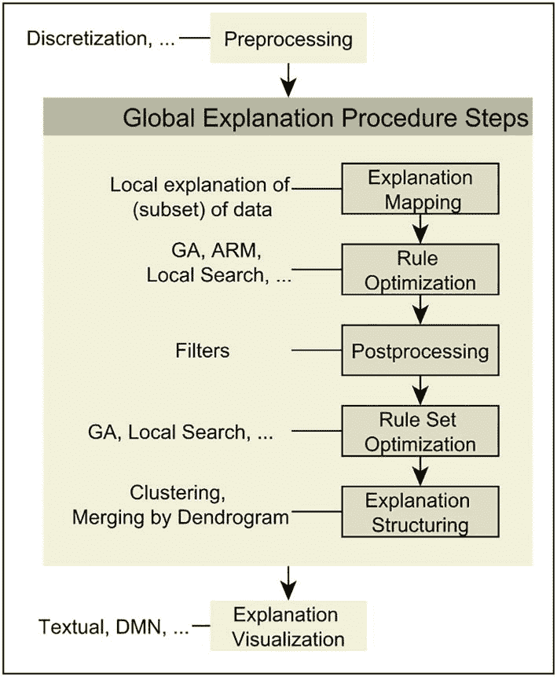

图 10-2

MAGIE 算法执行的详细框架

*   图 10-2 中的**解释映射步骤**对应于局部解释的初始创建。这些局部解释可作为构建全局解释的基石。因此，“解释映射”一词指的是将局部解释映射到全局解释的领域。该框架可以利用这些解释来初始化优化过程，并作为进一步探索规则的搜索空间。

*   图 10-2 中的**优化步骤**指的是两种类型的规则解释优化，可通过该框架执行：首先是对单个规则的优化，然后是对规则集的优化。优化器大致分为初始化器、表示转换器、目标函数和优化过程。初始化器的任务是接收一组转发的规则解释（例如来自解释映射步骤），并初始化一个待优化的规则解释种群。您可以直接将转发的规则作为初始种群，或使用规则前件的单个条件。表示转换器将算法使用的表示形式转换为规则解释（集）。通过这种方式，只需提供一个新的表示转换器，同一个优化过程就能优化规则集和单个规则。

*   图 10-2 中的**规则优化步骤**接收一个规则解释集作为输入。如果某个规则中存在一个条件（即分类预测特征的值），则该条件会被添加到优化过程的整体搜索空间中。随后可以探索此搜索空间以找到性能良好的规则。应应用目标函数来评估规则的质量。目前，MAGIE 算法使用基于互信息的度量，如表 10-1 所述。

*   **规则集优化器步骤**同样接收一个规则解释集。在此情况下，转发的规则解释集中的规则集合构成了搜索空间。规则集优化器的目标是在保持良好覆盖率和解释质量的同时，减少给定规则解释集中的规则数量。

*   **后处理步骤**指的是不利用搜索机制的过滤步骤以及对规则和规则集的更改。例如，如果两条规则覆盖了数据集中过多相同的数据实例，则只保留“更好”的那一条。另一个例子可能是将规则的度量与某个定义的基线（如基线精确率）进行比较。最后，可以评估某个规则对先前创建的规则集的贡献。

*   **解释结构化步骤**指的是准备规则集以向用户展示。规则集是为每个标签值分别创建的。因此，在解释结构化阶段，不同标签的解释可能会被聚类在一起。规则解释也可能以树状图的形式连接起来，这是 MAGIE 算法的输出。

最后，结构化的解释将可视化呈现给用户。

## GLocaLX

GLocalX（全局到局部解释器）是一种模型无关的、以局部为先的解释算法。GLocalX 基于这样的理念：通过对一组代表局部解释的逻辑规则进行推理，来推导出全局解释。GLocalX 通过迭代地将规则“合并”到一个不断增长的层次结构中，同时兼顾保真度（即模拟黑盒预测的准确性）和规则的复杂度，将表示为逻辑规则形式的局部解释聚合成一个全局解释。合并过程会估算解释之间的距离，并生成一组排序后的候选合并对。然后，选择满足保真度和复杂度约束且距离最小的那一对进行处理，以保证泛化能力，并用更新后的解释替换所选的对。每次合并都确保满足约束条件。这保证了 GLocalX 最终生成的解释具有高保真度和低复杂度。

在不同黑盒模型和数据集上的实证结果表明，GLocalX 在表示模型解释的规则集上同时实现了高保真度和低复杂度。与那些要么优化模型复杂度、要么优化保真度（但无法两者兼顾）的透明模型相比，GLocalX 同时达到了高保真度和低复杂度。其在预测任务中的高准确性也表明，GLocalX 可以直接用作透明模型，以替代 AI 系统中采用的全局分类器。

### 从局部到全局的解释问题

设 e1, ..., en ∈ E 是在人类可解释领域 E 中定义的黑盒分类器 b 的一组局部解释。从局部到全局的解释问题在于找到一个函数 g，该函数能产生一个解释理论 E = g(e1, ..., en) ⊂ E，使得 E 能够描述 b 做出决策的整体逻辑。为了解决从局部到全局的解释问题，我们需要对局部解释进行泛化，因为它们在局部是准确且忠实的，但在全局范围内并非如此。给定一个在 AI 系统中采用的黑盒分类器 b，以及一组被局部解释的实例 Xle = {x1, ..., xn}，以及它们的局部解释 {e1, ..., en}，该问题的解决方法是：通过聚合函数 g 将局部解释精炼成一个解释理论 E = {e'1, ..., e'k}，该理论能够模拟黑盒分类器 b 的全局决策逻辑。因此，人类可解释领域 E 由一组逻辑决策规则组成。


### 从局部到全局的解释理论层次结构

GLocalX 方法通过层次化方式将局部解释合并为全局解释理论。具体而言，GLocalX 的输入是一组以解释理论形式呈现的局部解释集合 E = {E1, . . . , En}，其中每个理论 Ei = {ei} 由单一解释构成（即 |Ei| = 1 ∀Ei ∈ E）。GLocalX 迭代地合并这些解释理论，最终返回一个解释理论 E = {e'1, . . . , e'k}。该方法模拟了黑盒分类器 b 的全局行为，同时保持了模型的整体简洁性与可解释性。在每次迭代中，GLocalX 通过逻辑理论间的相似度概念，合并最接近的一对解释理论 Ei 和 Ej。合并时会根据合并质量标准进行筛选：若未找到满足该标准的理论对，GLocalX 将提前终止，不构建完整的层次结构。最终生成的解释理论层次结构可用一种称为*树状图*的树形图表表示。GLocalX 方法包含两个关键要素：(i) 相似度搜索，用于选择需要合并与精炼的理论；(ii) 合并函数，用于精炼解释。

给定一组解释理论 E、一个成对相似度函数以及一个质量标准，逻辑理论会按相似度排序并存入队列 Q1 中。随后，系统会采样一批数据用于合并候选理论。使用数据批次而非整个训练数据集，有利于实现多样化的合并，因为合并过程会根据当前数据的不同表现出不同行为。在合并循环中，系统会弹出队列头部，找到最相似且合并后满足质量标准的一对理论，并执行合并操作。若合并有利，则保留合并后的理论。

作为质量标准，系统采用了*贝叶斯信息准则*（BIC），因为它能奖励模型的简洁性与准确性。BIC 已成功应用于多种技术中，例如聚类或采用二分层次精炼模型的方法。成功合并两个解释后，Ei 和 Ej 会被替换为合并后的理论 Ei+j。若未找到有利的合并，GLocalX 将终止。此过程会不断迭代，直至无法再进行合并。最后，会过滤掉保真度较低的解释，以减小输出规模。参数 α 用于指示每个类别的修剪阈值。

### 寻找相似理论

选择要合并的理论对，需要定义一个针对逻辑解释理论的成对相似度函数。为此，两个理论 E1 和 E2 的相似度被定义为它们在给定实例集 *X* 上覆盖范围的杰卡德相似度。

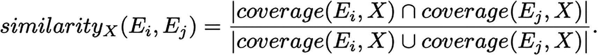

*E*[*i*] 和 *E*[*j*] 在 *X* 上的共享覆盖范围越大，这两个逻辑解释理论就越相似。覆盖相似度是一个双面度量，它同时捕捉了前提相似度和覆盖相似度。前者很直观：具有相似前提的规则具有相似的覆盖范围。后者则用于平衡前提相似度，以避免具有相似前提但覆盖范围较小的规则扭曲相似度得分。

合并函数使 GLocalX 能够泛化一组解释理论，同时通过近似逻辑蕴涵来平衡保真度与复杂度。合并涉及两个算子——连接（join）和切割（cut）——以同时实现泛化并保持高水平的保真度。在逻辑领域，泛化很少涉及前提的放宽或直接移除。因此，GLocalX 在利用此类泛化方面推进了现有技术水平。过度追求泛化可能会降低保真度。这些相互矛盾的行为是局部到全局设置中的焦点问题，必须妥善处理。这一问题通过一个同时处理规则泛化和保真度的合并函数来解决。假设有两个解释理论，E1 = {*e*[1], *e*[2]} 和 E2 = {*e*'[1], *e*'[2]}，其中 *e*[1]、*e*'[1] 解释记录 x1，*e*[2]、*e*'[2] 解释记录 x2。

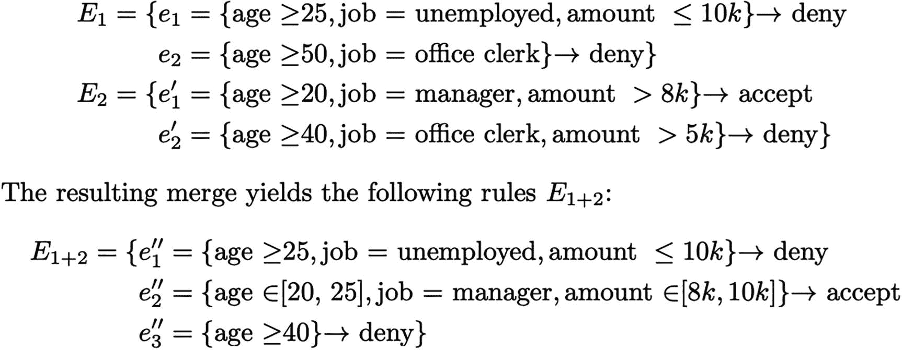

在 E[1+2] 中，来自不同解释理论且预测结果相同的规则，通过放宽其前提进行了泛化（规则 *e*'[3]）；而预测结果不同的规则，则通过进一步约束其前提进行了特化（规则 *e*'[2]）。具体来说，*e*'[1]、*e*'[2] 是对 *e*[1]、*e*'[1] 进行切割操作的结果，即 *e*[1] − *e*'[1]。更正式地说，给定两个解释理论 Ei 和 Ej，合并函数对这两个解释理论应用两个算子，以推导出一个被两者近似蕴涵的新理论：连接算子和切割算子。前者允许合并无冲突的规则，而后者允许合并有冲突的规则。

如果逻辑解释理论中的一组解释 E = {*e*[1], . . . , en} 中有两个或更多解释覆盖了同一个实例 *x*，但得出了不同的结果，则认为这组解释在该实例上存在冲突。合并两个逻辑解释理论 *E*[*i*] 和 *E*[*j*] 时，会针对批次中的每个实例，迭代地对无冲突解释应用连接算子，对有冲突解释应用切割算子。由此产生的解释集合构成了新的解释理论 *E*[*i*+*j*]。随后，通过 BIC 计算来测试候选合并，以考虑保真度与复杂度之间的平衡。

在大多数情况下，模型的对数似然度通过规则的保真度来计算，而模型复杂度则通过规则的平均长度来计算。下面，我们将详细介绍连接算子和切割算子。这两个算子的作用方向相反：连接算子泛化解释，可能以牺牲保真度为代价；而切割算子特化解释，可能以牺牲泛化能力为代价。换句话说，前者允许泛化，而后者则对其进行正则化。受此启发，我们通过决策规则的另一种表示形式来定义连接算子和切割算子。设 Xbi 为特征 i 上的子空间集合。给定一条决策规则 r = P → y，任何 Pi ∈ Xbi 都是特征 i 上的一个子空间。规则的前提 P 标识了一个准多面体，该多面体被定义为 Xb(m) 的一个子空间。


P = {Pi , . . . , Pj} ∈ P(Xb1 × · · · × Xbm)

若对于所有 Pi ∈ P 均有 xi ∈ Pi，则实例 x 满足 P。因此，当 x 位于由拟多面体定义的子空间内时，它满足 P。我们基于这种拟多面体解释，定义了合并函数所使用的连接（⊕）和切割（–）运算符。

连接运算符旨在泛化一组无冲突的解释，放宽其前提条件，从而泛化相关规则。给定两个拟多面体 P 和 Q，连接（⊕）定义如下：P ⊕ Q = {P1 + Q1, . . . , Pm + Qm}。

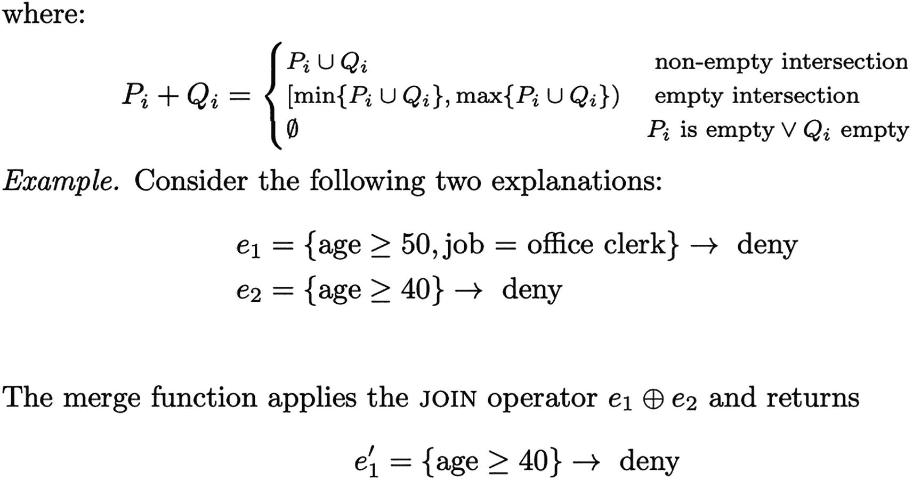

切割运算符则以互补的方式运作，对拟多面体进行切片。这里的目标是保留较好的规则，并将较差的规则限制在高保真度的子空间内。换句话说，目的是通过相减来消除规则之间的重叠。这直接转化为拟多面体的相减。形式上，给定两个拟多面体 P 和 Q，切割（–）定义如下：

P(–)Q = {P1 − Q1, . . . , Pm − Qm}

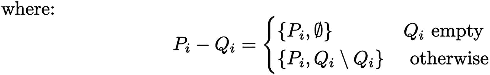

请注意，与连接运算符不同，切割运算符不是对称的，因此 P(–)Q ≠ Q(–)P。为了保留高保真度规则并限制低保真度规则，直接选择被减的多面体和减去的多面体即可，这两个规则分别对应保真度较高和较低的规则。

考虑以下两个解释：e1 = {age ≥ 25, job = unemployed, amount ≥ 10K} → deny（拒绝） e2 = {age ≥ 20, job = manager, amount > 8K} → accept（接受），其中第一个是主导解释，即保真度最高的那个。合并函数应用切割运算符 e1(–)e2，并返回 e1 = {age ≥ 25, job = unemployed, amount ≥ 10K} → deny（拒绝） e'1 = {age ∈ [20, 25], job = manager, amount ∈ [8K, 10K]} → accept（接受）。请注意，e1 保持不变，而 e2 的前提条件则被进一步约束以减少重叠。具体来说，年龄被约束以消除在 age ≥ 25 上的重叠，金额被约束以消除在 amount ≥ 10K 上的重叠。

连接和切割会产生不同基数的集合。切割保留了规则的数量，而连接则通过将规则归并到一个更小、更通用的解释集合中来减少规则数量。下一节将使用示例数据集和 Python 代码展示 GLocalX 的实际应用。

### 代码

让我们考虑以下数据集，这是一个电信公司的客户流失数据。数据中的变量包括：客户地址所在州、账户天数（账户时长）、区号、电话号码、是否开通国际套餐、是否开通语音邮件套餐、语音邮件消息数量、日间通话总分钟数、日间通话总次数、日间总费用、晚间通话总次数、晚间总费用、夜间通话总分钟数、夜间通话总次数、夜间总费用、国际通话总分钟数、国际通话总次数、国际总费用、客户服务呼叫次数。目标变量是 churn（流失），包含 True 和 False 值。True 值表示已流失或已停止使用电信公司服务的客户。False 值表示拥有有效套餐的客户。

让我们查看目标变量的分布情况。

```
class_name = 'churn' #目标变量名称
data[class_name] = data[class_name].replace({True: 1, False: 0})
data.shape
(3333, 21)
data.drop('phone number', axis=1, inplace=True)
data[class_name].value_counts()
0    2850
1     483
Name: churn, dtype: int64
```

为简单起见，让我们使类别保持均衡。

```
import imblearn
from imblearn.under_sampling import RandomUnderSampler
from imblearn.over_sampling import RandomOverSampler
X = data.drop(class_name,axis=1)
y = data[class_name]
# 定义过采样策略
over = RandomOverSampler(sampling_strategy=0.2)
# 应用变换
X, y = over.fit_resample(X, y)
# 定义欠采样策略
under = RandomUnderSampler(sampling_strategy=0.9)
# 应用变换
X, y = under.fit_resample(X, y)
data = pd.concat([X,y],axis=1)
#data.shape
data[class_name].value_counts()
0    633
1    570
Name: churn, dtype: int64
```

让我们查看不同变量的数据类型。

```
#   列名                    非空计数     数据类型
---  ------                  --------------  -----
0   state                   1203 non-null   object
1   account length          1203 non-null   int64
2   area code               1203 non-null   int64
3   international plan      1203 non-null   object
4   voice mail plan         1203 non-null   object
5   number vmail messages   1203 non-null   int64
6   total day minutes       1203 non-null   float64
7   total day calls         1203 non-null   int64
8   total day charge        1203 non-null   float64
9   total eve minutes       1203 non-null   float64
10  total eve calls         1203 non-null   int64
11  total eve charge        1203 non-null   float64
12  total night minutes     1203 non-null   float64
13  total night calls       1203 non-null   int64
14  total night charge      1203 non-null   float64
15  total intl minutes      1203 non-null   float64
16  total intl calls        1203 non-null   int64
17  total intl charge       1203 non-null   float64
18  customer service calls  1203 non-null   int64
19  churn                   1203 non-null   int64
dtypes: float64(8), int64(9), object(3)
memory usage: 188.1+ KB
```

重要提示！

在将数据传递给 LORE 和 GLocalX 之前，我们需要处理分类特征；否则，分类变量会被视为连续变量，并会使用某个阈值对其做出决策规则。

如果你的数据集维度非常高（列数过多），你可以使用 SHAP 选择前 20-30 个变量，然后将此数据集传递以进行后续处理！

*   **数据集**：分割以生成解释。

*   **训练集**：训练黑盒模型。

*   **测试集**：测试黑盒模型的准确性，然后通过 LORE 生成它们的局部规则。

*   **验证集**：验证 GLocalX 在其全局规则上的结果。


```
from scoped_rules.utils import data_processing
features = data_processing(data, class_name)
df, feature_names, class_values, numeric_columns, rdf, real_feature_names, features_map = features.prepare_variables()
X_train, y_train, X_test, y_test, r_X_test, val, test = features.data_splitting(test_size = 0.16, val_size = 0.05)
Length of train set is 959
Length of test set is 183
Length of val set is 61
```

本部分将所有分类变量转换为独热编码。

构建随机森林分类模型。该模型作为黑盒用于规则生成。

```
from sklearn.metrics import accuracy_score, f1_score, classification_report
from sklearn.ensemble import RandomForestClassifier, GradientBoostingClassifier
bb = RandomForestClassifier()
bb.fit(X_train, y_train)
def bb_predict(X):
return bb.predict(X)
def bb_predict_proba(X):
return bb.predict_proba(X)
y_pred = bb_predict(X_test)
print('Accuracy %.3f' % accuracy_score(y_test, y_pred))
print('F1-measure %.3f' % f1_score(y_test, y_pred))
Accuracy 0.880
F1-measure 0.872
```

LORE 是一种模型无关的方法，能够提供可解释且忠实的解释。LORE 首先在由遗传算法生成的合成邻域上学习一个局部可解释预测器。然后，它从局部可解释预测器的逻辑中推导出一个有意义的解释，该解释由一条决策规则构成，阐明了决策的原因。

我们之所以使用 LORE，是因为它比其他局部规则技术（如 anchors）更准确、更稳定。

```
from scoped_rules.lore.lorem import LOREM
from scoped_rules.lore.explanation import *
from scoped_rules.lore.rule import *
from scoped_rules.lore.util import *
import concurrent.futures
import os
import time
lore_explainer = LOREM(r_X_test, bb_predict, feature_names, class_name, class_values, numeric_columns, features_map,
neigh_type='geneticp', categorical_use_prob=True, continuous_fun_estimation=False,
size=1000, ocr=0.1, random_state=0, ngen=10, bb_predict_proba=bb_predict_proba,
verbose=True)
print()
#If you want to check local explanation of any test-set instance
x = X_test[115] #115th instance from our 183 X_test instances
exp = lore_explainer.explain_instance(x, samples=300, use_weights=True, metric=neuclidean)
print()
print()
print(exp)
```

### 输出

```
calculating feature values
generating neighborhood - geneticp
gen     nevals        avg           min           max
0       150        0.496654     0.496654     0.496654
1       130        0.767585     0.496654     0.993262
2       129        0.972472     0.496654     0.993301
3       122        0.992499     0.98517      0.993301
4       135        0.98904      0.496654     0.993301
5       118        0.99216      0.972332     0.993301
6       122        0.992392     0.97464      0.99328
7       128        0.992371     0.983344     0.99328
8       127        0.99234      0.984633     0.993287
9       132        0.992416     0.984333     0.993287
10      121        0.992546     0.987313     0.993287
gen     nevals      avg         min          max
0       150        0.5          0.5          0.5
1       135        0.500185     0.498573     0.509783
2       119        0.500508     0.498552     0.509982
3       131        0.501412     0.498649     0.51975
4       132        0.501696     0.497202     0.51975
5       123        0.502945     0.497272     0.51975
6       131        0.504018     0.498004     0.537397
7       132        0.505359     0.498784     0.537397
8       125        0.506727     0.498335     0.527432
9       123        0.508359     0.497412     0.55501
10      125        0.509345     0.497186     0.55501
synthetic neighborhood class counts {0: 188, 1: 160}
learning local decision tree
retrieving explanation
r = { customer service calls  22.50 } --> { churn: 0 }
c =  }
```

对于全局解释，你需要为所有测试实例生成局部解释规则。多进程技术利用所有资源并并行化处理过程。Python 并行处理库的 `concurrent.futures` 模块利用可用的高 CPU 核心数并行生成局部解释。

```
def lore_rules(instance):
exp = lore_explainer.explain_instance(X_test[instance], samples=300, use_weights=True)
rule = ExplanationEncoder.default(instance,exp)
return rule
def local_rules(lore_explainer, X_test):
start_time = time.time()
rules = []
with concurrent.futures.ProcessPoolExecutor(max_workers=94) as executor:
results = executor.map(lore_rules,[x for x in range(len(X_test))])
for result in results:
rules.append(result)
print()
print()
print(f'Total {len(rules)} local rules generated')
end_time = time.time()
print('time taken to generate local rules in sec: ', (end_time - start_time))
return rules
rules = local_rules(lore_explainer, X_test)
```

GLocalX 是一种“局部优先”的模型无关解释方法。从以局部决策规则形式表达的局部解释出发，GLocalX 通过分层聚合（合并显著规则）迭代地将它们泛化为全局解释。

生成的局部规则被合并，GLocalX 为目标变量的每个类别返回最终的全局决策规则。

```
from scoped_rules.global_interpret import glocalx_explanations
model = glocalx_explanations(rules, bb, feature_names, class_values, class_name, val, test, data_path)
results = model.global_rules(batch_size = 32)
Local Rules json file stored at path: /mnt/data/scoped_rules_package/data/local_rules.json
Val_set stored at path:  /mnt/data/scoped_rules_package/data/val.csv
Test_set stored at path:  /mnt/data/scoped_rules_package/data/test.csv
Merging Rules....
Merge Complete!
Time taken for global rules in sec:  13.0773446559906
{
customer service calls = 38.63331413269043
Class: 1
}
```

因此，你看到了如何使用 GLocalX 生成简单的 if-then 规则。GLocalX 的一个主要优势是它在执行方面提供的灵活性。你可以修改模型以适应数据集的需求。由于它是模型无关的，你可以使用任何类型的模型。它还提供了在最后一步修改和合并规则的灵活性。有时，我们可能希望以不同于默认输出的方式编码规则。例如，默认输出可以是编码后的类别，而你可以将几个类别组合起来，将规则表示为一个组。

## Skope-Rules

复杂的机器学习模型有时能实现高性能，但会导致决策不透明。由于法规或错误带来的严重后果，通常需要更高的可解释性。在此，我们介绍 skope-rules，一种基于规则的可解释模型。

Skope-rules，即所提出的可解释模型，旨在学习用于“界定”目标类别的决策规则；也就是说，以高精度检测该类别的实例。生成此类规则的问题已被广泛研究（参见 RuleFit、Slipper、LRI、MLRules）。

然而，这种方法的主要区别在于决策规则的选择方式：基于构成每条规则的变量进行语义去重，而非基于 L1 的特征选择（RuleFit）。


### 方法论

skope-rules 的方法论如图 10-3 所示。该方法通过一个简单的三步流程来生成规则。

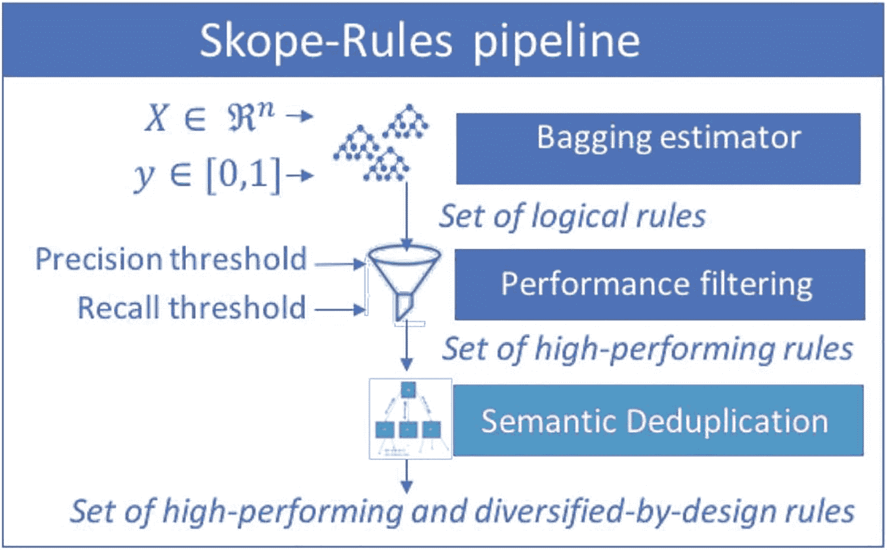

图 10-3

Skope-rules 流程

*   **装袋估计器训练**：训练多个决策树分类器以及可能的回归器（如果应用了样本权重）。请注意，此装袋估计器中的每个节点都可以被视为一条规则。

*   **性能过滤**：应用袋外精确率和召回率阈值来筛选最佳规则。

*   **语义去重**：应用相似性过滤以保持规则之间足够的多样性。两条规则的相似度基于它们共同项的数量。一个项是一个变量名与一个比较运算符（< 或 >）的组合。

现在，让我们更详细地了解各个步骤。图 10-4 展示了语义去重中最后一步的工作原理。

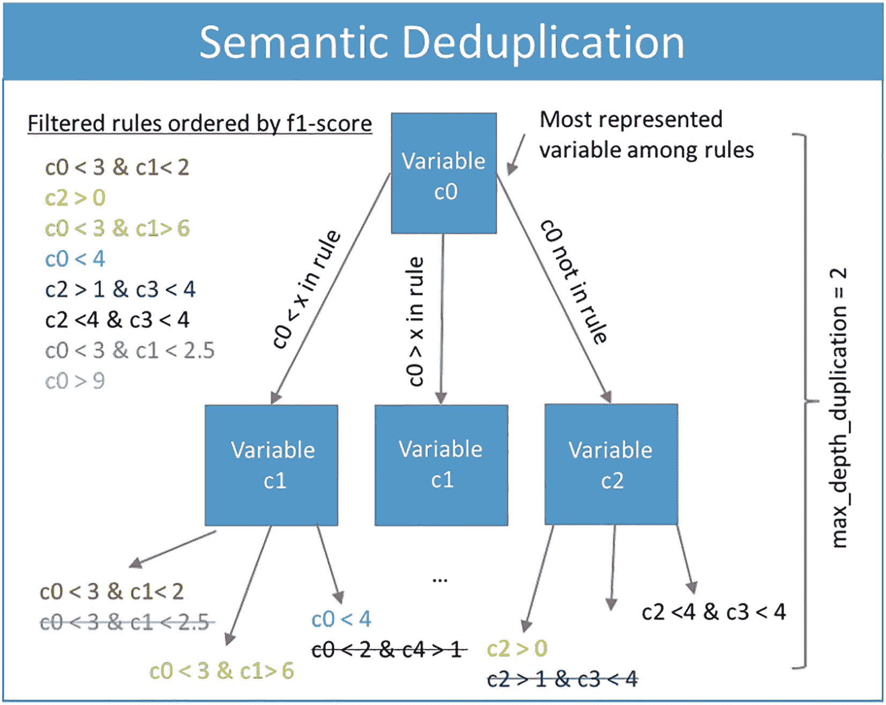

图 10-4

Skope-rules 方法论

### 实现

skope-rules 的实现非常简单，可以通过图 10-5 中所示的一段非常简洁的代码完成。

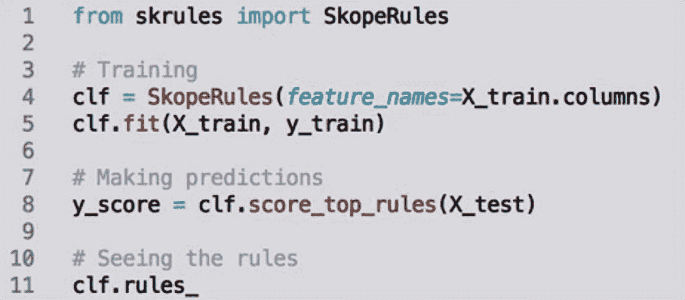

图 10-5

Skope-rules 实现示例

图 10-6 展示了 skope-rules 算法的一个输出示例。

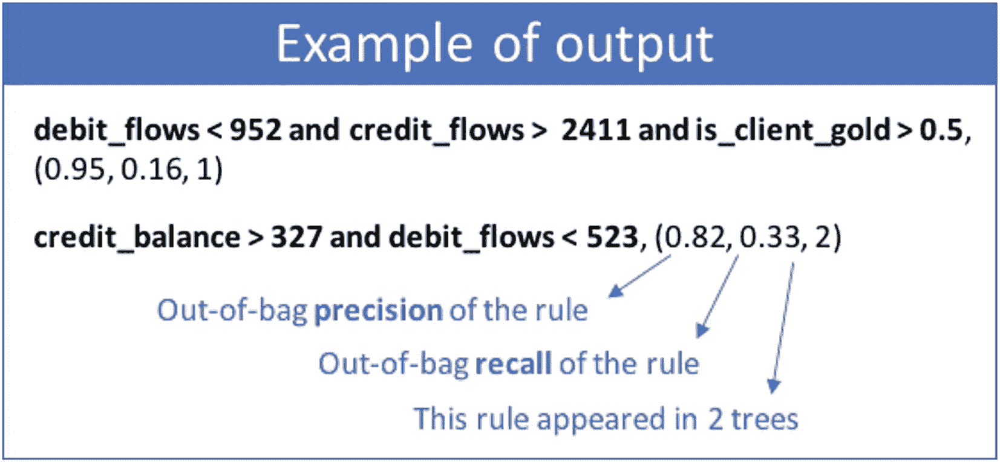

图 10-6

Skope-rules 输出示例

Skope-rules 适用于不同的应用场景，具体用法如下。

*   **作为全局可解释模型**：这是 skope-rules 在二分类任务中的自然用途。规则将类别 1 与类别 0 区分开来。

*   **作为聚类描述器**：在聚类任务中，skope-rules 描述每个分段。每个聚类都可以进行后处理，并用一组可解释的规则来近似表示。

*   **作为分布队列描述器**：Skope-rules 也适用于描述任何子样本与总体之间的差异。更准确地说，它描述了由给定变量的最高（或最低）值定义的子样本。Skope-rules 可以有效地理解另一个复杂分类器的最高（或最低）预测分数。

接下来，让我们使用自第 9 章以来一直在使用的相同数据集，看看如何实现一个 skope-rules 的工作示例。

响应变量类别编码为“将赚取”和“不会赚取”。

```
c=np.array(list3)
print(c)
print(list3)
list4=[]
list4.append('Will Earn')
list4.append('Wont Earn')
import sys
import six
sys.modules['sklearn.externals.six'] = six
import skrules
from skrules import SkopeRules
clf = SkopeRules(max_depth_duplication=2,
n_estimators=30,
precision_min=0.3,
recall_min=0.1,
feature_names=list)
for idx1, revenue in enumerate(list4):
clf.fit(x_train, y_train == idx1)
rules = clf.rules_[0:17]
print("Rules for Revenue ",revenue)#Ask
for rule in rules:
print(rule)
print()
print(20*'=')
print()
Rules for Revenue  Will Earn
('Month  6.5 and PageValues  9.61924123764038', (0.8133333333333334, 0.4299559471365639, 1))
('Administrative_Duration > 9.25 and PageValues  0.7777977585792542', (0.3952254641909814, 0.2634836427939876, 1))
('BounceRates > 0.0010931899887509644 and PageValues > 8.887159824371338', (0.4906716417910448, 0.2269197584124245, 1))
('BounceRates > 8.075000005192123e-05 and PageValues  0.9448194801807404', (0.3780260707635009, 0.18076580587711488, 1))
('BounceRates  2.515446901321411', (0.6148409893992933, 0.15038893690579083, 1))
```

你可以看到 skope-rules 的输出是为每个类别显示的简单规则。对于“不会赚取”类别，定义规则的重要变量是 PageValues 和 BounceRates。在正类中，“将赚取”的规则是基于 Month 和 PageValues 变量生成的。


## 锚点（Anchors）

锚点通过寻找一条能够充分“锚定”预测结果的规则，来解释任何黑盒分类模型的预测。如果其他特征值的变化不影响预测结果，则该规则锚定了该预测。锚点利用强化学习技术结合图搜索算法，将模型调用次数（以及所需的运行时间）降至最低，同时仍能从局部最优中恢复。Ribeiro、Singh 和 Guestrin 于 2018 年提出了该算法，他们也是 LIME 算法的提出者。

与其前身类似，锚点方法采用一种基于*扰动*的策略，为黑盒机器学习模型的预测生成*局部*解释。然而，与 LIME 使用的代理模型不同，锚点生成的解释以易于理解的 if-then 规则形式呈现，称为*锚点*。这些规则是可复用的，因为它们具有*作用域*：锚点包含了覆盖范围的概念，精确指明了它们适用于哪些其他（可能是未见过的）实例。寻找锚点涉及一个探索或多臂老虎机问题，该问题源于强化学习学科。为此，系统会为每个被解释的实例创建并评估其邻居（即扰动）。这样做使得该方法可以忽略黑盒模型的结构及其内部参数，从而保持这些参数既不可见也不被改变。因此，该算法是*模型无关的*，意味着它可以应用于*任何*模型类别。

图 10-7 展示了 LIME 和锚点分别使用两个示例实例，对一个复杂的二分类器（预测结果为 + 或 –）进行局部解释。LIME 的结果并未表明其解释的忠实度，因为 LIME 仅学习了一个最能逼近模型行为的线性决策边界。在相同的扰动空间下，锚点方法构建的解释，其覆盖范围会自适应于模型的行为，并清晰地表达其边界。因此，它们在设计上就是忠实的，并能精确说明它们对哪些实例有效。这一特性使得锚点特别直观且易于理解。

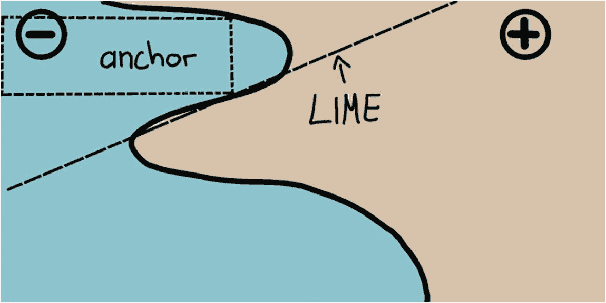

图 10-7

锚点与 LIME 的对比表示

如前所述，该算法的结果或解释以称为锚点的规则形式呈现。图 10-8 展示了一个这样的锚点。例如，假设我们有一个双变量黑盒模型，用于预测乘客是否在*泰坦尼克号*灾难中幸存。现在我们想知道，*为什么*该模型预测某个特定个体能够幸存。

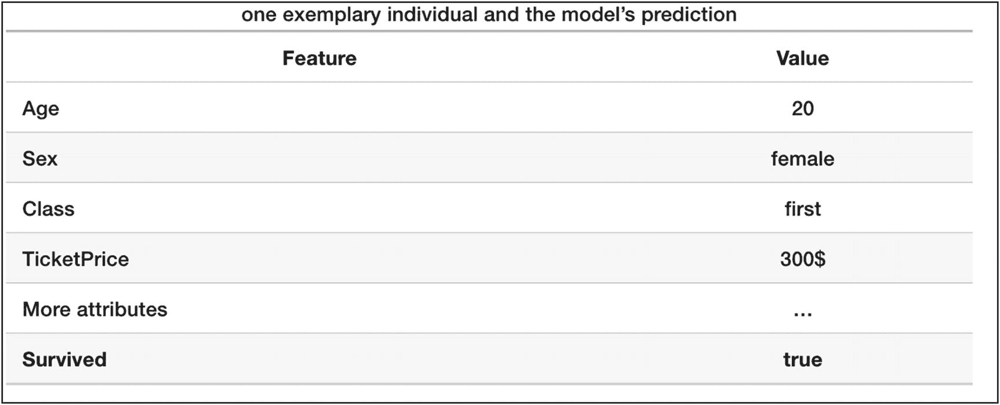

图 10-8

锚点示例

锚点算法提供以下结果解释。

```
如果 性别 = 女性
并且 舱位 = 头等舱
则 预测 幸存 = 是
精确度 97%
覆盖范围 15%
```

该示例展示了锚点如何提供对模型预测及其底层推理过程的重要洞察。结果显示模型考虑了哪些属性，即女性性别和头等舱。人类作为正确性的最终评判者，可以使用此规则来验证模型的行为。该锚点也适用于扰动空间中 15% 的实例。在这些情况下，解释的准确率为 97%，意味着所显示的谓词几乎完全决定了预测结果。

锚点 A 的形式化定义如下。

EDx(z|A)[1f(x)=f(z)] ≥ τ, A(x)=1

*   x 表示被解释的实例（例如，表格数据集中的一行）。
*   A 是一组谓词（即最终的规则或锚点），当 A 定义的所有特征谓词与 x 的特征值对应时，A(x)=1。
*   f 表示待解释的分类模型（例如，人工神经网络模型）。可以查询该模型来预测 x 及其扰动的标签。
*   Dx(·|A) 表示与 A 匹配的 x 的邻居分布。
*   0≤τ≤1 指定了一个精确度阈值。只有局部忠实度至少达到 τ 的规则才被视为有效结果。

### 寻找锚点

尽管锚点的数学描述看似清晰直接，但构建特定的规则是不可行的。因为需要评估以下内容：

1f(x)=f(z)1f(x)=f(z) 对于所有 z∈Dx(·|A)

这在连续或大型输入空间中是不可能的。因此，作者提出引入 0≤δ≤10≤δ≤1 参数来创建一个概率定义。通过这种方式，不断抽取样本，直到对其精确度有统计置信度。概率定义如下：

P(prec(A) ≥ τ) ≥ 1−δ 其中 prec(A)=EDx(z|A)[1f(x)=f(z)]

前两个定义通过引入覆盖范围的概念进行组合和扩展。其基本原理是找到适用于模型输入空间大部分区域的规则。覆盖范围在形式上定义为锚点应用于其邻居（即其扰动空间）的概率。

cov(A)=ED(z)[A(z)]

包含这个元素引出了锚点的最终定义，该定义考虑了覆盖范围的最大化。

Max cov(A)

As.t.P(prec(A)≥τ)≥1−δ

因此，该过程旨在所有符合条件的规则（即所有满足概率定义下精确度阈值的规则）中，寻找覆盖范围最大的规则。这些规则被认为更重要，因为它们描述了模型的更大部分。请注意，谓词更多的规则往往比谓词更少的规则具有更高的精确度。一个固定了 x 的每个特征的规则，会将评估的邻域缩小到完全相同的实例。因此，模型对所有邻居的分类结果相同，该规则的精确度为 1。同时，固定了太多特征的规则过于具体，仅适用于少数实例。因此，存在*精确度与覆盖范围之间的权衡*。

锚点方法使用四个主要组件来寻找解释，如图 10-9 所示。

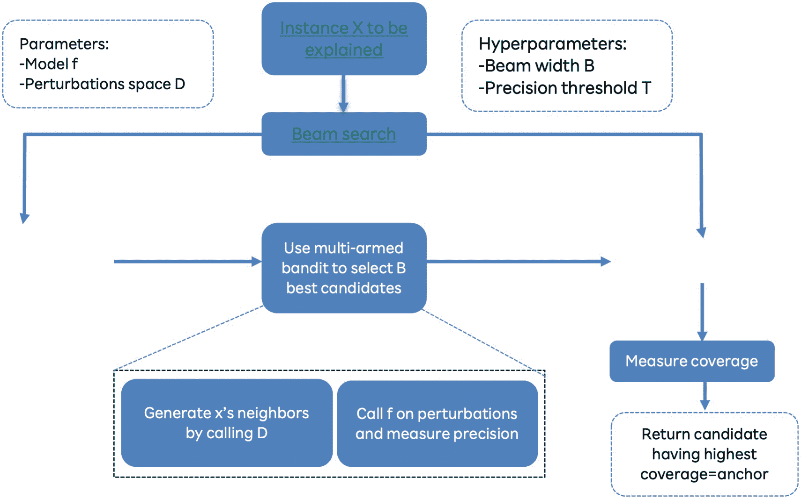

图 10-9

锚点流程图

*   **候选生成**：生成新的解释候选。在第一轮中，为 x 的每个特征创建一个候选，并固定可能扰动的相应值。在随后的每一轮中，上一轮的最佳候选会通过添加一个尚未包含在内的特征谓词进行扩展。
*   **最佳候选识别**：需要比较候选规则，看哪个规则最能解释 x。为此，会创建与当前观察到的规则相匹配的扰动，并通过调用模型进行评估。然而，需要最小化这些调用次数以限制计算开销。这就是为什么该组件的核心是一个纯探索的多臂老虎机（MAB；准确来说是 KL-LUCB）。MAB 通过顺序选择，高效地探索和利用不同的策略（类比老虎机，称为*臂*）。在给定的设置中，每个候选规则被视为一个可以拉动的臂。每次拉动该臂时，都会评估相应的邻居，从而获得关于该候选规则收益（在锚点情况下是精确度）的更多信息。因此，精确度表明了该规则描述被解释实例的程度。
*   **候选精确度验证**：如果没有统计置信度表明候选规则超过了 τ 阈值，则获取更多样本。


*   **改进的束搜索**：所有组件都集成在束搜索中，这是一种图搜索算法，也是广度优先算法的一种变体。它将每一轮中最佳的 B 个候选结果传递到下一轮（其中 B 被称为*束宽*）。然后，这 B 个最佳规则会被用来创建新规则。束搜索最多执行 featureCount(x) 轮，因为每个特征最多只能被包含在一个规则中一次。因此，在每一轮 i 中，它都会生成恰好包含 i 个谓词的候选规则，并从中选出最佳的 B 个。因此，通过设置较高的 B 值，算法更有可能避免局部最优解。反过来，这需要大量的模型调用，从而增加了计算负载。

### 优势

锚点方法相比 LIME 具有多个优势。首先，算法的输出更容易理解，因为规则**易于解释**（即使对于外行也是如此）。

此外，**锚点可子集化**，并且通过引入覆盖度的概念来表明重要性的度量。其次，当模型预测在实例邻域内是非线性或复杂时，锚点方法**依然有效**。由于该方法采用强化学习技术而非拟合代理模型，因此不太可能出现欠拟合的情况。

除此之外，该算法是**模型无关的**，因此适用于任何模型。

此外，通过使用支持批量采样的 MAB（例如 BatchSAR），该方法**可以并行化，因此效率极高**。

### 劣势

与大多数基于扰动的解释器一样，该算法存在**高度可配置且影响显著**的设置问题。需要调整诸如束宽或精度阈值之类的超参数，才能产生有意义的结果。扰动函数也需要针对特定领域/用例进行显式设计。想象一下表格数据是如何被扰动的（扰动意味着向数据添加噪声），并将相同的概念应用于图像数据。（提示：这些方法无法直接应用。）幸运的是，在某些领域（例如表格数据）中可以使用默认方法，从而简化初始解释设置。

此外，**许多场景需要进行离散化**，否则结果会过于具体、覆盖度低，并且无助于理解模型。虽然离散化有所帮助，但如果使用不当，也可能模糊决策边界，从而产生完全相反的效果。由于没有最佳的离散化技术，用户需要在决定如何离散化数据以避免获得糟糕结果之前，充分了解数据。

与所有基于扰动的解释器一样，构建锚点需要**大量调用机器学习模型**。虽然该算法部署了 MAB 来最小化调用次数，但其运行时间仍然取决于模型的性能，并且变化很大。

最后，**覆盖度的概念在某些领域是未定义的**。例如，对于一张图像中的超像素如何与另一张图像中的超像素进行比较，并没有明确或通用的定义。

接下来，让我们使用锚点算法中默认提供的数据集来生成简单的规则。您可以逐步跟随代码来理解锚点的实现。

导入与锚点相关的库。

```
from __future__ import print_function
import numpy as np
np.random.seed(1)
import sys
import sklearn
import sklearn.ensemble
%load_ext autoreload
%autoreload 2
from anchor import utils
from anchor import anchor_tabular
```

这个数据集是关于预测一个人的收入是否超过 50,000 美元。

```
dataset = utils.load_dataset('adult', balance=True, dataset_folder=dataset_folder, discretize=True)
```

接下来，我们训练一个分类器。

```
c = sklearn.ensemble.RandomForestClassifier(n_estimators=50, n_jobs=5)
c.fit(dataset.train, dataset.labels_train)
print('Train', sklearn.metrics.accuracy_score(dataset.labels_train, c.predict(dataset.train)))
print('Test', sklearn.metrics.accuracy_score(dataset.labels_test, c.predict(dataset.test)))
```

### 获取锚点

现在让我们启动解释器。我们需要训练数据来扰动实例。`categorical_names` 是一个从整数到字符串列表的映射，包含分类特征每个值的名称。不在此映射中的每个特征都被视为有序或连续特征，因此会被离散化。

```
explainer = anchor_tabular.AnchorTabularExplainer(
dataset.class_names,
dataset.feature_names,
dataset.train,
dataset.categorical_names)
```

接下来，我们获取预测编号 0 的锚点。锚点是一个充分条件；也就是说，当锚点成立时，预测结果应与该实例的预测结果相同。

```
idx = 0
np.random.seed(1)
print('Prediction: ', explainer.class_names[c.predict(dataset.test[idx].reshape(1, -1))[0]])
exp = explainer.explain_instance(dataset.test[idx], c.predict, threshold=0.95)
Prediction:  b'>50K'
print('Anchor: %s' % (' AND '.join(exp.names())))
print('Precision: %.2f' % exp.precision())
print('Coverage: %.2f' % exp.coverage())
Anchor: Education = Bachelors AND Relationship = Husband AND Occupation = Sales
Precision: 0.97
Coverage: 0.02
```

请注意，我们将阈值设置为 0.95，因此我们（以高概率）保证精度高于 0.95；也就是说，在锚点成立的实例上，预测结果与原始预测结果至少 95% 的时间相同。让我们在测试集上尝试一下。

```
# 获取锚点适用的测试样本
fit_anchor = np.where(np.all(dataset.test[:, exp.features()] == dataset.test[idx][exp.features()], axis=1))[0]
print('Anchor test precision: %.2f' % (np.mean(c.predict(dataset.test[fit_anchor]) == c.predict(dataset.test[idx].reshape(1, -1)))))
print('Anchor test coverage: %.2f' % (fit_anchor.shape[0] / float(dataset.test.shape[0])))
Anchor test precision: 0.97
Anchor test coverage: 0.02
```

## 总结

本章非常重要，因为基于规则的方法在分析行业中并非普遍流通的可解释性方法。大多数用例仍然依赖 SHAP 和其他与特征重要性相关的方法；然而，在理解建模数据集中每个类别的行为方面，像 MAGIE 和 GLocalX 这样的方法可以带来许多好处。

