# 11. 详解反事实方法

前两章讨论了特征重要性方法和基于规则的方法。尽管基于规则的方法让人工利益相关者轻松了许多，但模型解释中仍有一些空白可以填补。特征重要性方法和基于规则方法的输出对模型来说都是有益的。这些方法有助于确定分类模型场景中特定类别的行为。反事实解释比描述性信息更进一步，它提供了使模型结果利用变得有意义的行动。本章讨论了反事实提供的行动，以及如何通过实施反事实解释从模型解释中获得更多价值。我们希望您记住`可操作`这个词，以便与反事实解释联系起来。反事实的输出可以帮助从模型决策的输出中推导出有意义的行动，这远比仅仅拥有模型决策的描述性解释要好得多。

## 反事实解释

反事实解释以如下形式描述一种因果关系：“如果 X 没有发生，那么 Y 就不会发生。”例如，“如果我没有喝那口热咖啡，我就不会烫到舌头。”事件 Y 是我烫到了舌头；原因 X 是我喝了热咖啡。反事实需要想象一个与观察事实相矛盾的假设现实（例如，一个没有热咖啡的世界）；因此得名`反事实`。与其它动物相比，反事实思维能力使人类如此聪明。

在可解释的机器学习中，反事实解释用于解释单个实例的预测结果。“事件”指的是某个实例的预测结果。“原因”则是输入模型并“导致”特定预测的该实例的特征值。

即使输入与预测结果之间的关系可能并非因果关系，我们仍可将模型的输入视为预测的原因。

为了模拟机器学习模型预测的反事实，我们只需在做出预测前改变某个实例的特征值，并分析预测结果如何变化。我们感兴趣的是预测结果发生相关变化的场景，例如预测类别翻转（如贷款申请被批准或拒绝），或者预测结果达到某个阈值（如癌症概率达到 10%）。一个预测的反事实解释描述了为使预测结果变为预定义输出而对特征值做出的最小改变。

存在与模型无关和与模型特定两种反事实解释方法。本章重点介绍仅处理模型输入和输出（而非特定模型的内部结构）的与模型无关的方法。

与原型不同，反事实不必是训练数据中的实际实例，而可以是特征值的新组合。

在讨论如何创建反事实之前，我们先探讨一些用例。

## 用例 1：银行软件

在第一个例子中，Shankar 申请贷款却被（基于机器学习的）银行软件拒绝。他想知道自己的申请为何被拒，以及如何提高获得贷款的机会。这个“为什么”的问题可以表述为一个反事实：对特征（收入、信用卡数量、年龄等）做出怎样的最小改变，才能使预测结果从“拒绝”变为“批准”？一个可能的答案是：如果 Shankar 每年多赚 10,000 美元，他就能获得贷款。或者，如果 Shankar 减少信用卡数量，并且五年前没有贷款违约记录，他就能获得贷款。Shankar 永远不会知道被拒的原因，因为银行对透明度不感兴趣，但那是另一个故事了。

## 用例 2：连续型结果

第二个例子用反事实解释来解释一个预测连续型结果的模型。Garima 想出租她的公寓，但不确定该收多少租金，于是她训练了一个机器学习模型来预测租金。当然，因为 Garima 是一名数据科学家，这就是她解决问题的方式。在输入关于面积、位置、是否允许养宠物等所有细节后，模型告诉她可以收取 900 美元。她原本期望是 1000 美元或更多，但她信任自己的模型，并决定调整公寓的特征值，看看如何能提升公寓的价值。她发现，如果公寓面积再大 15 平方米，租金可以超过 1000 美元。这个知识有趣但不可操作，因为她无法扩大公寓面积。最后，通过仅调整她可控的特征值（是否带整体厨房、是否允许养宠物、地板类型等），她发现如果允许养宠物并安装隔热性能更好的窗户，她可以收取 1000 美元。Garima 凭直觉运用了反事实来改变结果。

## 反事实解释概览

反事实是对人类友好的解释，因为它们通常只关注少量特征的变化。每个反事实都讲述了关于某个结果是如何达成的不同“故事”。一个反事实可能建议改变特征 A，而另一个反事实可能建议保持 A 不变但改变特征 B，这就产生了矛盾。这种“多重真相”的问题可以通过报告所有反事实解释，或通过制定标准来评估反事实并选出最佳的一个来解决。

说到标准，我们如何定义一个优秀的反事实解释呢？首先，反事实解释的用户需要定义某个实例预测结果的相关变化（即替代现实）。

一个显而易见的首要要求是，反事实实例应尽可能接近地产生预定义的预测结果。找到具有预定义预测结果的反事实并不总是可能的。例如，在包含一个稀有类和一个常见类的二分类场景中，模型可能总是将实例分类为常见类。改变特征值以使预测标签从常见类翻转为稀有类可能是不可能的。因此，我们希望放宽对反事实预测结果必须与预定义结果完全匹配的要求。在分类例子中，我们可以寻找一个反事实，其中稀有类的预测概率从当前的 2%提高到 10%。特征值需要做出怎样的最小改变，才能使预测概率从 2%变为 10%（或接近 10%）？

另一个质量标准是，反事实在特征值上应尽可能与原始实例相似。两个实例之间的距离可以通过曼哈顿距离或（当同时存在离散和连续特征时）`Gower距离`来衡量。反事实不仅应接近原始实例，还应尽可能少地改变特征。我们可以简单地计算改变的特征数量，来衡量反事实解释在此指标上的优劣。

第三，通常希望生成多个多样化的反事实解释，以便决策主体能获得多种可行的途径来产生不同的结果。例如，继续贷款的例子，一个反事实解释可能建议只需将收入翻倍即可获得贷款。而另一个反事实解释可能建议搬到附近城市并小幅增加收入来获得贷款。可以注意到，虽然第一个反事实对某些人来说可能可行，但后者对另一些人可能更具可操作性。因此，除了为决策主体提供获得期望结果的不同途径外，多样性还能让“多样化的”个体选择对他们来说方便的特征进行改变。

最后一个要求是，反事实实例应具有合理的特征值。在租金例子中，生成一个公寓面积为负数或房间数设为 200 的反事实解释是没有意义的。当反事实符合数据的联合分布时更好；例如，一个 20 平方米却有十个房间的公寓不应被视为反事实解释。理想情况下，如果增加了平方米数，房间数也应相应增加。

下一节将探讨如何使用简单理论生成反事实解释。

## 生成反事实解释

生成反事实解释的一种简单朴素的方法是试错搜索。这种方法涉及随机改变目标实例的特征值，并在预测出期望输出时停止。就像安娜试图找到她公寓的一个版本以收取更高租金的例子那样。但存在比试错更好的方法。首先，我们根据上述标准定义一个损失函数。该损失函数以目标实例、一个反事实实例以及期望的（反事实）结果作为输入。然后，我们可以使用优化算法找到最小化该损失的反事实解释。许多方法都遵循此流程，但在损失函数和优化方法的定义上有所不同。

为了生成反事实，建议最小化以下损失。

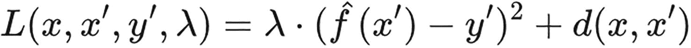

让我们看看公式的每个组成部分。

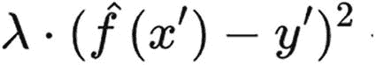

第一项是模型对反事实 `x'` 的预测值与期望结果 `y'` 之间的二次距离，其中 `y'` 需要用户预先定义。第二项是待解释实例 `x` 与反事实 `x'` 之间的距离 `d`。该损失衡量了反事实的预测结果与预定义结果之间的差距，以及反事实与目标实例之间的差距。

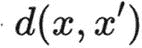

距离函数 `d` 定义为曼哈顿距离，并用每个特征的中位数绝对偏差（`MAD`）的倒数进行加权。

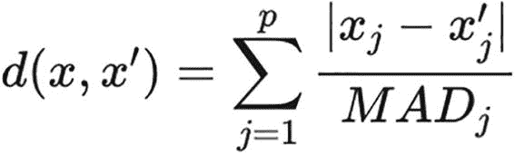

总距离是所有 `p` 个特征距离之和，即实例 `x` 与反事实 `x'` 之间特征值的绝对差。特征距离通过数据集中特征 `j` 的中位数绝对偏差的倒数进行缩放，其定义如下。

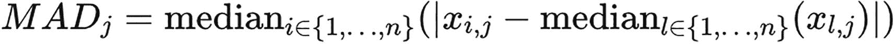

向量的中位数是指一半向量值大于它、另一半小于它的那个值。`MAD` 相当于特征的方差。但不同之处在于，它使用中位数作为中心并累加绝对距离，而不是使用均值作为中心并累加平方距离。所提出的距离函数相比欧几里得距离的优势在于，它对异常值更具鲁棒性。使用 `MAD` 进行缩放对于将所有特征统一到相同尺度是必要的。无论你是用平方米还是平方英尺来衡量公寓的大小，都不应产生影响。

参数 `λ` 平衡了预测距离（第一项）与特征值距离（第二项）。对于给定的 `λ`，求解该损失函数会返回一个反事实 `x'`。`λ` 值越高，意味着我们更倾向于选择预测结果接近期望结果 `y'` 的反事实。`λ` 值越低，意味着我们更倾向于选择特征值与 `x` 非常相似的反事实 `x'`。如果 `λ` 非常大，则会选择预测结果最接近 `y'` 的实例，无论它与 `x` 的距离有多远。最终，用户必须决定如何平衡“反事实的预测结果匹配期望结果”与“反事实与 `x` 相似”这两个要求。

为了最小化这个损失函数，可以使用任何合适的优化算法。如果你能访问机器学习模型的梯度，可以使用基于梯度的方法，例如 `Adam`。待解释的实例 `x`、期望输出 `y′` 以及容差参数 `ϵ` 必须预先设定。损失函数针对 `x′` 进行最小化，并返回（局部）最优的反事实 `x′`，同时不断增加 `λ`，直到找到足够接近的解（即在容差参数范围内）。

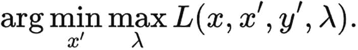

总的来说，生成反事实的步骤很简单。

1. 选择一个待解释的实例 `x`、期望结果 `y′`、容差 `ϵ` 以及一个（较低的）`λ` 初始值。
2. 随机采样一个实例作为初始反事实。
3. 以初始采样的反事实为起点，优化损失函数。
4. 当 `|f(x′) − y′| > ϵ` 时，
   1. 增加 `λ`。
   2. 以当前反事实为起点，优化损失函数。
   3. 返回使损失最小化的反事实。
5. 重复步骤 2 到 4，并返回反事实列表或使损失最小的那个反事实。

所提出的方法有一些缺点。它只考虑了第一和第二个标准，而没有考虑后两个标准（“生成仅改变少量特征且特征值合理的反事实”）。`d` 并不偏好稀疏解，因为将十个特征各增加一与将一个特征增加十，到 `x` 的距离是相同的。不切实际的特征组合也不会受到惩罚。

该方法不能很好地处理具有多个不同级别的分类特征。作者建议对分类特征的每个特征值组合分别运行该方法，但如果你有多个具有许多值的分类特征，这会导致组合爆炸。例如，六个具有十个唯一级别的分类特征意味着需要运行一百万次。

现在让我们看看解决这些问题的另一种方法。

在该方法中，最小化以下损失。

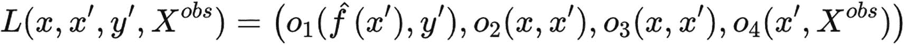

四个目标 `o[1]` 到 `o[4]` 分别对应前面提到的四个标准。第一个目标 `o[1]` 反映了反事实 `x′` 的预测应尽可能接近我们的期望预测 `y′`。因此，我们希望最小化 `f(x′)` 与 `y′` 之间的距离，该距离通过曼哈顿度量（L1 范数）计算。

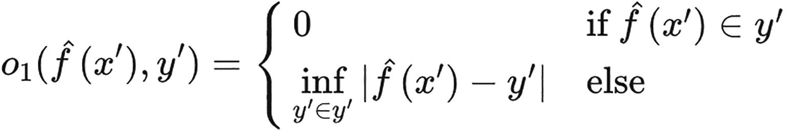

第二个目标 `o[2]` 反映了反事实应尽可能与实例 `x` 相似。它使用 Gower 距离来量化 `x′` 与 `x` 之间的距离。

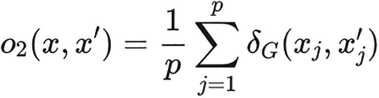

`p` 是特征的数量。`δ[G]` 的值取决于 `x[j]` 的特征类型。

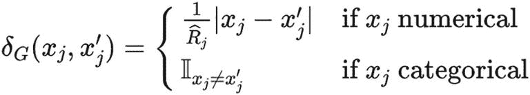

将数值特征 `j` 的距离除以 `R[j]`（观测到的值范围），可以将所有特征的 `δ[G]` 缩放到 0 到 1 之间。

Gower 距离可以处理数值和分类特征，但不计算改变了多少个特征。因此，我们在第三个目标 `o[3]` 中使用 L0 范数来计算特征的数量。

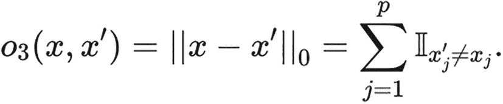

通过最小化 `o[3]`，我们旨在实现第三个标准——稀疏的特征变化。

第四个目标 `o[4]` 体现了反事实样本应具有合理的特征值或特征组合。我们可以利用训练数据或其他数据集推断一个数据点的“合理”程度。我们将该数据集记为 `X^(obs)`。为评估其可能性，`o[4]` 测量了 `x′` 与最近观测数据点 `x^([1])∈X^(obs)` 之间的平均 Gower 距离。

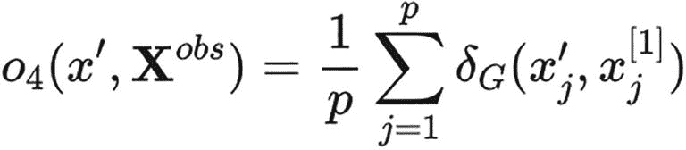

上述两者是生成反事实解释的最通用理论。除此之外，我们还将介绍多种基于数据生成反事实样本的实用方法。这些算法将在下一节中讨论。

* 基于原型的反事实引导
* `DiCE`
* `MOC`（多目标反事实）

## 基于原型的反事实引导

该算法是反事实解释算法的扩展。它利用类别原型生成反事实样本。

该公式的核心见解在于需要设计一个目标函数，使其能够生成高质量的反事实实例。

一个反事实实例应具备以下理想属性：

* 模型预测应接近预定义的输出。
* 将原始实例 `x` 改变为 `x′` 的扰动应是稀疏的。
* 反事实样本需要具有可解释性。
* 反事实样本的生成速度需足够快，以便应用于实际场景。

## DiCE

`DiCE` 能够生成多个彼此不同但尽可能接近原始实例的反事实样本。因此，在损失函数中加入了以下组成部分：

* 反事实样本的目标类别与模型预测类别之间的距离
* 不同反事实样本之间的距离，以确保它们之间的多样性
* 反事实样本与原始实例之间的距离，以确保反事实样本的可行性

在这种情况下，稀疏性是在事后进行控制的。因此，在该算法中，你可以选择需要改变的特征来生成反事实样本。

## MOC（多目标反事实）

该算法试图优化大部分重要属性。其损失函数包含以下组成部分：

* 反事实样本的目标类别与模型预测类别之间的距离
* 反事实样本与原始实例之间的相似度
* 被改变的特征数量或稀疏度
* 反事实样本是否具有合理的特征值或特征组合

由于该算法的损失函数包含了所有重要属性，因此它能生成非常逼真的反事实样本。然而，由于目标函数过于复杂难以求解，该算法为每个实例生成反事实样本所需的时间也是最长的。

# 算法对比

本节对比了多种算法，以确定并向用户推荐一种在其数据上生成反事实样本的方法。对比基于多项指标进行，例如生成时间、输出稀疏度、解释生成百分比、分类变量处理方法、相似度等。这些指标列于表 11-1 中。

这些算法在相同的在线购物者意图数据集上进行了测试，该数据集在第 9 章开头提及。测试机器为 8 GB RAM 的 Apple MacBook。未采用并行化处理。结果逐实例生成。

备注：

* 时间测试基于不同的概率范围（共测试了 6 到 10 个实例）
* 稀疏度：高表示改变的变量数量较少，反之亦然
* 百分比基于用于测试的十个观测样本报告
* 指示函数：分类变量值的任何变化均视为距离 1

基于评估，我们认为 `DiCE` 是一种可适用于多种用例的算法。接下来将介绍 `DiCE`。

# DiCE

有效的反事实解释应满足两个属性：

* 反事实操作在用户上下文和约束条件下的可行性
* 所呈现的反事实样本之间的多样性

因此，生成和评估多样化反事实解释的框架基于行列式点过程。为了评估反事实的可操作性，指标应将基于反事实的方法与其他局部解释方法进行比较。

输入是一个训练好的机器学习模型 `f` 和一个实例 `x`。我们希望生成一组 `k` 个反事实样本 `{c[1], c[2], . . ., c[k]}`，使得它们都能得出与 `x` 不同的决策。

实例 (`x`) 和所有反事实样本 (`{c[1], c[2], . . ., c[k]}`) 都是 `d` 维的。假设机器学习模型是可微的、静态的（不随时间变化），并且输出是二元的。

我们的目标是生成一个可操作的反事实集；也就是说，用户应该能找到可以付诸行动的反事实样本。为此，我们需要单个反事实样本相对于原始输入是可行的，同时还需要在生成的反事实样本之间保持多样性，以提供改变结果类别的不同途径。用于生成多样化反事实样本的多样性指标可以为用户提供多种选择。

同时，该方法通过邻近性约束来纳入可行性，并引入了其他用户定义的约束。

## 多样性与可行性约束

尽管多样化的反事实样本增加了至少一个样本对用户可操作的机会，但样本可能会改变大量特征，或者通过考虑与原始输入的巨大差异来最大化多样性。当特征维度较高时，这种情况可能会恶化。

通过行列式点过程实现多样性。该方法基于行列式点过程（DPP）来捕捉多样性，该过程适用于解决具有多样性约束的子集选择问题。以下是根据给定反事实样本的核矩阵行列式得出的指标。

```
dpp_diversity = det(K),
Ki, j = 1 / (1 + dist(ci, cj))
```

其中 `dist(ci, cj)` 表示两个反事实样本之间的距离度量。在实践中，为避免行列式定义不良，我们在计算行列式时会向对角线元素添加小的随机扰动。

## 邻近性

# 反事实解释

直观地说，最接近原始输入的反事实样本对用户可能最有用。该方法将邻近性量化为原始输入与反事实样本特征之间的（负）向量距离。这可以通过距离度量来指定，例如 `ℓ1` 距离（可选地由用户为每个特征提供的自定义权重进行加权）。一组反事实样本的邻近性是该集合的平均邻近性。

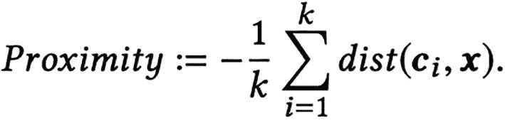

### 稀疏度

与邻近性密切相关的是稀疏性的可行性属性：用户需要改变的特征数量，以转换到反事实类别。直观地说，如果一个反事实样本改变的特征数量较少，则其可行性更高。一个反事实样本可能在特征空间中很接近，但由于现实世界的约束而可能不可行。因此，允许用户提供特征操作的约束是有意义的。可以通过两种方式指定。首先，作为每个特征可行范围的边界约束，需要搜索反事实样本。此类约束的一个例子是“收入不能超过 200,000 美元”。或者，用户可以指定可以改变的变量。

### 优化

基于多样性和邻近性的定义，该方法在生成的反事实样本上考虑了一个组合损失函数。

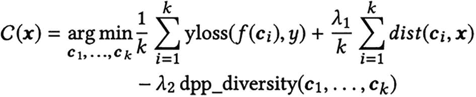

`c[i]` 是一个反事实样本 (CF)。`k` 是要生成的 CF 总数。`f(.)` 是机器学习模型（对最终用户而言是一个黑箱）。`yloss(.)` 是一个度量指标，用于最小化 `f(.)` 对 `c[i]` 的预测值与期望结果 `y`（在我们的实验中通常为 1）之间的距离。`d` 是输入特征的总数。`x` 是原始输入。`dpp_diversity(.)` 是多样性度量指标。`λ1` 和 `λ2` 是平衡损失函数三个部分的超参数。该方法使用梯度下降法优化上述损失函数。理想情况下，我们可以对每个反事实样本实现 `f(c[i]) = y`，但由于目标函数是非凸的，这并非总能实现。迭代会持续运行，直到损失函数收敛，并且生成的反事实样本是有效的（属于目标类别）。

### 优势

反事实解释的解读非常清晰。如果根据反事实样本改变某个实例的特征值，预测结果就会变为预定义的预测值。这背后没有额外的假设，也没有任何“魔法”。这也意味着它不像 `LIME` 等方法那样危险，因为 `LIME` 方法中，我们不清楚局部模型可以外推到何种程度来进行解释。

反事实方法会生成一个新实例，但我们也可以通过报告哪些特征值发生了变化来总结一个反事实样本。这提供了两种报告结果的方式。你可以报告反事实实例，也可以突出显示在目标实例与反事实实例之间哪些特征发生了变化。

反事实方法不需要访问数据或模型。它只需要访问模型的预测函数，这甚至可以通过 `Web API` 实现。这对于接受第三方审计或在不披露模型或数据的情况下为用户提供解释的公司来说很有吸引力。出于商业机密或数据保护的原因，公司有保护模型和数据的利益诉求。反事实解释在解释模型预测与保护模型所有者利益之间取得了平衡。

该方法也适用于不使用机器学习的系统。我们可以为任何接收输入并返回输出的系统创建反事实样本。预测公寓租金的系统也可以由手写规则构成，而反事实解释仍然有效。

反事实解释方法相对容易实现，因为它本质上是一个损失函数（可以是单目标或多目标），可以使用标准的优化器库进行优化。但必须考虑额外的细节，例如将特征值限制在有意义的范围内（例如，公寓面积只能为正数）。

### 劣势

对于每个实例，你通常会发现多个反事实解释（拉什莫尔效应）。这很不方便：大多数人更喜欢简单的解释，而不是现实世界的复杂性。这也是一个实际的挑战。假设我们为一个实例生成了 23 个反事实解释。我们是全部报告它们？还是只报告最好的？如果它们都相对“不错”但差异很大怎么办？这些问题必须针对每个项目重新回答。拥有多个反事实解释也可能是有利的，因为人类可以选择那些符合他们先前知识的解释。

让我们看一个例子。假设一位酒店经理分析客户预订情况，并希望分析哪些客户更可能取消预订。图 11-1 显示了一个客户没有取消酒店预订的实例。根据这个案例，该客户属于 `Offline TA/TO` 市场细分。客户类型是 `Contract`，分销渠道是 `TA/TO`，所需停车位数量是 `0`。

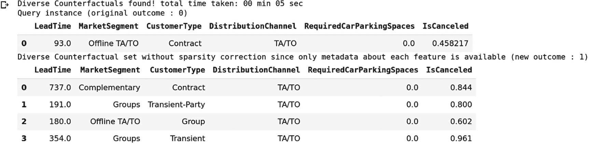

**图 11-1**

反事实输出示例

**表 11-1**

从模型生成反事实解释的各种方法比较

| 指标/算法 | 反事实解释 | 原型引导的反事实 | MOC | DiCE | CEML |
| --- | --- | --- | --- | --- | --- |
| 每个实例耗时 | 7–12 分钟 | 4 分钟 | 30 分钟 | 1 分钟 | 3–65 分钟 |
| 稀疏性 | 高 | 高 | 中 | 低 | 高 |
| 生成反事实的百分比 | 28% | 80% | 70% | 100% | 100% |
| 如何处理分类变量？ | 没有任何处理方法 | 有处理方法 | 指示函数 | 指示函数 | 没有任何处理方法 |
| 是否在数据流形中？ | 否 | 是 | 是 | 否 | 否 |
| 扰动特征选择 | 否 | 否 | 否 | 是 | 是 |
| 原始实例与反事实实例的相似性 | 因实例而异 | 相似 | 相似 | 不相似 | 相似 |
| 生成逼真的反事实样本 | 否 | 是 | 是 | 否 | 否 |
| 生成多个反事实样本 | 否 | 否 | 是 | 是 | 否 |

然而，希望最小化取消预订的酒店经理理想情况下希望识别出哪些类型的客户可能会取消预订。这就是 `DiCE` 发挥作用的地方。

观察反事实解释（即客户确实取消了预订的实例）时，可以发现以下情况：

*   在这四个示例中，`提前预订时间` 显著更高。
*   有一位客户仍然属于 `Offline TA/TO` 市场细分。
*   四个取消预订的客户中，有一个仍然是 `合同` 客户。
*   `分销渠道` 和 `所需停车位数量` 保持不变。

图 11-2 是数据集的一个样本。

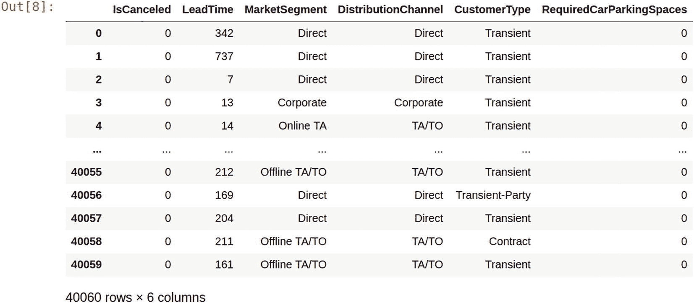

**图 11-2**

示例代码的数据集

数据集中连续特征的定义如下。

```
# 用于训练机器学习模型的数据集
d = dice_ml.Data(dataframe=data set,
continuous_features=['LeadTime','RequiredCarParkingSpaces'],
outcome_name='IsCanceled')
```

`DiCE` 可以从仓库 [https://github.com/interpretml/DiCE](https://github.com/interpretml/DiCE) 安装。

神经网络模型使用 `binary_crossentropy` 损失函数和 `Adam` 优化器，在 `30` 个 `epoch` 上进行训练。使用的是 `TensorFlow` 2.3.1 版本。

```
from tensorflow.keras.models import Sequential
from tensorflow.python.keras.layers import Dense
from tensorflow.python.keras.wrappers.scikit_learn import KerasRegressor
sess = tf.InteractiveSession()

# 生成训练和测试数据
train, _ = d.split_data(d.normalize_data(d.one_hot_encoded_data))
X_train = train.loc[:, train.columns != 'IsCanceled']
y_train = train.loc[:, train.columns == 'IsCanceled']

# 拟合一个密集神经网络模型
ann_model = Sequential()
ann_model.add(Dense(6, input_shape=(X_train.shape[1],), activation=tf.nn.relu))
ann_model.add(Dense(1, activation=tf.nn.sigmoid))
ann_model.compile(loss='binary_crossentropy', optimizer='adam', metrics=['accuracy'])
history = ann_model.fit(X_train, y_train, validation_split=0.20, epochs=30, verbose=0, class_weight={0:1,1:2})
history
```

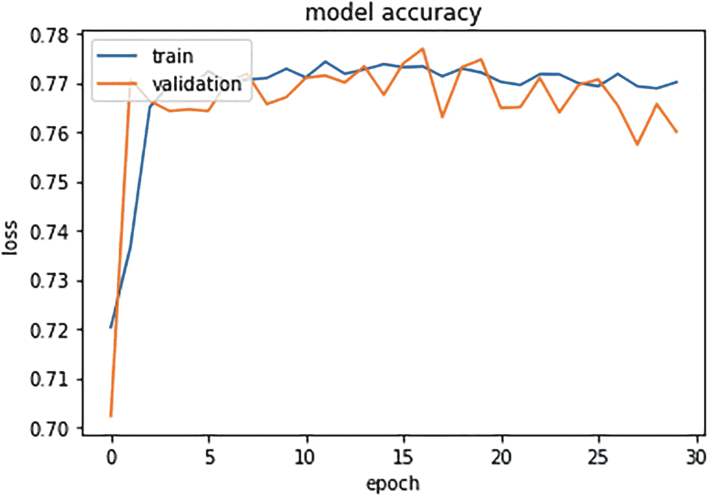
图 11-4 训练和验证准确率图

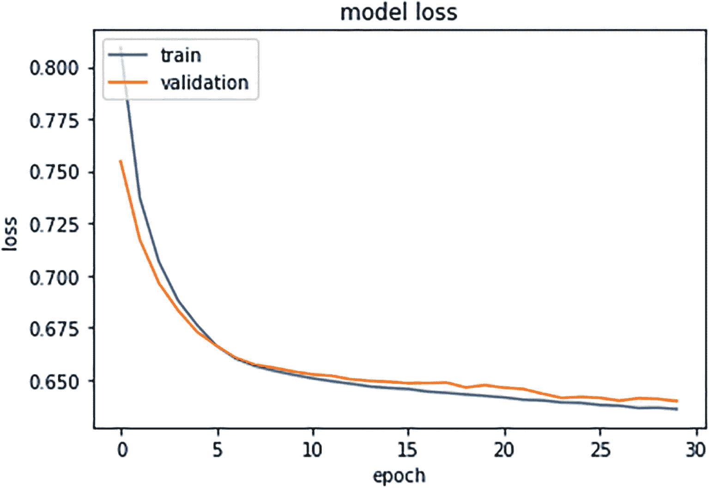
图 11-3 模型损失图

该模型现在作为 DiCE 模型存储，用于解释目的。特征现在以与 DiCE 兼容的特殊格式存储，以生成 DiCE 解释实例。

```
new_d = dice_ml.Data(features={
'LeadTime':[0, 737],
'MarketSegment': ['Complementary', 'Corporate', 'Direct', 'Groups', 'Offline TA/TO', 'Online TA'],
'CustomerType': ['Contract', 'Group', 'Transient', 'Transient-Party'],
'DistributionChannel':['Corporate', 'Direct', 'TA/TO', 'Undefined'],
'RequiredCarParkingSpaces': [0, 8]},
outcome_name='IsCanceled')
```

一个 DiCE 解释实例被创建。

```
>>> exp = dice_ml.Dice(new_d, m)
>>> exp
```

让我们以一个具有以下属性的客户为例，这些属性包含在所谓的*查询实例*中。

```
query_instance = {'LeadTime': 68,
'MarketSegment': 'Online TA',
'CustomerType': 'Transient',
'DistributionChannel': 'TA/TO',
'RequiredCarParkingSpaces': 0}
```

反事实示例生成如下。

```
# 生成反事实示例
dice_exp = exp.generate_counterfactuals(query_instance, total_CFs=4, desired_class="opposite")
# 可视化反事实解释
dice_exp.visualize_as_dataframe()
```

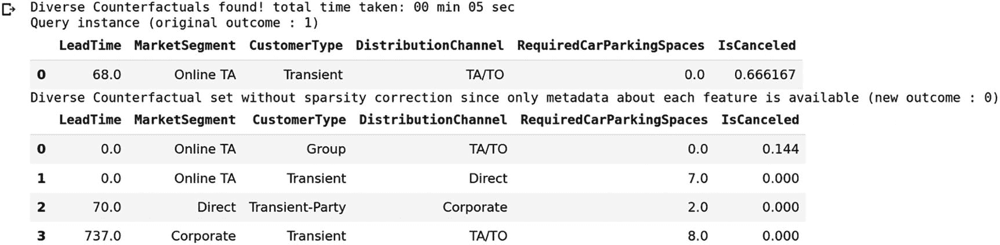
图 11-5 输出样本

这里，生成了一个原始结果为 **1**（即取消）的案例。同时观察到，也生成了客户未取消酒店预订的反例。相反，下面是一个客户**确实**取消了酒店预订的查询实例。

```
query_instance_2 = {'LeadTime': 93,
'MarketSegment': 'Offline TA/TO',
'CustomerType': 'Contract',
'DistributionChannel': 'TA/TO',
'RequiredCarParkingSpaces': 0}
```

再次生成反事实示例。

```
# 生成反事实示例
dice_exp_2 = exp.generate_counterfactuals(query_instance_2, total_CFs=4, desired_class="opposite")
# 可视化反事实解释
dice_exp_2.visualize_as_dataframe()
```


图 11-6 输出样本

这些只是如何生成反事实解释的一些示例。

## 总结

本章涵盖了反事实解释。当企业利用模型生成可操作的见解时，反事实解释的重要性就凸显出来。在业务问题场景中，模型结果并不总是直观的。大多数结果是描述性的（即锦上添花）。反事实有助于推导出行动。一家保险公司经理构建了一个预测下一个保费周期客户流失的模型，可以利用反事实来了解每个客户的变化，从而促使他们支付保费。在此类场景中，反事实具有诸多优势。然而，反事实并不总能给出合理的解释。

你需要理解，反事实是基于模型的数据运行的。各种数据集中的大多数特征并不在业务部门的控制范围内。例如，在构建客户流失模型时，特征包括年龄、收入、邮政编码、财务状况、已付保费、与客服的沟通记录、销售保单的代理人姓名或其他保单。即使我们构建了客户流失模型并理解了模型对每个实例的作用，我们也无法改变客户的年龄和收入。

但像与客服的沟通记录这样的因素，是我们能够控制的少数特征。在此数据上运行反事实后，公司经理会得到类似“改变客户服务满意度评分”的输出。这表明应将此客户分配给最优秀的客服主管。这可能会增加客户在下一个周期支付保费的机会。反事实领域并非新事物；然而，其在行业中的应用非常稀少。我们建议你在自己的组织内寻找用例，或者实施并测试反事实的用例。