# 12. 详解图像可解释性方法

本章重点介绍图像模型的解释方法。深度学习已经非常成功，尤其是在涉及图像和文本的任务中，例如图像分类和语言翻译。深度神经网络的成功故事始于 2012 年，当时一种深度学习方法赢得了 ImageNet 图像分类挑战赛。自那时起，我们见证了深度神经网络架构的爆炸式增长，趋势是网络越来越深，权重参数越来越多。

为了使用神经网络进行图像预测，数据输入会经过许多层与学习到的权重相乘，并通过非线性变换。根据神经网络的架构，单次预测可能涉及数百万次数学运算。我们人类不可能跟踪从数据输入到预测的精确映射。我们必须考虑数百万个以复杂方式相互作用的权重，才能理解神经网络的预测。

为了解释神经网络的行为和预测，我们需要特定的解释方法。本书假设你熟悉深度学习，包括卷积神经网络。你当然可以使用模型无关的方法，例如局部模型或部分依赖图。尽管如此，有两个理由说明考虑专门为神经网络开发的解释方法是合理的。首先，神经网络在其隐藏层中学习特征和概念，我们需要特殊的工具来揭示它们。其次，可以利用梯度来实现解释方法，这些方法在计算上比从“外部”观察模型的模型无关方法更高效。此外，本书中的大多数其他方法旨在解释表格数据的模型。图像和文本数据需要不同的方法。


## 使用 LIME 进行图像解释

让我们从用于模型可解释性的 LIME 方法开始。它是一种流行的方法，因为它可以用于表格、图像和文本数据。我们通过一个例子来探讨 LIME 如何解释图像。问题陈述如图 12-1 所示。

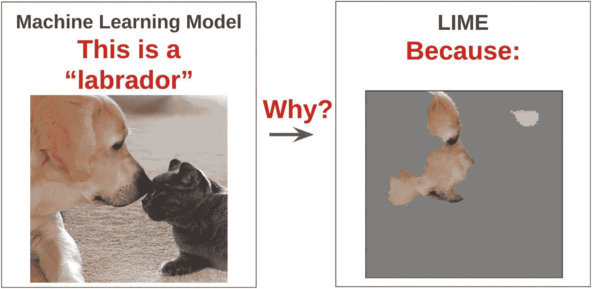

图 12-1

图像解释的问题描述

用于图像的 LIME 与用于表格数据和文本的 LIME 工作方式不同。直观地说，扰动单个像素意义不大，因为多个像素共同贡献于一个类别。随机改变单个像素可能不会显著改变预测结果。因此，通过将图像分割成超像素并打开或关闭它们来创建图像的变体。超像素是具有相似颜色的互连像素，可以通过将每个像素替换为用户定义的颜色（例如灰色）来关闭它们。用户还可以指定在每次排列中关闭超像素的概率。

让我们通过以下示例代码来学习图像解释的概念。首先，读取图像，并使用 Keras 中预训练的 InceptionV3 模型来预测图像类别。

```
# 读取图像
import numpy as np
import skimage
Xi = skimage.io.imread("https://arteagac.github.io/blog/lime_image/img/cat-and-dog.jpg")
Xi = skimage.transform.resize(Xi, (299,299))
Xi = (Xi - 0.5)*2 # Inception 预处理
skimage.io.imshow(Xi/2+0.5) # 显示 Inception 预处理前的图像
# 使用 InceptionV3 预测图像类别
import keras
from keras.applications.imagenet_utils import decode_predictions
np.random.seed(222)
inceptionV3_model = keras.applications.inception_v3.InceptionV3() # 加载预训练模型
preds = inceptionV3_model.predict(Xi[np.newaxis,:,:,:])
top_pred_classes = preds[0].argsort()[-5:][::-1] # 保存前 5 个类别的 ID
decode_predictions(preds)[0] # 打印前 5 个类别
```

此脚本将输入图像加载到 Xi 变量中，并打印图像的前五个类别（及其概率），如图 12-2 所示。

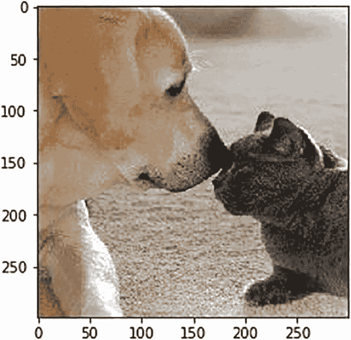

图 12-2

用于问题的图像

*   拉布拉多寻回犬 (82.2%)
*   金毛寻回犬 (1.5%)
*   美国斯塔福德郡梗 (0.9%)
*   斗牛獒 (0.8%)
*   大丹犬 (0.7%)

有了这些信息、输入图像和预训练的 InceptionV3 模型，我们就可以使用 LIME 生成解释。此示例为拉布拉多寻回犬类别生成解释***。***

LIME 通过在被解释实例周围生成一个随机扰动的新数据集（包含各自的预测），然后拟合一个加权的局部代理模型来创建解释。这个局部模型通常是一个具有内在可解释性的更简单的模型，例如线性回归模型。

### 步骤 1. 为输入图像生成随机扰动

对于图像，LIME 通过打开或关闭图像中的部分超像素来生成扰动。以下脚本使用快速移位分割算法来计算图像中的超像素。此外，它生成一个包含 150 个扰动的数组，其中每个扰动都是一个由 0 和 1 组成的向量，表示超像素是打开还是关闭。

```
# 为图像生成分割
import skimage.segmentation
superpixels = skimage.segmentation.quickshift(Xi, kernel_size=4,max_dist=200, ratio=0.2)
num_superpixels = np.unique(superpixels).shape[0]
skimage.io.imshow(skimage.segmentation.mark_boundaries(Xi/2+0.5, superpixels))
# 生成扰动
num_perturb = 150
perturbations = np.random.binomial(1, 0.5, size=(num_perturb, num_superpixels))
# 创建将扰动应用于图像的函数
import copy
def perturb_image(img,perturbation,segments):
active_pixels = np.where(perturbation == 1)[0]
mask = np.zeros(segments.shape)
for active in active_pixels:
mask[segments == active] = 1
perturbed_image = copy.deepcopy(img)
perturbed_image = perturbed_image*mask[:,:,np.newaxis]
return perturbed_image
# 显示扰动示例
print(perturbations[0])
skimage.io.imshow(perturb_image(Xi/2+0.5,perturbations[0],superpixels))
```

计算图像中的超像素会得到如图 12-3 所示的结果。

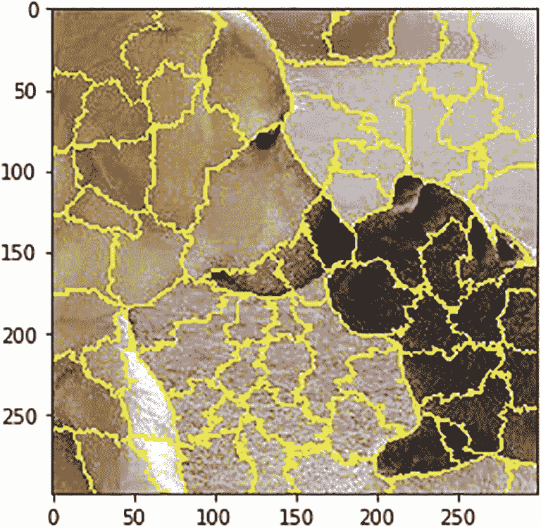

图 12-3

超像素的输出

图 12-4 显示了扰动向量和扰动图像的示例。

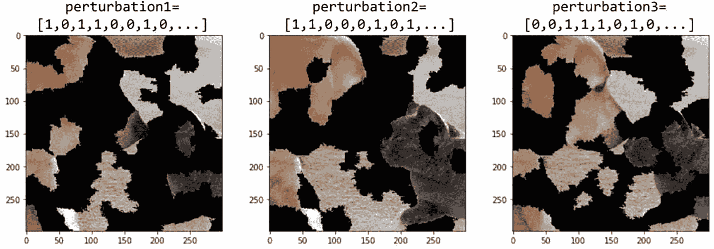

图 12-4

扰动图像的输出

### 步骤 2. 预测扰动的类别

以下脚本使用 `inceptionV3_model` 来预测每个扰动图像的类别。预测结果的形状为 (150,1000)，这意味着对于 150 个图像中的每一个，都有属于 InceptionV3 中 1000 个类别的概率。从这 1000 个类别中，我们在后续步骤中仅使用拉布拉多犬类别，因为这是我们想要解释的预测。在此示例中，使用了 150 个扰动。然而，对于实际应用，更多的扰动会产生更可靠的解释。

```
predictions = []
for pert in perturbations:
perturbed_img = perturb_image(Xi,pert,superpixels)
pred = inceptionV3_model.predict(perturbed_img[np.newaxis,:,:,:])
predictions.append(pred)
predictions = np.array(predictions)
print(predictions.shape)
```

现在我们拥有拟合线性模型所需的一切：使用扰动作为输入特征 `X`，使用拉布拉多犬的预测 `predictions[labrador]` 作为输出 `y`。然而，在拟合线性模型之前，LIME 需要为更接近被解释图像的图像赋予更大的权重（重要性）。

### 步骤 3. 计算扰动的权重（重要性）

我们使用距离度量来评估每个扰动与原始图像的距离。原始图像是一个所有超像素都激活（所有元素都为 1）的扰动。鉴于扰动是多维向量，余弦距离是一种可用于此目的的度量。计算余弦距离后，核函数将距离转换为 0 到 1 之间的值（权重）。在此过程结束时，我们为数据集中的每个扰动赋予权重（重要性）。

```
# 计算与原始图像的距离
import sklearn.metrics
original_image = np.ones(num_superpixels)[np.newaxis,:] # 所有超像素都启用的扰动
distances = sklearn.metrics.pairwise_distances(perturbations,original_image, metric='cosine').ravel()
print(distances.shape)
# 使用核函数将距离转换为 0 到 1 之间的值（权重）
kernel_width = 0.25
weights = np.sqrt(np.exp(-(distances**2)/kernel_width**2)) # 核函数
print(weights.shape)
```


### 步骤 4：使用扰动、预测和权重拟合可解释的线性模型

我们利用前几步获取的信息拟合一个加权线性模型。对于图像中的每个超像素，我们都会得到一个系数，该系数表示该超像素对“拉布拉多寻回犬”预测结果的影响强度。

```
# 估计线性模型
from sklearn.linear_model import LinearRegression
class_to_explain = top_pred_classes[0] # 拉布拉多犬类别
simpler_model = LinearRegression()
simpler_model.fit(X=perturbations, y=predictions[:,:,class_to_explain], sample_weight=weights)
coeff = simpler_model.coef_[0]
# 使用线性模型的系数提取最重要的特征
num_top_features = 4
top_features = np.argsort(coeff)[-num_top_features:]
# 仅显示与最重要特征对应的超像素
mask = np.zeros(num_superpixels)
mask[top_features]= True # 激活最重要的超像素
skimage.io.imshow(perturb_image(Xi/2+0.5,mask,superpixels))
```

我们需要对这些系数进行排序，以确定对于“拉布拉多寻回犬”预测最重要的超像素（`top_features`）。尽管我们使用了系数的绝对值来确定最重要的特征，但也可以使用其他方法（如前向或后向消除）来进行特征重要性选择。图 12-5 展示了计算后得到的最重要的超像素。

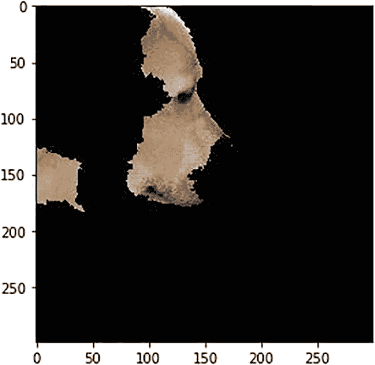

图 12-5

输入图像中最重要的超像素

这就是 LIME 返回的解释结果。图像中与“拉布拉多寻回犬”预测结果关联性更强的区域（超像素）。这个解释表明，预训练的 InceptionV3 模型在预测给定图像属于“拉布拉多寻回犬”类别方面表现良好。这个例子展示了 LIME 如何通过理解特定预测结果被返回的原因，来增强对机器学习模型的信心。

## 使用像素归因（显著性图）进行图像解释

像素归因方法会高亮显示神经网络在进行特定图像分类时相关的像素。图 12-6 是一个解释示例。

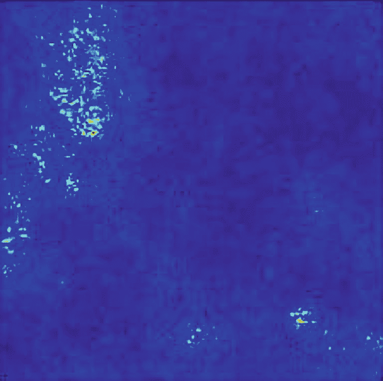

图 12-6

像素归因示例图像

像素归因方法有多种名称：敏感性图、显著性图、像素归因图、基于梯度的归因方法、特征相关性、特征归因和特征贡献。

像素归因是图像特征归因的一个特例。特征归因通过将每个输入特征根据其如何改变预测结果（负面或正面）进行归因，来解释单个预测。这些特征可以是输入像素、表格数据或词语。SHAP、Shapley 值和 LIME 是通用特征归因方法的例子。我们考虑输出长度为 C 的预测向量的神经网络，其中包含 C=1 的回归情况。神经网络对图像 I 的输出称为 S(I)=[S1(I),…,SC(I)]。所有这些方法都将 x∈Rp（可以是图像像素、表格数据、词语等）作为输入，其中包含 p 个特征，并输出每个 p 个输入特征的相关性值作为解释：Rc=[Rc1,…,Rcp]。c 表示对第 c 个输出 SC(I) 的相关性。

像素归因方法种类繁多，令人困惑。理解存在两种不同类型的归因方法会有所帮助。

*   **基于遮挡或扰动的方法**：像 SHAP 和 LIME 这样的方法通过操作图像的部分区域来生成解释（模型无关）。

*   **基于梯度的方法**：许多方法计算预测梯度（或分类分数）相对于输入特征的值。基于梯度的方法（种类很多）主要区别在于梯度的计算方式。

这两种方法的共同点是，解释结果与输入图像具有相同的大小（或者可以有意义地投影到图像上）。它们为每个像素分配一个值，该值可以解释为该像素对该图像预测或分类的相关性。

另一个有用的像素归因方法分类是基于基线的问题。

*仅梯度方法* 可以判断像素的变化是否会改变预测结果。Vanilla Gradient 和 Grad-CAM 是两个例子。仅梯度归因的解释是：如果我们改变这个像素，预测的类别概率会上升（对于正梯度）或下降（对于负梯度）。梯度的绝对值越大，该像素变化的影响就越强。

接下来的几节将解释如何使用激活图进行图像解释。

## 使用类别激活图进行图像解释

*类别激活图*（CAM）是在论文“Learning Deep Features for Discriminative Localization”中引入的，该论文在 CNN 中使用了全局平均池化。特定类别的 CAM 指示了 CNN 用于识别该类别的判别性区域。

已经观察到，卷积神经网络各层的卷积单元充当了目标检测器，尽管在训练网络进行分类任务时并未提供关于目标位置的先验信息。尽管卷积具有这种显著特性，但在使用全连接层进行分类任务时，这一特性会丢失。为了避免使用全连接网络，一些架构（如 Network in Network (NiN) 和 GoogLeNet）采用了全卷积神经网络。全局*平均池化*（GAP）是此类架构中常用的层。它主要用作正则化器，以防止训练时过拟合。类别激活图简单地指示了图像中的判别性区域，CNN 使用该区域将图像分类到特定类别。对于这种技术，网络由 ConvNet 组成，在 softmax 层（用于多类分类）之前，对卷积特征图执行全局平均池化。该层的输出用作全连接层的特征，全连接层产生所需的分类输出。鉴于这种简单的连接结构，我们可以通过将输出层的权重反向投影到卷积特征图上，来识别图像区域的重要性。

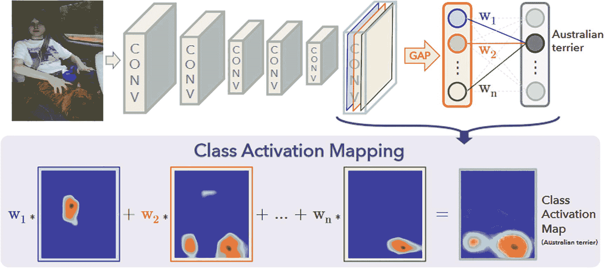

图 12-7

适用于 CAM 的示例网络架构

实现该方法的详细步骤如下所述。


### 步骤 1：修改模型

假设你已经使用卷积块和几个全连接层构建了深度分类器。你必须修改此架构，使其不再包含任何全连接层。在输出层（softmax/sigmoid）和最后一个卷积块之间使用 `GlobalAveragePooling2D` 层。CAM 模型为猫狗分类器提供了必要的修改。这里我们使用预训练的 VGG16 模型来模拟训练好的分类器。

```
def CAMmodel():
## 模拟我预训练的猫狗分类器。
vgg = VGG16(include_top=False, weights='imagenet')
vgg.trainable = False
## 展平层，使其不嵌套在序贯模型中。
vgg_flat = flatten_model(vgg)
## 插入 GAP
vgg_flat.append(keras.layers.GlobalAveragePooling2D())
vgg_flat.append(keras.layers.Dense(1, activation='sigmoid'))
model = keras.models.Sequential(vgg_flat)
return model
```

一个简单的工具函数 `flatten_model` 返回预训练模型中的层列表。这样做是为了在使用 `Sequential` 模型修改时，这些层不会嵌套，并且可以访问最后一个卷积层并将其用作输出。我们在 `flatten_model` 返回的数组中追加了 `GlobalAveragePooling2D` 和 `Dense` 层。最后，返回 `Sequential` 模型。

```
def flatten_model(model_nested):
'''
用于展平预训练模型的工具函数
'''
layers_flat = []
for layer in model_nested.layers:
try:
layers_flat.extend(layer.layers)
except AttributeError:
layers_flat.append(layer)
return layers_flat
```

接下来，我们使用适当的模型输入形状调用 `model.build()`。

```
keras.backend.clear_session()
model = CAMmodel()
model.build((None, None, None, 3)) # 注意
model.summary()
```

### 步骤 2：使用 CAMLogger 回调重新训练模型

由于引入了新层，我们必须重新训练模型。但我们不需要重新训练整个模型。我们可以通过使用 `vgg.trainable=False` 来冻结卷积块。当我们检查模型性能时，会发现模型在训练和验证准确率方面都有所下降。因此，为了实现 CAM，我们必须修改架构，这导致了模型性能的下降。

### 步骤 3：使用 CAMLogger 查看类别激活图

在 `CAM` 类的 `__init__` 方法中，我们初始化了 `cammodel`。请注意，这个 CAM 模型有两个输出。

-   最后一个卷积层（`block5_conv3`）的输出。
-   模型预测（softmax/sigmoid）。

```
class CAM:
def __init__(self, model, layerName):
self.model = model
self.layerName = layerName
## 准备 cammodel
last_conv_layer = self.model.get_layer(self.layerName).output
self.cammodel = keras.models.Model(inputs=self.model.input,
outputs=[last_conv_layer, self.model.output])
def compute_heatmap(self, image, classIdx):
## 获取最后一个卷积层的输出和模型预测
[conv_outputs, predictions] = self.cammodel.predict(image)
conv_outputs = conv_outputs[0, :, :, :]
conv_outputs = np.rollaxis(conv_outputs, 2)
## 获取类别权重
class_weights = self.model.layers[-1].get_weights()[0]
## 创建类别激活图。
caml = np.zeros(shape = conv_outputs.shape[1:3], dtype=np.float32)
for i, w in enumerate(class_weights[:]):
caml += w * conv_outputs[i, :, :]    caml /= np.max(caml)
caml = cv2.resize(caml, (image.shape[1], image.shape[2]))
## 准备热力图
heatmap = cv2.applyColorMap(np.uint8(255*caml), cv2.COLORMAP_JET)
heatmap[np.where(caml < 0.2)] = 0    return heatmap
def overlay_heatmap(self, heatmap, image):
img = heatmap*0.5 + image
img = img*255
img = img.astype('uint8')
return (heatmap, img)
```

`compute_heatmap` 方法负责生成热力图，这是 CNN 用于识别类别（图像类别）的判别区域。

*   `cammodel.predict()` 对输入图像进行预测，得到最后一个卷积层的特征图，形状为 (1,7,7,512)。

*   我们还提取了输出层的权重，形状为 (512,1)。

*   计算从最后一层提取的权重与特征图之间的点积，以生成类别激活图。

现在，让我们将所有内容封装到一个回调中。`CAMLogger` 回调集成了 `wandb.log()` 方法，用于将生成的激活图记录到 W&B 运行页面。最后，通过调用 `overlay_heatmap()` 方法，将 CAM 返回的热力图叠加到原始图像上。

### 步骤 4：从 CAM 中得出结论

你可以从图 12-8 所示的图表中得出许多结论。如果预测分数大于 0.5，网络将图像分类为狗；否则，分类为猫。CAM 图表有其对应的类别激活图。

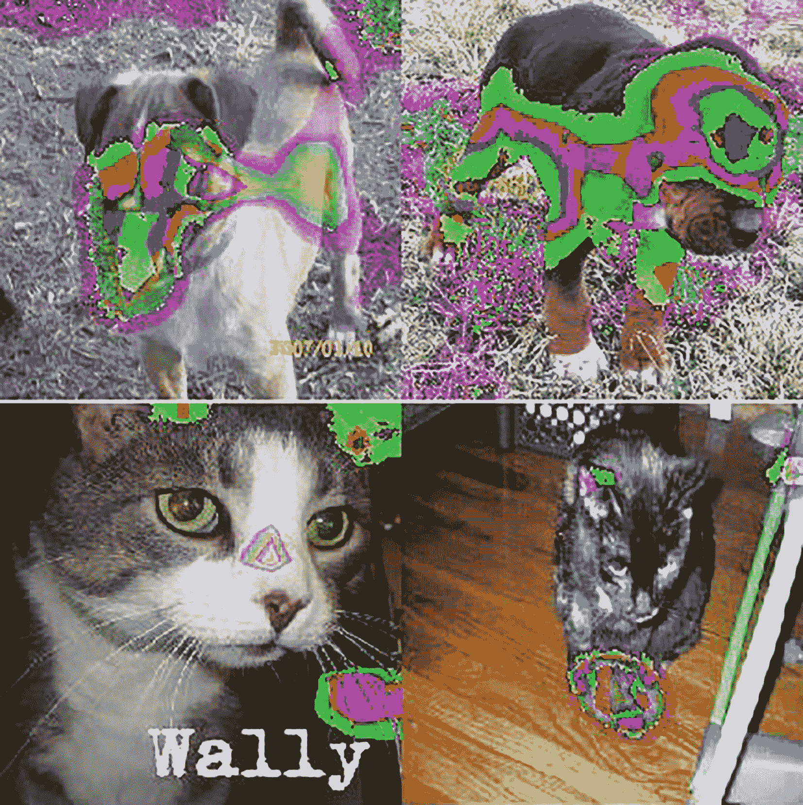

图 12-8

CAM 模型的输出，关注狗的脸部以及猫的胡须、爪子和耳朵。在错误分类的图像中，模型没有关注它应该关注的地方。因此，通过使用 CAM，我们能够解释这种错误分类背后的原因，这非常酷。

让我们来看一些观察结果。

*   模型通过关注图像中的面部区域将图像分类为狗。在某些图像中，它能够关注整个身体，但爪子除外。

*   模型通过关注耳朵、爪子和胡须将图像分类为猫。


## 使用梯度加权类激活映射进行图像解释

Grad-CAM 是一种流行的技术，用于可视化卷积神经网络模型正在关注的位置。Grad-CAM 是类别特定的，这意味着它可以为图像中存在的每个类别生成单独的可视化结果，如图 12-9 所示。

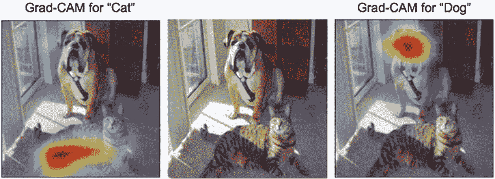

图 12-9

Grad-CAM 示例图像

Grad-CAM 是一种流行的技术，用于可视化卷积神经网络模型正在关注的位置。它是类别特定的，这意味着它可以为图像中存在的每个类别生成单独的可视化结果。Grad-CAM 可用于弱监督定位——即，使用仅在完整图像标签（而非显式位置标注）上训练的模型来确定对象的位置。它也可用于弱监督分割。该模型预测属于特定对象的所有像素，而无需像素级标签进行训练。最后，Grad-CAM 可用于更好地理解模型，例如，通过提供对模型失败原因的洞察。以下是关于 Grad-CAM 的几个值得注意的要点。

*   Grad-CAM 作为**事后注意力机制**：Grad-CAM 是一种事后注意力机制，这意味着它是一种生成热力图的方法，应用于已训练好的神经网络，且参数是固定的。这与可训练的注意力机制不同，后者涉及在训练过程中通过学习参数来学习如何生成注意力图（热力图）。

*   Grad-CAM 作为 CAM 的**泛化**：Grad-CAM 不需要特定的 CNN 架构。Grad-CAM 是 CAM 的一种泛化，而 CAM 方法确实需要使用特定的架构。CAM 要求架构对最终的卷积特征图应用全局平均池化，然后接一个用于生成预测的全连接层。

Grad-CAM 背后的基本思想与 CAM 相同：我们希望利用通过卷积层保留的空间信息，来理解输入图像的哪些部分对于分类决策是重要的。与 CAM 类似，Grad-CAM 使用 CNN 最后一个卷积层生成的特征图。Grad-CAM 的作者认为，“我们可以预期最后的卷积层在高层语义和详细空间信息之间具有最佳平衡。”

图 12-10 展示了与 Grad-CAM 相关的神经网络模型部分。

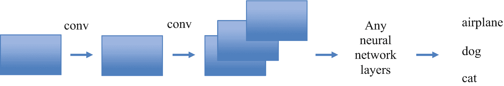

图 12-10

Grad-CAM 流程示意图

CNN 由一些卷积层组成（在示意图中显示为“conv”）。最终卷积层生成的特征图显示为 A1、A2 和 A3，与 CAM 示意图中的相同。此时，对于 CAM，我们需要进行全局平均池化，然后接一个全连接层。对于 Grad-CAM，我们可以做任何事情——例如，多个全连接层，即示意图中的“任意神经网络层”。唯一的要求是我们在 A1、A2 和 A3 之后插入的层必须是可微分的，以便获得梯度。最后，是针对 *飞机*、*狗*、*猫*、*人* 等的分类输出。

CAM 和 Grad-CAM 之间的区别在于如何对特征图 A1、A2 和 A3 进行加权以生成最终的热力图。在 CAM 中，我们使用从网络最后一个全连接层中提取的权重来对这些特征图进行加权。在 Grad-CAM 中，我们使用基于梯度计算的“alpha 值”来对特征图进行加权。因此，Grad-CAM 不需要特定的架构，因为我们可以通过任何我们想要的神经网络层来计算梯度。Grad-CAM 中的 *Grad* 代表 *梯度*。

Grad-CAM 的输出是一个*类别判别定位图*，即一个热力图，其中热点部分对应于特定类别。Grad-CAM 使用任何目标概念（例如，*狗* 的逻辑值，甚至是一个标题）的梯度，这些梯度流入最终的卷积层，以生成一个粗略的定位图，突出显示图像中对于预测该概念重要的区域。

使用 Grad-CAM，你可以直观地验证你的网络正在关注哪里，确认它确实在关注图像中的正确模式，并围绕这些模式激活。

如果网络*没有*在图像中正确的模式/对象周围激活，那么你就知道以下几点：

*   你的网络没有正确学习数据集中的底层模式。
*   你的训练过程需要重新审视。
*   你可能需要收集额外的数据。
*   最重要的是，*你的模型尚未准备好部署*。

Grad-CAM 是任何深度学习从业者工具箱中都应该拥有的工具。深度学习模型经常被批评为黑盒算法，我们不知道其内部运作机制。使用梯度相机（即 Grad-CAM），深度学习从业者可以使用 Keras/TensorFlow 可视化 CNN 层激活热力图。像这样的可视化允许你窥探“黑盒”正在做什么。

要使用 Grad-CAM 实现，你需要使用一些软件包配置你的系统，包括 TensorFlow（推荐 2.0）、OpenCV 或 Imutils。

现在让我们讨论 Grad-CAM 的实现。

首先，我们需要一个模型来执行前向传播。我们使用在 ImageNet 上预训练的 VGG16。你可以使用任何模型，因为 Grad-CAM 与 CAM 不同，它不需要特定的架构，并且与任何卷积神经网络兼容。

```
model = VGG16(weights='imagenet')
```

定义模型后，我们加载一个示例图像（见图 12-11）并对其进行预处理，使其与模型兼容。

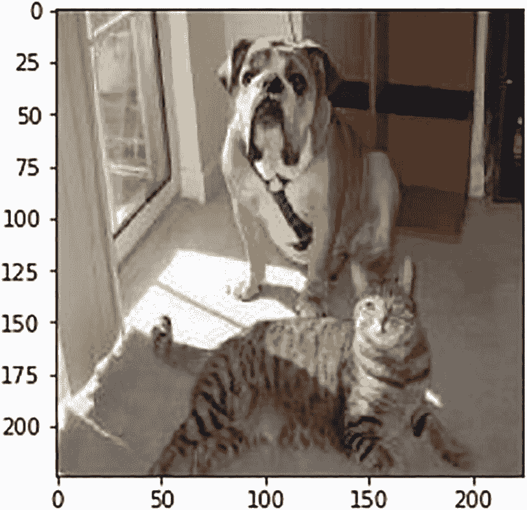

图 12-11

Grad-CAM 的输入图像

```
def preprocess(img):
img = img_to_array(img)
img = np.expand_dims(img,axis=0)
img = preprocess_input(img)
return img
image_1 = preprocess(image)
```

然后我们使用模型对示例图像进行预测，并解码前三个预测结果。正如你在下图中所见，我们正在考虑模型的前三个预测结果。模型的最高预测结果是拳师犬。

```
predict = model.predict(image_1)
print(decode_predictions(predict,top=3))
target_class = np.argmax(predict[0])
print("Target Class = %d"%target_class)
```

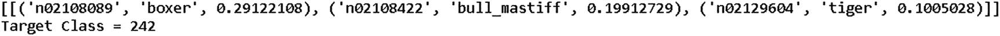

在下一步中，我们找到目标类别得分 y[c] 相对于最后一个卷积层的特征图 A[k] 的梯度。直观上，这告诉我们每个通道对于目标类别的重要性。grads 变量返回一个张量，用于后续步骤。

```
last_conv = model.get_layer('block5_conv3')
grads = K.gradients(model.output[:,242],last_conv.output)[0]
```

然后将这样获得的梯度进行全局平均池化，以获得对应于目标类别的神经元重要权重 a[k]。这会返回一个张量，该张量被传递给 Keras 函数，该函数以图像作为输入，并返回 pooled_grads 以及来自最后一个卷积层的激活图。

```
pooled_grads = K.mean(grads,axis=(0,1,2))
iterate = K.function([model.input],[pooled_grads,last_conv.output[0]])
pooled_grads_value,conv_layer_output = iterate([image_1])
```


接着，我们将每个激活图与对应的池化梯度相乘，这些梯度作为权重，决定了每个通道对目标类别的重要性。然后，我们沿着通道方向计算所有激活图的均值，得到的结果就是最终的类别判别显著性图（见图 12-12）。

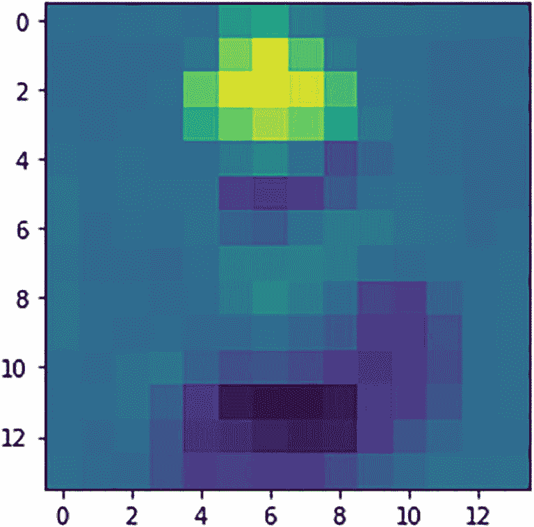

图 12-12

类别判别图

```
for i in range(512):
conv_layer_output[:,:,i] *= pooled_grads_value[i]
heatmap = np.mean(conv_layer_output,axis=-1)
```

然后，我们对生成的热力图应用 ReLU 函数，只保留对输出图有积极影响的特征。但我们可以看到，热力图中负值强度并不多，因此应用 ReLU 后热力图变化不大（见图 12-13）。


图 12-13

应用 ReLU 后的类别判别图

```
for x in range(heatmap.shape[0]):
for y in range(heatmap.shape[1]):
heatmap[x,y] = np.max(heatmap[x,y],0)
```

接着，我们将热力图中的每个强度值除以最大强度值，以对热力图进行归一化，使所有值都落在 0 到 1 之间（见图 12-14）。

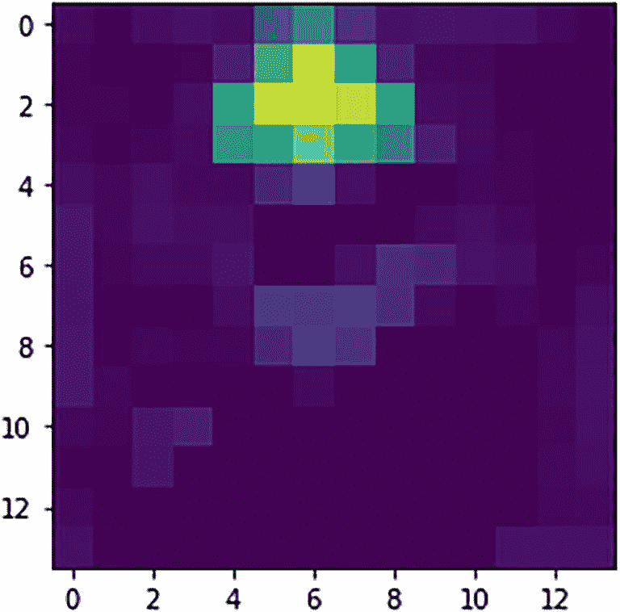

图 12-14

归一化后的类别判别显著性图

```
heatmap = np.maximum(heatmap,0)
heatmap /= np.max(heatmap)
plt.imshow(heatmap)
```

最后，我们对生成的热力图进行上采样，使其尺寸与输入图像匹配，并将其叠加在输入图像上以查看结果，如图 12-15 所示。

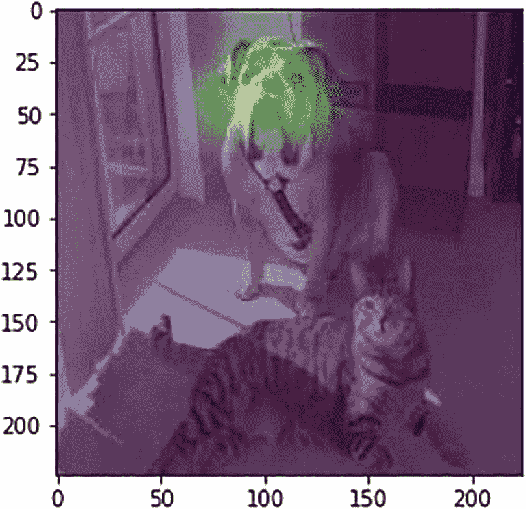

图 12-15

以斗牛犬为目标类别的最终显著性图

```
upsample = resize(heatmap, (224,224),preserve_range=True)
plt.imshow(image)
plt.imshow(upsample,alpha=0.5)
plt.show()
```

## 本章小结

在本章中，你学习了一种用于解释卷积神经网络的新技术，该网络是目前最先进的架构，尤其适用于图像相关任务。Grad-CAM 在其前身 CAM 的基础上进行了改进，提供了更好的定位能力和清晰的类别判别显著性图，从而揭示并简化了黑盒模型背后的复杂性。可解释机器学习的研究正在快速发展，并被证明在建立客户信任和改进模型方面至关重要。你还学习了如何使用 LIME 等基础技术来解释图像。

下一章将讨论文本解释方法。

