# 13. 解释文本分类模型

文本文档可以通过多个抽象概念来描述，例如语义类别、写作风格或情感倾向。机器学习模型已被训练用于自动将文档映射到这些抽象概念，从而能够标注海量的文本集合，其数量远超人类一生所能处理的范围。除了能够非常准确地预测文本类别之外，理解分类过程是如何以及为何发生的也极具价值。

在自然语言处理模型领域，特征的维度通常非常庞大，因此使用特征重要性来解释模型变得复杂得多。像 LIME 和 SHAP 这样的技术，可以向最终用户和数据科学从业者解释 NLP 模型是如何工作并做出决策的。本章将通过几个示例，介绍如何利用这两种方法来解释基于文本数据构建的模型。

首先，我们快速构建一个文本分类模型。由于模型构建并非本章重点，我们不会深入讨论。我们将构建模型，然后迅速进入生成解释的环节，以说明模型的决策过程。

我们使用了 Stack Overflow 标签分类数据集。以下是该数据集的简要描述。

*   问题 ID

*   创建日期

*   关闭日期（如果适用）

*   评分

*   所有者用户 ID

*   回答数量

*   标签

该数据集是从 Stack Overflow 数据库中提取的。它包含 12,583,347 个未删除的问题和 3,654,954 个已删除的问题。

这些都是 Stack Exchange 数据转储中的公开数据，该转储更为全面（包含问题和答案文本），但下载和处理所需的计算开销也更大。本数据集的设计旨在便于读取和开始分析。

## 数据预处理、特征工程及逻辑回归模型

以下是构建此模型所需的不同导入项。

```
import pandas as pd
import numpy as np
import sklearn
import sklearn.ensemble
import sklearn.metrics
from sklearn.utils import shuffle
from __future__ import print_function
from io import StringIO
import re
from bs4 import BeautifulSoup
from nltk.corpus import stopwords
from sklearn.model_selection import train_test_split
from sklearn.feature_extraction.text import CountVectorizer
from sklearn.linear_model import LogisticRegression
from sklearn.metrics import accuracy_score, f1_score, precision_score, recall_score
import lime
from lime import lime_text
from lime.lime_text import LimeTextExplainer
from sklearn.pipeline import make_pipeline
```

现在读取数据集，并执行模型所需的一些数据修改。你可以按照相同的代码在自己的系统或环境中复现结果。

```
df = pd.read_csv('stack-overflow-data.csv')
df = df[pd.notnull(df['tags'])]
df = df.sample(frac=0.5, random_state=99).reset_index(drop=True)
df = shuffle(df, random_state=22)
df = df.reset_index(drop=True)
df['class_label'] = df['tags'].factorize()[0]
class_label_df = df[['tags', 'class_label']].drop_duplicates().sort_values('class_label')
label_to_id = dict(class_label_df.values)
id_to_label = dict(class_label_df[['class_label', 'tags']].values)
REPLACE_BY_SPACE_RE = re.compile('[/(){}\[\]\|@,;]')
BAD_SYMBOLS_RE = re.compile('[⁰-9a-z #+_]')
# STOPWORDS = set(stopwords.words('english'))
def clean_text(text):
"""
text: 一个字符串
return: 修改后的初始字符串
"""
text = BeautifulSoup(text, "lxml").text # HTML 解码。BeautifulSoup 的 text 属性返回一个去除了所有 HTML 标签和元数据的字符串。
text = text.lower() # 将文本转换为小写
text = REPLACE_BY_SPACE_RE.sub(' ', text) # 将文本中 REPLACE_BY_SPACE_RE 匹配的符号替换为空格。
text = BAD_SYMBOLS_RE.sub('', text) # 从文本中移除 BAD_SYMBOLS_RE 中的符号。将匹配的字符串替换为空。
#    text = ' '.join(word for word in text.split() if word not in STOPWORDS) # 从文本中移除停用词
return text
df['post'] = df['post'].apply(clean_text)
list_corpus = df["post"].tolist()
list_labels = df["class_label"].tolist()
X_train, X_test, y_train, y_test = train_test_split(list_corpus, list_labels, test_size=0.2, random_state=40)
vectorizer = CountVectorizer(analyzer='word',token_pattern=r'\w{1,}', ngram_range=(1, 3), stop_words = 'english', binary=True)
train_vectors = vectorizer.fit_transform(X_train)
test_vectors = vectorizer.transform(X_test)
logreg = LogisticRegression(n_jobs=1, C=1e5)
logreg.fit(train_vectors, y_train)
pred = logreg.predict(test_vectors)
accuracy = accuracy_score(y_test, pred)
precision = precision_score(y_test, pred, average='weighted')
recall = recall_score(y_test, pred, average='weighted')
f1 = f1_score(y_test, pred, average='weighted')
```


## 使用 LIME 解释文本预测

本节将使用一种名为 LIME 的流行技术来解释文本模型，你在第 9 章中已经学习过它。这是一种用于黑盒模型（模型无关）的可解释性替代模型。它为单个观测预测提供可解释性（局部）。回顾一下，让我们看看 LIME 是如何工作的。

1.  选择单个预测。
2.  LIME 在此实例处创建数据的排列，并收集黑盒模型的结果。
3.  然后，它根据新样本与原始预测数据的匹配程度，为这些新样本赋予权重。
4.  一个更简单、可解释的新模型，在根据每个变体所附权重创建的数据变体上进行训练。
5.  这个局部可解释模型可以解释该预测。

使用 LIME，你可以创建如下可视化效果，以帮助理解文本中哪些词对模型的最终预测影响最大。在图 13-1 中，单词 *killed*、*crash* 和 *helicopter* 都对最终预测得分 0.89 有所贡献，这使得模型对其灾难类别的预测相当自信。

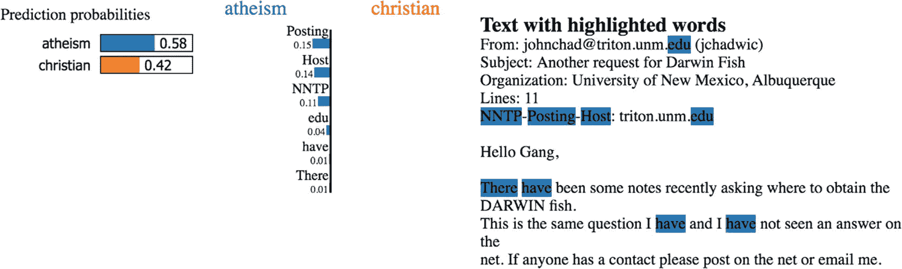

图 13-1

LIME 如何用于文本数据的描述

现在你已经了解了 LIME 如何用于文本数据，让我们继续看可以帮助实现 LIME 的代码片段。

```
c = make_pipeline(vectorizer, logreg)
class_names=list(df.tags.unique())
explainer = LimeTextExplainer(class_names=class_names)
idx = 1877
exp = explainer.explain_instance(X_test[idx], c.predict_proba, num_features=6, labels=[4, 8])
print('Document id: %d' % idx)
print('Predicted class =', class_names[logreg.predict(test_vectors[idx]).reshape(1, 1)[0,0]])
print('True class: %s' % class_names[y_test[idx]])
```

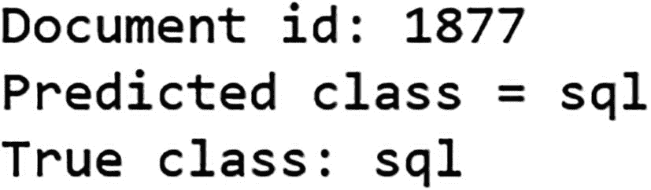

我们随机选择测试集中的一个文档，它恰好被标记为 SQL，模型也将其预测为 SQL。使用这个文档，我们为标签 4（即 SQL）和标签 8（即 Python）生成解释。

```
print ('Explanation for class %s' % class_names[4])
print ('\n'.join(map(str, exp.as_list(label=4))))
```

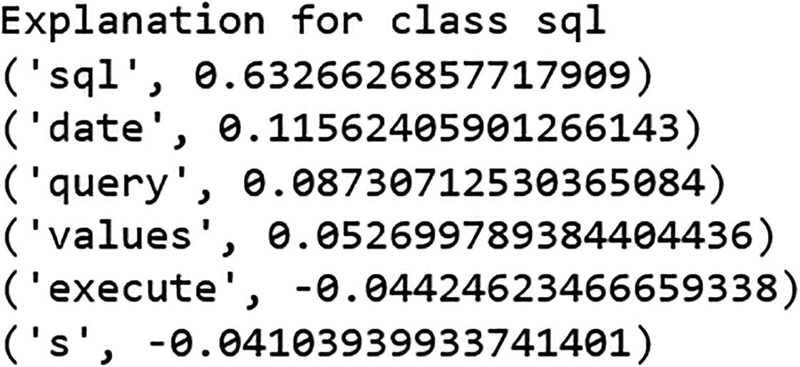

```
print ('Explanation for class %s' % class_names[8])
print ('\n'.join(map(str, exp.as_list(label=8))))
```

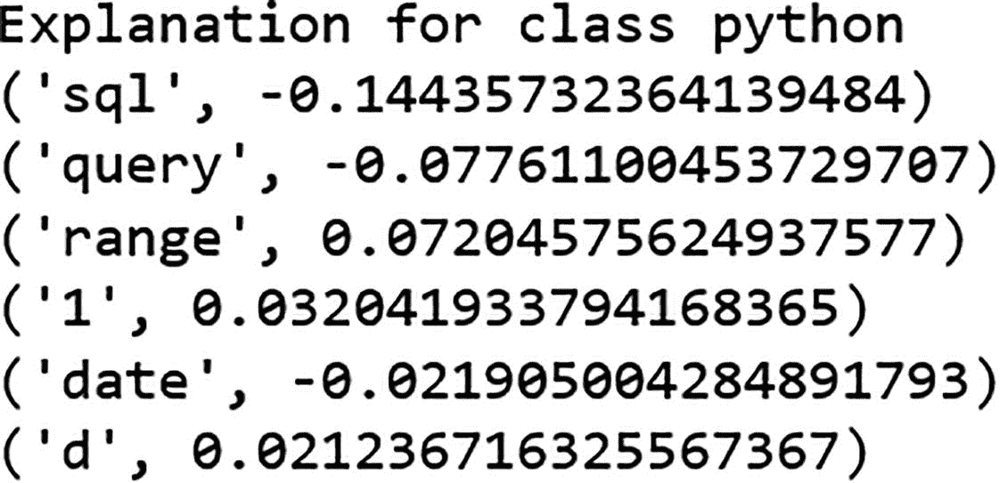

这个文档对标签 *sql* 的解释最高。我们还注意到，正负号是针对特定标签的；例如，单词 *sql* 对 *sql* 类别是正向的，而对 *python* 类别是负向的，反之亦然。

我们将为这个文档生成前两个类别的标签。

```
exp = explainer.explain_instance(X_test[idx], c.predict_proba, num_features=6, top_labels=2)
print(exp.available_labels())
```

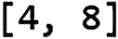

它给出了 *sql* 和 *python*。

```
exp.show_in_notebook(text=False)
```

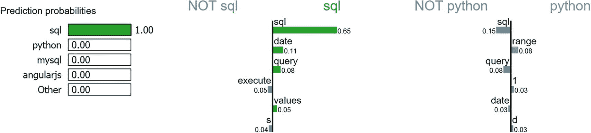

图 13-2

模型的 LIME 输出

以下是对图 13-2 中可视化的解释。

*   对于这个文档，单词 *sql* 对 ***sql*** 类别具有最高的正向得分。
*   我们的模型预测这个文档应被标记为 ***sql***，概率为 100%。
*   如果我们从文档中移除单词 *sql*，我们预计模型预测 ***sql*** 标签的概率为 100% – 65% = 35%。
*   另一方面，单词 *sql* 对 ***python*** 类别是负向的，并且模型已经学习到单词 *range* 对 ***python*** 类别有一个小的正向得分。

我们可能希望放大并研究对 ***sql*** 类别的解释，以及文档本身。

```
exp.show_in_notebook(text=y_test[idx], labels=(4,))
```

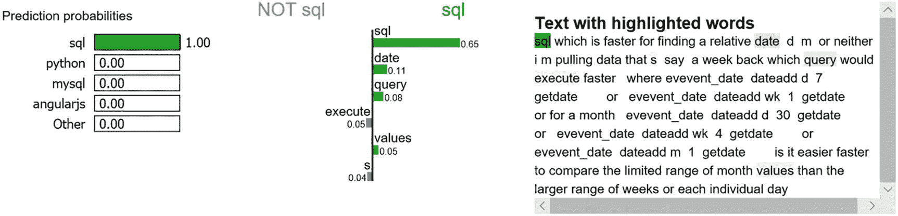

图 13-3

LIME 输出

当将 LIME 用于 NLP 时，主要缺点是其不稳定性。在相同局部数据周围进行不同的采样可能导致非常不同的解释结果，并且 LIME 仅提供局部可解释性。此外，由于 LIME 在感兴趣的实例周围创建一个线性局部模型，它假设局部实例可以被线性解释，但这并非总是如此。第一个问题可能会相当阻碍使用 LIME 进行可解释性，因为当采样变化时，很难信任一个能在相同解释上产生不同结果的模型。

然而，在局部可解释性方面，大多数特征权重在我们自己对灾难相关词汇的理解中是有意义的。LIME 解释器本身运行时间短，这意味着如果需要，可以在短时间内轻松为不同的局部预测生成许多解释。


### 使用 SHAP 解读文本预测

你在第 9 章已经学习了 SHAP。现在，我们来看看如何利用 SHAP 对文本数据生成解释。你可以使用 SHAP 创建多种不同类型的可视化图表，以理解模型的分类结果。

使用 SHAP 会为模型中的每个特征返回一个归因值，表明该特征对预测结果的贡献程度。这对于结构化数据来说相当直观，但它在文本数据中是如何工作的呢？在词袋模型（示例中提供了实现样例）中，SHAP 将词汇表中的每个单词视为一个独立的特征。然后，我们可以将归因值映射到词汇表中的索引，从而找出对模型预测贡献最大（和最小）的单词。在下一节中，我们将创建一个 SHAP 解释器对象。解释器有几种类型。由于我们使用的是深度模型，因此采用 `DeepExplainer`。我们通过向它传递模型和一部分训练数据来实例化它。

以下是必要的导入代码。

```
from sklearn.preprocessing import MultiLabelBinarizer
import tensorflow as tf
from tensorflow.keras.preprocessing import text
import keras.backend.tensorflow_backend as K
K.set_session
import shap
tags_split = [tags.split(',') for tags in df['tags'].values]
tag_encoder = MultiLabelBinarizer()
tags_encoded = tag_encoder.fit_transform(tags_split)
num_tags = len(tags_encoded[0])
train_size = int(len(df) * .8)
y_train = tags_encoded[: train_size]
y_test = tags_encoded[train_size:]
class TextPreprocessor(object):
def __init__(self, vocab_size):
self._vocab_size = vocab_size
self._tokenizer = None
def create_tokenizer(self, text_list):
tokenizer = text.Tokenizer(num_words = self._vocab_size)
tokenizer.fit_on_texts(text_list)
self._tokenizer = tokenizer
def transform_text(self, text_list):
text_matrix = self._tokenizer.texts_to_matrix(text_list)
return text_matrix
VOCAB_SIZE = 500
train_post = df['post'].values[: train_size]
test_post = df['post'].values[train_size: ]
processor = TextPreprocessor(VOCAB_SIZE)
processor.create_tokenizer(train_post)
X_train = processor.transform_text(train_post)
X_test = processor.transform_text(test_post)
def create_model(vocab_size, num_tags):
model = tf.keras.models.Sequential()
model.add(tf.keras.layers.Dense(50, input_shape = (VOCAB_SIZE,), activation='relu'))
model.add(tf.keras.layers.Dense(25, activation='relu'))
model.add(tf.keras.layers.Dense(num_tags, activation='sigmoid'))
model.compile(loss = 'binary_crossentropy', optimizer='adam', metrics = ['accuracy'])
return model
model = create_model(VOCAB_SIZE, num_tags)
model.fit(X_train, y_train, epochs = 2, batch_size=128, validation_split=0.1)
print('Eval loss/accuracy:{}'.format(model.evaluate(X_test, y_test, batch_size = 128)))
```

模型训练完成后，我们使用前 200 个训练文档作为背景数据集，进行积分并创建一个 SHAP 解释器对象。

*   我们获取测试集子集中单个预测的归因值。
*   将索引转换为单词。
*   使用 SHAP 的 `summary_plot` 方法展示影响模型预测的顶级特征。

```
attrib_data = X_train[:200]
explainer = shap.DeepExplainer(model, attrib_data)
num_explanations = 20
shap_vals = explainer.shap_values(X_test[:num_explanations])words = processor._tokenizer.word_index
word_lookup = list()
for i in words.keys():
word_lookup.append(i)word_lookup = [''] + word_lookup
shap.summary_plot(shap_vals, feature_names=word_lookup, class_names=tag_encoder.classes_)
```

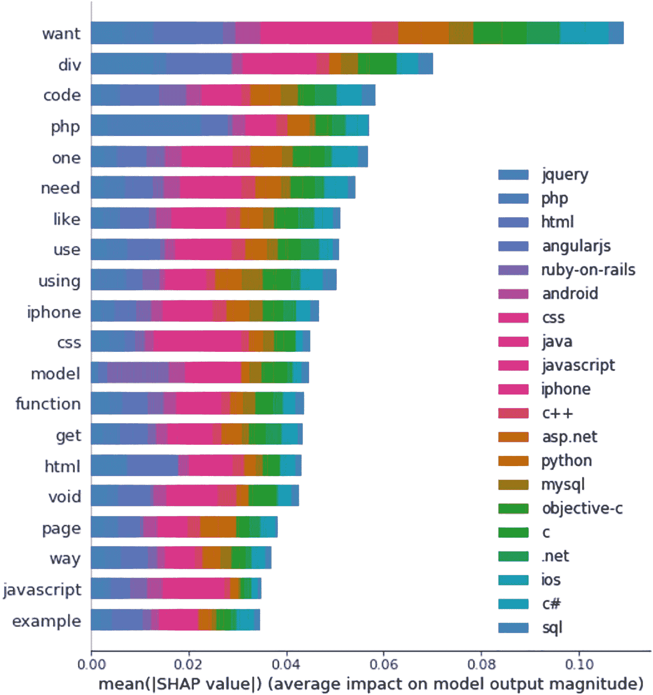

图 13-4

文本分类模型的 SHAP 输出

*   单词 *want* 是模型中使用的最强信号词，对 ***jquery*** 类别的预测贡献最大。
*   单词 *php* 是模型中使用的第四大信号词，对 ***php*** 类别的预测贡献最大。
*   另一方面，单词 *php* 可能对其他类别产生负面信号，因为在 ***python*** 文档中不太可能出现 *php*。

这就是我们使用 SHAP 解释文本模型的方法。在示例中，我们重点标出了对模型最重要的单词。


### 通过句子高亮解释文本模型

句子高亮是指根据每个词在最终预测中的重要性为其分配一个分数。形式上，句子高亮（SH）被建模为一个向量 s，用于解释黑盒模型 b 对输入 x 的分类结果 y = b(x)。s 的维度对应待解释句子 x 中的各个词，si 的值表示词 *i* 的显著性值。si 值越大，该词的重要性越高。正值表示该词对 y 有正向贡献，负值则表示该词产生了负向贡献。

ELI5 是一个 Python 库，允许通过统一的 API 可视化和调试各种机器学习模型。它内置了对多种机器学习框架的支持，并提供了解释黑盒模型的方法。

我们使用 Stack Overflow 数据集来演示 ELI5 如何处理文本数据。该数据集包含帖子及其对应的标签。

图 13-5 展示了该数据集。

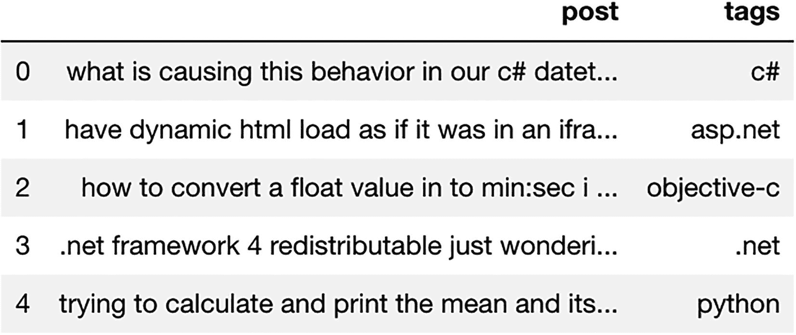

图 13-5

文本建模的样本数据

这是一个平衡的数据集，非常适合我们用于理解的目的。

首先，使用一个简单的 scikit-learn 流水线来构建一个文本分类器，稍后我们将对其进行解释。该流水线使用了简单的计数向量化器和逻辑回归。

```
from sklearn.model_selection import train_test_split
from sklearn.feature_extraction.text import CountVectorizer
from sklearn.linear_model import LogisticRegressionCV
from sklearn.pipeline import make_pipeline# 创建训练-测试集划分
X = sodata[['post']]
y = sodata[['tags']]X_train, X_test, y_train, y_test = train_test_split(X, y, test_size=0.2, random_state=0)# 拟合分类器
vec = CountVectorizer()
clf = LogisticRegressionCV()
pipe = make_pipeline(vec, clf)
pipe.fit(X_train.post, y_train.tags)
```

以下是结果（另见图 13-6）。

```
from sklearn import metricsdef print_report(pipe):
y_actuals = y_test['tags']
y_preds = pipe.predict(X_test['post'])
report = metrics.classification_report(y_actuals, y_preds)
print(report)
print("accuracy: {:0.3f}".format(metrics.accuracy_score(y_actuals, y_preds)))print_report(pipe)
```

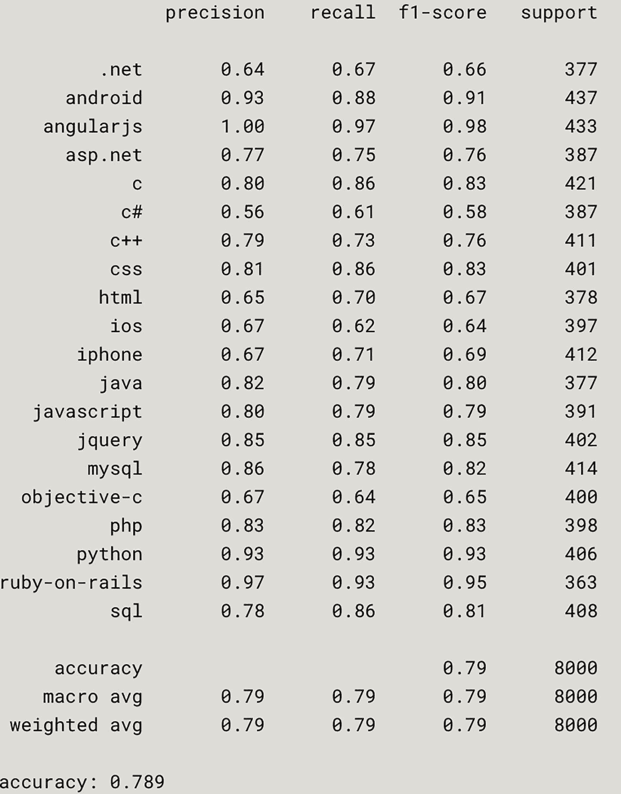

图 13-6

模型的输出

图 13-6 是一个简单的逻辑回归模型，其表现良好。你可以使用以下函数查看其权重。

```
for i, tag in enumerate(clf.classes_):
coefficients = clf.coef_[i]
weights = list(zip(vec.get_feature_names(),coefficients))
print('Tag:',tag)
print('Most Positive Coefficients:')
print(sorted(weights,key=lambda x: -x[1])[:10])
print('Most Negative Coefficients:')
print(sorted(weights,key=lambda x: x[1])[:10])
print("------------------------")-------------------------------------
OUTPUT:
------------------------------------------------------------Tag: python
Most Positive Coefficients:
[('python', 6.314761719932758), ('def', 2.288467823831321), ('import', 1.4032539284357077), ('dict', 1.1915110448370732), ('ordered', 1.1558015932799253), ('print', 1.1219958415166653), ('tuples', 1.053837204818975), ('elif', 0.9642251085198578), ('typeerror', 0.9595246314353266), ('tuple', 0.881802590839166)]
Most Negative Coefficients:
[('java', -1.8496383139251245), ('php', -1.4335540858871623), ('javascript', -1.3374796382615586), ('net', -1.2542682749949605), ('printf', -1.2014123042575882), ('objective', -1.1635960146614717), ('void', -1.1433460304246827), ('var', -1.059642972412936), ('end', -1.0498078813349798), ('public', -1.0134828865993966)]

Tag: ruby-on-rails
Most Positive Coefficients:
[('rails', 6.364037640161158), ('ror', 1.804826792986176), ('activerecord', 1.6892552000017307), ('ruby', 1.41428459023012), ('erb', 1.3927336940889532), ('end', 1.3650227017877463), ('rb', 1.2280121863441906), ('gem', 1.1988196865523322), ('render', 1.1035255831838242), ('model', 1.0813278895692746)]
Most Negative Coefficients:
[('net', -1.5818801311532575), ('php', -1.3483618692617583), ('python', -1.201167422237274), ('mysql', -1.187479885113293), ('objective', -1.1727511956332588), ('sql', -1.1418573958542007), ('messageform', -1.0551060751109618), ('asp', -1.0342831159678236), ('ios', -1.0319120624686084), ('iphone', -0.9400116321217807)]

```

这一切都相当不错。这些系数是合理的，我们可以利用这些信息来改进模型。但这需要编写大量代码。ELI5 让这项任务变得简单。你只需使用以下命令（输出见图 13-7）。

```
import eli5
eli5.show_weights(clf, vec=vec, top=20)
```

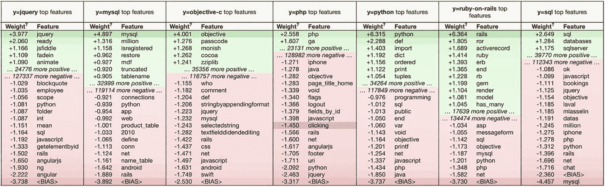

图 13-7

ELI5 解释模型的输出

Python 的权重值与我们从手动编写的函数中获得的值相同。而且它更美观、更便于探索。但这只是冰山一角。ELI5 还可以调试模型。现在，让我们找出某个特定示例被错误分类的原因。我们使用一个原本属于 Python 类别但被错误分类为 Java 的示例（见图 13-8）。

```
y_preds = pipe.predict(sodata['post'])sodata['predicted_label'] = y_predsmisclassified_examples = sodata[(sodata['tags']!=sodata['predicted_label'])&(sodata['tags']=='python')&(sodata['predicted_label']=='java')]eli5.show_prediction(clf, misclassified_examples['post'].values[1], vec=vec)
```

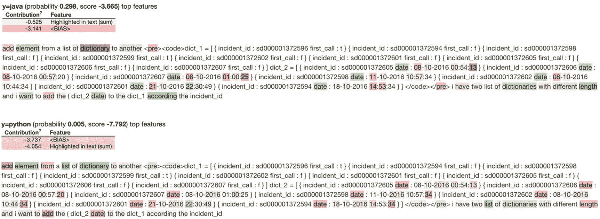

图 13-8

示例输出

在图 13-8 中，分类器以较低的概率预测为 Java。你可以检查示例中发生的许多情况，以改进模型。以下是一些示例。

*   分类器考虑了过多的数字（这不好），这让我们得出结论：需要清理数字——或者用 DateTime 标记替换 DateTime 对象。
*   虽然字典（dictionary）对 Java 具有负权重，但单词 dictionaries 却具有正权重。因此，词干提取可能也有帮助。
*   像 `<pre><code>` 这样的词会影响分类器。这些词应该在清理时移除。
*   为什么单词 *date* 会影响结果？值得思考。

我们可以查看更多示例以获得更多此类想法。让我们为这个简单任务创建一个深度模型。这一切都很好，但如果我们的模型不提供单个特征（如 LSTM）的权重呢？正是在这些模型中，可解释性可以发挥非常重要的作用。

为了理解如何做到这一点，我们首先在数据上创建一个 TextCNN 模型。当我们拥有一个训练好的黑盒模型对象时，事情就变得有趣了。ELI5 提供了 `eli5.lime.TextExplainer` 来调试我们的预测，以检查文档中哪些内容对做出预测决策是重要的。

要使用 TextExplainer 实例，我们将一个待解释的文档和一个黑盒分类器（一个返回概率的预测函数）传递给 `fit()` 方法。根据文档，预测函数应如下所示。

*predict (callable) — 黑盒分类流水线。* predict *应是一个函数，它接受一个字符串列表（文档）并返回一个形状为 (n_samples, n_classes) 的矩阵，其中包含概率值——每行对应一个文档，每列对应一个输出标签。*


要使用 ELI5，我们需要定义自己的函数，该函数接收一个字符串列表（文档）作为输入，并返回一个形状为 (n_samples, n_classes)* 的矩阵。你可以看到我们是如何先进行预处理，再进行预测的。*

```
def predict_complex(docs):
# preprocess the docs as required by our model
val_X = tokenizer.texts_to_sequences(docs)
val_X = pad_sequences(val_X, maxlen=maxlen)
y_preds = model.predict([val_X], batch_size=1024, verbose=0)
return y_preds
```

下面展示了如何使用 TextExplainer（见图 13-9）。这里使用了与我们简单分类器之前相同的错误分类示例。

```
import eli5
from eli5.lime import TextExplainerte = TextExplainer(random_state=2019)
te.fit(sodata['post'].values[0], predict_complex)
te.show_prediction(target_names=list(encoder.classes_))
```

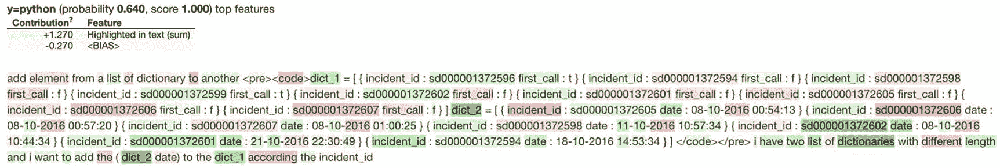

图 13-9

使用 TextExplainer 的输出

你可以看到，关键词 `dict` 和 `list` 的存在正在影响我们分类器的决策。在这个例子中，TextExplainer 通过移除部分词语，生成了大量与原始文档相似的文本，然后训练一个白盒分类器，该分类器预测的是黑盒分类器的输出，而非真实标签。我们看到的解释是针对这个白盒分类器的。相关代码请参阅 [`www.kaggle.com/mlwhiz/interpreting-text-classification-models-with-eli5`](http://www.kaggle.com/mlwhiz/interpreting-text-classification-models-with-eli5) 上的笔记本。

## 总结

本章我们没有讨论任何理论，因为大多数文本分类模型都可以使用 LIME、SHAP 和 ELI5 等技术来解释。这些方法在前面的章节中已经介绍过。通过本章，我们希望你对可解释性在文本数据方面的工作原理有了一些了解。

