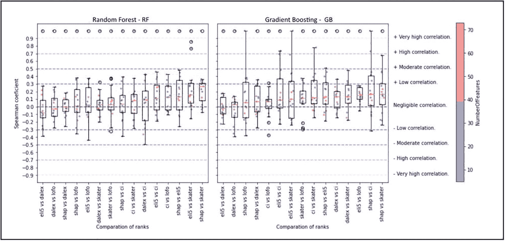
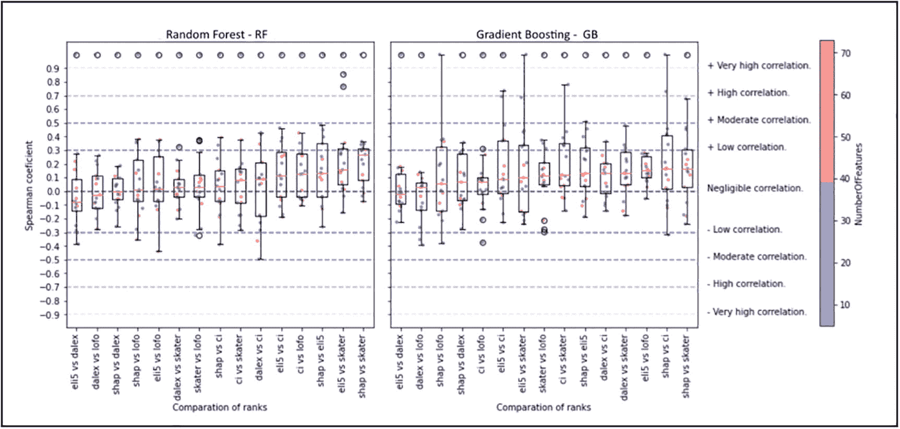

# 14. 数据在可解释性中的作用

现在，让我们尝试理解方法和建模技术之外的东西。本章试图找到以下问题的答案。

*   数据复杂性如何影响模型的可解释性？
*   如果不同的工具生成解释，这些解释是相同还是不同？

在最后几章中，我们研究了基于特征重要性框架构建的方法。我们评估了`CIU`、`DALEX`、`ELI5`、`SHAP`和`Skater`等方法。这些方法都基于某种共同的主题，为模型的特征排序生成全局重要性度量。

让我们详细阐述前面的两个问题。前面提到的工具都是解释黑盒模型的。能否推断出它们对相同的数据集生成相似的全局特征重要性，还是对同一数据集生成的解释之间存在差异？类似地，生成相似的解释是否与数据集的特定属性有关？

本章回答了前面两个问题，并探讨了数据集的复杂性是否对可解释性有影响。为此，我们选择了表格数据集，基于各种预定义的属性对数据集进行聚类，在这些数据集上构建模型和可解释性方法，然后计算不同方法对之间的相关性以分析结果。

这些数据集^(⁴)包括：`australian`、`phishing websites`、`spec`、`satellite`、`anal-catdata lawsuit`、`banknote authentication`、`blood transfusion service center`、`churn`、`climate model simulation crashes`、`credit-g`、`delta ailerons`、`diabetes`、`eeg-eye-state`、`haberman`、`heart-statlog`、`ilpd`、`ionosphere`、`jEdit-4.0-4.2`、`kc1`、`kc2`、`kc3`、`kr-vs-kp`、`mc1`、`monks-problems-1`、`monks-problems-2`、`monks-problems-3`、`mozilla4`、`mw1`、`ozone-level-8hr`、`pc1`、`pc2`、`pc3`、`pc4`、`phoneme`、`prnn crabs`、`qsar-biodeg`、`sonar`、`spambase`、`steel-plates-fault`、`tic-tac-toe`和`wdbc`。

为了准备用于建模的数据集，我们执行了以下预处理步骤。
1.  根据频率将分类特征转换为序数值。
2.  将布尔特征转换为数值（0 和 1）。
3.  使用最小-最大归一化将值缩放到 0 到 1 之间。

分析不同的数据集使你能够根据它们的相似性和差异性进行分组，即使这些数据集的主题不同。例如，可以根据类别熵值创建一个组，然后分离出信息量较多或较少的数据集，从而使数据集的复杂性能够影响未来模型解释的关系。本章分析了数据集的 15 个不同属性，然后使用`k-means`聚类算法来识别数据集的组别。

这 15 个属性是：特征数量、实例数量、维度、二元特征百分比、名义属性不同值的标准差、名义属性不同值的均值、二元特征数量、符号特征百分比、数值特征百分比、类别熵、自相关、数值特征数量、符号特征数量、多数类百分比和少数类百分比。

让我们基于`随机森林`和`梯度提升`来分析结果，因为两者都是基于树的集成方法，并且模型可解释性较低。

对每个模型执行了标准的训练-测试分割：70% 的数据用于训练，剩余的 30% 用于测试。然后，在每个模型上生成了准确率、精确率和召回率等指标，以定义所创建模型的度量标准。

对于 41 个数据集中的每一个，都创建了两个模型：一个基于`随机森林`算法，另一个基于`梯度提升`算法，总共生成了 82 个模型。通过六种不同的特征重要性方法，为每个模型生成了全局可解释性特征重要性排名，总共产生了 492 种不同类型的排名。基于`k-means`聚类，这 41 个数据集被分为三个不同的组。

为了分析全局特征重要性的秩对，我们使用了斯皮尔曼秩相关。该方法衡量了秩对之间的相关性，考虑了不同值可能出现的秩次概念（在此处，这些值指数据集属性）。

在此步骤中，为每个数据集生成了两个秩对相关性比较矩阵。结果按组（`随机森林`和`梯度提升`各一组）和簇（三个不同的数据集簇）进行计算。

每个簇分别包含 21、17 和 3 个数据集。为了理解单个数据集的影响，我们需要研究这些簇的行为。本章不讨论最后一个簇，因为它包含的数据集非常少（仅三个）。

在总共 15 个属性中，我们讨论了最能描述所分析簇行为的四个属性。

所展示的数据集的这四个属性是从 15 个属性中挑选出来的，因为它们最能区分所分析的两个簇。然而，这并不意味着其他 11 个属性不能解释这些簇。唯一的区别在于，其余 11 个属性的解释程度较低。

*   **簇 0**：该簇的特征是数据集具有较多的特征数量、较低的类别熵（信息量较少）、较高的自相关性和较高的不平衡度。
*   **簇 1**：该簇的特征是数据集具有较少的特征数量、较高的类别熵（信息量较多）、较低的自相关性和较低的不平衡度。

结果如图 14-1 和图 14-2 所示（另请参阅 [`https://arxiv.org/abs/2107.02661`](https://arxiv.org/abs/2107.02661)）。

*图 14-2*

*图 14-1*

图 14-1 是一个箱线图，汇总了为簇 0 的数据集计算的所有秩对比较（x 轴）及其各自的斯皮尔曼相关性（y 轴）。左侧为`随机森林`，右侧为`梯度提升`。蓝色虚线显示了不同的相关性水平。点标识了每次比较的相关性值的位置。点的颜色表示每个数据集的属性数量。请注意大多数箱线图的低方差，以及发现的可忽略或低相关性水平。

图 14-2 中的箱线图汇总了为簇 1 的数据集计算的所有秩对比较（x 轴）及其各自的斯皮尔曼相关性（y 轴）。左侧为`随机森林`，右侧为`梯度提升`。蓝色虚线显示了不同的相关性水平。点标识了每次比较的相关性值的位置。点的颜色表示每个数据集的属性数量。请注意大多数箱线图的高方差，以及发现的高相关性水平。

图 14-1 和图 14-2 显示，根据多项测试，属于簇 0 的数据集的执行结果具有低或可忽略的相关性。这表明，用于确定比较的六种可解释性方法，对于组内的大多数数据集，无论使用`随机森林`还是`梯度提升`算法，都会生成不同的可解释性排名。结果表明，复杂度更高的数据集会产生不同的解释。这证明了结果中发现的低相关性是合理的。

这些结果回答了第一个假设。考虑到当前旨在解释黑盒机器学习模型的工具，可以推断出它们生成的是相同、相似还是不同的全局可解释性排名？

不同的相关性表明，数据集的属性直接影响模型的可解释性。因此，这些工具可以生成具有较高相关性或较低相关性的可解释性。

尽管`随机森林`和`梯度提升`模型的结果相似，但相关性存在差异。在`梯度提升`算法结果的某些比较中，方差更大；例如，在`SHAP`与`Lofo`、`ELI5`与`CIU`、以及`ELI5`与`Skater`之间。这证明了模型中使用的算法（此处为装袋和提升）的复杂性会影响可解释性的生成。

重要的是，箱线图图形中存在的异常值表明，在所分析的数据集中可能存在其他数据集簇。用于在每个箱线图中区分不同数据集属性数量的颜色表明，相关性中获得的结果并非数据集属性数量的函数。

结果的比较给出了第二个假设的答案。遵循与前一个问题相同的思路，生成相同、相似或不同的可解释性是否与数据集的特定属性相关？

是的，因为基准输出中呈现的两个数据集簇的秩相关性结果不同，这表明类别熵、自相关性、多数类百分比和属性数量等属性是干扰可解释性排名的属性。

*   如果一个模型（算法和数据集）解决的是低复杂度数据集的分类或回归问题，那么该模型的可解释性排名应该很少（甚至只有一个），这使得不同的可解释性度量之间呈现出较高的相关性。
*   如果一个模型（算法和数据集）解决的是高复杂度数据集的分类或回归问题，那么该模型的可解释性排名应该很多，导致不同可解释性度量的排名之间呈现出较低的相关性。

## 总结

本章推断，数据集的复杂性确实会影响分类模型解释的生成，并且模型的选择也会极大地影响全局特征重要性排名。在本章中，我们想提醒读者，不要将可解释性工具视为可以随意挥舞、就能生成准确且易于理解模型的魔法棒。可解释性技术的使用者应将可解释性实践作为模型构建过程中的一个常规步骤，并遵循模型开发的最佳实践。模型开发以及使其易于人类理解，需要付出比在模型功能之上应用一个可解释性技巧多得多的努力。

脚注 1