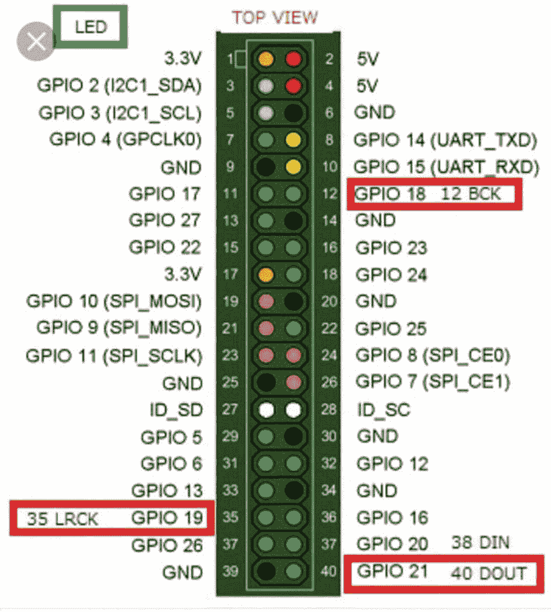
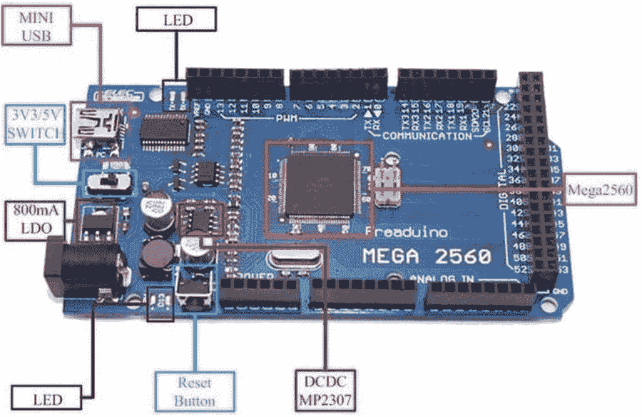
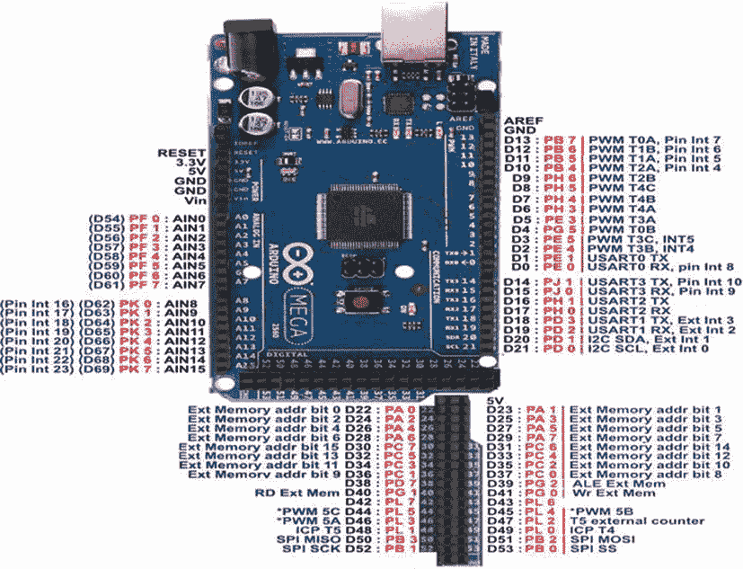

# 1. 入门指南：必要的软件和硬件

本章将带你进入单板计算机（SBC）的世界。你们中的许多人可能是第一次听到这个术语，可能会好奇什么是 SBC 以及它的用途。本章将解释 SBC 及其历史发展。你还将了解市场上最流行的 SBC，例如 Banana Pi、Raspberry Pi 和 Arduino。通过深入比较，我将解释流行 SBC 在 USB、存储、网络和通信方面的特性。

然后，你将学习 Raspberry Pi，更具体地说是 Raspberry Pi 3 Model B+，因为你将在本书的物联网和工业物联网项目中将其用作主节点。你还将深入了解 Raspberry Pi 上的 GPIO（通用输入/输出）引脚及其用途。接着，你将学习单板微控制器（SBM），它与单板计算机不同。在物联网和工业物联网应用中，单板微控制器通常用作 Raspberry Pi 等单板计算机的从设备。最流行的单板微控制器是 Arduino，你将通过详细的表格形式了解 SBM 的类型，涵盖其处理器、I/O 模块、频率、电压等。

然后，你将了解 Arduino Mega 2560 及其布局，并学习其 GPIO 引脚。接下来，你将学习本书最重要的主题：物联网传感器及其类型和应用。你将在案例研究解决方案中使用其中一些传感器。此外，还将涵盖无人机的主题，因为它们可用于为电信应用收集数据。请注意，在大多数国家/地区，飞行无人机需要许可证，在尝试将其用于任何项目之前，你应遵守相关规定。你还将了解 Modbus 设备以及如何使用它来构建商业应用。最后，你将学习运行所有这些设备的软件程序。

注意

本书通篇使用 Python 3.x 版本。如果你使用的是较旧版本的 Python，代码示例可能无法运行。你需要 Python 3.x 或更高版本才能成功运行它们。

## 硬件要求

要运行本书中的练习，你需要以下硬件：

*   **Raspberry Pi 3 Model B+**

*   **Arduino Mega 2560**

*   **用于输出 Raspberry Pi 3 Model B+的 LCD/LED 屏幕**

*   **单相电能表：Modbus 220/230V，双向，多功能，RS485，脉冲/Modbus 输出**

*   **无人机：工业级，重型负载，满足以下规格：**
    *   **最大有效载荷：1.5 千克（3.5 磅）**

    *   **航程：5 公里**

    *   **飞行时间：至少 30 分钟**

### 单板计算机

单板计算机是一台完全功能化的计算机，集成在一块印刷电路板上。这类计算机的独特之处在于，所有输入、输出以及图形和数值计算等处理过程都在同一块板上完成。虽然单板计算机可以构建为高性能计算服务器，但更常见的版本是小型紧凑的机器。

历史上，单板计算机的设计初衷是用于教育和追求紧凑性；如今，它们已被广泛应用于主流商业领域。

单板计算机基于不同的微处理器构建，但设计都较为简洁。它们被设计得便于携带且紧凑。运行一台占用空间极小、稳定且便携的快速计算机，增添了拥有这些机器的魅力。

单板计算机的早期实现之一（1976 年 5 月）被称为 Diana micro；它基于 Intel C8080A 处理器，是 BigBook 系列计算机中非常流行的家用电脑。随着个人电脑市场的发展，单板计算机一度停滞不前，直到现在，当个人电脑几乎被平板电脑、笔记本电脑和手机取代时，它才重新兴起。你可以访问 [`https://en.wikipedia.org/wiki/Single-board_computer`](https://en.wikipedia.org/wiki/Single-board_computer) 获取更多信息。

使用单板计算机的一些优势如表 1-1 所示。

表 1-1

单板计算机特性与优势

| 特性 | 优势 |
| --- | --- |
| 价格 | 如今每块单板计算机售价低于 30 美元。 |
| 外形尺寸 | 单板计算机非常小巧，几乎只有掌上电脑大小，便于携带和使用。 |
| 操作系统 | Linux 变体最为流行。Windows IoT |
| 架构 | 两种变体：支持插槽和不支持插槽。 |
| 能效 | 高 |

单板计算机流行的主要原因是价格，因为每块售价低于 30 美元。另一个优点是它们紧凑便携的外形；可以握在手掌中。有运行 Linux 或 Windows IoT 或其他操作系统的变体。大多数单板计算机不支持插槽；然而，有些型号支持插入工业级扩展卡。这些小型机器在功耗方面非常高效，可以有效地使用家用单相电源。除非你想将它们连接到大型 LED 或 LCD 屏幕，否则它们不需要为屏幕单独供电。它们有自己的 5 英寸或 7 英寸 LED/LCD 平板屏幕，可以由单板计算机本身供电。外壳选择也很灵活，可以将单板放入其中。从透明外壳到时尚机箱，再到容纳 4 块或 7 块单板计算机的集群外壳，当今的单板计算机有广泛的选择。这种多样性通过给用户带来 DIY 的成就感，扩展了这些计算机的吸引力。从选择外壳到安装操作系统，再到使用其他类型的软件，一切都很灵活，并且有很多选择。现在，让我们看看市场上最流行的单板计算机及其发展。

### 市场上流行的单板计算机

表 1-2 列出了市场上一些最流行的单板计算机，数据来源于 [`https://en.wikipedia.org/wiki/Comparison_of_single-board_computers#Operating_system`](https://en.wikipedia.org/wiki/Comparison_of_single-board_computers%2523Operating_system)。

表 1-2

流行的单板计算机

| 名称 | PCIe | USB[2] | 存储 | 网络 | 通信 | 通用 I/O |
| --- | --- | --- | --- | --- | --- | --- |
| 2 | 3 | 设备 | 板载 | 闪存插槽 | SATA | 以太网 | Wi-Fi | 蓝牙 | I²C | SPI | GPIO | 模拟 |
| --- | --- | --- | --- | --- | --- | --- | --- | --- | --- | --- | --- | --- |
| Raspberry PiZero W | 否 | 否 | 否 | OTG | 否 | microSD | 否 | 否 | b/g/n | 4.1 + BLE | 是 | 是 | 17 | 否 |
| Raspberry PiZero | 否 | 否 | 否 | OTG | 否 | microSD | 否 | 否 | 否 | 否 | 是 | 是 | 17 | 否 |
| Raspberry Pi Model B+ | 否 | 4 | 否 | 否 | 否 | microSD | 否 | 10/100 | 否 | 否 | 是 | 是 | 17 | 否 |
| Raspberry Pi Model B | 否 | 2 | 否 | 否 | 否 | SD | 否 | 10/100 | 否 | 否 | 是 | 是 | 8 | 否 |
| Raspberry Pi Model A | 否 | 1 | 否 | 否 | 否 | SD | 否 | 否 | 否 | 否 | 是 | 是 | 8 | 否 |
| Raspberry Pi 3 Model B | 否 | 4 | 否 | 否 | 否 | microSD | 否 | 10/100 | b/g/n | 4.1 | 是 | 是 | 17 | 否 |
| Raspberry Pi 2 Model B | 否 | 4 | 否 | 否 | 否 | microSD | 否 | 10/100 | 否 | 否 | 是 | 是 | 17 | 否 |
| Intel Galileo Gen 2[46] | 1 mini | 1 | 否 | 是 | 8 MB 闪存 + 8 KB EEPROM | SD | 否 | 10/100 | 否 | 否 | 是 | 是 | 20 | 12 位 ADC, 6 PWM |
| Banana Pi M3[137] | 否 | 2 | 否 | OTG | 8GB eMMC | microSD | USB 转 SATA 2.0 适配器 | GbE | a/b/g/n | 4 | 是 | 是 | 40 | 12 位 ADC (CON1 用于触摸) |
| Banana Pi M2 | 否 | 2 | 否 | OTG | 否 | microSD | 否 | GbE | a/b/g/n | 否 | 是 | 是 | 40 | 12 位 ADC (CON1 用于触摸) |
| Banana Pi[11] | 否 | 2 | 否 | OTG | 否 | SD | SATA 2.0 | GbE | 否 | 否 | 是 | 是 | 26 | 12 位 ADC (CON1 用于触摸) |

截至撰写本文时，当今最流行的单板计算机是 Raspberry Pi 和 Banana Pi。它们在爱好者和严肃用户中同样受欢迎。Raspberry Pi 运行 Noobs、Raspbian 和 Windows IoT 等操作系统，而 Banana Pi 运行 Linux 和 Android 4.x。Raspberry Pi 从 Model Zero 发展到目前的 3 Model B+，正如你在表 1-2 中所见，硬件有了巨大的改进。Raspberry Pi 3 B+ 现在拥有 ARM Cortex-A53 1.4GHz CPU，相比拥有 ARM Cortex-A53 1.2GHz CPU 的 Raspberry Pi 3 B 有所提升。RAM 大小没有改变；然而，Wi-Fi 有所增强，现在支持高达 5GHz 的传输。以太网支持已从 100Mbps 提升到 300Mbps。对于项目与移动应用紧密相关的用户来说，他们更倾向于使用 Banana Pi，因为其操作系统是 Android，虽然 Android 构建在 Linux 之上，但其内核是 Android。对于本书中的项目，我选择了 Raspberry Pi。我们将使用的操作系统是 Raspbian，它是 Debian 操作系统的改编版。我们不使用 Noobs，因为我们希望在单板计算机上制作商业级应用程序；我们也不使用 Windows IoT，因为我们需要一个内置桌面和开发 IDE 的操作系统。因此，选择 Raspbian 是显而易见的。

使用表 1-3 来帮助你决定为项目使用哪款 Raspberry Pi。

表 1-3

Raspberry Pi 技术规格

| 树莓派型号 | 内存 | 处理器 | USB | 以太网 | Wi-Fi | 蓝牙 | HDMI | 其他视频接口 | MicroSD |
| --- | --- | --- | --- | --- | --- | --- | --- | --- | --- |
| Raspberry Pi A+ | 512MB | 700 MHz ARM11 | 1 个 | - | - | - | 支持 | DSI、复合视频 | 支持 |
| Raspberry Pi B+ | 512MB | 700 MHz ARM11 | 4 个 | 10/100Mbps | - | - | 支持 | DSI、复合视频 | 支持 |
| Raspberry Pi 2 B | 1GB | 900 MHz 四核 ARM Cortex-A7 | 4 个 | 10/100Mbps | - | - | 支持 | DSI、复合视频 | 支持 |
| Raspberry Pi 3 B | 1GB | 1.2 GHz 四核 64 位 ARM Cortex A53 | 4 个 | 10/100Mbps | 802.11n | 4.1 | 支持 | DSI、复合视频 | 支持 |
| Raspberry Pi 3 B+ | 1GB | 1.4 GHz 64 位 ARM Cortex A53 | 4 个 | 300/Mbps/PoE | 802.11ac | 4.2 | 支持 | DSI、复合视频 | 支持 |
| Raspberry Pi Zero | 512MB | 1 GHz 单核 ARM11 | 1 个 micro USB | - | - | - | Mini-HDMI | - | 支持 |
| Raspberry Pi Zero Wireless | 512MB | 1 GHz 单核 ARM11 | 1 个 micro USB | - | 802.11n | 4.1 | Mini-HDMI | - | 支持 |

在进入下一节关于微控制器的主题之前，我们先来看一下树莓派架构中一个非常重要的方面，即 SBC 板上的 GPIO 引脚布局。这些引脚用于与辅助硬件通信，例如传感器或其他能够进行串行通信的微控制器（如 Arduino）。图 1-1 展示了 Raspberry Pi 3 Model B+ 的 GPIO 引脚布局。

图 1-1

Raspberry Pi 3 Model B+ 的 GPIO 引脚布局

在图 1-1 中，你可以看到总共有 40 个 GPIO 引脚。它们具有特定的结构，理解这一结构对于使用它们至关重要。图中引脚编号从 1 到 40。引脚 1 和 17 用于为你的设备提供电源输出（3.5 伏）。引脚 2 和 4 用于分别提供 5 伏的电源输出。编号为 6、9、14、20、25、30、34 和 39 的引脚用于电路接地。其余引脚用于 GPIO。稍后当你为某些基于物联网的解决方案创建完整电路时，将会用到这些信息。

现在我们来讨论微控制器及其使用方法。

## 单板微控制器

SBM 是集成在单块电路板上的微控制器；它们用于工业和商业应用，作为工业与商业设备（例如使用串行总线通信的设备）之间的接口。它们被用于开发需要与工业机器或网络接口（例如需要 Modbus 通信协议的接口）进行交互的解决方案。

Arduino 是一种非常流行的单板微控制器，被爱好者和学生用来学习硬件实现，以及如何控制和构建与常见 C 和 C++ 程序交互的爱好机器。然而，我们将把 Arduino 用于工业级目的。让我们比较 Arduino 系列中的三个型号，以便为我们的目的选择最佳的微控制器。

我们将比较 Arduino Uno、Arduino Mega 和 Arduino Mega 2560 这三个型号。这三款单板微控制器均使用 16MHz 频率的处理器。Mega 和 Mega 2560 的印刷电路板尺寸大于 Arduino Uno，后者在长度上比两者都短一半，尺寸为 2.7 英寸 x 2.1 英寸，而前两者为 4 英寸 x 2.1 英寸。Arduino Mega 2560 拥有最高的闪存，为 256kb，而 Arduino Uno 的闪存最低，为 32kb。Arduino Mega 拥有 128kb。就 SBM 而言，闪存非常重要，因为无论你编写什么程序来通过应用程序控制硬件，都必须首先写入闪存。如果闪存容量低，你就无法在其上编写工业级应用程序。两款 Mega 型号的 EEPROM 和 SRAM 都高于 Arduino Uno；此外，Mega 型号有 54 个 GPIO 引脚，而 Uno 只有 14 个引脚。为什么我们的应用程序需要更多引脚？我们将使用应用程序与串行 Modbus 通信接口进行通信，这可能需要同时连接两个或三个设备。如果引脚数量较少，我们在并行连接设备方面就会受到限制。因此，为此目的我们需要更多的引脚。

因此，对我们来说最好的型号是 Arduino Mega 2560，它拥有最高的闪存。

### Arduino Mega 2560

图 1-2 展示了 Arduino Mega 2560 的 GPIO 引脚布局及其通信架构。

图 1-2

Arduino Mega 2560 架构

你可以在图 1-2 的单板计算机图中看到标记为 GPIO 引脚的区域。该型号同时支持数字引脚和模拟引脚。数字引脚用于控制和与数字传感器等设备通信，模拟引脚用于与模拟传感器等模拟设备通信。该型号有一个 USB 接口，用于与另一个设备（如树莓派这样的 SBC）进行串行总线通信。你将在本书后面关于如何连接树莓派和 Arduino 并进行通信的部分中详细了解这一点。图 1-3 展示了 Arduino Mega 2560 板上的 GPIO 引脚布局。

图 1-3

Arduino Mega 2560 GPIO 引脚布局

如图所示，以 D 开头的引脚编号表示数字引脚；这些是你连接数字传感器和设备的插槽。以 A 开头的引脚是模拟引脚，可用于与模拟设备通信。目前，你只需要理解这些。一旦你开始组装系统，你将详细研究所有这些内容。

## 物联网传感器

物联网是将互联网连接扩展到日常物理设备和物品的延伸。当传感器和互联网连接等设备被添加到艺术品或任何其他显示创建日期、艺术家描述、最近修改日期等信息的物理物品中时，物联网便形成了。我们现在有了自动补货柜的概念，这些柜子可以在食物被消耗后自动在线订购。通过将物联网传感器嵌入日常物品，我们正在使它们变得智能且易于使用，以造福人类。

市面上常见的物联网传感器均可与树莓派和 Arduino 配合使用，因为它们都使用 GPIO 引脚进行通信。表 1-4 列出了可在树莓派和 Arduino 上使用的常见传感器类型。

**表 1-4**

**常见物联网传感器类型及其用途**

| 传感器类型 | 用途 |
| --- | --- |
| 机器视觉 | 光学和环境光检测 |
| 接近与位置 | GPS 定位及物体存在检测 |
| 温度 | 检测空气、土壤和水中的大气温度 |
| 湿度/水分 | 检测空气和土壤中的大气湿度 |
| 声学 | 检测大气中的次声波和超声波振动 |
| 化学 | 检测空气、土壤和水中的气体含量 |
| 流量 | 检测管道等封闭区域内的空气和水流 |
| 电磁 | 检测环境中的电磁水平 |
| 加速度 | 检测所连接电子设备的倾斜角度 |
| 负载/重量 | 检测被监测环境中负载或重量的变化 |

从表 1-4 中可以看出，有各种各样的传感器可用，它们从数字到模拟，从使用 Wi-Fi 摄像头测量和检测物体，到检测电子设备上重量或负载的变化。这些传感器的用途和应用是无限的，可以为物联网应用注入新的活力。在本书中，您将使用这些常见类型的传感器，并且在您构建解决方案时，我将更详细地介绍它们。

## 无人机

根据维基百科（[`https://simple.wikipedia.org/wiki/Unmanned_aerial_vehicle`](https://simple.wikipedia.org/wiki/Unmanned_aerial_vehicle)）的定义，无人机是一种通过遥控设备操作的无人驾驶飞行器。无人机内部通常嵌入了一个小型微控制器，能够检测气压变化、物体接近度、加速度等。它内部嵌入了许多物联网传感器，使其比有人驾驶飞机更智能。然而，很少有自动无人机可以在无需人工监督的情况下飞行和工作。大多数无人机都有操作员通过遥控机制控制其活动。

您将在电信领域案例研究的解决方案中使用工业级无人机。您需要一架能够承载高达 3.5 磅（约 1.5 公斤）有效载荷、航程为 5 公里的工业级无人机，因为您将用它在一个特定区域的周边进行探测。您需要的最短飞行时间是 30 分钟，因为这是收集一些像样数据以应用机器学习所需的最短时间。这类无人机绝对不便宜；起售价为 2500 美元。

## Modbus 设备

您将在案例研究的能源部分使用另一种设备。Modbus 设备是一种用于连接工业设备（例如将机器连接到计算机）的标准通信协议。它们也用于收集和发送数据。有一个主设备或微控制器使用 Modbus 协议与其从设备通信，从设备数量最多可达 247 个。这使得该协议非常强大，这也是我选择 Arduino Mega 2560 单板微控制器的原因（因为它的板上有大量用于通信的模拟和数字引脚）。

**免责声明**

在进一步操作之前，我想提醒您使用此 Modbus 设备作为电能表所涉及的风险。它是一种电器，如果连接不当，存在短路风险。如果不按照其使用说明书操作，也可能危及人身安全。如果连接错误，它还可能烧毁并损坏您的树莓派和 Arduino 板。因此，如果您对电气连接不熟悉，我强烈建议您不要使用此设备，或者请当地电气技术人员提供专业帮助进行正确连接。无论是作者还是出版商，对任何形式的物质或人身损害均不承担任何责任。请用户自行斟酌。

在工业领域，三相 Modbus 电能表被广泛使用，但这在普通环境中难以复制，因此我建议改用单相电能表，它使用 Modbus RTU 通信协议。施耐德电气等公司提供了多种选择。

## 所需软件

为了运行本书中的练习，您需要安装 Python 3.x。我建议您为此使用 Raspbian 操作系统自带的默认 Python 安装。Python 是一个简单的发行版，与 Anaconda 不同，它不需要任何安装。本书中的所有编码练习都适用于此版本的 Python。本书中的练习和解决方案不支持 Windows，也未在任何 Windows 版本上进行过测试。必须使用 Raspbian 操作系统才能使其正常工作。请按照本书安装部分给出的步骤进行安装。

您还将使用 Arduino IDE 在 Arduino 和树莓派之间进行通信，因此在您的解决方案中，Arduino 将作为树莓派的从设备工作。这可以通过`apt-get`命令安装，您将在本书后面的安装部分看到该命令。

## 总结

本章介绍了单板计算机及其历史发展。您了解了市场上最流行的单板计算机，例如香蕉派、树莓派和 Arduino。通过深入比较，您从 USB、存储、网络和通信功能方面探索了流行单板计算机的特性。您还了解了树莓派，特别是树莓派 3 Model B+，您将在本书后面的物联网和工业物联网项目中将其用作主节点。您了解了树莓派上的 GPIO 引脚及其用途。您还了解了单板微控制器及其与单板计算机的区别。您还了解到，在物联网和工业物联网应用中，单板微控制器通常用作树莓派等单板计算机的从设备。您还了解到最流行的单板微控制器是 Arduino，并查看了一个关于 SBM 类型和功能信息（如处理器、I/O 模块、频率、电压等）的表格。

接着，您了解了 Arduino Mega 2560 及其布局，并学习了其 GPIO 引脚。然后，您学习了本书最重要的主题：物联网传感器及其类型和应用。您还了解了无人机，因为它们将用于为本书中的电信应用收集数据。您了解了 Modbus 设备以及如何使用它来构建商业应用。最后，您获得了将在本书中使用的软件列表。

